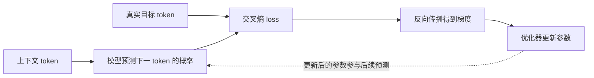

# 第一部分：基础与语言模型

## 本部分路线

这五讲要解开同一个问题：一段文本怎样推动模型参数变化？我们从模型预测下一个 token 开始，看预测和真实 token 的差距怎样变成 loss，再看梯度如何把这个差距传回参数，最后看优化器怎样更新参数。

前两讲都谈概率，回答的问题不同：第 1 讲解释“预测下一个 token”为什么能成为语言模型的训练目标；第 2 讲把这个目标放进训练和生成流程，说明标签怎样错开、训练为什么能并行、生成为什么通常要逐 token 前进。后面三讲再分别看 loss、梯度和优化器。读完后，你应该能把这些词放回同一条训练路径，而不是把它们当成互不相干的名词。

先看这条最小训练路径，五讲会逐步把其中每一步讲清楚：



第 1、2 讲解释模型看到什么、要预测什么；第 3 讲说明 loss 怎样衡量预测；第 4 讲追踪梯度；第 5 讲再看优化器如何更新参数。

本部分每个 Python 代码块都可独立复制到 `.py` 文件中，再用 `python3 文件名.py` 运行；运行环境按代码块前的说明准备。NumPy 和 PyTorch 片段分别标明所需版本、输入 shape 和预期现象；输出中的小数可能因平台浮点实现略有差异。

## 第 1 讲：大模型到底在学什么

### 从一句续写看训练目标

先看一个很普通的上下文：“法国的首都是……”。如果模型需要接着写，它必须给词表里的候选 token 分配分数，再把分数转换成概率。`Paris` 可能排在前面，也可能不是；模型真正输出的是一整个候选分布，而非直接查到一个标准答案。训练时，文本中实际出现的下一个 token 会告诉模型：在这段上下文之后，哪一个候选应该获得更高概率。

这就是自回归语言建模的基本问题：给定已经出现的 token，预测紧接着的 token。这里的 token 不是“词”的同义词。英文 token 可能是完整单词、词根或标点；中文 token 可能对应一个汉字、词的一部分、多个汉字或控制符。具体切分由 tokenizer 决定，所以模型看到的长度、训练吞吐和推理成本都要按 token 计算。

为什么这样的目标值得学？因为文本不是随机符号的堆叠。一个位置后面出现什么，往往同时受语法、含义、上下文事实、文体和任务格式影响。要持续把真实后继 token 预测得更准，模型就有机会从这些规律中获益。例如，“Translate to French:”改变了后续文本的任务形式；“3 个苹果又买了 2 个”提供了算出数量的线索；论文、代码和客服对话则有不同的表达惯例。目标本身只要求预测 token，并没有逐项要求模型先学会“语法”“算术”或“翻译”。这些能力是否出现、能否稳定迁移，还取决于数据、模型表示、训练计算和评估方式。

### 概率分解把整句话变成一串预测

假设 tokenizer 把一句话切成 $x_{1},x_{2},\ldots,x_{T}$。整句概率可以按概率链式法则写成每一步条件概率的乘积：

```math
P(x_{1},x_{2},\ldots,x_{T})
=P(x_{1})P(x_{2}\mid x_{1})P(x_{3}\mid x_{1},x_{2})\cdots P(x_{T}\mid x_{1},\ldots,x_{T-1})
```

GPT 类自回归模型要学的是这些逐步条件概率，通常记作 $P_{\theta}(x_{t}\mid x_{1:t-1})$。下标 $\theta$ 表示概率由模型参数决定； $x_{1:t-1}$ 表示当前 token 之前的整段前缀。训练材料中的每个位置都能提供一个目标：给定前缀，模型应该把真实的下一个 token 排得更靠前。至于怎样把整批预测误差变成一个数，再据此更新参数，我们会在第 3–5 讲逐步展开。

### 一个小语料怎样形成条件概率

只看一个 token 的小模型，就能把“根据上下文预测后继”这件事算出来。下面的例子不是神经网络，而是一个统计二元语言模型（bigram model）。它只根据当前 token 统计下一个 token，适合看清训练目标的最小形状。运行条件是 Python 3.13+，只依赖标准库 `collections`；输入是空白分词后的短文本，输出是经验频率。这里的 `split()` 只是教学切分，不是 BPE 等真实 tokenizer。

```python
from collections import defaultdict, Counter

texts = [
    "I love machine learning",
    "I love deep learning",
    "I love natural language processing",
    "machine learning is powerful",
    "deep learning is powerful",
]

# 统计当前词后面最常出现什么词。
next_token_counts = defaultdict(Counter)

for text in texts:
    tokens = text.split()
    for current_token, next_token in zip(tokens, tokens[1:]):
        next_token_counts[current_token][next_token] += 1


def predict_next(current_token):
    counts = next_token_counts[current_token]
    total = sum(counts.values())
    if total == 0:
        return []
    return [(token, count / total) for token, count in counts.most_common()]


print(predict_next("I"))
print(predict_next("love"))
print(predict_next("learning"))
```
> **代码状态：已验证（2026-10-07；Python 3.13.13；标准库）**

可能输出：

```text
[('love', 1.0)]
[('machine', 0.333...), ('deep', 0.333...), ('natural', 0.333...)]
[('is', 1.0)]
```

令 $c$ 是当前 token， $w$ 是候选后继， $n(c,w)$ 是语料里相邻组合 $(c,w)$ 的次数， $n(c)$ 是有后继 token 的 $c$ 的次数。这个小模型用 $\widehat{P}(w\mid c)=n(c,w)/n(c)$ 估计条件概率。`love` 后面观察到 `machine`、`deep`、`natural` 各一次，所以三者都是 $1/3$。`learning` 有后继的两处都接着 `is`，因此 $\widehat{P}(\text{is}\mid\text{learning})=2/2=1$。如果再加入 `machine learning really works`，计数就变成 `is: 2`、`really: 1`，对应 $2/3$ 和 $1/3$。这个变化很重要：概率是由样本和上下文条件出来的，不是对世界作出的确定断言。

真正的大语言模型会用更长上下文，也会用神经网络参数化概率分布；但它和这个小模型都在回答同一个最小问题：“在当前上下文之后，各种 token 有多可能？”它们的表示能力和规模差得极远，目标的基本形式却可以连续起来理解。

### 模型是在背诵，还是在泛化

这不是二选一。固定短语、重复文本或罕见字符串可能被模型记住；语法、常见事实关系和任务格式则可能以可泛化的模式被学到。实际回答往往混合了记忆、模式归纳、组合和上下文学习，单凭一条流畅回答无法辨明是哪一种机制起主要作用。

假设训练材料里出现过“2 + 3 = 5”，后来模型回答“12 + 37 = ?”时给出 49。这个结果至少不能只用“逐字背下了原题”解释，但它仍不足以证明模型掌握了稳定的符号运算。更好的检验是系统改变数值范围、运算符、表达方式和组合结构，再看未见过的变体是否仍能答对。这样检验的是一组行为，而不是一个漂亮答案。

模型中的知识也不像数据库那样“一条事实对应一个独立格子”。更合适的直觉是：语言关系、写作模式和事实线索由许多参数共同承载，模型可以在新上下文里组合这些模式，但这不等于每条事实都能被稳定取出。输入提示、语言、对话历史和解码方式都可能改变最终概率分布。训练数据质量同样会留下痕迹：如果语料反复包含错误、偏见或冗长的回答模式，预测目标不会自动把它们筛掉。数据记忆和基准污染还可能让熟悉样本上的分数显得很好，因此后面评估时还要看改写、组合和隔离样本上的表现；第 28 讲会具体讨论污染信号的边界。

记忆也不是抽象担忧。Carlini 等人针对 GPT-2 做过黑盒查询实验，在 1,800 个候选中确认了 604 条逐字训练样本；部分字符串只出现在一份训练文档中。不过“一份文档”不等于“训练时只出现一次”，因为同一字符串可能在文档内重复。这个结果说明特定模型和查询流程可能暴露训练内容，不能直接外推到所有模型、数据集或接口。训练数据治理和提取风险分别由[第八册隐私与记忆专题](../../book-08-ai-safety-alignment/chapters/10-privacy-memorization-watermarking.md)和[第九册去重与污染专题](../../book-09-data-engineering/chapters/04-去重与污染检测.md)深入处理。

### 概率不是事实核验

模型给出的 $P_{\theta}(x_{t}\mid x_{1:t-1})$ 是模型在给定参数和上下文时，对下一个 token 的条件分布。它不是“这个事实为真的概率”，也不会自动查验外部证据。常见但错误的说法可能因为在训练材料中反复出现而容易生成；正确但少见的内容则可能不容易排到前面。温度、top-k 和 top-p 可以改变从分布中选择 token 的方式，却不会补上事实证据。

这也说明语言模型和搜索引擎的分工不同。搜索系统寻找并排序已有文档；语言模型根据上下文生成后续 token。RAG 可以把检索到的材料加入上下文，但“检索命中”“引用是否支持结论”“最终回答是否正确”仍是三件需要分别检查的事。类似地，工具调用由模型提出意图和参数，外部执行器才负责查询、计算或操作。[Toolformer](https://arxiv.org/abs/2302.04761)展示过一种让模型学会何时调用 API 并利用返回结果的训练方案；真实系统还必须规定工具权限、协议和结果校验。

预测目标与事实性之间的距离，也是幻觉风险的一部分：模型被训练成在训练分布下提高预测质量，而不是直接为每句话附上真伪证明。分布偏移、训练语料错误、提示缺少证据、解码选择和系统设计都可能参与错误生成，所以不能把幻觉归因于单一原因。评估目标也会影响行为：Kalai 等人 2026 年的研究分析了准确率式评分怎样影响模型在不确定时作答或拒答；结果限于论文所研究的设定，不能推成所有准确率指标都会产生相同影响。[论文](https://www.nature.com/articles/s41586-026-10549-w)；第 28 讲会用一个可复算例子继续讨论。

### 从预训练到可用助手，中间还发生了什么

如果一个模型只接受 next-token 预训练，它学到的是文本分布上的底座倾向。怎样遵循指令、怎样体现人工偏好、怎样拒绝危险请求、怎样使用工具，都可能需要其它训练或运行时机制。这里的几条路线不是每个模型都必经的固定流水线。

监督微调（supervised fine-tuning，SFT）用示范回答训练模型按给定格式和指令作答；instruction tuning 通常是以指令—回答样本为主的 SFT 用法，不是与 SFT 并列的必经阶段。InstructGPT 论文报告过先用示范数据微调、再利用偏好反馈做强化学习的配方，但它是一个具体实例，不是唯一流程。

偏好优化使用“回答 A 比回答 B 更好”一类信号。RLHF 可以通过偏好标注、奖励模型和强化学习更新策略；DPO 则直接从偏好对构造优化目标，不要求完全照搬 InstructGPT 的奖励模型加策略优化流程。[RLHF 的具体案例](https://arxiv.org/abs/2203.02155)和 [DPO 论文](https://arxiv.org/abs/2305.18290)支持理解这两种方法的不同路径，但方法名称本身不能保证有用性、安全性或真实性一定提高。针对数学、代码或拒答等目标，还可以设计专门训练信号；[DeepSeek-R1 报告](https://arxiv.org/abs/2501.12948v2)是特定推理任务上的研究实例，单项结果仍需在预先定义的任务和风险评估中检验。

RAG 和工具通常提供运行时能力。RAG 把检索到的外部资料放入上下文，连接参数化模型与非参数化记忆；原始研究描述了这种组合方式 ([Lewis et al.](https://arxiv.org/abs/2005.11401))。工具则由模型提出调用请求，再由外部执行器实际运行并返回结果。训练可以教模型提出更合适的调用，但工具的可用性、权限和结果可信度仍由系统协议与执行环境决定。把这些环节分开后，就能避免把“模型学会某种倾向”和“产品给它接上某种能力”说成同一回事。

从这里开始，本书会不断沿着同一条路径追问：模型接收了什么表示，训练信号要求它学什么，算法怎样把要求变成参数变化，生成结果又怎样被验证。下一讲先把概率目标与训练、生成的实际顺序接起来，解释为什么训练可以并行，而生成通常要逐 token 进行。

### 练习

1. 用自己的话解释模型为什么会给多个候选 token 分配概率。
2. 用小语料手算 `love` 和 `learning` 后面的经验概率，并说明这个数不能证明什么。
3. 设计两种数值或表述变体，判断一个算术回答是否只是在重复见过的题型。
4. 分别说明 SFT、偏好优化、RAG 和工具调用改变了模型或系统的哪一部分。
5. 将示例 bigram 改成根据前两个 token 统计下一个 token，并指出它仍然无法代表真实大语言模型的哪些能力。

## 第 2 讲：语言模型与 Next-Token Prediction

### 从序列概率到逐 token 预测

上一讲把语言模型看成“给定上下文预测下一个 token”的概率模型。这一讲继续追问两个实际问题：一整句话的概率怎样由逐步预测组成？训练时明明可以一次处理一段文本，为什么生成时却要一步步往前走？

设 token 序列为 $x_{1},x_{2},\ldots,x_{T}$。语言模型要估计整段序列的联合概率。链式法则告诉我们，不需要假设 token 相互独立，也能把联合概率精确分解成逐个条件概率：

```math
P(x_{1},x_{2},\ldots,x_{T})
=P(x_{1})P(x_{2}\mid x_{1})P(x_{3}\mid x_{1},x_{2})\cdots P(x_{T}\mid x_{1},\ldots,x_{T-1})
```

简写为 $P(x_{1},\ldots,x_{T})=\prod_{t=1}^{T}P(x_{t}\mid x_{1:t-1})$。其中 $x_{1:t-1}$ 是当前位置以前的前缀；当 $t=1$ 时，前缀为空，所以 $P(x_{1}\mid\varnothing)=P(x_{1})$。有些格式会在文本前加 BOS（beginning-of-sequence，序列起始）token，此时第一个文本 token 的条件上下文包含 BOS。

我们可以用一组假设值把这次连乘走一遍。假设模型给 `I love machine learning` 的各步概率如下：

| 当前要计入的 token | 给定前缀后的概率 | 到此为止的序列概率 |
| --- | ---: | ---: |
| `I` | $P(I)=0.2$ | $0.2$ |
| `love` | $P(love\mid I)=0.5$ | $0.2\times0.5=0.1$ |
| `machine` | $P(machine\mid I,love)=0.3$ | $0.1\times0.3=0.03$ |
| `learning` | $P(learning\mid I,love,machine)=0.8$ | $0.03\times0.8=0.024$ |

因此，在这组**教学假设**下，四个 token 的序列概率是 $0.024$，也就是 $2.4\%$。每个概率都条件于不同的前缀，所以这不是把四个独立事件相乘。这个例子也没有计入 EOS；如果要给带结束标记的序列计分，还要乘上模型在该前缀后生成 EOS 的条件概率。数字是为演示运算构造的，不是模型实测结果。

这种把当前 token 写成过去 token 条件概率的建模方式，叫自回归建模。GPT 类模型通常从左往右工作：每一步使用已经有的前缀，给所有词表 token 产生分数和概率。训练时，文本本身就提供了真实后继 token，因此无需为每个位置另请人工标注；翻译、问答、代码补全也可以被组织成“读完提示后继续生成”的格式。这个统一目标有利于利用大量文本和批次化训练，但不意味着清理数据、保存样本或提供算力没有成本。

### 同一个目标，训练和生成的计算方式不同

看同一条序列 `I love machine learning`。next-token 训练可以构造出三个预测对：

| 模型能看到的前缀 | 目标 token |
| --- | --- |
| `I` | `love` |
| `I love` | `machine` |
| `I love machine` | `learning` |

真实训练中，模型通常接收 token ID，而不是字符串。对完整序列计算时，第 $t$ 个位置输出 logits（softmax 前、每个词表 token 一个分数），经 softmax 得到概率，再与下一个真实 token 计算损失。因果掩码（causal mask）确保第 $t$ 个位置不能偷看后面的 token。因为整段训练文本已经给定，Transformer 可以并行算出多个位置的预测；概念上每个位置仍在预测“下一个 token”。

推理时没有未来标签。模型先根据当前提示给出下一个 token 的概率，再按解码策略选出一个 token，把它追加到上下文，接着预测下一步。例如 `I love` 后可能有 `machine: 0.30`、`deep: 0.20`、`you: 0.10` 等候选；贪心解码选最高概率的 `machine` 后，下一步条件就变成 `I love machine`。于是生成通常是串行的：下一步输入包含上一步刚生成的结果。

| 计算环节 | 训练 | 生成 |
| --- | --- | --- |
| 历史 token | 通常使用数据中的真实前缀 | 包含模型自己已经生成的 token |
| 未来标签 | 有真实目标 token | 没有；模型需自行选下一 token |
| 位置计算 | 已知序列中的多个位置可并行 | 时间步通常串行推进 |
| 要解决的问题 | 让真实 token 获得较好的预测概率 | 依据解码规则形成一条输出序列 |

训练时用真实前缀作为条件，称为 teacher forcing。它让每个位置都能直接获得目标，也允许模型并行处理已知序列；但训练和推理看到的前缀分布并不完全相同。生成时早期错误会进入后续上下文，可能令错误继续累积，这种差异常被称为暴露偏差（exposure bias）。Bengio 等人在循环神经网络序列预测研究中分析过这一问题，并提出 scheduled sampling，让训练时逐步用模型生成的 token 替换真实前序 token。该论文给出一种研究思路，并不说明它能解决所有 Transformer 生成问题；数据质量、任务难度、解码和上下文长度也会影响错误。[Bengio et al., 2015](https://arxiv.org/abs/1506.03099v3)。

### 输入和标签为什么要错开

最容易在实现中出错的地方，是让第 $t$ 个位置预测错了 token。若输入是 $[x_{1},x_{2},x_{3},x_{4}]$，显式构造时应比较前缀 $[x_{1},x_{2},x_{3}]$ 与目标 $[x_{2},x_{3},x_{4}]$，而不是让 $x_{t}$ 去预测自己。把序列错移一次是任务定义的一部分；漏移可能退化成复制当前位置，移两次则会漏掉应预测的目标。

下面的纯 Python 例子把这层对齐直接打印出来。输入为长度 $T$ 的 token 列表，输出为 $T-1$ 个输入和目标位置；它不负责 batch、padding 或 loss mask。运行条件是 Python 3.13+，无第三方依赖。

```python
tokens = ["I", "love", "machine", "learning"]

input_tokens = tokens[:-1]
label_tokens = tokens[1:]

print("input:", input_tokens)
print("label:", label_tokens)

for context_end in range(1, len(tokens)):
    context = tokens[:context_end]
    target = tokens[context_end]
    print(f"context={context} -> target={target}")
```
> **代码状态：已验证（2026-10-07；Python 3.13.13；标准库）**

输出：

```text
input: ['I', 'love', 'machine']
label: ['love', 'machine', 'learning']
context=['I'] -> target=love
context=['I', 'love'] -> target=machine
context=['I', 'love', 'machine'] -> target=learning
```

序列长度小于 2 时没有有效预测对，训练管线不能对空目标直接求平均损失。

同一批数据在不同模型接口中可能有两种写法。假设序列 ID 是 $[10,20,30,40]$，由调用方显式右移时，输入 $[10,20,30]$ 对应目标 $[20,30,40]$：

| 输出位置 | 可见前缀 | 该位置的目标 |
| ---: | --- | ---: |
| 0 | $[10]$ | `20` |
| 1 | $[10,20]$ | `30` |
| 2 | $[10,20,30]$ | `40` |

另一些接口把完整的 $[10,20,30,40]$ 同时作为 `input_ids` 和 `labels`，由模型内部对齐；它等价于比较 `logits[:, :-1, :]` 与 `labels[:, 1:]`。以 Hugging Face Transformers v5.17.0 为例，因果语言建模教程说明了右移目标；固定版本的 data collator 将 `input_ids` 复制为 labels 并屏蔽 padding，GPT-2 causal LM 头在模型内部处理移位。[教程](https://huggingface.co/docs/transformers/v5.17.0/tasks/language_modeling)、[data collator 源码](https://github.com/huggingface/transformers/blob/v5.17.0/src/transformers/data/data_collator.py#L3414-L3422)、[GPT-2 causal LM 源码](https://github.com/huggingface/transformers/blob/v5.17.0/src/transformers/models/gpt2/modeling_gpt2.py#L3248-L3253)。这是特定版本和模型头的例子，其他接口可能要求调用方显式移位。判断时应查看当前 loss 契约，确保目标恰好右移一次。

### 从一行序列到一个训练 batch

若一个 batch 有 $B$ 条序列，每条补齐到长度 $T$，词表大小为 $V$，常见张量形状为：`input_ids` 对应 $B\times T$，`logits` 对应 $B\times T\times V$，`labels` 对应 $B\times T$。每个 `logits` 位置都包含 $V$ 个词表分数。形状本身不会说明哪些位置应该计入损失；padding、prompt 和任务目标都可能需要 mask（掩码）。

尤其要把“想训练什么”与“哪些位置算 loss”放在一起检查。对只监督 assistant 回答的 SFT，system/user 区域通常要屏蔽；对整段对话语言建模，把这些位置计入损失也可能是有意设计。不能把“prompt 永远不算 loss”当成通用规律。

因果掩码、标签对齐和 loss mask 各自处理不同问题：因果掩码控制位置能看见哪些 token；标签对齐决定这个位置要预测哪个 token；loss mask 决定哪些预测参与目标函数。padding 要从有效目标中排除，EOS 则负责学习何时结束。若一个数据管线让 EOS 和 padding 共用同一 ID，按 token ID 屏蔽 padding 的逻辑就可能同时屏蔽真实 EOS 目标。Hugging Face Transformers v5.17.0 的教程示例采用 pad token 等于 EOS，而该版本 collator 按 token ID 屏蔽 labels；两者组合可推出这一配置风险，但不能外推到所有管线。[教程](https://huggingface.co/docs/transformers/v5.17.0/tasks/language_modeling)、[collator 源码](https://github.com/huggingface/transformers/blob/v5.17.0/src/transformers/data/data_collator.py#L3414-L3422)。

对话数据还要经过聊天模板（chat template），把 system、user、assistant、tool 角色和轮次边界转换为 token。训练和推理若采用不兼容模板，模型接收到的角色标记和停止边界就不同；同一基础模型的不同微调版本也可能采用不同格式。Transformers v5.17.0 文档用 Mistral 与 Zephyr 展示了这种差异，并提醒重复添加 BOS/EOS 特殊 token 可能造成问题。[Chat templates 文档](https://huggingface.co/docs/transformers/v5.17.0/chat_templating)。停止条件也不只是最大 token 数，还可能包含 EOS、结构化输出结束标志和工具调用交接。

因此，训练样本出问题时，不要先盯着总 loss 猜原因。先取一个很短的样本，逐位置打印 `input_ids`、`labels`、attention mask 和 loss mask；核对第 $t$ 个输出预测的是不是第 $t+1$ 个 token；再固定前缀，只改目标之后的内容，保持长度、位置和 mask 不变，关闭 dropout 并禁用 KV cache，比较前缀位置的 logits。若这些 logits 随未来 token 改变，就要检查因果掩码或其它泄漏路径。最后检查 padding、EOS 和任务对应的 prompt mask。训练曲线只有在这些数据约定成立后才容易解释。

Next-token prediction 的长处是监督信号可从文本中直接得到、目标统一且与逐步生成衔接；它的边界也从这里显现：它不直接给出真实性、有用性或安全性的标准，推理时的历史又由模型自己生成。问答、翻译和代码生成可以写成文本续写，不代表所有任务的评估目标都相同。下一讲会从真实 token 的预测概率出发，推导损失怎样给这些预测打分。

### 练习

1. 将 $P(x_{1},x_{2},x_{3},x_{4})$ 写成自回归分解，并说明 $t=1$ 时前缀是什么。
2. 对 $[10,20,30,40]$ 写出三个输入—目标位置，并分别说明调用方移位和模型内部移位的区别。
3. 用自己的话解释 teacher forcing 为什么让训练更容易并行，又为什么会与生成时的条件不同。
4. 设计一个检查，判断前缀位置是否偷看了未来 token；说明哪些条件必须固定。
5. 解释 padding、EOS、prompt loss mask 和 chat template 各自控制什么。

## 第 3 讲：交叉熵、最大似然与困惑度

### 让预测误差变成可优化的量

前两节已经给出了 GPT 类语言模型的目标 $P(x_{t} \mid x_{1:t-1})$。接下来的问题是：模型如何把“这次预测得好不好”变成一个可以反向传播的数值？交叉熵、最大似然和困惑度正好构成这条桥梁。

本节先从单个真实 token 的概率出发，再推到整个序列和整个数据集的损失，解释交叉熵与 KL 散度的关系，并说明为什么一个更低的 loss 仍然不能直接代表事实性、代码正确性或用户体验。

### 从一个真实 token 的概率开始

语言模型在每个位置输出的是一个概率分布。

例如上下文是：

```text
The capital of France is
```

模型可能输出：

```text
Paris      0.70
London     0.05
Berlin     0.03
city       0.02
...
```

如果真实下一个 token 是 `Paris`，这个预测就比较好。

如果模型输出：

```text
Paris      0.01
London     0.50
Berlin     0.20
...
```

那预测就很差。

训练需要一个数字来衡量“模型给真实 token 的概率有多高”。这个数字就是 loss。

### 损失函数在训练系统中的位置

这里的 loss 不是一个抽象的“好坏分数”，而是把每个真实 token 的预测概率转换成可优化的数。先弄清单个 token 为什么得到某个惩罚，再把这些惩罚加总或平均，就能看到交叉熵如何连接最大似然训练、为什么会出现 perplexity，以及这些量能够支持哪些结论。SFT 仍可使用这种 token-level 目标；偏好方法则加入了另一种训练信号。两类目标的差异会在后面的对齐章节展开。

### 交叉熵的直觉

交叉熵把“模型给真实 token 的概率有多高”变成一个惩罚值：概率越低，惩罚越大。

如果真实 token 是 `Paris`：

```math
\begin{aligned}
\mathrm{Model\ A}:\quad &P(\mathrm{Paris})=0.8\\
\mathrm{Model\ B}:\quad &P(\mathrm{Paris})=0.01
\end{aligned}
```

模型 A 应该 loss 小，模型 B 应该 loss 大。

交叉熵对单个样本的形式是：

```math
L=-\log P(y)
```

这里 $y$ 表示真实下一个 token。模型给 $y$ 的概率越高， $-\log P(y)$ 越小。

例如使用自然对数：

```math
\begin{aligned}
P=1.0 &\Rightarrow -\log(P)=0\\
P=0.5 &\Rightarrow -\log(P)\approx 0.693\\
P=0.1 &\Rightarrow -\log(P)\approx 2.303\\
P=0.01 &\Rightarrow -\log(P)\approx 4.605
\end{aligned}
```

所以交叉熵非常直接：真实 token 概率越低，惩罚越重。

实际框架通常从未归一化的 logits 直接稳定地计算 log-softmax 与负对数似然，不要求调用方先把 logits 手动变成概率；PyTorch v2.14 的 `CrossEntropyLoss` 文档也明确其输入为未归一化 logits，并说明 `ignore_index` 与 reduction 的计算约定。[PyTorch CrossEntropyLoss 文档（v2.14）](https://docs.pytorch.org/docs/2.14/generated/torch.nn.CrossEntropyLoss.html)。

### 从最大似然理解语言模型训练

把训练集记作 $\mathcal{D}=\{x^{(i)}\}_{i=1}^{N}$，模型参数记为 $\theta$。在常见的 token-level 最大似然目标中，我们希望各条训练序列的似然乘积尽可能大：

```math
\max_{\theta} P_{\theta}(\mathcal{D})=\max_{\theta}\prod_{i=1}^{N}P_{\theta}(x^{(i)})
```

这里把每条序列当作训练目标中的一个样本因子；单条序列内部的 token 仍按自回归条件概率分解，并不假设 token 彼此独立。

对一个 token 序列：

```math
x_{1},x_{2},\ldots,x_{T}
```

自回归分解为：

```math
P_{\theta}(x_{1},\ldots,x_{T})=\prod_{t=1}^{T}P_{\theta}(x_{t}\mid x_{1:t-1})
```

最大化整个序列概率，等价于最大化所有位置真实 token 的条件概率乘积。

但很多概率相乘会非常小，计算不稳定。所以通常取 log：

```math
\log P_{\theta}(x_{1},\ldots,x_{T})=\sum_{t=1}^{T}\log P_{\theta}(x_{t}\mid x_{1:t-1})
```

最大化 log likelihood 等价于最小化 negative log likelihood：

```math
\mathrm{NLL}=-\sum_{t=1}^{T}\log P_{\theta}(x_{t}\mid x_{1:t-1})
```

这就是语言模型训练 loss 的来源。

平均到每个 token 上：

```math
L=-\frac{1}{T}\sum_{t=1}^{T}\log P_{\theta}(x_{t}\mid x_{1:t-1})
```

这个平均负对数似然在 one-hot（独热）标签下就是交叉熵。用三步序列做一组可复算的例子：假设模型对三个真实 token 的条件概率依次是 $0.8$、 $0.5$ 和 $0.1$。它们是教学假设值，不是实测模型数据。

| 真实 token 位置 | 假设的条件概率 | 该位置的负对数损失（nats） |
| ---: | ---: | ---: |
| 1 | $0.8$ | $-\ln(0.8)\approx0.2231$ |
| 2 | $0.5$ | $-\ln(0.5)\approx0.6931$ |
| 3 | $0.1$ | $-\ln(0.1)\approx2.3026$ |

序列似然是 $0.8\times0.5\times0.1=0.04$，负对数似然是 $-\ln(0.04)\approx3.2189$，与三个位置的损失之和一致。若按 token 平均， $L=3.2189/3\approx1.0730$ nats；下文会将这个平均损失换算为 perplexity。低概率的第三个 token 单独贡献约 $2.3026$ nats，说明少数难预测位置可以显著抬高平均损失。

### 交叉熵是什么

交叉熵衡量的是：用模型预测分布 $q$ 去表示真实分布 $p$ 时，平均需要多少代价。

公式：

```math
H(p,q)=-\sum_{x} p(x)\log q(x)
```

在分类任务中，真实标签通常是 one-hot 分布。

例如词表有 4 个 token，真实 token 是第 2 个：

```math
p=[0,1,0,0]
```

模型预测：

```math
q=[0.1,0.7,0.1,0.1]
```

交叉熵：

```math
H(p,q)=-\log(0.7)
```

因为 one-hot 分布只有真实类别那一项为 1，其他项为 0。

所以语言模型中，交叉熵就是：

```math
-\log P(y)
```

这里 $y$ 仍然表示真实下一个 token。

沿用上面的 one-hot 例子，若 $p=[0,1,0,0]$、 $q=[0.1,0.7,0.1,0.1]$，则
$H(p,q)=-(0\ln0.1+1\ln0.7+0\ln0.1+0\ln0.1)=-\ln0.7\approx0.3567$ nats。只有真实类别对应的那一项留下来；如果模型只给真实类别 $0.01$ 的概率，损失就变成 $-\ln0.01\approx4.6052$ nats。

### 交叉熵和 KL 散度的关系

KL 散度（Kullback–Leibler divergence）衡量两个分布的差异：

```math
\mathrm{KL}(p\Vert q)=\sum_{x} p(x)\log\frac{p(x)}{q(x)}
```

它可以写成：

```math
\mathrm{KL}(p\Vert q)=H(p,q)-H(p)
```

其中 $H(p,q)$ 是交叉熵， $H(p)$ 是数据分布自身的熵。

对于固定训练数据，真实分布 $p$ 不随模型参数变化，所以 $H(p)$ 是常数。

因此最小化交叉熵等价于最小化 KL 散度：

```math
\min H(p,q) \Longleftrightarrow \min \mathrm{KL}(p\Vert q)
```

直觉上，训练语言模型就是让模型分布 $q$ 尽量接近数据分布 $p$。

这里的 $\mathrm{KL}(p\Vert q)$ 不是对称距离；交换 $p$ 和 $q$ 通常会得到不同数值。公式说明的是在数据分布固定时，模型依赖的那部分交叉熵与 KL 优化方向相同，不代表两种度量在所有问题中可互换。

### Perplexity 是什么

Perplexity 通常翻译为困惑度，用来衡量自回归语言模型对一段文本的 token 预测有多“不确定”。它是指定 tokenization、上下文窗口和有效目标位置下的平均负对数似然变换，不是与评估设置无关的固有常数。

如果平均交叉熵 loss 使用自然对数，那么：

```math
\mathrm{PPL}=\exp(L)
```

这个定义直接用于自回归/因果语言模型；对 BERT 这类双向掩码语言模型（masked language model），不能把同一左到右联合概率直接代入并称为标准 perplexity。固定上下文长度时，长文本中较晚 token 的条件概率只能基于窗口内可见前缀；若评估时切成互不重叠的短块，许多预测会少用可用上下文，得到的 PPL 会受切块方案影响。评估应明确窗口长度、stride（窗口每次移动的 token 步长）、tokenizer 和计入 loss 的目标位置，并避免重复计数上下文 token。[Hugging Face 的固定长度模型 PPL 说明](https://huggingface.co/docs/transformers/perplexity)展示了滑动窗口的折中方案及其对 PPL 的影响。

例如上下文窗口最多容纳 3 个 token，要评分的目标是 $x_{5}$。在互不重叠的块 $[x_{4},x_{5},x_{6}]$ 中，模型预测 $x_{5}$ 时只能用到 $[x_{4}]$；滑动窗口则可把 $[x_{2},x_{3},x_{4}]$ 作为前缀来预测同一个 $x_{5}$。两种评估给目标 token 的可见上下文不同，因此所得 loss 不应在未说明窗口策略时直接比较。

若每个位置都在 $K$ 个候选 token 上均匀分配概率，则平均 loss 是 $\ln K$，PPL 正好是 $K$。真实模型的分布通常不均匀，所以可以把 PPL 当作一种有效分支数直觉，而不能把它当成真实候选 token 的计数。

如果：

```math
\begin{aligned}
L&=0\\
\mathrm{PPL}&=\exp(0)=1
\end{aligned}
```

表示模型完全确定真实 token。

如果：

```math
\begin{aligned}
L&=2.3\\
\mathrm{PPL}&\approx 10
\end{aligned}
```

粗略理解为模型平均像是在 10 个候选 token 中犹豫。

回到上面的三步例子，平均负对数似然约为 $1.0730$ nats，因此 $\mathrm{PPL}=\exp(1.0730)\approx2.9240$。这只是该组假设条件概率下的教学计算，不代表模型在任意语料上的实际困惑度。

### 一个最小代码例子（第 3 讲）

下面用纯 Python 实现单个样本的 softmax 和 cross entropy。运行条件是 Python 3.13+、只依赖标准库 `math`；`logits` 是长度为词表大小 $V$ 的有限实数列表，`target_index` 是 $[0,V)$ 内的整数。输出是词表概率和以自然对数计量的单 token loss（单位为 nats）。代码先通过 log-sum-exp 计算归一化常数，再按 $\ln\sum_{i=1}^{V}e^{z_{i}}-z_{y}$ 求目标负对数概率，其中 $z_{i}$ 是第 $i$ 个类别的 logit， $y$ 是目标类别索引；这与交叉熵公式一致，同时避免先求一个可能下溢为零的 softmax 概率再取对数。

```python
import math


def logsumexp(logits):
    if not logits:
        raise ValueError("logits must contain at least one value")
    if any(not math.isfinite(value) for value in logits):
        raise ValueError("logits must be finite")
    max_logit = max(logits)
    return max_logit + math.log(math.fsum(math.exp(x - max_logit) for x in logits))


def softmax(logits):
    log_z = logsumexp(logits)
    return [math.exp(value - log_z) for value in logits]


def cross_entropy(logits, target_index):
    if isinstance(target_index, bool) or not isinstance(target_index, int):
        raise TypeError("target_index must be an integer")
    if target_index < 0 or target_index >= len(logits):
        raise ValueError("target_index is outside the vocabulary")
    log_z = logsumexp(logits)
    # 直接用 log-softmax 计算，避免很小的目标概率先下溢为 0。
    return log_z - logits[target_index]


# 假设词表有 4 个 token，真实 token 是 index=1。
logits_good = [0.1, 3.0, 0.2, -1.0]
logits_bad = [3.0, 0.1, 0.2, -1.0]

print("good probs:", softmax(logits_good))
print("good loss:", cross_entropy(logits_good, 1))

print("bad probs:", softmax(logits_bad))
print("bad loss:", cross_entropy(logits_bad, 1))
```
> **代码状态：已验证（2026-10-07；Python 3.13.13；标准库）**


预期结果中，good logits 的目标概率约为 `0.881718`、loss 约为 `0.125883`；bad logits 的目标概率约为 `0.048515`、loss 约为 `3.025883`。这个例子展示：当模型给真实 token 更高 logit 时，cross entropy 更低。直接由 log-sum-exp 计算 loss，即使 softmax 中某个非目标概率下溢为 0，也不会先对 0 取对数。

可以手算 good 这一行核对实现。logits 是 $[0.1,3.0,0.2,-1.0]$，目标索引为 `1`，最大 logit 是 `3.0`；减去最大值后得到 $[-2.9,0,-2.8,-4.0]$，指数和约为 $e^{-2.9}+1+e^{-2.8}+e^{-4}=1.134149$。因此目标概率是 $1/1.134149\approx0.881718$，loss 为 $-\ln(0.881718)\approx0.125883$ nats。bad 行把最高 logit 放在错误类别，真实目标概率降为约 `0.048515`，相应 loss 升到约 `3.025883` nats；代码输出与手算的趋势和数值相符。

### 用 NumPy 计算一批 token 的交叉熵

上面的例子只处理一个样本。真实语言模型训练时，通常一次处理一个 batch，并对所有有效 token 的 loss 求平均。下面代码适用于 Python 3.13+ 和 NumPy 2.4.6；输入的 `logits` shape 为 `[B,T,V]`、`labels` shape 为 `[B,T]`，输出是有效位置的平均 loss 和逐 token loss。这个 helper 假设 `logits[b,t,:]` 已经对齐到 `labels[b,t]`，它本身不会替 causal LM 做右移；若输入来自未移位的整段序列，应按具体模型的 loss 契约先对齐预测位置和目标。PyTorch v2.14 文档也说明常见交叉熵接口接收未归一化 logits，忽略 `ignore_index` 后再按有效目标约定聚合。[PyTorch CrossEntropyLoss 文档（v2.14）](https://docs.pytorch.org/docs/2.14/generated/torch.nn.CrossEntropyLoss.html)。

下面这个 NumPy demo 演示三件事：

1. logits 如何变成概率。
2. 如何取出每个位置真实 label 的概率。
3. padding 位置如何通过 mask 排除。

```python
import numpy as np


def log_softmax(logits):
    # logits: [N, V]
    logits = np.asarray(logits)
    if logits.ndim < 1 or logits.shape[-1] == 0:
        raise ValueError("logits must have a non-empty vocabulary dimension")
    if not np.issubdtype(logits.dtype, np.number) or np.issubdtype(logits.dtype, np.complexfloating):
        raise TypeError("logits must be real numeric values")
    # 转成有符号浮点，避免 unsigned integer 减去最大值时发生下溢。
    logits = logits.astype(np.float64, copy=False)
    if not np.all(np.isfinite(logits)):
        raise ValueError("logits must be finite")
    shifted = logits - logits.max(axis=-1, keepdims=True)
    log_probs = shifted - np.log(np.exp(shifted).sum(axis=-1, keepdims=True))
    return log_probs


def masked_cross_entropy(logits, labels, ignore_index=-100):
    # logits: [B, T, V]
    # labels: [B, T]
    logits = np.asarray(logits)
    labels = np.asarray(labels)
    if logits.ndim != 3 or labels.ndim != 2 or labels.shape != logits.shape[:2]:
        raise ValueError("expected logits [B, T, V] and labels [B, T]")
    if isinstance(ignore_index, bool) or not isinstance(ignore_index, (int, np.integer)):
        raise TypeError("ignore_index must be an integer")
    if not np.issubdtype(labels.dtype, np.integer):
        raise TypeError("labels must use an integer dtype")
    batch_size, seq_len, vocab_size = logits.shape
    flat_logits = logits.reshape(batch_size * seq_len, vocab_size)
    flat_labels = labels.reshape(batch_size * seq_len)

    valid = flat_labels != ignore_index
    valid_logits = flat_logits[valid]
    valid_labels = flat_labels[valid]

    if valid_labels.size == 0:
        raise ValueError("at least one label must contribute to the loss")
    if np.any((valid_labels < 0) | (valid_labels >= vocab_size)):
        raise ValueError("a valid label is outside the vocabulary")

    log_probs = log_softmax(valid_logits)
    token_losses = -log_probs[np.arange(len(valid_labels)), valid_labels]
    return token_losses.mean(), token_losses


# B=2, T=3, V=4。假设第 2 个样本最后一个位置是 padding，不参与 loss。
logits = np.array([
    [[2.0, 0.1, 0.0, -1.0], [0.0, 2.0, 0.1, -1.0], [0.2, 0.0, 2.0, -1.0]],
    [[0.1, 0.2, 0.3, 2.0], [2.0, 0.0, 0.1, -1.0], [0.0, 0.0, 0.0, 0.0]],
])
labels = np.array([
    [0, 1, 2],
    [3, 0, -100],
])

mean_loss, token_losses = masked_cross_entropy(logits, labels)
print("token losses:", token_losses)
print("mean loss:", mean_loss)
print("perplexity:", np.exp(mean_loss))
```
> **代码状态：已验证（2026-10-07；Python 3.13.13；NumPy 2.4.6）**


这个例子里的 `ignore_index=-100` 是常见的忽略标签约定；具体框架和数据管线可能用不同 sentinel。padding 或不希望监督的 prompt 区域可以排除，但应由任务定义决定哪些 token 参与 loss。全 batch 都被忽略、标签越界、shape 不匹配和非有限 logits 都会显式报错，不会生成一个看似有效的 loss。

按上面五个有效位置计算，逐 token loss 约为 $[0.2887,0.2887,0.3004,0.4038,0.2887]$，平均 loss 约为 $0.3141$，perplexity 约为 $1.3690$。被 `ignore_index` 标记的第六个位置不进入分子或分母。

### 批量 token 的 loss 怎么算

真实语言模型训练时，loss 通常对 batch 和 sequence 里的有效 token 求平均。

假设：

```text
logits shape: [B, T, V]
labels shape: [B, T]
```

其中：

```text
B = batch size
T = sequence length
V = vocab size
```

每个位置 `(b, t)` 都有一个真实 label：

```text
labels[b, t]
```

模型在该位置输出：

```text
logits[b, t, :]
```

loss 是所有有效位置的平均：

```math
L=\mathrm{mean}_{(b,t)\in\mathcal{M}}\left[-\log P(y_{b,t}\mid x_{b,1:t-1})\right]
```

这里 $\mathcal{M}$ 表示所有有效 token 位置的集合， $y_{b,t}$ 表示第 $b$ 个样本第 $t$ 个位置的训练标签， $x_{b,1:t-1}$ 表示它之前的上下文。这个平均只有在 $|\mathcal{M}|>0$ 时才有定义；如果一个 batch 的所有位置都被 mask，正确行为是报告数据或 mask 配置错误，而不是把空集合的平均值当成有效 loss。

这里“有效位置”很重要。在 SFT 或 padding 场景中，某些位置不应该计入 loss，通常用 `ignore_index = -100` 表示。

### 一个 loss 数字究竟能说明什么

交叉熵来自一个清楚的目标，但汇总后的 loss 只对它实际看到的 token、mask、数据分布和聚合方式负责。若 padding 被计入，模型会被要求学习无意义的 PAD；若 SFT 只打算监督 assistant 回答，prompt 区域却意外参与损失，训练目标就与原计划不同。反过来，整段对话建模时把 prompt 计入也可能是有意选择。需要核对的是目标和 mask 是否一致，而不是背下一条“prompt 一律屏蔽”的规则。

即使 token 都对齐，平均数也会隐藏局部变化。长回答贡献更多 token，常见叙述会淹没数字、否定词、代码边界或稀有实体上的退化。一个模型可能在普通文本上变好、在数学或安全切片上变差，而总体 loss 仍然下降。比较训练结果时，可以按文本/代码/数学、短/长上下文、高频/稀有 token、prompt/assistant/tool 等区域，以及时间或难度切分来观察。若 benchmark 或验证集混入训练数据，loss 和 PPL 还可能因为记忆或模板匹配而显得过于乐观。

PPL（perplexity，困惑度）是平均自然对数 loss 的指数。它能概括模型对指定序列的平均预测不确定性；若所有评估目标的概率都为 1，则 $L=0$、PPL 为 1。把 PPL 理解成“模型平均在多少个真实候选中犹豫”只是一种直觉，真实分布通常并不均匀。不同 tokenizer、上下文窗口、stride、有效 token 定义或平均方式会改变数字，所以跨设置比较前必须先对齐口径。前文的滑动窗口例子说明，同一个目标 token 因为可见前缀不同，loss 也会不同。

要判断 loss 下降有没有带来实际收益，需要把预测层和任务层连起来看：先核对 token loss/PPL、mask 和重要切片；再看代码测试、数学答案、格式、引用支持和拒答等行为；最后检查端到端系统是否完成任务，以及延迟、成本和安全副作用。若 token 指标变好而任务表现不变，数据和任务可能没有对齐；若任务改善却总 loss 不动，关键切片可能被平均值掩盖；若答案变好但系统成本明显上升，产品层仍要权衡。不同训练 run 还应记录 tokenizer、有效 token、batch、数据顺序、mask、数值精度、聚合方式和 checkpoint 状态，避免把实验口径差异误判为模型提升。

因此，交叉熵适合做预训练和 SFT 的优化信号，也适合衡量指定数据上的 token 预测；它本身不直接优化人类偏好、事实正确性或安全性。后续训练和任务评估会补充不同目标，但它们需要独立的证据，不能从一个 loss 数字里推出来。

### 练习

1. 如果真实 token 概率是 0.8，计算单 token loss。
2. 如果平均 loss 是 2.0，计算 perplexity。
3. 用自己的话解释最大似然和交叉熵的关系。
4. 解释为什么 SFT 中通常只对 assistant 回答部分计算 loss。
5. 修改上面的代码，让它支持一批 logits 和 labels，并返回平均 cross entropy。

### 收束：把概率误差交给优化器

序列似然把逐 token 概率连在一起；取负对数后，乘法变成可相加的 token 损失；在 one-hot 目标下，交叉熵就是真实 token 的负对数概率；固定数据分布时，最小化交叉熵与最小化 KL 在优化方向上等价；对平均自然对数损失取指数，就得到 PPL。每一步都来自前一步，但它们回答的问题并不相同。loss 说明模型怎样拟合指定数据，PPL 是这个预测误差的另一种刻度，任务评估才检查模型是否完成真实使用中的要求。

下一讲开始看这个误差怎样对参数提供方向信息：梯度为什么能把一个标量损失转成许多参数的更新信号。

## 第 4 讲：反向传播与梯度下降

### 从损失到参数更新

交叉熵给出了一个可以比较的损失数值，但损失本身不会自动改变模型。参数更新需要知道每个参数对损失的局部影响，再沿着能够降低损失的方向移动。梯度下降、链式法则和反向传播正是把这件事变成可计算过程的三层机制。

本节从一个只有单个参数的函数开始，逐步过渡到深层网络和语言模型训练，并把梯度消失、梯度爆炸、混合精度和训练不收敛放回同一条诊断链上。

### 先看一个参数怎样更新

第 3 讲把预测质量变成了一个 loss。可这个数只告诉我们“这次错得有多重”，还没告诉模型该改哪一个参数、改多少。先用一个只有单个参数的例子把这一步走出来。

假设只有一个参数 $w$，loss 是：

```math
L(w)=(w-3)^2
```

这个函数在 $w=3$ 时最小。

它的梯度是：

```math
\frac{dL}{dw}=2(w-3)
```

从 $w=0$ 开始时，

```math
\frac{dL}{dw}=-6
```

梯度是负数，说明在当前位置把 $w$ 调大，loss 会下降。梯度下降沿着这个方向更新：

```math
w_{\mathrm{new}}=w-\eta\frac{dL}{dw}
```

因为 gradient 是负数，所以 $w$ 会变大，向 3 靠近。

取学习率 $\eta=0.1$，第一步从 $w_{0}=0$ 出发，梯度为 $-6$，于是 $w_{1}=0-0.1(-6)=0.6$；损失从 $L(w_{0})=9$ 降到 $L(w_{1})=5.76$。这组数值把“负梯度方向”具体化：更新后的 loss 要用新参数重新计算，不能把旧 loss 和新参数并排当成同一状态。

### 梯度下降公式

对参数 $\theta$，梯度下降更新为：

```math
\theta_{\mathrm{new}}=\theta_{\mathrm{old}}-\eta\nabla_{\theta} L
```

其中：

```text
η 是 learning rate
∇_θ L 是 loss 对参数的梯度
```

学习率（learning rate）决定每次沿梯度方向走多远。

如果太大：

1. 可能越过最优点。
2. loss 震荡。
3. 训练发散。
4. 甚至出现 NaN。

如果太小：

1. 训练很慢。
2. loss 下降不明显。
3. 在有限训练预算内模型学不充分。

对当前的一维函数 $L(w)=(w-3)^2$，可以直接推出学习率的稳定范围。更新后误差满足 $w_{t+1}-3=(1-2\eta)(w_{t}-3)$；误差收缩需要 $|1-2\eta|<1$，所以 $0<\eta<1$。当 $\eta=0.05$ 时每步误差乘 $0.9$，因此慢慢接近 3； $\eta=0.5$ 时乘数为 0，一步到达最小点； $\eta=1.1$ 时乘数为 $-1.2$，误差符号交替且绝对值变大。这个稳定区间只针对本例的二次函数，不能拿来设定大模型的学习率。

### 反向传播解决什么问题

神经网络把很多函数一层层接起来。可以先写成：

```text
input -> layer1 -> layer2 -> layer3 -> loss
```

每一层都有参数。我们需要知道 loss 对每个参数的梯度。

如果逐个参数手动求导，很快就会变得繁琐。反向传播利用链式法则，从 loss 出发沿计算图往回算，得到每个参数对 loss 的梯度；优化器再用这些梯度更新参数。

### 链式法则直觉

假设：

```math
\begin{aligned}
y&=f(z)\\
z&=g(w)
\end{aligned}
```

那么：

```math
\frac{dy}{dw}=\frac{dy}{dz}\frac{dz}{dw}
```

神经网络中每一层都是类似关系。反向传播就是把这些局部梯度乘起来。

例如：

```text
w -> z -> y -> loss
```

要计算：

```math
\frac{dL}{dw}
```

可以拆成：

```math
\frac{dL}{dw}
=\frac{dL}{dy}\frac{dy}{dz}\frac{dz}{dw}
```

用具体数字把局部导数相乘：令 $z=2w+1$、 $L=(z-3)^2$，从 $w=0$ 开始。前向计算得到 $z=1$、 $L=4$；反向计算得到 $\frac{dL}{dz}=2(z-3)=-4$、 $\frac{dz}{dw}=2$，因此 $\frac{dL}{dw}=(-4)\times2=-8$。若学习率 $\eta=0.1$，更新后 $w=0-0.1(-8)=0.8$，于是 $z=2.6$、新损失 $L=(2.6-3)^2=0.16$。前向阶段计算中间状态，反向阶段把局部导数按链式法则相乘，更新阶段再用梯度改变参数；三个步骤各自回答不同问题。

这种按局部导数把误差信号传回内部参数的做法构成多层网络反向传播的重要机制。Rumelhart、Hinton 和 Williams 1986 年的论文讨论了它如何调整连接权重以降低输出误差，并指出隐藏单元可以形成对任务有用的表示；它是这一技术谱系中的代表性工作，不能据此断言反向传播由该文首创。现代框架使用自动微分（automatic differentiation）记录实际执行的运算；PyTorch 的 autograd 在前向时建立计算图，再沿图反向应用链式法则计算梯度。[Rumelhart et al., 1986](https://www.nature.com/articles/323533a0)；[PyTorch Autograd mechanics（v2.14）](https://docs.pytorch.org/docs/2.14/notes/autograd.html)。

### 一个最小代码例子（第 4 讲）

下面用纯 Python 手写一个最简单的梯度下降。目标是让参数 $w$ 接近 3。运行条件是 Python 3.13+、无第三方依赖；输入为标量参数、学习率和步数，输出每步更新前后的参数与更新后损失。

```python
def loss_fn(w):
    return (w - 3) ** 2


def grad_fn(w):
    return 2 * (w - 3)


w = 0.0
lr = 0.1

for step in range(5):
    w_before = w
    grad = grad_fn(w_before)
    w = w_before - lr * grad
    loss_after = loss_fn(w)
    print(
        f"step={step}, w_before={w_before:.4f}, grad={grad:.4f}, "
        f"w_after={w:.4f}, loss_after={loss_after:.4f}"
    )
```
> **代码状态：已验证（2026-10-07；Python 3.13.13；标准库）**


前两步分别是 $0\to0.6$、 $0.6\to1.08$，更新后损失分别为 `5.76` 和 `3.6864`。打印的 `w_after` 与 `loss_after` 来自同一组参数，避免把更新前 loss 错配到更新后参数。

这就是训练神经网络的基本思想，只是大模型有海量参数和复杂计算图。

### 用 NumPy 对比不同学习率

学习率太小会很慢，太大可能震荡甚至发散。下面的 demo 用同一个简单函数比较三种学习率。运行条件是 Python 3.13+ 和 NumPy 2.4.6；每组输入为一个有限非负学习率和 12 步更新，输出 12 条 `(step, w, loss, grad)` 记录。 $1.1$ 对这个二次函数超过稳定区间，展示的是发散反例，不是推荐配置。

```python
import numpy as np


def run_gradient_descent(lr, steps=12):
    if isinstance(steps, bool) or not isinstance(steps, int) or steps < 1:
        raise ValueError("steps must be a positive integer")
    if not np.isfinite(lr) or lr < 0:
        raise ValueError("lr must be finite and non-negative")
    w = 0.0
    history = []
    for step in range(steps):
        loss = (w - 3.0) ** 2
        grad = 2.0 * (w - 3.0)
        history.append((step, w, loss, grad))
        w = w - lr * grad
    return history, w


for lr in [0.05, 0.5, 1.1]:
    print(f"\nlearning rate = {lr}")
    history, final_w = run_gradient_descent(lr)
    for step, w, loss, grad in history:
        print(f"step={step:02d}, w={w:7.3f}, loss={loss:8.3f}, grad={grad:7.3f}")
    print(f"after 12 updates: w={final_w:.4f}, loss={(final_w - 3.0) ** 2:.4f}")
```
> **代码状态：已验证（2026-10-07；Python 3.13.13；NumPy 2.4.6）**


这里能直接看到步长的影响： $0.05$ 走得慢， $0.5$ 一步到达最小点， $1.1$ 则越过最小点后越走越远。这个玩具函数不能替大模型选学习率；它只说明步长过大可能发散，真实训练还要结合架构、优化器和训练阶段观察更新是否稳定。

12 步更新后， $\eta=0.05$ 得到 $w\approx2.1527$、 $L\approx0.7179$； $\eta=0.5$ 一步到达 $w=3$、 $L=0$； $\eta=1.1$ 发散到 $w\approx-23.7483$、 $L\approx715.4716$。这是单参数二次函数的稳定性演示，不能直接用来推断大模型的最佳学习率。

### 用 PyTorch 看自动求导

真实深度学习代码不会手写每个梯度，而是用 autograd。运行条件是 Python 3.13+ 和 PyTorch 2.12.0；代码只使用 CPU 标量张量（shape `[]`），输入为初值 $w=0$ 和学习率 `0.1`，输出每步更新后的参数及对应 loss。

```python
import torch

w = torch.tensor(0.0, requires_grad=True)
lr = 0.1

for step in range(20):
    loss = (w - 3) ** 2
    loss.backward()

    with torch.no_grad():
        w -= lr * w.grad
        w.grad.zero_()
        loss_after = (w - 3) ** 2

    print(f"step={step:02d}, w={w.item():.4f}, loss_after={loss_after.item():.4f}")
```
> **代码状态：已验证（2026-10-07；Python 3.13.13；PyTorch 2.12.0+cpu）**


这几行代码把自动求导的接口串在了一起：`requires_grad=True` 让 PyTorch 跟踪 $w$；`loss.backward()` 计算梯度并放进 `w.grad`；更新参数时放在 `torch.no_grad()` 里，避免把这次更新本身也记进计算图。PyTorch 默认累积梯度，所以每一步更新后要清空 `w.grad`，再计算下一步。

第 1 步结束时 $w=0.6$、`loss_after=5.76`，与纯 Python 手算结果一致；这里的对应关系只验证一个标量函数的 autograd 路径，不代表完整神经网络训练。

### 在语言模型训练中的位置

放回语言模型里，一次训练 step 是：取 token 和对齐后的标签，前向得到 logits，按目标位置计算交叉熵，再从 loss 反向求梯度，最后由优化器使用梯度更新参数。`loss.backward()` 做梯度计算，`optimizer.step()` 才改变参数；框架通常把梯度累加在参数的 `.grad` 中，因此进入下一次更新前还要按训练方案清空或有意累积。第 5 讲会接着解释优化器怎样把这些梯度变成参数轨迹。

### 梯度为什么会消失或爆炸

反向传播要把梯度从输出一层层传回去。每经过一层，梯度都会乘上该层在当前状态下的局部导数；多层连乘后，如果许多方向都持续缩小，传到前面层的梯度就可能接近零，这叫梯度消失。若它持续放大，梯度就可能变得很大，这叫梯度爆炸。真实网络的局部变化有多个方向和尺度，不能只用一个数概括；但标量例子能说明连乘的风险： $0.8^{20}\approx0.0115$，而 $1.2^{20}\approx38.34$。

梯度很小，靠前的参数可能几乎得不到更新，训练也就难以继续；梯度过大，参数可能一步跳得太远，loss 出现尖峰，甚至变成 Inf 或 NaN。初始化、LayerNorm/RMSNorm、残差连接、梯度裁剪和学习率预热分别能影响信号传播或更新幅度，作用位置不同，不能把它们看成可以互换的修复按钮。

### 训练不稳定时，沿着梯度这条路排查

梯度描述的是当前参数和当前 batch 附近的局部变化，不是模型能力分数；一个 batch 的 loss 降了，也不保证验证集表现会提升。梯度下降的基本更新是：

```math
\theta_{t+1}=\theta_{t}-\eta\nabla_{\theta} L_{t}
```

学习率、batch 噪声、损失尺度和参数化共同影响这一步的大小。PyTorch 默认累积 `.grad`，忘记清梯度会把多步梯度叠加；在计算图中途调用 `.detach()` 或把张量转成 Python 数字，可能使梯度传不回相关参数；学习率过大可造成震荡、spike 或 NaN；只盯 loss 则可能漏掉梯度范数和参数变化的异常。梯度范数是排错信号，没有跨任务通用阈值，更不能当成能力指标。

前一节用层间连乘解释了梯度消失和爆炸。实际训练时，这两种情况只是可能原因之一；相似的 loss 异常也可能来自错位标签、错误 mask、学习率过大或数值精度问题。排查时要先找梯度从哪一步开始偏离预期。

混合精度也会影响数值范围。BF16 的指数范围通常比 FP16 大，但尾数精度较低；FP16 的小梯度可能下溢，loss scaling 能缓解梯度下溢，却不能保证前向值不溢出或所有算子都稳定。PyTorch v2.14 文档提醒，某些 BF16 预训练模型的数值可能超出 FP16 范围，所以 dtype 要结合模型、算子和硬件验证。[PyTorch Automatic Mixed Precision（v2.14）](https://docs.pytorch.org/docs/2.14/amp.html)。

看到 loss 不下降、突然升高或变成 NaN 时，可以按因果顺序逐层隔离：

1. 抽样看 token、labels、右移关系、padding、loss mask 和数据类型；
2. 检查 logits、激活和 attention mask 是否已经出现 Inf、NaN 或异常范围；
3. 用手算或小张量复核一两个位置的交叉熵；
4. 查看关键层梯度是否为零、过大或与预期计算图断开；
5. 对照参数范数、梯度范数、学习率、优化器步数和裁剪比例；
6. 再检查 FP32、BF16、FP16、loss scaling、梯度同步、梯度累积和 checkpoint 恢复；
7. 用一小份可人工核对的数据尝试过拟合。

若小数据也无法过拟合，优先检查数据和实现；小数据正常、大规模训练异常，再看学习率、并行和数值范围；训练 loss 正常但验证或任务表现变差，则要转向分布和评估切片。梯度裁剪可以限制偶发的大范数：对非零向量 $g$，令 $g\leftarrow g\cdot\min(1,\tau/\lVert g\rVert)$。例如 $g=(3,4)$ 的 L2 范数为 5，阈值 $\tau=1$ 时裁剪为 $(0.6,0.8)$，方向不变而范数变成 1；若范数已低于阈值就不缩放。裁剪无法修复错误标签、未来信息泄漏或错误 mask；若裁剪频繁发生，还应调查持续异常的来源。

反向传播和梯度下降能让网络用 mini-batch 和 GPU 优化大量参数，但它们不是全局最优保证，也不能替代数据、目标和数值检查。实用的理解是：能解释 backward 产出什么、optimizer.step 改变什么，并能用小实验区分数据、前向、反向、更新和环境问题。

### 练习

1. 对 $L(w)=(w-5)^2$ 求梯度，并手写 5 步梯度下降。
2. 修改上面的纯 Python 代码，观察不同 learning rate 的效果。
3. 解释为什么 PyTorch 需要 `zero_grad()`。
4. 用自己的话解释梯度消失和梯度爆炸。
5. 列出 loss 不下降时你会优先排查的 5 个方向。

### 收束：梯度给方向，优化器决定怎样走

本讲的因果链是：前向计算得到 loss，链式法则把 loss 对参数的局部影响逐层传回，梯度下降沿负梯度更新。反向传播算出方向，优化器管理更新过程，学习率控制步长；稳定训练还依赖数据对齐、梯度传播和数值范围。下一讲会比较 SGD、动量、Adam 与 AdamW，解释为什么现代训练很少只用最朴素的梯度下降。

## 第 5 讲：Adam、AdamW 与学习率调度

### 把梯度变成稳定的训练轨迹

梯度下降给出了最基本的更新方向，但真实模型的梯度尺度会随参数、层和训练阶段而变化，小批量（mini-batch）还会带来噪声。优化器需要在方向、步长、自适应缩放和正则化之间做取舍；权重衰减（weight decay）控制参数收缩，学习率调度（learning rate schedule）则把步长安排到训练生命周期中。

本节比较 SGD、Momentum、Adam 和 AdamW，解释解耦权重衰减的含义，再讨论学习率预热、衰减调度、参数分组以及恢复训练时容易被忽略的状态。

### 为什么朴素梯度下降不够用

梯度下降的基本公式是：

```math
\theta_{\mathrm{new}}=\theta_{\mathrm{old}}-\eta\nabla_{\theta} L
```

这个公式把所有参数都按同一个学习率更新。真实训练里，不同参数的梯度尺度可能差很多；mini-batch 只是用一小批数据估计全量梯度，估计会随 batch 内容波动；训练早期的模型也可能对过大的更新很敏感。参数变多后，优化器还要保存更新历史，并控制参数的收缩方式。

因此本讲不把 vanilla SGD 当作唯一选择，而用 AdamW 配合学习率调度作为一条代表性基线，再比较其机制和代价。公开训练配方仍须按模型与目标核对；第五册会进一步比较其他优化器和调度方案。

### SGD

随机梯度下降（stochastic gradient descent，SGD）每一步只用一个 mini-batch 估计整体数据集的梯度：

```math
\theta_{\mathrm{new}}=\theta_{\mathrm{old}}-\eta g_{t}
```

其中 $g_{t}$ 是当前 mini-batch 上的梯度。

SGD 的状态简单、额外内存开销低；一些任务中它也有不错的泛化表现。它的代价是对学习率敏感，梯度噪声大时更新会来回摆动，而且同一个学习率不区分不同参数的历史尺度。

### Momentum：利用历史梯度方向

先比较同一个参数在两种更新下会走多远。假设参数 $w$ 的连续两步梯度都是 `1`，学习率 $\eta=0.1$。普通 SGD 每步减去 `0.1`，两步总共减少 `0.2`。

现在让第二步也记住第一步的梯度。取 $\beta=0.9$，从累积量 $u_{0}=0$ 开始：第一步得到 $u_{1}=1$；第二步把旧累积量保留九成，再加上新梯度，得到 $u_{2}=0.9\times1+1=1.9$。参数两步一共减少 $0.1\times1+0.1\times1.9=0.29$。连续同向的梯度在这里逐步累积，所以参数比普通 SGD 多走了一段。

把“保留一部分过去梯度，再加上当前梯度”这个做法称为动量（Momentum）。它的更新公式是：

```math
\begin{aligned}
u_{t}&=\beta u_{t-1}+g_{t}\\
\theta_{t}&=\theta_{t-1}-\eta u_{t}
\end{aligned}
```

这里 $g_{t}$ 是第 $t$ 步的梯度， $u_{t}$ 是累积到当前步的梯度方向， $\beta$ 控制保留多少上一步的累积量， $\eta$ 是学习率；通常从 $u_{0}=0$ 开始。上面的两步算例正对应这条公式：第二步的 $u_{2}$ 同时包含 $0.9u_{1}$ 和新的 $g_{2}$。

如果梯度方向后来反过来，旧累积量也会被新梯度抵消一部分。因此动量会平滑更新方向，并可能加快持续同向的下降；它不会保证每个任务都更快或得到更好的结果。

### Adam

先看两个参数的一次更新。当前参数都是 $1$，梯度是 $(1,10)$，学习率是 $0.1$。普通 SGD 会分别减去 $0.1$ 和 $1.0$，第二个参数因为梯度大十倍，就走得远十倍。

假设 Adam 的两组历史量都从 $0$ 开始，取常用演示值 $\beta_{1}=0.9$、 $\beta_{2}=0.999$，并暂时忽略很小的 $\varepsilon$。第一次更新后，偏差修正后的一阶矩是 $(1,10)$，二阶矩是 $(1,100)$；再除以二阶矩的平方根 $(1,10)$，两个参数的更新量都约为 $0.1$。这展示了 Adam 怎样用各参数自己的梯度尺度调整步幅。这里只算首步，不能据此认为 Adam 后续每一步都会让所有参数走一样远。

这种维护梯度平均和梯度平方平均、再逐坐标调整更新的算法叫 Adam（Adaptive Moment Estimation，自适应矩估计）。它维护两个量：

1. 一阶矩估计：梯度的滑动平均。
2. 二阶矩估计：梯度平方的滑动平均。

令 $g_{t}$ 为当前小批量梯度， $0\leq\beta_{1},\beta_{2}<1$ 为一阶、二阶矩的衰减系数， $\varepsilon>0$ 为分母中的稳定常数。Adam 维护梯度及其平方的指数滑动平均，并用偏差修正（bias correction）抵消初始状态为零带来的低估：

```math
\begin{aligned}
m_{t}&=\beta_{1} m_{t-1}+(1-\beta_{1})g_{t}\\
v_{t}&=\beta_{2} v_{t-1}+(1-\beta_{2})g_{t}^2\\
\hat m_{t}&=\frac{m_{t}}{1-\beta_{1}^t},\quad
\hat v_{t}=\frac{v_{t}}{1-\beta_{2}^t}\\
\theta_{t}&=\theta_{t-1}-\eta\frac{\hat m_{t}}{\sqrt{\hat v_{t}}+\varepsilon}
\end{aligned}
```

其中 $m_{t}$ 是梯度的一阶矩估计， $v_{t}$ 是梯度平方的二阶矩估计，通常从 $m_{0}=v_{0}=0$ 开始；帽子表示偏差修正后的量。Adam 的原论文将它提出为适用于随机目标、带噪或稀疏梯度的一阶优化方法；这些性质解释了它为何成为实用选择，但不构成它在每个任务上都优于 SGD 的保证。[Kingma & Ba, 2014](https://arxiv.org/abs/1412.6980v9)。

二阶矩 $v_{t}$ 的平方根提供一个按坐标变化的尺度：在其他量相近时，历史平方梯度较大的坐标会被更强地归一化，较小的坐标可能获得相对更大的有效步长。实际更新还受一阶矩、偏差修正和 $\varepsilon$ 影响，不能简化成“当前梯度小就一定放大”。

### Adam 的适用动机与边界

Adam 把动量和按坐标缩放结合起来。对梯度带噪或稀疏的任务，这种做法有明确的机制动机；原论文也报告了特定任务上的对比结果，但不能据此断定它在现代大模型训练或泛化上普遍优于 SGD。[Kingma & Ba, 2014](https://arxiv.org/abs/1412.6980v9)。

它还要为每个参数保存一阶矩和二阶矩。若有 100 万个参数、两组状态都用 FP32 保存，仅这两组状态就占 $10^6\times2\times4=8$ MB；十亿参数约为 8 GB，还没算权重、梯度和其他状态。实际占用会随状态精度、分片方式和实现而变。Adam 的泛化也不一定胜过 SGD；它与权重衰减结合时，更新规则还需要特别说明。

### 权重衰减（weight decay）是什么

先把梯度更新暂时设为零，只看解耦权重衰减这一步：参数 $\theta=2$，学习率 $\eta=0.1$，衰减系数 $\lambda=0.1$。参数乘上 $1-\eta\lambda=0.99$，变成 $2\times0.99=1.98$。这就是权重衰减（weight decay）：每次更新时把参数按比例拉向零。它可能帮助限制参数尺度和过拟合，但效果取决于模型、数据、参数分组和训练目标，不能保证一定改善验证表现。

正则化（regularization）是在拟合训练目标之外加入约束，以影响模型参数或函数的复杂度。L2 正则化是一种相关写法：把参数大小的惩罚加进损失，再通过梯度影响更新。

在 L2 正则化中，可以把目标写为 $L_{\lambda}(\theta)=L(\theta)+\frac{\lambda}{2}\lVert\theta\rVert_{2}^2$，因此对参数求导会在原梯度 $g_{t}$ 上增加 $\lambda\theta$。普通 SGD 的一步更新就可写成下面形式：

展开后为：

```math
\theta_{\mathrm{new}}=\theta_{\mathrm{old}}-\eta g_{t}-\eta\lambda\theta_{\mathrm{old}}
```

其中 $\lambda$ 是衰减系数。普通 SGD 下，L2 梯度项和每步乘以 $1-\eta\lambda$ 的参数衰减可以按相同系数约定互相改写；但在 Adam 中，混入梯度的 $\lambda\theta$ 也会进入自适应缩放，二者不再等价。[Loshchilov & Hutter, 2017](https://arxiv.org/abs/1711.05101v3)。

它的作用需要通过验证集和任务评估确认；正则过强也可能造成欠拟合。

### Adam 和 AdamW 的区别

区别可以直接从更新式看出来。把 L2 正则化加进 Adam 的 loss，相当于先把 $\lambda\theta$ 加到梯度里；Adam 随后会像处理其他梯度一样，用矩估计缩放这部分项。AdamW 则先按比例衰减参数，再执行 Adam 的梯度更新，让衰减项不进入一阶、二阶矩。

这就是解耦权重衰减（decoupled weight decay）。Loshchilov 和 Hutter 的论文指出，L2 正则项与权重衰减在普通 SGD 中可按学习率缩放后等价，在 Adam 等自适应优化器中却不等价；AdamW 把参数衰减从损失梯度的自适应缩放中分开。[Loshchilov & Hutter, 2017](https://arxiv.org/abs/1711.05101v3)。

用带偏差修正的一阶矩和二阶矩写，AdamW 的典型更新可以表示为：

```math
\begin{aligned}
\hat m_{t}&=\frac{m_{t}}{1-\beta_{1}^t},\quad
\hat v_{t}=\frac{v_{t}}{1-\beta_{2}^t}\\
\theta_{t}&=(1-\eta\lambda)\theta_{t-1}
-\eta\frac{\hat m_{t}}{\sqrt{\hat v_{t}}+\varepsilon}
\end{aligned}
```

这个写法突出两件事：梯度项由 Adam 的矩估计决定，参数衰减项直接作用在参数上。它与 PyTorch v2.14 的 AdamW 公开算法一致：权重衰减直接乘到参数上，不累积进动量或方差。[PyTorch AdamW（v2.14）](https://docs.pytorch.org/docs/2.14/generated/torch.optim.AdamW.html)。不同实现仍可能在数值顺序、参数分组和学习率调度上有细节差异，但“是否解耦”是理解 AdamW 的关键。

### 为什么 AdamW 常被用作基线

本讲选 AdamW 做比较起点，因为它保留 Adam 按坐标调整更新的做法，同时把参数衰减单独处理。这个选择不代表它对所有 LLM 都最好：AdamW 原论文报告的是特定图像分类任务上的泛化改进；DeepSeek LLM 则给出一项具体例子，预训练采用 AdamW，并用多阶段调度（multi-step schedule）替换余弦调度（cosine schedule）。[Loshchilov & Hutter, 2017](https://arxiv.org/abs/1711.05101v3)；[DeepSeek LLM](https://arxiv.org/abs/2401.02954v1)。

在更大的训练系统中，优化器的选择还要和优化器状态（optimizer state，包括 $m_{t}$、 $v_{t}$ 等历史量）的显存、分片方式、通信开销、收敛速度、最终泛化以及训练负载（workload）一起评估。不能因为某篇论文使用 AdamW，就把它当成脱离训练条件的固定答案；同样，也不能因为出现了新的优化器，就忽略成熟基线的可复现性和工程成本。

本讲先建立 SGD、Momentum、Adam 和 AdamW 的共同语言。Adafactor、Lion、Sophia、Muon 等方法涉及不同的状态存储、更新方向或参数分工，放在[第五册的优化器专题](../../book-05-llm-training/chapters/06-优化器与学习率策略.md)比较；Muon 与 AdamW 按参数类型混用的模型案例见[第二十一册的架构演进专题](../../book-21-transformer-architecture-evolution/chapters/83-qwen3.8-qsa-gated-residual-n-gram-muon.md)。

### 学习率预热（learning-rate warmup）

预热把训练初期的学习率从较小值逐步升到目标值，限制最初几步的参数更新。

例如：

```text
step 0:      lr = 0
step 1000:   lr = max_lr
```

它的作用与模型结构有关。一项 Post-LN Transformer 理论分析发现，初始化时靠近输出层的预期梯度较大，因此直接使用大学习率可能导致训练不稳定；在该论文的分析和实验中，Pre-LN 在初始化时的梯度更平稳，可以不使用预热。[Xiong et al., 2020](https://arxiv.org/abs/2002.04745v2)。另一项针对小规模 GPT 的 AdamW/Lion 实验把预热收益联系到早期更新大小与方向变化，并报告特定改造优化器后可减少甚至消除预热需求；这项结果也不等于所有模型都无需预热。[Kosson et al., 2024](https://arxiv.org/abs/2410.23922)。因此，是否使用预热应结合架构、优化器和训练日志判断，它不能替代数据与实现检查。

### 学习率衰减（learning-rate decay）

训练中后期通常会逐渐降低 learning rate。

原因：

1. 训练早期需要较大步长快速下降。
2. 训练后期需要较小步长精细收敛。
3. 学习率一直过大可能在最优区域附近震荡。

常见策略：

1. 常数调度（constant）：保持不变。
2. 线性衰减（linear decay）：按比例下降。
3. 余弦衰减（cosine decay）：按余弦曲线下降。
4. 阶梯衰减（step decay）：每隔一段训练步数降低。

一些大模型配方使用预热加余弦或线性衰减，但这不是固定规则：DeepSeek LLM 报告称，其多阶段调度在该实验中取得了与余弦调度基本一致的最终表现，并便于把第一阶段训练复用于后续持续训练；这是该项目的选择，不是通用优劣结论。[DeepSeek LLM（v1，§2.3）](https://arxiv.org/abs/2401.02954v1)。

### 一个最小代码例子（第 5 讲）

下面用纯 Python 实现一个简化版 AdamW 更新。这个代码只用于理解，不是生产实现。运行条件是 Python 3.13+、只依赖标准库 `math`；输入为标量参数、梯度、矩状态和从 1 开始的 step，输出更新后的参数及一、二阶矩。实现显式拒绝非法 step、非有限值、负二阶矩和不合法超参数。

```python
import math


def adamw_update(param, grad, m, v, step, lr=0.001, beta1=0.9, beta2=0.999, eps=1e-8, weight_decay=0.01):
    if isinstance(step, bool) or not isinstance(step, int) or step < 1:
        raise ValueError("step must be a positive integer")
    values = (param, grad, m, v, lr, beta1, beta2, eps, weight_decay)
    if any(not math.isfinite(value) for value in values):
        raise ValueError("parameters and optimizer state must be finite")
    if lr < 0 or weight_decay < 0 or lr * weight_decay > 1:
        raise ValueError("lr and weight_decay must define a non-negative decay factor")
    if not 0 <= beta1 < 1 or not 0 <= beta2 < 1:
        raise ValueError("beta1 and beta2 must be in [0, 1)")
    if eps <= 0 or v < 0:
        raise ValueError("eps must be positive and v must be non-negative")

    m = beta1 * m + (1 - beta1) * grad
    v = beta2 * v + (1 - beta2) * (grad ** 2)

    # Bias correction.
    m_hat = m / (1 - beta1 ** step)
    v_hat = v / (1 - beta2 ** step)

    # Decoupled weight decay acts directly on the parameter.
    param = param * (1 - lr * weight_decay)

    # Adam gradient update.
    param = param - lr * m_hat / (math.sqrt(v_hat) + eps)

    return param, m, v


param = 1.0
m = 0.0
v = 0.0

for step in range(1, 6):
    grad = 0.1
    param, m, v = adamw_update(param, grad, m, v, step)
    print(f"step={step}, param={param:.6f}, m={m:.6f}, v={v:.6f}")
```
> **代码状态：已验证（2026-10-07；Python 3.13.13；标准库）**


手算第一步。初始参数 $\theta_{0}=1$，梯度 $g_{1}=0.1$，初始矩 $m_{0}=v_{0}=0$；取 $\beta_{1}=0.9$、 $\beta_{2}=0.999$、 $\eta=0.001$、 $\lambda=0.01$、 $\varepsilon=10^{-8}$。于是 $m_{1}=0.1\times0.1=0.01$， $v_{1}=0.001\times0.1^2=0.00001$；偏差修正后 $\hat m_{1}=0.01/(1-0.9)=0.1$， $\hat v_{1}=0.00001/(1-0.999)=0.01$。梯度更新量为 $0.001\times0.1/(\sqrt{0.01}+10^{-8})\approx0.001$。解耦衰减先把参数乘以 $1-0.001\times0.01=0.99999$，得到 $0.99999$；再减去梯度更新，得到 $\theta_{1}\approx0.9989900001$。代码以同样的初值连续运行五步，参数约为 `0.994950`。固定梯度是为了手算，不模拟真实训练中的随机梯度。

### 用 NumPy 对比 Adam 式 L2 和 AdamW

AdamW 的关键不是“有没有正则”，而是 weight decay 是否被 Adam 的自适应缩放扭曲。下面用 NumPy 2.4.6 和 Python 3.13+ 对两个有限参数做一步比较；输入数组 `theta`、`grad`、`v` 的 shape 均为 $[2]$，输出是更新后的参数。该 toy 对比只保留逐坐标的二阶矩缩放，省略一阶矩、偏差修正和跨步状态，因此不是完整 Adam 实现。

```python
import numpy as np


def adam_like_l2(theta, grad, v, lr=0.1, weight_decay=0.1, eps=1e-8):
    if theta.shape != grad.shape or theta.shape != v.shape or theta.ndim != 1:
        raise ValueError("theta, grad, and v must be same-shape vectors")
    if not all(np.all(np.isfinite(x)) for x in (theta, grad, v)) or np.any(v < 0):
        raise ValueError("inputs must be finite and v must be non-negative")
    if not np.isfinite(lr) or not np.isfinite(weight_decay) or not np.isfinite(eps):
        raise ValueError("hyperparameters must be finite")
    if lr < 0 or weight_decay < 0 or lr * weight_decay > 1 or eps <= 0:
        raise ValueError("invalid learning rate, weight decay, or epsilon")
    # L2 regularization is mixed into the gradient, then divided by sqrt(v).
    grad_with_l2 = grad + weight_decay * theta
    return theta - lr * grad_with_l2 / (np.sqrt(v) + eps)


def adamw_like(theta, grad, v, lr=0.1, weight_decay=0.1, eps=1e-8):
    if theta.shape != grad.shape or theta.shape != v.shape or theta.ndim != 1:
        raise ValueError("theta, grad, and v must be same-shape vectors")
    if not all(np.all(np.isfinite(x)) for x in (theta, grad, v)) or np.any(v < 0):
        raise ValueError("inputs must be finite and v must be non-negative")
    if not np.isfinite(lr) or not np.isfinite(weight_decay) or not np.isfinite(eps):
        raise ValueError("hyperparameters must be finite")
    if lr < 0 or weight_decay < 0 or lr * weight_decay > 1 or eps <= 0:
        raise ValueError("invalid learning rate, weight decay, or epsilon")
    # Weight decay is applied directly to theta, not scaled by sqrt(v).
    decayed = theta * (1 - lr * weight_decay)
    return decayed - lr * grad / (np.sqrt(v) + eps)


theta = np.array([1.0, 1.0])
grad = np.array([0.1, 0.1])
v = np.array([0.01, 100.0])  # 第二个参数历史梯度尺度更大。

print("Adam-style L2:", adam_like_l2(theta, grad, v))
print("AdamW-style decay:", adamw_like(theta, grad, v))
```
> **代码状态：已验证（2026-10-07；Python 3.13.13；NumPy 2.4.6）**


手算时取 $\theta=(1,1)$、 $g=(0.1,0.1)$、 $v=(0.01,100)$、 $\eta=0.1$、 $\lambda=0.1$、 $\varepsilon=10^{-8}$。这个对照仅把二阶矩当作给定尺度，省略一阶矩和偏差修正。两坐标的计算如下：

| 坐标 | $\sqrt{v_{i}}$ | Adam 式 L2 更新 | AdamW 衰减后再更新 |
| ---: | ---: | --- | --- |
| 1 | $0.1$ | $1-0.1(0.1+0.1)/(0.1+10^{-8})\approx0.800$ | $0.99-0.1(0.1)/(0.1+10^{-8})\approx0.890$ |
| 2 | $10$ | $1-0.1(0.1+0.1)/(10+10^{-8})\approx0.998$ | $0.99-0.1(0.1)/(10+10^{-8})\approx0.989$ |

第二个坐标的历史平方梯度尺度较大，因此混入梯度的 L2 项也被分母缩小；AdamW 则先按 $1-\eta\lambda=0.99$ 衰减两个坐标，再分别应用梯度更新。对应代码输出约为 Adam-style L2 的 $(0.8,0.998)$ 和 AdamW-style decay 的 $(0.89,0.989)$。这个示例解释差异，不是完整 Adam 实现，也不说明哪种配置在某个真实任务上效果更好。

### 学习率调度代码例子

下面是 warmup + cosine decay 的最小实现。运行条件是 Python 3.13+、只依赖标准库 `math`；输入为当前 step、总步数、warmup 步数和学习率上下界，输出当前 step 的学习率。代码要求 $0\leq\mathtt{warmup\_steps}<\mathtt{total\_steps}$ 且 $0\leq\mathtt{min\_lr}\leq\mathtt{max\_lr}$；训练完成后返回 `min_lr`。

```python
import math


def lr_schedule(step, total_steps, warmup_steps, max_lr, min_lr=0.0):
    if isinstance(step, bool) or not isinstance(step, int):
        raise TypeError("step must be an integer")
    if isinstance(total_steps, bool) or not isinstance(total_steps, int):
        raise TypeError("total_steps must be an integer")
    if isinstance(warmup_steps, bool) or not isinstance(warmup_steps, int):
        raise TypeError("warmup_steps must be an integer")
    if step < 0:
        raise ValueError("step must be non-negative")
    if total_steps <= 0:
        raise ValueError("total_steps must be positive")
    if warmup_steps < 0 or warmup_steps >= total_steps:
        raise ValueError("warmup_steps must be in [0, total_steps)")
    if not math.isfinite(max_lr) or not math.isfinite(min_lr):
        raise ValueError("learning rates must be finite")
    if min_lr < 0 or max_lr < min_lr:
        raise ValueError("learning rates must satisfy 0 <= min_lr <= max_lr")

    if warmup_steps > 0 and step < warmup_steps:
        return max_lr * step / warmup_steps

    if step >= total_steps:
        return min_lr

    progress = (step - warmup_steps) / (total_steps - warmup_steps)
    cosine = 0.5 * (1 + math.cos(math.pi * progress))
    return min_lr + (max_lr - min_lr) * cosine


for step in [0, 100, 500, 1000, 5000, 10000]:
    lr = lr_schedule(step, total_steps=10000, warmup_steps=1000, max_lr=3e-4, min_lr=3e-5)
    print(step, lr)
```
> **代码状态：已验证（2026-10-07；Python 3.13.13；标准库）**


这组输入的关键输出如下；步数小于 `1000` 时线性 warmup，`1000` 后开始余弦下降，到训练步数 `10000` 返回 `min_lr`。

| step | 学习率（约） |
|---:|---:|
| 0 | `0` |
| 100 | `3.0e-5` |
| 500 | `1.5e-4` |
| 1000 | `3.0e-4` |
| 5000 | `1.8844e-4` |
| 10000 | `3.0e-5` |

可以复算两个中间点：第 500 步位于预热段， $3\times10^{-4}\times500/1000=1.5\times10^{-4}$；第 5000 步已进入余弦段，进度为 $(5000-1000)/(10000-1000)=4/9$， $\frac{1+\cos(4\pi/9)}{2}\approx0.586824$，所以学习率为 $3\times10^{-5}+(3\times10^{-4}-3\times10^{-5})\times0.586824\approx1.8844\times10^{-4}$。训练终点按代码约定返回最小学习率。这里的步数和学习率是教学输入，不是推荐训练配方。

### 把优化器放回一份可复核的训练配置

AdamW 是常见的候选基线之一，不是所有任务都必须采用的标准答案。Adam 的一阶、二阶矩可以按坐标调整更新尺度，但需要保存两组历史状态；大模型下，这会占用显存，也会增加分片、通信和恢复时的状态管理成本。SGD 的状态更简单，某些任务的泛化表现也可能更好。最终选择要在目标任务、训练预算、状态显存、吞吐和验证表现下比较，而不能只看优化器名字或某篇论文的配方。

学习率计划、权重衰减和参数分组也属于同一份实验配置。预热过短，初始更新仍可能过大；预热过长，会让更多预算花在较低学习率阶段。训练早期出现 loss spike 或 NaN 时可以先看学习率、预热、梯度范数和数值精度，但若 labels、loss mask 或数据本身错了，换优化器并不能修复它。

权重衰减通常不应不加区别地施加到所有参数。Transformers 的一个翻译训练脚本把 bias 和若干 LayerNorm 参数放入零衰减组；这是该脚本的配置示例，不是所有模型的通用名单。RMSNorm、embedding 或其它缩放参数是否排除，需要核对模型实现和训练目标。[Transformers translation training example（main，2026-10-28 阅读）](https://github.com/huggingface/transformers/blob/main/examples/pytorch/translation/run_translation_no_trainer.py)。

从检查点（checkpoint）继续训练时，只恢复模型权重可能不够。Momentum/Adam 保存的历史量、scheduler 当前步数、梯度累积、随机状态和数据游标都会影响下一次更新；若只恢复参数而让学习率从错误阶段重新开始，模型就不再沿原来的训练轨迹走。PyTorch v2.14 文档说明 optimizer 和 scheduler 的状态如何保存与加载，并要求遵循加载顺序。[PyTorch AdamW（v2.14）](https://docs.pytorch.org/docs/2.14/generated/torch.optim.AdamW.html)。

因此，训练配置至少要能追溯优化器及版本、β1/β2/ε、学习率、预热与衰减形式、总步数、权重衰减和参数分组、裁剪阈值、数值精度、梯度累积、并行配置和 checkpoint revision。这样比较两个 run 时，才能判断差异来自更新规则，还是来自状态、预算或数据。也要记住：`backward()` 计算局部梯度，优化器将梯度变成参数更新；两者都不能保证全局最优或下游能力提升。

### 练习

1. 用自己的话解释 Adam 的一阶矩和二阶矩。
2. 解释 AdamW 为什么叫 decoupled weight decay。
3. 写一个 warmup + cosine decay 的学习率函数。
4. 列出训练 loss spike 时与 optimizer 相关的排查清单。
5. 为什么 LayerNorm 或 bias 参数通常不做 weight decay？

### 收束：更新规则就是训练轨迹的一部分

SGD 使用当前梯度，Momentum 让过去的方向留下惯性，Adam 用梯度的一阶和二阶矩调整每个坐标的更新，AdamW 再把参数衰减从 Adam 的矩估计中分离。warmup 和 decay 决定这些更新在训练早晚期各走多大一步。它们共同构成一条训练轨迹，必须连同数据、验证、显存成本和可恢复状态一起评估。至此，第一部分已经把一条文本如何变成预测目标、loss、梯度和参数更新串起来；下一部分将打开模型内部，追踪 token 表示怎样经过 Transformer 形成 logits。

## 五讲综合：从 token 概率到一次可复现的训练诊断

前四讲容易被分别记住，却在真实训练中同时发生。一次语言模型训练异常，可能表现为生成重复、loss 不降、验证 perplexity 变差或某类任务退化。排查不能只看最后一个数字，而要把 token 化、标签、概率、梯度和更新串成一条证据链。

假设一个 batch 经过 tokenizer 后得到 input_ids 和 labels。先确认 labels 是右移后的目标，padding 与不需要监督的区域被 mask；再确认 causal mask 没有让位置看到未来。此时 forward 输出 logits，交叉熵把每个有效位置的真实 token 概率转成 loss；backward 产生梯度，AdamW 根据矩估计和独立 weight decay 更新参数；scheduler 决定下一步的学习率。任何一层出错，都可能在最终生成中表现为“模型能力下降”。

可以把最小诊断记录写成：

| 层 | 记录 | 能排除什么 |
|---|---|---|
| Tokenizer | tokenizer revision、长度、特殊 token | 词表和模板不一致 |
| Label | 右移关系、ignore mask、有效 token 数 | 学错目标或 padding 污染 |
| Forward | logits 范围、激活统计、mask | 未来信息和 NaN |
| Loss | token loss 分布、分任务 loss | 平均值掩盖局部退化 |
| Backward | gradient norm、裁剪比例、断开层 | 梯度消失/爆炸 |
| Update | learning rate、参数范数、optimizer state | 更新过大或恢复错误 |
| Evaluation | PPL、任务测试、事实和安全切片 | 训练指标与实际能力脱节 |

一个小数据过拟合实验可以作为第一道 sanity check，但不能替代大规模验证。若小数据无法过拟合，先查实现；若小数据正常而真实数据异常，查分布、batch、学习率和数值；若 token loss 正常而任务失败，查数据到任务的桥接和评估器。

### 一个小型反事实实验

固定模型初始化和训练步数，制作四组只改变一个因素的实验：

1. 正确右移标签与 causal mask；
2. 标签不右移；
3. 训练集与验证集存在重复；
4. 平均 loss 相同但代码/数学/安全切片不同。

第一组应能正常学习；第二组可能得到异常低的复制损失；第三组会产生过于乐观的验证；第四组说明相同平均 loss 可以对应不同的产品风险。反事实实验的价值在于把“模型可能学坏了”变成可以证伪的假设。

### 本章的证据边界

本章公式说明自回归语言建模、交叉熵、反向传播和 AdamW 的机制；纯 Python、NumPy 和 PyTorch 片段用于教学，不代表完整分布式训练实现。论文与官方文档支持特定算法或接口的公开语义，不能自动证明某个模型的内部实现、数据组成或生产效果。涉及事实性、安全性、记忆和泛化的结论，都需要在独立数据、反事实切片和任务级 verifier 上复测。

## 资料入口与证据边界

- [Language Models are Few-Shot Learners（GPT-3）](https://arxiv.org/abs/2005.14165)：支持大规模自回归语言模型与 few-shot 行为的公开论文证据；不等于所有后续模型都使用相同数据、架构或训练配方。
- [Adam: A Method for Stochastic Optimization](https://arxiv.org/abs/1412.6980v9)：Adam 的原始论文版本，支持一阶/二阶矩、偏差修正及其在特定随机、带噪或稀疏梯度问题中的作者主张；不证明 Adam 在所有任务上优于 SGD。
- [Decoupled Weight Decay Regularization](https://arxiv.org/abs/1711.05101v3)：AdamW 与解耦权重衰减论文，说明 L2 正则与权重衰减在普通 SGD 和自适应优化器中的等价性差异，并报告其特定图像分类实验；不能直接外推为所有 LLM 的效果结论。
- [PyTorch AdamW（v2.14）](https://docs.pytorch.org/docs/2.14/generated/torch.optim.AdamW.html)：固定版本官方算法、参数组、optimizer state_dict 与 scheduler/optimizer 加载顺序入口；不代表其他框架或所有实现的内部细节。
- [On Layer Normalization in the Transformer Architecture](https://arxiv.org/abs/2002.04745v2)：支持该论文分析的 Post-LN 初始化梯度与预热机制，以及其 Pre-LN 实验中可不使用 warmup 的结论；不能推广到所有 Transformer 变体。
- [Analyzing & Reducing the Need for Learning Rate Warmup in GPT Training](https://arxiv.org/abs/2410.23922)：支持小规模 GPT AdamW/Lion 实验对早期更新幅度、方向变化和预热需求的分析；不能当作大规模生产训练的普遍结论。
- [DeepSeek LLM: Scaling Open-Source Language Models with Longtermism](https://arxiv.org/abs/2401.02954v1)：支持该报告使用 AdamW 及其预训练选用 multi-step 而非 cosine 调度的配置说明；只代表该项目的报告设置。
- [Transformers translation training example](https://github.com/huggingface/transformers/blob/main/examples/pytorch/translation/run_translation_no_trainer.py)：截至 2026-10-28 阅读的官方训练示例将 bias 和两种 LayerNorm 参数名放入零 weight-decay 参数组；main 分支可变，且该名单不代表所有模型或 RMSNorm 的通用规则。
- [PyTorch Autograd mechanics（v2.14）](https://docs.pytorch.org/docs/2.14/notes/autograd.html)：固定版本官方文档说明前向计算如何记录运算图、反向模式自动微分如何沿图应用链式法则；不能替代分布式训练故障排查。
- [Learning representations by back-propagating errors](https://www.nature.com/articles/323533a0)：Rumelhart、Hinton 和 Williams 的 1986 年论文摘要说明其所述反向传播训练过程如何调整连接权重、降低输出误差并形成任务相关的隐藏表示；摘要足以支持本讲的技术谱系说明，不用于判断方法首创权。
- [PyTorch Automatic Mixed Precision（v2.14）](https://docs.pytorch.org/docs/2.14/amp.html)：支持该版本关于 FP16 梯度下溢、损失缩放及部分 BF16 预训练模型超出 FP16 数值范围的公开说明；具体稳定性仍取决于模型、算子与硬件。
- [Hugging Face Transformers Causal Language Modeling（固定 revision）](https://github.com/huggingface/transformers/blob/e598fbad926d80bc356c0c4d96532030e3dfdb62/docs/source/en/tasks/language_modeling.md)：支持 labels、causal language modeling 和 data collator 的公开接口示例；该 revision 明确说明 `mlm=False` 时输入可作为 labels 并在 loss 中右移。框架教程默认配置不能直接当成所有生产任务的最佳配置。
- [Hugging Face Transformers Causal Language Modeling（v5.17.0）](https://huggingface.co/docs/transformers/v5.17.0/tasks/language_modeling) 与 [Chat templates（v5.17.0）](https://huggingface.co/docs/transformers/v5.17.0/chat_templating)：支持该版本教程中 causal attention、输入/label 对齐和模型相关聊天模板的公开说明；接口与模板行为应以实际使用的版本和模型为准。
- [Hugging Face Transformers `DataCollatorForLanguageModeling`（v5.17.0）](https://github.com/huggingface/transformers/blob/v5.17.0/src/transformers/data/data_collator.py#L3414-L3422) 与 [GPT-2 `GPT2LMHeadModel`（v5.17.0）](https://github.com/huggingface/transformers/blob/v5.17.0/src/transformers/models/gpt2/modeling_gpt2.py#L3248-L3253)：支持该固定版本中 collator 复制 labels、屏蔽 padding，以及模型头在模型内执行 label shift 的实现例；不能据此概括全部模型头。
- [PyTorch `CrossEntropyLoss`（v2.14）](https://docs.pytorch.org/docs/2.14/generated/torch.nn.CrossEntropyLoss.html)：支持该版本 API 接收未归一化 logits、类别索引目标、`ignore_index` 和 reduction 的公开计算约定；自定义训练循环应核对自己的 mask 与聚合方式。
- [Hugging Face Transformers Perplexity of fixed-length models](https://huggingface.co/docs/transformers/perplexity)：支持 PPL 的平均负对数似然定义、tokenization 对分数的影响，以及该文档中固定长度 GPT-2 评估的窗口/stride 说明；页面未固定版本，示例不等于所有模型或 benchmark 的统一评估标准。
- [Scheduled Sampling for Sequence Prediction with Recurrent Neural Networks](https://arxiv.org/abs/1506.03099v3)：支持循环神经网络序列预测论文对训练时使用真实前序 token、推理时使用模型生成 token 这一差异及其误差累积动机的讨论；不证明其结论可直接外推至所有 Transformer 任务。
- [Chinchilla: Training Compute-Optimal Large Language Models](https://arxiv.org/abs/2203.15556)：支持模型规模、数据量和训练计算预算之间的公开 scaling 讨论；其实验条件不能直接外推到当前所有模型。
- [Training language models to follow instructions with human feedback](https://arxiv.org/abs/2203.02155)：支持 InstructGPT 论文所报告的示范监督微调与偏好反馈训练流程；不代表所有产品采用相同流程。
- [Direct Preference Optimization](https://arxiv.org/abs/2305.18290)：支持 DPO 的偏好优化目标和论文实验；不意味着它在所有数据、模型和偏好目标上都优于 RLHF。
- [Retrieval-Augmented Generation for Knowledge-Intensive NLP Tasks](https://arxiv.org/abs/2005.11401)：支持参数化模型与非参数化检索记忆结合的研究背景；论文设置不等于任意 RAG 系统的生产效果。
- [Toolformer: Language Models Can Teach Themselves to Use Tools](https://arxiv.org/abs/2302.04761)：支持特定 API 工具调用训练方法的论文实例；不证明所有工具调用系统的安全或可靠性。
- [DeepSeek-R1: Incentivizing Reasoning Capability in LLMs via Reinforcement Learning（arXiv v2）](https://arxiv.org/abs/2501.12948v2)：支持该报告描述的推理训练方法和评估结果；不应外推为所有模型或任务的通用能力保证。
- [Extracting Training Data from Large Language Models](https://arxiv.org/abs/2012.07805v2)：支持特定 GPT-2 检查点在黑盒查询与筛选条件下可提取部分逐字训练样本；不能据此推断所有模型或数据都具有相同暴露风险。
- [Evaluating large language models for accuracy incentivizes hallucinations](https://www.nature.com/articles/s41586-026-10549-w)：支持论文对 next-token 预训练和封闭式准确率评分激励的分析，以及开放评分规则的建议；其理论设定和实验结果有明确范围，不能外推为所有评估指标或系统都会导致相同行为。

这些资料分别属于论文、官方文档和教学教程。正文中的公式是通用机制，代码是教学构造，模型行为和训练效果仍需在明确的 tokenizer、数据切分、硬件、优化器和评估 harness 下实测。

## 本章小结

语言模型从 token 序列的条件概率开始，通过 next-token prediction 获得语言、知识和任务模式的底座能力；交叉熵把真实 token 的概率变成可优化的损失，最大似然解释了它的统计来源，perplexity 提供了受限条件下的预测不确定性指标。反向传播把 loss 转成参数梯度，梯度下降和 AdamW 决定参数怎样移动，warmup、decay、裁剪、精度和 checkpoint 管理决定训练是否稳定。

这些机制必须被放回边界中理解：高概率不等于事实，低 loss 不等于任务成功，训练目标不等于产品目标，单个模型输出也不等于外部世界状态。只有把 tokenizer、数据、mask、模型、优化器、评估切片和系统 verifier 连接起来，才能解释一个训练结果到底说明了什么。
