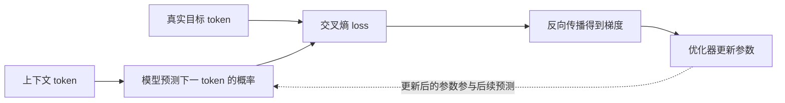

# 第一部分：基础与语言模型

## 本部分路线

语言模型的训练可以沿着一条清晰的因果链理解：文本先被切成 token，模型为每个位置预测下一个 token，交叉熵把预测质量变成可优化的数值，反向传播把数值误差传回参数，优化器和学习率调度再决定参数如何移动。本部分沿着这条链展开。

前两节会使用相同的概率符号，但关注点不同。第一节解释一个看似简单的预测目标为什么能够承载语言、知识和任务模式；第二节把这个目标落实到标签错位、因果掩码、训练并行和生成循环。后面三节依次讨论损失函数、梯度和优化器。这样读者既能看到直觉，也能在代码和训练日志中定位同一机制的具体表现。

本部分可以先用一条最小训练路径定位五讲：



前两讲说明 A、B、C 分别是什么，第三讲说明 D 如何衡量预测，第四讲解释梯度如何产生，第五讲讨论参数怎样移动。后文出现的训练目标、loss 或更新规则都应能放回这条路径。

本部分每个 Python 代码块都可独立复制到 `.py` 文件中，再用 `python3 文件名.py` 运行；运行环境按代码块前的说明准备。NumPy 和 PyTorch 片段分别标明所需版本、输入 shape 和预期现象；输出中的小数可能因平台浮点实现略有差异。

## 第 1 讲：大模型到底在学什么

### 从预测问题开始

大语言模型到底在学什么？这个问题看似基础，却决定了后面如何理解 attention、pretraining、SFT、RLHF、DPO 和 reasoning model。模型并不是直接对“文字的意义”做一个可观察的分类，而是在 tokenizer 产生的 token 序列上学习条件概率。这个事实既解释了它为什么能表现出丰富能力，也解释了它为什么会犯某些系统性错误。

本节先不展开 Transformer 的内部结构，而是把学习目标本身讲清楚：输入和输出是什么，概率分布从哪里来，预测目标为什么能够诱导出语言和知识，记忆与泛化又怎样同时存在。

### 文本为何可以成为训练信号

很多初学者第一次接触大模型时，会有几个直觉误解：

1. 大模型是不是把互联网内容背下来了？
2. 大模型是不是一个巨大的搜索引擎？
3. 大模型是不是真的“理解”了世界？
4. 为什么只是预测下一个词，就能写代码、翻译、做数学题、聊天？

这些问题都指向同一个核心：大模型训练时到底被要求做什么。

当前主流 GPT 类模型通常使用自回归语言建模。给定前面的 token，模型预测下一个 token 的概率分布。

例如输入：

```text
OpenAI is building
```

模型不是直接输出一个固定答案，而是输出一个概率分布：

```text
safe        0.18
AI          0.15
models      0.11
systems     0.08
...
```

训练的目标是让真实下一个 token 的概率尽可能高。

这个目标非常简单，但它的影响很深。要在多样文本上提高下一个 token 的预测质量，模型通常能从语法、语义、事实关系、常识、风格、任务格式等统计规律中获益；这并不表示每次正确续写都依赖同一种人类可解释的推理机制。

### 训练目标的影响

这个本质会在训练目标、能力边界和系统设计中反复出现：

1. 为什么 next-token prediction 能学到知识？
2. 为什么大模型会 hallucinate？
3. 为什么 pretraining 后还需要 SFT？
4. 为什么模型会模仿训练数据中的风格？
5. 为什么 scaling 会带来能力提升？
6. 为什么同一个模型可以做翻译、代码、数学和问答？

这些问题的底层答案都和“模型在学习条件概率分布”有关。

### 先建立一个直觉

一句话概括：

大模型在学习“在某个上下文中，接下来最可能出现什么”。

更正式一点：

大模型学习的是 token 序列的概率规律。

这里的 token 不能直接等同于“词”。英文中一个 token 可能是完整单词、词的一部分或标点；中文中一个 token 可能对应一个汉字、多个汉字、一个词的一部分或特殊控制符。具体切分由 tokenizer 决定。因此，模型的上下文长度、训练吞吐和推理成本都按 token 计算，而不是简单按字符数或词数计算。后文谈长度和成本时，默认使用同一 tokenizer 的 token 数。

但是，这句话不要理解得太浅。因为文本不是随机字符堆砌。文本里面压缩了大量人类知识和行为模式：

1. 语法：什么词通常接什么词。
2. 语义：一句话表达什么意思。
3. 事实：巴黎是法国首都，水在常压下约 100 摄氏度沸腾。
4. 推理：如果 A 大于 B，B 大于 C，那么 A 大于 C。
5. 任务模式：用户问问题时，回答应该解释；用户要求翻译时，输出另一种语言。
6. 风格：论文、代码、客服、闲聊、数学证明有不同表达方式。

所以，预测下一个 token 并不只是预测一个词，而是在利用上下文恢复文本背后的生成规律。

### 技术原理

假设一段文本被 tokenizer 切成 token 序列：

```math
x_1, x_2, x_3, \ldots, x_T
```

语言模型要学习整个序列的概率：

```math
P(x_1, x_2, \ldots, x_T)
```

根据概率链式法则，可以把它分解成：

```math
P(x_1, x_2, \ldots, x_T)
= P(x_1)P(x_2 \mid x_1)P(x_3 \mid x_1,x_2)\cdots P(x_T \mid x_1,\ldots,x_{T-1})
```

GPT 类自回归模型学习的就是每一步的条件概率：

```math
P(x_t \mid x_1, x_2, \ldots, x_{t-1})
```

也就是：给定历史 token，预测下一个 token。

训练时，模型看到大量文本。每个位置都可以形成一个训练样本：

```text
输入：x_1, ..., x_{t-1}
目标：x_t
```

模型输出的是词表中每个 token 的概率。训练会惩罚模型没有给真实 token 足够高的概率。

### 它学到的是背诵还是泛化

这是理解模型行为时经常需要拆开的两个方面，不能简单归结为“背诵”或“理解”二选一。

大模型既可能记忆，也可能泛化。

记忆发生在：

1. 某些文本在训练集中大量重复。
2. 某些事实或短语非常固定。
3. 模型容量足够大，可以存储训练样本中的细节。
4. 训练数据中包含可被直接复现的内容。

这些情况是记忆风险的线索，不是穷尽条件。Carlini 等人在一项针对 GPT-2 的黑盒查询实验中，从 1,800 个候选里确认了 604 条逐字训练样本；部分字符串只出现在一份训练文档中。这里的“一份文档”不等于“训练中只出现一次”，因为同一字符串可能在一份文档内重复。这个结果说明特定模型可能暴露训练样本，但不能直接外推到所有模型、数据集或访问接口。训练数据治理和提取风险评估分别在[第八册隐私与记忆专题](../../book-08-ai-safety-alignment/chapters/10-privacy-memorization-watermarking.md)与[第九册去重和污染专题](../../book-09-data-engineering/chapters/04-去重与污染检测.md)深入展开。

泛化发生在：

1. 模型学习到语言和任务的抽象模式。
2. 模型在新上下文中组合已有知识。
3. 模型把类似问题映射到类似解法。
4. 模型利用上下文中的示例进行 in-context learning。

一个简单例子：

假设模型在训练材料里确实只见过：

```text
2 + 3 = 5
```

测试时出现：

```text
12 + 37 = ?
```

如果模型答对，至少不能只用“逐字记住这一道原题”解释结果；它可能迁移了算术模式，也可能利用相似样本、上下文线索或其他内部策略。单个答案无法判定具体机制，更不能证明稳定的符号推理。要测试泛化，应系统改变数值范围、运算符、表达形式和组合结构，并在训练未出现的样本上报告结果。

更准确的概括是：

LLM 通过 next-token prediction 学习训练分布中的统计结构。它会记忆高频或特殊样本，也会学习可泛化的语言、知识和任务模式。模型能力来自记忆、模式归纳、组合泛化和上下文学习的共同作用。

### 为什么预测下一个 token 能产生能力

这个问题的关键在于：为了预测好下一个 token，模型必须压缩上下文中有用的信息。

例如下面这句话：

```text
The capital of France is
```

如果模型要预测下一个 token，大概率应该输出：

```text
Paris
```

这要求模型存储或学习世界知识。

再看一个例子：

```text
Translate to French: I love machine learning.
```

下一个合理输出不是随便一个英文词，而应该开始生成法语翻译。这要求模型识别“Translate to French”是一个任务指令。

再看数学：

```text
If Alice has 3 apples and buys 2 more, she has
```

合理的下一个 token 可能是：

```text
5
```

这要求模型利用简单算术和语义理解。

所以 next-token prediction 提供了一个可从原始文本构造的通用训练信号。它能支持哪些能力，取决于语料是否包含相关模式、模型是否能表示这些模式、优化和训练计算是否足够，以及评估任务是否与训练信号相匹配。规模扩大本身不保证某项能力出现或稳定迁移；[GPT-3 的 few-shot 结果](https://arxiv.org/abs/2005.14165)和 [Chinchilla 的计算最优实验](https://arxiv.org/abs/2203.15556)分别展示了规模、数据量与评估任务之间的关系，但都不能直接外推为所有模型的固定规律。

训练目标和评估目标之间还可能出现另一种错位：如果评估只奖励“答案是否与标准答案完全一致”，模型表达不确定或拒答就可能被当成错误。Kalai 等人 2026 年的研究专门分析了准确率式评估对幻觉行为的激励问题，提醒我们把“会生成高概率续写”与“会根据证据判断是否作答”分开讨论；这个结论针对论文所研究的评估设定，不能据此断言所有准确率指标都会产生相同程度的影响。[论文](https://www.nature.com/articles/s41586-026-10549-w)；[后面的幻觉与评估讲次](05-推理、部署与评估.md)会用可手算的例子说明这种差别。

但“概率高”必须和“事实为真”分开。模型输出的
$P_\theta(x_t \mid x_{1:t-1})$ 是在参数与上下文给定时对下一个 token 的条件分布，不是一个独立的事实核验器。温度、top-k 或 top-p 等解码规则会在模型分布上改变采样或选择方式，但也不会提供外部事实证据。某个说法在训练语料中常见，可能让它更容易被生成；这并不自动证明说法正确。事实性需要检索、引用、工具执行、外部验证或人工复核等额外机制。

### 一个最小代码例子（第 1 讲）

下面用纯 Python 展示“根据上下文预测下一个 token”的最小思想。这个例子不是神经网络，只是一个统计二元语言模型（bigram model），用来帮助理解语言模型最基本的目标。运行条件是 Python 3.13+，只依赖标准库 `collections`；输入是空白分词后的短文本列表，输出是给定当前 token 后各后继 token 的经验频率。这里的 `split()` 只是教学切分，不代表 BPE 或其他真实 tokenizer。

```python
from collections import defaultdict, Counter

texts = [
    "I love machine learning",
    "I love deep learning",
    "I love natural language processing",
    "machine learning is powerful",
    "deep learning is powerful",
]

# 统计当前词后面最常出现什么词。
next_token_counts = defaultdict(Counter)

for text in texts:
    tokens = text.split()
    for current_token, next_token in zip(tokens, tokens[1:]):
        next_token_counts[current_token][next_token] += 1


def predict_next(current_token):
    counts = next_token_counts[current_token]
    total = sum(counts.values())
    if total == 0:
        return []
    return [(token, count / total) for token, count in counts.most_common()]


print(predict_next("I"))
print(predict_next("love"))
print(predict_next("learning"))
```
> **代码状态：已验证（2026-10-07；Python 3.13.13；标准库）**


可能输出：

```text
[('love', 1.0)]
[('machine', 0.333...), ('deep', 0.333...), ('natural', 0.333...)]
[('is', 1.0)]
```

可以把这段代码的经验概率手算出来。令 $c$ 表示当前 token、$w$ 表示候选的下一 token，$n(c,w)$ 表示样本中相邻组合 $(c,w)$ 出现的次数，$n(c)$ 表示有后继 token 的 $c$ 出现次数；这个 bigram 模型用 $\widehat{P}(w \mid c)=n(c,w)/n(c)$ 估计条件概率。`love` 后面有三种观察结果：`machine`、`deep`、`natural` 各一次，所以三者的概率分别是 $1/3$。`learning` 在有后继 token 的两处都接着 `is`，因此 $\widehat{P}(\text{is} \mid \text{learning})=2/2=1$。这里的 `1` 只表示这份小语料中所有观察到的后继都是 `is`，不代表真实语言里 `learning` 后面必然出现 `is`。

如果在 `texts` 中再加入 `machine learning really works`，`learning` 的后继计数会变成 `is: 2`、`really: 1`，对应的经验概率是 $2/3$ 和 $1/3$。这说明样本频率会随训练样本变化，不是对外部世界的确定判断。

这个二元语言模型只看当前一个词；真正的大语言模型会结合更长上下文，并用 Transformer 参数化条件分布。两者共享“根据上下文预测下一个 token”这一训练目标，但切分方式、表示能力、上下文长度和训练规模并不相同。

### 大模型和搜索引擎有什么区别

这是一个高频误区。

搜索引擎通常做的是：

1. 根据 query 找相关文档。
2. 排序和返回已有内容。
3. 答案主要来自检索到的外部资料。

语言模型做的是：

1. 根据上下文生成 token。
2. 答案来自参数中学到的统计规律和当前上下文。
3. 如果没有外部检索，模型可能生成看似合理但不真实的内容。

所以 LLM 不是搜索引擎。它可以被搜索增强，比如 RAG，但基础语言模型本身是生成模型，不是数据库查询系统。

### 失败模式与工程后果（第 1 讲）

理解“模型在学条件概率”之后，你会更容易理解很多真实问题。

#### 坑 1：模型会模仿数据中的坏模式

如果训练数据里充满啰嗦、错误、偏见或低质量回答，模型也会学到这些模式。

#### 坑 2：高概率不等于真实

语言模型优化的是“在训练分布下像不像”，而不是直接优化“是否客观真实”。分布偏移、训练语料中的错误、上下文证据不足、解码随机性和缺少外部验证，都可能导致 hallucination；next-token 目标只是其中一个重要背景，而不是唯一原因。

#### 坑 3：模型可能学会表面格式，而不是任务能力

如果 SFT 数据格式固定但质量不高，模型可能学会“看起来像好答案”的风格，却没有真正提高推理能力。

#### 坑 4：评估分数可能只是分布匹配

如果 benchmark 和训练数据太接近，模型高分可能来自记忆或模板匹配，而不是泛化能力。

### 目标的能力边界与适用条件（第 1 讲）

next-token prediction 的优点：

1. 训练信号天然存在，不需要人工标注。
2. 可以利用海量文本。
3. 目标统一，适合大规模预训练。
4. 能学习语言、知识、风格和任务模式。
5. 可以自然用于自回归生成。

next-token prediction 的缺点：

1. 不直接优化真实性。
2. 不直接优化有用性和安全性。
3. 不保证推理过程可靠。
4. 容易学习训练数据中的偏见和噪声。
5. 可能记忆并复现训练数据中的敏感信息或长文本片段。

适用场景：

1. 大规模语言模型预训练。
2. 文本生成。
3. 代码生成。
4. 对话模型的基础能力学习。
5. 多任务通用模型的底座训练。

### 从预训练目标到完整系统（第 1 讲）

next-token 预训练提供语言建模底座，但不能单独规定产品要如何响应指令、如何处理偏好，或如何访问外部状态。需要把**模型训练阶段**和**运行时系统组件**分开看；下面是常见选择，不是每个模型都必须依次经过的固定流水线。

模型后训练通常会包括一种或多种监督或偏好训练：

1. **SFT / instruction tuning**：用示范回答训练模型遵循指令。Instruction tuning 通常指以指令—回答样本为主的监督微调；它是 SFT 的一种常见用法，不是与 SFT 并列的必然阶段。[InstructGPT 论文](https://arxiv.org/abs/2203.02155)报告了先用示范数据监督微调、再用偏好反馈进行强化学习的具体配方，但这只是一个可追溯的实例。
2. **偏好优化**：RLHF 可以通过偏好标注、奖励模型和强化学习更新策略；[DPO](https://arxiv.org/abs/2305.18290)则从偏好对直接构造优化目标，不要求先按 InstructGPT 的同一流程单独拟合奖励模型再做策略强化学习。二者是不同方法，也可以按项目目标组合其他训练阶段；都不能仅凭方法名称保证 helpfulness、harmlessness 或真实正确率提升。
3. **面向特定能力或安全目标的训练**：数据、监督信号或奖励可以针对数学、代码、拒答等任务设计。[DeepSeek-R1 报告](https://arxiv.org/abs/2501.12948v2)是以特定推理任务为目标的一项研究实例；收益仍应在预先定义的任务集、失败切片和安全评估中验证，不能把一个任务上的提升外推成通用推理或安全保证。

检索和工具则通常属于**运行时系统能力**，即使模型也可能经过工具调用数据训练：

1. **RAG** 在生成时把检索到的非参数资料加入上下文，可提供更新或可追溯的证据入口；原始 RAG 研究讨论了参数化与非参数化记忆的结合 ([Lewis et al.](https://arxiv.org/abs/2005.11401))。检索命中、引用和最终回答仍要分别评估，接入检索并不自动保证事实正确。
2. **工具调用** 由模型提出调用意图和参数，外部执行器负责实际查询、计算或操作，再把结果交回模型。[Toolformer](https://arxiv.org/abs/2302.04761)展示了训练模型决定何时调用 API 并利用返回结果的一种方案；工具是否可用、权限如何控制、结果是否可信，仍取决于运行时协议和执行系统。

这些训练和系统机制回答的是不同问题：预训练学习文本条件分布，后训练塑造目标行为，运行时系统提供额外数据或动作能力。它们可以互相配合，但不能混称为同一种“后续训练”。

### 把几层机制连起来

核心不在于重复一句“模型预测下一个词”，而在于看清一条因果链：数据被 tokenizer 变成 token 序列，序列中的共现和结构被参数化分布吸收，分布在新上下文中被重新组合，最后通过解码变成可见文本。链条中的每一步都有自己的边界，不能把最终生成的流畅性倒推成事实理解。

#### 条件概率为什么能承载知识

当上下文是“法国的首都是”时，Paris 的条件概率较高，说明训练分布中这个上下文与 Paris 有稳定关系。模型并没有在每次生成时查询一个明确的事实表，而是把许多关系分散编码在参数和表示中。它可能同时学到“法国—巴黎”“首都—城市”“问答句式—短答案”等多层模式。

这种知识表示有两个重要特点。第一，它是分布式的：一个事实通常不对应一个参数，而是与词、句式、位置和其他事实共同编码。第二，它是条件性的：提示、上下文、语言、时间和解码策略都会改变生成分布。因此，模型知道某个关系和模型在当前问题上一定会说对，不是同一件事。

#### 记忆、泛化和组合

训练样本重复、固定短语和罕见字符串更容易被直接记忆；常见结构、语法模式和任务格式更容易支持泛化。真实行为通常是二者混合：模型可能记住一个 API 的名称，再把它与新写出的函数组合起来；也可能记住数学题的表达方式，却在数值变换上出错。

判断是否泛化，不能只看一个答案。可以改变实体名称、顺序、表述、数值或任务模板，观察性能是否保持；也可以设计训练数据中没有出现的组合，并检查模型是否仍能迁移规则。这样的反事实测试比“答案看起来像人写的”更接近能力分析。

#### 预测概率不是事实概率

$P_\theta(x_t \mid x_{1:t-1})$ 描述模型在参数与上下文给定时预测下一个 token 的分布。解码规则会影响最终采样或选择出的 token，但两者都不是对世界状态的校准概率，也不是事实核验器。训练语料中常见的错误说法可能具有很高的生成概率；一个正确但罕见的事实可能反而不容易被生成。

因此，事实性需要额外机制：检索并检查来源、调用计算工具、读取数据库状态、运行测试、要求引用定位，或者交给人工复核。next-token 目标解释了为什么模型能产生丰富语言能力，也解释了为什么它不能单独保证真实性。

#### 从训练目标推不出全部产品能力

预训练提供的是语言分布上的底座能力。指令遵循、拒绝危险请求、使用工具、保持格式和持续完成任务，还依赖 SFT、偏好优化、工具协议、执行器、评估器和产品约束。把这些能力都归因于 next-token prediction，会混淆模型参数学到的倾向与系统运行时提供的控制。

这一节的核心结论可以写成一句完整的话：模型通过预测 token 学习训练数据中的统计结构，统计结构包含语言、知识和任务模式；这些结构可以支持记忆、泛化和组合，但生成概率不等于事实真值，产品能力还需要后续训练和外部系统。

### 容易混淆的结论（第 1 讲）

1. 误区：LLM 就是搜索引擎。
   纠正：LLM 是生成模型，搜索引擎是检索系统。RAG 是把两者结合。

2. 误区：LLM 完全是在背书。
   纠正：LLM 会记忆，但也会泛化。能力来自记忆、模式学习和组合泛化共同作用。

3. 误区：预测下一个 token 太简单，不可能学到推理。
   纠正：目标简单不代表任务简单。要在复杂上下文中预测正确 token，需要学习深层结构。

4. 误区：模型输出高概率答案就一定正确。
   纠正：高概率表示符合模型学到的分布，不保证事实正确。

### 练习：把概率目标落到纸面和代码（第 1 讲）

1. 用 3 句话解释 LLM 在学什么。
2. 举一个例子说明 next-token prediction 为什么需要世界知识。
3. 举一个例子说明 next-token prediction 为什么可能导致 hallucination。
4. 用自己的话解释“LLM 既会记忆，也会泛化”。
5. 修改上面的 bigram 代码，支持根据前两个词预测下一个词。

### 本节回顾（第 1 讲）

关键结论：

1. LLM 的输入和输出都是 token。
2. GPT 类模型通常学习 $P(x_t \mid x_{1:t-1})$。
3. next-token prediction 是一个简单但强大的自监督目标。
4. 模型为了预测 token，会学习语言、知识、任务模式和推理线索。
5. 大模型不是简单搜索，也不是纯粹背诵。
6. 它的能力来自统计学习、记忆、泛化、组合和上下文学习。
7. 它的局限也来自训练目标本身，例如 hallucination、安全性和真实性问题。

关键问题：

1. LLM 的输入和输出是什么？
2. 为什么语言模型可以被看成概率模型？
3. 大模型是在背诵，还是在泛化？
4. 为什么预测下一个 token 可以学到知识和能力？

到这里，LLM 的基本图景已经完整：模型在 token 序列上拟合条件概率，生成能力来自对训练分布的压缩与重组，而真实性不能由生成概率单独保证。

## 第 2 讲：语言模型与 Next-Token Prediction

### 从概率定义到生成循环

上一节说明了 next-token prediction 为什么能够成为强大的自监督目标。本节把这个直觉落到训练张量和生成过程：语言模型如何分配序列概率，自回归分解如何产生逐步预测，输入与标签为什么要错开，以及训练时的并行计算为什么不能直接等同于推理时的生成。

这些细节不是实现层面的枝节。标签错位、因果掩码、padding、对话模板和停止条件中的任意一个错误，都可能让训练 loss 看起来正常，却让模型在真实生成时表现失真。

### 从人类的续写直觉出发

人类看到一句话时，会自然地预测后面可能出现什么。

例如：

```text
The capital of France is
```

大多数人会预测：

```text
Paris
```

再看：

```text
def add(a, b):
    return
```

如果你熟悉 Python，会预测：

```text
a + b
```

语言模型把这种“根据上下文预测后续内容”的能力形式化成概率问题。

它不是直接判断一句话“对不对”，而是为一段 token 序列分配概率，并在生成时不断选择下一个 token。

### 什么是语言模型

语言模型是一个概率模型，用来估计一段 token 序列出现的概率。

给定 token 序列：

```math
x_1, x_2, \ldots, x_T
```

语言模型要建模：

```math
P(x_1, x_2, \ldots, x_T)
```

这个联合概率表示这段具体 token 序列在模型学到的分布下获得多少概率质量。它和语言流畅性有关，但不是对文本真实性或价值的判断。

例如，一个好的英文语言模型应该认为下面这句话概率较高：

```text
I like machine learning.
```

而认为下面这句话概率较低：

```text
Learning machine like I.
```

这不是因为模型知道语法规则表，而是因为它从大量文本中学到了类似句子的统计规律。

### 概率链式法则

一个序列的联合概率可以用链式法则分解：

```math
P(x_1, x_2, \ldots, x_T)
= P(x_1)P(x_2 \mid x_1)P(x_3 \mid x_1,x_2)\cdots P(x_T \mid x_1,\ldots,x_{T-1})
```

简写为：

```math
P(x_1, \ldots, x_T)=\prod_{t=1}^{T} P(x_t \mid x_{1:t-1})
```

其中：

```math
x_{1:t-1}=(x_1,x_2,\ldots,x_{t-1})
```

当 `t=1` 时，历史前缀为空，约定 $P(x_1 \mid \varnothing)=P(x_1)$；有些训练格式会在文本前显式加入 BOS（beginning-of-sequence，序列起始）token，此时第一个文本 token 的条件上下文包含 BOS。链式法则本身不要求各 token 相互独立，它只是把联合概率精确拆成一串条件概率。

用一组假设值可以把乘法走完。假设某模型对序列 `I love machine learning` 给出：

| 条件事件 | 假设概率 | 累乘结果 |
| --- | ---: | ---: |
| `I` | $P(I)=0.2$ | $0.2$ |
| `love` 在 `I` 后 | $P(love\mid I)=0.5$ | $0.2\times0.5=0.1$ |
| `machine` 在 `I love` 后 | $P(machine\mid I,love)=0.3$ | $0.1\times0.3=0.03$ |
| `learning` 在 `I love machine` 后 | $P(learning\mid I,love,machine)=0.8$ | $0.03\times0.8=0.024$ |

所以在这组**教学假设**下，四个 token 组成的序列概率是 $0.024$，即 $2.4\%$。这不是实测模型结果，也不是四个独立概率的相乘，而是依次使用每个前缀下的条件概率。这里把四个 token 当作待评分序列且不含结束 token；若任务把 EOS（end-of-sequence，序列结束）token 也计入序列，还要再乘上给定该前缀时生成 EOS 的条件概率。

这就是自回归语言模型的基础。

### 什么是自回归建模

自回归建模的意思是：当前 token 的概率依赖于之前已经出现的 token。

也就是：

```math
P(x_t \mid x_1, \ldots, x_{t-1})
```

GPT 类模型就是典型自回归模型。它从左到右生成文本，每一步只使用已经生成的历史 token，不能看到未来 token。

例如生成：

```text
I love machine learning
```

可以拆成：

```text
P(I)
P(love | I)
P(machine | I, love)
P(learning | I, love, machine)
```

自回归建模天然适合生成，因为生成过程本身就是一步一步产生 token。

### 什么是 Next-Token Prediction

Next-token prediction 是训练自回归语言模型最常见的目标。

给定前面的 token，预测下一个 token。

例如训练样本：

```text
I love machine learning
```

可以形成多个预测任务：

```text
输入：I
目标：love

输入：I love
目标：machine

输入：I love machine
目标：learning
```

在实际训练中，Transformer 可以并行计算所有位置的预测。也就是说，对于长度为 T 的序列，一次 forward 可以同时预测每个位置的下一个 token。

### 为什么 GPT 使用 Next-Token Prediction

GPT 使用 next-token prediction 有几个关键原因。

#### 原因 1：训练数据天然存在

任何一段文本都可以变成训练样本，不需要人工标注。

这叫自监督学习。监督信号来自文本本身：前面的 token 是输入，后面的 token 是标签。

#### 原因 2：目标和生成过程一致

训练时学习：

```text
给定历史，预测下一个 token
```

推理时执行：

```text
给定历史，生成下一个 token
```

训练目标和生成方式天然匹配。

#### 原因 3：可以扩展到超大规模

原始文本能直接提供前缀与后继 token，不需要为每个预测位置人工标注标签；统一目标也便于把许多序列组成批次训练。因此，next-token prediction 适合扩展到大规模数据和计算。数据清理、去重、存储和训练算力仍然有成本，目标形式简单不等于训练系统没有工程难点。

#### 原因 4：任务形式足够通用

很多任务都可以转成文本续写：

```text
Translate to Chinese: machine learning
```

模型继续生成：

```text
机器学习
```

再比如：

```text
Question: What is 2 + 3?
Answer:
```

模型继续生成：

```text
5
```

### 训练时到底发生了什么

训练时，模型接收一批 token 序列。

假设输入 tokens 是：

```text
[x_1, x_2, x_3, x_4]
```

模型会在每个位置输出一个 logits 向量。logits 的长度等于词表大小。

训练目标通常是右移一位：

```text
输入位置：x_1, x_2, x_3
预测目标：x_2, x_3, x_4
```

也可以写成：

```text
input_ids: [x_1, x_2, x_3]
labels:    [x_2, x_3, x_4]
```

实际工程里通常输入完整序列，然后在 loss 计算时让第 t 个位置的输出预测第 t+1 个 token。

核心细节：

1. 模型输出 logits，不是直接输出 token。
2. logits 经过 softmax 变成概率分布。
3. loss 会惩罚真实下一个 token 的概率太低。
4. causal mask（因果掩码）保证第 t 个位置不能看到未来 token。

### 推理时到底发生了什么

推理时，模型没有真实 label。

它只能根据当前上下文输出下一个 token 的概率分布，然后用某种 decoding 策略选出 token。

例如：

```text
Prompt: I love
```

模型输出：

```text
machine: 0.30
deep:    0.20
you:     0.10
...
```

如果使用 greedy decoding，就选择概率最高的：

```text
machine
```

然后把它拼回上下文：

```text
I love machine
```

继续预测下一个 token。

这就是自回归生成。

### 训练和推理的区别

训练和推理都围绕“下一个 token”，但它们有几个关键区别。

训练时：

1. 有真实答案 label。
2. 可以一次并行预测多个位置。
3. 使用 teacher forcing（以真实历史 token 作为上下文）。
4. 目标是最小化 loss。

推理时：

1. 没有真实答案 label。
2. 一般需要逐 token 生成。
3. 生成的 token 会成为后续上下文。
4. 需要 decoding 策略控制输出。

teacher forcing 的意思是：训练时每个位置都使用真实历史 token 作为上下文，而不是使用模型自己刚刚生成的 token。

teacher forcing 使训练时每个位置都基于真实前缀计算目标，并允许 Transformer 并行处理已知序列中的多个位置；但训练条件和推理条件并不完全一致。推理时模型会接收自己生成的 token，如果前面生成错了，后续错误可能累积。这类前缀条件差异通常概括为暴露偏差（exposure bias）。Bengio 等人在循环神经网络序列预测研究中分析了这种差异，并提出 scheduled sampling：训练时逐步用模型生成的 token 替换真实前序 token。这个研究说明了一种应对思路，不代表暴露偏差是所有生成错误的唯一原因，也不能证明该策略对所有 Transformer 任务都有效。[Bengio et al., 2015](https://arxiv.org/abs/1506.03099v3)。数据质量、解码策略、上下文长度和任务本身的难度也会影响结果。

### 一个最小代码例子（第 2 讲）

下面用纯 Python 演示如何把一段 token 序列构造成 next-token prediction 的输入和 label。运行条件是 Python 3.13+、无第三方依赖；输入为长度 `T` 的 token 列表，输出分别是长度 `T-1` 的上下文 token 和目标 token。真实训练通常用 token id 张量并另外处理 batch、padding 和 loss mask（标记哪些位置参与损失计算的掩码）。

```python
tokens = ["I", "love", "machine", "learning"]

input_tokens = tokens[:-1]
label_tokens = tokens[1:]

print("input:", input_tokens)
print("label:", label_tokens)

for context_end in range(1, len(tokens)):
    context = tokens[:context_end]
    target = tokens[context_end]
    print(f"context={context} -> target={target}")
```
> **代码状态：已验证（2026-10-07；Python 3.13.13；标准库）**


输出：

```text
input: ['I', 'love', 'machine']
label: ['love', 'machine', 'learning']
context=['I'] -> target=love
context=['I', 'love'] -> target=machine
context=['I', 'love', 'machine'] -> target=learning
```

这个例子展示了语言模型训练数据的核心构造方式：输入和标签相差一个位置。输入列表少于两个 token 时不会产生有效预测对，实际数据管线应检查有效目标数，避免对空集合求平均 loss。

### 形状直觉

真实训练时通常使用整数 token id，而不是字符串。

这里的形状先按“把完整长度为 $T$ 的序列传给模型”的接口约定；部分实现由调用方先切成长度为 $T-1$ 的输入与目标，二者的对齐稍后用同一组 token ID 对照。假设：

```text
batch_size = B
sequence_length = T
vocab_size = V
```

那么：

```text
input_ids shape: [B, T]
logits shape:    [B, T, V]
labels shape:    [B, T]
```

每个位置的 logits 是对整个词表的预测。用一条长度为 4 的 token ID 序列说明对齐，假设 ID 为 `[10, 20, 30, 40]`。如果由调用方显式准备 next-token 样本，输入是 `[10, 20, 30]`，目标是 `[20, 30, 40]`：

| 输出位置 | 该位置可见的前缀 | 该位置要预测的目标 |
| ---: | --- | ---: |
| 0 | `[10]` | `20` |
| 1 | `[10, 20]` | `30` |
| 2 | `[10, 20, 30]` | `40` |

另一种常见接口是把完整的 `[10, 20, 30, 40]` 同时作为 `input_ids` 和同长度 `labels` 传入，由模型的 loss 在内部对齐，效果对应比较 `logits[:, :-1, :]` 与 `labels[:, 1:]`。以 Hugging Face Transformers v5.17.0 为例，因果语言建模教程说明该目标会把输入作为 labels 并右移；固定版本的 data collator 源码则显示 `mlm=False` 时先复制 `input_ids` 为 labels、屏蔽 padding，GPT-2 causal LM 头再在模型内部处理移位。[教程](https://huggingface.co/docs/transformers/v5.17.0/tasks/language_modeling)、[data collator 源码](https://github.com/huggingface/transformers/blob/v5.17.0/src/transformers/data/data_collator.py#L3414-L3422)、[GPT-2 causal LM 源码](https://github.com/huggingface/transformers/blob/v5.17.0/src/transformers/models/gpt2/modeling_gpt2.py#L3248-L3253)。这只是特定版本和模型头的接口示例，其他模型可能要求调用方显式移位。两种写法表达的是同一组三个预测对，但张量长度和移位责任不同。实现时要读当前模型的 loss 契约，确保恰好移位一次：漏移位会让位置和目标错配，重复移位则会跳过正确目标。

### 训练数据与生成协议中的失败模式（第 2 讲）

#### 坑 1：label 没有右移

如果输入和 label 没有正确错开，模型可能在学复制当前位置 token，而不是预测下一个 token。

#### 坑 2：prompt 的 loss mask 与训练目标不一致

监督微调（supervised fine-tuning，SFT）是否只对 assistant 回答计算 loss，取决于数据和训练目标。若目标是只监督回答，却没有屏蔽 system/user prompt 对应的位置，loss 仍会要求模型预测这些 prompt token，实际优化目标就偏离了设定；若任务本来就是对整段对话做语言建模，则把这些位置纳入 loss 可能是有意选择。排查时要把目标定义和每个位置的 loss mask 对照，不能把“prompt 一律不计 loss”当成普遍规则。

#### 坑 3：没有 causal mask

如果训练时模型能看到未来 token，loss 可能异常低；模型因此利用了推理时不可用的信息，导致训练指标无法代表真实生成表现。

#### 坑 4：EOS 处理错误

EOS token 处理不好，模型可能难以学会何时结束，导致生成过长或停不下来。还要检查 padding 与 EOS 的关系：有些数据管线会让两者共用同一个 token ID；如果 collator 按 `input_id == pad_token_id` 把 label 设为忽略值，那么真实文本中的 EOS 位置也可能一并被屏蔽，模型就缺少相应的停止监督。Hugging Face Transformers v5.17.0 的教程示例确实把 pad token 设为 EOS，而该版本的 collator 源码按 token ID 屏蔽 labels；这是由特定配置和实现推得的风险，并非所有训练管线都会出现。[教程](https://huggingface.co/docs/transformers/v5.17.0/tasks/language_modeling)、[collator 源码](https://github.com/huggingface/transformers/blob/v5.17.0/src/transformers/data/data_collator.py#L3414-L3422)。因此要抽样核对真实 EOS 位置和 padding 位置的 labels，而不能只看 token ID 是否相同。

#### 坑 5：训练和推理模板不一致

对话样本经 tokenizer 的聊天模板（chat template）转成 token 序列后，训练与推理使用不兼容的角色控制 token 或边界标记，可能使模型无法按预期解析轮次。模板通常随 tokenizer/model 而定；同一基础模型的不同微调版本也可能采用不同格式。Hugging Face Transformers v5.17.0 文档用 Mistral 与 Zephyr 展示了这种差异，并提醒重复添加 BOS/EOS 特殊 token 也可能损害效果。[Chat templates 文档（v5.17.0）](https://huggingface.co/docs/transformers/v5.17.0/chat_templating)。

### 自回归目标的能力边界（第 2 讲）

next-token prediction 的优点：

1. 数据构造简单。
2. 不需要人工标注。
3. 目标和自回归生成一致。
4. 可扩展到海量文本。
5. 可以统一各种任务。

缺点：

1. 不直接优化真实性。
2. 不直接优化用户满意度。
3. 不直接保证安全性。
4. 推理时错误会逐步累积。
5. 对数据分布非常敏感。

适用场景：

1. GPT 类模型预训练。
2. 代码补全。
3. 文本续写。
4. 对话模型基础训练。
5. 多任务生成式建模。

### 从训练批次到生成循环

训练和生成都围绕下一个 token，但它们处在两个不同的计算条件中。训练可以利用一整段已知文本并行计算多个位置；生成只能把已经选出的 token 追加到上下文，再请求下一步预测。

| 维度 | 训练 | 推理 |
|---|---|---|
| 历史 token | 通常是真实序列 | 包含模型自己生成的历史 |
| 是否有 label | 有 | 没有未来 label |
| 计算方式 | 序列位置可并行 | 时间步通常串行 |
| 主要目标 | 最小化训练 loss | 按 decoding 规则生成序列 |
| 常见风险 | label shift、mask、padding 错误 | 暴露偏差、错误累积、停止异常 |

右移标签不是格式细节，而是任务定义本身。若 input_ids 的第 t 个位置去预测同一个位置的 token，模型可能学到复制当前位置；若 causal mask 失效，位置可以偷看未来，训练 loss 会虚低，推理时却没有同样的信息。

#### teacher forcing 的收益和代价

teacher forcing 让第 t 步使用真实历史，而不是模型在第 t-1 步生成的结果。它带来两个工程收益：训练样本可以并行处理，梯度信号也更直接；但它造成训练与推理的条件差异。推理时一个早期错误可能进入后续上下文，模型必须在不完美历史上继续工作。

这并不意味着 teacher forcing 本身是错误设计。它是大规模自回归训练的高效基础；暴露偏差只是可考虑通过数据覆盖、解码策略、纠错训练、工具验证和任务级评估管理的一类问题。不能用一个术语解释所有生成错误。

#### 因果 mask、padding 和 loss mask 的统一检查

一个训练 batch 需要同时满足三件事：位置只能看允许的历史；标签与输入正确错位；无效位置不参与损失。可以把排查写成顺序：

1. 打印一个短序列的 input_ids、labels 和有效 mask；
2. 检查第 t 个 logits 对应的 label 是否是 t+1；
3. 固定一个短前缀，只改变目标位置之后的 token；保持总序列长度、位置编号和 attention mask 不变，关闭 dropout、不使用 KV cache，再比较前缀位置的 logits。若它们发生超出数值误差的变化，检查 causal mask 及其他可能泄漏未来信息的路径；
4. 检查 padding 位置是否不计入 loss，并按本任务的 SFT 目标核对 prompt 区域 mask；
5. 用一个极小数据集过拟合，确认 loss 能下降且生成方向正确。

只有这五步同时成立，训练曲线才有解释意义。单看 loss 数字，无法确认模型究竟学到了预测任务还是数据泄漏。

#### chat template 和停止条件

对话模型还多了一层协议。system、user、assistant、tool 等角色需要使用训练时一致的模板；特殊 token、EOS、tool call 边界和 padding 方向也会影响 label。模板改变后，模型可能把角色标记当成普通文本，或者无法判断回答何时结束。

因此，训练样本应保存模板版本和 tokenizer 版本，推理服务也要记录同样的信息。停止条件不能只依赖最大 token 数；还要检查 EOS、结构化输出结束标志、工具调用完成和异常终止。

这里真正需要理解的不是一句“训练有 label、推理没有 label”，而是沿着 input_ids、labels、causal mask、loss mask、模板和 decoding 逐层解释一次生成为什么成功或失败。

### 容易混淆的训练与推理现象（第 2 讲）

1. 误区：训练时模型一次只预测一个 token。
   纠正：概念上是预测每个位置的下一个 token，但 Transformer 训练时可以并行计算所有位置。

2. 误区：推理和训练完全一样。
   纠正：训练有真实 label 和 teacher forcing，推理没有 label，需要逐步生成和 decoding。

3. 误区：next-token prediction 只适合续写，不适合问答。
   纠正：问答、翻译、代码、总结都可以格式化成文本续写任务。

4. 误区：loss 很低说明模型一定会生成好答案。
   纠正：loss 衡量训练分布上的预测概率，不直接等价于用户满意度、真实性或安全性。

### 练习：从序列构造训练样本（第 2 讲）

1. 写出 $P(x_1,x_2,x_3,x_4)$ 的自回归分解。
2. 给定 token 序列 `[10, 20, 30, 40]`，写出 input 和 label 应该如何错位。
3. 解释 teacher forcing 的优点和缺点。
4. 举例说明为什么训练 loss 低不代表生成质量一定好。
5. 用纯 Python 写一个函数，把 token id 序列转成 next-token prediction 的 input 和 labels。

### 本节回顾（第 2 讲）

关键结论：

1. 语言模型是为 token 序列分配概率的模型。
2. 自回归模型用链式法则把序列概率分解成条件概率。
3. GPT 类模型学习的是 $P(x_t \mid x_{1:t-1})$。
4. Next-token prediction 是自监督目标，标签来自文本本身。
5. 训练时使用真实历史 token，推理时使用模型自己生成的 token。
6. 训练和推理目标相关，但执行方式不同。
7. 工程里要特别注意 label shift、causal mask、EOS、chat template 和 loss mask。

关键问题：

1. 什么是语言模型？
2. 什么是自回归建模？
3. 为什么 GPT 使用 next-token prediction？
4. 预训练目标和生成过程有什么关系？

本节把同一个目标放在了两种计算条件下：训练用真实历史并行计算多个位置，推理用已生成历史逐步推进。理解这一区别，才能继续分析 teacher forcing、暴露偏差和 serving 阶段的吞吐瓶颈。

## 第 3 讲：交叉熵、最大似然与困惑度

### 让预测误差变成可优化的量

前两节已经给出了 GPT 类语言模型的目标 $P(x_t \mid x_{1:t-1})$。接下来的问题是：模型如何把“这次预测得好不好”变成一个可以反向传播的数值？交叉熵、最大似然和困惑度正好构成这条桥梁。

本节先从单个真实 token 的概率出发，再推到整个序列和整个数据集的损失，解释交叉熵与 KL 散度的关系，并说明为什么一个更低的 loss 仍然不能直接代表事实性、代码正确性或用户体验。

### 从一个真实 token 的概率开始

语言模型在每个位置输出的是一个概率分布。

例如上下文是：

```text
The capital of France is
```

模型可能输出：

```text
Paris      0.70
London     0.05
Berlin     0.03
city       0.02
...
```

如果真实下一个 token 是 `Paris`，这个预测就比较好。

如果模型输出：

```text
Paris      0.01
London     0.50
Berlin     0.20
...
```

那预测就很差。

训练需要一个数字来衡量“模型给真实 token 的概率有多高”。这个数字就是 loss。

### 损失函数在训练系统中的位置

交叉熵是大模型训练里最基础的 loss，但它也是很多高级问题的起点：

1. 为什么训练 loss 是负对数概率？
2. 为什么最大似然等价于最小化交叉熵？
3. 为什么 perplexity 是 $\exp(L)$？
4. 为什么 SFT 本质上还是 causal LM loss？
5. 为什么 DPO、RLHF 会在交叉熵之外引入偏好目标？
6. 为什么 loss 降低不一定代表模型更有用、更真实、更安全？

如果你能讲清楚交叉熵、最大似然和 perplexity，后面理解 SFT、DPO、reward model、评估指标会轻松很多。

### 交叉熵的直觉

一句话：

交叉熵损失惩罚模型没有给真实答案足够高的概率。

如果真实 token 是 `Paris`：

```math
\begin{aligned}
\mathrm{Model\ A}:\quad &P(\mathrm{Paris})=0.8\\
\mathrm{Model\ B}:\quad &P(\mathrm{Paris})=0.01
\end{aligned}
```

模型 A 应该 loss 小，模型 B 应该 loss 大。

交叉熵对单个样本的形式是：

```math
L=-\log P(y)
```

这里 `y` 表示真实下一个 token。模型给 `y` 的概率越高，$-\log P(y)$ 越小。

例如使用自然对数：

```math
\begin{aligned}
P=1.0 &\Rightarrow -\log(P)=0\\
P=0.5 &\Rightarrow -\log(P)\approx 0.693\\
P=0.1 &\Rightarrow -\log(P)\approx 2.303\\
P=0.01 &\Rightarrow -\log(P)\approx 4.605
\end{aligned}
```

所以交叉熵非常直接：真实 token 概率越低，惩罚越重。

实际框架通常从未归一化的 logits 直接稳定地计算 log-softmax 与负对数似然，不要求调用方先把 logits 手动变成概率；PyTorch v2.14 的 `CrossEntropyLoss` 文档也明确其输入为未归一化 logits，并说明 `ignore_index` 与 reduction 的计算约定。[PyTorch CrossEntropyLoss 文档（v2.14）](https://docs.pytorch.org/docs/2.14/generated/torch.nn.CrossEntropyLoss.html)。

### 从最大似然理解语言模型训练

把训练集记作 $\mathcal{D}=\{x^{(i)}\}_{i=1}^{N}$，模型参数记为 $\theta$。在常见的 token-level 最大似然目标中，我们希望各条训练序列的似然乘积尽可能大：

```math
\max_\theta P_\theta(\mathcal{D})=\max_\theta\prod_{i=1}^{N}P_\theta(x^{(i)})
```

这里把每条序列当作训练目标中的一个样本因子；单条序列内部的 token 仍按自回归条件概率分解，并不假设 token 彼此独立。

对一个 token 序列：

```math
x_1,x_2,\ldots,x_T
```

自回归分解为：

```math
P_\theta(x_1,\ldots,x_T)=\prod_{t=1}^{T}P_\theta(x_t\mid x_{1:t-1})
```

最大化整个序列概率，等价于最大化所有位置真实 token 的条件概率乘积。

但很多概率相乘会非常小，计算不稳定。所以通常取 log：

```math
\log P_\theta(x_1,\ldots,x_T)=\sum_{t=1}^{T}\log P_\theta(x_t\mid x_{1:t-1})
```

最大化 log likelihood 等价于最小化 negative log likelihood：

```math
\mathrm{NLL}=-\sum_{t=1}^{T}\log P_\theta(x_t\mid x_{1:t-1})
```

这就是语言模型训练 loss 的来源。

平均到每个 token 上：

```math
L=-\frac{1}{T}\sum_{t=1}^{T}\log P_\theta(x_t\mid x_{1:t-1})
```

这个平均负对数似然在 one-hot（独热）标签下就是交叉熵。用三步序列做一组可复算的例子：假设模型对三个真实 token 的条件概率依次是 $0.8$、$0.5$ 和 $0.1$。它们是教学假设值，不是实测模型数据。

| 真实 token 位置 | 假设的条件概率 | 该位置的负对数损失（nats） |
| ---: | ---: | ---: |
| 1 | $0.8$ | $-\ln(0.8)\approx0.2231$ |
| 2 | $0.5$ | $-\ln(0.5)\approx0.6931$ |
| 3 | $0.1$ | $-\ln(0.1)\approx2.3026$ |

序列似然是 $0.8\times0.5\times0.1=0.04$，负对数似然是 $-\ln(0.04)\approx3.2189$，与三个位置的损失之和一致。若按 token 平均，$L=3.2189/3\approx1.0730$ nats；下文会将这个平均损失换算为 perplexity。低概率的第三个 token 单独贡献约 $2.3026$ nats，说明少数难预测位置可以显著抬高平均损失。

### 交叉熵是什么

交叉熵衡量的是：用模型预测分布 `q` 去表示真实分布 `p` 时，平均需要多少代价。

公式：

```math
H(p,q)=-\sum_x p(x)\log q(x)
```

在分类任务中，真实标签通常是 one-hot 分布。

例如词表有 4 个 token，真实 token 是第 2 个：

```math
p=[0,1,0,0]
```

模型预测：

```math
q=[0.1,0.7,0.1,0.1]
```

交叉熵：

```math
H(p,q)=-\log(0.7)
```

因为 one-hot 分布只有真实类别那一项为 1，其他项为 0。

所以语言模型中，交叉熵就是：

```math
-\log P(y)
```

这里 `y` 仍然表示真实下一个 token。

沿用上面的 one-hot 例子，若 $p=[0,1,0,0]$、$q=[0.1,0.7,0.1,0.1]$，则
$H(p,q)=-(0\ln0.1+1\ln0.7+0\ln0.1+0\ln0.1)=-\ln0.7\approx0.3567$ nats。只有真实类别对应的那一项留下来；如果模型只给真实类别 $0.01$ 的概率，损失就变成 $-\ln0.01\approx4.6052$ nats。

### 交叉熵和 KL 散度的关系

KL 散度（Kullback–Leibler divergence）衡量两个分布的差异：

```math
\mathrm{KL}(p\Vert q)=\sum_x p(x)\log\frac{p(x)}{q(x)}
```

它可以写成：

```math
\mathrm{KL}(p\Vert q)=H(p,q)-H(p)
```

其中：

```math
H(p,q)\quad \mathrm{is\ the\ cross\ entropy}
```

```math
H(p)\quad \mathrm{is\ the\ entropy\ of\ the\ data\ distribution}
```

对于固定训练数据，真实分布 $p$ 不随模型参数变化，所以 $H(p)$ 是常数。

因此最小化交叉熵等价于最小化 KL 散度：

```math
\min H(p,q) \Longleftrightarrow \min \mathrm{KL}(p\Vert q)
```

直觉上，训练语言模型就是让模型分布 $q$ 尽量接近数据分布 $p$。

这里的 $\mathrm{KL}(p\Vert q)$ 不是对称距离；交换 $p$ 和 $q$ 通常会得到不同数值。公式说明的是在数据分布固定时，模型依赖的那部分交叉熵与 KL 优化方向相同，不代表两种度量在所有问题中可互换。

### Perplexity 是什么

Perplexity 通常翻译为困惑度，用来衡量自回归语言模型对一段文本的 token 预测有多“不确定”。它是指定 tokenization、上下文窗口和有效目标位置下的平均负对数似然变换，不是与评估设置无关的固有常数。

如果平均交叉熵 loss 使用自然对数，那么：

```math
\mathrm{PPL}=\exp(L)
```

这个定义直接用于自回归/因果语言模型；对 BERT 这类双向掩码语言模型（masked language model），不能把同一左到右联合概率直接代入并称为标准 perplexity。固定上下文长度时，长文本中较晚 token 的条件概率只能基于窗口内可见前缀；若评估时切成互不重叠的短块，许多预测会少用可用上下文，得到的 PPL 会受切块方案影响。评估应明确窗口长度、stride（窗口每次移动的 token 步长）、tokenizer 和计入 loss 的目标位置，并避免重复计数上下文 token。[Hugging Face 的固定长度模型 PPL 说明](https://huggingface.co/docs/transformers/perplexity)展示了滑动窗口的折中方案及其对 PPL 的影响。

例如上下文窗口最多容纳 3 个 token，要评分的目标是 $x_5$。在互不重叠的块 `[x_4,x_5,x_6]` 中，模型预测 $x_5$ 时只能用到 `[x_4]`；滑动窗口则可把 `[x_2,x_3,x_4]` 作为前缀来预测同一个 $x_5$。两种评估给目标 token 的可见上下文不同，因此所得 loss 不应在未说明窗口策略时直接比较。

若每个位置都在 $K$ 个候选 token 上均匀分配概率，则平均 loss 是 $\ln K$，PPL 正好是 $K$。真实模型的分布通常不均匀，所以可以把 PPL 当作一种有效分支数直觉，而不能把它当成真实候选 token 的计数。

如果：

```math
\begin{aligned}
L&=0\\
\mathrm{PPL}&=\exp(0)=1
\end{aligned}
```

表示模型完全确定真实 token。

如果：

```math
\begin{aligned}
L&=2.3\\
\mathrm{PPL}&\approx 10
\end{aligned}
```

粗略理解为模型平均像是在 10 个候选 token 中犹豫。

回到上面的三步例子，平均负对数似然约为 $1.0730$ nats，因此 $\mathrm{PPL}=\exp(1.0730)\approx2.9240$。这只是该组假设条件概率下的教学计算，不代表模型在任意语料上的实际困惑度。

### 一个最小代码例子（第 3 讲）

下面用纯 Python 实现单个样本的 softmax 和 cross entropy。运行条件是 Python 3.13+、只依赖标准库 `math`；`logits` 是长度为词表大小 `V` 的有限实数列表，`target_index` 是 `[0,V)` 内的整数。输出是词表概率和以自然对数计量的单 token loss（单位为 nats）。代码先通过 log-sum-exp 计算归一化常数，再由 `logsumexp(logits) - logits[target_index]` 求目标负对数概率；这与交叉熵公式一致，同时避免先求一个可能下溢为零的 softmax 概率再取对数。

```python
import math


def logsumexp(logits):
    if not logits:
        raise ValueError("logits must contain at least one value")
    if any(not math.isfinite(value) for value in logits):
        raise ValueError("logits must be finite")
    max_logit = max(logits)
    return max_logit + math.log(math.fsum(math.exp(x - max_logit) for x in logits))


def softmax(logits):
    log_z = logsumexp(logits)
    return [math.exp(value - log_z) for value in logits]


def cross_entropy(logits, target_index):
    if isinstance(target_index, bool) or not isinstance(target_index, int):
        raise TypeError("target_index must be an integer")
    if target_index < 0 or target_index >= len(logits):
        raise ValueError("target_index is outside the vocabulary")
    log_z = logsumexp(logits)
    # 直接用 log-softmax 计算，避免很小的目标概率先下溢为 0。
    return log_z - logits[target_index]


# 假设词表有 4 个 token，真实 token 是 index=1。
logits_good = [0.1, 3.0, 0.2, -1.0]
logits_bad = [3.0, 0.1, 0.2, -1.0]

print("good probs:", softmax(logits_good))
print("good loss:", cross_entropy(logits_good, 1))

print("bad probs:", softmax(logits_bad))
print("bad loss:", cross_entropy(logits_bad, 1))
```
> **代码状态：已验证（2026-10-07；Python 3.13.13；标准库）**


预期结果中，good logits 的目标概率约为 `0.881718`、loss 约为 `0.125883`；bad logits 的目标概率约为 `0.048515`、loss 约为 `3.025883`。这个例子展示：当模型给真实 token 更高 logit 时，cross entropy 更低。直接由 log-sum-exp 计算 loss，即使 softmax 中某个非目标概率下溢为 0，也不会先对 0 取对数。

可以手算 good 这一行核对实现。logits 是 `[0.1, 3.0, 0.2, -1.0]`，目标索引为 `1`，最大 logit 是 `3.0`；减去最大值后得到 `[-2.9, 0, -2.8, -4.0]`，指数和约为 $e^{-2.9}+1+e^{-2.8}+e^{-4}=1.134149$。因此目标概率是 $1/1.134149\approx0.881718$，loss 为 $-\ln(0.881718)\approx0.125883$ nats。bad 行把最高 logit 放在错误类别，真实目标概率降为约 `0.048515`，相应 loss 升到约 `3.025883` nats；代码输出与手算的趋势和数值相符。

### 用 NumPy 计算一批 token 的交叉熵

上面的例子只处理一个样本。真实语言模型训练时，通常一次处理一个 batch，并对所有有效 token 的 loss 求平均。下面代码适用于 Python 3.13+ 和 NumPy 2.4.6；输入的 `logits` shape 为 `[B,T,V]`、`labels` shape 为 `[B,T]`，输出是有效位置的平均 loss 和逐 token loss。这个 helper 假设 `logits[b,t,:]` 已经对齐到 `labels[b,t]`，它本身不会替 causal LM 做右移；若输入来自未移位的整段序列，应按具体模型的 loss 契约先对齐预测位置和目标。PyTorch v2.14 文档也说明常见交叉熵接口接收未归一化 logits，忽略 `ignore_index` 后再按有效目标约定聚合。[PyTorch CrossEntropyLoss 文档（v2.14）](https://docs.pytorch.org/docs/2.14/generated/torch.nn.CrossEntropyLoss.html)。

下面这个 NumPy demo 演示三件事：

1. logits 如何变成概率。
2. 如何取出每个位置真实 label 的概率。
3. padding 位置如何通过 mask 排除。

```python
import numpy as np


def log_softmax(logits):
    # logits: [N, V]
    logits = np.asarray(logits)
    if logits.ndim < 1 or logits.shape[-1] == 0:
        raise ValueError("logits must have a non-empty vocabulary dimension")
    if not np.issubdtype(logits.dtype, np.number) or np.issubdtype(logits.dtype, np.complexfloating):
        raise TypeError("logits must be real numeric values")
    # 转成有符号浮点，避免 unsigned integer 减去最大值时发生下溢。
    logits = logits.astype(np.float64, copy=False)
    if not np.all(np.isfinite(logits)):
        raise ValueError("logits must be finite")
    shifted = logits - logits.max(axis=-1, keepdims=True)
    log_probs = shifted - np.log(np.exp(shifted).sum(axis=-1, keepdims=True))
    return log_probs


def masked_cross_entropy(logits, labels, ignore_index=-100):
    # logits: [B, T, V]
    # labels: [B, T]
    logits = np.asarray(logits)
    labels = np.asarray(labels)
    if logits.ndim != 3 or labels.ndim != 2 or labels.shape != logits.shape[:2]:
        raise ValueError("expected logits [B, T, V] and labels [B, T]")
    if isinstance(ignore_index, bool) or not isinstance(ignore_index, (int, np.integer)):
        raise TypeError("ignore_index must be an integer")
    if not np.issubdtype(labels.dtype, np.integer):
        raise TypeError("labels must use an integer dtype")
    batch_size, seq_len, vocab_size = logits.shape
    flat_logits = logits.reshape(batch_size * seq_len, vocab_size)
    flat_labels = labels.reshape(batch_size * seq_len)

    valid = flat_labels != ignore_index
    valid_logits = flat_logits[valid]
    valid_labels = flat_labels[valid]

    if valid_labels.size == 0:
        raise ValueError("at least one label must contribute to the loss")
    if np.any((valid_labels < 0) | (valid_labels >= vocab_size)):
        raise ValueError("a valid label is outside the vocabulary")

    log_probs = log_softmax(valid_logits)
    token_losses = -log_probs[np.arange(len(valid_labels)), valid_labels]
    return token_losses.mean(), token_losses


# B=2, T=3, V=4。假设第 2 个样本最后一个位置是 padding，不参与 loss。
logits = np.array([
    [[2.0, 0.1, 0.0, -1.0], [0.0, 2.0, 0.1, -1.0], [0.2, 0.0, 2.0, -1.0]],
    [[0.1, 0.2, 0.3, 2.0], [2.0, 0.0, 0.1, -1.0], [0.0, 0.0, 0.0, 0.0]],
])
labels = np.array([
    [0, 1, 2],
    [3, 0, -100],
])

mean_loss, token_losses = masked_cross_entropy(logits, labels)
print("token losses:", token_losses)
print("mean loss:", mean_loss)
print("perplexity:", np.exp(mean_loss))
```
> **代码状态：已验证（2026-10-07；Python 3.13.13；NumPy 2.4.6）**


这个例子里的 `ignore_index=-100` 是常见的忽略标签约定；具体框架和数据管线可能用不同 sentinel。padding 或不希望监督的 prompt 区域可以排除，但应由任务定义决定哪些 token 参与 loss。全 batch 都被忽略、标签越界、shape 不匹配和非有限 logits 都会显式报错，不会生成一个看似有效的 loss。

按上面五个有效位置计算，逐 token loss 约为 `[0.2887, 0.2887, 0.3004, 0.4038, 0.2887]`，平均 loss 约为 `0.3141`，perplexity 约为 `1.3690`。被 `ignore_index` 标记的第六个位置不进入分子或分母。

### 批量 token 的 loss 怎么算

真实语言模型训练时，loss 通常对 batch 和 sequence 里的有效 token 求平均。

假设：

```text
logits shape: [B, T, V]
labels shape: [B, T]
```

其中：

```text
B = batch size
T = sequence length
V = vocab size
```

每个位置 `(b, t)` 都有一个真实 label：

```text
labels[b, t]
```

模型在该位置输出：

```text
logits[b, t, :]
```

loss 是所有有效位置的平均：

```math
L=\mathrm{mean}_{(b,t)\in\mathcal{M}}\left[-\log P(y_{b,t}\mid x_{b,1:t-1})\right]
```

这里 $\mathcal{M}$ 表示所有有效 token 位置的集合，$y_{b,t}$ 表示第 `b` 个样本第 `t` 个位置的训练标签，$x_{b,1:t-1}$ 表示它之前的上下文。这个平均只有在 $|\mathcal{M}|>0$ 时才有定义；如果一个 batch 的所有位置都被 mask，正确行为是报告数据或 mask 配置错误，而不是把空集合的平均值当成有效 loss。

这里“有效位置”很重要。在 SFT 或 padding 场景中，某些位置不应该计入 loss，通常用 `ignore_index = -100` 表示。

### 损失统计中的失败模式（第 3 讲）

#### 坑 1：把 padding token 计入 loss

如果 padding 位置参与 loss，模型会被迫学习预测 PAD，训练信号被污染。

#### 坑 2：SFT 的 prompt mask 与目标不一致

是否让 prompt token 参与 loss 取决于训练目标。若目标是只监督 assistant 回答，却把用户 prompt 也纳入损失，优化目标就多包含了不打算监督的 token；若目标是对整段对话做语言建模，计入 prompt 可能是有意选择。排查时要核对目标定义、labels 和 loss mask，而不能把 prompt 一律参与或一律排除写成规则。

#### 坑 3：只看平均 loss，不看分任务 loss

平均 loss 下降，可能只是简单文本变好，数学、代码、安全等关键能力反而退化。

#### 坑 4：perplexity 低不等于用户体验好

在相同评估协议下，较低 perplexity 表示模型给评估序列的平均负对数似然较低；它不保证回答有用、真实、安全或符合用户偏好。

#### 坑 5：评估集污染导致 loss 虚低

如果验证集或 benchmark 出现在训练数据里，loss 和 perplexity 会过于乐观。

### 交叉熵和困惑度的能力边界（第 3 讲）

交叉熵作为语言模型 loss 的优点：

1. 概率解释清晰。
2. 和最大似然一致。
3. 数学形式简单。
4. 易于大规模优化。
5. 与 next-token prediction 自然匹配。

缺点：

1. 不直接优化人类偏好。
2. 不直接优化事实正确性。
3. 不直接优化安全性。
4. 对数据分布和数据质量敏感。
5. 平均 loss 可能掩盖局部能力退化。

适用场景：

1. 语言模型预训练。
2. SFT 监督微调。
3. token-level 分类和生成建模。
4. perplexity 评估。

### 从 token 损失到任务证据（第 3 讲）

为弥补交叉熵目标的不足，后续训练通常会引入：

1. 高质量 SFT 数据：改善回答风格和指令遵循。
2. RLHF：优化人类偏好。
3. DPO：直接利用偏好对优化模型。
4. factuality eval：专门评估事实性。
5. safety training：降低有害回答概率。
6. task-specific eval：避免只看平均 loss。

### 从一个 loss 数字到一组实验结论

交叉熵是一个清楚的优化目标，但一个 loss 数字只对它对应的数据分布、tokenizer、mask、聚合方式和评估条件负责。看到 loss 下降，首先只能说明模型在当前被计入的 token 上提高了概率，不能直接推出事实性、代码正确性或用户满意度都提高了。

#### 交叉熵、KL 和数据分布

用模型分布 q 表示数据分布 p 时：

```math
H(p,q)=H(p)+\mathrm{KL}(p\Vert q)
```

当 p 固定时，最小化交叉熵和最小化 KL 在优化方向上等价；但 H(p) 不是模型可以控制的量，也不是所有下游任务的价值函数。数据分布变了，tokenizer 变了，长短样本的权重变了，loss 的数值就不能直接横向比较。

Perplexity 是平均自然对数 loss 的指数：

```math
\mathrm{PPL}=\exp(L)
```

它可以帮助比较同一评估协议下的语言预测不确定性。跨语言、跨 tokenizer、跨长度和跨数据质量比较时，必须说明分词和聚合，否则“PPL 更低”可能只是计量口径不同。

#### token 平均会掩盖什么

把所有有效 token 等权平均，长答案会贡献更多损失，常见词也可能淹没罕见但重要的字段。一个模型可以在普通叙述上变好，同时在代码边界、数字、否定词和安全拒答上变差，而总 loss 仍下降。

更完整的报告应同时切分：

- 文本、代码、数学、结构化输出；
- 短上下文和长上下文；
- 高频 token 和稀有实体；
- prompt、assistant、tool result 等不同区域；
- 训练来源、时间切分和难度层级。

在 SFT 中，是否只计算 assistant 区域的 loss 是任务设计选择，不是永远正确的规则。需要根据目标判断哪些 token 应提供行为监督，哪些 token 只是条件上下文；关键是 mask 有记录、验证有对照，而不是照搬一个框架默认值。

#### 从 loss 到能力的桥接实验

要判断 loss 下降是否带来能力提升，可以设计三层证据：

1. **预测层**：验证 token loss、PPL、校准和不同切片；
2. **行为层**：验证代码测试、数学答案、格式遵循、事实引用和拒答；
3. **系统层**：验证端到端任务完成、成本、延迟、错误恢复和安全副作用。

如果预测层变好而行为层不变，可能是数据与任务不匹配；如果行为层变好而平均 loss 不变，可能是关键 token 或少数切片改善被平均值掩盖；如果行为层变好但系统层变差，可能是输出更长、工具调用更多或成本上升。

#### 训练 loss 的可比性

比较两个 run 时，至少固定 tokenizer、有效 token 定义、batch 构成、数据顺序、mask、数值精度和聚合方式。恢复 checkpoint 还要记录 optimizer、scheduler、随机状态和数据游标。否则曲线差异可能来自实验状态，而不是模型改动。

这一节的关键认识是：交叉熵解释了模型如何被训练，却不能单独解释模型是否完成了任务。loss 是证据链中的一个测量，不是整个结论。

### 容易混淆的指标结论（第 3 讲）

1. 误区：交叉熵只是分类 loss，和语言模型概率无关。
   纠正：语言模型训练中交叉熵正是负对数似然。

2. 误区：perplexity 越低，模型一定越好。
   纠正：在相同 tokenizer、目标 mask、窗口和聚合口径下，perplexity 较低表示模型对评估序列的平均负对数似然较低；它不直接衡量所有下游能力。

3. 误区：KL 散度和交叉熵完全一样。
   纠正：二者差一个真实分布熵 $H(p)$；训练时因为 $p$ 固定，优化目标等价。

4. 误区：所有 token 都应该计入 loss。
   纠正：padding 和无效位置不应计入；prompt 是否计入取决于训练目标。

### 练习：手算并实现损失（第 3 讲）

1. 如果真实 token 概率是 0.8，计算单 token loss。
2. 如果平均 loss 是 2.0，计算 perplexity。
3. 用自己的话解释最大似然和交叉熵的关系。
4. 解释为什么 SFT 中通常只对 assistant 回答部分计算 loss。
5. 修改上面的代码，让它支持一批 logits 和 labels，并返回平均 cross entropy。

### 本节回顾（第 3 讲）

关键结论：

1. 语言模型训练是在最大化训练文本的似然。
2. 自回归分解把序列概率变成一系列 next-token 条件概率。
3. 最大化似然等价于最小化负对数似然。
4. 在 one-hot 标签下，负对数似然就是交叉熵。
5. KL 散度和交叉熵相差一个真实分布熵，训练时优化目标等价。
6. Perplexity 是平均交叉熵的指数形式。
7. loss 和 perplexity 很重要，但不能替代任务评估、安全评估和人工评估。

关键问题：

1. 为什么语言模型用交叉熵损失？
2. 最大似然估计和最小化交叉熵是什么关系？
3. KL 散度和交叉熵有什么区别？
4. Perplexity 如何衡量语言模型好坏？

交叉熵因此应被理解为证据链中的一个测量：它严格回答模型在指定 token、mask、数据切分和聚合规则下给真实目标分配了多少概率，但不替代任务级、安全性和事实性评估。

## 第 4 讲：反向传播与梯度下降

### 从损失到参数更新

交叉熵给出了一个可以比较的损失数值，但损失本身不会自动改变模型。参数更新需要知道每个参数对损失的局部影响，再沿着能够降低损失的方向移动。梯度下降、链式法则和反向传播正是把这件事变成可计算过程的三层机制。

本节从一个只有单个参数的函数开始，逐步过渡到深层网络和语言模型训练，并把梯度消失、梯度爆炸、混合精度和训练不收敛放回同一条诊断链上。

### 参数为什么需要方向信息

训练一个语言模型时，我们先让模型做预测，再计算损失（loss）。

但 loss 本身不会自动让模型变好。真正让模型变好的是参数更新。

模型参数可以理解为大量可调旋钮。训练的目标是找到一组参数，让 loss 尽可能低。

问题是：参数可能有几十亿甚至上万亿个，我们不可能手动调整。梯度下降和反向传播就是解决这个问题的核心方法。

### 梯度在训练系统中的位置

如果你不理解梯度和反向传播，就很难真正理解：

1. 为什么 loss 会下降。
2. 为什么学习率太大会发散。
3. 为什么学习率太小会训练很慢。
4. 为什么深层网络会有梯度消失或爆炸。
5. 为什么 normalization、residual connection、warmup 很重要。
6. 为什么训练出 NaN 时要看 gradient norm。

大模型训练问题经常不是“模型不会学”，而是“梯度信号、优化器、学习率、数据和数值精度出了问题”。

### 先看一个一维例子

一句话：

梯度告诉我们，参数往哪个方向改会让 loss 增大；梯度下降则反着走，让 loss 变小。

假设只有一个参数 `w`，loss 是：

```math
L(w)=(w-3)^2
```

这个函数在 `w = 3` 时最小。

它的梯度是：

```math
\frac{dL}{dw}=2(w-3)
```

如果当前 `w = 0`：

```math
\frac{dL}{dw}=-6
```

梯度是负的，说明增大 `w` 会降低 loss。所以梯度下降更新：

```math
w_{\mathrm{new}}=w-\eta\frac{dL}{dw}
```

因为 gradient 是负数，所以 `w` 会变大，向 3 靠近。

取学习率 `η=0.1`，第一步从 `w_0=0` 出发，梯度为 `-6`，于是 `w_1=0-0.1(-6)=0.6`；损失从 `L(w_0)=9` 降到 `L(w_1)=5.76`。这组数值把“负梯度方向”具体化：更新后的 loss 要用新参数重新计算，不能把旧 loss 和新参数并排当成同一状态。

### 梯度下降公式

对参数 `θ`，梯度下降更新为：

```math
\theta_{\mathrm{new}}=\theta_{\mathrm{old}}-\eta\nabla_\theta L
```

其中：

```text
η 是 learning rate
∇_θ L 是 loss 对参数的梯度
```

学习率（learning rate）决定每次走多大一步。

如果太大：

1. 可能越过最优点。
2. loss 震荡。
3. 训练发散。
4. 甚至出现 NaN。

如果太小：

1. 训练很慢。
2. loss 下降不明显。
3. 在有限训练预算内模型学不充分。

对当前的一维函数 $L(w)=(w-3)^2$，可以直接推出学习率的稳定范围。更新后误差满足 $w_{t+1}-3=(1-2\eta)(w_t-3)$；误差收缩需要 $|1-2\eta|<1$，所以 $0<\eta<1$。当 $\eta=0.05$ 时每步误差乘 $0.9$，因此慢慢接近 3；$\eta=0.5$ 时乘数为 0，一步到达最小点；$\eta=1.1$ 时乘数为 $-1.2$，误差符号交替且绝对值变大。这个稳定区间只针对本例的二次函数，不能拿来设定大模型的学习率。

### 反向传播解决什么问题

神经网络是很多函数的复合。

简单写成：

```text
input -> layer1 -> layer2 -> layer3 -> loss
```

每一层都有参数。我们需要知道 loss 对每个参数的梯度。

如果直接手动求导，会非常复杂。

反向传播的作用是：利用链式法则，从 loss 出发，沿着计算图反向传播梯度，高效计算每个参数该怎么更新。

### 链式法则直觉

假设：

```math
\begin{aligned}
y&=f(z)\\
z&=g(w)
\end{aligned}
```

那么：

```math
\frac{dy}{dw}=\frac{dy}{dz}\frac{dz}{dw}
```

神经网络中每一层都是类似关系。反向传播就是把这些局部梯度乘起来。

例如：

```text
w -> z -> y -> loss
```

要计算：

```math
\frac{dL}{dw}
```

可以拆成：

```math
\frac{dL}{dw}
=\frac{dL}{dy}\frac{dy}{dz}\frac{dz}{dw}
```

用具体数字把局部导数相乘：令 $z=2w+1$、$L=(z-3)^2$，从 $w=0$ 开始。前向计算得到 $z=1$、$L=4$；反向计算得到 $\frac{dL}{dz}=2(z-3)=-4$、$\frac{dz}{dw}=2$，因此 $\frac{dL}{dw}=(-4)\times2=-8$。若学习率 $\eta=0.1$，更新后 $w=0-0.1(-8)=0.8$，于是 $z=2.6$、新损失 $L=(2.6-3)^2=0.16$。前向阶段计算中间状态，反向阶段把局部导数按链式法则相乘，更新阶段再用梯度改变参数；三个步骤各自回答不同问题。

这种按局部导数把误差信号传回内部参数的做法构成多层网络反向传播的重要机制。Rumelhart、Hinton 和 Williams 1986 年的论文讨论了它如何调整连接权重以降低输出误差，并指出隐藏单元可以形成对任务有用的表示；它是这一技术谱系中的代表性工作，不能据此断言反向传播由该文首创。现代框架使用自动微分（automatic differentiation）记录实际执行的运算；PyTorch 的 autograd 在前向时建立计算图，再沿图反向应用链式法则计算梯度。[Rumelhart et al., 1986](https://www.nature.com/articles/323533a0)；[PyTorch Autograd mechanics（v2.14）](https://docs.pytorch.org/docs/2.14/notes/autograd.html)。

### 一个最小代码例子（第 4 讲）

下面用纯 Python 手写一个最简单的梯度下降。目标是让参数 `w` 接近 3。运行条件是 Python 3.13+、无第三方依赖；输入为标量参数、学习率和步数，输出每步更新前后的参数与更新后损失。

```python
def loss_fn(w):
    return (w - 3) ** 2


def grad_fn(w):
    return 2 * (w - 3)


w = 0.0
lr = 0.1

for step in range(5):
    w_before = w
    grad = grad_fn(w_before)
    w = w_before - lr * grad
    loss_after = loss_fn(w)
    print(
        f"step={step}, w_before={w_before:.4f}, grad={grad:.4f}, "
        f"w_after={w:.4f}, loss_after={loss_after:.4f}"
    )
```
> **代码状态：已验证（2026-10-07；Python 3.13.13；标准库）**


前两步分别是 `0 → 0.6`、`0.6 → 1.08`，更新后损失分别为 `5.76` 和 `3.6864`。打印的 `w_after` 与 `loss_after` 来自同一组参数，避免把更新前 loss 错配到更新后参数。

这就是训练神经网络的基本思想，只是大模型有海量参数和复杂计算图。

### 用 NumPy 对比不同学习率

学习率太小会很慢，太大可能震荡甚至发散。下面的 demo 用同一个简单函数比较三种学习率。运行条件是 Python 3.13+ 和 NumPy 2.4.6；每组输入为一个有限非负学习率和 12 步更新，输出 12 条 `(step, w, loss, grad)` 记录。`1.1` 对这个二次函数超过稳定区间，展示的是发散反例，不是推荐配置。

```python
import numpy as np


def run_gradient_descent(lr, steps=12):
    if isinstance(steps, bool) or not isinstance(steps, int) or steps < 1:
        raise ValueError("steps must be a positive integer")
    if not np.isfinite(lr) or lr < 0:
        raise ValueError("lr must be finite and non-negative")
    w = 0.0
    history = []
    for step in range(steps):
        loss = (w - 3.0) ** 2
        grad = 2.0 * (w - 3.0)
        history.append((step, w, loss, grad))
        w = w - lr * grad
    return history, w


for lr in [0.05, 0.5, 1.1]:
    print(f"\nlearning rate = {lr}")
    history, final_w = run_gradient_descent(lr)
    for step, w, loss, grad in history:
        print(f"step={step:02d}, w={w:7.3f}, loss={loss:8.3f}, grad={grad:7.3f}")
    print(f"after 12 updates: w={final_w:.4f}, loss={(final_w - 3.0) ** 2:.4f}")
```
> **代码状态：已验证（2026-10-07；Python 3.13.13；NumPy 2.4.6）**


你会看到：`0.05` 收敛较慢，`0.5` 很快到达最优点附近，`1.1` 会在最优点两侧来回放大震荡。这就是大模型训练中学习率需要 warmup、decay 和监控 loss spike 的最小直觉。

12 步更新后，`lr=0.05` 得到 `w≈2.1527`、`L≈0.7179`；`lr=0.5` 一步到达 `w=3`、`L=0`；`lr=1.1` 发散到 `w≈-23.7483`、`L≈715.4716`。这是单参数二次函数的稳定性演示，不能直接用来推断大模型的最佳学习率。

### 用 PyTorch 看自动求导

真实深度学习代码不会手写每个梯度，而是用 autograd。运行条件是 Python 3.13+ 和 PyTorch 2.12.0；代码只使用 CPU 标量张量（shape `[]`），输入为初值 `w=0` 和学习率 `0.1`，输出每步更新后的参数及对应 loss。

```python
import torch

w = torch.tensor(0.0, requires_grad=True)
lr = 0.1

for step in range(20):
    loss = (w - 3) ** 2
    loss.backward()

    with torch.no_grad():
        w -= lr * w.grad
        w.grad.zero_()
        loss_after = (w - 3) ** 2

    print(f"step={step:02d}, w={w.item():.4f}, loss_after={loss_after.item():.4f}")
```
> **代码状态：已验证（2026-10-07；Python 3.13.13；PyTorch 2.12.0+cpu）**


关键点：

1. `requires_grad=True` 表示需要计算梯度。
2. `loss.backward()` 触发反向传播。
3. `w.grad` 存储梯度。
4. 更新参数时要用 `torch.no_grad()`，避免把更新过程也加入计算图。
5. 每一步后要清空梯度，否则 PyTorch 默认会累积梯度。

第 1 步结束时 `w=0.6`、`loss_after=5.76`，与纯 Python 手算结果一致；这里的对应关系只验证一个标量函数的 autograd 路径，不代表完整神经网络训练。

### 在语言模型训练中的位置

一次语言模型训练 step 通常是：

```text
1. 取一批 token input_ids 和 labels
2. forward 得到 logits
3. 计算 cross entropy loss
4. loss.backward() 计算梯度
5. optimizer.step() 更新参数
6. optimizer.zero_grad() 清空梯度
```

伪代码：

```text
logits = model(input_ids)
loss = cross_entropy(logits, labels)
loss.backward()
optimizer.step()
optimizer.zero_grad()
```

### 梯度消失和梯度爆炸

反向传播需要沿着很多层传递梯度。

反向传播是多个局部雅可比矩阵（Jacobian）的转置与上游梯度的连乘。若许多层在实际传播方向上的缩放持续小于 1，梯度范数可能快速缩小，这叫梯度消失；若持续大于 1，梯度范数可能快速放大，这叫梯度爆炸。真实网络的 Jacobian 有多个方向和奇异值，不能把每层简化成一个固定标量，但标量连乘能展示风险：`0.8^20≈0.0115`，而 `1.2^20≈38.34`。

梯度消失的后果：

1. 底层参数几乎不更新。
2. 深层网络训练很慢。
3. loss 降不下来。

梯度爆炸的后果：

1. 参数更新过大。
2. loss spike。
3. 出现 Inf 或 NaN。

常见缓解方法：

1. 合理初始化（initialization）。
2. 归一化层（normalization），例如 LayerNorm、RMSNorm。
3. 残差连接（residual connection）。
4. 梯度裁剪（gradient clipping）。
5. 学习率预热（learning-rate warmup）。
6. 在适合的硬件和算子上使用 bfloat16（BF16）或 float16（FP16）等混合精度策略。BF16 的指数范围通常比 FP16 大，可降低部分数值溢出风险，但尾数精度更低；FP16 的小梯度还可能下溢，损失缩放（loss scaling）可缓解这一类梯度下溢，却不能保证前向范围溢出或所有算子数值问题都消失。PyTorch v2.14 文档也提醒，某些 BF16 预训练模型的数值可能超出 FP16 范围，因此 dtype 选择须结合模型、算子和硬件验证。[PyTorch Automatic Mixed Precision（v2.14）](https://docs.pytorch.org/docs/2.14/amp.html)。

### 反向传播中的失败模式（第 4 讲）

#### 坑 1：忘记清空梯度

PyTorch 默认梯度累积。如果不 `zero_grad()`，梯度会叠加，导致更新异常。

#### 坑 2：学习率过大

表现通常是 loss 震荡、spike、NaN。大模型训练早期尤其需要 warmup。

#### 坑 3：梯度被意外断开

如果中间用了 `.detach()` 或不小心把 tensor 转成 Python number，梯度可能无法传回去。

#### 坑 4：混合精度溢出

FP16 的指数范围小于 BF16，部分训练配置因此更容易溢出；BF16 的尾数精度较低，舍入误差仍需考虑。真实行为取决于硬件、算子、loss scaling 和模型数值范围，不能把某种 dtype 当成对所有任务都稳定的保证。

#### 坑 5：只看 loss，不看 gradient norm

训练异常时，梯度范数（gradient norm）可作为诊断信号；应与 loss、学习率、参数变化和裁剪比例一起看，不存在跨任务通用阈值，也不能把范数当作能力分数。

### 梯度方法的能力边界与适用条件（第 4 讲）

梯度下降和反向传播的优点：

1. 可以自动优化大量参数。
2. 适合深度神经网络。
3. 和 mini-batch 训练结合后可扩展。
4. 能利用 GPU 高效并行计算。

缺点：

1. 对 learning rate 敏感。
2. 非凸优化没有全局最优保证。
3. 深层网络可能梯度不稳定。
4. 需要大量数据和计算。
5. debug 成本高。

适用场景：

1. 神经网络训练。
2. 语言模型预训练。
3. SFT、DPO 等后训练。
4. 多模态模型训练。

### 从 loss 异常到训练诊断（第 4 讲）

反向传播的公式很短，工程故障的原因却很多。看到 loss 不下降、突然 spike 或变成 NaN 时，最有效的做法不是立刻换模型或优化器，而是沿数据、前向、反向、更新和数值环境逐层隔离。

#### 梯度是局部敏感度，不是能力分数

对参数 θ，梯度 ∇θL 描述在当前 batch 和当前参数附近，loss 对参数小幅变化的局部敏感度。它告诉更新方向，却不告诉我们全局最优在哪里，也不保证一个 batch 的下降会带来验证集和任务层面的提升。

梯度下降的基本更新是：

```math
\theta_{t+1}=\theta_t-\eta\nabla_\theta L_t
```

学习率 η、batch 噪声、损失尺度和参数化共同决定实际步长。梯度范数很大不代表模型能力强，梯度很小也不必然代表训练完成；都要结合 loss、验证集、激活和参数变化来判断。

#### 一条可执行的排查顺序

1. **数据与标签**：抽样查看 token、右移关系、padding、loss mask 和数据类型；
2. **前向输出**：检查 logits、激活、attention mask 是否出现 Inf、NaN 或异常范围；
3. **损失计算**：用手算或小张量复核一两个位置的 cross entropy；
4. **反向传播**：查看关键层梯度是否为零、爆炸或断开；
5. **更新前后**：记录参数范数、梯度范数、学习率和 optimizer step；
6. **数值精度**：比较 FP32、BF16、FP16 或 loss scaling；
7. **分布式状态**：检查梯度同步、梯度累积、数据切分和 checkpoint 恢复；
8. **小数据过拟合**：用极小且可人工验证的数据判断模型和 loss 是否能学习。

这个顺序的价值在于一次只排除一类原因。若小数据也无法过拟合，优先怀疑实现和数据；若小数据正常而大规模训练异常，再看学习率、分布式和数值范围；若训练 loss 正常而验证和任务变差，转向数据分布和评估切片。

#### 梯度消失、爆炸与工程缓解

深层复合函数中，局部导数连乘可能变得极小或极大。residual connection、LayerNorm/RMSNorm、合理初始化、梯度裁剪和 warmup 都是在控制信号传播或更新尺度，但它们解决的是不同层面的问题。

梯度裁剪（gradient clipping）可以限制更新前的范数。对非零梯度向量 $g$：

```math
g\leftarrow g\cdot\min\left(1,\frac{\tau}{\lVert g\rVert}\right)
```

其中 τ 是阈值。裁剪能防止偶发大梯度造成灾难性更新，却不能修复错误 label、未来信息泄漏或错误的 loss mask。它也可能掩盖持续的数值或数据问题，因此应同时记录裁剪发生频率。

若 $\lVert g\rVert=0$，梯度本身保持为零；实现通常只在范数超过阈值时缩放，避免对零范数做除法。

例如梯度向量 `g=(3,4)` 的 L2 范数为 `5`；设阈值 `τ=1`，裁剪后 `g'=(0.6,0.8)`，方向不变、范数变为 `1`。若梯度范数已小于阈值，公式中的缩放系数为 `1`，梯度保持不变。

真正有用的结果不是背出 backward 和 optimizer.step 的区别，而是能根据一条训练日志提出可证伪的排查顺序，并用最小实验区分数据、模型、优化器、数值和分布式故障。

### 容易混淆的梯度现象（第 4 讲）

1. 误区：loss.backward() 会自动更新参数。
   纠正：`backward()` 只计算梯度，真正更新参数的是 `optimizer.step()`。

2. 误区：梯度越大越好。
   纠正：梯度太大可能导致训练不稳定甚至 NaN。

3. 误区：学习率越大训练越快。
   纠正：学习率太大会震荡或发散。

4. 误区：训练不收敛一定是模型结构问题。
   纠正：更常见的原因可能是数据、loss、学习率、数值精度或工程实现问题。

### 练习：把梯度方向变成更新动作（第 4 讲）

1. 对 $L(w)=(w-5)^2$ 求梯度，并手写 5 步梯度下降。
2. 修改上面的纯 Python 代码，观察不同 learning rate 的效果。
3. 解释为什么 PyTorch 需要 `zero_grad()`。
4. 用自己的话解释梯度消失和梯度爆炸。
5. 列出 loss 不下降时你会优先排查的 5 个方向。

### 本节回顾（第 4 讲）

关键结论：

1. 梯度表示 loss 对参数的变化方向和敏感程度。
2. 梯度下降沿负梯度方向更新参数。
3. 反向传播用链式法则高效计算所有参数梯度。
4. `backward()` 计算梯度，`optimizer.step()` 更新参数。
5. learning rate 对训练稳定性非常关键。
6. 深层网络可能出现梯度消失和梯度爆炸。
7. 训练异常时要系统排查数据、loss、梯度、优化器、数值精度和分布式问题。

关键问题：

1. 梯度代表什么？
2. 反向传播如何利用链式法则？
3. 为什么深层网络会有梯度消失或梯度爆炸？
4. 学习率过大或过小会发生什么？

反向传播只负责计算局部梯度，参数是否真正更新、更新是否稳定，还取决于优化器、学习率、数值精度、数据和分布式状态。把这些层次区分开，训练日志才有可解释性。

## 第 5 讲：Adam、AdamW 与学习率调度

### 把梯度变成稳定的训练轨迹

梯度下降给出了最基本的更新方向，但真实模型的梯度尺度会随参数、层和训练阶段而变化，小批量（mini-batch）还会带来噪声。优化器需要在方向、步长、自适应缩放和正则化之间做取舍；权重衰减（weight decay）控制参数收缩，学习率调度（learning rate schedule）则把步长安排到训练生命周期中。

本节比较 SGD、Momentum、Adam 和 AdamW，解释解耦权重衰减的含义，再讨论学习率预热、衰减调度、参数分组以及恢复训练时容易被忽略的状态。

### 为什么朴素梯度下降不够用

梯度下降的基本公式是：

```math
\theta_{\mathrm{new}}=\theta_{\mathrm{old}}-\eta\nabla_\theta L
```

这个公式很简单，但真实训练中会遇到很多问题：

1. 不同参数的梯度尺度差异很大。
2. 损失地形（loss landscape）可能不平滑，小批量梯度方向带有噪声。
3. 大 batch、小 batch 对梯度噪声影响不同。
4. 大模型训练初期很脆弱，学习率过大容易炸。
5. 参数量巨大，正则化和权重衰减很重要。

因此本讲不把 vanilla SGD 当作唯一选择，而用 AdamW 配合学习率调度作为一条代表性基线，再比较其机制和代价。公开训练配方仍须按模型与目标核对；第五册会进一步比较其他优化器和调度方案。

### SGD

SGD 指 stochastic gradient descent，即随机梯度下降。

每一步用一个 mini-batch 估计整体数据集的梯度：

```math
\theta_{\mathrm{new}}=\theta_{\mathrm{old}}-\eta g_t
```

其中 $g_t$ 是当前 mini-batch 上的梯度。

优点：

1. 简单。
2. 内存开销低。
3. 泛化性质在某些任务上很好。

缺点：

1. 对 learning rate 敏感。
2. 收敛可能慢。
3. 梯度噪声大时震荡明显。
4. 对不同参数使用同一个学习率，不够自适应。

### Momentum：利用历史梯度方向

动量（Momentum）的直觉是：不要只看当前梯度，也要保留历史方向。

如果连续很多步都朝某个方向下降，那说明这个方向可能比较可靠，可以加速。

更新形式中用 $u_t$ 表示动量累积量；$\beta$ 控制保留多少历史方向，通常从 $u_0=0$ 开始：

```math
\begin{aligned}
u_t&=\beta u_{t-1}+g_t\\
\theta_t&=\theta_{t-1}-\eta u_t
\end{aligned}
```

其中 $u_t$ 是动量累积量；改用 $u_t$ 是为了和 Adam 中表示梯度平方滑动平均的 $v_t$ 区分。

直觉：

1. 当前梯度像当前风向。
2. momentum 像惯性。
3. 它可以减少来回震荡，加快稳定方向上的下降。

例如令 $\beta=0.9$、$u_0=0$，连续两步梯度都为 $g_1=g_2=1$。第一步 $u_1=1$；第二步 $u_2=0.9\times1+1=1.9$。若 $\eta=0.1$，两步总共让参数减少 $0.1\times1+0.1\times1.9=0.29$；不带动量的 SGD 在相同梯度下只减少 $0.2$。动量保存了前一步方向，所以连续同向的梯度会累积；若梯度方向反复改变，动量也会随之抵消一部分。

### Adam

Adam（Adaptive Moment Estimation，自适应矩估计）可以理解为动量加上按坐标调整步长的尺度估计。

它维护两个量：

1. 一阶矩估计：梯度的滑动平均。
2. 二阶矩估计：梯度平方的滑动平均。

令 $g_t$ 为当前小批量梯度，$0\leq\beta_1,\beta_2<1$ 为一阶、二阶矩的衰减系数，$\varepsilon>0$ 为分母中的稳定常数。Adam 维护梯度及其平方的指数滑动平均，并用偏差修正（bias correction）抵消初始状态为零带来的低估：

```math
\begin{aligned}
m_t&=\beta_1 m_{t-1}+(1-\beta_1)g_t\\
v_t&=\beta_2 v_{t-1}+(1-\beta_2)g_t^2\\
\hat m_t&=\frac{m_t}{1-\beta_1^t},\quad
\hat v_t=\frac{v_t}{1-\beta_2^t}\\
\theta_t&=\theta_{t-1}-\eta\frac{\hat m_t}{\sqrt{\hat v_t}+\varepsilon}
\end{aligned}
```

其中 $m_t$ 是梯度的一阶矩估计，$v_t$ 是梯度平方的二阶矩估计，通常从 $m_0=v_0=0$ 开始；帽子表示偏差修正后的量。Adam 的原论文将它提出为适用于随机目标、带噪或稀疏梯度的一阶优化方法；这些性质解释了它为何成为实用选择，但不构成它在每个任务上都优于 SGD 的保证。[Kingma & Ba, 2014](https://arxiv.org/abs/1412.6980v9)。

二阶矩 $v_t$ 的平方根提供一个按坐标变化的尺度：在其他量相近时，历史平方梯度较大的坐标会被更强地归一化，较小的坐标可能获得相对更大的有效步长。实际更新还受一阶矩、偏差修正和 $\varepsilon$ 影响，不能简化成“当前梯度小就一定放大”。

### Adam 的适用动机与边界

Adam 在带噪声或稀疏梯度问题中有实用性，原论文也报告了特定任务上的对比结果；这些结果不能证明它在现代大模型训练或泛化上普遍优于 SGD。[Kingma & Ba, 2014](https://arxiv.org/abs/1412.6980v9)。

Adam 的机制动机包括：

1. 不同参数的梯度尺度可能相差很大，按坐标缩放能让更新幅度参考各自的历史梯度。
2. 动量汇总一段时间内的方向，减少单批梯度噪声对更新方向的影响。
3. 对稀疏梯度的适用性是原论文提出的动机之一；具体任务是否更快或效果更好，仍需按模型、数据、批量大小和训练预算验证。[Kingma & Ba, 2014](https://arxiv.org/abs/1412.6980v9)。

但 Adam 也有代价：

1. 需要保存一阶矩和二阶矩，显存开销大。假设有 100 万个参数，且两组矩都以 FP32 保存，仅矩状态就约需 $10^6\times2\times4=8$ MB；十亿参数时约为 8 GB，不含模型权重、梯度和其他状态。实际占用随状态精度、分片和优化器实现变化。
2. 泛化表现不一定总优于 SGD。
3. 和 weight decay 混用时需要特别小心。

### 权重衰减（weight decay）是什么

正则化（regularization）是在拟合训练目标之外加入约束，以影响模型参数或函数的复杂度。权重衰减是一种常见写法：每次更新时按比例缩小参数，可能帮助限制参数尺度和过拟合，但效果取决于模型、数据、参数分组和训练目标，不能保证一定改善验证表现。

在 L2 正则化中，可以把目标写为 $L_{\lambda}(\theta)=L(\theta)+\frac{\lambda}{2}\lVert\theta\rVert_2^2$，因此对参数求导会在原梯度 $g_t$ 上增加 $\lambda\theta$。普通 SGD 的一步更新就可写成下面形式：

展开后为：

```math
\theta_{\mathrm{new}}=\theta_{\mathrm{old}}-\eta g_t-\eta\lambda\theta_{\mathrm{old}}
```

其中 $\lambda$ 是衰减系数。普通 SGD 下，L2 梯度项和每步乘以 $1-\eta\lambda$ 的参数衰减可以按相同系数约定互相改写；但在 Adam 中，混入梯度的 $\lambda\theta$ 也会进入自适应缩放，二者不再等价。[Loshchilov & Hutter, 2017](https://arxiv.org/abs/1711.05101v3)。

它的作用需要通过验证集和任务评估确认；正则过强也可能造成欠拟合。

### Adam 和 AdamW 的区别

这里最容易混淆的地方，是把两种不同的正则化写法当成同一个更新规则。

传统 Adam 中，如果把 L2 regularization 直接加到 loss 里，等价于把 $\lambda\theta$ 加到梯度里。Adam 会对这个正则项也做自适应缩放。

问题是：weight decay 的本意是直接衰减参数，但在 Adam 里它会被自适应学习率扭曲。

AdamW 的核心改动是：

```text
把 weight decay 从梯度更新中解耦出来。
```

也就是说：

1. Adam 部分负责根据梯度更新参数。
2. weight decay 部分单独负责缩小参数。

简化理解：

```text
Adam:  gradient 包含 weight decay 项，然后一起被 Adam 自适应缩放
AdamW: gradient 更新和 weight decay 分开做
```

这就是解耦权重衰减（decoupled weight decay）。Loshchilov 和 Hutter 的论文指出，L2 正则项与权重衰减在普通 SGD 中可按学习率缩放后等价，在 Adam 等自适应优化器中却不等价；AdamW 把参数衰减从损失梯度的自适应缩放中分开。[Loshchilov & Hutter, 2017](https://arxiv.org/abs/1711.05101v3)。

用带偏差修正的一阶矩和二阶矩写，AdamW 的典型更新可以表示为：

```math
\begin{aligned}
\hat m_t&=\frac{m_t}{1-\beta_1^t},\quad
\hat v_t=\frac{v_t}{1-\beta_2^t}\\
\theta_t&=(1-\eta\lambda)\theta_{t-1}
-\eta\frac{\hat m_t}{\sqrt{\hat v_t}+\varepsilon}
\end{aligned}
```

这个写法突出两件事：梯度项由 Adam 的矩估计决定，参数衰减项直接作用在参数上。它与 PyTorch v2.14 的 AdamW 公开算法一致：权重衰减直接乘到参数上，不累积进动量或方差。[PyTorch AdamW（v2.14）](https://docs.pytorch.org/docs/2.14/generated/torch.optim.AdamW.html)。不同实现仍可能在数值顺序、参数分组和学习率调度上有细节差异，但“是否解耦”是理解 AdamW 的关键。

### 为什么 AdamW 常被用作基线

本讲把 AdamW 当作便于说明和比较的基线之一。原论文报告了特定图像分类任务上的泛化改进，不能单独证明所有 LLM 训练都优于其他优化器；DeepSeek LLM 报告提供一项具体配置实例：预训练采用 AdamW，并用多阶段调度（multi-step schedule）替换余弦调度（cosine schedule）。[Loshchilov & Hutter, 2017](https://arxiv.org/abs/1711.05101v3)；[DeepSeek LLM](https://arxiv.org/abs/2401.02954v1)。

在本书的训练语境中，AdamW 可作为便于比较的基线，理由包括：

1. 保留 Adam 的自适应优化能力。
2. weight decay 行为更符合正则化直觉。
3. 如 DeepSeek LLM 的公开配方，已有具体 Transformer 实例可供对照。
4. 基线只提供比较起点，不代表所有模型规模、硬件或目标都应选它。

在更大的训练系统中，优化器的选择还要和优化器状态（optimizer state，包括 $m_t$、$v_t$ 等历史量）的显存、分片方式、通信开销、收敛速度、最终泛化以及训练负载（workload）一起评估。不能因为某篇论文使用 AdamW，就把它当成脱离训练条件的固定答案；同样，也不能因为出现了新的优化器，就忽略成熟基线的可复现性和工程成本。

本讲先建立 SGD、Momentum、Adam 和 AdamW 的共同语言。Adafactor、Lion、Sophia、Muon 等方法涉及不同的状态存储、更新方向或参数分工，放在[第五册的优化器专题](../../book-05-llm-training/chapters/06-优化器与学习率策略.md)比较；Muon 与 AdamW 按参数类型混用的模型案例见[第二十一册的架构演进专题](../../book-21-transformer-architecture-evolution/chapters/83-qwen3.8-qsa-gated-residual-n-gram-muon.md)。

### 学习率预热（learning-rate warmup）

预热把训练初期的学习率从较小值逐步升到目标值，限制最初几步的参数更新。

例如：

```text
step 0:      lr = 0
step 1000:   lr = max_lr
```

它的作用与模型结构有关。一项 Post-LN Transformer 理论分析发现，初始化时靠近输出层的预期梯度较大，因此直接使用大学习率可能导致训练不稳定；在该论文的分析和实验中，Pre-LN 在初始化时的梯度更平稳，可以不使用预热。[Xiong et al., 2020](https://arxiv.org/abs/2002.04745v2)。另一项针对小规模 GPT 的 AdamW/Lion 实验把预热收益联系到早期更新大小与方向变化，并报告特定改造优化器后可减少甚至消除预热需求；这项结果也不等于所有模型都无需预热。[Kosson et al., 2024](https://arxiv.org/abs/2410.23922)。因此，是否使用预热应结合架构、优化器和训练日志判断，它不能替代数据与实现检查。

### 学习率衰减（learning-rate decay）

训练中后期通常会逐渐降低 learning rate。

原因：

1. 训练早期需要较大步长快速下降。
2. 训练后期需要较小步长精细收敛。
3. 学习率一直过大可能在最优区域附近震荡。

常见策略：

1. 常数调度（constant）：保持不变。
2. 线性衰减（linear decay）：按比例下降。
3. 余弦衰减（cosine decay）：按余弦曲线下降。
4. 阶梯衰减（step decay）：每隔一段训练步数降低。

一些大模型配方使用预热加余弦或线性衰减，但这不是固定规则：DeepSeek LLM 报告称，其多阶段调度在该实验中取得了与余弦调度基本一致的最终表现，并便于把第一阶段训练复用于后续持续训练；这是该项目的选择，不是通用优劣结论。[DeepSeek LLM（v1，§2.3）](https://arxiv.org/abs/2401.02954v1)。

### 一个最小代码例子（第 5 讲）

下面用纯 Python 实现一个简化版 AdamW 更新。这个代码只用于理解，不是生产实现。运行条件是 Python 3.13+、只依赖标准库 `math`；输入为标量参数、梯度、矩状态和从 1 开始的 step，输出更新后的参数及一、二阶矩。实现显式拒绝非法 step、非有限值、负二阶矩和不合法超参数。

```python
import math


def adamw_update(param, grad, m, v, step, lr=0.001, beta1=0.9, beta2=0.999, eps=1e-8, weight_decay=0.01):
    if isinstance(step, bool) or not isinstance(step, int) or step < 1:
        raise ValueError("step must be a positive integer")
    values = (param, grad, m, v, lr, beta1, beta2, eps, weight_decay)
    if any(not math.isfinite(value) for value in values):
        raise ValueError("parameters and optimizer state must be finite")
    if lr < 0 or weight_decay < 0 or lr * weight_decay > 1:
        raise ValueError("lr and weight_decay must define a non-negative decay factor")
    if not 0 <= beta1 < 1 or not 0 <= beta2 < 1:
        raise ValueError("beta1 and beta2 must be in [0, 1)")
    if eps <= 0 or v < 0:
        raise ValueError("eps must be positive and v must be non-negative")

    m = beta1 * m + (1 - beta1) * grad
    v = beta2 * v + (1 - beta2) * (grad ** 2)

    # Bias correction.
    m_hat = m / (1 - beta1 ** step)
    v_hat = v / (1 - beta2 ** step)

    # Decoupled weight decay acts directly on the parameter.
    param = param * (1 - lr * weight_decay)

    # Adam gradient update.
    param = param - lr * m_hat / (math.sqrt(v_hat) + eps)

    return param, m, v


param = 1.0
m = 0.0
v = 0.0

for step in range(1, 6):
    grad = 0.1
    param, m, v = adamw_update(param, grad, m, v, step)
    print(f"step={step}, param={param:.6f}, m={m:.6f}, v={v:.6f}")
```
> **代码状态：已验证（2026-10-07；Python 3.13.13；标准库）**


手算第一步。初始参数 $\theta_0=1$，梯度 $g_1=0.1$，初始矩 $m_0=v_0=0$；取 $\beta_1=0.9$、$\beta_2=0.999$、$\eta=0.001$、$\lambda=0.01$、$\varepsilon=10^{-8}$。于是 $m_1=0.1\times0.1=0.01$，$v_1=0.001\times0.1^2=0.00001$；偏差修正后 $\hat m_1=0.01/(1-0.9)=0.1$，$\hat v_1=0.00001/(1-0.999)=0.01$。梯度更新量为 $0.001\times0.1/(\sqrt{0.01}+10^{-8})\approx0.001$。解耦衰减先把参数乘以 $1-0.001\times0.01=0.99999$，得到 $0.99999$；再减去梯度更新，得到 $\theta_1\approx0.9989900001$。代码以同样的初值连续运行五步，参数约为 `0.994950`。固定梯度是为了手算，不模拟真实训练中的随机梯度。

### 用 NumPy 对比 Adam 式 L2 和 AdamW

AdamW 的关键不是“有没有正则”，而是 weight decay 是否被 Adam 的自适应缩放扭曲。下面用 NumPy 2.4.6 和 Python 3.13+ 对两个有限参数做一步比较；输入数组 `theta`、`grad`、`v` 的 shape 均为 `[2]`，输出是更新后的参数。该 toy 对比只保留逐坐标的二阶矩缩放，省略一阶矩、偏差修正和跨步状态，因此不是完整 Adam 实现。

```python
import numpy as np


def adam_like_l2(theta, grad, v, lr=0.1, weight_decay=0.1, eps=1e-8):
    if theta.shape != grad.shape or theta.shape != v.shape or theta.ndim != 1:
        raise ValueError("theta, grad, and v must be same-shape vectors")
    if not all(np.all(np.isfinite(x)) for x in (theta, grad, v)) or np.any(v < 0):
        raise ValueError("inputs must be finite and v must be non-negative")
    if not np.isfinite(lr) or not np.isfinite(weight_decay) or not np.isfinite(eps):
        raise ValueError("hyperparameters must be finite")
    if lr < 0 or weight_decay < 0 or lr * weight_decay > 1 or eps <= 0:
        raise ValueError("invalid learning rate, weight decay, or epsilon")
    # L2 regularization is mixed into the gradient, then divided by sqrt(v).
    grad_with_l2 = grad + weight_decay * theta
    return theta - lr * grad_with_l2 / (np.sqrt(v) + eps)


def adamw_like(theta, grad, v, lr=0.1, weight_decay=0.1, eps=1e-8):
    if theta.shape != grad.shape or theta.shape != v.shape or theta.ndim != 1:
        raise ValueError("theta, grad, and v must be same-shape vectors")
    if not all(np.all(np.isfinite(x)) for x in (theta, grad, v)) or np.any(v < 0):
        raise ValueError("inputs must be finite and v must be non-negative")
    if not np.isfinite(lr) or not np.isfinite(weight_decay) or not np.isfinite(eps):
        raise ValueError("hyperparameters must be finite")
    if lr < 0 or weight_decay < 0 or lr * weight_decay > 1 or eps <= 0:
        raise ValueError("invalid learning rate, weight decay, or epsilon")
    # Weight decay is applied directly to theta, not scaled by sqrt(v).
    decayed = theta * (1 - lr * weight_decay)
    return decayed - lr * grad / (np.sqrt(v) + eps)


theta = np.array([1.0, 1.0])
grad = np.array([0.1, 0.1])
v = np.array([0.01, 100.0])  # 第二个参数历史梯度尺度更大。

print("Adam-style L2:", adam_like_l2(theta, grad, v))
print("AdamW-style decay:", adamw_like(theta, grad, v))
```
> **代码状态：已验证（2026-10-07；Python 3.13.13；NumPy 2.4.6）**


手算时取 $\theta=(1,1)$、$g=(0.1,0.1)$、$v=(0.01,100)$、$\eta=0.1$、$\lambda=0.1$、$\varepsilon=10^{-8}$。这个对照仅把二阶矩当作给定尺度，省略一阶矩和偏差修正。两坐标的计算如下：

| 坐标 | $\sqrt{v_i}$ | Adam 式 L2 更新 | AdamW 衰减后再更新 |
| ---: | ---: | --- | --- |
| 1 | $0.1$ | $1-0.1(0.1+0.1)/(0.1+10^{-8})\approx0.800$ | $0.99-0.1(0.1)/(0.1+10^{-8})\approx0.890$ |
| 2 | $10$ | $1-0.1(0.1+0.1)/(10+10^{-8})\approx0.998$ | $0.99-0.1(0.1)/(10+10^{-8})\approx0.989$ |

第二个坐标的历史平方梯度尺度较大，因此混入梯度的 L2 项也被分母缩小；AdamW 则先按 $1-\eta\lambda=0.99$ 衰减两个坐标，再分别应用梯度更新。对应代码输出约为 `Adam-style L2: [0.8, 0.998]` 和 `AdamW-style decay: [0.89, 0.989]`。这个示例解释差异，不是完整 Adam 实现，也不说明哪种配置在某个真实任务上效果更好。

### 学习率调度代码例子

下面是 warmup + cosine decay 的最小实现。运行条件是 Python 3.13+、只依赖标准库 `math`；输入为当前 step、总步数、warmup 步数和学习率上下界，输出当前 step 的学习率。代码要求 `0≤warmup_steps<total_steps` 且 `0≤min_lr≤max_lr`；训练完成后返回 `min_lr`。

```python
import math


def lr_schedule(step, total_steps, warmup_steps, max_lr, min_lr=0.0):
    if isinstance(step, bool) or not isinstance(step, int):
        raise TypeError("step must be an integer")
    if isinstance(total_steps, bool) or not isinstance(total_steps, int):
        raise TypeError("total_steps must be an integer")
    if isinstance(warmup_steps, bool) or not isinstance(warmup_steps, int):
        raise TypeError("warmup_steps must be an integer")
    if step < 0:
        raise ValueError("step must be non-negative")
    if total_steps <= 0:
        raise ValueError("total_steps must be positive")
    if warmup_steps < 0 or warmup_steps >= total_steps:
        raise ValueError("warmup_steps must be in [0, total_steps)")
    if not math.isfinite(max_lr) or not math.isfinite(min_lr):
        raise ValueError("learning rates must be finite")
    if min_lr < 0 or max_lr < min_lr:
        raise ValueError("learning rates must satisfy 0 <= min_lr <= max_lr")

    if warmup_steps > 0 and step < warmup_steps:
        return max_lr * step / warmup_steps

    if step >= total_steps:
        return min_lr

    progress = (step - warmup_steps) / (total_steps - warmup_steps)
    cosine = 0.5 * (1 + math.cos(math.pi * progress))
    return min_lr + (max_lr - min_lr) * cosine


for step in [0, 100, 500, 1000, 5000, 10000]:
    lr = lr_schedule(step, total_steps=10000, warmup_steps=1000, max_lr=3e-4, min_lr=3e-5)
    print(step, lr)
```
> **代码状态：已验证（2026-10-07；Python 3.13.13；标准库）**


这组输入的关键输出如下；步数小于 `1000` 时线性 warmup，`1000` 后开始余弦下降，到训练步数 `10000` 返回 `min_lr`。

| step | 学习率（约） |
|---:|---:|
| 0 | `0` |
| 100 | `3.0e-5` |
| 500 | `1.5e-4` |
| 1000 | `3.0e-4` |
| 5000 | `1.8844e-4` |
| 10000 | `3.0e-5` |

可以复算两个中间点：`step=500` 位于预热段，$3\times10^{-4}\times500/1000=1.5\times10^{-4}$；`step=5000` 已进入余弦段，进度为 $(5000-1000)/(10000-1000)=4/9$，$\frac{1+\cos(4\pi/9)}{2}\approx0.586824$，所以学习率为 $3\times10^{-5}+(3\times10^{-4}-3\times10^{-5})\times0.586824\approx1.8844\times10^{-4}$。训练终点按代码约定返回最小学习率。这里的步数和学习率是教学输入，不是推荐训练配方。

### 优化器配置中的失败模式（第 5 讲）

#### 坑 1：学习率过大导致损失突增（loss spike）

如果训练早期频繁出现损失突增或 NaN（非数值），优先检查学习率、预热、梯度范数和混合精度。

#### 坑 2：warmup 太短

预热太短会保留较大的初始更新；预热太长则会让较多训练预算消耗在较低学习率阶段。需要按训练预算和验证表现比较，而不是寻找跨模型通用的步数。

#### 坑 3：参数分组没有按预期应用权重衰减

参数是否衰减由具体训练脚本和参数名决定。例如，Hugging Face Transformers 的一个翻译训练脚本把偏置（bias）、`LayerNorm.weight` 和 `layer_norm.weight` 放入 `weight_decay=0` 的参数组；这只是该脚本的配置，不代表所有模型都该使用相同名单。RMSNorm、embedding 或其他缩放参数是否排除，需要查看当前模型的命名和训练目标。[Transformers translation training example（main，2026-10-28 阅读）](https://github.com/huggingface/transformers/blob/main/examples/pytorch/translation/run_translation_no_trainer.py)。

#### 坑 4：恢复训练检查点（checkpoint）后调度器状态不一致

如果只恢复模型参数，没有恢复优化器（optimizer）和学习率调度器（scheduler）的状态，下一步的矩估计或学习率可能与原训练轨迹不同。PyTorch v2.14 文档分别提供 optimizer 与 scheduler 状态加载方式，并提醒应按规定顺序加载；完整恢复还需要训练管线保存的数据游标、随机状态和梯度累积状态。[PyTorch AdamW（v2.14）](https://docs.pytorch.org/docs/2.14/generated/torch.optim.AdamW.html)。

#### 坑 5：只调 optimizer，不看数据和 loss mask

训练不稳定不一定是优化器问题。数据异常、label shift、loss mask 错误也会造成类似现象。

### 优化器和调度策略的能力边界（第 5 讲）

AdamW 的优点：

1. Adam 的矩估计按坐标调整更新尺度，适合用作一类自适应优化的基线。
2. decoupled weight decay 让参数收缩不进入 Adam 的矩估计。
3. 它在公开的 Transformer 配置中有使用实例，便于与已知设置比较；这不保证对所有目标都收敛更快或泛化更好。

AdamW 的缺点：

1. optimizer state 显存开销大。
2. 超参数仍然重要。
3. 不解决所有训练不稳定问题。
4. 分布式训练中 optimizer state 管理更复杂。

适用场景：

1. 可作为文本 Transformer 预训练和 SFT 的候选基线，再用目标任务验证。
2. 其他模型、数据与资源设置也应按验证集表现、状态内存和吞吐决定，不因模型属于深度学习就默认适用。

### 从优化器公式到训练配置

优化器不是一个脱离数据和模型的固定答案。训练配置把前文的更新规则落实成可恢复、可比较的一次运行：它记录优化器保留的历史量、每一步的学习率，以及参数衰减如何作用。

#### 优化器、调度器与检查点状态

SGD 使用当前小批量梯度；Momentum 额外保存历史方向；Adam 还维护一阶矩和二阶矩。因此优化器越依赖历史统计，检查点要保留的状态通常越多。AdamW 则要求参数衰减和梯度矩状态保持分离，参数组配置也会决定哪些参数实际被衰减。

warmup 和 decay 安排不同训练阶段的步长，但具体曲线依赖架构、优化器和训练设置。若目标是从中断点继续原训练轨迹，通常需要匹配模型参数、优化器状态、学习率调度器状态、梯度累积状态、随机状态和数据游标；只恢复模型权重却从错误的学习率阶段继续，会让曲线出现难以解释的跳变。PyTorch v2.14 的 AdamW 文档列出 optimizer state_dict 内容，并提醒 scheduler 与 optimizer 状态需按规定顺序加载。[PyTorch AdamW（v2.14）](https://docs.pytorch.org/docs/2.14/generated/torch.optim.AdamW.html)。

#### 参数分组和正则化边界

权重衰减不应机械施加到所有参数。前述 Transformers 示例把部分偏置与 LayerNorm 权重单独分组；RMSNorm、embedding 和其他参数是否排除必须按具体实现核对。更重要的是记录参数分组，确保不同训练运行（run）的比较不是因为某组参数意外被衰减。

训练配置应作为实验产物（artifact）保存：优化器版本、β1/β2、ε、学习率、预热步数、总步数、衰减形式、权重衰减、裁剪阈值、精度、梯度累积、并行配置和检查点 revision。没有这些字段，很难复现或解释一条 loss 曲线。

这一节的结论是：AdamW 和调度策略是可测量的工程选择，不是脱离 workload 就能套用的固定结论。比较配置时要同时看训练稳定性、验证和下游能力、显存、吞吐、成本以及恢复行为。

### 容易混淆的优化器结论（第 5 讲）

1. 误区：AdamW 只是 Adam 改了个名字。
   纠正：AdamW 解耦了 weight decay，这是核心区别。

2. 误区：Adam 一定比 SGD 好。
   纠正：Adam 按坐标调整步长，SGD 的状态更简单；效果取决于目标、数据、预算和泛化要求。

3. 误区：warmup 只是经验技巧，没有原理。
   纠正：warmup 限制早期更新，但是否需要及为何有效取决于架构、优化器和训练设置；不能一概归因于 Adam 矩估计不准。

4. 误区：训练不稳定只要换 optimizer。
   纠正：还要排查数据、loss、mask、数值精度和分布式配置。

### 练习：比较更新规则（第 5 讲）

1. 用自己的话解释 Adam 的一阶矩和二阶矩。
2. 解释 AdamW 为什么叫 decoupled weight decay。
3. 写一个 warmup + cosine decay 的学习率函数。
4. 列出训练 loss spike 时与 optimizer 相关的排查清单。
5. 为什么 LayerNorm 或 bias 参数通常不做 weight decay？

### 本节回顾（第 5 讲）

关键结论：

1. SGD 直接使用 mini-batch 梯度更新参数。
2. Momentum 利用历史梯度方向减少震荡。
3. Adam 使用一阶矩和二阶矩做自适应学习率。
4. AdamW 将 weight decay 从 Adam 梯度更新中解耦。
5. warmup 限制初期更新幅度，decay 安排后期步长；是否采用和具体曲线都依赖训练配置。
6. 训练异常时，优化器、学习率、warmup、gradient norm、weight decay、scheduler 状态都需要系统检查。

关键问题：

1. SGD、Momentum、Adam 的区别是什么？
2. Adam 的适用动机和资源代价是什么？
3. AdamW 和 Adam 的核心区别是什么？
4. warmup 和 cosine decay 各自改变训练轨迹的哪一部分？

AdamW、warmup 和 decay 共同定义了一条训练轨迹，但它们不是脱离数据、模型和资源条件的固定答案。只有把 optimizer state、参数分组、学习率和验证行为一起记录，优化实验才可比较、可复现。

## 五讲综合：从 token 概率到一次可复现的训练诊断

前四讲容易被分别记住，却在真实训练中同时发生。一次语言模型训练异常，可能表现为生成重复、loss 不降、验证 perplexity 变差或某类任务退化。排查不能只看最后一个数字，而要把 token 化、标签、概率、梯度和更新串成一条证据链。

假设一个 batch 经过 tokenizer 后得到 input_ids 和 labels。先确认 labels 是右移后的目标，padding 与不需要监督的区域被 mask；再确认 causal mask 没有让位置看到未来。此时 forward 输出 logits，交叉熵把每个有效位置的真实 token 概率转成 loss；backward 产生梯度，AdamW 根据矩估计和独立 weight decay 更新参数；scheduler 决定下一步的学习率。任何一层出错，都可能在最终生成中表现为“模型能力下降”。

可以把最小诊断记录写成：

| 层 | 记录 | 能排除什么 |
|---|---|---|
| Tokenizer | tokenizer revision、长度、特殊 token | 词表和模板不一致 |
| Label | 右移关系、ignore mask、有效 token 数 | 学错目标或 padding 污染 |
| Forward | logits 范围、激活统计、mask | 未来信息和 NaN |
| Loss | token loss 分布、分任务 loss | 平均值掩盖局部退化 |
| Backward | gradient norm、裁剪比例、断开层 | 梯度消失/爆炸 |
| Update | learning rate、参数范数、optimizer state | 更新过大或恢复错误 |
| Evaluation | PPL、任务测试、事实和安全切片 | 训练指标与实际能力脱节 |

一个小数据过拟合实验可以作为第一道 sanity check，但不能替代大规模验证。若小数据无法过拟合，先查实现；若小数据正常而真实数据异常，查分布、batch、学习率和数值；若 token loss 正常而任务失败，查数据到任务的桥接和评估器。

### 一个小型反事实实验

固定模型初始化和训练步数，制作四组只改变一个因素的实验：

1. 正确右移标签与 causal mask；
2. 标签不右移；
3. 训练集与验证集存在重复；
4. 平均 loss 相同但代码/数学/安全切片不同。

第一组应能正常学习；第二组可能得到异常低的复制损失；第三组会产生过于乐观的验证；第四组说明相同平均 loss 可以对应不同的产品风险。反事实实验的价值在于把“模型可能学坏了”变成可以证伪的假设。

### 本章的证据边界

本章公式说明自回归语言建模、交叉熵、反向传播和 AdamW 的机制；纯 Python、NumPy 和 PyTorch 片段用于教学，不代表完整分布式训练实现。论文与官方文档支持特定算法或接口的公开语义，不能自动证明某个模型的内部实现、数据组成或生产效果。涉及事实性、安全性、记忆和泛化的结论，都需要在独立数据、反事实切片和任务级 verifier 上复测。

## 资料入口与证据边界

- [Language Models are Few-Shot Learners（GPT-3）](https://arxiv.org/abs/2005.14165)：支持大规模自回归语言模型与 few-shot 行为的公开论文证据；不等于所有后续模型都使用相同数据、架构或训练配方。
- [Adam: A Method for Stochastic Optimization](https://arxiv.org/abs/1412.6980v9)：Adam 的原始论文版本，支持一阶/二阶矩、偏差修正及其在特定随机、带噪或稀疏梯度问题中的作者主张；不证明 Adam 在所有任务上优于 SGD。
- [Decoupled Weight Decay Regularization](https://arxiv.org/abs/1711.05101v3)：AdamW 与解耦权重衰减论文，说明 L2 正则与权重衰减在普通 SGD 和自适应优化器中的等价性差异，并报告其特定图像分类实验；不能直接外推为所有 LLM 的效果结论。
- [PyTorch AdamW（v2.14）](https://docs.pytorch.org/docs/2.14/generated/torch.optim.AdamW.html)：固定版本官方算法、参数组、optimizer state_dict 与 scheduler/optimizer 加载顺序入口；不代表其他框架或所有实现的内部细节。
- [On Layer Normalization in the Transformer Architecture](https://arxiv.org/abs/2002.04745v2)：支持该论文分析的 Post-LN 初始化梯度与预热机制，以及其 Pre-LN 实验中可不使用 warmup 的结论；不能推广到所有 Transformer 变体。
- [Analyzing & Reducing the Need for Learning Rate Warmup in GPT Training](https://arxiv.org/abs/2410.23922)：支持小规模 GPT AdamW/Lion 实验对早期更新幅度、方向变化和预热需求的分析；不能当作大规模生产训练的普遍结论。
- [DeepSeek LLM: Scaling Open-Source Language Models with Longtermism](https://arxiv.org/abs/2401.02954v1)：支持该报告使用 AdamW 及其预训练选用 multi-step 而非 cosine 调度的配置说明；只代表该项目的报告设置。
- [Transformers translation training example](https://github.com/huggingface/transformers/blob/main/examples/pytorch/translation/run_translation_no_trainer.py)：截至 2026-10-28 阅读的官方训练示例将 bias 和两种 LayerNorm 参数名放入零 weight-decay 参数组；main 分支可变，且该名单不代表所有模型或 RMSNorm 的通用规则。
- [PyTorch Autograd mechanics（v2.14）](https://docs.pytorch.org/docs/2.14/notes/autograd.html)：固定版本官方文档说明前向计算如何记录运算图、反向模式自动微分如何沿图应用链式法则；不能替代分布式训练故障排查。
- [Learning representations by back-propagating errors](https://www.nature.com/articles/323533a0)：Rumelhart、Hinton 和 Williams 的 1986 年论文摘要说明其所述反向传播训练过程如何调整连接权重、降低输出误差并形成任务相关的隐藏表示；摘要足以支持本讲的技术谱系说明，不用于判断方法首创权。
- [PyTorch Automatic Mixed Precision（v2.14）](https://docs.pytorch.org/docs/2.14/amp.html)：支持该版本关于 FP16 梯度下溢、损失缩放及部分 BF16 预训练模型超出 FP16 数值范围的公开说明；具体稳定性仍取决于模型、算子与硬件。
- [Hugging Face Transformers Causal Language Modeling（固定 revision）](https://github.com/huggingface/transformers/blob/e598fbad926d80bc356c0c4d96532030e3dfdb62/docs/source/en/tasks/language_modeling.md)：支持 labels、causal language modeling 和 data collator 的公开接口示例；该 revision 明确说明 `mlm=False` 时输入可作为 labels 并在 loss 中右移。框架教程默认配置不能直接当成所有生产任务的最佳配置。
- [Hugging Face Transformers Causal Language Modeling（v5.17.0）](https://huggingface.co/docs/transformers/v5.17.0/tasks/language_modeling) 与 [Chat templates（v5.17.0）](https://huggingface.co/docs/transformers/v5.17.0/chat_templating)：支持该版本教程中 causal attention、输入/label 对齐和模型相关聊天模板的公开说明；接口与模板行为应以实际使用的版本和模型为准。
- [Hugging Face Transformers `DataCollatorForLanguageModeling`（v5.17.0）](https://github.com/huggingface/transformers/blob/v5.17.0/src/transformers/data/data_collator.py#L3414-L3422) 与 [GPT-2 `GPT2LMHeadModel`（v5.17.0）](https://github.com/huggingface/transformers/blob/v5.17.0/src/transformers/models/gpt2/modeling_gpt2.py#L3248-L3253)：支持该固定版本中 collator 复制 labels、屏蔽 padding，以及模型头在模型内执行 label shift 的实现例；不能据此概括全部模型头。
- [PyTorch `CrossEntropyLoss`（v2.14）](https://docs.pytorch.org/docs/2.14/generated/torch.nn.CrossEntropyLoss.html)：支持该版本 API 接收未归一化 logits、类别索引目标、`ignore_index` 和 reduction 的公开计算约定；自定义训练循环应核对自己的 mask 与聚合方式。
- [Hugging Face Transformers Perplexity of fixed-length models](https://huggingface.co/docs/transformers/perplexity)：支持 PPL 的平均负对数似然定义、tokenization 对分数的影响，以及该文档中固定长度 GPT-2 评估的窗口/stride 说明；页面未固定版本，示例不等于所有模型或 benchmark 的统一评估标准。
- [Scheduled Sampling for Sequence Prediction with Recurrent Neural Networks](https://arxiv.org/abs/1506.03099v3)：支持循环神经网络序列预测论文对训练时使用真实前序 token、推理时使用模型生成 token 这一差异及其误差累积动机的讨论；不证明其结论可直接外推至所有 Transformer 任务。
- [Chinchilla: Training Compute-Optimal Large Language Models](https://arxiv.org/abs/2203.15556)：支持模型规模、数据量和训练计算预算之间的公开 scaling 讨论；其实验条件不能直接外推到当前所有模型。
- [Training language models to follow instructions with human feedback](https://arxiv.org/abs/2203.02155)：支持 InstructGPT 论文所报告的示范监督微调与偏好反馈训练流程；不代表所有产品采用相同流程。
- [Direct Preference Optimization](https://arxiv.org/abs/2305.18290)：支持 DPO 的偏好优化目标和论文实验；不意味着它在所有数据、模型和偏好目标上都优于 RLHF。
- [Retrieval-Augmented Generation for Knowledge-Intensive NLP Tasks](https://arxiv.org/abs/2005.11401)：支持参数化模型与非参数化检索记忆结合的研究背景；论文设置不等于任意 RAG 系统的生产效果。
- [Toolformer: Language Models Can Teach Themselves to Use Tools](https://arxiv.org/abs/2302.04761)：支持特定 API 工具调用训练方法的论文实例；不证明所有工具调用系统的安全或可靠性。
- [DeepSeek-R1: Incentivizing Reasoning Capability in LLMs via Reinforcement Learning（arXiv v2）](https://arxiv.org/abs/2501.12948v2)：支持该报告描述的推理训练方法和评估结果；不应外推为所有模型或任务的通用能力保证。
- [Extracting Training Data from Large Language Models](https://arxiv.org/abs/2012.07805v2)：支持特定 GPT-2 检查点在黑盒查询与筛选条件下可提取部分逐字训练样本；不能据此推断所有模型或数据都具有相同暴露风险。
- [Evaluating large language models for accuracy incentivizes hallucinations](https://www.nature.com/articles/s41586-026-10549-w)：支持论文对 next-token 预训练和封闭式准确率评分激励的分析，以及开放评分规则的建议；其理论设定和实验结果有明确范围，不能外推为所有评估指标或系统都会导致相同行为。

这些资料分别属于论文、官方文档和教学教程。正文中的公式是通用机制，代码是教学构造，模型行为和训练效果仍需在明确的 tokenizer、数据切分、硬件、优化器和评估 harness 下实测。

## 本章小结

语言模型从 token 序列的条件概率开始，通过 next-token prediction 获得语言、知识和任务模式的底座能力；交叉熵把真实 token 的概率变成可优化的损失，最大似然解释了它的统计来源，perplexity 提供了受限条件下的预测不确定性指标。反向传播把 loss 转成参数梯度，梯度下降和 AdamW 决定参数怎样移动，warmup、decay、裁剪、精度和 checkpoint 管理决定训练是否稳定。

这些机制必须被放回边界中理解：高概率不等于事实，低 loss 不等于任务成功，训练目标不等于产品目标，单个模型输出也不等于外部世界状态。只有把 tokenizer、数据、mask、模型、优化器、评估切片和系统 verifier 连接起来，才能解释一个训练结果到底说明了什么。
