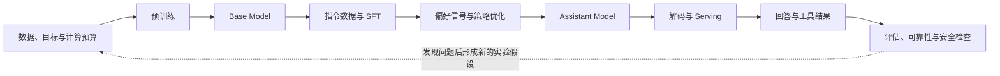

# 第三部分：训练、对齐与推理

这一部分把前两部分的模型结构落到一条完整的工程链路上：先用数据训练出 base model，再通过指令微调和偏好优化改变模型的行为，最后讨论生成、部署、评估与安全。第 16--18 讲关注“模型怎样被训练出来”，第 19--23 讲关注“模型怎样学会按要求回答”，第 24--28 讲关注“模型怎样高效、可靠地服务用户”，第 29--30 讲则把这些知识转化为研究判断、实验设计和系统复盘。

这里的“流程”不是一条所有团队都完全相同的流水线。模型规模、数据许可、硬件、产品风险和评估目标都会改变具体做法；书中给出的公式和代码首先用于建立可复核的心智模型，落地时还需要结合框架实现和真实基准测试。

### 两条阅读线：先建立直觉，再建立边界

初学者可以先把本部分看成一条因果链：预训练决定模型会什么，SFT 决定模型怎样按格式回答，偏好优化决定哪些回答更被选择，推理系统决定回答能否及时产生，评估与安全决定这个回答能否被信任。每个阶段后面的例子都尽量把抽象变量换成可手算的数量，例如 token 数、显存字节数、概率差和错误率。

有经验的读者则应关注链条中的接口是否保持一致：数据分布是否改变了目标，mask 是否改变了梯度，reference 是否限制了策略漂移，prefill 与 decode 是否被混为同一个瓶颈，代理指标是否与真实目标脱钩。相同的章节因此会同时给出直觉、公式、反事实实验和证据边界；直觉帮助定位问题，公式说明变量关系，实验负责排除替代解释。

本部分的章节按“训练出基础模型—改变回答行为—生成并检查回答”组织：



这是帮助阅读的生命周期抽象，不是所有团队共用的固定配方，也不表示每个系统都会运行相同的偏好优化步骤。第 16–18 讲解释模型和训练系统，第 19–23 讲解释回答行为如何被调整，第 24–28 讲转向生成、服务和可信度；第 29–30 讲把前面的文本模型链路转为研究问题和综合实验。

## 本文件的阅读路径

本文件接住第二部分给出的 decoder-only Transformer、token 序列和 next-token loss。阅读顺序是：先确定预训练要得到什么模型，再看数据和计算预算如何影响目标，最后看单机训练怎样扩展到多卡系统。读完后应能描述一个 checkpoint 从语料到训练状态的主要接口，并指出数据、目标、计算和分布式系统各自会留下什么证据。

~~~mermaid
flowchart LR
    A["目标与数据契约"] --> B["语料清理、去重与切分"]
    B --> C["Tokenization 与 Packing"]
    C --> D["模型和优化配置"]
    D --> E["分布式训练与监控"]
    E --> F["Checkpoint 与独立评估"]
~~~

## 第 16 讲：LLM 预训练流程

### 16 讲·预训练的对象与边界

前面我们已经知道 GPT 类模型的结构和训练目标。本讲从更高层看：如果要训练一个基础大语言模型，从原始数据到可用 checkpoint，需要经历哪些步骤？

这一讲围绕以下问题展开：

1. LLM 预训练的整体流程。
2. 预训练数据从哪里来。
3. 数据清洗、去重、过滤为什么重要。
4. tokenizer 和数据 packing 在训练中的作用。
5. 训练时需要监控哪些指标。
6. checkpoint 如何保存、恢复和选择。
7. base model 为什么还不能直接成为好助手。

### 什么是预训练

对 decoder-only 语言模型，预训练通常是在大量 token 序列上最小化 next-token 负对数似然。模型会拟合训练语料中的统计规律，并可能在下游任务中表现出语言、知识、代码或推理能力；这些表现仍需用独立评估验证，不能仅从训练目标推出。

对于 GPT 类模型，预训练目标通常是：

```text
next-token prediction
```

预训练得到的模型通常叫：

```text
base model
```

Base model 的主要训练目标是续写文本，因此不应把“能生成连贯文字”直接等同于“能稳定遵循用户指令”。模型进入助手场景后通常还会经过 SFT、偏好优化等后训练，具体流程因模型而异。

### 预训练总流程

一个简化的大模型预训练 pipeline：

```text
1. 明确模型目标
2. 收集原始数据
3. 清洗、去重、过滤数据
4. 训练或选择 tokenizer
5. 将文本 tokenization
6. 构造训练样本和 packing
7. 设计模型架构
8. 配置训练系统
9. 执行大规模训练
10. 监控 loss、吞吐、梯度和评估指标
11. 保存 checkpoint
12. 评估 checkpoint
13. 选择 base model 进入后训练
```

预训练不是“写个训练脚本跑起来”这么简单，而是数据、模型、优化、系统、评估和成本共同组成的工程系统。

### 第一步：明确模型目标

训练前要先回答：这个模型要做什么？

例如：

1. 通用聊天。
2. 代码生成。
3. 数学推理。
4. 多语言能力。
5. 专业领域问答。
6. 多模态理解。

目标会影响：

1. 数据配比。
2. tokenizer 设计。
3. 模型规模。
4. context length。
5. 评估集。
6. 后训练策略。

### 第二步：收集原始数据

预训练数据可能来自：

1. 网页文本。
2. 书籍。
3. 论文。
4. 百科。
5. 新闻。
6. 论坛和问答。
7. 代码仓库。
8. 数学数据。
9. 多语言数据。
10. 合成数据。

不同数据来源质量差异很大。

高质量数据通常更有价值，但规模、覆盖面和多样性也很重要。

### 第三步：数据清洗

原始网页数据非常脏，常见问题包括：

1. HTML 模板和导航栏。
2. 广告和垃圾文本。
3. 重复页面。
4. 乱码。
5. 低质量机器生成内容。
6. 色情、暴力、有害内容。
7. PII 和隐私信息。
8. benchmark 泄漏。

数据清洗不是“把文本变得像标准书面语”。方言、少数语言、代码、公式和口语都可能是目标能力的一部分；机械过滤会同时删掉噪声和有效信号。实际流程应抽样检查过滤前后的文档，记录规则版本、删除比例和被误删的例子。还要保留来源、采集时间、使用限制及处理版本等元数据；文本质量筛选不能替代数据来源与使用条件的审查。

清洗目标：

1. 提高信号质量。
2. 降低噪声和有害内容。
3. 减少重复。
4. 降低评估污染。
5. 改善模型学习效率。

### 第四步：去重和污染检测

去重是控制重复暴露和训练/评估重叠的一种手段。Lee 等人在 C4 等数据集的实验中发现了大量近重复内容，并报告其特定模型和数据设置下的记忆输出与训练/验证重叠变化；这说明重复值得检查，但不意味着任何去重规则都会普遍提升所有任务。

常见去重：

1. exact dedup：完全重复去重。
2. near dedup：近重复去重。
3. document-level dedup：文档级去重。
4. benchmark contamination check：检查评估集是否泄漏到训练集。

训练集与 benchmark 有重叠会削弱“模型未见过测试题”的解释，但仅检测到文本重叠，不足以断言分数必然虚高。影响取决于重叠的是题目、答案还是无关片段，以及模型训练时如何见到这些内容。GPT-3 论文报告多数被检查数据集的影响较小，但也标记或不报告少数可能受影响的结果；检测本身也可能漏掉污染。这里先建立风险意识，具体检测与评估边界见第 17 讲。

### 第五步：Tokenizer

Tokenizer 可以自己训练，也可以选择已有 tokenizer。

需要考虑：

1. 词表大小。
2. 多语言压缩率。
3. 代码压缩率。
4. 数字、公式、符号处理。
5. 特殊 token。
6. chat template 预留。
7. 多模态 token 预留。

Tokenizer 一旦确定，后续更换成本很高，因为它和 embedding matrix 强绑定。

### 第六步：Tokenization 和 Packing

文本清洗后，需要转成 token id。

为了提高训练效率，通常会把多个文档拼接或 packing 成固定长度序列。

例如 block size 是 2048：

```text
doc1 + EOS + doc2 + EOS + doc3 ... -> chunk into 2048 tokens
```

Packing 的作用：

1. 减少 padding。
2. 提高 GPU 利用率。
3. 稳定 batch shape。

但要小心：

1. 文档边界要处理好。
2. EOS token 要正确插入。
3. 如果目标把文档视为彼此独立的样本，就要在注意力或样本构造中落实边界；单独插入 EOS 不会自动隔离前后文。

### 最小 demo：文档 packing 和 input/label 构造

下面这个 demo 用整数 token 模拟预训练数据 packing。重点不是 tokenizer 本身，而是理解：多个文档通常会用 EOS 分隔后拼接，再切成固定长度训练块；label 是 input 右移一位。

```python
EOS = 0
docs = [
    [11, 12, 13],
    [21, 22],
    [31, 32, 33, 34],
]

block_size = 5
if block_size <= 0:
    raise ValueError("block_size must be positive")

stream = []
for doc in docs:
    stream.extend(doc)
    stream.append(EOS)

chunks = []
for start in range(0, len(stream) - block_size, block_size):
    x = stream[start:start + block_size]
    y = stream[start + 1:start + block_size + 1]
    chunks.append((x, y))

print("token stream:", stream)
for i, (x, y) in enumerate(chunks[:3]):
    print(f"chunk {i} input={x} label={y}")
```
> **代码状态：已验证（2026-10-07；Python 3.13.13；标准库）**


输出示例：

```text
token stream: [11, 12, 13, 0, 21, 22, 0, 31, 32, 33, 34, 0]
chunk 0 input=[11, 12, 13, 0, 21] label=[12, 13, 0, 21, 22]
chunk 1 input=[22, 0, 31, 32, 33] label=[0, 31, 32, 33, 34]
```

这里采用固定长度、步长等于 `block_size` 的非重叠切块；示例末尾不足一个完整块的 `34 -> EOS` 预测对被丢弃，实际数据管道也可以补齐并把 padding 位置从 loss 中屏蔽。`0` 是 EOS 分隔符，但它本身不会阻止后续 token 通过 causal attention 读取前一篇文档。若把每篇文档定义为独立训练样本，就还要用文档边界 attention mask 或其他构造方式落实隔离；若训练目标把拼接后的 token stream 当作连续上下文，则跨文档可见性是另一种明确的目标选择。ACL 2024 的 packing 实验比较了普通因果 mask 与文档内因果 mask，在其模型和数据设置下观察到前一篇无关文档可能成为干扰，并同时报告了隔离策略的额外运行开销。真实系统还要处理数据源权重、loss mask、shuffle 和分布式 dataloader 状态。

### 第七步：模型架构设计

需要确定：

1. 参数量。
2. 层数。
3. hidden size。
4. head 数。
5. context length。
6. MLP hidden size。
7. norm 类型。
8. 位置编码。
9. MHA/MQA/GQA。
10. 是否使用 MoE。

架构设计要平衡：

1. 训练成本。
2. 推理成本。
3. 目标能力。
4. 数据规模。
5. 硬件条件。

### 第八步：训练配置

训练配置包括：

1. optimizer：通常 AdamW。
2. learning rate。
3. warmup steps。
4. decay schedule。
5. batch size。
6. sequence length。
7. gradient clipping。
8. mixed precision。
9. distributed strategy。
10. checkpoint interval。

这些配置会极大影响训练稳定性。

### 第九步：分布式训练

大模型通常无法在单张 GPU 上训练。

常见并行策略：

1. Data Parallel。
2. FSDP / ZeRO。
3. Tensor Parallel。
4. Pipeline Parallel。
5. Sequence Parallel。
6. Context Parallel。

第 18 讲会展开。这里先记住：训练大模型是算法和系统共同问题。

### 第十步：训练监控

预训练中需要持续监控：

1. training loss。
2. validation loss。
3. perplexity。
4. learning rate。
5. gradient norm。
6. tokens/sec。
7. GPU utilization。
8. MFU。
9. loss spike。
10. NaN / Inf。
11. checkpoint 保存和恢复状态。

只看 loss 是不够的。吞吐、梯度、数值稳定性和评估结果都很重要。

### 第十一步：Checkpoint

断点续训时，checkpoint 应能说明“参数当前在哪里、下一步如何继续”。一个实用清单是：

| 保存内容 | 它记录什么 | 缺失时的影响 |
| --- | --- | --- |
| 模型参数 | 当前权重 | 不能从该状态继续训练 |
| optimizer、scheduler 和 global step | 动量等优化器状态、学习率进度与更新计数 | 权重虽能加载，但后续更新轨迹已改变 |
| RNG 与数据采样器/游标状态 | 随机操作和接下来读取的数据位置 | 样本顺序或随机过程可能变化；分布式实现需按框架保存对应状态 |
| 配置、tokenizer、数据版本和评估摘要 | 解释 checkpoint 如何产生、应如何比较 | 难以复现输入契约或判断指标是否可比 |

以 AdamW 为例，optimizer 还持有一阶、二阶矩等更新状态；只加载权重相当于重新开始优化器过程，不是原训练的无缝续跑。PyTorch 的通用 checkpoint 教程也建议把模型与 optimizer 的 `state_dict` 等训练信息一起保存。分片训练会使用框架特定的保存和恢复接口，第 18 讲再展开。

保存完整状态有助于续训，但不等于承诺逐位复现：随机数来源、数据 worker、非确定性算子、硬件和软件版本都会影响结果。PyTorch 2.14 的复现说明明确指出，跨版本或平台不保证完全相同；因此应把“恢复训练状态”和“逐位重放同一次运行”区分开。

### 第十二步：评估 checkpoint

Checkpoint 评估包括：

1. validation loss。
2. perplexity。
3. 基础 benchmark。
4. 代码能力。
5. 数学能力。
6. 多语言能力。
7. 长上下文能力。
8. 安全和有害输出初筛。
9. 数据污染检查。

预训练阶段的评估不一定要像最终 chat model 那样看用户体验，但要判断 base model 的基础能力是否健康。

### Base Model 为什么不能直接聊天

因此，提示词把它放进问答情境，并不代表它已经训练出稳定的助手行为。

它可能会：

1. 继续补全文档。
2. 模仿网页格式。
3. 不知道应该遵循用户指令。
4. 输出不安全内容。
5. 不会拒答。
6. 回答风格不稳定。

常见后续阶段包括：

1. Instruction Tuning。
2. SFT。
3. RLHF / DPO。
4. Safety training。

### 一个可手算的预训练账本

假设训练计划消费 1T 个 token，序列长度为 2048，global batch size 为 512 个序列，并且每个位置都参与 loss，那么每次 optimizer update 对应 `2048 × 512 = 1,048,576` 个目标 token，约需 95.4 万次更新。若有 padding、被 mask 的标签、尾块丢弃或恢复时重复读取，输入 token 数与实际参与 loss 的目标 token 数会不同，账本要分别记录。若候选语料有 1.2T token 且不重复采样，这个计划约使用其中六分之五；若重复采样，则还要记录重复暴露。

这个数量关系解释了为什么“训练了几步”不是一个充分的进度指标。两个实验都跑 10,000 steps，如果一个使用 2048 长度、另一个使用 4096 长度，它们看到的 token 数和优化噪声并不相同。记录 tokens seen、有效 loss token、数据混合比例和每步 wall-clock，才能比较训练进度。

对初学者来说，这是一张“数据进来、参数更新、指标出去”的账；对有经验的读者来说，它还提示了有效 token 和分领域评估之间的接口。训练系统应把数据/Tokenizer 版本、配置、有效 loss token、checkpoint 和评估结果绑定到同一个 run id，后面的后训练比较才有依据。

### 16 讲·训练现场的故障模式

| 观察到的信号 | 先核对什么 |
| --- | --- |
| loss 突然上升或出现 NaN | 当前 batch、有效标签数、学习率、梯度范数和数值精度 |
| tokens/sec 低 | profile 数据输入与计算/通信等待；GPU 利用率单独看不能说明瓶颈位置 |
| validation loss 下降、某领域指标回退 | 固定评估版本和口径，查看分领域结果，再排查数据变化与污染风险 |

这些信号用于缩小排查范围，不是单一原因的证明；并行通信的细节见第 18 讲。

### 从流程到实验：预训练决策如何被复核

把预训练流程画成箭头还不够，因为每一个箭头都可能改变最终能力。更可靠的做法是为每次训练建立一份可追踪的实验账本：数据版本和混合比例、tokenizer 哈希、模型配置、优化器超参数、随机种子、有效 token 数、checkpoint 状态以及评估集版本都要能够对应起来。

例如，某个 checkpoint 的验证损失下降了，但代码能力下降。这个现象至少有四种不同解释：代码数据比例改变，通用网页数据稀释了代码信号；tokenizer 对代码符号的切分变差；训练过度导致某些能力回归；或者评估集被污染。没有数据版本、tokenizer 统计和分领域评估，就无法区分这些原因。

checkpoint 选择应先设定不可妥协的门槛，再查看分领域指标，而不是把指标直接加成一个总分。loss、准确率、拒答率和成本的单位与优化方向不同；如果没有明确的归一化方法和业务效用定义，加权求和会制造一个看似精确、实际难以解释的分数。对通用模型，应分别报告知识、代码、数学、多语言、长上下文、安全和成本；对代码模型，还应报告编译通过率、单元测试通过率和工具调用格式正确率。先剔除未达到预设安全、格式或资源门槛的 checkpoint，再依据目标场景比较剩余候选的指标向量；若必须汇总成单一分数，应在评估前固定指标方向、归一化基准和权重，并同时保留原始分项结果。

恢复训练时要先区分两种操作：恢复权重但重置 optimizer、scheduler 或数据游标，是一次 warm start；恢复完整状态，才是在尝试延续原 run。比较时固定软件/硬件、数据版本和配置，检查 global step、学习率、下一批样本及短程 loss 是否按预期衔接。完整状态下仍可能因非确定性算子而无法逐位重合；权重重启后曲线不同也不自动证明 checkpoint 损坏。应先把两种操作标成不同实验，再调查状态缺项。

### 16 讲·预训练的反例与边界

1. 误区：预训练就是跑 next-token loss。
   纠正：真实预训练还包括数据、tokenizer、分布式系统、监控、评估和 checkpoint 管理。

2. 误区：数据越多越好。
   纠正：token 总量本身不能说明学习信号、重复暴露和目标能力是否合适。

3. 误区：checkpoint 只保存模型权重。
   纠正：续训需要恢复对应训练状态；只恢复权重是 warm start。

4. 误区：base model 可以直接当 ChatGPT。
   纠正：续写目标不等于助手行为，后训练会调整交互目标，但不保证回答正确或安全。

### 16 讲·预训练账本复核

1. 序列长度为 2048、global batch 为 512 条序列时，理想情况下每次更新处理多少目标 token？
2. 只插入 EOS 与使用文档边界 attention mask 分别约束什么？
3. 训练/benchmark 文本有重叠，为什么还不能直接断定分数虚高？
4. 从 checkpoint 恢复权重但重置 AdamW 状态，属于续跑还是 warm start？
5. 两个 checkpoint 的平均 loss 接近时，应保存哪些分领域结果辅助选择？

### 16 讲·从数据到 checkpoint 的关键结论

这一讲的关键关系：

1. 预训练是训练 base model 的过程。
2. GPT 类预训练目标通常是 next-token prediction。
3. 预训练 pipeline 包含数据、tokenizer、模型、优化、系统、监控、checkpoint 和评估。
4. 数据清洗、去重和污染检测要结合采样审查与独立评估解释。
5. 续训 checkpoint 要包含恢复所需状态；逐位复现还受实现和运行环境限制。
6. base model 的续写目标不等于助手行为；后训练用于调整交互目标，但不保证正确或安全。

### 16 讲·预训练资料边界

decoder-only 语言模型和 next-token 目标的例子见 [GPT-3 论文](https://arxiv.org/abs/2005.14165)。关于重复数据与记忆/训练集—验证集重叠的实证结果，见 [Lee et al., ACL 2022](https://aclanthology.org/2022.acl-long.577/)；污染的时间分析和检测方法，见 [Li 与 Flanigan，AAAI 2024](https://arxiv.org/abs/2312.16337)。[Packing and Masking Strategies, ACL 2024](https://aclanthology.org/2024.acl-long.427.pdf) 的结论只适用于该文测试的模型、语料和 mask/packing 配置。checkpoint 清单参考 [PyTorch 2.14 保存/加载教程](https://docs.pytorch.org/tutorials/beginner/saving_loading_models.html)，复现限制参考 [PyTorch 2.14 Reproducibility](https://docs.pytorch.org/docs/2.14/notes/randomness.html)。[InstructGPT 论文](https://arxiv.org/abs/2203.02155)展示了特定 prompt 分布下的人工偏好比较。本讲的流程是教学抽象，数据许可、分片格式、评估协议与团队的过滤策略都需要按具体项目确认。

## 第 17 讲：数据质量与 Scaling Law

### 17 讲·规模化问题的边界

第 16 讲我们讲了预训练流程。本讲深入两个核心问题：模型变强到底靠什么？更多参数、更多数据、更多计算之间如何权衡？

这一讲围绕以下问题展开：

1. 什么是 scaling law。
2. 参数量、数据量、计算量如何共同影响模型性能。
3. Chinchilla scaling law 的核心启发。
4. 为什么数据质量可能比数据规模更重要。
5. 数据配比和数据污染如何影响评估。
6. 如何把 scaling law 转化为可检验的训练预算决策。

### 问题背景

在一段受测规模范围内，增加参数、数据或计算通常会降低 held-out 语言建模 loss；这不等于每种下游能力都会按同一比例提升。

但问题是：资源不是无限的。

如果你有固定预算，应该：

1. 训练更大的模型？
2. 喂更多 token？
3. 提高数据质量？
4. 做更长训练？
5. 做更好的后训练？

Scaling law 就是在研究这些变量和模型性能之间的规律。

### 什么是 Scaling Law

Scaling law 是用经验拟合描述模型规模变量与语言建模 loss 之间的规律。经典实验观察到，在没有被其他资源变量卡住的范围内，held-out cross entropy 会随参数量、数据量和训练计算近似按幂律变化；这是特定 Transformer、语料和训练范围内的实验规律，不等同于下游能力的通用增长定律。[Kaplan 等，2020](https://arxiv.org/abs/2001.08361)

常见规模变量：

1. 模型参数量 `N`。
2. 训练 token 数 `D`。
3. 训练计算量 `C`。

性能指标通常用 validation loss 或 cross entropy 表示。

一种常见的拟合形式是：

~~~math
L(N,D)\approx L_\infty+\frac{A}{N^\alpha}+\frac{B}{D^\beta}
~~~

这里 `N` 是模型参数规模，`D` 是训练 token 数；参数口径按具体研究定义，Kaplan 等的拟合排除词表与位置 embedding 参数。$A,B,\alpha,\beta,L_\infty$ 由具体实验拟合。它是描述特定模型族、数据和训练设置的近似式，不是对所有模型能力的普遍定律。作为补充，dense Transformer 常用 $C\approx6ND$ 估算训练 FLOPs；严格复算时，`N` 应按所选估算口径计数，注意力、上下文长度、模型结构和实现都会改变实际计算量。[Kaplan 等，2020](https://arxiv.org/abs/2001.08361)

直觉：

```text
模型更大、数据更多、计算更多，loss 通常会下降
```

但下降不是线性的，而是有规律地逐渐变慢。

### 参数量、数据量、计算量

参数量决定模型容量。

数据量决定模型能学习多少分布信息。

计算量决定你能训练多大模型、训练多少 token。

三者互相制约。

如果模型太大但数据太少：

1. 容易 under-train。
2. 参数没有充分学习。
3. 计算资源浪费。

如果数据很多但模型太小：

1. 模型容量不足。
2. 无法吸收数据中的复杂模式。

如果计算不足：

1. 模型和数据都无法充分利用。

### Compute-Optimal Training

在固定计算量下，问题是：参数量和训练 token 数应该怎么分配？

早期很多模型偏向训练很大的模型，但训练 token 数相对不足。

Chinchilla 的实验指出，许多当时的大模型相对其参数量训练 token 不足；在论文的固定计算预算和模型/数据设定中，参数量与训练 token 大致同比例扩展，即参数量翻倍时 token 数也翻倍。[Hoffmann 等，2022](https://arxiv.org/abs/2203.15556) 由此可见，固定预算下用较小模型训练更多 token 可能得到更低的预训练 loss；新架构、新语料或不同目标仍需重新测量。

直觉：

```text
不要只把钱花在更大模型上，也要给模型足够多高质量 token。
```

### 数据质量为什么重要

数据不是越多越好。

低质量数据可能带来：

1. 噪声。
2. 错误事实。
3. 重复内容。
4. 有害内容。
5. 模板和广告。
6. 风格污染。
7. benchmark contamination。

质量与覆盖面都会影响有效学习信号，但“高质量”的定义依任务而变。过滤、增加某一领域比例或加入合成数据，都应在固定 token/计算口径下通过验证集和目标任务评估，而不是假定单一质量分数能够预测所有能力。

例如：

1. 增加代码数据可能改变代码任务表现，也可能改变其他领域的指标。
2. 数学、多语言或指令格式数据的收益需按目标任务验证。
3. 训练 loss 只能说明指定验证分布上的预测误差，不能代替这些任务评估。

### 数据配比

Data mixture 是预训练中的关键问题。

一个通用 LLM 的数据可能包含：

1. 通用网页。
2. 书籍。
3. 论文。
4. 代码。
5. 数学。
6. 多语言。
7. 问答。
8. 专业领域数据。

不同配比会影响模型能力。

配比也可以通过受控实验或代理目标来估计，而不只靠人工指定。[DoReMi](https://arxiv.org/abs/2305.10429) 先用 280M 参数 proxy model 对数据域做 Group DRO 重加权，再用得到的比例训练 8B 模型；在其 The Pile 实验中，few-shot 平均准确率比默认比例高 6.5 个百分点，并以基线约 `1/2.6` 的训练步数达到基线准确率。该结果说明配比值得优化，具体比例仍受数据域、proxy、模型和评测任务限制。

例如：

1. 增加代码比例可能改变代码和自然语言两类任务表现，需分别测量。
2. 英文占比和中文任务表现之间的关系要通过多语言评估确认。
3. 数学数据占比变化应与数学任务成绩、通用 loss 一起观察。
4. 合成数据的作用取决于生成方式、自然数据来源、模型规模和训练预算，不能只用“比例越高越好”或“合成数据必然退化”概括。

“合成数据”也不是一个单一类别。把自然文本改写、由模型独立编写教材、由程序构造的数学/代码题，产生的训练分布和错误模式并不相同。一个报告了超过 1,000 个模型、总计超过 100,000 GPU 小时实验的 2025 年系统研究发现：只用改写文本并没有比自然网页文本更快达到相同验证 loss；在较大数据预算下，约 `1/3` 改写文本与 `2/3` 自然网页文本混合，在该研究设定中达到相同验证 loss 的速度提高约 5–10 倍；只用教材风格生成文本，则在许多下游域、特别是小数据预算下出现更高 loss。另一项 2026 年预印本把“生成改写数据花掉的计算”也纳入 scaling law，在其 compute-limited 设定下估计的最优改写比例随预算增加而上升。两项研究共同提示的不是某个通用配方，而是要把数据类型、可用自然数据、生成成本和目标预算放进同一个比较中。

| 研究 | 具体观察 | 解释边界 |
| --- | --- | --- |
| Kang 等，2025 | 在该研究设置中，约 1/3 改写文本与 2/3 自然网页文本的组合，在较大数据预算下达到相同验证 loss 的速度提高约 5–10 倍；纯教材式生成数据在若干下游域的 loss 更高 | 不能把 1/3 或 5–10 倍当成所有模型、语料和预算下的结果，也不能将教材数据的发现推广到所有合成数据 |
| Roberts 等，2026 预印本 | compute-limited scaling-law 估计中，改写比例从 `3×10^18` FLOPs 下低于 10%，升到 `10^22` FLOPs 下约 32% | 这是预印本中的拟合与外推，不是通用最优比例或生产训练结论；其数据受限设定采用不同假设 |
| Subramanyam 等，ICLR 2026 | 将质量参数纳入 loss scaling 形式，并在人工控制噪声的机器翻译与自回归实验中检验预测 | 参数估计和实验依赖特定数据质量定义与合成噪声设置；不能把它当作任意语料的通用质量评分，也不能据此断言清洗总能减少模型规模 |

读这类结果时要先对齐比较对象：相同训练 token 不等于相同总计算，因为一侧可能额外花了生成数据的计算；相同验证 loss 也不等于相同下游能力，因为数据域和评价集不同。因而在项目里应同时记录生成器、种子语料、重写方法、去重方式、生成成本、混合比例、训练 token、目标验证集和下游任务。比例是待验证的决策变量，不是可以脱离条件复制的行业常数。

来源：[Demystifying Synthetic Data in LLM Pre-training](https://arxiv.org/abs/2510.01631)；[Rewriting Scaling Laws for Synthetic Data with Compute and Data Constraints](https://arxiv.org/abs/2610.31867)（2026 年预印本）；[Scaling Laws Revisited: Modeling the Role of Data Quality in Language Model Pretraining](https://proceedings.iclr.cc/paper_files/paper/2026/hash/d0c80a0c294a16190c8904b9809c5fba-Abstract-Conference.html)。

### 数据重复和记忆

重复曝光会改变样本的实际抽样权重；大量近重复还可能增加记忆和训练/评估重叠风险。Lee 等人在其 C4 与特定模型实验中报告，去重后模型未提示时复现训练文本的频率约下降一个数量级；这一结果说明应检查重复度，不证明所有重复样本都会伤害每个任务。[论文](https://aclanthology.org/2022.acl-long.577/)

可能的影响包括：

1. 训练 loss 虚低。
2. 泛化能力下降。
3. 重复暴露会影响对个人信息的暴露风险判断；去重不能替代隐私和许可审查。
4. benchmark 污染风险增加。

因此，去重与抽样审计是预训练数据 pipeline 的重要检查；规则、阈值和删除比例应与数据覆盖及目标任务一起评估。

### 17 讲·Benchmark Contamination

如果评估样本或其答案进入训练数据，模型可能利用见过的内容；但发现文本重叠本身还不足以证明模型记住了答案或分数一定被抬高。

这会造成以下风险：

1. benchmark 分数虚高。
2. 错误判断模型能力。
3. 研究结论不可信。
4. 模型版本比较失真。

污染检测常见方法：

1. exact match。
2. near duplicate search。
3. n-gram overlap。
4. embedding similarity。
5. 时间切分评估。

这些方法的召回率和误报率不同；时间切分也可能同时改变任务难度和数据分布。应把 overlap 检查与新旧测试集、任务切片和评估版本记录结合起来。[GPT-3 论文](https://arxiv.org/abs/2005.14165)报告多数 benchmark 的清洁子集分数变化很小，但个别结果需要标记或不报告；论文也提醒清洁子集可能改变样本分布。[Li 与 Flanigan，AAAI 2024](https://arxiv.org/abs/2312.16337)发现，训练语料检查和任务例提取在其设置下召回率较低，而时间分析召回率较高但误报也更多；语料不可得、格式和模型行为差异会限制直接检查。具体来源与边界见第 16 讲资料及本讲末尾引用。

### Scaling Law 的局限

Scaling law 很有用，但不能迷信。

局限包括：

1. 它通常基于 validation loss，而不是所有能力。
2. loss 下降不一定等于 reasoning 提升。
3. 数据质量变化会改变曲线。
4. 后训练会显著改变模型行为。
5. 多模态、agent、安全能力不一定能用同一条 loss 曲线解释。
6. 推理时计算 test-time compute 也会影响能力。

所以 scaling law 是资源规划工具，不是能力解释的全部。

### 一个预算决策的 worked example

以统一口径的非 embedding 参数量 `N` 和训练 token `D` 做量级估算，$C\approx6ND$。三个候选的代入过程如下：

| 方案 | 代入计算 | 估算训练 FLOPs |
| --- | --- | --- |
| 30B 非 embedding 参数、1T token | $6\times(30\times10^9)\times(1\times10^{12})=180\times10^{21}$ | $1.8\times10^{23}$ |
| 10B 非 embedding 参数、3T token | $6\times(10\times10^9)\times(3\times10^{12})=180\times10^{21}$ | $1.8\times10^{23}$ |
| 7B 非 embedding 参数、4T token | $6\times(7\times10^9)\times(4\times10^{12})=168\times10^{21}$ | $1.68\times10^{23}$ |

三组预算接近，但计算量相近不代表训练结果相同：30B 方案可能 token 不足，7B 方案可能容量不足，10B 方案则处于中间。是否适合目标任务，需要小规模 proxy 试验和分领域评估。

先在缩小版模型上做比例实验，并固定数据质量。若增加 token 只改善 validation loss，却没有改善代码和数学切片，应检查数据是否重复、任务是否需要后训练或验证器。若高质量数据减少了总 token 却提升单位 token 的收益，说明“有效数据量”比原始 token 数更适合做资源决策。

还要把推理成本纳入选择。一个较大的 dense 模型可能在一次请求上更准确，但在相同 GPU 预算下可服务并发更低；一个较小模型可能需要更多 test-time samples 才达到同等成功率。最终目标不是最小化单一训练 loss，而是比较单位成功任务的训练成本、推理成本和质量。

### 最小 demo：固定 compute 下的参数和 token 权衡

预训练里常用 $C\approx6ND$ 粗估 decoder-only Transformer 的训练计算量，其中 `N` 是非 embedding 参数量，`D` 是训练 token 数；这种估算依赖 dense Transformer 等近似假设，不是精确 profiler。[Kaplan 等，2020](https://arxiv.org/abs/2001.08361) 给出每个训练 token 约 $6N$ 的非 embedding FLOPs 估算；[Chinchilla 论文](https://arxiv.org/abs/2203.15556)也采用该近似构造 compute-optimal 前沿。

```python
import math


def estimate_compute(params_billion, tokens_trillion):
    if not all(math.isfinite(value) and value > 0 for value in (params_billion, tokens_trillion)):
        raise ValueError("parameter and token counts must be positive and finite")
    params = params_billion * 1e9
    tokens = tokens_trillion * 1e12
    flops = 6 * params * tokens
    return flops


plans = [
    (30, 1),
    (10, 3),
    (7, 4),
]

for params_b, tokens_t in plans:
    flops = estimate_compute(params_b, tokens_t)
    print(f"{params_b}B params, {tokens_t}T tokens -> {flops:.2e} FLOPs")
```
> **代码状态：已验证（2026-10-07；Python 3.13.13；标准库）**


输出示例：

```text
30B params, 1T tokens -> 1.80e+23 FLOPs
10B params, 3T tokens -> 1.80e+23 FLOPs
7B params, 4T tokens -> 1.68e+23 FLOPs
```

这里代码输入的参数规模对应上文的 `N`，即非 embedding 参数量；若实际估算使用其他参数口径，应先按同一口径换算输入。

这个例子说明：同样训练预算下，不是只能选择“更大模型”。你也可以选择较小模型加更多高质量 token。真实决策还要同时考虑数据质量、目标能力、推理成本、训练稳定性和后训练效果。

### 17 讲·数据与预算的失败模式

| 容易犯的错误 | 需要补上的控制 |
| --- | --- |
| 只记录参数量，不记录训练 token | 对齐有效 token 和估算 FLOPs，再讨论 compute-optimal |
| 更换 mixture 却不保留数据版本 | 记录域比例、采样权重、数据版本和去重规则 |
| 只比较平均 validation loss | 固定评估集，并报告代码、数学、多语言等目标切片 |
| 增加合成数据却忽略生成成本 | 同时核算生成 FLOPs、训练 FLOPs 和数据类型 |

### 把 scaling law 变成可执行的预算实验

Scaling law 的价值不在于给出一个脱离语境的“最佳参数量”，而在于帮助我们排除明显不合理的预算分配。先用 C ≈ 6ND 做量级估算，再对参数量、token 数和数据质量做小规模实验；如果只改变模型大小而不记录有效数据量，实验就无法回答“容量不足”还是“训练不足”。

一个实用的实验矩阵可以固定总计算量，比较三组方案：较大模型配较少 token、中等模型配平衡 token、较小模型配较多 token。每组都使用同一验证集，并额外报告代码、数学、多语言和记忆/污染切片。若较小模型的验证损失更好但推理任务没有提升，不能据此否定 scaling law；这说明 next-token loss 与目标能力之间存在转换损失，或者后训练和 test-time compute 才是瓶颈。

数据质量需要单独做消融。可以把数据分成高质量集合 D_h 和普通集合 D_l，在相同 token 预算下比较不同混合比例：

~~~math
D(\alpha)=\alpha D_h+(1-\alpha)D_l,\qquad 0\leq\alpha\leq1
~~~

然后同时观察训练损失、单位有效 token 的收益、分领域能力和重复率。若增加低质量数据让总 loss 略降，却让事实性或代码通过率下降，那么“更多数据”并没有带来更多有效学习信号。

Chinchilla 的结论来自特定模型族、数据和计算设定，不能机械外推到所有 MoE、长上下文或后训练系统。书中引用它时，证据边界应写清楚：它支持“参数与训练 token 需要共同规划”这一原则，不直接证明某个新模型的最佳数据配比。

### 17 讲·Scaling Law 的反例与边界

1. 误区：参数越多模型一定越好。
   纠正：还要看训练 token、数据质量、计算预算和目标任务。

2. 误区：数据越多越好。
   纠正：低质量或重复数据可能改变 loss、泛化、记忆与评测重叠，实际影响要按目标任务测量。

3. 误区：scaling law 可以解释所有能力。
   纠正：reasoning、安全、多模态、agent 能力还需要专门评估。

4. 误区：benchmark 分数高就一定强。
   纠正：分数还受数据重叠、任务难度、评测实现和切片构成影响，应结合污染检查及独立评估解释。

### 17 讲·数据与规模的复核实验

1. 按 $C\approx6ND$ 比较 30B/1T 与 10B/3T 两组训练预算；这个等式没有预测哪些领域的成绩更高，下一步要测什么？
2. 设计数据 mixture ablation：哪些变量要固定，哪些分领域指标要报告？
3. 比较改写数据与从零生成的教材数据时，为什么要同时记生成器、种子语料、训练 token 和生成 FLOPs？
4. 找出训练集/benchmark 重叠证据后，还缺哪些证据才能判断评估是否失真？

### 17 讲·从规模规律到预算决策的关键结论

这一讲的关键关系：

1. Scaling law 在受测范围内描述参数量、数据量、计算量和 held-out loss 的关系。
2. 固定 compute 下，模型大小和训练 token 数需要共同规划。
3. Chinchilla 的实验显示，当时许多模型相对参数量训练 token 不足；具体比例需在新设定下重新测量。
4. 数据质量与覆盖会影响有效学习信号，需结合目标任务验证。
5. 数据配比会改变训练中各领域信号的权重，最终能力分布要用分领域评估确认。
6. 重复数据和 benchmark contamination 可能影响记忆、训练/评估重叠及分数解释。
7. Scaling law 是重要工具，但不能替代任务评估、安全评估和真实用户评估。

### 17 讲·Scaling Law 资料边界

经典 scaling law 的 held-out cross entropy 拟合见 [Kaplan et al., 2020](https://arxiv.org/abs/2001.08361)，compute-optimal 参数/token 关系见 [Hoffmann et al., 2022](https://arxiv.org/abs/2203.15556)。两者的实验结论都依赖各自的模型族、数据和预算设定。数据 mixture 的代理重加权实验见 [DoReMi, NeurIPS 2023](https://arxiv.org/abs/2305.10429)；合成数据类型与比例的条件性结果见 [Kang 等，2025](https://arxiv.org/abs/2510.01631)，计算受限下的改写比例估计来自 [Roberts 等，2026 预印本](https://arxiv.org/abs/2610.31867)。质量参数和可控噪声实验见 [Subramanyam 等，ICLR 2026](https://proceedings.iclr.cc/paper_files/paper/2026/hash/d0c80a0c294a16190c8904b9809c5fba-Abstract-Conference.html)。重复数据与训练/评测重叠的特定实验见 [Lee 等，ACL 2022](https://aclanthology.org/2022.acl-long.577/)；benchmark 污染的分析与检测限制见 [GPT-3 论文](https://arxiv.org/abs/2005.14165)和 [Li 与 Flanigan，AAAI 2024](https://arxiv.org/abs/2312.16337)。数据质量、配比和污染都需要结合目标领域的独立评估，不能从一条 validation-loss 曲线推断所有能力。

## 第 18 讲：分布式训练基础

### 18 讲·分布式训练的对象

大模型训练不是单卡训练的简单放大。模型参数、激活、梯度、优化器状态和训练数据都可能大到单张 GPU 放不下或训练太慢。

这一讲从参数、激活、梯度、优化器状态和数据并行的资源关系开始，展开以下问题：

1. 为什么大模型训练需要分布式。
2. 训练显存主要由哪些部分构成。
3. Data Parallel / DDP 如何工作。
4. ZeRO 和 FSDP 解决什么问题。
5. Tensor Parallel 和 Pipeline Parallel 的区别。
6. 通信开销为什么是训练效率瓶颈。
7. 如何解释不同并行策略的 trade-off，并用 profiling 找到通信瓶颈。

### 为什么需要分布式训练

大模型训练有两个主要瓶颈：

1. 显存放不下。
2. 单卡训练太慢。

显存中通常要放：

1. 模型参数。
2. 梯度。
3. optimizer state。
4. 激活值。
5. 临时 buffer。

以 AdamW 为例，除了参数本身，还要保存一阶矩和二阶矩。训练显存远大于单纯模型权重大小。

### 显存粗略构成

训练时显存主要包括：

```text
parameters
gradients
optimizer states
activations
temporary buffers
```

如果用 AdamW，optimizer states 通常包括：

```text
m: first moment
v: second moment
```

所以一个参数可能对应多份状态。

这就是为什么一个看似能放下权重的模型，训练时仍然放不下。

### 最小 demo：DDP 和 ZeRO 显存粗略对比

下面这个 demo 用非常简化的方式估算单卡训练状态显存。参数量以十进制十亿为单位；假设参数用 bf16，占 2 bytes，梯度也占 2 bytes，AdamW 的一阶矩和二阶矩用 fp32，各占 4 bytes。此估算没有加入可能存在的 fp32 master weights，也没有加入激活、临时 buffer、通信 buffer、碎片和框架开销；不同训练栈的状态精度和峰值内存行为可能不同。

```python
import math


def gib(bytes_value):
    return bytes_value / 1024 ** 3


def estimate_training_state_memory(params_billion, world_size):
    if not math.isfinite(params_billion) or params_billion <= 0:
        raise ValueError("params_billion must be positive and finite")
    if not isinstance(world_size, int) or isinstance(world_size, bool) or world_size <= 0:
        raise ValueError("world_size must be a positive integer")
    params = params_billion * 1e9
    param_bytes = params * 2
    grad_bytes = params * 2
    optim_bytes = params * 8  # AdamW m and v in fp32

    ddp = param_bytes + grad_bytes + optim_bytes
    zero1 = param_bytes + grad_bytes + optim_bytes / world_size
    zero2 = param_bytes + grad_bytes / world_size + optim_bytes / world_size
    zero3 = (param_bytes + grad_bytes + optim_bytes) / world_size

    return {
        "DDP": gib(ddp),
        "ZeRO-1": gib(zero1),
        "ZeRO-2": gib(zero2),
        "ZeRO-3/FSDP": gib(zero3),
    }


for name, memory_gib in estimate_training_state_memory(7, world_size=8).items():
    print(f"{name}: {memory_gib:.1f} GiB per GPU")
```
> **代码状态：已验证（2026-10-07；Python 3.13.13；标准库）**


输出示例：

```text
DDP: 78.2 GiB per GPU
ZeRO-1: 32.6 GiB per GPU
ZeRO-2: 21.2 GiB per GPU
ZeRO-3/FSDP: 9.8 GiB per GPU
```

用同一组输入手算一遍：7B 参数各占 2 bytes 的参数与梯度分别是 $7\times10^9\times2=14\times10^9$ bytes；Adam 的 $m,v$ 各占 4 bytes，合计 $7\times10^9\times8=56\times10^9$ bytes。假设 8 个 rank 均匀分片并暂不计其他开销：

| 方案 | 每卡状态字节数 | 换算为 GiB |
| --- | --- | --- |
| DDP | $(14+14+56)\times10^9=84\times10^9$ | $84\times10^9/2^{30}\approx78.2$ |
| ZeRO-1 | $(14+14+56/8)\times10^9=35\times10^9$ | $35\times10^9/2^{30}\approx32.6$ |
| ZeRO-2 | $(14+14/8+56/8)\times10^9=22.75\times10^9$ | $22.75\times10^9/2^{30}\approx21.2$ |
| ZeRO-3/FSDP | $84\times10^9/8=10.5\times10^9$ | $10.5\times10^9/2^{30}\approx9.8$ |

`GiB` 使用 $2^{30}$ bytes，`GB` 使用 $10^9$ bytes；函数除以 `1024**3`，所以输出必须标为 GiB。这个例子假设分片组大小等于 `world_size`，并按理想均匀分片估算参数、梯度和优化器状态；它不包含激活显存，也没有计算 ZeRO-3/FSDP 前向和反向期间可能出现的参数 all-gather 峰值。因此不能直接当作真实训练需求，但能解释训练状态分片为何降低稳态单卡占用。

### Data Parallel

Data Parallel 是最直观的并行方式。

每张 GPU 保存完整模型副本，但处理不同数据 batch；训练数据要按 rank 切分或采样，避免所有副本反复读取同一批样本。

流程：

```text
1. 每张 GPU 拿不同 mini-batch
2. 各自 forward/backward
3. 同步梯度
4. 每张 GPU 用相同梯度更新参数
```

优点：

1. 思路简单。
2. 实现成熟。
3. 扩展 batch size 方便。

缺点：

1. 每张 GPU 都要放完整模型。
2. 大模型单卡放不下时无法使用纯 DP。
3. 梯度同步有通信开销。

### DDP 如何工作

DDP 是 PyTorch 的 DistributedDataParallel 实现，常见配置为每个训练进程绑定一张 GPU。[PyTorch 2.14 DDP 文档](https://docs.pytorch.org/docs/2.14/generated/torch.nn.parallel.DistributedDataParallel.html)

反向传播过程中，各 GPU 的梯度通过 all-reduce 同步；在相同初始参数和 optimizer 状态的前提下，各进程用同步后的梯度执行相同更新，因此参数保持一致。具体求和/平均与 loss reduction、各 rank 的 batch 大小、world size 和实现约定有关。

all-reduce 的作用：

```text
把所有 GPU 的梯度求和或平均，再分发回每张 GPU
```

同步后，每张 GPU 参数更新一致。

DDP 适合模型能放进单卡，但需要加速训练的场景。

### ZeRO 解决什么问题

ZeRO 的核心思想是：不要让每张 GPU 都保存完整训练状态。

它把训练状态切分到不同 GPU 上。

ZeRO 在数据并行 rank 间消除重复训练状态，按切分范围分为三阶段；这是 DeepSpeed/ZeRO 术语，具体接口以框架版本为准。[DeepSpeed ZeRO 文档](https://deepspeed.readthedocs.io/en/latest/zero3.html)；原始方法见 [Rajbhandari 等，2020](https://arxiv.org/abs/1910.02054)。

ZeRO 通常分阶段：

1. ZeRO-1：切分 optimizer states。
2. ZeRO-2：切分 optimizer states 和 gradients。
3. ZeRO-3：切分 optimizer states、gradients 和 parameters。

优点：

1. 显著降低单卡显存。
2. 支持更大模型训练。

缺点：

1. 通信更复杂。
2. 实现和调试成本更高。
3. 参数需要按需 gather。

### FSDP 是什么

FSDP 是 Fully Sharded Data Parallel。PyTorch 2.14 同时有传统 FSDP API 与以 `fully_shard` 为入口的 FSDP2 API；以下讲的是它们共享的全分片思路，不把不同版本的调用接口混为一谈。[PyTorch 2.14 FSDP](https://docs.pytorch.org/docs/2.14/fsdp.html)；[FSDP2 教程](https://docs.pytorch.org/tutorials/intermediate/FSDP_tutorial.html)

它和 ZeRO-3 思想类似，把模型参数、梯度和 optimizer states 分片到多个 GPU；实际分片组、精度策略、预取和状态字典格式由 API 与配置决定。

训练时：

1. 某个分片单元计算前，用 all-gather 暂时组成该单元需要的完整参数。
2. 执行该单元的 forward；是否在 forward 后立即重新分片，取决于 `reshard_after_forward` 等配置。
3. backward 需要权重时再按需 all-gather，并用 reduce-scatter 汇总梯度、保留每个 rank 的梯度分片。
4. 优化器在分片状态上更新；必要的参数预取可与当前单元计算重叠，但是否隐藏通信要由 profiling 确认。

分片状态还会影响 checkpoint 的保存与恢复。PyTorch Distributed Checkpoint 允许各 rank 按分片参与读取；恢复时各 rank 需要提供兼容的 state-dict 键，若 rank 数或拓扑变化，还要验证框架能否把旧分片映射到新布局，不能只确认权重文件存在。[Distributed Checkpoint 文档](https://docs.pytorch.org/docs/2.14/distributed.checkpoint.html)

优点：

1. 显存节省明显。
2. PyTorch 生态支持好。
3. 适合训练单卡放不下的大模型。

缺点：

1. 通信开销大。
2. 配置复杂。
3. 对网络和 overlap 优化敏感。

### Tensor Parallel

Tensor Parallel 是把单层内部的大矩阵计算切分到多张 GPU。

例如一个大 Linear：

~~~math
Y=XW
~~~

如果 `W` 太大，可以按列或行切分到不同 GPU；切分方式决定输出布局和何时需要 collective，并非把任意矩阵简单拆开就能免通信。[Megatron-LM](https://arxiv.org/abs/1909.08053)

优点：

1. 单层参数太大时很有用。
2. 适合超大模型。
3. Megatron-LM 等系统常用。

缺点：

1. 层内通信频繁。
2. 对高速互联要求高。
3. 实现复杂。

### Pipeline Parallel

Pipeline Parallel 是把不同层放到不同 GPU。

例如：

```text
GPU 0: layers 1-10
GPU 1: layers 11-20
GPU 2: layers 21-30
GPU 3: layers 31-40
```

数据像流水线一样经过不同 GPU；每个 micro-batch 依次经过各 stage，前后向调度让不同 GPU 同时处理不同 micro-batch。[GPipe](https://arxiv.org/abs/1811.06965)

为了减少填充/排空时的空闲，会把 batch 切成 micro-batches。GPipe 给出的 bubble 开销随 stage 数增加、随 micro-batch 数增加而下降；这不是完整 step-time 预测，micro-batch 大小、stage 均衡、激活占用和调度策略仍要一起测量。

优点：

1. 可以训练层数很深的模型。
2. 每张 GPU 只保存部分层。

缺点：

1. pipeline bubble 导致设备空闲。
2. 调度复杂。
3. 层间负载不均会影响效率。

### 3D Parallelism

超大模型训练可以组合多种并行：

```text
Data Parallel + Tensor Parallel + Pipeline Parallel
```

这类数据、张量、流水线三轴组合通常称为 3D parallelism；Megatron-LM 展示了张量并行与流水线并行可正交组合的实现思路。[论文](https://arxiv.org/abs/1909.08053)

例如：

1. tensor parallel 切大矩阵。
2. pipeline parallel 切模型层。
3. data parallel 复制多个模型分片组处理不同数据。

具体组合要按模型结构、单卡显存、设备互联和目标吞吐设计，再用 profiling 验证；不能仅凭“模型很大”推断必须采用某一种固定组合。

### Activation Checkpointing

训练时反向传播需要保存激活。

Activation checkpointing（激活重计算）的思想是：

```text
前向时少存一些激活，反向时重新计算
```

它在部分前向边界保存激活，反向时重新计算未保存的中间结果，以额外计算换取更低的激活显存；重算范围与速度/显存折中取决于实现。[Chen 等，2016](https://arxiv.org/abs/1604.06174)；[PyTorch 2.14 checkpoint 文档](https://docs.pytorch.org/docs/2.14/checkpoint.html)

优点：节省激活显存。

缺点：增加训练计算时间。

### 通信开销

分布式训练不是 GPU 越多越快。

因为 GPU 之间需要通信：

1. DDP 常用 all-reduce 同步各副本梯度。
2. ZeRO-3/FSDP 在参数计算前用 all-gather 组成当前分片单元所需参数。
3. ZeRO-2/3/FSDP 可用 reduce-scatter 汇总并分片梯度。
4. Pipeline Parallel 在相邻 stage 间 send/recv 激活和梯度。

如果通信慢，GPU 会等待，利用率下降。

所以训练效率取决于：

1. 计算量。
2. 通信量。
3. 通信和计算能否 overlap。
4. 网络拓扑。
5. batch size 和 micro-batch 设置。

### 设备拓扑决定并行取舍

并行方式会把不同 collective 放到不同位置：TP 在层内切分矩阵，频繁交换中间结果，通常更依赖快速互联；PP 主要在 stage 边界 send/recv 激活和梯度，并会出现填充/排空 bubble；DDP 保留完整副本状态并在反向阶段同步梯度；FSDP/ZeRO 通过 all-gather 与 reduce-scatter 交换分片状态。[Megatron-LM](https://arxiv.org/abs/1909.08053) 和 [PyTorch FSDP2](https://docs.pytorch.org/tutorials/intermediate/FSDP_tutorial.html)

可以用一个小表记录决策：

| 约束 | 首选基线 | 需要重点测量 |
| --- | --- | --- |
| 模型能放进单卡，目标是加速 | DDP | all-reduce、global batch、scaling efficiency |
| optimizer state 放不下 | ZeRO-1/2 或 FSDP | shard gather、通信 overlap、恢复时间 |
| 单层矩阵放不下 | Tensor Parallel | layer 内 collective、互联带宽 |
| 层数多、单卡只放部分层 | Pipeline Parallel | bubble、stage 负载、micro-batch |

这张表不是固定答案，而是把“为什么选它”转成可以被 profiling 推翻的假设。对初学者来说，先记住“切数据、切状态、切层内矩阵、切层间结构”四种动作；对专家来说，还要继续追踪 collective 的大小、发生时机和是否与计算重叠。

### 常见指标

分布式训练常看：

1. tokens/sec。
2. GPU utilization。
3. MFU。
4. step time。
5. communication time。
6. memory usage。
7. scaling efficiency。

MFU 是 Model FLOPs Utilization，通常把测得的模型 FLOPs 吞吐与设备在相应精度下的峰值 FLOPs 对比；统计口径需随模型 FLOPs 估算和硬件精度一起说明。

### 18 讲·分布式现场的故障模式

| 现场信号 | 容易误判 | 下一步核对 |
| --- | --- | --- |
| GPU 利用率高但 tokens/sec 低 | 以为设备一直在做有效矩阵计算 | 分解 step time，查看 MFU、NCCL kernel 和数据等待 |
| global batch 改变后 loss 曲线变化 | 只归因于模型或数据 | 固定其他条件，记录每 rank batch、梯度累积和学习率策略 |
| 分片 checkpoint 无法恢复 | 只检查模型权重文件 | 对齐 model/optimizer state、rank 与 shard 元数据，并在目标拓扑试恢复 |
| 某 pipeline stage 长期空闲 | 只调整 micro-batch 数 | 对比每个 stage 的计算时长、激活传输和层分配 |
| 扩卡后 step time 不降 | 直接归因于 GPU 故障 | 统计各 collective 的大小、耗时、同步点和可重叠区间 |

### 用显存账本和通信剖析选择并行方式

分布式策略的选择可以从两个问题开始：哪个状态放不下，以及哪种通信会成为每一步的关键路径。若模型副本本身能放进单卡，DDP 往往是最简单的基线；若 optimizer state 和梯度占据主要空间，ZeRO-1/2 或 FSDP 可能更合适；若单层矩阵就无法容纳，则必须引入 Tensor Parallel；层数很多且设备间带宽允许时，再考虑 Pipeline Parallel。

一个容易被忽略的事实是，分片节省的是容量，不是免费性能。设单步计算时间为 `t_c`，通信时间为 `t_m`，`rho` 表示较短的计算/通信时段中被另一侧隐藏的比例，则在 `0` 到 `1` 之间取值；一个简化步时模型是：

~~~math
t_{\mathrm{step}}\approx t_c+t_m-\rho\min(t_c,t_m),\qquad 0\leq\rho\leq1
~~~

例如，假设某一步计算用时 `t_c=40 ms`、通信用时 `t_m=20 ms`，其中一半通信能与计算重叠（`rho=0.5`），则 $t_{\mathrm{step}}\approx40+20-0.5\times20=50\text{ ms}$；完全没有重叠时约 60 ms，理想地隐藏全部较短通信段时约 40 ms。这个例子只说明公式里的 overlap 项，真实调度还受依赖、分块、网络争用和同步点影响。

当网络慢、micro-batch 太小或张量切分导致频繁 collective 时，`t_m` 会主导总时间；这时继续增加 GPU 反而可能降低 scaling efficiency。工程上应记录每种 collective 的大小、耗时和发生位置，而不是只看 GPU utilization。GPU 利用率指标也可能把 NCCL 等通信 kernel 计作忙碌，因此要和 tokens/sec、MFU 及 step-time 分解一起看。

可以做一个受控对照：固定全局 batch 和模型，分别改变 data-parallel degree、micro-batch 数和通信 overlap；再比较 tokens/sec、MFU、峰值显存和 step time。若 FSDP 让模型成功运行但 tokens/sec 明显下降，应继续检查参数 all-gather 是否与计算重叠、wrap 粒度是否过细、checkpoint 是否频繁触发，而不是简单判定 FSDP “更慢”。

### 18 讲·并行策略的反例与边界

1. 误区：分布式训练就是 DDP。
   纠正：DDP 只是数据并行，超大模型还需要 ZeRO/FSDP/TP/PP。

2. 误区：GPU 越多训练一定线性加速。
   纠正：通信、同步、负载均衡会降低 scaling efficiency。

3. 误区：FSDP 只节省参数显存。
   纠正：它还涉及梯度和 optimizer state 分片。

4. 误区：Tensor Parallel 和 Pipeline Parallel 一样。
   纠正：TP 切层内计算，PP 切层间结构。

### 18 讲·通信与恢复复核实验

1. 列出训练显存的 5 个主要组成部分。
2. 画出 DDP 的梯度同步流程。
3. 比较 ZeRO-1、ZeRO-2、ZeRO-3。
4. 用自己的话解释 Tensor Parallel 和 Pipeline Parallel。
5. 思考：为什么通信开销会限制多 GPU 训练加速？

### 18 讲·从切分到可复现训练的关键结论

这一讲的关键关系：

1. 分布式训练用于缓解单设备显存或吞吐限制，是否加速还取决于通信与同步。
2. DDP 复制模型，同步梯度。
3. ZeRO/FSDP 通过分片训练状态节省显存。
4. Tensor Parallel 切层内矩阵。
5. Pipeline Parallel 切模型层。
6. 模型与设备约束允许时可以组合多种并行策略，具体组合要以测量结果为准。
7. 通信开销、负载均衡和 checkpoint 恢复是分布式训练的关键工程难点。

### 18 讲·分布式训练资料边界

DDP 和 FSDP 的 API 行为以固定版本文档为准：[PyTorch 2.14 DistributedDataParallel](https://docs.pytorch.org/docs/2.14/generated/torch.nn.parallel.DistributedDataParallel.html)、[FSDP](https://docs.pytorch.org/docs/2.14/fsdp.html)、[FSDP2](https://docs.pytorch.org/tutorials/intermediate/FSDP_tutorial.html) 与 [Distributed Checkpoint](https://docs.pytorch.org/docs/2.14/distributed.checkpoint.html)。ZeRO 三阶段的切分定义见 [DeepSpeed 文档](https://deepspeed.readthedocs.io/en/latest/zero3.html) 和 [Rajbhandari et al., 2020](https://arxiv.org/abs/1910.02054)；TP 的层内切分见 [Megatron-LM](https://arxiv.org/abs/1909.08053)，PP 的 micro-batch 与 bubble 分析见 [GPipe](https://arxiv.org/abs/1811.06965)，activation checkpointing 的计算/显存折中见 [Chen et al., 2016](https://arxiv.org/abs/1604.06174)。这些资料分别支持其版本、API 或论文设置，不规定所有训练栈的相同实现。本讲的显存公式是容量估算，不包含所有框架 buffer、通信和碎片。

## 本阶段交接

本阶段的产物是经过数据、训练配置和验证指标共同描述的基础模型 checkpoint。接下来进入[后训练与对齐](04-后训练与对齐.md)：它从这个模型接手，通过示范和偏好信号改变回答行为；它不会让前面的数据和模型事实自动消失。
