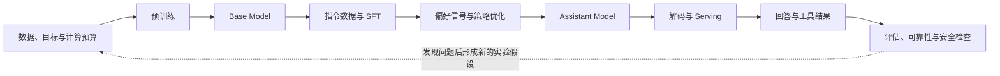

# 第三部分：训练、对齐与推理

这一部分把前两部分的模型结构落到一条完整的工程链路上：先用数据训练出 base model，再通过指令微调和偏好优化改变模型的行为，最后讨论生成、部署、评估与安全。第 16--18 讲关注“模型怎样被训练出来”，第 19--23 讲关注“模型怎样学会按要求回答”，第 24--28 讲关注“模型怎样高效、可靠地服务用户”，第 29--30 讲则把这些知识转化为研究判断、实验设计和系统复盘。

这里的“流程”不是一条所有团队都完全相同的流水线。模型规模、数据许可、硬件、产品风险和评估目标都会改变具体做法；书中给出的公式和代码首先用于建立可复核的心智模型，落地时还需要结合框架实现和真实基准测试。

### 两条阅读线：先建立直觉，再建立边界

初学者可以先把本部分看成一条因果链：预训练决定模型会什么，SFT 决定模型怎样按格式回答，偏好优化决定哪些回答更被选择，推理系统决定回答能否及时产生，评估与安全决定这个回答能否被信任。每个阶段后面的例子都尽量把抽象变量换成可手算的数量，例如 token 数、显存字节数、概率差和错误率。

有经验的读者则应关注链条中的接口是否保持一致：数据分布是否改变了目标，mask 是否改变了梯度，reference 是否限制了策略漂移，prefill 与 decode 是否被混为同一个瓶颈，代理指标是否与真实目标脱钩。相同的章节因此会同时给出直觉、公式、反事实实验和证据边界；直觉帮助定位问题，公式说明变量关系，实验负责排除替代解释。

本部分的章节按“训练出基础模型—改变回答行为—生成并检查回答”组织：



这是帮助阅读的生命周期抽象，不是所有团队共用的固定配方，也不表示每个系统都会运行相同的偏好优化步骤。第 16–18 讲解释模型和训练系统，第 19–23 讲解释回答行为如何被调整，第 24–28 讲转向生成、服务和可信度；第 29–30 讲把前面的文本模型链路转为研究问题和综合实验。

## 本文件的阅读路径

本文件接住第二部分给出的 decoder-only Transformer、token 序列和 next-token loss。阅读顺序是：先确定预训练要得到什么模型，再看数据和计算预算如何影响目标，最后看单机训练怎样扩展到多卡系统。读完后应能描述一个 checkpoint 从语料到训练状态的主要接口，并指出数据、目标、计算和分布式系统各自会留下什么证据。

~~~mermaid
flowchart LR
    A["目标与数据契约"] --> B["语料清理、去重与切分"]
    B --> C["Tokenization 与 Packing"]
    C --> D["模型和优化配置"]
    D --> E["分布式训练与监控"]
    E --> F["Checkpoint 与独立评估"]
~~~

## 第 16 讲：LLM 预训练流程

### 16 讲·预训练的对象与边界

前面我们已经知道 GPT 类模型的结构和训练目标。本讲从更高层看：如果要训练一个基础大语言模型，从原始数据到可用 checkpoint，需要经历哪些步骤？

这一讲围绕以下问题展开：

1. LLM 预训练的整体流程。
2. 预训练数据从哪里来。
3. 数据清洗、去重、过滤为什么重要。
4. tokenizer 和数据 packing 在训练中的作用。
5. 训练时需要监控哪些指标。
6. checkpoint 如何保存、恢复和选择。
7. base model 为什么还不能直接成为好助手。

### 什么是预训练

预训练是指在大规模通用数据上训练基础模型，让模型学习语言、知识、代码、推理模式和世界规律。

对于 GPT 类模型，预训练目标通常是：

```text
next-token prediction
```

预训练得到的模型通常叫：

```text
base model
```

Base model 擅长续写，但不一定擅长遵循用户指令。后续还需要 instruction tuning、SFT、RLHF、DPO 等后训练步骤。

### 预训练总流程

一个简化的大模型预训练 pipeline：

```text
1. 明确模型目标
2. 收集原始数据
3. 清洗、去重、过滤数据
4. 训练或选择 tokenizer
5. 将文本 tokenization
6. 构造训练样本和 packing
7. 设计模型架构
8. 配置训练系统
9. 执行大规模训练
10. 监控 loss、吞吐、梯度和评估指标
11. 保存 checkpoint
12. 评估 checkpoint
13. 选择 base model 进入后训练
```

预训练不是“写个训练脚本跑起来”这么简单，而是数据、模型、优化、系统、评估和成本共同组成的工程系统。

### 第一步：明确模型目标

训练前要先回答：这个模型要做什么？

例如：

1. 通用聊天。
2. 代码生成。
3. 数学推理。
4. 多语言能力。
5. 专业领域问答。
6. 多模态理解。

目标会影响：

1. 数据配比。
2. tokenizer 设计。
3. 模型规模。
4. context length。
5. 评估集。
6. 后训练策略。

### 第二步：收集原始数据

预训练数据可能来自：

1. 网页文本。
2. 书籍。
3. 论文。
4. 百科。
5. 新闻。
6. 论坛和问答。
7. 代码仓库。
8. 数学数据。
9. 多语言数据。
10. 合成数据。

不同数据来源质量差异很大。

高质量数据通常更有价值，但规模、覆盖面和多样性也很重要。

### 第三步：数据清洗

原始网页数据非常脏，常见问题包括：

1. HTML 模板和导航栏。
2. 广告和垃圾文本。
3. 重复页面。
4. 乱码。
5. 低质量机器生成内容。
6. 色情、暴力、有害内容。
7. PII 和隐私信息。
8. benchmark 泄漏。

清洗目标：

1. 提高信号质量。
2. 降低噪声和有害内容。
3. 减少重复。
4. 降低评估污染。
5. 改善模型学习效率。

### 第四步：去重和污染检测

去重非常重要。

如果某些文本重复太多，模型可能过度记忆，训练 loss 看起来很好，但泛化能力不一定好。

常见去重：

1. exact dedup：完全重复去重。
2. near dedup：近重复去重。
3. document-level dedup：文档级去重。
4. benchmark contamination check：检查评估集是否泄漏到训练集。

污染检测尤其重要，因为一旦 benchmark 出现在训练数据中，评估结果就会虚高。

### 第五步：Tokenizer

Tokenizer 可以自己训练，也可以选择已有 tokenizer。

需要考虑：

1. 词表大小。
2. 多语言压缩率。
3. 代码压缩率。
4. 数字、公式、符号处理。
5. 特殊 token。
6. chat template 预留。
7. 多模态 token 预留。

Tokenizer 一旦确定，后续更换成本很高，因为它和 embedding matrix 强绑定。

### 第六步：Tokenization 和 Packing

文本清洗后，需要转成 token id。

为了提高训练效率，通常会把多个文档拼接或 packing 成固定长度序列。

例如 block size 是 2048：

```text
doc1 + EOS + doc2 + EOS + doc3 ... -> chunk into 2048 tokens
```

Packing 的作用：

1. 减少 padding。
2. 提高 GPU 利用率。
3. 稳定 batch shape。

但要小心：

1. 文档边界要处理好。
2. EOS token 要正确插入。
3. 不该跨文档泄漏的任务要避免错误拼接。

### 最小 demo：文档 packing 和 input/label 构造

下面这个 demo 用整数 token 模拟预训练数据 packing。重点不是 tokenizer 本身，而是理解：多个文档通常会用 EOS 分隔后拼接，再切成固定长度训练块；label 是 input 右移一位。

```python
EOS = 0
docs = [
    [11, 12, 13],
    [21, 22],
    [31, 32, 33, 34],
]

block_size = 5
if block_size <= 0:
    raise ValueError("block_size must be positive")

stream = []
for doc in docs:
    stream.extend(doc)
    stream.append(EOS)

chunks = []
for start in range(0, len(stream) - block_size, block_size):
    x = stream[start:start + block_size]
    y = stream[start + 1:start + block_size + 1]
    chunks.append((x, y))

print("token stream:", stream)
for i, (x, y) in enumerate(chunks[:3]):
    print(f"chunk {i} input={x} label={y}")
```
> **代码状态：已验证（2026-10-07；Python 3.13.13；标准库）**


输出示例：

```text
token stream: [11, 12, 13, 0, 21, 22, 0, 31, 32, 33, 34, 0]
chunk 0 input=[11, 12, 13, 0, 21] label=[12, 13, 0, 21, 22]
chunk 1 input=[22, 0, 31, 32, 33] label=[0, 31, 32, 33, 34]
```

这里采用固定长度、步长等于 `block_size` 的非重叠切块；示例末尾不足一个完整块的 `34 -> EOS` 预测对被丢弃，实际数据管道也可以补齐并把 padding 位置从 loss 中屏蔽。`0` 是 EOS 分隔符，但它本身不会阻止后续 token 通过 causal attention 读取前一篇文档；若任务要求文档彼此隔离，还需使用文档边界 attention mask 或其他隔离策略。真实系统还要处理数据源权重、loss mask、shuffle 和分布式 dataloader 状态。

### 第七步：模型架构设计

需要确定：

1. 参数量。
2. 层数。
3. hidden size。
4. head 数。
5. context length。
6. MLP hidden size。
7. norm 类型。
8. 位置编码。
9. MHA/MQA/GQA。
10. 是否使用 MoE。

架构设计要平衡：

1. 训练成本。
2. 推理成本。
3. 目标能力。
4. 数据规模。
5. 硬件条件。

### 第八步：训练配置

训练配置包括：

1. optimizer：通常 AdamW。
2. learning rate。
3. warmup steps。
4. decay schedule。
5. batch size。
6. sequence length。
7. gradient clipping。
8. mixed precision。
9. distributed strategy。
10. checkpoint interval。

这些配置会极大影响训练稳定性。

### 第九步：分布式训练

大模型通常无法在单张 GPU 上训练。

常见并行策略：

1. Data Parallel。
2. FSDP / ZeRO。
3. Tensor Parallel。
4. Pipeline Parallel。
5. Sequence Parallel。
6. Context Parallel。

第 18 讲会展开。这里先记住：训练大模型是算法和系统共同问题。

### 第十步：训练监控

预训练中需要持续监控：

1. training loss。
2. validation loss。
3. perplexity。
4. learning rate。
5. gradient norm。
6. tokens/sec。
7. GPU utilization。
8. MFU。
9. loss spike。
10. NaN / Inf。
11. checkpoint 保存和恢复状态。

只看 loss 是不够的。吞吐、梯度、数值稳定性和评估结果都很重要。

### 第十一步：Checkpoint

Checkpoint 通常需要保存：

1. model weights。
2. optimizer state。
3. scheduler state。
4. random seed / RNG state。
5. dataloader progress。
6. training step。
7. config。

为什么 optimizer state 重要？

AdamW 有一阶矩和二阶矩。如果只恢复模型权重，不恢复 optimizer state，训练曲线可能异常。

### 第十二步：评估 checkpoint

Checkpoint 评估包括：

1. validation loss。
2. perplexity。
3. 基础 benchmark。
4. 代码能力。
5. 数学能力。
6. 多语言能力。
7. 长上下文能力。
8. 安全和有害输出初筛。
9. 数据污染检查。

预训练阶段的评估不一定要像最终 chat model 那样看用户体验，但要判断 base model 的基础能力是否健康。

### Base Model 为什么不能直接聊天

Base model 学的是文本续写。

它可能会：

1. 继续补全文档。
2. 模仿网页格式。
3. 不知道应该遵循用户指令。
4. 输出不安全内容。
5. 不会拒答。
6. 回答风格不稳定。

所以后续需要：

1. Instruction Tuning。
2. SFT。
3. RLHF / DPO。
4. Safety training。

### 一个可手算的预训练账本

假设数据流经过 tokenizer 后得到 120 亿个 token，训练序列长度为 2048，global batch size 为 512 个序列，那么一次 optimizer update 消耗的有效 token 约为 1,048,576。若目标训练 token 是 1T，理想情况下需要约 953,674 次 update；实际还要扣除丢弃的尾块、padding、无效样本和恢复时重复计算。

这个数量关系解释了为什么“训练了几步”不是一个充分的进度指标。两个实验都跑 10,000 steps，如果一个使用 2048 长度、另一个使用 4096 长度，它们看到的 token 数和优化噪声并不相同。记录 tokens seen、有效 loss token、数据混合比例和每步 wall-clock，才能比较训练进度。

进一步看 checkpoint 选择：假设 validation loss 从 2.8 降到 2.6，但代码单元测试通过率从 61% 降到 58%。这时不能用平均 loss 覆盖回归，而应检查代码数据比例、tokenizer 的符号切分、学习率阶段和评估污染。若恢复完整状态后曲线连续，说明问题更可能来自数据或目标；若恢复后曲线跳变，优先检查 checkpoint 状态。

对初学者来说，这是一张“数据进来、参数更新、指标出去”的账；对有经验的读者来说，它还提示了有效 token、梯度噪声尺度和评估切片之间的接口。训练系统只有把这些量绑定到同一个 run id，后面的后训练比较才有意义。

### 16 讲·训练现场的故障模式

#### 坑 1：数据质量差但只调模型结构

预训练问题很多时候来自数据，而不是模型结构。

#### 坑 2：验证集被训练数据污染

validation loss 看起来很好，但不可信。

#### 坑 3：checkpoint 不完整

只保存 model weights，恢复训练后 optimizer/scheduler 状态不一致。

#### 坑 4：只看平均 loss

平均 loss 下降可能掩盖代码、数学、多语言等能力退化。

#### 坑 5：训练吞吐低但没有 profiling

大模型训练成本高，tokens/sec 和 GPU 利用率非常关键。

### 从流程到实验：预训练决策如何被复核

把预训练流程画成箭头还不够，因为每一个箭头都可能改变最终能力。更可靠的做法是为每次训练建立一份可追踪的实验账本：数据版本和混合比例、tokenizer 哈希、模型配置、优化器超参数、随机种子、有效 token 数、checkpoint 状态以及评估集版本都要能够对应起来。

例如，某个 checkpoint 的验证损失下降了，但代码能力下降。这个现象至少有四种不同解释：代码数据比例改变，通用网页数据稀释了代码信号；tokenizer 对代码符号的切分变差；训练过度导致某些能力回归；或者评估集被污染。没有数据版本、tokenizer 统计和分领域评估，就无法区分这些原因。

checkpoint 选择应先设定不可妥协的门槛，再查看分领域指标，而不是把指标直接加成一个总分。loss、准确率、拒答率和成本的单位与优化方向不同；如果没有明确的归一化方法和业务效用定义，加权求和会制造一个看似精确、实际难以解释的分数。对通用模型，应分别报告知识、代码、数学、多语言、长上下文、安全和成本；对代码模型，还应报告编译通过率、单元测试通过率和工具调用格式正确率。先剔除未达到预设安全、格式或资源门槛的 checkpoint，再依据目标场景比较剩余候选的指标向量；若必须汇总成单一分数，应在评估前固定指标方向、归一化基准和权重，并同时保留原始分项结果。

恢复训练时也要做一次反事实检查：只恢复模型权重，保持数据和学习率不变；再恢复完整 optimizer、scheduler、RNG 和 dataloader 状态。若两条曲线在恢复点出现明显断裂，说明 checkpoint 不能被视为完整实验状态。这个小实验通常比背诵“checkpoint 要保存什么”更能暴露工程缺口。

### 16 讲·预训练的反例与边界

1. 误区：预训练就是跑 next-token loss。
   纠正：真实预训练还包括数据、tokenizer、分布式系统、监控、评估和 checkpoint 管理。

2. 误区：数据越多越好。
   纠正：低质量和重复数据会伤害训练，数据质量和配比同样重要。

3. 误区：checkpoint 只保存模型权重。
   纠正：恢复训练还需要 optimizer、scheduler、RNG 和训练进度。

4. 误区：base model 可以直接当 ChatGPT。
   纠正：base model 缺少指令遵循和安全对齐。

### 16 讲·预训练账本复核

1. 画出 LLM 预训练从数据到 checkpoint 的流程图。
2. 列出 5 类预训练数据来源。
3. 列出数据清洗中至少 5 个要处理的问题。
4. 解释为什么 checkpoint 要保存 optimizer state。
5. 用自己的话解释 base model 和 instruct model 的区别。

### 16 讲·从数据到 checkpoint 的关键结论

这一讲的关键关系：

1. 预训练是训练 base model 的过程。
2. GPT 类预训练目标通常是 next-token prediction。
3. 预训练 pipeline 包含数据、tokenizer、模型、优化、系统、监控、checkpoint 和评估。
4. 数据清洗、去重和污染检测非常关键。
5. checkpoint 需要保存完整训练状态。
6. base model 不等于 chat model，后续还需要指令微调和对齐。

### 16 讲·预训练资料边界

本讲关于 decoder-only 语言模型和 next-token 预训练的基本描述，可参阅 GPT-3 技术报告（[Brown et al., 2020](https://arxiv.org/abs/2005.14165)）。数据清洗、去重、污染和 checkpoint 的工程细节会随数据许可、训练框架和团队流程变化；本讲的流程图是通用抽象，不应被理解成任何具体模型的完整实现。

## 第 17 讲：数据质量与 Scaling Law

### 17 讲·规模化问题的边界

第 16 讲我们讲了预训练流程。本讲深入两个核心问题：模型变强到底靠什么？更多参数、更多数据、更多计算之间如何权衡？

这一讲围绕以下问题展开：

1. 什么是 scaling law。
2. 参数量、数据量、计算量如何共同影响模型性能。
3. Chinchilla scaling law 的核心启发。
4. 为什么数据质量可能比数据规模更重要。
5. 数据配比和数据污染如何影响评估。
6. 如何把 scaling law 转化为可检验的训练预算决策。

### 问题背景

大模型的发展有一个明显趋势：模型越大、数据越多、计算越强，能力通常越强。

但问题是：资源不是无限的。

如果你有固定预算，应该：

1. 训练更大的模型？
2. 喂更多 token？
3. 提高数据质量？
4. 做更长训练？
5. 做更好的后训练？

Scaling law 就是在研究这些变量和模型性能之间的规律。

### 什么是 Scaling Law

Scaling law 指模型性能随着规模变量变化呈现比较稳定的规律。

常见规模变量：

1. 模型参数量 `N`。
2. 训练 token 数 `D`。
3. 训练计算量 `C`。

性能指标通常用 validation loss 或 cross entropy 表示。

直觉：

```text
模型更大、数据更多、计算更多，loss 通常会下降
```

但下降不是线性的，而是有规律地逐渐变慢。

### 参数量、数据量、计算量

参数量决定模型容量。

数据量决定模型能学习多少分布信息。

计算量决定你能训练多大模型、训练多少 token。

三者互相制约。

如果模型太大但数据太少：

1. 容易 under-train。
2. 参数没有充分学习。
3. 计算资源浪费。

如果数据很多但模型太小：

1. 模型容量不足。
2. 无法吸收数据中的复杂模式。

如果计算不足：

1. 模型和数据都无法充分利用。

### Compute-Optimal Training

在固定计算量下，问题是：参数量和训练 token 数应该怎么分配？

早期很多模型偏向训练很大的模型，但训练 token 数相对不足。

Chinchilla scaling law 的一个核心启发是：很多大模型其实训练 token 不够。在固定 compute 下，应该用更小一些的模型、更多的训练 token，可能更优。

直觉：

```text
不要只把钱花在更大模型上，也要给模型足够多高质量 token。
```

### 数据质量为什么重要

数据不是越多越好。

低质量数据可能带来：

1. 噪声。
2. 错误事实。
3. 重复内容。
4. 有害内容。
5. 模板和广告。
6. 风格污染。
7. benchmark contamination。

高质量数据可以让模型用更少 token 学到更有价值的模式。

例如：

1. 高质量代码数据提升代码能力。
2. 高质量数学推理数据提升 reasoning。
3. 高质量多语言数据提升跨语言能力。
4. 高质量指令数据提升指令遵循。

### 数据配比

Data mixture 是预训练中的关键问题。

一个通用 LLM 的数据可能包含：

1. 通用网页。
2. 书籍。
3. 论文。
4. 代码。
5. 数学。
6. 多语言。
7. 问答。
8. 专业领域数据。

不同配比会影响模型能力。

例如：

1. 代码比例高，代码能力可能提升，但自然语言能力可能受影响。
2. 英文比例过高，中文能力可能不足。
3. 数学推理数据不足，数学能力可能弱。
4. 合成数据的作用取决于生成方式、自然数据来源、模型规模和训练预算，不能只用“比例越高越好”或“合成数据必然退化”概括。

“合成数据”也不是一个单一类别。把自然文本改写、由模型独立编写教材、由程序构造的数学/代码题，产生的训练分布和错误模式并不相同。一个报告了超过 1,000 个模型、总计超过 100,000 GPU 小时实验的 2025 年系统研究发现：只用改写文本并没有比自然网页文本更快达到相同验证 loss；在较大数据预算下，约 `1/3` 改写文本与 `2/3` 自然网页文本混合，在该研究设定中达到相同验证 loss 的速度提高约 5–10 倍；只用教材风格生成文本，则在许多下游域、特别是小数据预算下出现更高 loss。另一项 2026 年预印本把“生成改写数据花掉的计算”也纳入 scaling law，在其 compute-limited 设定下估计的最优改写比例随预算增加而上升。两项研究共同提示的不是某个通用配方，而是要把数据类型、可用自然数据、生成成本和目标预算放进同一个比较中。

| 研究 | 具体观察 | 解释边界 |
| --- | --- | --- |
| Kang 等，2025 | 在该研究设置中，约 1/3 改写文本与 2/3 自然网页文本的组合，在较大数据预算下达到相同验证 loss 的速度提高约 5–10 倍；纯教材式生成数据在若干下游域的 loss 更高 | 不能把 1/3 或 5–10 倍当成所有模型、语料和预算下的结果，也不能将教材数据的发现推广到所有合成数据 |
| Roberts 等，2026 预印本 | compute-limited scaling-law 估计中，改写比例从 `3×10^18` FLOPs 下低于 10%，升到 `10^22` FLOPs 下约 32% | 这是预印本中的拟合与外推，不是通用最优比例或生产训练结论；其数据受限设定采用不同假设 |
| Lee 等，ICLR 2026 | 在受控噪声、覆盖率和数据质量实验中，把质量作为影响预训练 loss 的一个独立因素建模 | 论文的实验包含特定机器翻译与自回归建模设置；其质量变量有助于构造实验，不是可直接给任意语料打分的通用质量指标 |

读这类结果时要先对齐比较对象：相同训练 token 不等于相同总计算，因为一侧可能额外花了生成数据的计算；相同验证 loss 也不等于相同下游能力，因为数据域和评价集不同。因而在项目里应同时记录生成器、种子语料、重写方法、去重方式、生成成本、混合比例、训练 token、目标验证集和下游任务。比例是待验证的决策变量，不是可以脱离条件复制的行业常数。

来源：[Demystifying Synthetic Data in LLM Pre-training](https://arxiv.org/abs/2510.01631)；[Rewriting Scaling Laws for Synthetic Data with Compute and Data Constraints](https://arxiv.org/abs/2610.31867)（2026 年预印本）；[Scaling Laws Revisited: Modeling the Role of Data Quality in Language Model Pretraining](https://proceedings.iclr.cc/paper_files/paper/2026/hash/d0c80a0c294a16190c8904b9809c5fba-Abstract-Conference.html)。

### 数据重复和记忆

重复数据会导致模型过度记忆。

影响包括：

1. 训练 loss 虚低。
2. 泛化能力下降。
3. 版权和隐私风险增加。
4. benchmark 污染风险增加。

所以去重是预训练数据 pipeline 的核心环节。

### 17 讲·Benchmark Contamination

如果评估集样本进入训练数据，模型可能只是记住答案。

这会导致：

1. benchmark 分数虚高。
2. 错误判断模型能力。
3. 研究结论不可信。
4. 模型版本比较失真。

污染检测常见方法：

1. exact match。
2. near duplicate search。
3. n-gram overlap。
4. embedding similarity。
5. 时间切分评估。

### Scaling Law 的局限

Scaling law 很有用，但不能迷信。

局限包括：

1. 它通常基于 validation loss，而不是所有能力。
2. loss 下降不一定等于 reasoning 提升。
3. 数据质量变化会改变曲线。
4. 后训练会显著改变模型行为。
5. 多模态、agent、安全能力不一定能用同一条 loss 曲线解释。
6. 推理时计算 test-time compute 也会影响能力。

所以 scaling law 是资源规划工具，不是能力解释的全部。

### 一个预算决策的 worked example

假设固定预算允许 1.8e23 FLOPs，候选方案有三种：30B 参数配 1T token、10B 参数配 3T token、7B 参数配 4T token。三者的粗略计算量接近，但它们的风险不同：30B 方案容量大，却可能训练不足；7B 方案训练充分，却可能无法容纳专业知识和复杂组合；10B 方案处在中间，需要用目标能力评估决定是否更合适。

先在缩小版模型上做比例实验，并固定数据质量。若增加 token 只改善 validation loss，却没有改善代码和数学切片，应检查数据是否重复、任务是否需要后训练或验证器。若高质量数据减少了总 token 却提升单位 token 的收益，说明“有效数据量”比原始 token 数更适合做资源决策。

还要把推理成本纳入选择。一个较大的 dense 模型可能在一次请求上更准确，但在相同 GPU 预算下可服务并发更低；一个较小模型可能需要更多 test-time samples 才达到同等成功率。最终目标不是最小化单一训练 loss，而是比较单位成功任务的训练成本、推理成本和质量。

### 一个简单估算例子

假设你有固定训练预算，两个方案：

```text
方案 A：训练 30B 模型，1T tokens
方案 B：训练 10B 模型，3T tokens
```

哪个更好不能只看参数量。

你要考虑：

1. 是否 compute-optimal。
2. 数据质量是否足够。
3. 目标任务是否需要更大容量。
4. 推理成本是否可接受。
5. 后训练是否能弥补能力差异。

工程判断中，能说明这些 trade-off 比背诵一个孤立数字更有价值。

### 最小 demo：固定 compute 下的参数和 token 权衡

预训练里常用一个粗略估算：decoder-only Transformer 的训练计算量近似正比于 `6 * N * D`，其中 `N` 是参数量，`D` 是训练 token 数。这个公式不是精确 profiler，但足够帮助你形成 compute trade-off 直觉。

```python
import math


def estimate_compute(params_billion, tokens_trillion):
    if not all(math.isfinite(value) and value > 0 for value in (params_billion, tokens_trillion)):
        raise ValueError("parameter and token counts must be positive and finite")
    params = params_billion * 1e9
    tokens = tokens_trillion * 1e12
    flops = 6 * params * tokens
    return flops


plans = [
    (30, 1),
    (10, 3),
    (7, 4),
]

for params_b, tokens_t in plans:
    flops = estimate_compute(params_b, tokens_t)
    print(f"{params_b}B params, {tokens_t}T tokens -> {flops:.2e} FLOPs")
```
> **代码状态：已验证（2026-10-07；Python 3.13.13；标准库）**


输出示例：

```text
30B params, 1T tokens -> 1.80e+23 FLOPs
10B params, 3T tokens -> 1.80e+23 FLOPs
7B params, 4T tokens -> 1.68e+23 FLOPs
```

这个例子说明：同样训练预算下，不是只能选择“更大模型”。你也可以选择较小模型加更多高质量 token。真实决策还要同时考虑数据质量、目标能力、推理成本、训练稳定性和后训练效果。

### 17 讲·数据与预算的失败模式

#### 坑 1：只追求参数量

更大模型如果 token 不够、数据质量差，可能不如更小但训练充分的模型。

#### 坑 2：混入大量低质量数据

数据规模变大，但有效信号密度下降，训练效率反而变差。

#### 坑 3：只看平均 validation loss

平均 loss 好，不代表代码、数学、多语言、安全能力都好。

#### 坑 4：合成数据失控

过多模型生成数据可能导致风格单一、错误放大、分布退化。

#### 坑 5：没有数据版本管理

数据 mixture 改了但没记录，实验结果无法复现。

### 把 scaling law 变成可执行的预算实验

Scaling law 的价值不在于给出一个脱离语境的“最佳参数量”，而在于帮助我们排除明显不合理的预算分配。先用 C ≈ 6ND 做量级估算，再对参数量、token 数和数据质量做小规模实验；如果只改变模型大小而不记录有效数据量，实验就无法回答“容量不足”还是“训练不足”。

一个实用的实验矩阵可以固定总计算量，比较三组方案：较大模型配较少 token、中等模型配平衡 token、较小模型配较多 token。每组都使用同一验证集，并额外报告代码、数学、多语言和记忆/污染切片。若较小模型的验证损失更好但推理任务没有提升，不能据此否定 scaling law；这说明 next-token loss 与目标能力之间存在转换损失，或者后训练和 test-time compute 才是瓶颈。

数据质量需要单独做消融。可以把数据分成高质量集合 D_h 和普通集合 D_l，在相同 token 预算下比较不同混合比例：

~~~math
D(\alpha)=\alpha D_h+(1-\alpha)D_l,\qquad 0\leq\alpha\leq1
~~~

然后同时观察训练损失、单位有效 token 的收益、分领域能力和重复率。若增加低质量数据让总 loss 略降，却让事实性或代码通过率下降，那么“更多数据”并没有带来更多有效学习信号。

Chinchilla 的结论来自特定模型族、数据和计算设定，不能机械外推到所有 MoE、长上下文或后训练系统。书中引用它时，证据边界应写清楚：它支持“参数与训练 token 需要共同规划”这一原则，不直接证明某个新模型的最佳数据配比。

### 17 讲·Scaling Law 的反例与边界

1. 误区：参数越多模型一定越好。
   纠正：还要看训练 token、数据质量、计算预算和目标任务。

2. 误区：数据越多越好。
   纠正：低质量和重复数据会伤害模型。

3. 误区：scaling law 可以解释所有能力。
   纠正：reasoning、安全、多模态、agent 能力还需要专门评估。

4. 误区：benchmark 分数高就一定强。
   纠正：可能存在 contamination 或 benchmark gaming。

### 17 讲·数据与规模的复核实验

1. 用自己的话解释 scaling law。
2. 解释为什么固定 compute 下不能只增大模型参数量。
3. 设计一个数据 mixture ablation 实验。
4. 列出 5 种低质量数据对模型的负面影响。
5. 解释 benchmark contamination 为什么会让评估失真。

### 17 讲·从规模规律到预算决策的关键结论

这一讲的关键关系：

1. Scaling law 描述参数量、数据量、计算量和 loss 的关系。
2. 固定 compute 下，模型大小和训练 token 数需要平衡。
3. Chinchilla 的核心启发是很多模型训练 token 不足。
4. 数据质量决定有效学习信号。
5. 数据配比决定模型能力分布。
6. 重复数据和 benchmark contamination 会严重误导训练和评估。
7. Scaling law 是重要工具，但不能替代任务评估、安全评估和真实用户评估。

### 17 讲·Scaling Law 资料边界

Chinchilla 的计算最优分析见 [Hoffmann et al., 2022](https://arxiv.org/abs/2203.15556)；它支持参数量、训练 token 和计算预算需要共同规划，但实验结论来自特定模型族和数据设定。数据质量、数据配比和污染检测还需要结合目标领域的独立评估，不能从一条 validation-loss 曲线推断所有能力。

## 第 18 讲：分布式训练基础

### 18 讲·分布式训练的对象

大模型训练不是单卡训练的简单放大。模型参数、激活、梯度、优化器状态和训练数据都可能大到单张 GPU 放不下或训练太慢。

这一讲从参数、激活、梯度、优化器状态和数据并行的资源关系开始，展开以下问题：

1. 为什么大模型训练需要分布式。
2. 训练显存主要由哪些部分构成。
3. Data Parallel / DDP 如何工作。
4. ZeRO 和 FSDP 解决什么问题。
5. Tensor Parallel 和 Pipeline Parallel 的区别。
6. 通信开销为什么是训练效率瓶颈。
7. 如何解释不同并行策略的 trade-off，并用 profiling 找到通信瓶颈。

### 为什么需要分布式训练

大模型训练有两个主要瓶颈：

1. 显存放不下。
2. 单卡训练太慢。

显存中通常要放：

1. 模型参数。
2. 梯度。
3. optimizer state。
4. 激活值。
5. 临时 buffer。

以 AdamW 为例，除了参数本身，还要保存一阶矩和二阶矩。训练显存远大于单纯模型权重大小。

### 显存粗略构成

训练时显存主要包括：

```text
parameters
gradients
optimizer states
activations
temporary buffers
```

如果用 AdamW，optimizer states 通常包括：

```text
m: first moment
v: second moment
```

所以一个参数可能对应多份状态。

这就是为什么一个看似能放下权重的模型，训练时仍然放不下。

### 最小 demo：DDP 和 ZeRO 显存粗略对比

下面这个 demo 用非常简化的方式估算单卡训练状态显存。参数量以十进制十亿为单位；假设参数用 bf16，占 2 bytes，梯度也占 2 bytes，AdamW 的一阶矩和二阶矩用 fp32，各占 4 bytes。此估算没有加入可能存在的 fp32 master weights，也没有加入激活、临时 buffer、通信 buffer、碎片和框架开销；不同训练栈的状态精度和峰值内存行为可能不同。

```python
import math


def gib(bytes_value):
    return bytes_value / 1024 ** 3


def estimate_training_state_memory(params_billion, world_size):
    if not math.isfinite(params_billion) or params_billion <= 0:
        raise ValueError("params_billion must be positive and finite")
    if not isinstance(world_size, int) or isinstance(world_size, bool) or world_size <= 0:
        raise ValueError("world_size must be a positive integer")
    params = params_billion * 1e9
    param_bytes = params * 2
    grad_bytes = params * 2
    optim_bytes = params * 8  # AdamW m and v in fp32

    ddp = param_bytes + grad_bytes + optim_bytes
    zero1 = param_bytes + grad_bytes + optim_bytes / world_size
    zero2 = param_bytes + grad_bytes / world_size + optim_bytes / world_size
    zero3 = (param_bytes + grad_bytes + optim_bytes) / world_size

    return {
        "DDP": gib(ddp),
        "ZeRO-1": gib(zero1),
        "ZeRO-2": gib(zero2),
        "ZeRO-3/FSDP": gib(zero3),
    }


for name, memory_gib in estimate_training_state_memory(7, world_size=8).items():
    print(f"{name}: {memory_gib:.1f} GiB per GPU")
```
> **代码状态：已验证（2026-10-07；Python 3.13.13；标准库）**


输出示例：

```text
DDP: 78.2 GiB per GPU
ZeRO-1: 32.6 GiB per GPU
ZeRO-2: 21.2 GiB per GPU
ZeRO-3/FSDP: 9.8 GiB per GPU
```

`GiB` 使用 $2^{30}$ bytes，`GB` 使用 $10^9$ bytes；函数除以 `1024**3`，所以输出必须标为 GiB。这个例子假设分片组大小等于 `world_size`，并按理想均匀分片估算参数、梯度和优化器状态；它不包含激活显存，也没有计算 ZeRO-3/FSDP 前向和反向期间可能出现的参数 all-gather 峰值。因此不能直接当作真实训练需求，但能解释训练状态分片为何降低稳态单卡占用。

### Data Parallel

Data Parallel 是最直观的并行方式。

每张 GPU 保存完整模型副本，但处理不同数据 batch。

流程：

```text
1. 每张 GPU 拿不同 mini-batch
2. 各自 forward/backward
3. 同步梯度
4. 每张 GPU 用相同梯度更新参数
```

优点：

1. 思路简单。
2. 实现成熟。
3. 扩展 batch size 方便。

缺点：

1. 每张 GPU 都要放完整模型。
2. 大模型单卡放不下时无法使用纯 DP。
3. 梯度同步有通信开销。

### DDP 如何工作

DDP 是 PyTorch 中常用的 Distributed Data Parallel。

每个进程通常绑定一张 GPU。

反向传播过程中，各 GPU 的梯度通过 all-reduce 同步。

all-reduce 的作用：

```text
把所有 GPU 的梯度求和或平均，再分发回每张 GPU
```

同步后，每张 GPU 参数更新一致。

DDP 适合模型能放进单卡，但需要加速训练的场景。

### ZeRO 解决什么问题

ZeRO 的核心思想是：不要让每张 GPU 都保存完整训练状态。

它把训练状态切分到不同 GPU 上。

ZeRO 通常分阶段：

1. ZeRO-1：切分 optimizer states。
2. ZeRO-2：切分 optimizer states 和 gradients。
3. ZeRO-3：切分 optimizer states、gradients 和 parameters。

优点：

1. 显著降低单卡显存。
2. 支持更大模型训练。

缺点：

1. 通信更复杂。
2. 实现和调试成本更高。
3. 参数需要按需 gather。

### FSDP 是什么

FSDP 是 Fully Sharded Data Parallel。

它和 ZeRO-3 思想类似，把模型参数、梯度和 optimizer states 分片到多个 GPU。

训练时：

1. forward 前 gather 当前层参数。
2. 计算当前层。
3. 不需要时释放完整参数。
4. backward 时再 gather / reduce-scatter。

优点：

1. 显存节省明显。
2. PyTorch 生态支持好。
3. 适合训练单卡放不下的大模型。

缺点：

1. 通信开销大。
2. 配置复杂。
3. 对网络和 overlap 优化敏感。

### Tensor Parallel

Tensor Parallel 是把单层内部的大矩阵计算切分到多张 GPU。

例如一个大 Linear：

~~~math
Y=XW
~~~

如果 `W` 太大，可以按列或行切分到不同 GPU。

优点：

1. 单层参数太大时很有用。
2. 适合超大模型。
3. Megatron-LM 等系统常用。

缺点：

1. 层内通信频繁。
2. 对高速互联要求高。
3. 实现复杂。

### Pipeline Parallel

Pipeline Parallel 是把不同层放到不同 GPU。

例如：

```text
GPU 0: layers 1-10
GPU 1: layers 11-20
GPU 2: layers 21-30
GPU 3: layers 31-40
```

数据像流水线一样经过不同 GPU。

为了减少空闲，会把 batch 切成 micro-batches。

优点：

1. 可以训练层数很深的模型。
2. 每张 GPU 只保存部分层。

缺点：

1. pipeline bubble 导致设备空闲。
2. 调度复杂。
3. 层间负载不均会影响效率。

### 3D Parallelism

大规模训练常组合多种并行：

```text
Data Parallel + Tensor Parallel + Pipeline Parallel
```

也叫 3D parallelism。

例如：

1. tensor parallel 切大矩阵。
2. pipeline parallel 切模型层。
3. data parallel 复制多个模型分片组处理不同数据。

真实 frontier model training 通常需要多种并行策略组合。

### Activation Checkpointing

训练时反向传播需要保存激活。

Activation checkpointing 的思想是：

```text
前向时少存一些激活，反向时重新计算
```

它用计算换显存。

优点：节省激活显存。

缺点：增加训练计算时间。

### 通信开销

分布式训练不是 GPU 越多越快。

因为 GPU 之间需要通信：

1. all-reduce。
2. all-gather。
3. reduce-scatter。
4. send/recv。

如果通信慢，GPU 会等待，利用率下降。

所以训练效率取决于：

1. 计算量。
2. 通信量。
3. 通信和计算能否 overlap。
4. 网络拓扑。
5. batch size 和 micro-batch 设置。

### 设备拓扑决定并行取舍

如果 8 张 GPU 通过高速互联连接，Tensor Parallel 的层内 all-reduce 可能能够与矩阵计算重叠；如果设备跨节点、链路带宽较低，同样的切分会把通信放到关键路径。Pipeline Parallel 减少层内通信，却引入 stage 之间的 send/recv 和 bubble；Data Parallel 通信频率较低，但每个副本需要更多状态。

可以用一个小表记录决策：

| 约束 | 首选基线 | 需要重点测量 |
| --- | --- | --- |
| 模型能放进单卡，目标是加速 | DDP | all-reduce、global batch、scaling efficiency |
| optimizer state 放不下 | ZeRO-1/2 或 FSDP | shard gather、通信 overlap、恢复时间 |
| 单层矩阵放不下 | Tensor Parallel | layer 内 collective、互联带宽 |
| 层数多、单卡只放部分层 | Pipeline Parallel | bubble、stage 负载、micro-batch |

这张表不是固定答案，而是把“为什么选它”转成可以被 profiling 推翻的假设。对初学者来说，先记住“切数据、切状态、切层内矩阵、切层间结构”四种动作；对专家来说，还要继续追踪 collective 的大小、发生时机和是否与计算重叠。

### 常见指标

分布式训练常看：

1. tokens/sec。
2. GPU utilization。
3. MFU。
4. step time。
5. communication time。
6. memory usage。
7. scaling efficiency。

MFU 是 Model FLOPs Utilization，用来衡量理论计算能力中有多少真正用于模型计算。

### 18 讲·分布式现场的故障模式

#### 坑 1：只看 GPU 利用率

GPU 利用率高不代表训练高效，还要看 tokens/sec 和 MFU。

#### 坑 2：batch size 变大但学习率没调整

全局 batch size 改变会影响优化动态。

#### 坑 3：checkpoint 在分片状态下保存和恢复出错

FSDP/ZeRO 下 checkpoint 格式和恢复逻辑更复杂。

#### 坑 4：pipeline stage 负载不均

某些 GPU 更忙，导致整体等待。

#### 坑 5：通信没有 overlap

计算和通信不能重叠时，扩展效率会明显下降。

### 用显存账本和通信剖析选择并行方式

分布式策略的选择可以从两个问题开始：哪个状态放不下，以及哪种通信会成为每一步的关键路径。若模型副本本身能放进单卡，DDP 往往是最简单的基线；若 optimizer state 和梯度占据主要空间，ZeRO-1/2 或 FSDP 可能更合适；若单层矩阵就无法容纳，则必须引入 Tensor Parallel；层数很多且设备间带宽允许时，再考虑 Pipeline Parallel。

一个容易被忽略的事实是，分片节省的是容量，不是免费性能。设单步计算时间为 `t_c`，通信时间为 `t_m`，理想情况下能够重叠的比例为 `rho`，则粗略步时可写成：

~~~math
t_{\mathrm{step}}\approx t_c+t_m-\rho\min(t_c,t_m),\qquad 0\leq\rho\leq1
~~~

当网络慢、micro-batch 太小或张量切分导致频繁 all-reduce 时，`t_m` 会主导总时间；这时继续增加 GPU 反而可能降低 scaling efficiency。工程上应记录每种 collective 的大小、耗时和发生位置，而不是只看 GPU utilization。GPU 利用率高也可能是在忙于等待通信相关 kernel。

可以做一个小型反事实实验：固定全局 batch 和模型，分别改变 data-parallel degree、micro-batch 数和通信 overlap；再比较 tokens/sec、MFU、峰值显存和 step time。若 FSDP 让模型成功运行但 tokens/sec 明显下降，应继续检查参数 all-gather 是否与计算重叠、wrap 粒度是否过细、checkpoint 是否频繁触发，而不是简单判定 FSDP “更慢”。

### 18 讲·并行策略的反例与边界

1. 误区：分布式训练就是 DDP。
   纠正：DDP 只是数据并行，超大模型还需要 ZeRO/FSDP/TP/PP。

2. 误区：GPU 越多训练一定线性加速。
   纠正：通信、同步、负载均衡会降低 scaling efficiency。

3. 误区：FSDP 只节省参数显存。
   纠正：它还涉及梯度和 optimizer state 分片。

4. 误区：Tensor Parallel 和 Pipeline Parallel 一样。
   纠正：TP 切层内计算，PP 切层间结构。

### 18 讲·通信与恢复复核实验

1. 列出训练显存的 5 个主要组成部分。
2. 画出 DDP 的梯度同步流程。
3. 比较 ZeRO-1、ZeRO-2、ZeRO-3。
4. 用自己的话解释 Tensor Parallel 和 Pipeline Parallel。
5. 思考：为什么通信开销会限制多 GPU 训练加速？

### 18 讲·从切分到可复现训练的关键结论

这一讲的关键关系：

1. 大模型训练需要分布式，是因为显存和计算都受限。
2. DDP 复制模型，同步梯度。
3. ZeRO/FSDP 通过分片训练状态节省显存。
4. Tensor Parallel 切层内矩阵。
5. Pipeline Parallel 切模型层。
6. 大规模训练常组合多种并行策略。
7. 通信开销、负载均衡和 checkpoint 恢复是分布式训练的关键工程难点。

### 18 讲·分布式训练资料边界

DDP 和 FSDP 的接口与状态管理以 [PyTorch Distributed 文档](https://pytorch.org/docs/stable/distributed.html) 和 [FSDP 文档](https://pytorch.org/docs/stable/fsdp.html) 为准；ZeRO 的分片思想见 [Rajbhandari et al., 2020](https://arxiv.org/abs/1910.02054)，Megatron-LM 的张量/流水线并行见 [Shoeybi et al., 2019](https://arxiv.org/abs/1909.08053)。本讲的显存公式是容量估算，不包含所有框架 buffer、通信和碎片。

## 本阶段交接

本阶段的产物是经过数据、训练配置和验证指标共同描述的基础模型 checkpoint。接下来进入[后训练与对齐](04-后训练与对齐.md)：它从这个模型接手，通过示范和偏好信号改变回答行为；它不会让前面的数据和模型事实自动消失。
