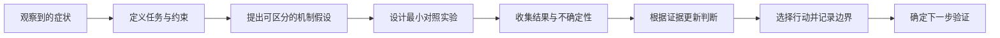

# 第五部分：综合复习与技术表达

前四部分已经分别讲过语言模型、Transformer、训练与推理、多模态系统。现在把它们放进一次项目评审或企业面试：资深工程师不会只问术语定义，还会追问目标是什么、为什么选这个方案、如何验证、线上失败会先看什么、成本是否能接受。现实问题也很少按照章节标题出现；你遇到的可能是“模型最近变笨了”“延迟突然升高”“图片问答经常数错”“训练 loss 下降但线上质量变差”。

因此，综合复习不是把前面的定义再抄一遍，也不是把一组固定题目背熟。它要训练两种可迁移的能力：第一，把模糊现象变成明确的任务契约和可验证假设；第二，把见过的知识变成能够在陌生数据、陌生约束和时间压力下重新推导的判断。最后要能用一段清楚的说明交代机制、证据、取舍和未知项，让面试官可以继续追问，而不是靠术语堆出“做过项目”的印象。

本部分沿一条“从现象到证据”的路径展开：把含糊的故障描述变成任务和约束，提出能区分原因的假设，再用实验判断哪些结论站得住。接着把同一套做法用于自己的学习：从定义重建公式，用最小实现检验机制，主动寻找反例，并在陌生变体上观察能否迁移。这样，前文的公式、系统和模型就不再是要背下来的章节，而成为分析新问题时可以调用的工具。



这条流程是第 37 讲开放问题拆解和第 38 讲学习迁移的共同骨架：每个结论都要能回到观测、实验、证据和下一步动作。

## 第 37 讲：开放技术问题的系统拆解

### 37.1 闭合问题与开放问题

闭合问题有相对明确的对象和答案空间，例如“为什么因果语言模型训练时要错开输入和目标 token”“KV Cache 缓存了什么”。回答时讲清机制、形状和限制，通常就能说明问题。

开放问题从目标或现象开始，条件还不完整。例如：

```text
知识助手最近总是给出过期流程，应该怎么修？
```

要先确认“过期”指什么版本、多少请求受影响、用户风险有多大，资料更新是否成功、搜索实际返回了哪些内容、模型收到的提示是什么，以及答案怎样被打分。直接回答“换更大的模型”“做微调”或“提高检索 top-k”都只是候选动作，尚未说明它们针对什么原因。

开放问题的关键是把模糊目标变成可检查的任务，再找证据区分多个可能原因。面试回答可以先复述现象和影响，提出需要补齐的条件，然后给出第一项低成本检查；不需要立刻列出一串技术名词。

### 37.2 先写任务契约，再讨论方案

一个可用的任务契约至少要写清输入、期望结果、失败定义、运行约束、判断证据和失败处理。写成一页表格即可，不需要先创造新的评分公式：

| 字段 | 要回答的问题 |
| --- | --- |
| 输入 | 哪类用户提出什么请求？有哪些上下文或权限？ |
| 期望结果 | 用户拿到什么才算完成任务？ |
| 失败定义 | 哪些错误会造成实际影响？ |
| 约束 | 延迟、成本、隐私和人工审核上限是什么？ |
| 证据 | 哪些日志、标签、样本和版本能复核结果？ |
| 失败处理 | 重试、澄清、拒答、回退还是转人工？ |

以“助手引用旧流程”为例，可以先约定：对一组固定的设备问题，回答要引用当前有效手册；无法找到依据时应说明资料不足；任何建议都不能绕过手册中的安全限制。再记录评测样本、索引快照、模型版本、提示、检索结果和原始输出。这样，后续方案讨论才针对同一个任务。

### 37.3 症状、机制与根因

同一个表面症状可以由不同环节造成。知识助手答错可能是源文档过期、索引没有刷新、检索排序不对、提示丢了版本信息、模型忽略了证据，也可能是引用解析或评估标签出错。

先画出系统里真实存在的数据流，再把失败样本放到对应环节：

```text
文档与权限 -> 清理/切分 -> 索引 -> 检索 -> 提示组装
    -> 模型回答 -> 引用校验 -> 界面展示
```

| 观察到的现象 | 可能原因 | 首先核对什么 | 不能直接推出什么 |
| --- | --- | --- | --- |
| 检索不到当前手册 | 未入库、权限过滤、查询表达不匹配 | 源文件清单、索引 ID、top-k 结果 | 模型不知道领域知识 |
| 当前资料进入提示但答案仍旧 | 版本字段不清、上下文冲突、模型未遵循证据 | 实际提示、版本标记、逐条引用 | 需要重训模型 |
| 原始回答正确，网页引用旧链接 | 引用解析或缓存问题 | 原始响应、引用映射和 UI 展示 | 生成模型退化 |
| 离线分数上涨，员工仍报错 | 测试分布不匹配、权限/工具流程不同 | 真实任务回放、失败切片和外部状态 | benchmark 没有价值 |
| 平均质量持平，P95 变高 | 输出变长、排队、重试或工具调用变化 | 输入/输出长度、队列时间、调用日志 | 模型单步计算变慢 |

每个候选原因都要对应可观察证据和能改变判断的结果。流程图不是让人把所有组件都查一遍；它帮助你选出最靠近失败、也最容易复核的边界。

### 37.4 用最小实验区分当前假设

排查不是先挑最复杂的方法，而是先找能区分当前假设、成本可接受的检查。按顺序问：

1. 哪些日志和样本已经存在，先查它们是否足以定位阶段？
2. 只改变一个因素时，哪种结果会支持或推翻当前解释？
3. 这项检查的成本、风险和回退方式是什么？

例如，若助手给出旧版流程，先查源文档、索引版本和实际检索结果，再做固定请求回放。相比之下，重新训练大模型同时改变了参数、数据和服务条件，成本高，也难说明哪个原因被修复。

如果评测模型输出具有随机性，保留同一批样本的请求、配置和原始响应；新旧版本应使用同一题集、提示、解码、解析器和工具版本。样本量太小时，不要把偶然涨跌说成确定提升。对于同题比较，逐题看变化和失败类别通常比只比较两个平均分更容易发现问题。

### 37.5 完整示例：知识助手引用了旧版流程

假设一名员工问：“设备 E17 报错后还能继续运行吗？”助手引用了旧版手册。这里的资料和问题是教学构造。排查要判断错误发生在哪个环节，而不是直接决定微调模型。

#### 第一步：确认影响和基线

固定同一组失败请求，记录当前和旧模型版本、索引快照、提示、解码设置、工具、原始输出和引用链接。先人工确认“引用旧版流程”确实违反本次任务目标，并标出对应的当前有效文档。

#### 第二步：对照各环节的输入输出

| 检查位置 | 结果 A | 结果 B | 下一步 |
| --- | --- | --- | --- |
| 源文档和索引 | 新版文档未入索引 | 新版已入索引 | A 查入库任务；B 查检索排序 |
| 检索候选 | 只返回旧版本 | 已返回新版 | 前者修版本过滤，后者检查提示组装 |
| 模型实际上下文 | 只含新版资料 | 新旧版本混在一起 | 检查提示元数据和版本优先级 |
| 模型回答和引用 | 依据新资料仍答旧步骤 | 文本正确但链接指向旧版 | 前者测提示/生成；后者查引用解析或前端缓存 |

表格不是让人机械按顺序修改所有组件，而是让每个结果对应一个下一步动作。

#### 第三步：选一处改动并建立回归

如果证据显示新文档没进入索引，先修入库和索引更新，不同时换模型。用原失败样本、新旧版本对照样本、相似问题和无答案问题回归，分别记录文档命中、回答正确、引用支持、拒答和延迟。如果只有目标样本修复、相邻样本出现新错误，不能直接判定改动完成。

#### 第四步：向工程师说明结论

说明“当前证据将问题定位到索引刷新，修复并重放了固定回归集；相关问题已通过，仍需确认周期性更新和权限过滤”。如果还没有足够样本，就把结论说成暂定，并列明下一项验证。这个回答给出了机制、证据和边界，也留下可继续追问的空间。

### 37.6 示例：幻觉不是一个单一指标

把“回答有幻觉”直接当成一个比例，会把不同修复路径混在一起。对知识助手，可以按一条条可核对的陈述做审计：

1. 把回答拆成能独立核对的事实陈述；
2. 为每条陈述找到它声称依据的文档或工具结果；
3. 按预先写好的规则标注为“有支持”“资料不足”或“与资料冲突”；
4. 另外记录引用版本、风险等级和是否应当拒答。

例如，合成回答中有六条可核对陈述：三条被当前手册支持，两条在手册中找不到依据，一条与手册冲突。报告这三类的数量和样本，比合成一个加权分数更容易决定下一步。风险更高的冲突陈述要单独呈现；“资料不足”也不等于“事实必然为假”。

随后用相同请求做对照：不提供资料、提供检索资料、提供资料并要求逐项引用。检查检索是否拿到证据、回答是否使用证据、引用链接是否指向正确版本。LLM judge 可以用于初筛，但应用前要用人工标注样本核对其误判；官方 RAG 评估文档也将检索质量、回答相关性和上下文 groundedness 分开描述。[Microsoft Foundry RAG evaluators](https://learn.microsoft.com/en-us/azure/foundry/concepts/evaluation-evaluators/rag-evaluators)

### 37.7 示例：设计统一多模态系统

“设计一个能处理文本、图像、语音和视频的模型”也不能直接落到“使用统一 Transformer”。先区分目标任务：实时语音对话关心首包延迟和打断，发票审核关心 OCR 和字段证据，视频检索关心时间覆盖，开放创作关心生成质量和安全来源。

一个合理的设计分层如下：

```text
模态适配层：采样、裁剪、codec、OCR、时间戳和许可
表示层：patch、频谱、离散 token、latent 与位置元数据
融合层：prefix、cross-attention、query resampler 或统一序列
推理层：语言生成、工具调用、检索、verifier 和状态管理
服务层：缓存、批处理、流式传输、回退、审计和权限
```

每层都要有独立的测试。图像输入通过接口不代表小字可读；统一 embedding 形状不代表语义对齐；模型生成文本不代表引用证据；端到端语音不代表能正确处理打断。架构讨论的质量，取决于能否说出每个接口的可观测量和失败回退。

### 37.8 新模型信息的证据等级

快速发布的模型容易造成一种错觉：只要记住模型名和宣传语，就掌握了最新技术。本节的 A—D 是本书为面试和研究记录采用的工作分类，不是行业标准；等级应贴到具体陈述及其来源上，不能给整个模型或发布打一个笼统等级。更可靠的做法是给陈述标注证据等级：

| 等级 | 信息来源 | 可以支持的陈述 |
| --- | --- | --- |
| A | 原论文、官方技术报告、模型卡 | 方法、训练目标、公开实验和明确限制 |
| B | 官方产品页、API 文档、system card | 对外提供的接口、公开展示和产品约束 |
| C | 高质量复现、独立评测、公开代码 | 在特定设置下的实现行为和可复现实验 |
| D | 社区逆向、传闻、单次 demo | 研究假设或待核验线索 |

A 级资料也不意味着普遍有效；论文实验有数据、硬件和评估口径。B 级资料不等于内部架构披露。D 级信息可以启发实验，但不应写成“该模型一定采用某组件”。当无法核验时，最专业的表述不是填补空白，而是说明已知事实、未知部分和验证方法。

### 37.9 质量、延迟、成本与安全的取舍

“质量更高、成本更低、响应更快”不是一个完整决策。要先说明哪些指标有硬门槛，再比较满足门槛的方案。不同配置可能提供不同取舍，没有脱离任务约束的唯一最优方案。

| 方案 | 任务质量 | 延迟 | 单次成本 | 风险和限制 |
| --- | --- | --- | --- | --- |
| 小模型、短上下文 | 需要在目标任务上实测 | 通常资源占用较低，端到端仍要测 | 需按相同负载估算 | 复杂请求可能答不全 |
| 更大模型或更长上下文 | 需检查证据和任务切片 | 可能增大首 token 或总时延 | 需记录输入/输出 token 与并发 | 更多上下文也可能引入干扰 |
| 增加检索或 verifier | 可能改善证据使用或校验 | 增加额外调用/处理时间 | 统计每次调用与失败重试 | verifier 可能误判，需复核 |
| 量化或缓存优化 | 需检查任务质量回归 | 目标硬件上压测 | 记录显存、吞吐和实例成本 | 软硬件支持与数值误差相关 |

面试时先问清“质量”对应什么用户任务，再讲指标口径：任务正确率、证据支持、拒答、P95 延迟、吞吐和单位成功成本分别回答不同问题。说明你愿意接受什么代价、不能突破什么安全边界，以及如果结果不达标如何回退。

### 37.10 开放问题中的安全推理

安全不是开放题最后附加的一句“注意风险”。它应该在任务契约中出现：输入是否含有个人信息，输出是否会触发外部动作，错误是否可逆，证据是否可审计，谁有权批准高风险步骤。

例如，调试一个代码 Agent 时，除了测试通过率，还要记录它是否读取了不应读取的文件、是否修改了无关路径、是否执行了未经批准的网络命令；调试一个语音助手时，还要记录声音身份授权、录音留存和高风险建议的确认流程。安全实验应使用隔离环境、合成数据和无害回归样本，不能为了“测试注入”而把真实凭据暴露给模型。

### 37.11 从低成本验证开始

不需要把候选实验换算成一个看似精确的分数。把它们按“先查现成证据、再做隔离回放、最后才做昂贵改动”排队，并写出每一步会改变什么决定：

| 检查 | 成本与风险 | 能回答的问题 | 继续条件 |
| --- | --- | --- | --- |
| 查看索引、版本、请求和错误日志 | 低，不改变线上状态 | 新资料是否入库？错误集中在哪个环节？ | 有明确缺口时先修该环节 |
| 用固定请求离线回放 | 低到中，可在隔离环境做 | 是否由提示、解码或工具条件触发？ | 重复结果支持某一假设时做小改动 |
| 做小规模成对对照 | 中，需准备标签和样本 | 候选改动是否改善目标切片并避免明显回归？ | 质量、成本、风险均达到预设门槛 |
| 全量重训或迁移服务 | 高，可能影响线上 | 更大改动是否值得投入？ | 小实验和回归已有足够证据再进入 |

实验单可以只有六行：问题、当前假设、固定条件、唯一改动、预期观察、回退条件。优先级取决于任务影响、信息是否已有、改动是否可逆和资源成本；不使用未经校准的算术分数冒充决策依据。

### 37.12 技术判断应留下什么证据

一次开放问题分析至少应该留下四种产物：

1. 问题契约：目标、约束、失败定义和风险边界。
2. 假设表：每个可能原因、支持证据、反证和优先级。
3. 实验记录：数据切片、固定变量、运行版本、指标和异常。
4. 决策记录：选择了什么、放弃了什么、为什么、下一步如何复核。

这些产物比一段听起来完整的口头表达更可靠。它们允许另一个人复现实验，也允许在结果相反时快速修正判断。技术表达的底层不是修辞，而是让因果链和证据链可检查。

## 第 38 讲：学习迁移与技术表达

### 38.1 “见过”不等于“会用”

阅读一个公式时产生的熟悉感，很容易被误认为掌握。真正遇到空白纸张、陌生题目或代码错误时，能否从定义重建公式、解释变量、写出 shape、预测失败模式，才是更强的证据。

可以把知识状态分成四层：

1. 识别：看到术语能说出大概主题。
2. 回忆：没有原文也能给出定义、公式和变量。
3. 迁移：换数据、换约束或换表述后仍能使用机制。
4. 诊断：结果异常时能提出实验，区分多个原因。

很多“复习完成”只证明了第一层。大模型工程需要至少达到后三层，因为线上问题不会把缺失信息整理成教材小节。

### 38.2 用小任务安排复习

重读一遍会让内容看起来熟悉，但并不能说明自己能在没有资料时解释或排查。每次复习都安排一个能观察结果的小任务，按需要调整间隔，而不是先套固定日历：

| 复习动作 | 例子 | 观察什么 |
| --- | --- | --- |
| 闭卷复述 | 不看书说明 causal mask 解决什么问题 | 是否说清可见位置和训练/生成区别 |
| 手算或画 shape | 用小矩阵算一次 attention 输入输出尺寸 | 是否能检查维度和 mask 边界 |
| 改条件做对照 | 加入 padding 或长短不同的请求 | 是否预测出机制会怎样变化 |
| 回到错误样本 | 重看一次 citation 错误或 loss/行为冲突 | 是否能提出下一项区分检查 |

复习失败时记下卡点，例如“把输入 token 和目标 token 对齐错了”，然后做针对练习。复习通过也要换一条题目或一组约束检查迁移；同一道题答对多次可能只代表记住了答案。

### 38.3 用四种产物证明一个知识点

为每个重要主题留下一种或几种能复核的学习证据。不同主题不必凑同样形式：

#### 解释产物

用自己的话说清它解决什么问题、改变什么对象、结果传给哪里。比如，不能只说“KV Cache 加速推理”，还要说明它缓存哪些历史计算、为何能省重复计算，以及缓存占用会随哪些模型和请求因素变化。

#### 推导或 shape 产物

不看原文重建必要公式，解释符号、尺寸和边界。对 Attention，要能沿 $QK^\top$ 的维度说明 mask 和输出；对 DPO，要能解释 chosen/rejected 以及 reference 比较在目标中的作用。

#### 实现产物

用小数组或公开工具做最小实现，写清输入、输出、依赖和检查条件。调用框架 API 可以验证使用方式，但还要能说明关键张量和计算路径。

#### 失败产物

主动给方法一个会失败的输入：padding、重复数据、过期文档、错误工具结果、权限冲突或分布外请求。记录系统表现和下一步修复方向。

可将这些作为一张检查清单，不需要把它们相加成“掌握分数”。如果某个主题只有术语复述，没有机制、执行或失败边界的证据，就继续做一个对应的小任务。

### 38.4 第一册的依赖图

第一册不是 38 个互相独立的名词，而是一张依赖图。前面的概念为后面的概念提供变量和问题背景：

```text
概率与优化
    -> tokenizer / embedding / attention
    -> Transformer block / position / context
    -> pretraining / data / scaling / distributed training
    -> SFT / preference / reward / reasoning
    -> decoding / KV cache / IO / quantization
    -> evaluation / safety / product reliability
    -> CLIP / VLM / diffusion / speech / video
    -> open problem diagnosis and technical communication
```

如果 attention 的 shape 没有真正掌握，后面很难准确理解 KV cache；如果 SFT label mask 没有掌握，DPO 的 response log probability 就容易错位；如果评估与证据边界没有掌握，所谓“最新模型能力”就会退化成宣传语的抄写。

复习应沿依赖边逐步恢复，而不是每周随机刷一个热门名词。随机抽题仍然有价值，但它应该用来检测迁移，不应成为唯一学习顺序。

### 38.5 用一份可调整的学习计划落实主线

下面是十二周的安排样例，不是必须遵循的时间表。每周按自己的时间和基础调整；如果前置还没掌握，就先补齐再继续。每个单元都留下一个能说明理解的产物：

| 周次 | 学习主题 | 实践产物 |
| --- | --- | --- |
| 1–2 | next-token、概率、loss、梯度和优化 | 手算一个小训练目标，解释训练 loss 与业务正确性的差别 |
| 3–4 | tokenizer、embedding、Attention、mask、position | 画一次前向数据流，核对 shape 和一个边界样本 |
| 5–6 | 数据、预训练、预算与分布式 | 写一张数据清单和算力/显存预算，说明不训练基础模型的理由 |
| 7–8 | 指令数据、SFT、偏好信号和奖励 | 复核一条训练样本的 labels，找出一个可能的行为回归 |
| 9–10 | 解码、KV Cache、优化、量化、评估和安全 | 做资源估算，按错误类型检查固定回归集 |
| 11 | 图像、语音、视频和跨模态任务 | 选一个输入任务，说明表示、证据、时延和安全检查点 |
| 12 | 综合诊断与技术表达 | 完成一页实验记录和一次陌生问题口头演练 |

每周不必完成固定小时数。要是第 8 周仍不能解释 label mask，就先补这个依赖；赶完日历但没有产物，不等于完成学习。

### 38.6 项目叙述是一条证据链

技术项目不能只写成“用了某模型，指标提升了”。一个可信的说明要连接问题、数据、方案、基线、测量、失败和下一步：

```text
业务问题 -> 任务契约 -> 数据与切分 -> baseline
    -> 单项改动 -> 指标和样本 -> 失败归因 -> 下一步决定
```

介绍一个领域 SFT 或知识助手练习时，说明原系统在哪类输入上失败、数据如何整理和留出、训练或检索改了什么、Base 与新方案如何公平比较、有哪些错误切片以及哪些内容还没验证。不要把示例指标写成真实结果。可以用下面的表格留空，真实运行后再填写：

| 项目 | 需要记录的内容 |
| --- | --- |
| 任务和样本 | 请求范围、样本数、数据来源、切分方法 |
| 基线与改动 | 模型/索引/提示版本、唯一主要变化 |
| 质量 | 任务通过、证据支持、格式、拒答及分层结果 |
| 服务 | 硬件、负载、P50/P95、吞吐、成本口径 |
| 风险与回归 | 高风险错误、误拒、新出现的失败样本 |
| 结论和限制 | 采用或回退的理由、未覆盖条件和下一步 |

面试里应分清个人职责和团队结果，区分自己实际测到的内容、设计方案和教学练习。结论要能回到具体样本和配置，才经得住追问。

### 38.7 模拟交流应当是测量工具

模拟面试不是背熟一组答案。选一个没提前准备过的变体问题，限定回答时间，并请同伴继续追问方案的机制、证据、成本和失败条件。没有同伴时，先录下自己的回答，再对照以下检查项复盘：

| 检查项 | 面试官可能追问什么 | 自查标准 |
| --- | --- | --- |
| 任务 | 用户目标和失败定义是什么？ | 是否补齐输入、目标和硬约束？ |
| 机制 | 方案改变了哪一段数据流或状态？ | 是否解释了输入、关键计算和结果？ |
| 证据 | 怎样知道它有效？ | 是否有基线、固定条件、样本和失败切片？ |
| 取舍 | 更快或更便宜的替代方案是什么？ | 是否能说出质量、延迟、成本和风险代价？ |
| 边界 | 哪些条件下方案会失效？ | 是否区分已知、推断和未知？ |
| 责任 | 线上出错如何发现和回退？ | 是否说明监控、权限、人工接管和恢复办法？ |

可以用知识助手做练习：“引用总是过期，先查什么？”回答后连续追问“如果索引是新的呢？”“怎样确认 UI 没有缓存旧链接？”“换模型的成本和收益怎么比较？”记录卡住的位置，再安排下一次最小练习。一次流畅回答不能证明掌握；换一个小条件再问，才能检验是否真的理解。

### 38.8 错误日志要指向下一次动作

“这题不会”不是可执行的错误类别。更有用的分类包括：

| 错误类别 | 典型表现 | 下一次动作 |
| --- | --- | --- |
| 定义缺失 | 说不清方法解决什么问题 | 写问题—机制—输出三句因果链 |
| 变量/shape 错误 | 公式会背但维度不一致 | 手算一个小 batch 并加断言 |
| 目标错位 | 优化 loss 与业务指标混淆 | 写出训练目标和最终验收的差别 |
| 工程遗漏 | 不提显存、延迟、失败回退 | 补资源账本和异常状态 |
| 评估错位 | 只报平均分 | 增加切片、反事实和置信区间 |
| 证据越界 | 把社区推测说成模型事实 | 给句子标 A/B/C/D 证据等级 |
| 表达失序 | 先列十个方法，没有目标 | 用任务契约开头，删掉无关名词 |

错误日志最好记录“下一次要做的最小动作”，例如“明天不看资料手算带 padding 的 attention mask”，而不是“再看一遍 Transformer”。动作越具体，复盘越容易闭环。

### 38.9 用未知变体做迁移评估

熟悉题目答得好，可能来自理解，也可能只是记住了题面。迁移练习改变输入或约束，同时保留要检查的核心机制：

1. 把一条普通文本问题换成带表格、缺失字段和文档版本的问题，检查证据是否完整；
2. 把单轮 SFT 样本改成多轮对话，检查角色边界和 label mask；
3. 给 Attention 加入 padding 和不同长度 batch，检查 mask 与最后有效 token；
4. 把模型质量问题换成质量、延迟、成本和安全同时受限的服务问题；
5. 给出一个信息不全的新模型介绍，检查哪些说法是事实、推断或未知。

用同一份记录表对照熟悉题与变体题：哪里还能解释机制，哪里开始猜测，下一步查什么证据。差异大时不要只写“没学会”，而是找到具体断点，比如变量 shape、前置条件、评估口径或证据等级。

### 38.10 第一册的最终综合评估

读完第一册后，综合评估不应是把 38 个标题逐个朗读。更好的评估包含四个部分：

#### 机制重建

随机抽取一个核心对象，要求从定义写到公式和 shape，例如从 next-token 目标推到 cross entropy，或从 Q/K/V 推到 attention 输出。评分重点是变量关系和边界，而不是术语数量。

#### 实验设计

给出一个异常现象，例如“loss 下降但真实任务变差”，要求写出至少三个可区分假设、固定变量和结果解释。没有实验控制的方案建议只能算猜测。

#### 最小实现

在不调用大型模型 API 的情况下，写一个小实现验证 mask、log probability、cache 容量、对比损失或 token 预算。代码应有输入、输出、断言和已知失败案例。

#### 未知变体

对一个没有见过的模态、模型版本或系统约束，要求说明哪些事实已知、哪些只是推测、下一步如何核验。它测的是方法迁移，不是新闻记忆。

综合结果可以写成证据表，而不是一个神秘总分：

| 证据 | 结果 | 仍需补什么 |
| --- | --- | --- |
| 公式与 shape | 通过/部分通过 | 哪个变量仍混淆 |
| 最小实现 | 通过/失败 | 哪个断言失败 |
| 反事实实验 | 通过/失败 | 哪种边界未覆盖 |
| 真实项目复盘 | 有/无 | 是否有 baseline 和失败切片 |
| 未知变体 | 稳定/不稳定 | 事实边界或迁移能力缺口 |

这种记录比“已经完成第一册”更诚实，也更容易决定下一轮时间投入。学习目标不是让所有主题都达到相同深度，而是知道每个主题目前的证据强度和下一步动作。

### 38.11 把复习记录变成下一步动作

每次复习后记录主题、题目变化、卡点和下一项动作。用简单表格即可，不需要先实现遗忘模型或自动调度器：

| 日期 | 主题与任务 | 结果 | 暴露的缺口 | 下一步动作 |
| --- | --- | --- | --- | --- |
| 周一 | 手算带 padding 的 Attention mask | shape 正确，mask 漏掉一个位置 | 忽略了不同长度样本 | 写一个长度为 2、4 的小 batch 再走一遍 |
| 周三 | 解释 SFT label mask | 能说明只对目标回答计 loss | 不确定模板 token 边界 | 对照 tokenizer 输出核对 labels |
| 周五 | 复盘引用旧流程的故障题 | 能区分索引与生成 | 忘了确认页面缓存 | 将 UI 链接解析纳入故障链 |

安排下一次复习时优先处理上次暴露的缺口，再换一个输入或约束检验迁移。这样每次练习都会产生一个明确的后续动作。

### 38.12 从“会说”到“能负责”

技术表达的最后一层不是语言流畅，而是能够对判断负责。一个成熟的回答或报告应当让读者知道：结论是什么，依据是什么，哪些条件成立，哪里可能失败，下一步如何验证。如果使用了论文结果，要说明论文设置；如果使用了产品页，要说明它只证明公开接口；如果使用了自己的实验，要报告数据、版本和限制。

这也是本书各章共同的收束方式。语言模型的公式、Transformer 的 shape、训练的 loss、推理的 cache、多模态的证据和 Agent 的权限，都不应停留在名词表中。它们要进入同一个工作循环：定义问题、建立机制模型、做最小实验、记录失败、比较取舍、保留证据。

## 资料与证据边界

本章的企业知识助手、问题样本和排查结果均为教学构造，不代表真实企业部署、事故或性能数据。复习计划、项目表格与面试追问是用于练习的工作工具，不是经过验证的通用面试评分标准或学习效果保证。

RAG 评估示例引用 Microsoft Foundry 文档，因为它明确区分文档检索过程评估与 groundedness、relevance 等最终回答评估；具体评估器名称、API 和预览状态可能随文档更新而变化，正文借用的是测量对象的区分，不要求绑定其服务。[Microsoft Foundry RAG evaluators](https://learn.microsoft.com/en-us/azure/foundry/concepts/evaluation-evaluators/rag-evaluators)

工具型 agent 的例子参考 Anthropic 的评测工程文章。该文章描述了 task、trial、grader、transcript 和最终环境状态等概念，并讨论自动评估、监控、人工审阅等互补手段；这属于该团队公开的实践经验，不代表所有团队必须采用相同实现。[Anthropic, Demystifying evals for AI agents](https://www.anthropic.com/research/demystifying-evals-for-ai-agents)

本册其余机制事实和时效性接口，分别以对应章节引用的论文、官方文档和固定版本来源为准。教学简化不等于实测结果；遇到未公开的模型细节，应明确说明未知并给出核验办法。
