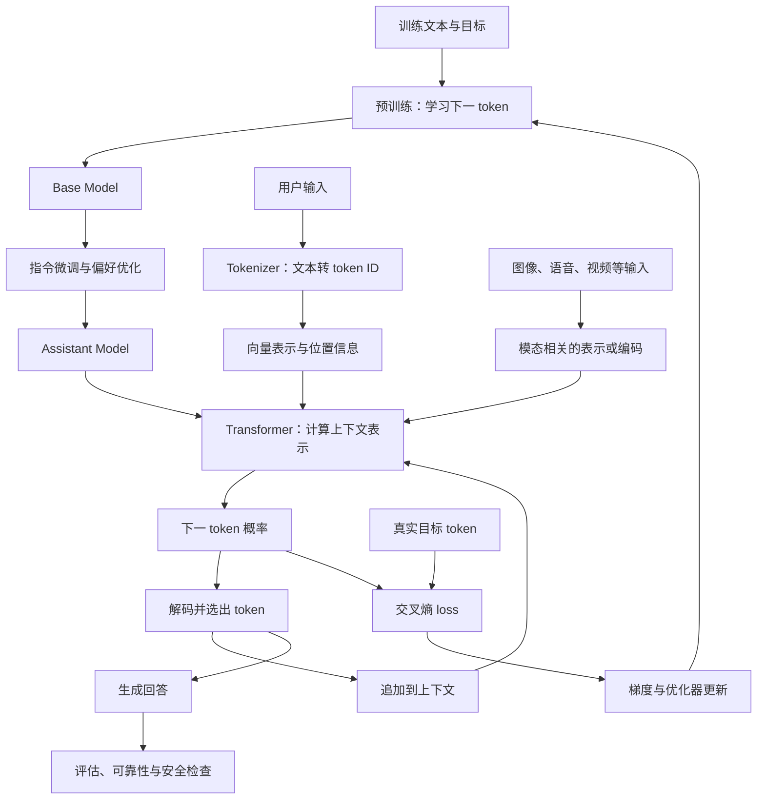

# 第一册：大模型工程主线——从入门到项目判断

## 本册定位

第一册是书系的共同入口，沿一条工程主线回答：**模型如何从输入中学会预测、经过训练与推理后生成回答，我们又怎样验证它是否解决了用户的问题？** 本册面向刚进入大模型领域的读者，强调可追踪的机制、项目决策、故障定位和证据表达；专题书负责把各自领域讲深，实战书负责把机制变成完整代码与项目。

贯穿全书的是一个假设性的企业知识助手：员工根据流程文档或设备资料提问，系统检索证据、生成有依据的回答，并在资料不足时澄清或说明无法确认。图像、录音和视频作为后续扩展输入。案例、指标和资料均为教学构造，不表示真实企业系统的效果。

## 学习主线图

图中的生成与训练是同一预测机制的两种使用方式：训练时把概率分布与目标 token 比较并更新参数；推理时从分布中选择 token，再把它接回上下文。多模态分支是高层抽象，各模型如何编码并接入不同模态并不相同，具体结构见第十五册。

## 五部分结构

| 部分 | 讲次 | 要回答的问题 | 项目中的阶段产物 |
| --- | --- | --- | --- |
| 基础与语言模型 | 1–5 | 预测目标如何变成 loss、梯度和参数更新？ | 定义任务目标，说明训练信号和行为验收之间的差别 |
| Transformer 核心 | 6–15 | token 如何变成上下文表示和下一 token 分布？ | 追踪助手请求的输入、shape、输出与关键边界 |
| 训练、对齐与推理 | 16–30 | 模型如何训练、变成助手、服务用户并接受验证？ | 形成方案对照、资源账本、评估与故障复盘 |
| 多模态基础 | 31–36 | 输入和输出不再只有文本时，哪些环节改变？ | 为截图、录音或视频问题列出表示、证据和成本检查点 |
| 综合复习与技术表达 | 37–38 | 如何把知识用于陌生问题、实验设计和技术沟通？ | 完成可复核的项目说明与面试追问练习 |

第一至第三部分构成文本语言模型主线；第四部分是在这条主线上扩展模态，不承担多模态专题书的深度；第五部分将全书知识用于项目诊断和技术表达。第 30 讲复盘文本模型生命周期，第 37–38 讲训练陌生问题分析、项目证据整理和面试沟通。

## 章节文件与阅读顺序

### 第一部分：基础与语言模型

回答“模型在学什么，误差怎样推动参数变化”。

1. [`chapters/01-基础与语言模型.md`](chapters/01-基础与语言模型.md)：第 1–5 讲
   - 大模型到底在学什么
   - 语言模型与 Next-Token Prediction
   - 交叉熵、最大似然与困惑度
   - 反向传播与梯度下降
   - Adam、AdamW 与学习率调度

### 第二部分：Transformer 核心

回答“模型怎样把当前上下文转成下一 token 的分布”。

2. [`chapters/02-transformer核心.md`](chapters/02-transformer核心.md)：第 6–15 讲
   - 输入表示：Tokenization → Embedding 与位置信息
   - 上下文计算：Self-Attention 直觉 → 公式与因果 mask → 多头和 KV 共享
   - 训练与深层结构：自回归目标 → Transformer Block → Norm 与残差稳定性
   - 位置与综合：RoPE 和长上下文边界 → miniGPT 端到端实现

### 第三部分：训练、对齐与推理

回答“基础模型怎样学会按要求回答，回答又如何高效生成并接受检查”。

3. [`chapters/03-预训练与规模化.md`](chapters/03-预训练与规模化.md)：第 16–18 讲
   - LLM 预训练流程
   - 数据质量与 Scaling Law
   - 分布式训练基础
4. [`chapters/04-后训练与对齐.md`](chapters/04-后训练与对齐.md)：第 19–23 讲
   - Instruction Tuning 与 SFT 的分工
   - RLHF、DPO 与奖励模型
   - Reward Hacking 与代理目标审计
5. [`chapters/05-推理、部署与评估.md`](chapters/05-推理、部署与评估.md)：第 24–28 讲
   - 推理采样策略
   - KV Cache 与推理加速
   - FlashAttention 与显存优化
   - 量化与部署
   - 幻觉、评估与安全
6. [`chapters/06-工程问题诊断与综合实验.md`](chapters/06-工程问题诊断与综合实验.md)：第 29–30 讲
   - 从故障现象定位请求链路，形成可验证的假设
   - 综合实验、失败分析与方案复盘

### 第四部分：多模态基础

回答“文本主线中的表示、生成和评估，面对图像、语音、视频时有哪些变化”。这里建立概念地图；视觉、音频、视频和生成模型的完整机制转入第十五册及相关专题。

7. [`chapters/07-多模态理解与表示.md`](chapters/07-多模态理解与表示.md)：第 31–33 讲
   - 多模态大模型概览：从文本模型到统一交互
   - CLIP 与图文对齐
   - Vision-Language Model：图像如何接入 LLM
8. [`chapters/08-多模态生成与交互.md`](chapters/08-多模态生成与交互.md)：第 34–36 讲
   - Diffusion Model 与图像生成
   - 语音大模型：Whisper、TTS 与端到端语音对话
   - 视频生成、时序一致性与世界模型边界

### 第五部分：综合复习与技术表达

把前四部分收束为对陌生问题的分析、验证与沟通能力。

9. [`chapters/09-综合复习与技术表达.md`](chapters/09-综合复习与技术表达.md)：第 37–38 讲
   - 开放技术问题的系统拆解
   - 学习迁移与技术表达

## 推荐阅读方法

按五部分顺序推进，不把 38 个标题当成彼此独立的知识卡片。每讲结束时回答：它接入主线的哪一步？前面哪个结果是它的前置？它会改变项目里的哪个决定或检查？第一遍优先建立全链路，第二遍再沿专题入口补深度。

每部分完成后做一次闭卷重建：第一部分画出一次训练更新；第二部分从文本画到下一 token 分布；第三部分画出从数据到助手回答再到验证的链路；第四部分标出模态接入点和模型差异；第五部分用一个未见过的故障场景检查自己能否提出证据和实验。把结论、反例和未确认项写进贯穿项目档案，面试时就能围绕实际推理过程接受追问。

## 书系中的下一步

| 想继续解决的问题 | 后续入口 |
| --- | --- |
| 需要更深的原理、架构对照与前沿研究 | 第二册：进阶理论与研究深度 |
| 需要真正写出代码、复现实验并完成项目，再形成可展示的项目结果 | 第三册：实战手册 |
| 需要补数学或 PyTorch 前置 | 第十三册：数学基础；第十四册：PyTorch 与深度学习工程 |
| 需要把训练、部署、评估、安全或数据某一环节讲透 | 第五至第九册及第二十四册等专题书 |
| 需要深入多模态、Reasoning、Agent、AI Infra 或产品 | 第十五至第二十三册的相应专题 |
| 只需快速查术语 | 第四册：大模型百科全书 |
