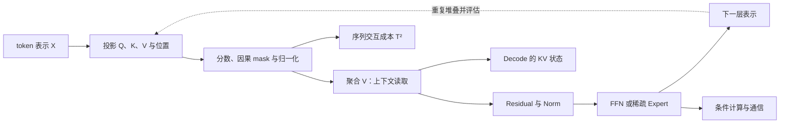

# 第二部分：Transformer 架构进阶

Transformer 的关键不在于记住一张组件清单，而在于理解信息如何流动、计算为什么变贵、哪些近似会改变模型行为，以及架构选择如何传导到训练和部署。

本章覆盖第 11—25 讲；文末的统一评估部分用于收束本章主线，不另计为一讲。下面的 Python 片段均使用 Python 3.12+ 标准库，可分别复制运行，不依赖第三方包。

本部分把一个 decoder-only Transformer 拆成一条完整链路：

1. Self-Attention 如何在 token 之间做内容寻址和信息路由；
2. 为什么 dense attention 出现平方复杂度，以及算法近似与 kernel 优化的区别；
3. residual、normalization 和深度如何共同决定训练稳定性；
4. FFN、门控 MLP 和 MoE 如何提供特征容量与条件计算；
5. RoPE、ALiBi 和相对位置 bias 如何影响长度泛化；
6. MHA、MQA、GQA 如何改变 KV Cache 和解码带宽；
7. encoder-only、decoder-only、encoder-decoder、SSM 与混合架构分别适合什么问题；
8. 模型尺寸、硬件整除、并行方式和真实模型配置如何统一分析。

贯穿各讲的共同对象是一个 token 表示：它先形成 Q/K/V，在位置机制与 mask 约束下读取历史，再经过 residual、norm、MLP 或 expert 更新主干表示，进入下一层，最终影响 logits。后续各讲讨论的不是互不相关的组件，而是这条数据流在计算、状态和并行上的不同接口。

这张图先把前向信息流固定下来，再解释成本分支：attention 的 T² 是候选 token 交互数量，KV 是逐步生成时保留的状态，MoE 则让 token 按路由激活不同参数。SSM 和混合结构不是在这条图上简单加一个名字，而是改变历史如何保存和读取；最后的配置审计要能把这些差异映射回张量形状和硬件。

贯穿全章的一个区分是：理论复杂度、实际 kernel 时间、模型质量和单位成功任务成本不是同一个指标。把 O(T²) 写成 O(T) 不代表 GPU 一定更快；把最大上下文窗口写大不代表模型会使用远处证据；把总参数量做大不代表每个 token 的激活计算也同比增长。每个主题都要把机制、数量关系、适用条件、反例和评估方法放在一起。

## 11. Self-Attention：从相关性计算到动态信息路由

### 11.1 一个 token 怎样读取其他 token

设一段序列的表示矩阵为 X∈R^(T×d)，T 是序列长度，d 是模型宽度。对一个 head，线性投影得到：

~~~math
Q=XW_Q,\qquad K=XW_K,\qquad V=XW_V
~~~

其中 Q、K、V∈R^(T×d_h)，d_h 是单个 head 的维度。注意力分数、归一化权重和输出分别为：

~~~math
S=\frac{QK^\mathsf T}{\sqrt{d_h}},
\qquad
A=\mathrm{softmax}_{\mathrm{row}}(S),
\qquad
O=AV
~~~

第 i 行的输出可以展开为：

~~~math
O_i=\sum_{j=1}^{T}A_{ij}V_j
~~~

A_ij 表示当前位置 i 从位置 j 读取多少 value。它不是固定卷积核，而是由当前输入内容决定的权重矩阵。

初学者可以把 Q 理解为“我现在想找什么”，把 K 理解为“我能被什么查询匹配”，把 V 理解为“匹配成功后真正提供的内容”。这三个比喻有助于读公式，但 Q/K/V 并不是人工规定的语义字段，而是通过训练学出来的投影空间。

### 11.2 为什么要除以平方根

如果 Q 和 K 的每个维度均值接近 0、方差接近 1，那么点积是 d_h 个乘积之和，其方差大致随 d_h 增长。维度越大，未经缩放的 logits 越容易进入 softmax 的饱和区。

softmax 饱和会让一两个位置获得几乎全部概率，其他位置梯度很小，训练早期尤其不稳定。除以 √d_h 的作用是把分数尺度拉回可学习范围，而不是人为规定“每个 head 只能看多少位置”。

数值实现还会在 softmax 前减去每行最大值：

~~~math
\mathrm{softmax}(s)_j
=\frac{\exp(s_j-\max_k s_k)}
{\sum_u\exp(s_u-\max_k s_k)}
~~~

这个变换不改变结果，却避免指数溢出。

### 11.3 Attention matrix 是动态路由图

A∈R^(T×T) 可以看成一张随输入变化的有向加权图：第 i 行是从查询位置 i 指向所有来源位置的边权。标准 dense attention 让所有位置对都有候选边；causal mask 则删除指向未来的边。

如果第 i 个 token 需要找到前文中某个实体、变量定义或约束，它可以通过 Q 与候选 K 的内容匹配，把权重集中到相关位置。与固定窗口卷积相比，attention 的连接模式依赖内容；与 RNN 相比，远处位置可以在一层内直接交互，不必经过逐时间步的隐藏状态传递。

这也解释了 attention 的代价：每个查询都要和 T 个 key 比较，天然产生 T×T 的交互表。

### 11.4 因果 mask 改变的是信息流

自回归模型在训练时一次处理整段序列，但位置 i 不能读取未来位置 j>i。设未加 mask 的分数为 S，则：

~~~math
\widetilde S_{ij}
=\begin{cases}
S_{ij},&j\le i\\
-\infty,&j>i
\end{cases}
~~~

softmax 后，未来位置的权重为零。mask 必须在 softmax 之前施加；若先 softmax 再把权重清零而不重新归一化，概率质量会丢失，若实现错误地让未来权重参与归一化，训练就会发生信息泄漏。

一个反事实测试很有价值：在同一前缀中只改变未来 token，检查当前位置的 hidden state 和 logits 是否完全不变。如果会变，mask、position id 或缓存实现至少有一处不符合因果协议。

### 11.5 Multi-Head 不只是重复计算

多头注意力把模型宽度切成多个子空间：

~~~math
\mathrm{head}_h
=\mathrm{Attention}(XW_Q^{(h)},XW_K^{(h)},XW_V^{(h)})
~~~

~~~math
\mathrm{MHA}(X)
=\mathrm{Concat}(\mathrm{head}_1,\ldots,\mathrm{head}_H)W_O
~~~

不同 head 可以学习不同的匹配几何和信息路由：局部邻近、实体指代、代码分隔符、长程复制和格式约束都可能出现。但不能把这种可能性写成每个 head 都有清晰人类语义。head 会冗余、重组和随训练阶段变化。

### 11.6 Attention map 不是完整解释

attention 权重可以告诉我们某一层、某一个 head 在聚合 value 时使用了哪些权重，但它不能直接证明某个 token 对最终答案具有因果贡献，原因有四个：

1. V 已经经过线性投影，权重高不代表原文本被原样读取；
2. 多层多头会继续混合和重写表示；
3. MLP 与 residual stream 也能改变最终 logits；
4. 输出可能由多个路径共同造成。

若要研究因果作用，需要做遮挡或替换实验、activation patching、路径追踪，并检查输出变化是否稳定。解释性分析应当报告干预方法和反事实结果，而不是只展示一张热力图。

### 11.7 Attention 与外部检索的边界

把 attention 叫作“内部检索器”是有帮助的类比：Q 类似查询，K 类似索引，V 类似内容。但它的知识来源仍然受限于当前上下文和参数：

- attention 只能访问输入窗口中的 token 表示；
- RAG 可以从外部索引取回新文档；
- attention 的 key/value 是连续向量；
- RAG 通常还要处理文档来源、时间、权限和引用。

上下文没有某个事实时，attention 不能凭空把它检索出来。参数中可能存有相关知识，但那是生成模型的记忆路径，不是当前上下文检索。

### 11.8 Residual stream 连接各个子层

现代 Transformer 常把每个子层看成对主干表示的增量更新。以 Pre-Norm 为例：

~~~math
x_{l+1}=x_l+\mathrm{Attention}(\mathrm{Norm}(x_l))
~~~

~~~math
x_{l+2}=x_{l+1}+\mathrm{MLP}(\mathrm{Norm}(x_{l+1}))
~~~

attention 负责跨位置的信息混合，MLP 负责每个位置的特征变换，normalization 控制数值尺度，residual stream 则承载跨层累积的表示。只讲 attention 而不讲 residual、MLP 和 norm，会得到一个不完整的架构模型。

### 把分数、权重和输出手算一遍

使用本讲代码中的最后一个 query `q=[0.1,0.9]`、三个 key `k₀=[1,0]`、`k₁=[0,1]`、`k₂=[0.2,0.8]`，head 维度为 2。除以 `√2` 后的分数约为 `[0.0707,0.6364,0.5233]`。减去最大值再取指数，未归一化权重约为 `[0.568,1,0.893]`，除以总和 `2.461` 得到 `[0.2308,0.4063,0.3629]`。

把它们乘回三个 value `[10,0]`、`[0,10]`、`[3,7]`：第一维约 `0.2308×10+0.3629×3=3.397`，第二维约 `0.4063×10+0.3629×7=6.603`。于是读出的向量是 `[3.397,6.603]`。这一计算把“相关性”与“内容”分开：分数只决定读取比例，真正聚合的是 V；如果本位置是序列首 token，因果 mask 会令后两个位置权重为零，不能因为它们的内容匹配就读取未来。

### 11.9 一个纯 Python 的单头实现

输入为列表形式的 Q、K `[T,d_h]` 和 V `[T,d_v]`；函数返回输出 `[T,d_v]` 与路由权重 `[T,T]`。下面的代码用列表实现小规模 causal attention，适合手工检查每一步。它没有使用高效矩阵库，所以只用于教学。

~~~python
import math

def dot(left, right):
    if len(left) != len(right) or not left:
        raise ValueError("dot product requires non-empty vectors of equal length")
    if any(not is_finite_number(value) for value in left + right):
        raise ValueError("dot product inputs must be finite real numbers")
    result = sum(a * b for a, b in zip(left, right))
    if not is_finite_number(result):
        raise ValueError("dot product overflowed")
    return result

def is_finite_number(value):
    if isinstance(value, bool) or not isinstance(value, (int, float)):
        return False
    try:
        return math.isfinite(float(value))
    except OverflowError:
        return False

def softmax(values):
    if not values or any(not is_finite_number(value) for value in values):
        raise ValueError("softmax input must be non-empty and finite")
    peak = max(values)
    weights = [math.exp(value - peak) for value in values]
    total = sum(weights)
    if not math.isfinite(total) or total <= 0:
        raise ValueError("softmax normalizer must be positive and finite")
    return [weight / total for weight in weights]

def causal_attention(query, keys, values):
    if not query or len(query) != len(keys) or len(keys) != len(values):
        raise ValueError("query, keys and values must be non-empty and aligned")
    query_dim = len(query[0])
    value_dim = len(values[0])
    if query_dim == 0 or value_dim == 0:
        raise ValueError("query and value dimensions must be positive")
    if any(len(row) != query_dim for row in query + keys):
        raise ValueError("query and key dimensions must be consistent")
    if any(len(row) != value_dim for row in values):
        raise ValueError("value dimensions must be consistent")
    if any(not is_finite_number(value)
           for row in query + keys + values for value in row):
        raise ValueError("query, key and value entries must be finite real numbers")
    outputs = []
    routes = []
    scale = math.sqrt(query_dim)
    for i, current_query in enumerate(query):
        visible_scores = [dot(current_query, key) / scale for key in keys[: i + 1]]
        visible_weights = softmax(visible_scores)
        weights = visible_weights + [0.0] * (len(keys) - i - 1)
        output = [
            sum(weight * value[dimension] for weight, value in zip(weights, values))
            for dimension in range(len(values[0]))
        ]
        if any(not is_finite_number(value) for value in output):
            raise ValueError("attention output overflowed")
        outputs.append(output)
        routes.append(weights)
    return outputs, routes

q = [[1.0, 0.0], [0.8, 0.2], [0.1, 0.9]]
k = [[1.0, 0.0], [0.0, 1.0], [0.2, 0.8]]
v = [[10.0, 0.0], [0.0, 10.0], [3.0, 7.0]]
outputs, routes = causal_attention(q, k, v)
print("last route:", [round(value, 4) for value in routes[-1]])
print("last output:", [round(value, 4) for value in outputs[-1]])
assert all(routes[i][j] < 1e-8 for i in range(3) for j in range(i + 1, 3))
~~~

> **代码状态：已验证（2026-10-07；Python 3.12.9；标准库）**

最后一个断言验证了因果性。对给定的最后一个 query，路由权重约为 `[0.2308, 0.4063, 0.3629]`，聚合输出约为 `[3.3965, 6.6035]`。真正的 Transformer 还需要多头投影、batch 维、位置编码、残差、归一化和高效 kernel；这段代码只把“分数—mask—权重—value 聚合”这条主线显式化。

### 11.10 分层理解

初学者先回答：Q/K 决定从哪里读，V 决定读到什么，softmax 形成读取比例，causal mask 限制可见范围。

进阶学习者要继续追问：

1. attention 权重的统计是否随层和 head 改变；
2. 高权重是否真的对应因果重要性；
3. full attention 的交互图是否必要；
4. KV Cache、位置编码和 kernel 如何改变同一个公式的工程成本。

实际排查可以沿着“问题表示 → key 匹配 → value 读取 → head 输出 → 最终 logits”这条数据流走。比如问题是“合同中负责付款的一方是谁”，上下文有标题、定义段和一封无关邮件；模型却回答了邮件里的公司名。若运行时能读取指定层的权重、head 输出和 logits，就记录这些量，确认错误最早出现在哪个接口；若只有黑盒 API，就只能比较输入变化和最终回答，不能声称观察到了内部路由。即使某个 head 更偏向无关邮件，也只支持路由竞争这一候选解释，不能断定它单独造成了答案错误。

接下来固定问题做三次单变量对照：删掉无关邮件，检验噪声竞争；保留付款方实体、改写定义段措辞，检验匹配是否依赖表面表达；交换候选段落顺序，检验位置变化是否影响读取。对可观测内部量的 checkpoint，同时比较权重、head 聚合向量和最终 logits；黑盒条件下则只报告输入与答案的差异。删掉邮件后正确实体的 logit 上升，会支持“噪声争夺了读取比例”的假设；若聚合向量变了而答案不变，其他 head、残差或后续层可能补偿了变化。要提出更强的因果结论，还需说明干预及其副作用，并用 value 阻断或 activation patching 等方法复核。attention 图用于提出假设，受控对照用于检验它。

## 12. Attention 的平方瓶颈：稀疏、线性与 IO 优化

### 12.1 复杂度从哪里来

单个 head 的 Q、K、V 形状为 T×d_h。计算 QK^T 和 AV 的主要乘法量分别约为：

~~~math
C_{QK}=O(T^2d_h),\qquad C_{AV}=O(T^2d_h)
~~~

H 个 head 合起来可近似写成 O(T²d_model)。Q/K/V 投影和输出投影是 O(Td_model²)，在短序列、大宽度模型中也可能占很大比例，但长上下文的独特瓶颈是 T²。

长度从 4K 变成 32K，T 增加 8 倍，交互数增加 64 倍。若把 32K 解释为 32,768、把 1M 解释为 1,000,000，交互数约增加 931 倍；若两者都按二进制单位理解（32 Ki tokens 与 1 Mi tokens），则增加 1,024 倍。比较上下文长度时应写清单位约定。这个数量级足以说明：把窗口声明得很大，必须同时说明采用了什么注意力结构、训练方式和推理成本。

### 12.2 训练显存与推理显存

训练反向传播需要保存或重算中间值。若直接保存 attention logits 或 probabilities，形状通常是 [B,H,T,T]。单个 head、T=32768 时约有：

~~~math
32768^2=1,073,741,824
~~~

个元素。即使每个元素 2 字节，也约 2 GiB，还未计入 batch、多头、反向保存和临时 buffer。FlashAttention 通过分块和在线 softmax 避免把完整矩阵写回高层显存，但并没有让精确 dense attention 的数学交互数消失；这是 IO 与中间存储优化，不是稀疏连接。其算法和适用边界见 [FlashAttention](https://arxiv.org/abs/2205.14135) 与 [FlashAttention-2](https://arxiv.org/abs/2307.08691)。

自回归解码有另一种瓶颈。使用 KV Cache 后，第 t 步的新 query 仍需读取前 t 个 key/value，单步读量随 t 增长；缓存本身大致需要：

~~~math
M_{\mathrm{KV}}
=2BLT H_{\mathrm{KV}}d_h s
~~~

其中 B 是 batch，L 是层数，T 是缓存长度，H_KV 是 K/V head 数，d_h 是 head dimension，s 是每个元素的字节数，2 表示 K 与 V。GQA/MQA 会直接缩小 H_KV，分页管理则减少碎片和调度浪费。

### 12.3 局部和滑动窗口注意力

如果每个位置只关注 w 个邻近位置，交互量近似为：

~~~math
C_{\mathrm{window}}=O(Twd_h)
~~~

当 w 固定且远小于 T 时，它从平方增长变为线性增长。代价是远处信息不能在一层直接交互，必须通过多层传播、全局 token、摘要或外部检索传递。

局部窗口适合局部依赖强、流式处理或可以接受有限记忆的任务；对跨文档精确引用、长距离变量绑定和多段证据合并，需要额外的全局路径。

### 12.4 Block sparse 和 global token

完全随机的稀疏模式不一定能被 GPU 高效执行，因此实际设计常把保留的连接组织成块。典型模式包括局部块、跨块稀疏连接、全局 token 和少量随机边。

global token 的直觉是：局部 token 负责细节，全局位置负责汇聚和广播。它能缩短某些信息传播路径，却也会产生汇聚瓶颈：如果所有证据都压到少数全局位置，容量不足时可能损失细节。

Longformer 和 BigBird 分别展示了局部/全局与块状稀疏模式；这些工作说明稀疏结构既是算法归纳偏置，也是硬件布局。需要同时报告理论保留的边、实际 kernel 是否利用稀疏、以及任务质量是否下降：[Longformer](https://arxiv.org/abs/2004.05150)、[BigBird](https://arxiv.org/abs/2007.14062)。

### 12.5 低秩和线性 attention

若认为 attention 交互矩阵存在可压缩结构，可以用低秩投影、landmark token 或 kernel feature map 减少显式 T×T 计算。Performer 是随机特征近似路线的代表，线性 attention 的抽象形式是：

~~~math
\mathrm{Attention}(Q,K,V)
\approx\phi(Q)\left(\phi(K)^\mathsf TV\right)
~~~

它尝试先聚合 K 与 V，再让 Q 查询聚合结果，从而避免显式构造完整交互矩阵；该近似路线见 [Performer](https://arxiv.org/abs/2009.14794)。但 softmax attention 的归一化、因果前缀和数值稳定性并不会自动保留；任何近似都要验证检索、组合推理和语言建模质量。

### 12.6 FlashAttention 与稀疏 attention 必须分开

两者解决的层次不同：

| 路线 | 是否改变精确连接图 | 主要收益 | 主要代价 |
| --- | --- | --- | --- |
| dense attention | 不改变 | 表达完整、生态成熟 | T² 交互 |
| sparse/window | 改变 | 减少实际连接 | 远程信息可能丢失、kernel 更难 |
| linear/低秩 | 近似或改写 | 降低复杂度阶数 | 可能改变 softmax 行为 |
| FlashAttention | 不改变 | 减少 IO 和中间矩阵写回 | 仍有 dense 交互，依赖硬件 kernel |

因此“FlashAttention 把 attention 变成线性复杂度”是错误的；更准确的描述是它对精确 attention 做 IO-aware 的分块实现。

### 12.7 加 mask 不等于省计算

如果实现仍然构造完整 T×T logits，只是把远处位置设为负无穷，数学结果可能是稀疏的，底层乘法却仍然是 dense。要真正降低计算，需要：

1. 让 kernel 只读取保留的块；
2. 使用专门的 sliding-window 或 block-sparse 实现；
3. 改变计算图，避免生成完整交互矩阵；
4. 检查端到端 profiler，而不是只看理论公式。

### 12.8 一个量级估算

函数输入序列长度、batch、head、层数、窗口和 head dimension 等正整数，输出单层 score/window 交互数及 BF16 显存估算。下面的结果按 batch=1 计算：score 数是单层 dense attention 的矩阵元素上界，显存按未融合的 BF16 score 矩阵估算；KV Cache 则按给定层数和 KV heads 估算。因果 kernel 可能利用三角结构，FlashAttention 也不会物化完整 score 矩阵，所以这些数字不是实际峰值显存或 profiler 结果。

~~~python
def gibibytes(elements, bytes_per_element=2):
    if (type(elements) is not int or elements < 0
            or type(bytes_per_element) is not int or bytes_per_element <= 0):
        raise ValueError("elements must be non-negative and bytes must be positive")
    return elements * bytes_per_element / (1024 ** 3)

def attention_accounting(seq_len, heads=32, layers=32, kv_heads=8,
                         head_dim=128, window=4096, batch=1):
    dimensions = [seq_len, heads, layers, kv_heads, head_dim, window, batch]
    if any(type(value) is not int or value <= 0 for value in dimensions):
        raise ValueError("sequence, batch and model dimensions must be positive integers")
    if kv_heads > heads or heads % kv_heads != 0:
        raise ValueError("query heads must be divisible by KV heads")
    dense_pairs = batch * heads * seq_len * seq_len
    window_pairs = batch * heads * seq_len * min(seq_len, window)
    kv_elements = 2 * batch * layers * seq_len * kv_heads * head_dim
    return {
        "dense_pairs_per_layer": dense_pairs,
        "window_pairs_per_layer_upper_bound": window_pairs,
        "dense_score_gib_bf16": gibibytes(dense_pairs),
        "kv_cache_gib_bf16": gibibytes(kv_elements),
    }

for length in [4096, 32768]:
    result = attention_accounting(length)
    print("length =", length)
    for name, value in result.items():
        print(" ", name, "=", round(value, 4) if isinstance(value, float) else value)
~~~

> **代码状态：已验证（2026-10-07；Python 3.12.9；标准库）**

例如 batch=1、32 heads、32 层、8 个 KV heads、head_dim=128 时，4K 输入对应单层未融合 score 约 1 GiB、KV Cache 约 0.5 GiB；32K 时分别约 64 GiB 和 4 GiB。窗口设为 4K 时，32K 的窗口交互上界约 8 GiB。它们是按公式计算的容量账本，不是实际峰值；真实显存还包括权重、激活、通信 buffer、allocator 碎片和并发请求。

再单独算一个更容易检查的窗口例子。令 T=8192、窗口 w=512，单个 head 的 dense 候选交互数是 8192×8192=67,108,864；窗口内的候选数是 8192×512=4,194,304，正好少 16 倍。若把完整分数矩阵物化为 BF16，前者要 128 MiB，32 个 head 合计 4 GiB；窗口矩阵则是 8 MiB/头、256 MiB/层。这个比较只估算矩阵元素，因果三角、分块 kernel、反向保存和 batch 都会改变实际占用。它说明“窗口减少了候选边”是结构收益，“显存恰好降到 1/16”则只有在实现确实按窗口计算并且其他开销可忽略时才成立。

近年的线性序列模型研究也没有沿着“attention 与 SSM 二选一”单线推进。例如 Log-Linear Attention 讨论在固定状态和显式二次交互之间保留中间形式；Gated DeltaNet-2 研究输入相关的擦除与写入门控。论文报告的速度、质量和规模结论都绑定其模型大小、数据、硬件与任务，不构成普遍胜出证据。读这类工作时要把它们放回本节的四种问题：是否改了连接/状态表示、节省了什么、损失可能出现在哪里、真实 kernel 是否兑现理论成本。[Log-Linear Attention](https://arxiv.org/abs/2506.04761)、[Gated DeltaNet-2](https://arxiv.org/abs/2605.22791)。

### 12.9 评估长上下文优化

至少要把以下测试分开：

- 语言建模 loss 随长度的曲线；
- 远处单证据检索；
- 多个远处证据的合并；
- 中间位置证据，避免只测开头和结尾；
- 长代码中的跨文件依赖；
- 长对话中的约束保持；
- 首 token 延迟、每 token 延迟、吞吐和缓存占用。

needle-in-a-haystack 可以作为入口，但它只测一种检索形式，不能代表复杂长上下文推理。

实际选择 attention 形式时，可以先问这次任务需要哪种历史访问。代码补全要回到远处变量定义，局部窗口可能会漏掉依赖；流式语音更重视固定延迟和有限状态；长文档问答需要精确引用远处证据；高并发服务还要考虑每条请求的缓存。先按这些访问要求提出结构候选，再按真实长度分布估算交互数、缓存和延迟，最后用同一任务集比较召回与回答正确率。

理论复杂度也要和硬件执行分开。稀疏模式若块形状不规则，kernel 可能浪费线程；序列很短时，固定 launch 和索引开销可能超过节省的乘法；线性状态算法若需要额外特征映射，也会引入常数成本。可复现的报告应同时给出理论边数、实际显存峰值、吞吐、首 token 与逐 token 延迟，并说明 GPU、精度、batch 和序列长度。这样才知道数学上的优势是否兑现为系统收益。

还要区分三种常被混用的优化：连接稀疏化减少候选 query-key 对；线性/低秩方法用新的表示或近似改写交互；IO-aware kernel 保持原来的精确结果，减少中间张量写回。若一段材料只报告“速度提高”，应追问它改变了哪一层、是否保持精确注意力、比较的长度和 batch 是什么。算法复杂度、峰值显存和实测时延是三份不同证据，不能从一个结果推导另外两个。

实际设计还受任务访问模式约束。局部窗口适合持续关注邻近上下文，global token 或检索可提供远距信息通道；窗口加大能增加局部可见范围，却也增加交互数。检索可以把候选证据搬到近处，但引入召回错误和索引成本。服务团队应先统计证据距离分布，再决定用更大上下文、稀疏结构、外部检索还是混合策略，并把“找不到证据”和“找到后用错”分开评估。

## 13. Residual、Pre-LN、Post-LN 与 DeepNorm

### 13.1 归一化位置是信息流设计

一个残差子层可以抽象为：

~~~math
x_{l+1}=x_l+F_l(x_l)
~~~

把 norm 放在 F 的输入前或 residual add 后，会改变主干和子层的梯度路径：

~~~math
\mathrm{PreLN}(x)=x+F(\mathrm{Norm}(x))
~~~

~~~math
\mathrm{PostLN}(x)=\mathrm{Norm}(x+F(x))
~~~

这不是代码风格差异，而是改变了每层表示和梯度的递推关系。

### 13.2 为什么 Pre-LN 通常更稳

Pre-LN 保留了较直接的 identity path。即使子层 F 的梯度不理想，主干仍然可以把一部分梯度传过许多层。Xiong 等人在其分析和实验设置中发现，Pre-LN 的初始化梯度更稳定，训练对 warmup 的依赖较低；这不意味着所有模型、数据和预算下它都优于 Post-LN。具体选择还要验证训练稳定性与下游质量。

但 Pre-LN 的 residual stream 没有在每个 add 之后立即被中心化，层数增加时表示尺度仍需监控，输出前常见 final norm。训练稳定也不自动意味着下游质量更高。

### 13.3 Post-LN 的边界

Post-LN 让每层输出尺度被 norm 约束，在浅层模型和原始 Transformer 配置中可以工作；Xiong 等人的分析与实验显示，深层设置下它对初始化和 warmup 更敏感。它不是错误架构，而是在该类设置下深度扩展的工程裕量较小；其他结构仍需按目标配置验证。

可以用局部 Jacobian 看出两个位置为何不能互换。Pre-LN 的导数近似为 $I+J_FJ_N$，Post-LN 则为 $J_N(I+J_F)$；矩阵乘法通常不交换，且后者把整个 residual sum 放进 norm 的变换中。用一维局部近似 $J_F=0.5$、$J_N=0.8$，Pre-LN 得 $1+0.5\times0.8=1.4$，Post-LN 得 $0.8(1+0.5)=1.2$。这不是两种架构训练质量的预测，而是说明梯度路径会因运算顺序而变；深层时逐层复合的差异会继续累积。

### 13.4 Sandwich-LN 和额外控制

Sandwich-LN 的一种抽象形式是：

~~~math
x_{l+1}=x_l+\mathrm{Norm}_2
\left(F_l(\mathrm{Norm}_1(x_l))\right)
~~~

它同时控制子层输入和输出，可能改善尺度漂移，却增加归一化算子、内存读写和结构复杂度。是否值得使用，要看融合 kernel、训练稳定性和质量收益。

### 13.5 DeepNorm 与 residual scaling

若每层都加入增量 Δx_l，则：

~~~math
x_L=x_0+\sum_{l=1}^{L}\Delta x_l
~~~

深度变大时，增量累积可能使表示或梯度失控。DeepNorm/DeepNet 的核心思想是让 residual 缩放和初始化随深度配套设计，从而控制累积效应。应把它理解为一组架构与初始化规则，而不是简单在某一行代码乘一个常数；论文给出的系数依赖网络形态和深度，见 [DeepNet](https://arxiv.org/abs/2203.00555)。

论文中的具体系数依赖 encoder/decoder、层数和残差定义。移植时需要核对公式、参数初始化、学习率和最终 norm，不能只复制一个 α。

2026 年 ICML 的 SpanNorm 延续了“残差通路与归一化位置需要联合设计”这条思路：它保留 PreNorm 的直接残差路径，同时在 residual 输出端加入 PostNorm 式归一化，并配合缩放策略。作者报告了对深层 dense 与 MoE Transformer 的理论和实验结果；这些结论仍绑定论文模型与设置，不应当成新的通用默认项。它适合作为 Pre-LN/Post-LN 之外的研究案例，帮助读者理解架构设计空间仍在变化。[SpanNorm](https://proceedings.mlr.press/v306/chao26b.html)

### 13.6 训练监控

深层模型除了总 loss，还应记录：

1. 每层 residual stream 的 RMS 或 L2 norm；
2. attention 和 MLP 分支输出相对主干的比例；
3. 每层梯度范数和参数更新比率；
4. norm 的缩放参数是否极端；
5. 不同深度的激活分布；
6. loss spike 与具体 batch 的对应关系。

如果只有总 loss，无法判断是底层梯度消失、上层激活爆炸，还是数据和优化器问题。

### 13.7 一个 toy 递推

~~~python
import math

def residual_stack(value, updates, scale=1.0):
    if not isinstance(updates, (list, tuple)):
        raise ValueError("updates must be a list or tuple of layer increments")
    numbers = [value, scale, *updates]
    if any(isinstance(number, bool) or not isinstance(number, (int, float))
           or not math.isfinite(float(number)) for number in numbers):
        raise ValueError("value, scale and updates must be finite real numbers")
    history = [value]
    for update in updates:
        value = value + scale * update
        if not math.isfinite(value):
            raise ValueError("residual accumulation overflowed")
        history.append(value)
    return history

updates = [1.0] * 8
for scale in [1.0, 0.25, 0.125]:
    print("scale =", scale, "last =", residual_stack(0.0, updates, scale)[-1])
~~~

> **代码状态：已验证（2026-10-07；Python 3.12.9；标准库）**

函数接收一个标量初值、一列逐层标量增量和 scale，返回含初值在内的长度为 9 的状态轨迹。这个例子不模拟深度网络，却显示相同的每层增量在深度累积时会迅速放大：8 层、每层增量为 1 时，三个 scale 的末值分别为 8、2、1。残差缩放的作用是控制累积尺度，而不是消除学习能力。

令标量子层 $F(x)=0.5x$，简化地写成 $x'=x+\alpha F(x)$，局部导数为 $1+0.5\alpha$。当 $\alpha=1$ 时，8 层梯度因子的乘积为 $1.5^8\approx25.63$；当 $\alpha=0.125$ 时为 $1.0625^8\approx1.64$。真实网络里 $F'$ 随输入和训练状态变化，归一化还有自己的 Jacobian，因此这个例子只能说明残差尺度会改变前后向信号，不能用来推导具体架构系数。

把计算关系变成诊断路径：固定 checkpoint 和一批短、中、长样本，按浅层、中层、深层记录 residual RMS、attention/MLP 分支相对主干的范数、梯度范数和参数更新比率；再把第一次突变的层与 loss spike、学习率、数据长度和精度日志对齐。若分支从训练早期起就接近零，增加层数可能没有增加有效变换；若少数深层突然放大，则检查对应样本、初始化、归一化与优化器状态。全局 loss 只能告诉你系统出了问题，逐层信号才帮助定位问题出现在哪里。

比较 Pre-LN、Post-LN、DeepNorm 或 SpanNorm 时，固定深度、数据、token budget、优化器和训练步数，并报告发散率、达到目标 loss 的步数、层间方差/梯度分布、验证切片质量及额外算子成本。若稳定性提升伴随更多计算，应把两者作为成本收益呈现；论文理论、作者实验和目标模型结果也是不同证据层级。SpanNorm 联合改变残差通路与输出归一化，[AdaGC](https://proceedings.mlr.press/v306/wang26dg.html) 则按张量处理梯度裁剪，二者改动接口不同，不能归并成一种通用“稳定化技巧”。

例如某 checkpoint 的浅层主干范数为 100、分支增量范数为 5，相对增量 $\rho=5/100=0.05$；若深层同一比值升到 0.25，分支相对主干放大了五倍。它们不是通用异常阈值，但相邻层突变值得与 loss 和输入切片对齐。同步比较 $\|\Delta\theta\|/(\|\theta\|+\epsilon)$，才能分清前向激活尺度变化与参数更新过猛。

实现复核固定模型版本和可复算输入，比较残差缩放前后、归一化位置及最终 logits；小模型上先做同预算对照，再扩展到目标规模。只看前向范数不能判断梯度是否稳定，只看梯度也无法发现层输出退化。把前向、反向和任务质量沿同一批样本对齐，才能检查架构改动是否改善了目标问题。

### 13.8 用同一批样本定位残差尺度变化

假设一次训练检查发现第 8、16、24 层的分支/主干范数比分别为 0.04、0.05、0.22，而这些层的梯度范数是 0.9、0.95、2.4。不能只因第 24 层的比值最大就认定 Pre-LN 失稳：要先确认该层是否刚好遇到更长输入、特定 batch 或 loss spike，再检查同一批样本的参数更新比率和验证损失。若长样本上比值突增而短样本稳定，可能是输入长度或激活分布与深度共同作用；若所有长度在相同层突增，则更该检查初始化、归一化参数和优化器状态。

这种诊断也说明了几种方案的证据顺序。先确认实现使用了预期的 norm 位置和 residual scaling，再观察前向尺度，随后查看梯度与更新，最后比较任务质量和计算成本。若 DeepNorm 把发散率从 3/5 个随机种子降到 0/5，却多花了 8% 训练时间，应将稳定收益和额外成本同时报告；五个种子仍不足以证明所有规模都稳定。只有把机制、局部信号和最终任务放在同一实验中，才能判断改动解决的是梯度传递、表示尺度还是数据问题。

## 14. LayerNorm、RMSNorm、ScaleNorm 与统计维度

### 14.1 LayerNorm 的统计对象

对一个 token 的 hidden vector x∈R^d，LayerNorm 在 hidden 维度上计算均值和方差；公式采用总体方差约定，学习到的 γ、β 是逐维参数。LayerNorm 的原始定义见 [Layer Normalization](https://arxiv.org/abs/1607.06450)：

~~~math
\mu=\frac{1}{d}\sum_{i=1}^{d}x_i,
\qquad
\sigma^2=\frac{1}{d}\sum_{i=1}^{d}(x_i-\mu)^2
~~~

~~~math
y_i=\gamma_i\frac{x_i-\mu}{\sqrt{\sigma^2+\epsilon}}+\beta_i
~~~

它不依赖 batch 统计，因此适合变长序列和自回归推理。

### 14.2 RMSNorm 做了什么

RMSNorm 只控制向量的均方根；这里采用 ε 加在均方根平方项中的常见写法，原论文的定义与实验见 [RMSNorm](https://arxiv.org/abs/1910.07467)：

~~~math
r(x)=\sqrt{\frac{1}{d}\sum_{i=1}^{d}x_i^2+\epsilon}
~~~

~~~math
y_i=\gamma_i\frac{x_i}{r(x)}
~~~

它不保证输出均值为零；RMSNorm 已出现在包括 LLaMA 在内的 decoder-only 架构中，但这一采用事实不等于它在所有模型上都更稳定或更快。减少均值计算还可能带来更轻的实现，实际收益取决于融合 kernel 和内存访问，LLaMA 的架构实例见 [LLaMA](https://arxiv.org/abs/2302.13971)。

### 14.3 ScaleNorm 的不同取舍

ScaleNorm 使用一个可学习标量按向量 L2 范数缩放，论文中的研究结论来自特定机器翻译设置，不能直接推广为所有 LLM 都更快或更准，见 [Transformers without Tears](https://arxiv.org/abs/1910.05895)：

~~~math
y=g\frac{x}{\lVert x\rVert_2+\epsilon}
~~~

其中 g 通常是一个可学习标量。与 RMSNorm 的逐维 γ 相比，ScaleNorm 对各维的可调自由度更少，强调整体向量尺度。

### 14.4 为什么 BatchNorm 不常用于 decoder LLM

BatchNorm 的统计跨 batch 或空间维度，语言模型的动态 batch、padding、分布式同步和自回归单 token 解码会造成训练—推理统计差异。它在视觉模型中仍然有价值，但不能因为它经典，就直接移植到所有语言模型。

### 14.5 epsilon 与精度

ε 既影响除零保护，也影响小方差时的归一化尺度。过小可能在低精度下不稳定，过大则会让归一化偏离原本的统计量。替换 norm 时应固定或记录 ε、参数精度、累积精度和 kernel 实现。

### 14.6 norm 参数的 weight decay

norm 的 γ/β 主要控制尺度和平移，通常从 weight decay 参数组中排除；这是经验配置，不是普适定理。若模型包含特殊 norm、门控 scale 或 adapter，应按参数功能和对照实验决定。

### 14.7 一个无框架比较

为突出归一化统计量，下面令 LayerNorm/RMSNorm 的逐维 γ=1、β=0，并把 ScaleNorm 的目标范数设为 2；代码不模拟可学习 affine 参数。

~~~python
import math

def validate_vector(values, eps):
    if (not values or any(isinstance(value, bool)
                          or not isinstance(value, (int, float))
                          for value in values)):
        raise ValueError("values must be non-empty and finite")
    try:
        finite_values = all(math.isfinite(float(value)) for value in values)
        finite_eps = math.isfinite(float(eps))
    except (TypeError, ValueError, OverflowError):
        finite_values = finite_eps = False
    if not finite_values:
        raise ValueError("values must be non-empty and finite")
    if (not isinstance(eps, (int, float)) or not finite_eps
            or isinstance(eps, bool) or eps <= 0):
        raise ValueError("eps must be finite and positive")

def layer_norm(values, eps=1e-6):
    validate_vector(values, eps)
    mean = math.fsum(values) / len(values)
    centered = [value - mean for value in values]
    if any(not math.isfinite(value) for value in centered):
        raise ValueError("centering overflowed")
    squares = [value * value for value in centered]
    if any(not math.isfinite(value) for value in squares):
        raise ValueError("variance overflowed")
    variance = math.fsum(squares) / len(values)
    scale = math.sqrt(variance + eps)
    return [(value - mean) / scale for value in values]

def rms_norm(values, eps=1e-6):
    validate_vector(values, eps)
    rms = math.hypot(*(value / math.sqrt(len(values)) for value in values),
                     math.sqrt(eps))
    return [value / rms for value in values]

def scale_norm(values, target=2.0, eps=1e-6):
    validate_vector(values, eps)
    if (isinstance(target, bool) or not isinstance(target, (int, float))
            or not math.isfinite(float(target)) or target < 0):
        raise ValueError("target must be finite and non-negative")
    norm = math.hypot(*values)
    return [target * value / (norm + eps) for value in values]

x = [5.0, 6.0, 4.0, 5.0]
for name, function in [
    ("LayerNorm", layer_norm),
    ("RMSNorm", rms_norm),
    ("ScaleNorm", scale_norm),
]:
    y = function(x)
    mean = sum(y) / len(y)
    rms = math.sqrt(sum(value * value for value in y) / len(y))
    norm = math.sqrt(sum(value * value for value in y))
    print(name, "mean=", round(mean, 4), "rms=", round(rms, 4), "l2=", round(norm, 4))
~~~

> **代码状态：已验证（2026-10-07；Python 3.12.9；标准库）**

输入是长度 d 的有限向量，三个函数都返回相同长度的归一化向量。对 `[5, 6, 4, 5]`，LayerNorm 的输出均值为 0、RMS 和 L2 范数分别约为 1 和 2；RMSNorm 与 ScaleNorm 的均值约 0.9901，RMS 约 1，L2 约 2。三者控制的统计量不同，不能只看“输出看起来都差不多”就认为等价。

用更小的向量手算差异：取 $x=[1,3]$。LayerNorm 的均值为 2、总体方差为 1，忽略很小的 ε 后输出约为 `[-1,1]`；RMSNorm 的尺度是 $\sqrt{(1^2+3^2)/2}=\sqrt5\approx2.236$，输出约 `[0.447,1.342]`，均值仍约 0.894；目标 L2 范数为 2 的 ScaleNorm 输出约 `[0.632,1.897]`。因此 LN 去掉共同偏移并按方差缩放，RMSNorm 保留均值而控制能量，ScaleNorm 只控制整体长度。代码把 affine 参数设为单位值，是在比较核心统计，不是在排名训练后的模型。

归一化的统计轴是实现契约。输入张量若是 `[batch, sequence, hidden]`，常见 decoder norm 对每个 token 的最后一维单独计算。可固定 token 向量 $x=[5,6,4,5]$，先单独计算，再与另一个序列拼 batch、补 padding、改变 batch 顺序后重算；有效 token 的输出应一致。若输出变化，优先检查统计轴、padding 是否混入、fused kernel 的维度广播和自定义布局。相反，若实现按 batch 或 sequence 轴统计，改变同批样本便会改变归一化结果，训练和单 token decode 的行为可能不一致。

ε 的影响在向量尺度很小时最明显。取 $x=[0,10^{-4}]$、$\epsilon=10^{-5}$，LayerNorm 方差约 $2.5\times10^{-9}$，尺度 $\sqrt{\sigma^2+\epsilon}\approx0.00316$，输出约 `[-0.0158,0.0158]`；若忽略 ε，输出会接近 `[-1,1]`。RMSNorm 使用平方均值加 ε，得到尺度约 0.00316，输出约 `[0,0.0316]`。若代码把 ε 加在平方根外、放进平方根内，或者参数精度不同，小向量下的结果会变化；检查定义、默认值和累积精度比只看函数名更可靠。

训练时 norm 统计与参数也会影响后续表示。LN 有逐维 γ/β，RMSNorm 通常有逐维 γ 而无 β，ScaleNorm 则以少量标量控制整体长度；这些参数训练后不再是单位映射。若替换 norm，除了输入输出数值，还需检查残差尺度、激活 RMS、更新幅度和目标 logits，并说明是从头训练、转换权重还是继续训练。常见实践会把 norm 参数排除在 weight decay 之外，但这属于训练配方，应随目标配置验证。

精度与性能要分开归因。可将固定向量分别用 FP32 和目标 dtype 计算，记录均值、RMS、最大绝对误差及输出 logits 差异；再对目标 GPU 比较 fused/unfused 的训练、长 prompt prefill 和单 token decode。LayerNorm 多计算减均值，并不必然比 RMSNorm 慢；融合和内存读写可能盖过算术差异。若低精度下出现异常，要沿均值/方差累积、平方根、缩放参数与残差分支检查首个误差放大点，不能把 norm 当作自动消除异常值的保险。

### 14.8 平移、尺度和极端分量

再用 $x=[1,3]$ 看共同偏移：LayerNorm 对 $[1,3]$ 与 $[6,8]$ 都得到约 `[-1,1]`，因为均值一起平移，中心化结果不变；RMSNorm 对前者输出约 `[0.447,1.342]`，对后者的 RMS $\sqrt{50}\approx7.071$，输出约 `[0.849,1.131]`。RMSNorm 保留均值方向，所以相同相对差异叠在更大的共同偏移上时，归一化方向不同。若把 `[1,3]` 乘以 2，忽略 ε 时 RMSNorm 输出不变，显示它对共同正尺度近似不敏感。

极端分量会把整个向量一起拉动。取 `[0,0,0,10]`，LayerNorm 的均值为 2.5、标准差约 4.330，输出约 `[-0.577,-0.577,-0.577,1.732]`；RMSNorm 的 RMS 为 5，输出 `[0,0,0,2]`。异常值不仅改变自己的位置，也改变其他维度的相对尺度；但 norm 没有把异常信息删除，只是按统计量重新缩放。排查某层爆点时，要比较归一化前后的分位数、最大值及残差主干，而不能只看 norm 后 RMS 被拉回 1。

这两组计算给出选择 norm 时更准确的问题：目标是移除共同偏移、稳定整体能量，还是减少特定统计步骤？如果模型依赖表示中的共同偏移，LN 与 RMSNorm 会保留不同信息；若极端维度主导统计，两者都会耦合其他特征。ScaleNorm 更少参数，但只调向量总长度。公式说明各自做了什么，是否有助于目标模型仍要匹配权重、训练预算和评估切片验证。

在迁移已训练模型时，不应只把 LN 调用替换成 RMSNorm 并期待现有权重仍适配。需要明确是否保留 affine 参数、γ 的初始化/迁移方式、β 是否删除、ε 取值，以及最终 norm 的变化；接着做固定样本 logits 对照和继续训练，再跑语言建模与下游任务回归。若目标只是推理加速，还要先 profile 现有 kernel，证明瓶颈在 norm 而非 attention、MLP 或显存读写。这样归一化选择才能和实际系统问题对上。

Affine 参数会重新塑造归一化后的向量。对前面的 LN 输出 `[-1,1]`，若取逐维 $\gamma=[2,0.5]、\beta=[1,-1]$，结果为 `[-1,-0.5]`；输出均值不再是 0。因而部署时不能只校验“norm 后均值为零”，还要加载训练后的 γ/β 和最终 norm 顺序。训练器通常把这些参数放进单独 weight-decay 组，但不同 recipe 会有差异；复现 checkpoint 应读取实际 optimizer parameter groups，而不是凭常见习惯推断。

BatchNorm 的困难则是统计量跨样本或空间位置共享：训练时一个 token 的结果可能依赖同批其他样本，增量 decode 时 batch 组成又会不断变化。相反，按 hidden 维独立计算的 norm 能让单 token 推理与变长 batch 使用一致定义；这也是第 14.7 的 batch 重排测试不仅是数值单测，还涉及服务的请求隔离。

## 15. FFN、GeLU、SwiGLU 与 MLP 容量

### 15.1 Attention 之外的另一条主干

Transformer block 通常交替包含 attention 和 MLP。attention 让不同位置交换信息，MLP 对每个位置的表示做非线性变换：

~~~math
\mathrm{FFN}(x)
=W_{\mathrm{down}}\,
\phi(W_{\mathrm{up}}x+b_{\mathrm{up}})
+b_{\mathrm{down}}
~~~

如果没有激活函数，多层线性矩阵可以合并成一个线性矩阵，网络深度不会带来同等的非线性表达能力。MLP 的作用不是“再做一次 attention”，而是在已经混入上下文的 token 表示上进行高维特征组合。

### 15.2 参数量与计算量

普通 FFN 从 d_model 扩展到 d_ff，再投影回来，两个主要矩阵的参数量近似为：

~~~math
P_{\mathrm{FFN}}
\approx 2d_{\mathrm{model}}d_{\mathrm{ff}}
~~~

每个 token 的矩阵乘法量也与 d_model d_ff 成正比。若 d_ff=4d_model，参数量约为 8d_model²；一个带 Q/K/V/O 四个投影的 attention 模块约为 4d_model²。因此在许多 dense Transformer 中，MLP 的参数和 FLOPs 都不容忽略。

### 15.3 激活函数的架构含义

ReLU 是：

~~~math
\mathrm{ReLU}(x)=\max(0,x)
~~~

GeLU 是：

~~~math
\mathrm{GELU}(x)=x\Phi(x)
~~~

GeLU 的定义来自标准正态分布的累积分布函数；原论文比较了其在若干视觉、语言和语音任务上的表现，但不构成对现代 LLM 的普遍优越性证明，见 [Gaussian Error Linear Units](https://arxiv.org/abs/1606.08415)。SiLU 是：

~~~math
\mathrm{SiLU}(x)=x\sigma(x)
~~~

GeLU 和 SiLU 都是平滑的输入相关调制；它们不会像 ReLU 那样把全部负半轴硬切成零。具体效果会受初始化、norm、数据和训练预算影响，不能脱离对照实验把某个激活函数写成普遍最优。

### 15.4 GLU 与 SwiGLU

门控 MLP 把中间表示拆成内容分支和控制分支：

~~~math
u=W_{\mathrm{up}}x,\qquad
g=W_{\mathrm{ctrl}}x
~~~

~~~math
h=u\odot\mathrm{SiLU}(g)
~~~

~~~math
\mathrm{SwiGLU}(x)=W_{\mathrm{down}}h
~~~

逐元素乘法让控制分支根据输入调节内容特征。它提供了比单分支激活更丰富的乘法交互，但同时多了一条投影矩阵；GLU 变体及相应实验见 [GLU Variants Improve Transformer](https://arxiv.org/abs/2002.05202)。

### 15.5 为什么 hidden size 常接近 8/3

SwiGLU 有 up、control、down 三个矩阵，若中间宽度为 h：

~~~math
P_{\mathrm{SwiGLU}}\approx3d_{\mathrm{model}}h
~~~

要与普通 d_ff=4d_model 的 FFN 参数量 8d_model² 接近，需要：

~~~math
3d_{\mathrm{model}}h\approx8d_{\mathrm{model}}^2
\quad\Longrightarrow\quad
h\approx\frac{8}{3}d_{\mathrm{model}}
~~~

现实配置还会向上取整，以满足 tensor parallel 和矩阵 kernel 的维度约束。比较 GeLU 与 SwiGLU 时，必须同时报告参数量和 FLOPs。

### 15.6 FFN 与知识表示

FFN 具有大量参数和高维非线性变换，因此可能编码许多知识模式。Geva 等人在特定 Transformer 语言模型中将 FFN 分析为 key-value memory；这是解释性研究视角，不表示某条事实只存储在某一个神经元或某一层。embedding、attention、MLP、residual stream 和输出头共同构成分布式表示，见 [Transformer Feed-Forward Layers Are Key-Value Memories](https://arxiv.org/abs/2012.14913)。

### 15.7 一个参数量比较器

~~~python
def ffn_parameters(d_model, hidden, projections):
    if any(type(value) is not int or value <= 0
           for value in [d_model, hidden, projections]):
        raise ValueError("dimensions and projection count must be positive integers")
    return projections * d_model * hidden

for d_model in [1024, 4096]:
    gelu_hidden = 4 * d_model
    swiglu_hidden = round(8 * d_model / 3)
    gelu = ffn_parameters(d_model, gelu_hidden, 2)
    swiglu = ffn_parameters(d_model, swiglu_hidden, 3)
    print(
        "d_model =", d_model,
        "GeLU =", round(gelu / d_model**2, 3), "d^2",
        "SwiGLU =", round(swiglu / d_model**2, 3), "d^2",
    )
~~~

> **代码状态：已验证（2026-10-07；Python 3.12.9；标准库）**

函数把参数量归一到 $d_{model}^2$，因此 GeLU 两矩阵 FFN 约为 $8d_{model}^2$，参数匹配后的 SwiGLU 也接近这个数量。以 $d_{model}=4096$ 为例，GeLU 用 $d_{ff}=16384$ 得 134,217,728 个权重；SwiGLU 用 $h=10923$ 得 134,221,824 个权重，只差 4,096，约 0.003%。若用 BF16 存储，单层这部分权重约 256 MiB；梯度、优化器状态、激活和切分填充还要另算。这个算例说明 8/3 是容量匹配近似，不代表两种网络有相同的表达或运行速度。

用 $u=2$ 固定内容支路，再改变控制值 $g$：$g=0$ 时 $u\mathrm{SiLU}(g)=0$；$g=2$ 时约为 3.524；$g=-2$ 时约为 -0.477。控制支路不是二值开关，而是连续地压低、放大或反向调制内容。MLP 在每个位置共享投影，但输入已含 attention 汇集的上下文；因此相同参数可以随语境产生不同变换。解释具体知识时，要固定输入条件做激活干预并看任务输出，不能把某个中间维直接命名为一条事实。

近期研究继续从不同方向改造固定激活。预印本 [PowLU](https://arxiv.org/abs/2605.25704) 针对 SwiGLU 大正值区间近似二次增长、低精度训练中可能放大异常值的问题，提出增长更缓的 rational-power 激活；作者报告了 Ling 架构 7.9B 与 124B 总参数设置中的预训练实验。[MoA](https://arxiv.org/abs/2605.26647) 则用输入相关门控混合多个激活函数，研究 token-adaptive expressivity，在 0.12B—2B 的 dense 与 MoE 模型上报告结果。两者面向的问题不同，规模和实验协议也不可横向排名；它们是研究候选，不足以替代已验证的默认激活。

做对照时，先匹配参数量或 FLOPs、训练 token、优化器和数据，再一起看验证 loss、下游质量、异常值/梯度统计、吞吐与实际 kernel。若要区分 attention 与 MLP 的作用，可固定 token 内容而改变上下文，比较两处表征和目标 logit；若只看 loss 或某一层激活图，无法确认因果路径。

### 15.8 门控输出为零，梯度也可能非零

对 $h=u\mathrm{SiLU}(g)$，内容支路的导数是 $\partial h/\partial u=\mathrm{SiLU}(g)$，控制支路的导数是 $\partial h/\partial g=u\,\sigma(g)[1+g(1-\sigma(g))]$。沿用 $u=2$、$g=0$，此时 $h=0$，但 $\partial h/\partial g=1$。所以某次前向恰好得到零门控输出，不等于该通道不学习；反过来，负输入下 SiLU 的局部导数也可能为负。训练诊断要同时看前向激活、反向梯度和自然输入中的任务影响，不能只把“非零激活比例”当作活跃度。

这个导数还解释了为什么 gate 与 content 两条投影需要一起分析。若 $u$ 很大，即使 $\mathrm{SiLU}(g)$ 中等，输出和对 gate 的梯度都可能被放大；若 $u$ 接近零，gate 有变化也未必影响最终隐藏向量。对真实模型可以固定一组 token，分别扰动 $u$ 与 $g$ 所在分支，比较门控前后的激活分布和目标 logit；再用同一输入做分支消融，区分相关性与因果贡献。

### 15.9 从参数数转到训练资源

参数量匹配并不意味着中间激活占用相同。取 2,048 个有效 token、BF16，普通 FFN 的 $d_{ff}=16,384$ 中间张量约为 $2,048\times16,384\times2=64$ MiB；SwiGLU 的 $h=10,923$，up 和 gate 两路投影各约 42.7 MiB，若同时物化便约 85.3 MiB。融合 kernel、激活重算、并行切分和反向保存策略会改变峰值，所以这只是中间张量账本，不等于整层训练显存。

这也说明对照实验要区分参数、计算、激活和实际时间。两个矩阵的普通 FFN 与三矩阵 SwiGLU 可通过调整 hidden width 匹配主要权重和矩阵乘法；但门控激活多出逐元素运算，并可能需要读写两路中间结果。测量时固定有效 token 数和 dtype，记录显存峰值、kernel 数、吞吐与 loss；若只匹配参数而忽略中间张量，无法回答更大的 SwiGLU 激活是否适合目标 batch 和硬件。

因此本讲回答的是：MLP 怎样把已经聚合的上下文变成非线性特征、这种表达会付出什么资源代价。下一讲转向另一条结构问题：不同位置的信息如何进入 attention 分数。

### 15.10 激活输出怎样改变后续特征

以输入 $x=-2$ 和 $x=2$ 作一个局部对照：ReLU 输出 0 和 2；SiLU 输出约 $-0.238$ 和 $1.762$；GeLU 的精确值依赖标准正态累积分布，常用近似下也会保留一小段负半轴响应。差异不是“平滑函数一定更好”，而是负向证据能否继续进入后续线性层。若一个任务需要抑制某个特征，ReLU 的硬零值可能有利于稀疏门控；若梯度需要跨过零点，平滑激活则提供连续变化。最终表现还受到初始化、norm、学习率和数据分布影响。

比较激活函数时，先匹配参数或 FLOPs，再确认隐藏宽度、偏置、精度和 fused kernel 没有悄悄改变。训练中记录负半轴输入比例、激活均值/方差、异常值、梯度以及验证集分桶；推理中测 kernel 数和真实 token/s。若只把 GeLU 替成 SiLU，却同时把 hidden size 从 $4d$ 改为 $8d/3$，观察到的差异同时来自激活与容量，无法单独归因。读者可以先用这里的 $x=\pm2$ 手算局部输出，再用固定输入的小网络观察梯度，最后才把结论扩展到完整模型。

输出差别还会进入反向传播。SiLU 的导数为 $\sigma(x)+x\sigma(x)(1-\sigma(x))$；在 $x=-2$ 时约为 $-0.091$，而 ReLU 在负半轴的导数为 0。在 $x=2$ 时，SiLU 导数约为 1.091，ReLU 为 1。于是同一个上游梯度经过两种激活后会得到不同的局部梯度，随后再经过权重、归一化和残差路径影响参数更新。这个单点导数仍不是训练效果，但能解释为什么比较激活时只看前向输出不够：还应记录梯度分布、更新比率以及不同输入切片的 loss，检查收益来自更好的表示还是更易优化。

## 16. RoPE：旋转几何与相对位置

### 16.1 纯 attention 为什么不知道顺序

如果 attention 只依据 token 内容做匹配，序列中 token 的排列需要额外注入。位置编码可以加在 embedding 上、作为 attention bias，也可以改变 Q/K 的几何表示。

“绝对位置”告诉模型一个 token 位于第 i 个位置；“相对位置”关注两个 token 的距离 i−j。语言中的局部依赖、变量引用和跨句关系，往往更依赖后者。

### 16.2 二维旋转

把 hidden vector 的相邻两个维度看成二维平面。位置 i 的旋转矩阵为：

~~~math
R(\theta_i)=
\begin{bmatrix}
\cos\theta_i&-\sin\theta_i\\
\sin\theta_i&\cos\theta_i
\end{bmatrix}
~~~

对 query 和 key 分别应用：

~~~math
q_i'=R(\theta_i)q_i,\qquad
k_j'=R(\theta_j)k_j
~~~

旋转矩阵满足正交性质 R(θ_i)^T R(θ_j)=R(θ_j−θ_i)，因此：

~~~math
(q_i')^\mathsf Tk_j'
=q_i^\mathsf T
R(\theta_j-\theta_i)k_j
~~~

这说明 Q/K 的点积中出现了相对相位差。多维 RoPE 会在多个二维子空间使用不同频率，让模型同时感知短距离和长距离变化。

### 16.3 频率与位置

通常第 r 个二维子空间的角度与位置 i 和频率 ω_r 的乘积有关。一个常见约定是令频率基数 Θ>1、维度为偶数，并取 r=0,…,d_h/2−1：

~~~math
\theta_{i,r}=i\omega_r
~~~

~~~math
\omega_r=\Theta^{-2r/d_h}
~~~

不同频率提供不同周期。高频对短距离变化敏感，低频变化慢，更适合表示较长距离。基数 θ、维度配对顺序和实现布局需要与模型配置保持一致；RoPE 的旋转构造见 [RoFormer](https://arxiv.org/abs/2104.09864)。实际实现还要考虑数据类型和 kernel。

### 16.4 RoPE 与长度泛化

RoPE 的相对结构为长度外推提供了更自然的先验，但不是无限长度保证。若训练只覆盖 4K，直接推理到 128K 可能出现相位分布、attention score、训练数据和有效检索能力的共同漂移。

位置插值、频率缩放和继续预训练的目标，是把更长的实际位置映射到模型更熟悉的相位范围，或者让模型在长序列上重新适应。任何 scaling 都可能影响短上下文，因此必须做长度分段回归。

Position Interpolation 和 YaRN 给出了 RoPE 上下文扩展的具体训练方案；论文结果绑定其模型、微调预算和任务，不能据此推断任意 checkpoint 都能无损外推：[Position Interpolation](https://arxiv.org/abs/2306.15595)、[YaRN](https://arxiv.org/abs/2309.00071)。

### 16.5 RoPE 与 ALiBi 的区别

RoPE 改变 Q/K 的表示，使点积带有相对相位；ALiBi 直接在 logits 上加入距离 bias。两者都能让位置进入 attention，但一个修改几何表示，一个修改分数先验，不能混为同一方法。

### 16.6 一个旋转等价性实验

~~~python
import math

def rotate(vector, angle):
    if (not isinstance(vector, (list, tuple)) or len(vector) != 2
            or any(isinstance(value, bool) or not isinstance(value, (int, float))
                   or not math.isfinite(float(value)) for value in vector)):
        raise ValueError("rotate expects a finite 2D vector")
    if (isinstance(angle, bool) or not isinstance(angle, (int, float))
            or not math.isfinite(float(angle))):
        raise ValueError("angle must be finite")
    cosine = math.cos(angle)
    sine = math.sin(angle)
    x, y = vector
    return [x * cosine - y * sine, x * sine + y * cosine]

def dot(left, right):
    if len(left) != len(right) or len(left) != 2:
        raise ValueError("dot expects two equal-length 2D vectors")
    if any(isinstance(value, bool) or not isinstance(value, (int, float))
           or not math.isfinite(float(value)) for value in left + right):
        raise ValueError("dot inputs must be finite real numbers")
    return sum(a * b for a, b in zip(left, right))

q = [0.7, -0.2]
k = [0.1, 0.9]
frequency = 0.37

for i, j in [(1, 4), (3, 6), (2, 9)]:
    absolute = dot(rotate(q, i * frequency), rotate(k, j * frequency))
    relative = dot(q, rotate(k, (j - i) * frequency))
    print(i, j, round(absolute, 8), round(relative, 8))
    assert abs(absolute - relative) < 1e-9
~~~

> **代码状态：已验证（2026-10-07；Python 3.12.9；标准库）**

输入为两个二维向量和位置频率，函数返回旋转后的二维向量；三个位置对的绝对位置点积与相对位移点积逐项相等，示例数值包括 −0.63111691 和 −0.24694281。这个二维例子只验证旋转矩阵的代数性质，不代表完整 LLM 的长度能力。真正的 RoPE 还包括多频率维度、批量计算、缓存和精度处理。

手算一个角度关系：令 q=k=[1,0]，query 在位置 i、key 在位置 j，频率取 1 弧度/位置。若 i=j，相对相位为 0，点积是 1；若 j−i=π/3，旋转后的点积为 cos(π/3)=0.5。把两个位置同时平移 5，位移仍是 π/3，点积依旧 0.5。这说明点积带有相对相位差，但不表示模型天然理解任意距离。真实 RoPE 使用多个频率，长距离时相位会绕转；位置插值或频率缩放改变模型经历的相位分布，仍要测量实际任务表现。

### 16.7 位置扩展的回归方案

位置扩展需要分开回答三个问题：接口能否接收目标长度；注意力计算是否仍能给远处证据合理分数；最终回答能否正确使用证据。最大可运行长度只回答第一个问题。插值会压缩位置范围、频率缩放会改变不同维度的相位变化；这两种变换可能让短文本仍然流畅，同时让长距离证据排序或中间位置引用退化。因此不能用单一最大窗口数字代替有效长度曲线。复现实验时要绑定 rotary dimension、频率 base 与排列、position id、缩放方法和多轮拼接策略；频率 $ω_r$ 是每个位置累积的弧度，实际角度是 $θ_{i,r}=iω_r$。

构造回归集时，固定权重、提示模板和答案，只移动一条可核验事实的位置，例如分别放在 4K、8K 和 32K 附近，并把它轮换到输入开头、中间、末尾；同时加入相似诱饵和需要合并的第二条约束。先测训练长度以内的 perplexity/任务基线，再测训练长度附近是否平滑退化，最后报告各距离的召回、答案引用和延迟。只有一个关键词的 needle test 会把“找到字符串”误当成“整合证据”，因此还要包含多证据和长代码依赖。

还要检查位置坐标是否在训练和推理中连续。增量解码中的旧 key 已按写入时的位置旋转；若分块 prefill 重置 offset，或切换 scaling 后继续复用旧 KV Cache，新 query 和缓存 key 会采用不同相位约定。Packed training 也要确认每段样本的位置是否按设计重置、mask 是否阻止跨样本 attention。回归应覆盖完整 prefill、chunked prefill、prefix-cache 命中和 decode 续接，并明确相关配置变化时如何失效缓存。

最后报告质量和资源：训练长度内的短任务回归、距离分桶准确率、prefill 时间、decode 每 token 时间及 KV Cache。若 attention gold mass 正常但答案错，问题可能在后续层整合或生成；若 gold mass 本身随距离异常，再查 scaling、position offset 和 mask。位置外推实验看到的是公式、数据包装、模型训练和 runtime 的组合效果，不应将所有变化归结为某一个频率参数。

两维 toy 还可以看出高频的相位绕转：令 $q=k=[1,0]$，频率 $\omega=\pi/6$，位置差 3 时相位差为 $\pi/2$、点积为 0；位置差 12 时相位差为 $2\pi$、点积又回到 1。远距离并非按长度单调变小，而是周期性变化；真实 RoPE 用多个频率子空间共同编码，模型再从中学习位置关系。长上下文扩展改变这些频率的使用区间，必须验证模型是否能把多频率组合成稳定的检索线索。

流式分块也要保持全局位置。若 prefill 前一块已经到 4096，下一块的 token 若错误从 position id 0 重新旋转，那么新 key 与旧 key 使用的相位坐标不同；输出可能看似正常，但跨块引用会出错。测试时把同一长序列分别一次性 prefill 和切成多个 chunk，固定模型和 mask，比较边界附近 logits 与最终答案；还要覆盖 cache 命中和位置扩展版本切换。这个数值不一致能直接定位 position offset，而不是误判为模型记忆不足。

### 16.8 频率缩放改变的是相位跨度

继续看一个二维旋转子空间，令 query 和 key 的初始方向都为 $[1,0]$，原频率取 $\omega=\pi/32$。当位置差为 16 时，相对相位是 $\pi/2$，旋转后的点积为 0。若某种长度扩展把该频率缩成原来的一半，新的相位变为 $\pi/4$，点积变为 $\cos(\pi/4)\approx0.707$。同一对向量在远处因此保留了更大的相似度，但近距离的相位变化也被压慢。

这只是单频率子空间的手算，不能用它预测模型准确率。真实 RoPE 在不同维度使用多组频率，扩展方法还可能对不同频段采用不同缩放或插值；长序列表现取决于训练覆盖、注意力分数范围、KV cache 的 position id 和具体 kernel。实验可以固定事实及诱饵，把证据放在 16、128、1024 等距离，再对比原位置编码与扩展版本的 logit、答案和引用。若远处 recall 提升而近处顺序题下降，说明扩展改变了整体位置几何，需要重新校准而不是只看最大窗口长度。

## 17. ALiBi 与相对位置 bias

### 17.1 直接把距离写进分数

ALiBi 在 attention logits 上加入距离相关的线性偏置；原论文的斜率构造和长度外推实验见 [Train Short, Test Long](https://arxiv.org/abs/2108.12409)：

~~~math
\widetilde S_{ij}
=\frac{q_i^\mathsf Tk_j}{\sqrt{d_h}}
-m_h(i-j),\qquad j\le i
~~~

m_h 是第 h 个 head 的斜率。距离越远，默认分数越低，但这只是软偏置，不是把远处位置硬掩码。

### 17.2 多头斜率提供多尺度

如果所有 head 使用相同斜率，所有路由都会有同样的距离偏好。为不同 head 设置不同斜率后，部分 head 更偏局部，部分 head 可以保留远程访问能力。斜率分布是架构超参数，不能随意更改后只观察一个 benchmark。

### 17.3 相对 bias 的其他形式

相对位置 bias 可以是固定函数、可学习距离表或分桶后的 embedding。T5 风格方法把距离分到若干 bucket，近距离分得细、远距离分得粗，以控制参数量和长距离泛化。ALiBi 使用固定线性函数，参数更简单，但先验更强。

### 17.4 ALiBi 的适用条件与代价

它的优点是没有固定长度的位置 embedding 表，距离函数可以应用到更长位置；代价是单调的近处偏置可能伤害某些需要精确远程检索的任务。长度外推形式好，不等于模型经过训练就能整合远处证据。

### 17.5 一个 bias 生成器

输入序列长度 n 和非负斜率，函数返回 n×n 的加性 bias 矩阵；未来位置写为 `-inf`，供 softmax 前与 causal mask 组合。

~~~python
import math

def alibi_bias(seq_len, slope):
    if type(seq_len) is not int or seq_len <= 0:
        raise ValueError("seq_len must be a positive integer")
    if (isinstance(slope, bool) or not isinstance(slope, (int, float))
            or not math.isfinite(float(slope)) or slope < 0):
        raise ValueError("slope must be finite and non-negative")
    matrix = []
    for i in range(seq_len):
        row = []
        for j in range(seq_len):
            row.append(float("-inf") if j > i else -slope * (i - j))
        matrix.append(row)
    return matrix

for slope in [0.25, 1.0]:
    bias = alibi_bias(5, slope)
    print("slope =", slope, "last row =", bias[-1])
    assert bias[0][1] == float("-inf")
    assert bias[-1][0] < bias[-1][-1]
~~~

> **代码状态：已验证（2026-10-07；Python 3.12.9；标准库）**

当斜率为 0.25 时，最后一行从最远可见位置到当前 token 依次为 `[-1.0, -0.75, -0.5, -0.25, 0.0]`；未来位置则是 `-inf`，由 causal mask 屏蔽。

用内容分数和距离惩罚合起来算：query 在 $i=4$，key 分别在 $j=3$ 与 $j=1$，原始分数为 1.0、0.9，$m=0.1$。两者距离为 1 和 3，加 bias 后变成 0.9、0.6，softmax 权重约 0.574、0.426；不加 bias 时约 0.525、0.475。远处 key 仍然可见，只是需要更强的内容匹配抵消惩罚。若 $m=0.5$，分数会变为 0.5、−0.6，权重明显偏向近处。这个小例子说明斜率会直接改变路由概率，而不是只在模型输入中附带一个位置标签。

实现时，只有 $j\le i$ 的 key 使用 $-m_h(i-j)$，未来位置应由 causal mask 变成 $-\infty$；bias 不负责单独实现因果性。符号写反会奖励远处位置，mask 顺序错误则可能让未来 token 可见或令 softmax 出现非有限值。多头实现还要检查斜率张量是否按 `[batch,head,query,key]` 正确广播；把 32 个斜率误扩成 query 维时，输出仍可能流畅，却不再是预期的 head-wise 距离先验。

可以做一个最小反事实：固定 q/k 内容分数和 gold evidence，只改变 key 距离，先核对 logits 与 attention mass 是否随 $m_h$ 按预期变化，再检查最终任务答案。若 gold mass 变化但答案不变，位置 bias 已接入，后续 value/层间传递可能补偿；若 gold mass 不变，先查 bias 是否被 kernel 使用；若模型答案错误而局部数值正确，问题可能在训练分布或下游推理。Attention 权重可以定位计算路径，但不能单独证明模型理解了证据。

### 17.6 RoPE、ALiBi 与绝对位置的选择表

| 方法 | 注入位置的位置 | 长度外推形式 | 主要风险 |
| --- | --- | --- | --- |
| 学习式绝对 embedding | 输入表示 | 未见位置没有自然参数 | 长度绑定 |
| RoPE | Q/K 几何 | 相对相位结构 | 超长相位与训练分布漂移 |
| ALiBi | attention logits | 距离函数可继续计算 | 距离先验可能过强 |
| 分桶相对 bias | attention logits | 依赖 bucket 设计 | 远距离分辨率有限 |

表中的方法改动位置不同：ALiBi 在 logits 上加距离项，RoPE 旋转 Q/K，分桶 bias 把距离映射到有限 embedding。选择时先看任务需要何种距离先验，再结合训练长度和 kernel；不同论文的模型、数据和预算不同，分数不能直接横比。

斜率决定距离惩罚的 logit 量级。两个 head 的斜率若为 0.1 和 0.5，相距 4 的 key 分别被扣 0.4 和 2.0。对两个候选位置，概率对数比满足 $\log(p_{far}/p_{near})=(s_{far}-s_{near})-m(d_{far}-d_{near})$；若远处证据的内容分数高 0.5、距离多 100、斜率为 0.01，它最终仍落后 0.5，概率比约为 $e^{-0.5}=0.607$。这说明斜率要和 scaled attention logits 的量级配合，不能仅凭“远近”直觉选数值；改变 head dimension、temperature 或缩放顺序也会改变偏置强度。

比较位置方案时，用受控训练或说明 checkpoint 继续训练的差异，并固定模型规模、数据/token budget、训练长度、优化器与评测模板。把同一事实放在 16、128、1024、8192 token 的距离，并轮换开头、中间、末尾，加入相似诱饵；分别记录短程语言建模、各距离召回、答案引用和 prefill/decode 延迟。能读取内部状态的 checkpoint 可补充按 head 的 gold evidence mass；黑盒 API 只能报告输入变化与最终答案，不能声称观察到了内部路由。平均分还要按距离切片，避免少数关键远距任务被总体准确率掩盖。

实现检查可从一个 logits 单元开始。正确形式为 $QK^T/\sqrt{d_h}+b$；若误写成 $(QK^T+b)/\sqrt{d_h}$，当 $d_h=64$、距离 4、$m=0.1$ 时，惩罚会从 0.4 变成 0.05。再核对斜率是固定还是学习得到、按 head 还是按层共享、是否和 causal/padding mask 分开广播；把 query 与所有 key 的 position id 同加 10 后，依赖相对距离的 bias 和权重应保持不变。prefix cache 还要绑定模型、位置和斜率配置，配置变化时失效或清理旧缓存，避免新 query 与旧 key 使用不一致的坐标约定。

### 17.7 从单行 bias 检查到多头广播

实现审计不能停留在“公式写对了”。例如 batch 为 2、head 数为 4、query 长度为 2、key 长度为 4，内容分数的形状应为 `[2,4,2,4]`；每个 head 的斜率应扩展成可广播到该形状的 `[1,4,1,1]`，距离矩阵则是 `[1,1,2,4]`。若不小心把斜率扩展到 query 轴，张量有时仍能广播成功，但每个位置会得到不同 head 的 bias，结果不一定报错。

可用两个不依赖模型权重的断言定位这类错位：第一，把 query 和所有可见 key 的位置同时加同一个常数，基于相对距离的 bias 应不变；第二，把 query 从位置 3 移到 4、所有 key 固定，bias 每个可见项应按斜率与距离变化，未来位置仍由 causal mask 单独屏蔽。再用同一组 logits 手算 softmax，检查 CPU 参考实现与目标 kernel 的偏差。这样的单元核对只能验证计算接口，不证明 ALiBi 在目标任务上优于 RoPE；架构选择还要回到证据距离、训练长度和质量切片。

变长 batch 会增加另一类边界：padding mask 与 causal mask 要在 softmax 前共同生效，padding key 不能因为 ALiBi 对近处加了较小惩罚而重新获得概率。若把两条长度分别为 3 和 5 的序列补到长度 5，第一条序列的最后一个有效 query 应只对前三个有效 key 归一化，后两列应为 $-\infty$；否则它的概率分母会随 batch 中的长样本变化。packed sequence 则要额外屏蔽文档边界，不能让一个样本的 token 读取前一个样本。用单条推理、补齐批推理和 packed 推理三种方式对照同一输入，检查有效位置 logits；若只有批处理不一致，优先定位 mask 广播而不是位置斜率。

注意力图还需要按任务解释。对一个需要复制远处编号的任务，ALiBi 可能让近处的同名诱饵占更大概率；对局部语法和相邻依赖，较强的近距偏好却可能帮助建模。可以设置同一模板的 100 个配对样本，只把 gold evidence 距离从 16 移到 512，再交换诱饵位置，按 head 和最终答案分别统计。若模型在远处样本失效，但加大远距内容分数后恢复，可能是先验 bias 过强；若权重已指向 gold 而答案仍错，则需检查 value 传递和后续层整合。因而距离 bias 的效果既不是单纯的“长上下文能力”，也不是仅凭注意力图就能断定的解释。

相对距离还意味着 ALiBi 本身不编码“这是开头”或“这是文档末尾”这样的绝对身份。两个 query-key 对只要距离相同，就会得到同样的线性偏置；若任务必须区分标题、正文和结尾，模型还需从 token 内容、分隔标记或其他位置特征中学习这种区别。测试时可以把同一句证据整体平移到文档前部和后部，同时保留相对距离，再看模型是否变化；若变化来自模板边界，就不能将其解释为 bias 的距离效应。

## 18. MHA、MQA、GQA 与 KV Cache

### 18.1 三种 head 组织

标准 MHA 有 H 个 query heads，也有 H 个 K/V heads；MQA 仍保留 H 个 query heads，但只使用一个 K/V head；GQA 则使用介于 1 和 H 之间的 H_KV 个 K/V heads。

~~~math
\begin{aligned}
\mathrm{MHA}:&\quad H_Q=H,\ H_{\mathrm{KV}}=H\\
\mathrm{MQA}:&\quad H_Q=H,\ H_{\mathrm{KV}}=1\\
\mathrm{GQA}:&\quad H_Q=H,\ 1<H_{\mathrm{KV}}<H
\end{aligned}
~~~

当 H_Q 能被 H_KV 整除时，每个 K/V head 服务 H_Q/H_KV 个 query heads。

### 18.2 KV Cache 为什么受 head 数影响

增量解码时，历史 K/V 不需要重复投影，因此保存在缓存中。单个请求的缓存元素量近似为：

~~~math
N_{\mathrm{KV}}
=2LTH_{KV}d_h
~~~

再乘 batch 和 dtype 字节数。GQA 把 H_KV 从 H 降到 G 后，缓存约变为原来的 G/H；MQA 的理论 head 维度则只剩 1/H。

### 18.3 质量与系统的折中

共享 K/V 减少了每个 query head 的独立内容空间，可能影响模型质量、长程检索或复杂任务。GQA 比 MQA 保留更多 K/V 表达，因此常被作为折中。不能把训练好的 MHA 直接改配置就当成无损 GQA；权重映射、继续训练和目标任务评估都需要说明。

### 18.4 Prefill 与 Decode

推理通常分为两个阶段：

- prefill：一次处理用户输入，计算并写入整段 prompt 的 KV Cache；
- decode：逐 token 生成，每一步读取历史缓存并追加一个位置。

GQA/MQA 主要缓解 decode 阶段的缓存体积和带宽。若请求 prompt 很长，prefill 的 dense attention 仍然可能很贵；优化一阶段不等于优化另一阶段。

### 18.5 Paged KV 管理的边界

GQA/MQA 改变每 token 的缓存大小；分页 KV 管理解决缓存如何分块、复用、回收和减少碎片。二者可以组合：

~~~text
GQA/MQA       减少每个 token 的 K/V 体积
KV paging     改善缓存的分配、共享和调度
量化/压缩      进一步减少每个元素的字节数
~~~

实际吞吐还取决于 batch 调度、并发请求长度、attention kernel 和内存带宽。PagedAttention 通过分页管理 KV block、减少碎片并支持缓存共享；这是缓存分配与调度优化，不会减少模型每 token 的 KV 表示量，见 [PagedAttention](https://arxiv.org/abs/2309.06180)。

### 18.6 估算缓存

输入 batch、序列长度、层数、KV heads、head dimension 和每元素字节数，函数返回单请求 KV Cache 的 MiB 估算；例子使用 BF16 的 2 字节。

~~~python
def kv_cache_mib(batch, seq_len, layers, kv_heads, head_dim, bytes_per_value=2):
    dimensions = [batch, seq_len, layers, kv_heads, head_dim]
    if any(type(value) is not int or value <= 0 for value in dimensions):
        raise ValueError("cache dimensions must be positive integers")
    if type(bytes_per_value) is not int or bytes_per_value <= 0:
        raise ValueError("bytes_per_value must be a positive integer")
    elements = 2 * batch * seq_len * layers * kv_heads * head_dim
    return elements * bytes_per_value / (1024 ** 2)

query_heads = 32
for kv_heads in [32, 8, 1]:
    size = kv_cache_mib(1, 8192, 32, kv_heads, 128)
    print("kv_heads =", kv_heads, "cache_mib =", round(size, 1))

assert kv_cache_mib(1, 8192, 32, 8, 128) == kv_cache_mib(1, 8192, 32, 32, 128) / 4
~~~

> **代码状态：已验证（2026-10-07；Python 3.12.9；标准库）**

当 batch=1、长度 8192、32 层、head_dim=128、BF16 时，32 个 KV heads 约需 4096 MiB，8 个需 1024 MiB，1 个需 128 MiB。缓存大小随 KV head 数线性缩放；这个账本没有包括权重、激活、allocator 碎片和多请求排队。线上容量规划要用真实引擎的峰值显存与 P95/P99 延迟验证。

把 GQA 的结构关系接到数字上：H_Q=32、H_KV=8 时，每个 KV head 服务 32/8=4 个 query heads。若每层每个位置的 key 和 value 各有 8×128 个 BF16 数，每个 token、每层要存 2×8×128×2=4096 字节；32 层合计 131,072 字节，即 128 KiB/token。MHA 则为 512 KiB/token，所以在相同层数、head_dim、上下文和 dtype 下，GQA 的 KV 容量是四分之一。长度 8192 时便得到 1 GiB 对 4 GiB 的估算。

这笔节省主要发生在解码时缓存存储和读取，并不把 prefill 的 query 数、因果交互候选数按四分之一缩小。还要确认推理 kernel 是否直接支持 GQA 布局；若运行时把 KV 复制成 query-head 数，理论缓存优势可能被部分抵消。若某硬件的 tensor parallel 切分数大于 KV head 数，部署还可能需要复制 KV head 或采用非对称切分。因而模型配置、kernel 和并行拓扑必须合在一起看，不能仅凭 H_KV/H_Q 得出真实吞吐或质量结论。

读部署指标时，应把 prefill tokens/s、decode tokens/s、首 token 延迟和每输出 token 延迟拆开。短 prompt、长 prompt和长输出的缓存占比不同；同样的 1 GiB 节省，可能被更大并发利用，也可能被更长上下文消耗。若用缓存收益换 batch，必须复测 P95/P99 排队和请求级成功率，才能判断资源是否真正转化为用户可感知的服务能力。

还可以从配置检查 head 分组是否闭合：H_Q=32、H_KV=8 时组大小为 4；如果 H_Q 不能被 H_KV 整除，就需要定义不均匀映射或复制策略。权重转换时要确保 query head 与对应 K/V group 的顺序一致，不能仅通过 reshape 让张量形状“看起来正确”。因此 GQA 的验证除了缓存公式，还包括权重映射、单步 logits 回归和目标 serving kernel 的显存/带宽 profile。

### 18.7 从公式推到并发预算

上一节算出的单请求缓存为 GQA 约 1 GiB、MHA 约 4 GiB。若服务给 KV 预留 24 GiB，并留出 20% 水位，可用量是 19.2 GiB，理想情况下分别可容纳约 19 条和 4 条长度 8192 的请求；若同时维持 8 条，GQA 约需 8 GiB，MHA 约需 32 GiB。这个反事实显示了容量差异，但不是 p99 承诺：输出继续增长、分页块未填满、权重与临时激活、前缀共享和调度等待都会改变真实上限。

GQA 的节省主要落在 decode 缓存和历史 K/V 读取，prefill 仍要处理整段 prompt，不会按 $H_{KV}/H_Q$ 缩小 query 数或注意力候选交互。一次 decode 若要读取全部历史状态，理论字节量与该请求的缓存规模同阶；长输出、高并发更可能受缓存带宽约束，长 prompt、短输出则可能仍由 prefill 主导。PagedAttention 减少分配碎片，量化减少每个元素的字节数，二者解决的是不同环节。

公式中的 $T$ 是模板序列化和 tokenizer 之后的模型位置数，不是字符数。长 system prompt、图像 patch 或音频帧都会改变它。容量评估应从请求轨迹记录 prompt/output token、缓存命中和取消时刻，按长度分位数与并发做压力测试；平均长度会漏掉长尾请求和 batch 内 padding/块浪费。

部署对照固定模型权重、tokenizer、请求长度分布、并发和 dtype，记录 prefill/decode tokens/s、峰值显存及 P95/P99 延迟。MHA 转 GQA 时，还要写明 K/V 合并映射、继续训练预算、单步 logits 回归和长程质量；若 runtime 复制共享 K/V，纸面容量比例可能无法变成带宽收益。并行切分也要核对 $H_Q/H_{KV}$ 分组、跨 rank KV 复制和请求取消后的 block 回收。GQA 论文给出了从 MHA checkpoint uptraining 的路线，权重形状对齐本身并不保证行为无损：[GQA](https://arxiv.org/abs/2305.13245)。

Hybrid 架构应只对 attention 层累加缓存：$N_{KV}=2T\sum_{l\in\mathcal A}H_{KV,l}d_{h,l}$，再乘并发和每元素字节数；SSM 层的固定状态另列。若把所有层都按同一 attention 公式计算，就会错估混合模型。第 23 讲再讨论 attention 层的组织方式，这里先把它作为容量公式的边界。

### 18.8 共享键值头会改变哪些自由度

GQA 的一个 group 内，4 个 query head 读取相同的 K/V 表示，但仍可用各自的 query 形成不同注意力分布；共享的是供检索的历史内容空间，不是把 4 个 head 合成一个输出。比如一个 K/V head 保存了两个位置的 value，而四个 query 分别偏向位置 1、位置 2、两者混合和当前位置，它们仍可能得到四种不同的加权结果。不过，如果任务需要不同 head 为同一 token 保存互不相容的 key/value 特征，减少 K/V head 可能形成表示瓶颈。

因此 MHA→GQA 的评估不应只检查 logits 平均误差。先用短输入做逐 token logits 回归和生成停止位置检查，再按长距复制、多实体指代、代码变量回查及普通语言建模分桶；同时固定吞吐测试的 prompt/output 长度和并发。若缓存减少四倍、decode 带宽下降，但长程实体绑定正确率从 92% 降到 86%，是否可接受取决于产品质量下限和成本收益。这个假设数字只是说明判定方式，真实模型必须用同一 checkpoint 转换路径和数据复测。

并行拓扑也约束这种分组如何落到设备上。若 $H_Q=32,H_{KV}=8$，一个 KV head 服务 4 个 query heads；在 4 路 tensor parallel 下，理想地每个 rank 分到 8 个 query heads 和 2 个 KV heads，映射自然闭合。若并行度提高到 16 路，每个 rank 平均只有 2 个 query heads，却不足以给每 rank 分配一个独立 KV head，运行时可能需要复制 KV 或采用不同分片。复制能让算子执行，却会部分抵消显存收益；因此部署前要检查每个 rank 的 head 映射、collective 通信和单步输出，而不能把全局缓存公式当作每卡成本。

参数转换还要分开看三个误差来源：把多个旧 K/V head 合并时，权重如何初始化；继续训练用了多少 token 和何种目标；服务侧是否正确应用共享布局。可以先用几百条固定短输入比较转换前后的逐位置 logits，再用多实体和长上下文样本检查行为差异，最后在真实并行拓扑测显存和 decode 带宽。若单卡输出一致、张量并行输出不同，优先检查 head 排布和跨 rank 复制；若两者都不同，再检查 uptraining 配方和质量回归。缓存节省是架构属性，实际延迟收益则是 kernel、带宽和批处理共同决定的系统结果。

## 19. Mixture of Experts：用稀疏激活扩展容量

### 19.1 从一个 FFN 到多个 expert

Dense Transformer 的每个 token 都经过同一个 FFN。MoE 把它替换成 E 个 expert，每个 expert 通常仍是一个 FFN 或 SwiGLU MLP。router 根据 token 表示决定使用哪几个 expert。

设第 t 个 token 的路由 logits 为：

~~~math
z_t=W_r x_t,\qquad
p_t=\mathrm{softmax}(z_t)
~~~

若选择的 expert 集合为 S_t，一个常见的路由加权形式为：

~~~math
y_t=\sum_{e\in S_t}p_{t,e}F_e(x_t)
~~~

其中 p 是 router 对全部 expert 的 softmax 概率，未选 expert 的权重为零。实现也可能对选中的权重重新归一化，因此比较 MoE 代码时要检查 combine 规则。总参数量随 E 增长，但每个 token 只激活 k 个 expert。这里要区分 total parameters 和 activated parameters：前者说明模型潜在容量，后者更接近每 token 计算。稀疏路由的经典定义见 [Sparsely-Gated Mixture-of-Experts](https://arxiv.org/abs/1701.06538)；top-1 路由实例见 [Switch Transformers](https://arxiv.org/abs/2101.03961)。

### 19.2 Top-1 与 Top-2

top-1 路由只选择最大概率 expert，计算和通信较省，但单次路由错误的影响更直接。top-2 选择两个 expert 并加权合并，通常提供更平滑的训练信号，却增加计算、通信和容量管理。

路由并不是外部多个模型投票。所有 expert 和 router 是同一个网络的一部分，梯度、通信和容量约束都在训练图中发生。

可以把稀疏计算与存储的差别再分开算一次。若有 16 个 expert、每个含 134M 个权重、每 token 选 top-2，那么总专家权重约 $16\times134M=2.144B$，单 token 实际经过的专家权重约 $2\times134M=268M$。后者接近 dense 计算账本，不代表训练时只需保留 268M 权重：checkpoint、optimizer state、梯度同步和容错仍要处理全部 expert 参数，通常分片存放在多卡。若 batch 很小，16 个专家各自收到的 token 可能不足以填满矩阵乘法，dispatch 与通信又会增加固定开销，实际每 token 时间甚至可能高于 dense 模型。因此 MoE 适合在容量需求明确、负载足够且并行实现成熟时比较，而不是按“总参数大、激活参数小”直接判断服务便宜。

### 19.3 MoE 为什么不是免费扩容

MoE 把部分算力压力换成了：

1. token dispatch 和 combine；
2. expert parallel 的 all-to-all 通信；
3. 路由不均衡；
4. expert capacity 和 token dropping；
5. 动态 batch 与 tail latency；
6. checkpoint、容错和 serving 调度复杂度。

当 expert 分布在不同设备时，token 需要被发送到拥有目标 expert 的设备，计算完还要按原 token 顺序合并。GPU 的矩阵乘法变快，不代表整个 MoE step 变快。

### 19.4 Expert specialization 需要验证

人们常把不同 expert 解释成代码、数学或多语言专家，但 router 的分配可能受到 token 频率、位置、格式和 batch 组成影响。要研究 specialization，至少需要：

- 统计不同领域和任务的路由分布；
- 固定输入做 expert ablation；
- 比较 expert 替换对输出的影响；
- 分析路由熵、负载和质量是否相关。

均匀使用不等于每个 expert 学到了有用功能；高度专门化也不等于没有冗余。

### 19.5 一个 top-1 路由模拟

输入矩阵形状为 `[token 数, expert 数]` 的有限 router logits，输出每个 token 的 expert id，再统计每个 expert 收到的 token 数；这里仅模拟 argmax 路由，不计算概率权重或 expert MLP。

~~~python
import math

def top1_route(logits):
    if not logits or any(not isinstance(row, (list, tuple)) or not row for row in logits):
        raise ValueError("logits must contain non-empty rows")
    width = len(logits[0])
    if any(len(row) != width for row in logits):
        raise ValueError("all router rows must have the same expert count")
    for row in logits:
        for value in row:
            if (isinstance(value, bool) or not isinstance(value, (int, float))
                    or not math.isfinite(float(value))):
                raise ValueError("router logits must be finite real numbers")
    return [max(range(len(row)), key=row.__getitem__) for row in logits]

def count_assignments(assignments, num_experts):
    if type(num_experts) is not int or num_experts <= 0:
        raise ValueError("num_experts must be a positive integer")
    if any(type(expert) is not int or not 0 <= expert < num_experts
           for expert in assignments):
        raise ValueError("expert assignments are out of range")
    counts = [0] * num_experts
    for expert in assignments:
        counts[expert] += 1
    return counts

logits = [
    [2.0, 0.1, 0.2],
    [1.9, 0.2, 0.1],
    [0.1, 2.0, 0.2],
    [1.8, 0.1, 0.3],
    [0.2, 0.4, 1.7],
]
assignments = top1_route(logits)
counts = count_assignments(assignments, 3)
print("assignments =", assignments)
print("counts =", counts)
~~~

> **代码状态：已验证（2026-10-07；Python 3.12.9；标准库）**

结果为 assignments `[0, 0, 1, 0, 2]`、counts `[3, 1, 1]`，第一个 expert 获得了多数 token。这个 toy 现象就是下一节需要处理的负载不均衡问题。

top-2 的合并规则也需要算清。对 logits `[2,1,0,-1]`，softmax 约为 `[0.644,0.237,0.087,0.032]`，前两个 expert 入选。若入选权重重新归一化，约为 `[0.731,0.269]`；两个 expert 输出 `[2,0]` 和 `[0,4]` 时，合并结果约为 `[1.462,1.076]`。若不重新归一化，结果约为 `[1.288,0.948]`。阅读实现时要核对 top-k 权重是否归一化、是否乘回 router 概率以及是否再乘 residual scale。

稀疏激活不等于低存储。若每个 expert 的 MLP 有 $P$ 个参数，$E=16$、每 token 选 $k=2$，总专家权重约 $16P$，单 token 经过的专家约 $2P$；训练仍需保存或分布式持有全部专家权重和优化器状态。以 $d_{model}=4096$、宽度约 10,923 的 SwiGLU 为例，每个 expert 约有 134M 个权重，而 $E=16$ 时 router 主投影只有约 65,536 个权重。比较 dense 与 MoE 时，要说清固定的是总参数、训练 FLOPs 还是单位成功请求成本，并把通信、优化器状态和专家存储算进资源账本。

expert 的领域功能不能从路由热图直接命名。比如代码 token 常去 expert 3，可能反映代码结构，也可能只是模板或位置相关。可配对输入：保持代码语义、改写说明模板并移动位置；再固定模板、换成自然语言内容；最后屏蔽或替换 expert 3，比较 logits 与代码任务成功率。路由统计能说明 token 被送到哪里，干预后的行为变化才为功能假设提供证据。

观察分工时也要区分 token 级统计与任务级因果。假设 1000 个样本中，expert 3 接收 40% 的代码标点，却只接收 8% 的变量名；这可能意味着它识别格式边界，而不是“会写代码”。再把同一程序改成自然语言描述、保留语义但改变标点密度，如果路由分布随标点变化，原解释就需要收窄。消融时同时观察目标答案和中间路由：屏蔽该 expert 后其他 expert 可能接管负载，因此性能无变化不代表它原先无作用；负载改变而任务质量不变，可能说明功能冗余。分析 MoE 的 expert 需要把自然路由、配对反事实、受控干预和替代路径放在一起，避免把可视化现象写成内部语义事实。

训练和推理时的“选中”也不是完全相同的对象。训练可能加入 router noise、负载辅助损失或容量截断，推理则可能关闭噪声、采用不同的 capacity 处理；因此同一 token 的 top-k expert 可能变化。检查 checkpoint 时，应记录 train/eval 模式、路由温度、噪声开关、top-k 和归一化规则。一个 top-1 代码例只展示硬分配的接口，不等于训练时路由概率的完整梯度路径；若想解释模型为什么学会某种分工，还需把 gate logits、概率、实际 assignment 和 expert 参数更新放进同一时间序列。

前面五个 token 的负载是 `[3,1,1]`，平均 $5/3\approx1.67$，最大/平均比为 1.8；它提示 expert 0 值得排查，但五个 token 太少，不能据此判定路由崩塌。还要区分 softmax 概率与硬 top-k 计数：前者显示 router 偏好，后者显示真正的 expert assignment；两者差异可能来自容量截断、噪声或 tie-breaking。训练中应按路由组和 checkpoint 同时记录两者，下一讲再沿容量与通信解释负载偏斜如何影响训练和服务。

运行时的判断也要看 batch 和设备拓扑。短 batch 可能让每个 expert 只有零散 token，dispatch、combine 和调度成本抵消稀疏计算收益；expert id 与 expert-to-rank 映射也必须和 checkpoint 一致。端到端通信时间、capacity overflow 和请求尾延迟属于下一讲的分析对象，不应从“每 token 激活两个 expert”直接推导出推理成本减半。

### 19.7 如何检验 expert 是否形成有用分工

若将一批代码样本路由到 expert 3 的比例从通用文本的 12% 升到 48%，这只是相关性。可以构造 100 对保持程序语义、但替换注释模板和变量名的输入：若路由仍主要跟随代码语义，且屏蔽 expert 3 后代码任务成功率下降、普通对话变化较小，功能分工假设会得到更强支持；若改写模板就让路由比例回到 12%，模型可能主要识别格式而不是算法内容。每种条件都要使用相同问题、长度和采样温度，并对多个 checkpoint 重复。

还要将路由与容量、梯度和专家参数联系起来。一个 expert 频繁接收某类 token，不等于它独立承担该能力；其他 expert、attention 和 residual path 可能仍然冗余地编码相同功能。可比较对指定 expert 的屏蔽、交换或只读消融，再记录任务准确率、目标 logit 和专家负载变化。若消融没有影响，可能是该 expert 不重要，也可能是替代路径立即补偿；要结合激活干预和多层实验解释。路由热图是提出假设的入口，不是给 expert 贴领域标签的证据。

## 20. MoE 负载均衡、容量与通信

### 20.1 为什么 router 会塌缩

训练早期的微小偏好可能被反馈放大：某个 expert 得到更多 token，更新更多，随后更容易得到高 router 分数；其他 expert 因为样本少，学习机会变少。这会形成 expert collapse。

collapse 的表现不仅是平均利用率下降，还包括：

- 最大 expert 负载远高于平均；
- 某些领域几乎总走同一 expert；
- overflow 和 token drop 增加；
- device 之间 all-to-all 等待不平衡；
- 某些 expert 梯度长期接近零。

### 20.2 Auxiliary load-balancing loss

在 Switch 的 top-1 形式中，设 N 是当前路由组中的 token 数，f_e 是硬路由到 expert e 的 token 比例，P_e 是 router 对该 expert 的平均 softmax 概率，E 是 expert 数；一个常见辅助损失为：

~~~math
\mathcal L_{\mathrm{aux}}
=\alpha E\sum_{e=1}^{E}f_eP_e,
\qquad
f_e=\frac{1}{N}\sum_{t=1}^{N}\mathbf{1}[\arg\max_j p_{t,j}=e],
\qquad
P_e=\frac{1}{N}\sum_{t=1}^{N}p_{t,e}
~~~

当 f 和 P 都均匀时，乘积和达到较理想的平衡尺度；当 token 和概率都集中到少数 expert 时，损失变大。不同论文和实现的归一化、top-k 处理、路由组范围和系数可能不同；上式是 Switch top-1 的一种定义，不应直接套用到任意 top-k 实现。

辅助损失只能鼓励均衡，不能保证任务质量。过强的均衡约束可能把本应由某个 expert 处理的 token 强行分散，损害 specialization。

### 20.3 Expert capacity 与 token dropping

若一个路由组含 N 个 token、每个 token 只分配给一个 expert、共有 E 个 expert，capacity factor 为 c，则每个 expert 的槽位常按下式估算：

~~~math
C=\left\lceil c\frac{N}{E}\right\rceil
~~~

top-k 路由、多设备分组和具体实现会改变 capacity 的统计范围或分配量；若分配给某 expert 的 token 数超过 C，就发生 overflow。系统可以丢弃、转发到备选 expert、增加 capacity 或采用更复杂的合并策略。Switch 的容量定义和 token dropping 见 [Switch Transformers](https://arxiv.org/abs/2101.03961)。

c 太小会增加 token dropping 和训练信号损失；c 太大则需要更多 padding、显存和通信。capacity 不是越大越安全，而是一个资源—丢失风险的折中。

### 20.4 Router logits 的数值稳定

logits 间差异过大时，softmax 会变尖，router 可能过早偏向少数 expert。另一个数值稳定问题是 log-sum-exp 的尺度过大。设 N 是当前路由组中的 token 数，z_t 是 token t 的 logits；ST-MoE 提出的 router z-loss 直接约束后者：

~~~math
\mathcal L_z
=\frac{1}{N}\sum_{t=1}^{N}
\left(\log\sum_{e=1}^{E}\exp z_{t,e}\right)^2
~~~

训练中也可能加入 jitter 或噪声，让早期路由保留探索空间。噪声太大则会使 dispatch 不稳定，因此要结合路由熵、drop rate 和验证质量一起调。z-loss 的定义及稳定性讨论见 [ST-MoE](https://arxiv.org/abs/2202.08906)。

### 20.5 All-to-all 的端到端账本

一次 MoE 层通常包含：

1. 本地计算 router；
2. 按 expert 排序 token；
3. 跨设备 dispatch；
4. expert MLP 计算；
5. 跨设备 combine；
6. 恢复原 token 顺序。

当 expert parallel 跨越多个节点时，网络拓扑、消息大小和同步等待可能决定 step 时间。模型 FLOPs 低而通信时间高，是 MoE 工程中非常常见的结果。

### 20.6 推理中的热点和尾延迟

在线请求的 token 分布不均，会让某个 expert 变成热点。即使平均 utilization 正常，P95/P99 也可能被最慢 expert、跨节点通信或某个长请求主导。评估不能只报告平均 token/s，应包括：

- expert 负载分位数；
- dispatch/combine 时间；
- 每个 expert 的排队；
- token drop 或 fallback；
- 请求级 P50/P95/P99；
- 质量和单位成功成本。

### 20.7 capacity 模拟

输入每个 token 的单个 expert assignment、expert 数和正 capacity factor，输出槽位数、各 expert 保留量以及按输入顺序保留/丢弃的 token 下标。这个 demo 对应 top-1 的简单容量截断。

~~~python
import math

def apply_capacity(assignments, num_experts, capacity_factor):
    if not assignments:
        raise ValueError("assignments must not be empty")
    if type(num_experts) is not int or num_experts <= 0:
        raise ValueError("num_experts must be a positive integer")
    if (isinstance(capacity_factor, bool)
            or not isinstance(capacity_factor, (int, float))
            or not math.isfinite(float(capacity_factor)) or capacity_factor <= 0):
        raise ValueError("capacity_factor must be finite and positive")
    if any(type(expert) is not int or not 0 <= expert < num_experts
           for expert in assignments):
        raise ValueError("expert assignments are out of range")
    expected_load = capacity_factor * len(assignments) / num_experts
    if not math.isfinite(expected_load):
        raise ValueError("capacity calculation overflowed")
    capacity = math.ceil(expected_load)
    used = [0] * num_experts
    kept = []
    dropped = []
    for token, expert in enumerate(assignments):
        if used[expert] < capacity:
            used[expert] += 1
            kept.append(token)
        else:
            dropped.append(token)
    return capacity, used, kept, dropped

assignments = [0, 0, 0, 0, 0, 1, 1, 2, 3, 3]
for factor in [1.0, 1.5, 2.0]:
    result = apply_capacity(assignments, 4, factor)
    print("factor =", factor, "capacity =", result[0],
          "used =", result[1], "dropped =", result[3])
~~~

> **代码状态：已验证（2026-10-07；Python 3.12.9；标准库）**

真实 top-k 的 overflow 要按 assignment 而非 token 解释。8 个 token 的 expert 对若依次为 `[0,1]、[0,1]、[0,2]、[0,2]、[0,1]、[0,2]、[0,1]、[0,2]`，共有 16 个 assignment，负载为 `[8,4,4,0]`，平均每个 expert 4 个。capacity factor 取 1、1.25、1.5 时，槽位数分别为 4、5、6，expert 0 超槽数为 4、3、2，占 assignment 的 25%、18.75%、12.5%；但每个 token 仍有一条第二路可用，因此 overflow 数不等于完整丢失 token 数。最终影响取决于是否保留第二路、如何重新归一化权重及是否启用 fallback。

再手算 Switch top-1 辅助损失。若 $E=4$、硬负载 $f=[0.5,0.25,0.25,0]$、平均概率 $P=[0.45,0.30,0.20,0.05]$，则 $E\sum f_eP_e=4(0.225+0.075+0.05)=1.4$，乘系数 $\alpha$ 后为 $1.4\alpha$；硬分配和概率都均匀时该项为 1。它只衡量这一公式下的路由分布，不包含任务质量。增大 $\alpha$ 可能降低负载偏斜，也可能压平有用 specialization，因此需要和验证任务一起看。

诊断按“分配—容量—设备—任务”顺序进行。每个路由组、checkpoint 和任务切片分别记录硬负载、softmax 概率、熵、最大/平均比、overflow 与 fallback；同时标注 padding 是否计入分母、capacity 按全局 batch 还是 expert-parallel group 计算、top-k 权重如何归一化。全局均衡不能排除某个局部 group 溢出，单个小组的高比值也可能只是采样波动；应看多步时间序列与 per-group 分布，再判断热点是否持续。

接着把负载映射到端到端时间。hidden size=4096、BF16 时，一个向量是 8 KiB；top-2 向两个 expert dispatch 并收回两份结果，原始载荷约 32 KiB/token，尚未计元数据、对齐和同步。分别 profile router、排序、dispatch、expert compute、combine 与等待；若负载变均匀但 step time 不降，瓶颈可能是通信启动、小批矩阵效率或固定同步。服务侧还要看 expert 排队、请求 P95/P99、drop/fallback 和任务成功率。固定模型与请求分布，逐步改变 $\alpha$、capacity factor 和拓扑，才能画出质量、显存、吞吐与尾延迟的成本曲线。

辅助损失的统计对象也必须写明：前述 $\mathcal L_{aux}$ 是 Switch top-1 归一化；top-2 若按 assignment 比例，分母是 $2N$，若按 token 是否命中过 expert 计算，定义不同。报告实现时要列出 router group、top-k、$f/P$ 分母、capacity 舍入和丢弃顺序。阈值也要结合 group size：8 个 assignment 分给 4 个 expert，均值只有 2，某个 expert 收到 4 个的最大/平均比虽为 2，仍可能由小样本波动造成。告警阈值应以目标 workload 的持续分布校准，不能照搬 toy 比例。

### 20.9 top-k 改变 capacity 分母

再看一个 top-2 的组内账本：$N=1024$ 个 token、$E=8$ 个 expert、$c=1.25$。若 capacity 按 assignment 计算，路由总量是 $kN=2048$，平均每 expert 256 个 assignment，乘 capacity factor 后每个 expert 约有 320 个槽位；若照搬 top-1 的 $N/E$ 算法，只会分到 160 个槽位，实际等于把目标容量减半。某些实现会使用不同的舍入、分组或 token-priority 规则，所以公式中的 $N$ 和 $k$ 必须对应代码里的统计口径。

当 expert 0 收到 400 个 assignment 时，320 个槽位意味着 80 个 overflow assignment，但不一定是 80 个完整 token 丢失：其中部分 token 的第二路可能仍被保留，也可能触发 fallback。若每个 token 的两路权重被重新归一化，第一路被丢弃后剩下的专家会承担全部权重；若没有重新归一化，输出幅度也会变化。于是 capacity 改动不仅影响吞吐和丢失率，还改变训练样本收到的有效路由权重。比较实验需同时记录 assignment overflow、完整 token drop、combine 权重和任务输出，而不能只报一个“drop rate”。

容量估算还应按路由组而非全局均值做。若一个全局 batch 的 8 个 expert 看似平均各收 256 个 assignment，拆成 4 个 expert-parallel group 后，某组可能出现 `[400,200,200,224]`，另一组则是 `[112,300,306,306]`；全局聚合会掩盖第一组 expert 0 的局部 overflow。padding token 是否参与 $N$、每个组是否独立设 capacity、舍入是向上还是向下，都会改变边缘 token 去留。复现 paper 或阅读框架实现时，应把这些口径写到日志字段里，并把相同输入分别放在不同 batch 组合中检查结果是否变化。若容量门控随同批其他请求变化，服务端还必须确认这种耦合不会让请求顺序改变输出质量。

增大 capacity factor 可以降低 overflow，却也会预留更多槽位；在固定 token 数下，这些槽位可能表现为空 padding 或低利用率矩阵行。若 $c$ 从 1.0 增到 1.5，容量增加 50%，并不表示有效 FLOPs 或任务质量也增加 50%；它只是给偏斜分配更多余地。选取 $c$ 时应画出 overflow、token drop、专家计算利用率、通信字节和验证质量曲线，并检查每个路由组的尾部，而不是根据全局平均利用率找一个看似平衡的点。极端偏斜若由 router collapse 引起，继续加容量可能只是掩盖分配问题，不能替代路由训练的诊断。

## 21. Encoder-only、Decoder-only 与 Encoder–Decoder

### 21.1 三种信息流

Encoder-only 通常使用双向 self-attention，位置 i 可以读取完整输入；decoder-only 使用 causal self-attention，位置 i 只能读取左侧上下文；encoder–decoder 则组合了 source encoder 和 target decoder。BERT、GPT 和 T5 分别提供了这些范式的代表实例：[BERT](https://arxiv.org/abs/1810.04805)、[GPT](https://cdn.openai.com/research-covers/language-unsupervised/language_understanding_paper.pdf) 与 [T5](https://arxiv.org/abs/1910.10683)：

~~~math
\begin{aligned}
\text{Encoder-only:}&\quad H=\mathrm{Enc}(X)\\
\text{Decoder-only:}&\quad y_t\sim P(y_t\mid y_{1:t-1},x)\\
\text{Encoder-decoder:}&\quad H=\mathrm{Enc}(X),\\
&\quad Y=\mathrm{Dec}(Y_{1:t-1},H)
\end{aligned}
~~~

mask 和训练目标共同决定这些信息流，不是只看模块名字。

### 21.2 Encoder-only 与 MLM

BERT 类 encoder 用 masked language modeling 或类似的去噪目标，在输入中遮挡一部分 token，让模型利用左右上下文预测它们。它适合分类、embedding、reranking、抽取和审核，但训练时的双向可见性与逐 token 生成不完全一致。

这不是能力高低的简单排序，而是目标匹配问题：如果产品需要一个高质量句向量，encoder-only 可能比大 decoder 更经济；如果需要开放式多轮生成，decoder-only 更自然。

### 21.3 Decoder-only 与统一生成

decoder-only 的 next-token 目标可以把问答、翻译、摘要、代码和工具调用组织成 prompt→continuation。训练和自回归推理形态一致，数据与 serving 也较统一，这是通用 LLM 采用它的重要原因。

它并不意味着 decoder-only 在所有 source-to-target 任务上都理论最优。encoder–decoder 对输入完整双向理解、输出独立生成的任务仍然很自然。

### 21.4 Encoder–Decoder 的 cross-attention

encoder 先把 source 编码为 H，decoder 的每个位置通过 cross-attention 读取 H：

~~~math
\mathrm{CrossAttn}(Q_{\mathrm{dec}},K_H,V_H)
=\mathrm{softmax}
\left(\frac{Q_{\mathrm{dec}}K_H^\mathsf T}{\sqrt{d_h}}\right)V_H
~~~

翻译、摘要和某些语音/视觉到文本任务都可以利用这种清晰的输入—输出边界。代价是需要管理 encoder states、decoder self-attention cache 和 cross-attention 的系统形态。

### 21.5 选择架构的实际问题

| 需求 | 适合优先考虑 | 原因 |
| --- | --- | --- |
| 句向量、分类、reranking | encoder-only | 双向表示，推理短 |
| 通用对话、代码、工具调用 | decoder-only | 统一自回归生成 |
| 翻译、摘要、强条件生成 | encoder–decoder | source 双向理解、target 独立生成 |
| 图像/语音 encoder 到文本 | encoder + decoder | 模态编码与文本生成边界清楚 |

最终还要看数据标注、模型规模、延迟、缓存和部署生态。

### 21.6 mask 账本

函数输入 source 和 target 的正整数长度，返回 encoder self-attention、decoder causal self-attention 和 cross-attention 三个矩阵；下面构造的是未加 padding 的可见性矩阵：1 表示 query 可以读取该 key，0 表示不可读。生产实现还要组合 padding、packed sequence、prefix-LM 或其他任务 mask。

~~~python
def encoder_mask(length):
    if type(length) is not int or length <= 0:
        raise ValueError("length must be a positive integer")
    return [[1 for _ in range(length)] for _ in range(length)]

def causal_mask(length):
    if type(length) is not int or length <= 0:
        raise ValueError("length must be a positive integer")
    return [[1 if column <= row else 0 for column in range(length)]
            for row in range(length)]

def encoder_decoder_masks(source, target):
    if (type(source) is not int or source <= 0
            or type(target) is not int or target <= 0):
        raise ValueError("source and target lengths must be positive integers")
    return {
        "encoder_self": encoder_mask(source),
        "decoder_self": causal_mask(target),
        "cross": [[1 for _ in range(source)] for _ in range(target)],
    }

print("encoder =", encoder_mask(3))
print("decoder =", causal_mask(3))
print("enc-dec =", encoder_decoder_masks(4, 2))
~~~

> **代码状态：已验证（2026-10-07；Python 3.12.9；标准库）**

长度为 3 的 causal mask 是 `[[1,0,0],[1,1,0],[1,1,1]]`。若 source 长度为 3、target 长度为 2，encoder self-attention 有 9 个可见位置对，decoder causal self-attention 有 3 个，cross-attention 有 6 个，共 18 个；decoder-only 对长度 5 的拼接序列有 15 个可见位置对。这个计数帮助检查可见性与矩阵形状，不足以比较真实 FLOPs，因为投影宽度、层数、padding 和 kernel 仍未固定。

### 21.7 用同一摘要任务比较三种接口

假设输入是三段来源，每段含一条事实；输出是两句带来源编号的摘要。Encoder-only 可双向编码全文，再由检索/分类头选取事实，适合判别而非直接生成任意摘要。Decoder-only 把三段来源和输出要求拼成前缀，之后逐 token 续写；它统一了任务协议，但生成时会把来源放入 KV cache。Encoder–decoder 将 source 双向编码一次，decoder 每步通过 cross-attention 读取；如果同一 source 要生成多个摘要或格式版本，编码状态可能被复用。

这里没有无条件更优者。若输入只用一次且输出很短，encoder–decoder 的 cross-attention 投影也有成本；若同一 source 重复生成多种结果，编码复用会改变总成本；若产品把问答、工具调用、代码和摘要都组织成消息续写，decoder-only 的统一训练/serving 接口可能更简单。选型实验应固定 source、目标答案、训练 token 与评估切片，同时记录输入是否复用、输出长度、成功率和缓存状态。这样比较的是实际任务合同，而不是三个模型名字。

### 21.8 用最小样本找信息泄漏

做一个人工样本：source 是 `物体 A 的颜色是红色`，target 是 `物体 A 是红色`。在 causal decoder 中，预测 target 的第一个 token 时只能看到 source 与 target 前缀；若 causal mask 的某个上三角位置错误地变成可见，模型可能直接读取尚未预测的“红色”。在 encoder–decoder 中，decoder self-attention 仍需 causal，cross-attention 则可读取完整 source；两张 mask 的形状和语义不能互换。Encoder-only 若把目标答案本身混进输入，也会形成另一种泄漏。

最小检查依次验证 mask 尺寸、可见位置、padding 组合、packed sequence 边界和模型输出。可将答案 token 替换成另一颜色，再确认预测位置能访问 source 中的证据，却不能访问 target 的未来位置。随后用真实训练 pipeline 重放，检查 shift-right、ignore index 和 label mask；矩阵绘图能发现实现错误，但训练样本构造和 loss 位置同样可能泄漏。

架构还决定推理要保留什么状态：encoder-only 可缓存文档向量，decoder-only 保存 prefix KV，encoder–decoder 可保留 source 表示和 decoder KV。究竟哪种更省，要代入 source 长度、重复次数、输出长度和并发计算；复杂多模态模型还要说明视觉/语音 encoder 与语言 decoder 的连接方式。后续多模态部分会沿“表示如何进入生成器、训练目标如何对齐、结果如何评估”继续这条信息流主线。

把重复输入变成一个具体成本问题：同一份 512-token source 需要生成 4 份、每份 128 token 的摘要。若 encoder–decoder 每次都重算 source，就多做 4 次编码；若缓存 encoder state，则能复用 source 表示，但每个输出 token 仍需 cross-attention 读取它。Decoder-only 每次都把 source 放进前缀，会反复处理同一输入；但若 runtime 支持 prefix KV cache，也可能共享这段 prefill 结果。公平比较应把两种缓存都打开或都关闭，记录源编码次数、prefill 时间、每 token decode、缓存占用和输出质量，不能只凭理论接口判断成本。

批处理还会把 mask 的 padding 语义带进来。若一个 source 有 3 个 token、另一个有 4 个，统一补到长度 4，前者 encoder 每行的 key mask 应是 `[1,1,1,0]`；decoder target 长度为 2 时，对 source 的 cross mask 形状为 `[2,4]`，前者两行最后一列都应不可见。若 padding 位置参与 softmax，模型可能因同批另一条样本的长度而改变输出。把短样本单独推理与补齐后批推理对照，是检查 mask 广播和 padding 处理的简单反事实测试。

同一目标序列能把信息流和监督位置一起看清。输入 `A B C` 做 MLM 时，把 `B` 替成 `[MASK]`，encoder 可在该位置同时读取 A、C，损失通常只落在被选中的 mask 位置；做 causal next-token 时，位置 A 的 hidden 预测 B、位置 B 预测 C，不能读取未来；span corruption 则根据损坏输入重建目标片段。若一个实验对所有位置计损失、另一个只算选中位置，归一化分母也不同。比较时要固定数据、目标位置、label mask 和有效 token 数，否则无法把差异归因于架构信息流。

任务标注也会改变范式成本。抽取任务若答案来自固定 span，encoder 输出可接 token classification head，损失只落在 span 标签；改成开放式解释后，decoder 还要学习答案顺序、格式与停止位置。把抽取数据转成生成文本，不只是换一个网络头，也改变了目标 token 数和解码成本。架构实验应固定评估答案语义，同时分别报告判别准确率、生成格式正确率和每个成功样本的延迟。

### 21.9 输入复用会改变编码架构的账本

假设同一份长度 4096 的 source 需要生成 4 种短格式答案，例如摘要、标题、实体清单和 JSON。Decoder-only 每次都将 source 放入自回归前缀，虽然模型权重和接口统一，但每个请求都要处理这段前缀并维护相应 KV；encoder–decoder 可以把 source states 编码一次再复用于四个 target，节省的部分取决于推理服务是否真的保留并共享这些 states。反过来，若每个 source 只生成一次，encoder states 的额外存储和 cross-attention 路径也会有成本。

公平比较要把“复用”当作系统条件明写：固定源文本和四种输出要求，分别测冷请求与同源热请求；报告 encoder 计算是否命中缓存、缓存字节与生命周期、每个目标 token 的 decode 时间，以及输出语义和格式正确率。若只在冷请求测时延，可能看不到可复用编码的价值；若允许一种架构共享缓存却不允许另一种复用 prompt prefix，也会造成不公平。结构选择最终服务于工作负载，而非对架构名称做抽象排名。

## 22. State Space Models：压缩历史的序列算子

### 22.1 为什么需要非 attention 路线

Transformer 的优势是显式读取任意历史 token，代价是 dense 交互、训练显存和解码缓存。状态空间模型（SSM）使用隐状态持续压缩历史，目标是在长序列和流式推理中获得更接近线性的成本。

### 22.2 连续与离散状态方程

线性离散状态空间模型可以写为：

~~~math
h_t=Ah_{t-1}+Bx_t,\qquad
y_t=Ch_t+Dx_t
~~~

A 控制历史状态如何衰减和混合，B 决定输入如何写入，C 决定状态如何读出，D 是输入的直接通路。对线性、时不变系统，可以把递推展开为卷积；训练时可用卷积或并行 scan，推理时可用状态递推。S4 和 Mamba 分别展示了结构化状态空间与选择性状态更新路线：[S4](https://arxiv.org/abs/2111.00396)、[Mamba](https://arxiv.org/abs/2312.00752)。

离散化连续系统会得到带步长的 A_bar、B_bar 等参数。实际 S4、Mamba 等模型有更复杂的结构化参数化和数值处理，不能用四个矩阵的 toy 公式替代论文实现。

### 22.3 与 RNN、CNN、attention 的边界

SSM 和 RNN 都维护状态，但现代 SSM 更强调结构化参数、长序列并行算法和硬件友好的 scan。线性 SSM 与卷积存在联系，因此可以兼顾训练并行与推理递推。

attention 显式保留 token-to-token 访问；SSM 把历史压缩进状态。前者更适合精确检索，后者更省长序列成本。状态压缩的核心风险是：如果多个重要事实被压到有限状态中，细节可能丢失。

### 22.4 Mamba 的选择性

固定状态更新可能无法区分“必须长期保留的约束”和“可以遗忘的噪声”。选择性 SSM 让部分状态更新参数依赖输入，让模型动态决定写入、保留和遗忘哪些信息。Mamba 的 selective scan 同时要解决两件事：内容相关的状态控制，以及并行/硬件效率。

Mamba-2/SSD 展示了 SSM 与 attention 在更一般的结构空间中存在联系，因此更合理的判断是这些路线存在可分析的统一结构与融合空间，而不是据此预测谁会完全淘汰谁，见 [Transformers are SSMs](https://arxiv.org/abs/2405.21060)。

### 22.5 一个标量状态实验

输入有限标量序列和 A、B、C、D 四个系数，输出逐步生成的标量状态读出；状态递推可手算，代码不实现向量状态或选择性参数。

~~~python
import math

def scalar_ssm(inputs, a, b=1.0, c=1.0, d=0.0):
    parameters = [a, b, c, d, *inputs]
    if any(isinstance(value, bool) or not isinstance(value, (int, float))
           or not math.isfinite(float(value)) for value in parameters):
        raise ValueError("inputs and coefficients must be finite real numbers")
    state = 0.0
    outputs = []
    for value in inputs:
        state = a * state + b * value
        output = c * state + d * value
        if not math.isfinite(state) or not math.isfinite(output):
            raise ValueError("state update overflowed")
        outputs.append(output)
    return outputs

inputs = [1.0, 0.0, 0.0, 0.0, 0.0]
for a in [0.2, 0.8]:
    print("a =", a, "outputs =", [round(v, 4) for v in scalar_ssm(inputs, a)])
~~~

> **代码状态：已验证（2026-10-07；Python 3.12.9；标准库）**

a 越接近 1，历史衰减越慢；输入 `[1,0,0,0,0]` 在 a=0.2 时产生 `[1,0.2,0.04,0.008,0.0016]`，在 a=0.8 时产生 `[1,0.8,0.64,0.512,0.4096]`。这只是状态记忆的直觉，不是 Mamba 的完整实现。

再用含写入系数的递推手算一次：取 h_t=0.8h_{t−1}+0.2x_t、h_0=0、输入 `[1,0,1]`。第一步 h_1=0.2；第二步 h_2=0.8×0.2=0.16；第三步 h_3=0.8×0.16+0.2=0.328。第一条输入的贡献经过两个间隔后只剩 0.8²×0.2=0.128，最近输入贡献是 0.2，二者相加得到 0.328。A 控制历史衰减，B 控制当前写入，输出矩阵 C 再决定哪些状态维度被读出。

这个 toy 也能帮助设计反事实任务：同一随机标记放在近处或远处，其他 token 和答案不变，测其输出随距离如何变化；再把同一标记更新成新值，区分“仍能复述旧值”和“能跟踪最新值”。如果距离变长但最新值能力保持，可能是覆盖机制与精确检索不同；如果短距离也失败，再检查输入写入、状态初始化和输出读出。用这样的对照，能把一个准确率下降拆成写入、保留、更新或读出环节。

这个小算式揭示了状态路线的基本折中：固定维度状态让每步更新成本不随完整历史长度线性增长，但过去信息被混合压缩，模型无法像 dense attention 一样直接寻址任意历史 token。选择性 SSM 试图让写入/遗忘随输入变化，改善固定递推的限制。近年的 Gated DeltaNet-2 将擦除与写入门控拆开研究；论文报告的长程任务、规模和速度收益绑定其实验设置，阅读时应看它保留了什么状态、怎样并行训练、解码时状态多大，以及精确检索是否仍有损失。[Gated DeltaNet-2](https://arxiv.org/abs/2605.22791)。

### 22.6 SSM 的评价维度

不能只看 O(T) 或接近线性复杂度。把“压缩历史”变成有区分力的测评：在第 50、500、5000 个 token 放入多个随机 ID 和属性，末尾分别询问最早值、最近更新值、两条约束的组合结果及冲突时应遵从哪条，并加入相似 ID 作诱饵。每个距离重复多组随机样本，报告均值和波动，再补充长序列语言建模、精确复制和 in-context learning；这些任务分别测语言建模、精确记忆与状态更新，单一总分难以定位失败机制。

与 attention 对照时匹配模型规模、训练 token、数据、位置和 decode batch，并报告质量、prefill/decode 延迟、状态或 KV 字节及成功任务成本。若 SSM 吞吐更高但 5000 token 处开始丢 ID，应呈现效率与精确回忆的取舍；若复制保持而冲突约束失败，问题可能在状态绑定。标量例子只说明递推，不代表真实多维选择性状态的全部能力。

状态容量也能按系统预算粗估。若每层持有 $d_s$ 个元素、共有 $L$ 层、每元素 $s$ 字节，单流状态约为 $Ld_ss$，并发 $B$ 条流再乘 $B$。以 32 层、每层 4096 个 BF16 元素为例，单流是 $32\times4096\times2=262,144$ 字节，即 256 KiB；真实模型还可能有卷积状态、门控或额外缓存，须从配置与实现补齐。训练 scan 的吞吐与单步递推延迟也要分开测。

流式实现还要验证状态生命周期：新请求从正确初态开始，结束或取消后释放状态，chunk 边界连续，批次重排不串流。对同一输入比较整段与分块处理，再并发运行两条内容不同的流，确认重置和隔离。数学递推正确并不能排除运行时状态复用错误。

### 22.7 记忆容量还要看请求生命周期

常数大小状态只表示它不随完整历史长度线性增长，不表示状态可以在请求间随意共享。两条并发流若错误复用同一份 $h_t$，第二条流的输出就可能依赖第一条流的历史；在 batch 动态重排时，状态还必须跟着 request ID 移动，而不是跟着 batch 行号保留。每条流至少应绑定模型版本、层状态、卷积缓存、position/chunk 计数和取消标记。

做一个最小生命周期检查：同一序列先整段输入，再切成 3 个 chunk 输入，比较每个边界后的状态读出；然后用两条内容完全不同的序列交错执行 A1、B1、A2、B2，与分别单独执行 A、B 对照。若单流数值正确、交错后不一致，问题在状态隔离或重排，不在状态方程。生产评估还要包含请求取消、超时、批次扩缩和模型热切换；释放状态不及时会造成显存泄漏，错误重用则会造成跨用户信息污染。理论上的线性序列成本必须与这些状态治理成本一起看。

并发状态的账本会把小数字放大。若一个教学配置的单流状态约为 256 KiB，1000 条并发流的纯状态合计约 250 MiB；这仍未包括卷积状态、allocator 对齐、请求元数据和模型权重。若系统同时运行 32 个 replica，必须确认该预算是每卡、每 replica 还是全服务口径。对短请求，状态初始化与调度开销可能超过递推本身；对长流，常驻状态有利于避免反复编码历史，但取消或断连后应尽快释放。将峰值并发、平均并发和取消后的残留状态分别测量，才能判断“常数状态”是否转化成实际的服务优势。

## 23. Attention、SSM 与卷积的混合架构

### 23.1 为什么混合比单一替代更现实

attention 适合精确读取，SSM 适合连续状态传播，卷积适合局部模式。长上下文任务往往同时需要“持续记忆”和“精确找证据”，因此可以把三种算子放在不同层或同一 block 中。

常见布局包括：

- 每隔若干 SSM 层插入 attention；
- 前层用局部/卷积，后层用全局 attention；
- 大多数层用 SSM，少数层承担精确检索；
- 在不同 token 类型或模态上选择不同算子。

### 23.2 需要固定的公平账本

比较混合架构时要尽量固定参数量、训练 token、数据、上下文和硬件。只减少 attention 层而不补偿容量，观察到的质量变化不能归因于“SSM 更好”。

同时要拆分成本：

- 训练 FLOPs；
- 激活显存；
- attention KV Cache；
- SSM 状态大小；
- kernel launch 和融合；
- 通信与并行；
- 单请求和批量延迟。

### 23.3 一个粗略成本模型

每层输入序列长度、算子类型和线性算子的宽度，返回一个交互数 proxy；stack 函数把各层 proxy 相加。它不计算真实 FLOPs、内存流量或 kernel 延迟。

~~~python
def layer_cost(length, kind, width=64):
    if type(length) is not int or length <= 0:
        raise ValueError("length must be a positive integer")
    if type(width) is not int or width <= 0:
        raise ValueError("width must be a positive integer")
    if kind == "attention":
        return length * length
    if kind in {"ssm", "conv"}:
        return length * width
    raise ValueError(kind)

def stack_cost(length, kinds):
    return sum(layer_cost(length, kind) for kind in kinds)

length = 8192
stacks = {
    "dense": ["attention"] * 12,
    "hybrid": ["attention", "ssm", "ssm", "conv"] * 3,
    "mostly_ssm": ["attention"] * 2 + ["ssm"] * 8 + ["conv"] * 2,
}
baseline = stack_cost(length, stacks["dense"])
for name, kinds in stacks.items():
    print(name, round(stack_cost(length, kinds) / baseline, 4))
~~~

> **代码状态：已验证（2026-10-07；Python 3.12.9；标准库）**

T=8192 时，12 个 dense attention 层的交互 proxy 是 $12T^2=805,306,368$；示例 hybrid 含 3 个 attention、6 个 SSM 和 3 个卷积层，按 width=64 合计 $3T^2+9\times64T=206,045,184$，约为 dense 的 25.6%；mostly-SSM 为 $2T^2+10\times64T=139,460,608$，约为 17.3%。这只是交互数 proxy，不含各算子的真实常数、完整宽度、kernel、状态读写和质量，不能据此预测端到端速度。

一种可能的中间设计是让固定状态注意力在常数状态与完整二次交互之间提供可调记忆容量。Log-Linear Attention 研究了这类中间状态表达，说明架构空间不只有“全 attention”或“全 SSM”两端。[Log-Linear Attention](https://arxiv.org/abs/2506.04761)。但论文中某个规模下的效果不能自动外推到长文档问答或在线推理；公平对照要同时固定 token 预算、参数量、精度、硬件和 kernel 成熟度，并用单证据、多证据、复制和顺序任务检查状态压缩的代价。

混合层的放置顺序会改变信息流。若每四层才有一层 full attention，局部层的状态压缩必须把有用线索带到下一次全局读取；若最先的 attention 太稀疏，远距离证据可能在被精确访问前已被压缩。反过来，attention 层太密会吃掉预期的线性成本收益。因此应做层位 ablation：固定层数和算子数量，只改变 attention 所在深度，再比较不同证据距离的任务表现和每层状态/缓存开销。

“成本低”也要说清具体哪一种成本。训练 wall-clock 受并行实现和硬件利用率影响；decode 成本受每 token 状态读写、batch 和带宽影响；质量成本则可能表现为需要更多生成 token 或重试。一个架构如果每秒 token 更多，但为了达到同等成功率需要更长输出，最终任务成本未必更低。将质量、训练成本、服务成本放在同一预算表，才有架构选择的可比条件。

例如设 dense baseline 每个请求平均用 1 秒、任务成功率 80%，混合模型每个请求用 0.6 秒、成功率 60%。按“每次成功请求”的简单期望成本估算，dense 是 1/0.8=1.25 秒，混合模型是 0.6/0.6=1 秒；混合模型仍更省，但差距远小于单次时延看起来的 40%。若失败还会触发人工复核或二次调用，就要把这些成本也加进去。这个算例不是架构实测，只展示质量和系统指标必须一起折算。

同一 proxy 在不同长度下的比例也不同。按示例中的 width=64，T=1024 时 hybrid 约占 dense 的 29.7%，mostly-SSM 约 21.9%；T=8192 时已降到约 25.6% 和 17.3%；T=32768 时接近 25.1% 和 16.8%。这是因为线性项在短序列中占比更高，长度增加后 $T^2$ attention proxy 更快增长。它只说明这个玩具公式里的交互量变化，真实延迟还受投影、kernel 常数、并行度和内存流量影响。

所以混合结构的决策应先标明目标请求长度分布：若 90% 请求低于 1K token，理论长序列优势可能很难覆盖新增 kernel 和状态转换成本；若请求常达数万 token，再关注长距准确率、decode 缓存和状态隔离。长度分布决定哪一段曲线具有产品意义，不能只选择最有利的一个 benchmark 长度。

这个比例还假设每次请求独立、成功定义一致、失败没有额外代价。若多次重试会改变成功概率，应从真实策略的请求轨迹估计期望成本；若失败任务严重度不同，则需要分层报告高风险 slice，而不能把它们压成一个均值。混合架构是否值得采用，最终取决于目标服务的延迟/成本预算和质量下限，而不是 proxy 曲线本身。

### 23.4 混合架构的失败模式

常见失败包括：

1. SSM 状态压缩丢失关键事实；
2. attention 层太少，精确检索退化；
3. 不同算子尺度不匹配，训练不稳定；
4. kernel 不成熟，理论成本没有转化为速度；
5. reset、缓存和并发状态管理错误；
6. 短 benchmark 变好，长任务和真实部署变差。

因此混合架构的主张必须配套任务矩阵和系统 profiler。

混合设计的关键旋钮是全局 attention 的位置和间隔：SSM/卷积负责低成本传播，attention 提供跨位置精确读取。若把每四层中的三层换成 SSM，关键证据可能需要在压缩状态中保留三层，才等到下一次全局读取；反过来，attention 太密又会吃掉主要成本收益。应先固定总层数和训练预算，只改 attention 的位置，再改替换数量；逐次消融比同时改变深度、数据和状态宽度更容易归因。

每次替换都用两类结果判断。一类是长程任务切片：随机 ID 复制、多约束合并、远距离代码定义回查，并按 evidence distance 分桶；另一类是系统分阶段 profile：训练 token/s 与峰值显存、长 prompt 的 prefill、长输出的 decode、状态/KV 字节与通信。短序列时投影和 kernel 启动成本可能主导，长序列时 $T^2$ 与线性状态路径的差异才更明显，因此至少测短、中、长三档，而不是把 8192 的 proxy 比例直接当成线上加速。

总体平均值还可能掩盖一类不可接受的失败。假设请求中 90% 是短文本、混合架构成功率 96%，另 10% 是长文档、成功率 62%，总体成功率为 $0.9\times0.96+0.1\times0.62=92.6\%$；若长文档属于合同审查且最低要求为 90%，总体均值通过也不能让该切片上线。先为各切片设质量下限，再在满足约束的方案中比较成本，能避免用大量简单任务冲淡少数关键失效。这个原则同样适用于决定 attention 层位置：优化目标应绑定真实请求构成和失败代价，而不只是 proxy FLOPs。

混合 runtime 还要把两类状态作为一个事务管理。每层 attention cache 需要记录位置、KV dtype 和 block 所属请求；SSM 状态需要记录 chunk 序号、初始状态及模型版本。请求在 decode 中途被重排或迁移时，两类状态必须同时跟随同一 request ID；若升级模型后只刷新 KV 而复用旧 SSM 状态，行为仍可能错误。可以在同一请求上注入取消、批次重排和版本切换，确认状态被完整迁移或一起失效。理论复杂度描述的是算子路径，真实服务还要保证状态路径的一致性。

还要检查算子接口是否兼容：attention 与 SSM 的 residual 尺度、norm、状态初始化和 chunk 边界不一致，可能让层间分布漂移；混合 kernel 也可能增加中间张量与 launch 数。若第 8 层 attention 换成 SSM 后语言建模 loss 持平、远距代码引用下降，应优先检查检索切片和该层的信息路径，不要用总分掩盖局部损伤。reset/并发隔离、层位置、硬件 kernel 共同决定混合模型是否真正可用。

## 24. 深度、宽度、head 与硬件友好尺寸

### 24.1 结构变量

一个 decoder-only 模型的主要尺寸包括层数 L、模型宽度 d_model、query head 数 H_Q、K/V head 数 H_KV、head dimension d_h、MLP 中间宽度 d_ff、词表大小 V 和上下文长度 T。

通常：

~~~math
d_{\mathrm{model}}=H_Qd_h
~~~

GQA/MQA 只改变 H_KV，不改变 query 的总宽度关系。

### 24.2 深度和宽度

增加深度会增加逐层组合、顺序延迟和训练稳定性压力；增加宽度会提高每层表示容量，但主要矩阵参数和 FLOPs 近似按 d_model² 增长。两者不是互换完全等价的旋钮。

在一个带 dense attention 与普通 FFN 的 block 中，主要参数粗略为：

~~~math
P_{\mathrm{attn}}\approx4d_{\mathrm{model}}^2
~~~

~~~math
P_{\mathrm{ffn}}\approx2d_{\mathrm{model}}d_{\mathrm{ff}}
~~~

如果 d_ff=4d_model，则每层约 12d_model²，再乘 L；embedding、输出头、norm、bias 和 MoE 需要另算。

### 24.3 Head 数和 head dimension

head 数和 d_h 共同决定子空间数量及每个子空间的宽度；d_h 过小会限制单头表示维度，过大则减少 head 数或增加矩阵计算。对齐要求随硬件、精度和 kernel 变化，因此具体尺寸必须在目标实现上测量，不能把某个 d_h 清单当成通用最优值。

### 24.4 FFN 与 SwiGLU 尺寸

普通 FFN d_ff 常接近 4d_model；SwiGLU 的三投影结构常把中间宽度调到约 8d_model/3。tensor parallel 要求 intermediate size 能均匀切分，因此配置中经常出现经过整除取整的数字。

### 24.5 硬件约束

模型设计还要检查：

- hidden size 是否能被 tensor parallel 度数整除；
- query/KV heads 是否能被并行度整除；
- intermediate size 是否适合矩阵 kernel；
- vocab 是否做 padding；
- 序列长度是否适合 attention tile；
- GQA 是否被 serving kernel 原生支持。

一个理论更优但维度不友好的结构，可能在真实 GPU 上更慢。

### 24.6 计算最优不是只增大参数

在固定计算预算下，要平衡模型参数、训练 token、数据质量和训练步数。模型过大而训练不足会欠训练；模型过小而数据很多会受容量限制。Chinchilla 研究展示了这一类参数与数据预算的联合取舍，但其计算最优关系依赖论文数据和训练设置；架构尺寸还必须和数据配比、优化器状态显存与推理成本一起决定，见 [Training Compute-Optimal Large Language Models](https://arxiv.org/abs/2203.15556)。

### 24.7 参数量估算

尺寸之间存在连锁约束，而不是可以独立拨动的旋钮。先由 hidden 和 query heads 算出 d_h，再检查 KV heads 如何分组；接着由 attention 投影和 FFN hidden 估算每层参数，最后乘层数并补 embedding、词表与 norm。若任一步不整除，真实实现可能会填充或复制，估算就要修正。

下面把四个 attention 投影与 MLP 矩阵分开计数：普通两层 FFN 有 2 个主要矩阵，SwiGLU 有 up、gate、down 三个；输入模型宽度、中间宽度和层数，忽略 bias、norm、embedding 和输出头。

~~~python
def round_multiple(value, multiple):
    if type(value) is not int or value < 0 or type(multiple) is not int or multiple <= 0:
        raise ValueError("value and multiple must be integers; value non-negative and multiple positive")
    return ((value + multiple - 1) // multiple) * multiple

def block_params(d_model, d_ff, mlp_projections):
    if (any(type(value) is not int or value <= 0 for value in [d_model, d_ff])
            or type(mlp_projections) is not int or mlp_projections not in {2, 3}):
        raise ValueError("dimensions must be positive integers and MLP must have 2 or 3 projections")
    return 4 * d_model * d_model + mlp_projections * d_model * d_ff

d_model = 4096
layers = 32
gelu_ff = 4 * d_model
swiglu_ff = round_multiple(8 * d_model // 3, 256)

for name, hidden, projection_count in [
    ("GeLU", gelu_ff, 2),
    ("SwiGLU", swiglu_ff, 3),
]:
    total = block_params(d_model, hidden, projection_count) * layers
    print(name, "intermediate =", hidden, "block stack params ~", round(total / 1e9, 3), "B")
~~~

> **代码状态：已验证（2026-10-07；Python 3.12.9；标准库）**

代码给出的 block stack 参数量约为 GeLU 6.442B、SwiGLU 6.476B。两者差异主要来自 SwiGLU 中间宽度取整，不是漏算了矩阵；二者都未含 embedding、输出头、norm、router 或共享权重。手算一层也能核对数量级：$d=4096$ 时四个 attention 投影约 $4d^2=67.1$M；$h=10923$ 的 SwiGLU 三张矩阵约 $3dh=134.2$M，约为 attention 的两倍。乘 32 层得到主干估算，权重以外的梯度、optimizer state 和激活还需另外计算。

接着把全局维度映射到并行设备。$d_{model}=4096,H_Q=32$ 得到 $d_h=128$；若 $H_{KV}=8$，每个 KV head 服务 4 个 query heads。tensor parallel=8 时可理想地分到每 rank 4 个 Q heads 与 1 个 KV head；切分度改为 16 后，KV heads 不再一对一，框架可能复制 KV 或使用非对称布局。SwiGLU 的 $h=10923$ 也不一定能被 rank 数或 kernel tile 整除。配置检查要先算全局 head_dim/组大小，再列每 rank 张量形状，最后查目标框架和 kernel 是否支持；单看 hidden 能被 8 整除并不够。

参数相近也不代表运行成本相近。矩阵形状会影响 padding、融合、通信和设备利用率；更深模型增加串行 block 与 pipeline 压力，更宽模型增大主要矩阵与参数存储，更长上下文增加注意力交互或状态缓存。MoE 还会把总参数存储、激活参数计算与 expert 通信拆成不同账目。架构审计需要同时报告理论参数/FLOPs、每 rank 形状、峰值激活、通信与目标硬件上的实测，不能只按参数量排名。

在固定训练预算下，尺寸还与数据利用相互作用：大模型若 token 不足，新增参数可能没有充分训练；小模型面对大量高质量 token 又可能受表示容量限制。实际实验要固定或报告训练 token、数据质量、训练步数和目标任务曲线，再以设备短跑校准吞吐与稳定性。公开 scaling law 给出预算权衡的研究依据，但不能直接替代目标语料和硬件上的层宽选择。

词表与上下文会把这本账接到下一部分。词表大小 $V$ 每增加一项，未共享的 embedding 与输出头通常各增加约 $d_{model}$ 个权重；它还改变最后层 logits 计算。Tokenizer 若让同一语料平均 token 数减少，固定窗口能容纳更多文本，却可能增大词表矩阵；更长 context 则增加 attention 计算或缓存。审计尺寸时应代入真实 tokenizer、语料长度分布、prefill/decode 目标和权重共享方式，再确认这套配置是在目标约束下可训练、可切分且可服务。

可以把参数账本进一步换成训练显存的量级。按代码的约 6.44B block-stack 参数，假设 BF16 权重 2 bytes、BF16 梯度 2 bytes、FP32 master weights 4 bytes、Adam 一阶/二阶状态各 4 bytes，则仅这部分约 $6.44\times10^9\times16\approx103$ GB（约 96 GiB）。这是显式假设下的优化器状态估算，未含 embedding/output head、激活、临时 buffer、碎片，也未考虑 ZeRO/FSDP 分片；若实现使用不同精度或 optimizer，数值会变。这样读者能看出“参数是 6.4B”并不等于“一张卡需要存 12.8GB 就能训练”。

相同主干参数量也可有不同深宽组合。以主要参数近似 $P\propto Ld^2$，若把层数从 32 加到 64，保持此近似账本不变，宽度可缩到 $4096/\sqrt2\approx2896$。更深的模型每 token 串行经过更多 block，更窄模型的矩阵形状和 kernel 利用率又不同，因此相同参数量不等于相同延迟、稳定性或质量。这个推导只用于说明变量之间的约束；真实选择还要匹配 head、FFN、token budget、硬件和目标服务负载。

词表也能代入同一数量账本。若 $V=32,000,d_{model}=4096$，一张 embedding/output 矩阵有 $Vd=131,072,000$ 个权重；BF16 存储约 262 MB（约 250 MiB）。若输入 embedding 与输出头不共享，需两张表；若权重绑定则只存一张，但输出 logits 仍要对每个位置计算与词表的相似度。tokenizer 的词表缩小可能减少这部分参数，却改变平均 token 数和序列长度，所以必须在同一语料上同时统计 tokens/document、词表投影计算和上下文覆盖量。

再核对代码里 256 对齐的后果：$8d/3$ 的整数宽度约为 10,922，向上取到 256 的倍数成为 11,008，比未对齐宽度多约 85 个通道；每层额外约 $3\times4096\times85\approx1.04$M 个 SwiGLU 权重，32 层多约 33.4M。取整让矩阵更适合目标 kernel，但也意味着“理论等参数”与真实 checkpoint 有小幅差异。写模型配置和比较实验时应记录最终 intermediate size，而不是只抄公式中的理想宽度。

完整主干的粗估可以写成 $P\approx L(4d^2+3dh)$，其中只计 attention 和 SwiGLU 的主要矩阵。代入 $L=32,d=4096,h=11008$ 得到约 6.48B；若把 embedding/output head 或词表共享方式混进这项，就会重复或漏计。模型卡的“参数量”还可能包含 MoE 全部专家，报告时应说明这个公式覆盖了哪些模块，并用框架加载后的参数计数做最终核对。

这些约束说明 24 讲输出的是尺寸候选，不是模型设计答案。完成公式审计后，还要把参数映射到目标 parallel degree 和 kernel，再以目标语料做短训练/吞吐 profile，最后把模型行为回归交给对应任务评估。下一讲将把这些尺寸字段放回真实配置文件，区分配置能证明什么、运行时与实验还需证明什么。

## 25. 从配置文件拆解现代 LLM

### 25.1 先看整体范式

分析一个未知模型时，先回答它是 encoder-only、decoder-only 还是 encoder–decoder，再看信息流和生成协议。不要从模型名称推断全部架构，因为同一系列的不同版本可能改变 norm、KV head、MoE、位置缩放和上下文。

### 25.2 再看六组字段

1. attention：H_Q、H_KV、d_h、是否稀疏或混合；
2. position：RoPE base、scaling、ALiBi 或 relative bias；
3. normalization：LayerNorm、RMSNorm、Pre/Post-LN、ε；
4. MLP：激活函数、intermediate size、SwiGLU 或 MoE；
5. scale：layers、hidden size、vocab、context；
6. serving：KV Cache、quantization、kernel 和并行切分。

配置字段只能告诉你设计意图，不能证明训练质量、长上下文有效性或产品行为。

### 25.3 LLaMA 风格组合的读法

如果配置包含 decoder-only、RMSNorm、RoPE、SwiGLU 和 H_KV<H_Q，它可以被描述为一种现代 decoder-only 组合，并且使用 GQA。这个判断说明架构结构，不应扩展成“因此一定更强”。质量还取决于数据、训练 token、后训练和评估。

### 25.4 MoE 配置的读法

如果看到 num_experts、top_k、capacity factor 或 auxiliary router loss，要把 total parameters 与 activated parameters 分开，并继续检查 expert parallel、通信拓扑、token drop、路由熵和热点延迟。

### 25.5 长上下文配置的读法

看到 max context 或 rope scaling 时，要追问：

- 长序列训练是否存在；
- 远处证据是否真的能被找到；
- 中间信息是否退化；
- prefill/decode 成本如何；
- KV Cache 是否可承载目标并发；
- 评估是否只测接口接收而没有测任务成功。

### 25.6 配置解析器

输入一个含层数、hidden size、query/KV heads 和 intermediate size 的配置字典；解析器返回结构摘要，并拒绝非整数、非正数及不满足 head 整除关系的维度。它检查字段一致性，不替代框架对完整模型配置的校验。

~~~python
def inspect_config(config):
    if not isinstance(config, dict):
        raise ValueError("config must be a dictionary")
    required = {
        "num_attention_heads",
        "num_hidden_layers",
        "hidden_size",
        "intermediate_size",
    }
    missing = required.difference(config)
    if missing:
        raise ValueError(f"missing config fields: {sorted(missing)}")
    query_heads = config["num_attention_heads"]
    kv_heads = config.get("num_key_value_heads", query_heads)
    if any(
        type(value) is not int or value <= 0
        for value in [query_heads, kv_heads, config["num_hidden_layers"],
                      config["hidden_size"], config["intermediate_size"]]
    ):
        raise ValueError("model dimensions must be positive integers")
    if kv_heads > query_heads or query_heads % kv_heads != 0:
        raise ValueError("query heads must be divisible by KV heads")
    if config["hidden_size"] % query_heads != 0:
        raise ValueError("hidden_size must be divisible by query heads")
    experts = config.get("num_experts", 0)
    if type(experts) is not int or experts < 0:
        raise ValueError("num_experts must be a non-negative integer")
    if kv_heads == query_heads:
        attention = "MHA"
        cache_ratio = 1.0
    elif kv_heads == 1:
        attention = "MQA"
        cache_ratio = 1.0 / query_heads
    else:
        attention = "GQA"
        cache_ratio = kv_heads / query_heads

    hidden = config["hidden_size"]
    intermediate = config["intermediate_size"]
    return {
        "layers": config["num_hidden_layers"],
        "head_dim": hidden // query_heads,
        "attention": attention,
        "kv_cache_ratio_vs_mha": round(cache_ratio, 4),
        "mlp_ratio": round(intermediate / hidden, 4),
        "norm": config.get("norm", "unknown"),
        "position": config.get("position", "unknown"),
        "experts": experts,
    }

llama_like = {
    "num_hidden_layers": 32,
    "hidden_size": 4096,
    "num_attention_heads": 32,
    "num_key_value_heads": 8,
    "intermediate_size": 11008,
    "norm": "RMSNorm",
    "position": "RoPE",
}
print(inspect_config(llama_like))
~~~

> **代码状态：已验证（2026-10-07；Python 3.12.9；标准库）**

示例解析结果是 32 层、head_dim=128、GQA、相对 MHA 的 KV Cache 比例 0.25、MLP/hidden 比例 2.6875、RMSNorm 与 RoPE。代码只对字段做结构一致性检查，不验证权重、训练配方或长上下文能力。

因此审计结论应分层写：从 config 可以确认维度、声明的 norm/位置类型和 KV head 数；从权重 shape 可进一步核对投影是否匹配；从源码/运行时可确认 kernel、缓存布局和并行切分；从训练记录与评估才可判断长上下文和任务质量。缺哪类证据，就把结论停在哪一层。若外部模型卡只公布最大窗口和总参数量，仍不足以估算真实并发或判断某种架构机制是否有效。

### 25.7 从配置到结论的审计顺序

审计先固定模型 ID、revision、配置/权重文件哈希和 tokenizer/template 版本，再按以下顺序推理：

1. **识别信息流**：判断 encoder、causal decoder、encoder–decoder 或混合状态，核对 mask 与生成协议。
2. **检查维度**：计算 $d_h=d_{model}/H_Q$、GQA 分组 $H_Q/H_{KV}$ 和 MLP 投影宽度；标出不整除、复制或 padding。
3. **估算资源**：按参数、KV/状态缓存、激活、精度和并行组分别记账，注明哪些数是公式估算。
4. **核对实现**：通过源码、runtime 配置或小型回归确认 kernel、缓存布局、位置 offset、量化和 expert placement。
5. **验证能力**：用长距离检索、目标任务和负载切片检验配置所暗示的能力；窗口字段本身不是有效长度证据。

每一步都要写出输入证据和结论边界。这样审计会从可复算的配置字段逐渐走向需要真实运行或训练资料支持的主张，而不是根据型号名补全缺失字段。

### 25.8 同一配置的完整解读

假设配置列出 32 层、hidden=4096、32 个 query heads、8 个 KV heads、intermediate=11008、RMSNorm 和 RoPE。可直接算得 $d_h=128$、GQA 组大小 4、$H_{KV}/H_Q=1/4$、MLP/hidden 比率约 2.69；若 batch=1、上下文 8192、BF16，逻辑 KV 估算约 1 GiB。配置能确认声明字段，权重 shape 可核对投影维度，源码/runtime 可核对 norm 顺序、RoPE scaling、KV layout、精度与并行实现；只有训练资料与任务评测能支持长上下文质量或 GQA 无损等结论。这里的 1 GiB 不是实测峰值，也不含分页碎片和并发。

若同一配置加入 64 experts、top-2，每个 token 激活两个专家，但总权重和优化器状态仍取决于全部专家。缺 capacity 统计范围就不能算 overflow；缺 expert-to-rank 映射和拓扑就不能估算 all-to-all。还需查 top-k 权重合并、fallback、router loss、量化 scale 和敏感算子的累积精度，避免从字段名补全未公开的实现。

审计表可以把四种证据层级摊开，避免一列“架构”混合所有判断：

| 要回答的问题 | 可接受证据 | 证据不足时不要下的结论 |
| --- | --- | --- |
| 配置声明了什么 | 同一 revision 的 config/model card | 推断隐藏实现完全一致 |
| 张量如何组织 | 权重 shape、源码和转换脚本 | 仅凭字段名确认映射无损 |
| 运行时怎样工作 | 框架版本、kernel、profile 和复现请求 | 把公式字节数写成线上峰值 |
| 任务能力如何 | 固定模型快照、数据、评分器与长度切片 | 把最大窗口等同有效记忆 |

若配置里出现陌生字段，先查该版本的 schema 和 loader 如何解释它，再查模型代码是否覆盖默认值。一个字段在两个库里同名，默认值、单位或组合语义仍可能不同；尤其是 RoPE scaling、tie embeddings、expert capacity、量化 scale 和 padding。记录配置哈希与 loader 版本，可以解释“同一个 JSON”为什么在两个 runtime 中生成了不同张量或占用不同显存。

最后让未知项变成下一步验证。model card 若写“支持 128K”，config 只有 `max_position_embeddings=131072` 和 `rope_scaling`，又没有训练长度、runtime revision 或长程任务结果，只能记录为“公开配置声明可接收该长度”。下一步固定模板和干扰文本，在 4K、32K、64K、128K 放置证据，测检索正确率、答案引用、prefill 峰值与 p99；若无可执行端点，就把能力证据标为缺失。FP8 是否可用，则要在固定模型和硬件下比较敏感层误差、任务质量与吞吐。

交付审计结论时，附上模型 revision、配置路径、loader/runtime 版本、并行度、精度、tokenizer/template 和固定请求；把公式估算与 profiler 的 reserved/allocated 显存分开记录。若字段含义不明，先查对应版本 schema 和 loader，说明需要哪个文件或 workload 才能改变结论。这样结果能被复核，也能明确哪些判断仍只是配置声明。

把配置字段换成一个完整请求，还能看出“最大上下文”与“可用上下文”的差别。假设模型声明 32K 窗口，用户材料有 28K token，系统提示和历史对话占 3K，预留输出 2K，总需求是 33K，已经超过窗口。服务端必须明确选择截断、摘要、分段处理或拒绝请求；不同选择会改变模型能看到的证据。配置只给出容量上限，真正的请求预算还要扣掉模板、历史、特殊 token 和输出预留。审计长上下文能力时，应记录这些部分各占多少，而不是只记用户正文长度。

字段缺省时尤其不能把解析器的默认值当成模型事实。上面的示例代码在缺少 `num_key_value_heads` 时回退到 query head 数，因此会将结构暂判为 MHA；但自定义 loader 可能从模型代码、权重 shape 或另一份配置补出 GQA 信息。若 JSON 没写这个字段，审计记录应标成“解析器按默认值推断”，再核对 K/V 投影矩阵和实际加载后的张量。默认值能让静态工具继续工作，却不能填补证据缺口；把推断来源写清，才能避免下游把 MHA 分类和缓存估算误当成已确认事实。

## 本章总结：架构选择的统一评估

### 四本账

比较 attention、SSM、MoE 或不同 norm 时，至少维护四本账：

1. 质量账：验证 loss、任务成功、长上下文、鲁棒性；
2. 计算账：FLOPs、激活、参数和通信；
3. 系统账：显存、带宽、kernel、并行、P95/P99；
4. 风险账：训练失败、数据泄漏、能力回归、未知边界。

先根据产品或研究目标定义四本账的优先级。若某些账变好、另一些变坏，应明确写出代价和目标权重；不能用单一指标把 trade-off 描述成无条件的整体收益。

### 最小 ablation

架构实验要固定数据、token budget、随机种子范围和评估协议，至少保留 dense baseline。SwiGLU 要匹配参数量或 FLOPs；GQA 要比较质量和缓存；MoE 要报告 activated parameters、通信和 drop；SSM/混合要加入精确检索任务。

### 架构知识主线

本部分的知识关系可以写成：

~~~text
Q/K/V 路由
  -> T^2 交互与 KV Cache
  -> sparse/IO/kernel 取舍
  -> residual/norm 稳定性
  -> FFN/SwiGLU 容量
  -> RoPE/ALiBi 位置泛化
  -> MQA/GQA 解码缓存
  -> MoE 条件容量与通信
  -> encoder/decoder/SSM/混合范式
  -> 尺寸、硬件与配置审计
~~~

读者最终应能同时回答两个问题：模型为什么这样计算，以及这种计算在真实数据、硬件和任务上是否值得。

架构账本确定了模型有哪些参数、状态和计算路径，但训练结果还取决于哪些文本被编码、哪些 token 获得监督以及重复曝光如何分配。下一部分从 tokenizer 和训练语料进入，补上“模型实际上学到了什么数据”的前置问题：[Tokenizer、数据与预训练进阶](03-tokenization数据与预训练进阶.md)。

## 参考资料与证据边界

本部分优先使用原始论文、正式教材和公开技术报告。数学定义与复杂度推导属于可直接检查的内容；具体模型在某个 benchmark 上的收益属于实验结果；闭源模型的内部实现不能由外部配置或产品宣传反推。

1. Vaswani et al., Attention Is All You Need：Transformer、scaled dot-product attention 和 multi-head attention。
   https://arxiv.org/abs/1706.03762
2. Dao et al., FlashAttention：Fast and Memory-Efficient Exact Attention with IO-Awareness：精确 attention 的 IO 优化。
   https://arxiv.org/abs/2205.14135
3. Dao, FlashAttention-2：Faster Attention with Better Parallelism and Work Partitioning：并行与 work partitioning。
   https://arxiv.org/abs/2307.08691
4. Beltagy, Peters and Cohan, Longformer：The Long-Document Transformer：局部与全局稀疏注意力。
   https://arxiv.org/abs/2004.05150
5. Zaheer et al., Big Bird：Transformers for Longer Sequences：块状、全局和随机稀疏连接。
   https://arxiv.org/abs/2007.14062
6. Choromanski et al., Rethinking Attention with Performers：线性 attention 近似。
   https://arxiv.org/abs/2009.14794
7. Xiong et al., On Layer Normalization in the Transformer Architecture：Pre-LN 与梯度分析。
   https://arxiv.org/abs/2002.04745
8. Wang et al., DeepNet：Scaling Transformers to 1,000 Layers：DeepNorm/DeepNet 深层稳定性。
   https://arxiv.org/abs/2203.00555
9. Zhang and Sennrich, Root Mean Square Layer Normalization：RMSNorm。
   https://arxiv.org/abs/1910.07467
10. Shazeer, GLU Variants Improve Transformer：GeLU/SiLU 门控 MLP。
    https://arxiv.org/abs/2002.05202
11. Su et al., RoFormer：Enhanced Transformer with Rotary Position Embedding：RoPE。
    https://arxiv.org/abs/2104.09864
12. Press et al., Train Short, Test Long：Attention with Linear Biases Enables Input Length Extrapolation：ALiBi。
    https://arxiv.org/abs/2108.12409
13. Shazeer, Fast Transformer Decoding：One Write-Head is All You Need：MQA。
    https://arxiv.org/abs/1911.02150
14. Ainslie et al., GQA：Training Generalized Multi-Query Transformer Models from Multi-Head Checkpoints：GQA。
    https://arxiv.org/abs/2305.13245
15. Shazeer, Sparsely-Gated Mixture-of-Experts：MoE 路由与稀疏激活。
    https://arxiv.org/abs/1701.06538
16. Lepikhin et al., GShard：Scaling Giant Models with Conditional Computation and Automatic Sharding：专家并行。
    https://arxiv.org/abs/2006.16668
17. Fedus, Zoph and Shazeer, Switch Transformers：稀疏激活与 top-1 routing。
    https://arxiv.org/abs/2101.03961
18. Gu and Dao, Mamba：Linear-Time Sequence Modeling with Selective State Spaces：选择性 SSM。
    https://arxiv.org/abs/2312.00752
19. Gu and Goel, Efficiently Modeling Long Sequences with Structured State Spaces：S4。
    https://arxiv.org/abs/2111.00396
20. Dao and Gu, Transformers are SSMs：Generalized Models and Efficient Algorithms Through Structured State Space Duality：Mamba-2/SSD 视角。
    https://arxiv.org/abs/2405.21060
21. Gulati et al., Conformer：Convolution-augmented Transformer for Speech Recognition：attention 与卷积混合。
    https://arxiv.org/abs/2005.08100
22. Devlin et al., BERT：Pre-training of Deep Bidirectional Transformers for Language Understanding：encoder-only 与 MLM。
    https://arxiv.org/abs/1810.04805
23. Radford et al., Language Models are Unsupervised Multitask Learners：GPT 范式的早期公开说明。
    https://cdn.openai.com/research-covers/language-unsupervised/language_understanding_paper.pdf
24. Raffel et al., Exploring the Limits of Transfer Learning with a Unified Text-to-Text Transformer：T5 与 encoder-decoder。
    https://arxiv.org/abs/1910.10683
25. Touvron et al., LLaMA：Open and Efficient Foundation Language Models：现代 decoder-only 配置与训练路线。
    https://arxiv.org/abs/2302.13971
26. Hoffmann et al., Training Compute-Optimal Large Language Models：模型尺寸、数据和计算预算的平衡。
    https://arxiv.org/abs/2203.15556
27. Ba, Kiros and Hinton, Layer Normalization：逐样本、逐层归一化定义。
    https://arxiv.org/abs/1607.06450
28. Nguyen and Salazar, Transformers without Tears：Pre-Norm 与 ScaleNorm 的特定机器翻译实验。
    https://arxiv.org/abs/1910.05895
29. Hendrycks and Gimpel, Gaussian Error Linear Units：GeLU 定义和原始实验范围。
    https://arxiv.org/abs/1606.08415
30. Zoph et al., ST-MoE：router z-loss 与稀疏专家训练稳定性。
    https://arxiv.org/abs/2202.08906
31. Kwon et al., Efficient Memory Management for Large Language Model Serving with PagedAttention：KV block 管理和 vLLM serving 系统。
    https://arxiv.org/abs/2309.06180
32. Geva et al., Transformer Feed-Forward Layers Are Key-Value Memories：特定模型上的 FFN 机制分析。
    https://arxiv.org/abs/2012.14913
33. Chen et al., Extending Context Window of Large Language Models via Positional Interpolation：RoPE 上下文扩展方法及对应实验。
    https://arxiv.org/abs/2306.15595
34. Peng et al., YaRN: Efficient Context Window Extension of Large Language Models：RoPE 扩展方案和论文实验范围。
    https://arxiv.org/abs/2309.00071
