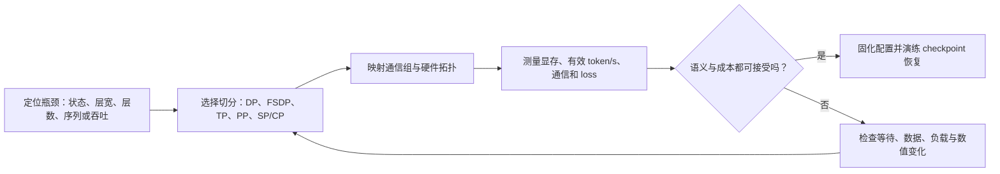
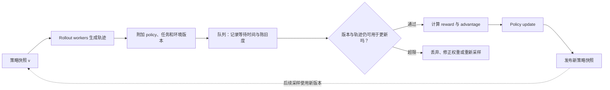

# 第四部分：大规模训练系统进阶

当模型、序列和数据规模增长到单卡无法承受时，训练问题就不再只是“把 batch 放到更多 GPU”。参数、梯度、优化器状态、激活、通信、数据游标、随机状态和 checkpoint 必须共同组成一个可恢复的分布式系统。

本部分按十个独立主题展开：DDP 的同步语义，ZeRO/FSDP 的状态分片，Tensor Parallel 的层内切分，Pipeline Parallel 的层间流水线，Sequence/Context Parallel 的序列切分，DP/TP/PP/CP 的混合布局，Activation Checkpointing 的重计算，通信与计算重叠，吞吐与性能分析，以及训练事故的发现、恢复和复盘。

入门者可以先把四种主要并行方式记成四个问题：数据太多，用 Data Parallel；单层太宽，用 Tensor Parallel；层数太深，用 Pipeline Parallel；训练状态重复太多，用 ZeRO/FSDP。进阶时还要问第五个问题：序列太长，激活和 attention 如何沿序列分片？真正的系统设计还要把这些维度映射到硬件拓扑、global batch、通信组和 checkpoint 格式。

贯穿本部分的原则是：理论上“能切分”不等于实际“值得切分”。每种并行方式都在显存、通信、调度、数值一致性和恢复复杂度之间交换成本，必须用 tokens/s、显存峰值、通信占比、loss 曲线和故障恢复结果共同验证。

把整章看作一次系统设计会更容易理解：先确认哪个对象放不下或跑不动，再沿合适的维度切分；切分之后，通过调度隐藏通信，通过实测判断有没有得到收益，最后验证异常时能否回到同一训练状态。

图中最重要的顺序是先诊断、再选并行方式。单看 GPU utilization 或峰值显存不能定位问题：显存高可能来自参数，也可能来自长序列 activation 或预取 buffer；吞吐低可能来自跨节点通信，也可能来自数据加载或最慢 stage。后面的十讲分别补齐诊断、切分、调度和恢复的接口。

## 41. DDP：同步数据并行的梯度语义

### 41.1 DDP 解决的是什么问题

设模型参数可以放在一张 GPU 上，但单卡处理数据太慢。Data Parallel 的思路是复制模型，让不同 GPU 同时处理不同样本，再把各自的梯度合成一个全局梯度。

若有 R 个 rank，每个 rank 的本地 batch 大小为 m，梯度累积步数为 A，则一个 optimizer step 处理的样本数近似为：

~~~math
B_{\mathrm{global}}=m\times R\times A
~~~

DDP 的关键不是“同步 loss”，而是让所有 rank 在 optimizer step 前使用同一个梯度。同步完成后，各 rank 都执行相同的参数更新，因此模型副本继续保持一致。

### 41.2 DataParallel 与 DistributedDataParallel

单进程多卡的 `DataParallel` 通常由一个进程切分输入、调度多个 GPU，再把结果聚合到主卡。主卡的输入聚合、输出聚合和 Python 调度容易成为瓶颈，扩展到多机时也不自然。PyTorch 的 [DDP 文档](https://docs.pytorch.org/docs/stable/generated/torch.nn.parallel.DistributedDataParallel.html)说明了多进程包装模型和梯度同步接口；下方 CPU 示例使用 Gloo 展示相同的同步语义。

DDP 通常采用一进程一 GPU。每个进程绑定一个 rank 和一张 GPU，forward/backward 在本地执行，collective 通信由 NCCL 等后端完成。这样避免了单一主卡承担所有聚合，更适合多机多卡。

DDP 的“复制”意味着每个 rank 仍然拥有完整模型参数、梯度和通常的优化器状态。它提高数据吞吐，却不自动降低单卡模型状态显存，这是它与 FSDP/ZeRO 的根本差异。

### 41.3 一步训练中的六个状态

一次同步 DDP step 可以拆成：

1. 所有 rank 从相同或一致的 checkpoint 初始化参数；
2. `DistributedSampler` 为各 rank 提供不重叠的数据；
3. 每个 rank 独立 forward，得到本地 loss；
4. 每个 rank 独立 backward，形成本地梯度；
5. DDP 对梯度 bucket 做 all-reduce 或等价聚合；
6. 所有 rank 使用同一优化器状态和同步梯度执行 step。

第 5 步是 DDP 的通信核心。参数不是每一步从某个主卡广播下来的；在正常同步训练中，各 rank 在更新前已经具有相同参数，梯度同步后各自更新即可。

### 41.4 all-reduce 与全局平均梯度

设第 r 个 rank 的本地样本集合为 B_r，单样本损失为 ell(x; theta)，本地使用 mean reduction，则：

~~~math
g_r=\frac{1}{|B_r|}\sum_{x\in B_r}\nabla_\theta\ell(x;\theta)
~~~

若各 rank 的样本数都为 m，DDP 的平均梯度为：

~~~math
g=\frac{1}{R}\sum_{r=0}^{R-1}g_r
  =\frac{1}{Rm}\sum_{r=0}^{R-1}\sum_{x\in B_r}\nabla_\theta\ell(x;\theta)
~~~

这与把所有本地 batch 拼成一个 global batch 后求平均等价。

但语言模型经常使用变长序列，真正应该平均的是有效 token，而不一定是样本。若 rank 0 有 100 个有效 token，rank 1 只有 10 个有效 token，简单平均两个 rank 的 mean loss 会让两个 rank 权重相同，而按 token 平均应使用：

~~~math
L_{\mathrm{global}}=\frac{\sum_r S_r}{\sum_r N_r}
~~~

其中 S_r 是 rank r 的有效 token loss sum，N_r 是有效 token 数。比如 rank 0 的 100 个 token 平均 loss 为 1，rank 1 的 10 个 token 平均 loss 为 2。直接平均两个 rank 的 mean 得到 1.5；按 token 加权的全局 mean 则是 (100×1+10×2)/110≈1.091。

若要让 DDP 默认的 rank 梯度平均得到全局 token 平均梯度，可先 all-reduce 得到 N=Σ_r N_r，再让 rank r 对 `R × S_r / N` 做 backward。DDP 再除以 R 后，结果就是 Σ_r ∇S_r/N。累积多个 micro-batch 时，分母必须覆盖同一个 optimizer step 内的有效 token；自定义 communication hook 若改变了梯度缩放，也要相应调整。日志里的 loss 同样应汇总 loss sum 和 token count，不能平均各 rank 的 mean。

### 41.5 all-reduce、reduce-scatter 与 all-gather

all-reduce 的输入是每个 rank 的 tensor，输出是每个 rank 都拥有的聚合结果。若四个 rank 的标量是 1、2、3、4，sum all-reduce 后每个 rank 都得到 10；再除以 4 就是平均值。

reduce-scatter 先做聚合，再把结果切成若干片，每个 rank 只拿一片。all-gather 则把各 rank 的分片收集起来，让每个 rank 都得到完整 tensor。DDP 主要使用 all-reduce；ZeRO/FSDP、TP 和 CP 会更多使用 reduce-scatter/all-gather 组合。

通信量可用一个很粗略的带宽模型理解：

~~~math
T_{\mathrm{comm}}\approx \alpha\,n_{\mathrm{msg}}+\beta\,V
~~~

alpha 代表每次通信启动的延迟，beta 代表单位字节传输时间，V 是有效传输量。小 bucket 会增大消息数量，超大 bucket 会延迟通信启动；实际还要考虑拓扑、collective 算法和竞争流量。

### 41.6 global batch 与梯度累积

`micro_batch_size` 是单 rank 一次 forward/backward 的样本数，`R_dp` 是数据并行 rank 数，`A` 是在一次 optimizer step 前累积的 micro-batch 数：

~~~math
B_{\mathrm{global}}=B_{\mathrm{micro}}R_{\mathrm{dp}}A
~~~

梯度累积时，前 A-1 个 micro-step 不应反复做全量梯度同步，否则通信成本被重复放大。DDP 提供 `no_sync()` 这类机制，让中间 backward 只累积本地梯度，最后一个 micro-step 再同步。

但要注意 loss 缩放。如果每个 micro-step 的 loss 是 mean，应除以 A 后再 backward，使累计梯度与一次 global batch 的平均梯度一致。若有效 token 数不同，则应累计 loss sum 和 token count，不能只按 micro-step 数平均。

### 41.7 bucket 与反向计算重叠

反向传播通常从最后一层向前产生梯度。DDP 会把梯度组织成 bucket；某个 bucket 内的梯度全部就绪后，就可以启动 all-reduce，同时继续计算更前面层的梯度。

bucket 太小会产生很多通信启动，alpha 成本明显；bucket 太大则要等待更多梯度就绪，通信开始得晚，重叠机会减少。最后一个 bucket 往往没有后续足够计算可以覆盖，因此形成通信尾部。

### 41.8 数据切分与 DistributedSampler

数据并行的正确性依赖每个 rank 的数据进度。常见要求包括：

1. 每个 epoch 调用 `sampler.set_epoch(epoch)`，让 shuffle 随 epoch 变化；
2. 数据量不能整除 world size 时，明确选择 padding 或 drop-last；
3. 所有 rank 尽量拥有相同数量的 batch，避免某个 rank 提前结束；
4. 恢复训练时保存 shard、sample offset 和随机状态；
5. 验证阶段聚合有效样本数，而不是只读取 rank 0 的指标。

忘记 `set_epoch` 不一定立刻报错，却可能让每轮数据顺序相同；rank batch 数不一致则可能在 collective 处长期等待。

### 41.9 DDP 代码骨架

下面的 CPU/Gloo 例子用两个进程处理四个样本，展示 DDP 把各 rank 的本地平均梯度再平均，并让参数副本保持一致。将代码保存为 `ddp_cpu_demo.py`，运行 `torchrun --standalone --nproc_per_node=2 ddp_cpu_demo.py`。它验证梯度聚合语义，不测 GPU/NCCL 性能；GPU 训练通常使用 NCCL。

~~~python
import torch
import torch.distributed as dist
from torch.nn.parallel import DistributedDataParallel as DDP
from torch.utils.data import DataLoader, DistributedSampler, TensorDataset

def main():
    torch.set_num_threads(1)
    dist.init_process_group(backend="gloo")
    rank = dist.get_rank()
    world_size = dist.get_world_size()
    try:
        features = torch.tensor([[1.0], [2.0], [3.0], [4.0]])
        targets = features.clone()
        dataset = TensorDataset(features, targets)
        sampler = DistributedSampler(
            dataset, num_replicas=world_size, rank=rank,
            shuffle=False, drop_last=True,
        )
        sampler.set_epoch(0)
        loader = DataLoader(dataset, batch_size=2, sampler=sampler)

        model = torch.nn.Linear(1, 1, bias=False)
        with torch.no_grad():
            model.weight.zero_()
        model = DDP(model)
        optimizer = torch.optim.SGD(model.parameters(), lr=0.1)
        local_batch = 0
        for x, y in loader:
            local_batch += x.size(0)
            optimizer.zero_grad(set_to_none=True)
            loss = (model(x) - y).square().mean()
            loss.backward()
            optimizer.step()

        dist.barrier()
        if rank == 0:
            weight = model.module.weight.item()
            print(
                f"world_size={world_size} local_batch={local_batch} "
                f"global_batch={local_batch * world_size} weight={weight:.4f}"
            )
    finally:
        dist.destroy_process_group()

if __name__ == "__main__":
    main()
~~~

> **代码状态：静态审阅，未运行（2026-10-29）**

预期输出为 `world_size=2 local_batch=2 global_batch=4 weight=1.5000`。rank 0 和 rank 1 的本地 mean gradient 分别为 -5 和 -25，DDP 平均后为 -15；学习率 0.1 从零权重更新到 1.5。这个 CPU 结果验证梯度平均的代数关系，不代表 NCCL 或 GPU 性能。

### 41.10 DDP 的边界

DDP 适合模型、梯度和优化器状态能够放进单卡的情况。它不单独解决：参数放不下、Adam state 放不下、长序列激活爆炸、单层矩阵太宽或多层模型太深。此时需要 FSDP/ZeRO、TP、PP、SP/CP 或 Activation Checkpointing 的组合。

### 41.11 用有效 token 核对一次同步更新

把上一讲的 token 加权公式再走一遍，可以发现“每个 rank 平均”只有在 rank 的有效 token 数相同，或本地 loss 已经按全局 token 数正确缩放时才等价于全局目标。假设 rank 0 处理 3 个有效 token，其梯度分别为 1、2、3；rank 1 处理 1 个 token，梯度为 9。全局 token 平均梯度是 (1+2+3+9)/4=3.75。若先在 rank 内求 mean，则两边分别得到 2 和 9，DDP 再平均为 5.5。多出来的 1.75 不是通信误差，而是目标权重改变：短 batch 的 rank 被赋予了和长 batch 相同的权重。

真实语言模型的“样本数”与“有效 token 数”常不一致，原因包括 padding、packing、不同长度样本和 ignore mask。应把每个 rank 的 loss sum 与有效 token count 同时记录；一个 optimizer step 的累计窗口结束时，再以总 token 数归一化。梯度裁剪也应放在同步与归一化之后，避免各 rank 按不同局部尺度裁剪出不同方向。若使用自定义 all-reduce hook、梯度压缩或梯度累积，必须确认它们没有额外除以 world size 或 accumulation steps。排查 DDP 数值不一致时，先用单卡拼接 batch 与多卡同步 batch 对照梯度，再检查数据分片和 reduction，而不是先怀疑 NCCL。

排查时可以做一个很小的等价性实验：固定随机种子和四个训练样本，单卡一次性处理四个样本；多卡则让两个 rank 各处理两个样本。分别记录 loss sum、有效 token 数、同步前本地梯度和同步后梯度。若本地 batch 相同、目标定义相同、优化器尚未更新，单卡和多卡得到的梯度应只存在浮点规约顺序导致的微小误差。若差距很大，依次检查 sampler 是否重复或漏样本、loss reduction 是否一致、梯度是否被重复缩放，以及某个 rank 是否在 gradient accumulation 中错误地先更新了参数。这个对照把“训练不稳定”拆成可定位的语义问题与数值误差。

日志同样要和梯度目标一致。若一个 step 有两个 micro-batch，第一个有效 token 数为 100、loss sum=120，第二个为 50、loss sum=75，则全局 token 平均 loss 是 (120+75)/(100+50)=1.3。先计算两个 micro-batch 的平均值 1.2 和 1.5，再简单平均会得到 1.35。后一个数对梯度目标也可能产生相同的错误权重。监控 dashboard 应保留 sum/count 或以有效 token 为分母汇总，尤其在 packing、padding 和多语言变长样本下，避免训练曲线自己改变统计定义。

## 42. ZeRO 与 FSDP：把训练状态从复制变成分片

### 42.1 DDP 的显存账

设模型参数量为 N。混合精度 AdamW 训练时，单个参数可能同时需要低精度参数、低精度梯度、FP32 一阶矩、FP32 二阶矩和 FP32 master weight。一个教学估算是：

~~~math
M_{\mathrm{state}}\approx N(b_p+b_g+b_m+b_v+b_{\mathrm{master}})
~~~

若前三类分别按 2、2、4、4、4 bytes 计，则约 16 bytes/parameter，不包括 activation、通信 buffer、workspace 和碎片。DDP 每个 rank 都有这份状态，GPU 数增加不会按 rank 数降低单卡模型状态。

### 42.2 ZeRO 的三个阶段

ZeRO 的核心是消除数据并行中的状态冗余；阶段定义来自 [ZeRO 论文](https://arxiv.org/abs/1910.02054)，PyTorch 的全分片实现接口见 [FSDP 文档](https://docs.pytorch.org/docs/stable/fsdp.html)：

1. **ZeRO-1**：只分片 optimizer states；
2. **ZeRO-2**：分片 optimizer states 和 gradients；
3. **ZeRO-3**：进一步分片 parameters。

若数据并行组大小为 R，用参数、梯度和优化器长期状态的粗略显存表示：

~~~math
M_{\mathrm{DDP}}=M_p+M_g+M_o
~~~

~~~math
M_{\mathrm{Z1}}=M_p+M_g+\frac{M_o}{R}
~~~

~~~math
M_{\mathrm{Z2}}=M_p+\frac{M_g}{R}+\frac{M_o}{R}
~~~

~~~math
M_{\mathrm{Z3}}\approx\frac{M_p}{R}+\frac{M_g}{R}+\frac{M_o}{R}
~~~

Z3 的等号只是长期状态近似；当前层 all-gather 的完整参数、prefetch buffer 和 activation 会形成额外峰值。

### 42.3 ZeRO-1 与 ZeRO-2 的适用边界

如果模型参数本身能放下，但 Adam state 是主要瓶颈，ZeRO-1 就可能有明显收益。若完整梯度也占据大量显存，ZeRO-2 可以进一步降低长期梯度副本。它们不需要在每一层 forward 前恢复完整参数，因此通信和实现通常比 ZeRO-3 简单。

代价是分片梯度或状态的通信、checkpoint 复杂度和调试难度。小模型上，额外通信可能超过显存收益；大模型上，能够运行本身可能比少量吞吐损失更重要。

### 42.4 ZeRO-3 的参数生命周期

ZeRO-3 中参数平时只保留分片。某个模块计算前，相关参数通过 all-gather 临时恢复；forward 或 backward 使用后释放完整副本，回到分片状态；梯度计算完成后通过 reduce-scatter 形成各 rank 的梯度分片。

因此 ZeRO-3 的状态转换是：

~~~text
长期保存参数分片
  -> 当前模块前 all-gather
  -> 模块计算
  -> 释放完整参数
  -> backward 后 reduce-scatter 梯度
  -> 每个 rank 更新自己的参数分片
~~~

参数分片让单卡能容纳更大模型，但 all-gather 的时机、prefetch 和模块 wrap 粒度会决定真实峰值显存与吞吐。

### 42.5 FSDP 的核心思想

Fully Sharded Data Parallel（FSDP）是 PyTorch 生态中的全分片数据并行方案。它通常把模型按 block 或其他模块粒度包裹：模块空闲时参数、梯度和 optimizer state 分片；进入模块计算前 all-gather 参数；计算后释放完整参数；梯度完成后 reduce-scatter。PyTorch 的 [FSDP 文档](https://docs.pytorch.org/docs/stable/fsdp.html)和[训练教程](https://docs.pytorch.org/tutorials/intermediate/FSDP_tutorial.html)说明了对应 API 与包裹流程，具体行为应按使用的 PyTorch 版本核对。

从“切哪些状态”的角度，FSDP 与 ZeRO-3 相近；差异主要在 API、模块包裹、通信调度、offload、state dict 和生态集成。比较两者时应先说清分片语义，再讨论框架差异，而不是把名称当作算法本身。

### 42.6 wrap 粒度与峰值显存

按每个 Linear 包裹会让通信启动次数很多；整个模型包裹则可能一次 all-gather 过多参数。Transformer 中常以一个 block 作为 FSDP unit，在通信次数、临时完整参数和计算重叠之间取得折中。

wrap 粒度还会影响 checkpointing、prefetch、混合精度和 pipeline stage balance。更细的粒度不是无条件更好；应使用 profiler 比较 all-gather 时间、峰值显存和 tokens/s。

### 42.7 all-gather 与 reduce-scatter 的角色

若各 rank 拥有参数分片 P_0,...,P_{R-1}，all-gather 后每个 rank 获得完整 P。若各 rank 产生可聚合梯度 G_r，reduce-scatter 先聚合，再让每个 rank 只保留对应片段。

这与 DDP 的 all-reduce 形成对照：DDP 聚合后每个 rank 保存完整梯度，FSDP/ZeRO 聚合后只保存自己负责的梯度片段。对比通信操作时不能只看名称，还要看 collective 的输入形状、输出形状和调用时机。

### 42.8 offload 的收益与代价

optimizer state、参数或梯度可以 offload 到 CPU，极端情况下还可借助 NVMe。这样能降低 GPU 显存，却把瓶颈转移到 PCIe、CPU 内存带宽、NVMe 吞吐和异步调度。

offload 适合显存极紧、微调或吞吐不是第一目标的场景；高吞吐预训练通常更偏向 GPU 内完成主要状态访问。是否使用 offload 必须用目标 batch、序列长度和恢复成本做实测。

### 42.9 分片状态的显存估算器

~~~python
import math
from numbers import Real

def gib(value):
    return value / (1024 ** 3)

def state_memory(params, world_size, param_bytes=2, grad_bytes=2, optim_bytes=12):
    if (isinstance(params, bool) or not isinstance(params, int) or params <= 0
            or isinstance(world_size, bool) or not isinstance(world_size, int)
            or world_size <= 0):
        raise ValueError("params and world_size must be positive integers")
    byte_sizes = [param_bytes, grad_bytes, optim_bytes]
    if any(isinstance(value, bool) or not isinstance(value, Real)
           or not math.isfinite(value) or value <= 0 for value in byte_sizes):
        raise ValueError("state byte sizes must be finite positive numbers")
    parameters = params * param_bytes
    gradients = params * grad_bytes
    optimizer = params * optim_bytes
    return {
        "DDP": parameters + gradients + optimizer,
        "ZeRO-1": parameters + gradients + optimizer / world_size,
        "ZeRO-2": parameters + (gradients + optimizer) / world_size,
        "ZeRO-3/FSDP": (parameters + gradients + optimizer) / world_size,
    }

for name, value in state_memory(7_000_000_000, 8).items():
    print(name, round(gib(value), 2), "GiB")
~~~

> **代码状态：静态审阅，未运行（2026-10-29）**

7B 参数、8 个 rank 的示例输出依次约为 DDP 104.31 GiB、ZeRO-1 35.86 GiB、ZeRO-2 24.45 GiB、ZeRO-3/FSDP 13.04 GiB。这个估算器没有包括 activation 和 all-gather 峰值，只用于判断“分片对象不同，单卡长期状态如何变化”。容量规划不能直接把估算数字填满 GPU。

### 42.10 checkpoint 与恢复

分片训练必须区分 full state dict、sharded state dict 和 local state dict。full state dict 易于发布，却可能需要聚合内存；sharded state dict 适合恢复训练，但需要 manifest 和分片元数据；local state dict 与当前 rank layout 绑定更紧。

如果恢复时 GPU 数、TP/PP/DP 组或 FSDP wrap 变化，需要 reshard/repartition。除了权重，还要恢复 optimizer、scheduler、scaler、RNG、数据进度和并行配置。

### 42.11 把状态内存和瞬时峰值分开

前面的状态估算已给出：这个 7B 配置在 8 个 rank 上做全分片后，长期状态约 13 GiB/rank。它回答的是状态如何分布，不等于 forward、backward 或保存阶段都能放进显存。

进入某个 Transformer block 前，设备可能临时 all-gather 该 block 的完整权重；与此同时还要存 activation、通信 bucket、CUDA workspace 和内存碎片。假设设备可用显存 80 GiB，长期分片状态占 13 GiB，当前 block 参数重建占 9 GiB，activation 占 46 GiB，通信与 workspace 需要 7 GiB，理论合计已经是 75 GiB，只剩 5 GiB 余量。若预取下一 block 又额外同时驻留 8 GiB，就可能 OOM。降低分片比例只能解决长期状态项，不能自动释放 activation；这时要考虑减小 micro-batch、checkpoint activation、缩短序列或限制预取。

所以容量规划至少分成两张账：长期常驻状态和按训练阶段变化的瞬时峰值。前者回答“模型状态能不能分片放下”，后者回答“forward、backward、optimizer step、评估和保存各自能否通过”。PyTorch FSDP2 的 fully_shard 按模块创建通信组，模块粒度会影响 all-gather 时机和重叠；这也是为什么包裹粒度要和峰值、通信曲线一起实测，而不是只按模型参数总量推导。

把 ZeRO 的三个阶段放回一个选择流程：若参数和梯度能放下、optimizer state 却占主导，可先估 ZeRO-1；若梯度副本也明显，再考虑 ZeRO-2；若单卡连参数都放不下，才需要 ZeRO-3/FSDP 的参数分片或 Tensor Parallel。这个顺序不是性能排名，而是从最少改变参数访问模式开始，避免不必要的 all-gather。即使长期状态已分片，activation、通信 buffer 和临时重建参数仍可能令总峰值超限。

若采用 CPU offload，显存账会变好看，却要再问数据如何往返。参数更新依赖梯度和 optimizer state，CPU 内存带宽、PCIe 传输、CPU 核绑定和异步预取可能成为关键路径。一个设定在单卡 GPU 上能容纳 10B 模型的例子，不代表它会有同样的 token/s，也不代表它适用于多节点高吞吐预训练。DeepSpeed 文档将 ZeRO-Offload 的目标明确放在用主机资源扩展可训练规模；评估时应把 GPU 峰值、CPU 使用、传输带宽、step time 和失败恢复一起记录。

恢复状态时，参数分片文件也不是唯一的映射。假设保存时 DP=8，每个 rank 保存全局参数的八分之一；恢复时改为 DP=4，每个新 rank 要从旧 checkpoint 的两个分片重组自己的状态。若 optimizer moments 与参数使用不同 flatten 顺序，或 checkpoint 没保存 shape、offset、dtype 和 shard metadata，权重可能勉强能载入，优化器却不能正确续训。PyTorch Distributed Checkpoint 和 Megatron 的分布式 checkpoint 方案都把全局张量描述与各 rank 的本地片段分开处理，支持重排需要相应格式和模型集成。

所以试用 FSDP/ZeRO 前要先做一次小模型恢复演练：在 8 rank 保存，退出进程后按 4 rank 重载，检查每个全局参数重组后的值和 optimizer step；再用固定 batch 做 forward、loss 与一步更新。若只验证了模型权重相等，仍没有验证 scheduler、随机状态和数据 cursor。发布 checkpoint 与恢复 checkpoint 也可有不同格式，但要明示转换步骤、峰值主机内存和转换后是否还能继续训练。

还应区分“继续训练”和“从权重重新开始微调”。前者要恢复优化器矩、学习率、随机数、数据位置和梯度累积阶段；后者可以只加载权重并重新初始化优化器，但它代表一条新的训练轨迹。若从一个用于发布的 full state dict 恢复训练，转换时可能短暂同时占用源分片、聚合权重和新分片内存。checkpoint 的写入、转换和恢复都需要独立测峰值与耗时，不能因为训练循环的显存足够，就假设保存阶段也一定安全。

框架实现还在调整“分片状态怎样表示”和“局部计算怎样表达”的边界。PyTorch 团队 2026 年 8 月的 TorchTitan 工程记录描述了一个迁移：FSDP2 继续用 DTensor 表示持久化的分片参数、梯度和 checkpoint 元数据；计算区则转向 SPMD Types，减少计算过程对 DTensor 张量子类分派的依赖，并显式表达不同 rank 上的数据变化和反向归约。该记录称 TorchTitan 已把它设为 eager 预训练与 RL 的默认后端；这是该项目当时的工程状态，不等于所有 PyTorch 训练栈都已切换。[SPMD Types in TorchTitan 工程记录](https://docs.pytorch.org/devlogs/distributed/2026-08-26-spmd-types-in-torchtitan/)

用 8 张卡的 DP=2、TP=4 网格看这种表示变化不改变张量账本。设权重矩阵 `W` 的全局形状为 16×64，按输出列切给 4 个 TP rank，再按行切给 2 个 DP rank；每个 rank 长期保存 8×16=128 个元素。若用 BF16，每元素 2 byte，这片权重占 256 byte。进入计算时，FSDP 在同一 TP 切片内 all-gather 两个 DP 分片，得到 16×16=256 个元素，即 512 byte；TP 切片仍保持本地。表中只计算这一块权重，不包括梯度、优化器、激活或通信缓冲：

| 状态 | 每个 rank 的形状 | 元素数 | BF16 字节数 |
| --- | ---: | ---: | ---: |
| 全局权重 | 16×64 | 1,024 | 2,048 |
| DP 与 TP 分片后常驻 | 8×16 | 128 | 256 |
| 计算时聚齐本 TP 切片 | 16×16 | 256 | 512 |

因此先前的显存估算仍然成立：DTensor 或 SPMD Types 是承载布局与计算语义的框架表示，不会让真实参数凭空变少。比较这类实现时，应固定 mesh、参数切片、collective 序列和输入，分别测 eager/warmup/steady-state 时间，并核对输出、梯度和 checkpoint 重排；不能把一次 API 迁移直接写成吞吐提升。

## 43. Tensor Parallel：把单层矩阵切给多个设备

### 43.1 TP 与状态分片的不同

ZeRO/FSDP 主要改变训练状态的保存方式；Tensor Parallel（TP）改变单层计算本身。DDP 是每张卡处理不同数据，TP 是多张卡共同处理同一批数据的某一层。

设线性层为：

~~~math
Y=XW,\qquad X\in\mathbb R^{B\times H},\quad W\in\mathbb R^{H\times O}
~~~

当 H、O 极大时，权重和矩阵乘都可能成为单卡瓶颈。TP 沿矩阵维度切开计算，让每张 GPU 只持有部分权重和 partial result。Megatron-LM 论文给出了 Transformer 中张量并行的列切分、行切分及其通信组合：[Megatron-LM](https://arxiv.org/abs/1909.08053)。

### 43.2 Column Parallel Linear

按输出维度切 W：

~~~math
W=[W_0\;W_1\;\cdots\;W_{T-1}],qquad Y_i=XW_i
~~~

每个 rank 持有完整 X 与一块 W，计算输出的一部分。完整输出是：

~~~math
Y=\mathrm{concat}(Y_0,Y_1,\ldots,Y_{T-1})
~~~

如果下一层也接受分片 hidden，就可以暂时不 all-gather，减少通信。

### 43.3 Row Parallel Linear

若输入和权重按输入维度切分：

~~~math
X=[X_0\;X_1\;\cdots\;X_{T-1}],\qquad
W=\begin{bmatrix}W_0\\W_1\\\vdots\\W_{T-1}\end{bmatrix}
~~~

则：

~~~math
Y=\sum_{i=0}^{T-1}X_iW_i
~~~

每个 rank 产生 partial output，通常通过 all-reduce 求和。于是 column parallel 产生拼接输出，row parallel 产生求和输出。

### 43.4 MLP 的 Column + Row 组合

典型 Transformer MLP 是：

~~~text
hidden -> up projection -> activation -> down projection -> hidden
~~~

up projection 使用 column parallel，把大 intermediate dimension 切成多块；SiLU、GELU、乘法门控等逐元素操作在本地完成；down projection 使用 row parallel，接收分片中间表示并把 partial output all-reduce。

这种组合的价值在于中间激活可以保持分片，不必在激活函数前后反复 gather。真实实现还需处理 bias、SwiGLU 的两个 up 分支、量化和 fused kernel。

### 43.5 Attention 的 head 切分

多头 attention 的 head 维度天然适合 TP。若有 H_Q 个 query heads、TP size 为 T，常见前提是 H_Q 能被 T 整除，每个 rank 计算一组 heads。Q/K/V 投影、局部 attention 和部分 output projection 可以在本地完成。

GQA/MQA 会让 query head 数与 KV head 数不同。此时不能只按 Q head 数机械切分，还要保证 KV head 的复制、共享和缓存布局合理。若 KV head 数小于 TP size，某些 rank 可能需要复制 KV 或采用不同的并行布局。

### 43.6 TP 的通信位置

一个高效 block 通常让通信出现在少数边界：column parallel 输出保持分片，局部 activation 与 attention 计算继续进行，row parallel 再通过 all-reduce 合并。若每个小算子都立即 gather，通信频率会吞噬计算收益。

TP 通信发生在每个 Transformer block 内，频率高、延迟敏感。因此 TP 通常放在同一节点的 NVLink/NVSwitch 域内，跨慢速网络会造成明显等待。

### 43.7 TP size 的约束

TP size 受 hidden size、intermediate size、query heads、KV heads 和硬件拓扑共同限制。维度不能整除时，要么采用不均匀切分，要么改变并行配置；不均匀切分会带来负载和 kernel 复杂度。

TP 越大，单卡矩阵更小，但每次通信更频繁，单卡计算粒度也可能过小。小模型使用过大的 TP size，常常比少量 TP 或 DDP 更慢。

### 43.8 一个纯 Python 的矩阵切分验证

~~~python
def matmul(x, w):
    if not x or not w or not w[0]:
        raise ValueError("matrices must be non-empty")
    if any(len(row) != len(w) for row in x):
        raise ValueError("inner matrix dimensions must match")
    if any(len(row) != len(w[0]) for row in w):
        raise ValueError("weight rows must have equal width")
    return [
        [sum(row[k] * w[k][j] for k in range(len(w))) for j in range(len(w[0]))]
        for row in x
    ]

def add(left, right):
    if not left or len(left) != len(right):
        raise ValueError("matrices must be non-empty and aligned")
    if any(len(x) != len(y) for x, y in zip(left, right)):
        raise ValueError("matrices must have matching shapes")
    return [[a + b for a, b in zip(x, y)] for x, y in zip(left, right)]

x = [[1.0, 2.0, 3.0, 4.0], [2.0, 1.0, 0.0, 1.0]]
w = [
    [1.0, 0.0, 2.0, 1.0],
    [0.0, 1.0, 1.0, 2.0],
    [1.0, 1.0, 0.0, 1.0],
    [2.0, 0.0, 1.0, 0.0],
]

full = matmul(x, w)
row_shards = [w[:2], w[2:]]
input_shards = [row[:2] for row in x], [row[2:] for row in x]
partials = [matmul(shard_x, shard_w) for shard_x, shard_w in zip(input_shards, row_shards)]
reduced = add(partials[0], partials[1])
print("full:", full)
print("row-parallel result:", reduced)
print("match:", full == reduced)
~~~

> **代码状态：静态审阅，未运行（2026-10-29）**

它只验证矩阵恒等式，不模拟 GPU、通信和反向传播；真实 TP 需要把同样的切分关系放进 forward/backward、collective 和 checkpoint。

### 43.9 TP 与 DP、PP 的组合

若 TP=4、PP=2，则一个模型副本需要 8 个 rank。总 world size 为 W 时，若其余维度只使用 DP，则：

~~~math
D=\frac{W}{T\times P}
~~~

TP group 内做层内通信，PP group 在 stage 之间传激活，DP group 在副本之间同步梯度或分片状态。一个 rank 同时属于多个通信组，group 构造错误可能造成 hang、错误梯度或 checkpoint 无法恢复。

### 43.10 TP 用于推理

推理时没有 backward，但 TP 仍要处理权重分片、attention head、KV Cache、all-reduce 延迟和 batch 调度。低延迟 decode 对通信很敏感；大 batch prefill 可能更能摊平 TP 通信。训练 TP 配置不能直接假设是服务端最优配置，应按 prefill/decode、并发和 P99 延迟重新测量。

### 43.11 两张卡如何算出同一个 MLP 输出

取一个只有 4 维 hidden 的线性层，输入 x=[1,2,3,4]，权重矩阵按输入维度拆成两半。rank 0 只接收前两个输入分量以及对应的两行权重，rank 1 接收后两个分量和另外两行权重。以第一个输出列的权重 [1,0,1,2] 为例，两个 rank 分别算出 1×1+2×0=1 和 3×1+4×2=11，row-parallel 层再把两个 partial sum 相加，输出 12。单卡直接做点积也得到 1+0+3+8=12。TP 保持的是矩阵乘法的代数结果，分片过程没有改变模型函数。

把它扩展到 Transformer MLP：第一层按输出维度分片，各 rank 得到一段 intermediate；激活函数在本地逐元素处理；第二层按输入维度分片，再把 partial output 求和。理想布局只在必要边界通信，不在两个投影之间把整个 intermediate gather 到每张卡。若隐藏维度 8192、TP=8，每卡处理约 1024 个输出通道；每个 block 仍需在投影边界做 collective。TP 增大八倍并不会把时间缩短八倍，因为每层都重复通信，且矩阵规模缩小后 kernel 利用率可能下降。

因此 TP 的首要约束不是“卡越多越快”，而是维度是否可整除、每卡矩阵是否仍有足够计算量，以及 rank 之间互联是否够快。高频、低延迟的 TP 通信通常优先留在同一节点高速互联域；若跨节点，必须测一层实际 collective 的 latency 和带宽。训练与推理还要分别检查：训练含反向通信，decode 每个新 token 都要经过层内依赖，通信延迟可能直接累加到 token latency。

再看 attention 的 head 切分。若模型有 32 个 query heads、TP=4，最直接的均匀划分是每卡 8 个 query heads；每张卡用本地 Q/K/V head 计算 attention，再在 output projection 的约定边界合并结果。若是 GQA，假设 32 个 Q heads 共用 8 个 KV heads，TP=4 时每卡可分到 8 个 Q heads 和 2 个 KV heads，布局整齐；若 TP=8，则每卡 4 个 Q heads、1 个 KV head，也能对齐；若 TP=16，KV head 少于 rank 数，框架可能需要复制 KV、改变并行组或使用不同方案。复制减少不了总 KV 状态，还可能增加通信和显存，不能把“Q head 可整除”当作完整可行性条件。

attention 与 MLP 的通信边界也应按张量布局理解。column parallel 产生输出维度分片；逐元素激活通常不需要跨卡；row parallel 将各卡 partial contribution 汇合。若下游算子希望收到完整 hidden，必须在接口边界 all-reduce 或 all-gather；若下游能消费同样的分片，就可以继续延迟合并。调试 TP 时打印每层输入、输出的全局 shape 与本地 shard shape，核对通信前后是否恢复预期布局。逻辑计算正确但 layout 声明错误，可能导致每层静默复制或形状对不上。

从通信量角度看，若 hidden shape 是 [B,T,H]，一个 TP all-reduce 的数据量大致随 B×T×H×dtype_bytes 增长；序列变长或 micro-batch 变大时，即使 TP size 不变，边界 collective 也会变大。以 B=1、T=2048、H=4096、BF16 两字节为例，一个完整 hidden tensor 约有 16.8M byte，即约 16 MiB；若每层有两个类似 collective，32 层就会触发很多次通信。真实 ring all-reduce 的每卡收发量受算法和 rank 数影响，这里只估张量尺寸，不能直接当网络流量。

TP 最适合的形状往往是足够大的矩阵配合高速互联；小 batch decode 会使矩阵乘变窄，通信启动延迟在每层都出现，可能抵消分片的好处。反过来，长 prefill 或大 batch 会提高每次 GEMM 的工作量，让通信占比相对下降。比较 TP=1、2、4 时应固定服务阶段与 batch 形状，分别测 prefill、decode 和端到端请求，不把一个阶段的吞吐结论套到另一个阶段。

训练中的 TP 还会改变反向图。column parallel 线性层的输入梯度通常需要汇总来自不同输出分片的贡献；row parallel 层的输入本身是分片，输出梯度在各 rank 上复制或按实现约定组织。前向某处少一次 all-gather，可能把同步推迟到反向的另一个边界，而不是彻底消除通信。使用 Megatron-LM 一类实现时，应沿一个 block 跟踪前向与反向的 layout，尤其检查 residual 分支：主支如果是 sequence-sharded，残差也必须在相同位置切分或通过明确通信恢复。

小矩阵数值验证只能证明分片乘法等价，不能证明并行训练的所有接口正确。完整验收可以从 TP=1 和 TP=2 的 tiny Transformer 开始，初始化相同全局权重，跑同一 batch，比较 logits、loss、各参数梯度和一次 optimizer update。浮点规约顺序可能带来微小误差，但若误差随层数持续放大，要检查 head 映射、复制参数的梯度缩放、bias 是否重复相加及 checkpoint shard 的顺序。性能测试应在数值对照通过后再做。

从读者角度，可以沿一个 block 做张量追踪：输入 hidden 先按需要复制或切分，Q/K/V projection 产生本地 head，attention 只访问分配给该 rank 的 head；合并 head 后通过 output projection 的分片规则恢复目标布局；residual 与下一层输入维度保持一致。每个边界都写出全局 shape 和本地 shape，例如 [B,T,H] 与 [B,T,H/TP]。这样不仅能解释通信发生在哪里，也能检查一个实现有没有意外 all-gather 完整激活。真实框架可能使用不同的 sequence parallel 组织，但必须能把布局关系讲清。

## 44. Pipeline Parallel：按层切分并填充流水线

### 44.1 PP 的基本结构

Transformer 是层的序列：embedding、若干 block、最终 norm 和 LM head。Pipeline Parallel（PP）把连续层划分为多个 stage。Stage 0 输出的 hidden 传给 Stage 1，最后一个 stage 计算 loss；backward 的梯度沿相反方向返回。GPipe 论文把 micro-batch 切分与流水线调度作为核心机制之一：[GPipe](https://arxiv.org/abs/1811.06965)。

例如 48 层可以粗略分成：

~~~text
Stage 0: embedding + block 1-12
Stage 1: block 13-24
Stage 2: block 25-36
Stage 3: block 37-48 + lm_head
~~~

PP 降低每个 stage 的参数量，但每个 stage 仍要保存自己的 activation、梯度和优化器状态，不能替代 FSDP 或 checkpointing。

### 44.2 为什么需要 micro-batch

如果一个完整 batch 一次通过，Stage 0 计算时其他 stage 空闲，Stage 1 开始后 Stage 0 又可能空闲。把 global batch 拆成 M 个 micro-batch 后，Stage 0 可以处理 micro-batch 2，同时 Stage 1 处理 micro-batch 1，流水线逐渐填满。

### 44.3 pipeline bubble

有 P 个 stage、M 个 micro-batch，并假设每个 stage 单个 micro-batch 的计算时间相近，forward-only 的时间片近似为 M+P-1。理想无空闲只需要 M 个时间片，因此可用一个教学近似表示利用率：

~~~math
U_{\mathrm{fwd}}\approx\frac{M}{M+P-1}
~~~

bubble 比例约为：

~~~math
B_{\mathrm{bubble}}\approx\frac{P-1}{M+P-1}
~~~

真实训练还要加入 backward、warmup/cooldown、通信、stage 不均衡和 checkpointing；公式只说明 P 大而 M 小时空闲严重。

### 44.4 GPipe 与 1F1B

GPipe 的经典思路是先让多个 micro-batch 完成 forward，再统一 backward。优点是调度清晰、梯度语义直观；缺点是要保留更多 micro-batch 的 activation。

1F1B 在 warmup 后尽量交替执行 one-forward-one-backward。backward 更早开始，activation 生命周期缩短，显存压力降低；代价是调度、依赖和 debug 更复杂。不同框架有不同 1F1B 变体，不能仅凭名称推断其精确调度。

### 44.5 stage 负载均衡

PP 的吞吐由最慢 stage 决定。不能只按 block 数平均分配：embedding、LM head、MoE、不同 attention 配置和跨节点通信都可能让 stage 时间不同。应记录每个 stage 的 forward、backward、send/recv、等待时间和显存峰值，再根据 profile 调整层分配。

### 44.6 PP 通信与显存

PP 的边界通信是 activation forward 发送和 activation gradient backward 返回。序列长度、micro-batch、hidden size 和 stage 数都会影响通信量。

micro-batch 增多会摊薄 bubble，却可能增加同时存活的 activation；GPipe 的保存压力尤其明显，1F1B 可以缓解；activation checkpointing 还可以进一步减少存储，但会增加重计算。PP 的配置应同时给出 M、micro batch、序列长度和 checkpoint 策略。

### 44.7 流水线时间线模拟

~~~python
def timeline(stages, micro_batches):
    if (not isinstance(stages, int) or stages <= 0
            or not isinstance(micro_batches, int) or micro_batches <= 0):
        raise ValueError("stages and micro_batches must be positive integers")
    slots = stages + micro_batches - 1
    rows = []
    for stage in range(stages):
        row = []
        for time in range(slots):
            index = time - stage
            row.append(f"F{index}" if 0 <= index < micro_batches else ".")
        rows.append(row)
    return rows

for row_id, row in enumerate(timeline(4, 8)):
    print("stage", row_id, ":", " ".join(row))
slots = 4 + 8 - 1
print("utilization:", round(8 / slots, 3))
~~~

> **代码状态：静态审阅，未运行（2026-10-29）**

这个 forward-only 时间线不是完整训练调度，但能直接显示 warmup/cooldown 的空闲位置。真实调度还要把 backward、send/recv、权重版本和梯度累积加入模型。

### 44.8 interleaved pipeline

interleaved PP 把每个物理 stage 再拆为多个 virtual chunks，使调度更细，可能降低 bubble、改善负载均衡。它也增加 stage 间切换、通信和 checkpoint 映射复杂度。只有在 profile 证明 bubble 或负载不均是主要瓶颈时，才有必要承担这类复杂性。

### 44.9 PP checkpoint

PP checkpoint 同时带有 stage mapping；若再叠加 TP 和 ZeRO/FSDP，还要记录 tensor shard、DP shard、optimizer state 和 rank mapping。改变 PP size 需要 repartition，而不是简单复制文件。恢复测试必须验证每个层是否加载到正确 stage，并对 forward、loss 和短步训练做回归。

### 44.10 手算 bubble 与激活驻留

用 4 个 stage 处理 4 个 micro-batch，假设每个 stage 的前向时间都为 1 个时间单位。只看 forward 的排程长度是 M+P-1=4+4-1=7，可用于计算的时间格共 16 个，因此平均利用率为 16/(4×7)=4/7≈57.1%；等价的简化公式 M/(M+P-1) 也得到 4/7。如果 micro-batch 增为 16，流水线时间格是 19，利用率变为 16/19≈84.2%。增加 micro-batch 能摊薄填充和排空阶段的空闲，但不意味着训练总成本自动下降，因为每个 micro-batch 仍有调度开销，而且它们可能需要保留不同的 activation。

再把 stage 时间改成 [1,1,1,2]。最后 stage 是其他 stage 的两倍，前面三个 stage 在部分时刻必须等待它，平均利用率公式便不再能准确反映实际吞吐。流水线每个稳态周期的速度由最慢 stage 决定；即使 bubble 比例低，慢 stage 也会形成持续队列。实际调优要将各 stage 的 forward、backward、send/recv 和 wait 时间画成时间线，并调整层分配，而不是单纯增加 micro-batch 数。

显存也与调度有关：GPipe 先完成多个 forward，backward 才开始，早期 activation 需要等待更久；1F1B 让 backward 较早消费 activation，驻留时间缩短。若 stage 使用不同 checkpoint 粒度，重算时间也会改变负载平衡。于是 PP 配置必须同时给出 stage 层数、micro-batch 数、调度类型和 activation 策略，只有“PP=4”并不足以复现实验。

再看 4 个 stage、8 个 micro-batch 的理想 forward 时间线。排程长度为 8+4-1=11 个时间单位，利用率约 8/11=72.7%；若 micro-batch 增到 32，利用率升至 32/(32+4-1)=91.4%。收益逐渐变小：从 8 加到 32 提高约 18.7 个百分点，而不是四倍吞吐。真实的训练 schedule 还需 forward 和 backward 两组依赖，且一个 optimizer step 的梯度必须来自同一组参数版本；流水线调度必须保证参数更新只发生在预定边界，避免不同 micro-batch 意外使用不同权重。

若 4 个 stage 中前三个各花 1 秒，最后一个花 1.5 秒，稳态吞吐由 1.5 秒的慢 stage 限制。把层数平均成 12/12/12/12 可能并不平衡，因为 embedding、loss head、MoE 或不同序列长度的 block 成本不同。可以先用 profiler 得到每层前向、反向和通信时间，再按总 stage 时间分组；调整时还要对比峰值显存，因为把昂贵层放在同一个 stage 会同时聚集 activation。PP 的调优对象是时间与内存共同约束下的分区问题。

流水线训练还要核对微批梯度如何组成全局 batch。假设 DP=4，每个 DP 副本内部有 PP=4，micro-batch=2，累积 A=8 次，则 global batch=2×8×4=64。PP 的 4 个 stage 处理的是同一 micro-batch 的不同层，不能再把 PP=4 乘进样本数。若把累积从 8 降到 4，global batch 会变成 32；即使 step time 减半，按每个 optimizer update 计的梯度噪声与学习率条件也改变了。按 token 设定训练预算时，还要乘有效序列长度并扣除 padding。

schedule 名称也不能代替执行轨迹。GPipe 的 all-forward-then-backward 会让许多 micro-batch activation 等待；1F1B 会在填充阶段后交替送入 forward 和 backward；interleaved 可能增加虚拟 stage 数以减少 bubble，却要求更细的调度。阅读框架配置时要确认 warmup、steady state、cooldown 中每个 stage 在何时发送 activation、接收梯度和更新权重。用 2 个 stage、3 个 micro-batch 的极小模型打印事件顺序，通常比只读一个“pipeline parallel enabled”参数更能发现死锁和内存驻留问题。

一个用于读时间线的简化例子：P=3、M=3 时，forward-only 排程长度为 5，整个排程包含 15 个 stage-slot，其中有 9 个执行单元时间片，利用率近似 3/5=60%。但训练并非只有 forward，且每个 micro-batch 还要等待最后 stage 的 loss 梯度沿反向返回；完整 schedule 中 warmup、steady state 和 cooldown 的计数不同。公式给出的是填充损失的直觉，不应用来预测真实 step time。若各 stage 的计算相等、通信可忽略，增加 M 会摊薄 bubble；若通信占据边界时间，或最后一层的 loss 计算明显更重，实测利用率会偏离公式。

流水线配置还改变样本如何进入模型。某个 micro-batch 到达 Stage 0 时会逐段传递 hidden state，Stage 3 得到 label 并计算 loss，梯度再反向逐段返回。数据 sampler 一般按完整模型副本划分样本，而不是按 pipeline stage 重复取样；stage 之间必须把 micro-batch ID、sequence shape 和控制信号对齐。出现 hang 时，记录最后一个成功发送/接收的 micro-batch ID，比只看 rank 编号更容易定位哪个 stage 或哪个 batch 丢失。

还要确认参数更新的可见边界。一个同步 optimizer step 内的不同 micro-batch 通常应对应同一组模型参数；若 schedule 在部分 stage 提前更新，而其他 stage 仍处理旧参数，会形成权重版本不一致。不同 pipeline schedule 对 weight stashing 或版本管理有各自实现，不能只用“1F1B”名称推断。复现实验时记录 schedule 类型、micro-batch 数、梯度累积边界和参数更新时点，保证 global batch 语义清楚。

用实际运行日志定位 stage 慢点时，可把每个 stage 的有效计算时间、通信等待和空闲时间分别相加。假设 Stage 0 每 micro-batch 0.8 秒、Stage 1 1.0 秒、Stage 2 1.4 秒；即使有很多 micro-batch，稳态也很难快过 Stage 2 每 1.4 秒处理一个 batch。把 Stage 2 的一层移到 Stage 1 后，可能将两者时间变成 1.2 秒和 1.2 秒，改善吞吐；但若该层使 Stage 1 峰值 activation 超过显存，则方案不可行。平衡 PP stage 是多目标分区，不是机械平均层数。

## 45. Sequence Parallel 与 Context Parallel：沿序列维度分摊压力

### 45.1 长序列为什么单独成为一类问题

输入张量为 X∈R^(B×T×H)。许多逐 token activation 的显存近似为：

~~~math
M_{\mathrm{act}}\propto BTHL b
~~~

其中 L 是层数，b 是每元素字节数。标准 attention 的 score 交互还与 T² 相关。T 从 4K 增加到 32K 时，长度变为 8 倍，平方交互变为 64 倍。

Sequence Parallel（SP）和 Context Parallel（CP）都使用序列维度，但目标不同：SP 常服务 TP 体系，减少某些 activation 的复制；CP 直接把长 context 的 Q/K/V 或 attention 计算分布到多个 rank。SP 与张量并行的结合可参见 Korthikanti 等人的分析：[Reducing Activation Recomputation](https://arxiv.org/abs/2205.05198)。

### 45.2 Sequence Parallel 的 activation sharding

若某种 activation 原本每个 TP rank 都保存完整 `[B,T,H]`，SP 可以按 T 切成 S 片，每个 rank 长期保存约 1/S：

~~~math
M_{\mathrm{sp}}\approx\frac{BTHb}{S}
~~~

LayerNorm、residual add 和 dropout 等逐 token 操作较容易沿序列本地执行；真正困难在于 TP hidden 分片与 SP sequence 分片之间的 layout 转换，以及如何把已有 all-reduce/reduce-scatter 组合起来而不引入额外通信。

### 45.3 Context Parallel 的 attention 依赖

若 CP size 为 C，长度 T 可以按 block 分给不同 rank。每个 rank 有自己的 Q/K/V 子段，但 causal attention 中后部 token 需要访问前部的 K/V：

~~~math
O_i=\mathrm{softmax}\left(\frac{Q_iK_{\le i}^{\mathsf T}}{\sqrt d}\right)V_{\le i}
~~~

当 K/V 分布在其他 rank 时，必须 all-gather、分块传输或采用 ring attention。直接 all-gather 全部 K/V 简单，却可能重新产生完整 context 的显存与通信压力。

### 45.4 blockwise softmax 的数值合并

把每个 K/V block 独立 softmax 后相加是错误的，因为不同 block 的分母不同。对一个 query 行和第 b 个 K/V block，设分数为 z_j、对应 value 向量为 v_j，则先计算该 block 的局部最大值 m_b、归一化分母 l_b 和加权 value 和 o_b：

~~~math
m_b=\max_j z_j,\qquad
l_b=\sum_j e^{z_j-m_b},\qquad
o_b=\sum_j e^{z_j-m_b}v_j
~~~

再把 block 统计量并入全局 running maximum m、分母 l 和加权输出 o：

~~~math
m_{\mathrm{new}}=\max(m_{\mathrm{old}},m_b)
~~~

~~~math
l_{\mathrm{new}}=e^{m_{\mathrm{old}}-m_{\mathrm{new}}}l_{\mathrm{old}}+l_b
~~~

~~~math
o_{\mathrm{new}}=e^{m_{\mathrm{old}}-m_{\mathrm{new}}}o_{\mathrm{old}}+o_b
~~~

最终输出为 o/l。这样每个 block 不必物化跨全序列的完整 attention score 矩阵，同时仍然使用全局 softmax 分母；输出是向量而不是逐 block 概率的简单平均。FlashAttention 的 online softmax 与 ring/context attention 的分块合并都依赖这一类数值稳定思想。[FlashAttention](https://arxiv.org/abs/2205.14135) 与 [Ring Attention](https://arxiv.org/abs/2310.01889) 分别给出相关机制。

### 45.5 Ring attention 的运行方式

每个 rank 初始持有一块 K/V。第 1 轮使用本地 block 计算，第 2 轮把 block 传给环上的下一个 rank，同时接收上一个 rank 的 block，继续计算，直到处理完需要的 block。这样不需要一次性保存全部 K/V，但要协调通信、causal mask、running softmax、负载均衡和 stream。Ring Attention 论文讨论了这种分块传输与长上下文 attention 的组合：[Ring Attention](https://arxiv.org/abs/2310.01889)。

前部 Q 的可见 block 较少，后部 Q 的可见 block 更多。连续区间切分可能产生 rank 负载不均，zig-zag 或 block 调度可以改善，但会让 token 顺序与通信映射更复杂。

### 45.6 SP 与 CP 的对照

| 维度 | Sequence Parallel | Context Parallel |
| --- | --- | --- |
| 主要目标 | 减少 TP 中的 activation 复制 | 支撑超长 context 的 attention 计算 |
| 主要对象 | 部分 activation | context、Q/K/V、attention block |
| 通信难点 | layout 转换 | 跨 rank K/V、causal mask、softmax 合并 |
| 常见组合 | TP、FSDP、checkpointing | FlashAttention、ring attention、长上下文训练 |
| 主要验证 | activation 峰值与吞吐 | 长度扩展、prefill、检索和通信效率 |

### 45.7 序列切分的教学实验

~~~python
import math

def online_attention(scores, values):
    if (not scores or len(scores) != len(values)
            or any(not math.isfinite(value) for value in scores + values)):
        raise ValueError("scores and values must be non-empty, aligned and finite")
    maximum = float("-inf")
    denominator = 0.0
    weighted = 0.0
    for score, value in zip(scores, values):
        new_maximum = max(maximum, score)
        scale = math.exp(maximum - new_maximum) if denominator else 0.0
        weight = math.exp(score - new_maximum)
        denominator = scale * denominator + weight
        weighted = scale * weighted + value * weight
        maximum = new_maximum
    if denominator <= 0 or not math.isfinite(denominator):
        raise ValueError("softmax denominator must be positive and finite")
    return weighted / denominator

scores = [1.0, 4.0, 2.0, -1.0]
values = [10.0, 0.0, 5.0, 2.0]
maximum = max(scores)
weights = [math.exp(score - maximum) for score in scores]
full = sum(weight * value for weight, value in zip(weights, values)) / sum(weights)
print("full:", round(full, 8))
print("online:", round(online_attention(scores, values), 8))
print("match:", abs(full - online_attention(scores, values)) < 1e-8)
~~~

> **代码状态：静态审阅，未运行（2026-10-29）**

这段代码只处理一行 score/value，并不模拟多 GPU；它用逐项合并说明分块 softmax 必须保留全局归一化状态，不能对局部输出做简单平均。

### 45.8 长上下文系统的组合

长上下文训练通常要把 SP/CP 与 FlashAttention、activation checkpointing、TP、混合精度、位置编码训练策略和合适的硬件拓扑组合。RoPE scaling 或位置外推解决的是位置表示泛化，不会自动解决激活显存、跨 rank K/V 通信和长上下文能力评估。

若把类似的序列分片布局用于推理，其收益和通信代价在 prefill 与 decode 阶段会不同：prefill 一次处理长 prompt，decode 通常逐步追加 token，并访问已有 KV Cache。因此训练 CP 配置不应直接当作在线服务配置，必须分别测首 token 延迟、decode 吞吐、显存和并发。

### 45.9 用小数字看全局 softmax

设一个 query 对四个 key 的分数是 [1,4,2,-1]，对应 value 是 [10,0,5,2]。直接计算时，最大分数为 4，减去最大值后的指数权重约为 [0.0498,1,0.1353,0.0067]。加权 value 总和约为 0.498+0+0.677+0.013=1.188，权重和约为 1.192，因此 attention 输出约为 0.997。把 key 分成前两个与后两个 block，不能分别求两个 block 的 softmax 输出再做平均，因为前两项的归一化分母和后两项不同，平均会给两个 block 人为相等的权重。

在线合并时，第一块最大值 m_1=4，分母 l_1=e^-3+1≈1.0498，加权和 o_1=10e^-3+0≈0.498。第二块最大值 m_2=2，局部分母 l_2=1+e^-3≈1.0498，加权和 o_2=5+2e^-3≈5.0996。合并到全局最大值 4 时，第二块的量要乘 e^(2-4)=e^-2≈0.1353，所以全局分母约 1.0498+0.1421=1.1919，全局加权和约 0.498+0.690=1.188，输出仍约为 0.997。分布式 attention 的通信算法可以改变数据何时移动，但必须保持这组全局统计量和 causal 可见范围一致。

CP 的收益也要和总工作量区分。长度从 8K 增到 32K，activation 线性项约扩大 4 倍，dense attention 的两两交互项约扩大 16 倍；CP=4 可以把部分序列状态分布到四个 rank，却不能把必要的总 attention 计算简单变成四分之一。切分可降低单卡峰值，跨 rank 的 K/V 传递和同步则会增加通信。要判断 CP 是否有效，应分别报告最大单卡显存、实际 token/s、跨 rank 通信时间及长程任务表现。

SP 与 CP 都可能显示“序列被分到多张卡”，但常驻张量和通信目标不同。一个 [B,T,H] activation 若原先在 4 个 TP rank 上完整复制，SP 可以让每卡长期保存 T/4 个位置的切片；归一化或 residual 操作后，某些投影前后需要改变 layout，这会引入 collective。CP 则让每个 rank 对自己的 query 片段计算，同时按需读取其他 rank 的 K/V。它不是简单把 attention 输出拼接，因为 query 的因果可见范围不同；前半段 token 不得读取未来 block，最后一个 block 却要读取此前所有 block。

用 T=16、CP=4 的玩具例子，每个 rank 持有 4 个连续 token。rank 0 对应位置 0—3，只需本地 K/V；rank 1 的位置 4—7 除本地片段外还要看到位置 0—3；rank 3 的位置 12—15 则最多要综合四个 block。若按同一轮通信让每个 rank 处理完整 KV，前部 rank 会传输并计算一些被 mask 掉的未来 token；若采用 ring 或 zig-zag 排列，需要把 mask 与实际 block 顺序对应起来。小规模单元测试应覆盖第一个、边界和最后一个位置，比较分布式切分的输出与单卡 causal attention，不能只对随机张量比 shape。

SP 的正确性测试也需要把数学等价与 layout 变换分开。取一个长度为 8、hidden 为 2 的张量，每个位置的两维元素都不同；切成四份后，每 rank 只保留两个连续位置。逐 token 的 layer norm 和 residual add 理论上可以本地计算；若某一步在 hidden 维切分，则 LayerNorm 需要跨 hidden 分片求均值和方差，可能触发通信。测试时先逐项核对输出张量拼接是否与单卡相同，再比较输入梯度，随后加入 dropout、padding mask 和变长样本。只验证前向 shape 一致，无法证明反向梯度或 mask 的切分语义正确。

长上下文扩展还需要分开三类结果：单卡能否容纳长度 T、系统能否在可接受时间内处理 T、模型是否真正利用 T 远处的信息。SP/CP 主要处理前两类的内存和算子分布；位置编码训练、数据覆盖和长程监督影响第三类。可以在固定总 token 数下逐步增加 prompt 长度，同时把关键证据放在近端和远端，对比答案与 latency。若只报告最大序列长度或显存下降，就不能推出模型长上下文理解能力提高。

这一边界也解释了 FlashAttention、SP 与 CP 不可互换。FlashAttention 改变 attention 的 kernel 和中间矩阵物化方式，避免把完整 score 矩阵写回高带宽显存；SP 改变 activation 在 TP rank 间的存放布局；CP 把 context 相关工作分配到多个 rank。三者能组合使用，但分别影响显存流量、张量驻留与跨 rank 通信。一个 32K 输入若使用 FlashAttention，可能解决单卡 score 矩阵显存，却仍因 QKV activation 放不下而需要 SP/CP；使用 CP 后，远端 K/V 通信又可能成为慢点。

诊断长序列 OOM 时，应先区分训练还是推理：训练需要保存反向信息，常关注 activation 和重算；prefill 需要并行处理 prompt，decode 则重复读取历史 KV cache。即使模块名字都叫 Context Parallel，训练和 serving 的 batch、KV 状态及通信时序也不同。把长上下文优化写成一组组件组合，再按最大可运行长度、token/s、任务准确率和每请求成本分别验收，才能说明哪一个环节得到改善。

做 causal attention 的切分测试时，取长度 4 的序列，位置 0 只能看到 key 0，位置 1 只能看到 0—1，位置 3 才能看到全部四个位置。将序列切到两个 rank 后，边界位置 2 的 query 需要处理远端历史 block，同时必须屏蔽位置 3 的未来 key。若只比较无 mask attention，通信与 softmax 可能正确，但自回归训练目标仍然错误。测试应分别检查每个位置的可见集合、attention output 和反向梯度，并测试不同 block 切分点；多 rank 的 causal mask 通常是最容易被 layout 重排破坏的隐性约束。

## 46. 3D 与混合并行：把并行维度映射到集群

### 46.1 三个基本维度

经典 3D Parallelism 由 Data Parallel、Tensor Parallel 和 Pipeline Parallel 组成：

~~~math
W=D\times T\times P
~~~

W 是 world size，D 是 DP size，T 是 TP size，P 是 PP size。一个模型副本通常占 T×P 个 rank，D 表示副本数量：

~~~math
G_{\mathrm{replica}}=T\times P,\qquad D=\frac{W}{T\times P}
~~~

TP/PP 主要改变一个副本如何承载模型，DP 才直接增加同时处理的训练数据副本。

$W=D\times T\times P$ 是经典三维网格的计数式，不代表现代训练配置只有这三个并行维度。长序列训练可能另设 CP，MoE 可能另设 EP；只有当这些维度确实是互相独立的 mesh 轴时，才把它们各自的组大小继续乘入 world size。Sequence Parallel 往往描述 TP 组内激活的切分方式，不应不加判断地再乘成一条独立轴。配置评审要以实际 rank group 为准，而不是先套一个固定的维度乘积；[Megatron Core 并行策略指南](https://docs.nvidia.com/megatron-core/developer-guide/latest/user-guide/parallelism-guide.html)展示了 DP、TP、PP、CP、EP 与全分片策略的组合入口。

### 46.2 一个 64 GPU 例子

配置 A：TP=4、PP=4、DP=4。一个模型副本占 16 张 GPU，有 4 个副本。

配置 B：TP=8、PP=2、DP=4。一个模型副本也占 16 张 GPU，但单层切得更细，层间 stage 更少。

二者 GPU 数相同，训练语义却不同：A 的 pipeline bubble、stage 数和 TP 通信次数与 B 不同；硬件拓扑、模型宽度和层数会决定哪一个更合适。

### 46.3 通信组

同一个 rank 可能同时属于：

1. TP group：层内 all-reduce、all-gather 或 reduce-scatter；
2. PP group：相邻 stage send/recv；
3. DP group：梯度同步或 ZeRO 状态分片；
4. CP/SP group：序列或 K/V block 通信；
5. EP group：按路由把 token 发往持有目标 expert 的 rank，再把结果送回；常见路径包含 all-to-all；
6. checkpoint group：分片保存与重排。

通信组的成员、顺序和 collective 调用必须一致。组映射错误可能不立即报错，而是产生错误梯度或加载错参数，因此需要在启动时打印 rank table，并用小张量做 collective 对照测试。

### 46.4 硬件拓扑优先级

TP 通信发生在每个 block 内，最频繁、最延迟敏感，通常优先放在节点内 NVLink/NVSwitch。PP 传输边界 activation，通信频率取决于 micro-batch 和调度，可以跨更大范围但需要检查带宽。DP all-reduce/reduce-scatter 可跨节点，却可能成为整体瓶颈。

一个常见而非绝对的映射是：节点内使用 TP，跨节点布置 PP 和 DP；长上下文 CP 也更偏好高带宽域。MoE 的 EP dispatch/combine 常包含 all-to-all，既要看网络位置，也要比较不同 rank 收到的 token 数和通信尾部；平均 all-to-all 时间可能掩盖热点 expert。[Megatron Core 当前指南](https://docs.nvidia.com/megatron-core/developer-guide/latest/user-guide/parallelism-guide.html)还要求 TP 与 EP 组合时启用 SP，这是该框架的配置约束，不能直接推广到所有实现。映射必须以实际拓扑、消息大小、collective 和 profile 为依据。

### 46.5 global batch 的影响

在 3D 并行下，简化的 global batch 是：

~~~math
B_{\mathrm{global}}=B_{\mathrm{micro}}\times A\times D
~~~

TP 和 PP 通常是副本内部切分，不直接增加数据样本数。固定 W 时增大 T 或 P 会减少 D，从而改变 global batch；若学习率、warmup 和训练 token 不调整，性能变化可能来自优化动态而不是并行效率。

### 46.6 ZeRO/FSDP 与 3D

ZeRO/FSDP 常叠加在 DP 维度，减少多个模型副本之间的 optimizer state、gradient 或 parameter 冗余；Activation Checkpointing 处理 activation；SP/CP 处理序列布局。所谓 hybrid parallelism 的关键不是记住一个新名词，而是维护一张“每个对象沿哪个维度切分”的账：

| 对象 | 常见切分维度 |
| --- | --- |
| 数据样本 | DP |
| 单层矩阵/attention head | TP |
| 连续模型层 | PP |
| 参数/梯度/optimizer state | ZeRO/FSDP 的 DP 组 |
| token activation/context | SP/CP |
| MoE experts 与路由 token | EP 分布专家；dispatch/combine 常在 expert group 内通过 all-to-all 完成 |

专家并行与路由负载的完整机制已在[第二章 MoE 专题](02-transformer架构进阶.md#20-moe-负载均衡容量与通信)讲解；[第五册分布式训练章](../../book-05-llm-training/chapters/07-分布式训练.md)进一步展开 EP group、expert capacity、all-to-all 与负载诊断。本讲在混合网格中定位它，不重复建立第二套完整主讲。

### 46.7 设计流程

1. 估算参数、梯度、optimizer、activation 和通信 buffer；
2. 检查单层宽度、head 数和 hidden size，确定 TP 候选；
3. 检查层数、stage 显存与 bubble，确定 PP 候选；
4. 用 W/(T×P) 计算 DP，并核对 global batch；
5. 把高频通信映射到高速互联；
6. 选择 ZeRO/FSDP、SP/CP 和 checkpointing；若模型含 MoE，还要确认 EP group、路由负载和 dispatch/combine 通信；
7. 在小规模集群用统一数据与固定 token budget profile；
8. 逐项比较吞吐、显存、通信、loss 和恢复能力。

### 46.8 rank mapping 教学代码

~~~python
def rank_table(tp, pp, dp):
    if any(not isinstance(value, int) or value <= 0 for value in (tp, pp, dp)):
        raise ValueError("tp, pp and dp must be positive integers")
    rows = []
    for d in range(dp):
        for p in range(pp):
            for t in range(tp):
                rank = ((d * pp) + p) * tp + t
                rows.append((rank, d, p, t))
    return rows

rows = rank_table(tp=2, pp=4, dp=2)
print("world_size:", len(rows))
print("rank dp pp tp:")
for row in rows:
    print(row)
~~~

> **代码状态：静态审阅，未运行（2026-10-29）**

这里的排列方式只是教学构造，真实框架可能使用不同 rank 顺序。关键是同一 rank 必须能被明确映射到各个通信组，并且 checkpoint 保存这个映射。

### 46.9 先算并行网格，再判断 batch 是否改变

假设 64 张 GPU，采用 TP=4、PP=4，则每个模型副本占 4×4=16 张，数据并行度是 64/16=4。若每个 pipeline micro-batch 含 2 个样本，累积 8 次，则 global batch 为 2×8×4=64 个样本。把配置改成 TP=8、PP=2，模型副本仍占 16 张，DP 仍是 4，所以在 micro-batch 和累积不变时 global batch 也是 64；但单层 collective 从 4 路变为 8 路，stage 数从 4 降到 2，pipeline bubble 的结构也变了。GPU 数量相同，不等于硬件通信行为相同。

如果固定总 GPU 数而把 PP 改为 8、TP 仍是 4，模型副本就占 32 张，DP 降为 2。若 micro-batch 和累积仍为 2 与 8，global batch 随之降为 32。此时 loss 曲线变化不能直接归因于 PP 吞吐，因为优化器每步看到的数据量已减半。可以把累积加倍恢复 global batch，但 optimizer update 数、学习率调度按 step 还是按 token 计，以及训练总 token 数都要一并核对。

设备放置再按通信频率检查：TP 在每个 block 内频繁同步，通常靠近高速互联；PP 在 stage 边界传 hidden state，消息较大但调用频率较低；DP 在副本之间同步梯度或分片状态。跨机通信不是禁区，但要先用实际消息尺寸测得 latency、有效带宽和重叠程度。NVIDIA Megatron Core 的并行策略文档把 DP、TP、PP、CP、EP 和全分片分别映射到不同瓶颈；这张表适合生成候选方案，最终选择仍要看目标模型与集群实测。

可以把网格再扩展为 128 张 GPU，令 TP=4、PP=4、CP=2，则一个模型副本占 32 张，余下 DP=4。micro-batch=1、梯度累积 16 次时，global batch 是 1×16×4=64 个样本；CP 不直接乘进 batch，因为它共同处理同一条长序列。若有人把 CP=2 也乘进 batch，会错误地把 batch 估成 128，进而改变学习率和 token 预算。每个 rank 需要同时有 dp、pp、tp、cp 坐标；同一组维度的 rank 列表必须在所有进程中以一致顺序建立，否则 collective 可能参与了错误的设备。

混合并行的配置评审可以用一张对象账本逐行追问：参数在哪个维度切？梯度如何归并？优化器状态由哪个 rank 更新？activation 是否按序列分布？每种通信从哪个设备到哪个设备？checkpoint 中如何还原全局 tensor？只回答“我们用了 3D parallel”不够，因为该名称通常只说明 DP/TP/PP，未说明 CP、EP、FSDP 和 state dict 布局。记录配置时应保存网格大小、rank mapping、通信组成员、每层 shard layout 和 global batch 计算式，使性能与恢复结果都可复查。

生成候选布局时可以做逐层筛选。第一步根据最大层参数和 optimizer 状态排除单卡或纯 DDP；第二步根据 hidden size、head 数和矩阵形状排除不整除的 TP；第三步用层数与单层时间估算 PP stage；第四步看目标上下文是否让 activation 成为瓶颈，再考虑 SP/CP；最后计算 DP 与有效 global batch。举例说，模型有 64 个 attention heads，hidden=8192，48 层，128 张卡。候选 TP=8、PP=4、CP=2 时，每副本占 64 卡，DP=2；TP=16、PP=4、CP=2 时每副本要 128 卡，DP=1，失去数据并行副本。若目标需要较大 global batch，第二种可能必须增加累积或总 GPU 数，不能只看单卡显存。

拓扑映射进一步过滤候选。假设每节点 8 张 GPU，TP=8 可完全在节点内；PP=4 若跨 4 节点传 activation，可能将边界通信放在节点间；DP 在副本之间聚合大梯度，通常也会跨节点。若 TP=16，则每个 TP 组必然横跨至少两个节点，层内频繁通信会更敏感。具体网络是 NVLink、NVSwitch、InfiniBand 还是 Ethernet、是否有 GPUDirect，都要以集群实测为准。Megatron Core 并行策略指南可用于梳理支持的组合与启动配置，但不是对任意集群的性能保证。

从映射角度看，一个 dense rank 可以表示成坐标 (d,p,t,c)，分别对应数据、流水线、张量和上下文维度。固定其中三个坐标、只改变第四个，便得到该维度的通信组；例如同一个 (d,p,c) 下的不同 t 构成 TP group。MoE 的 EP 组可能是独立网格轴，也可能由框架在相同全局 rank 上建立稀疏 expert mesh；例如 TorchTitan 的工程记录描述了计算期间切换到稀疏 EFSDP/EP mesh 的做法[PyTorch DevLog](https://docs.pytorch.org/devlogs/distributed/2026-08-26-spmd-types-in-torchtitan/)。只有确认它与现有轴互相独立时，才把 EP size 乘入 rank 网格。创建 group 时，不同进程必须以相同顺序调用相同的集合操作。若某个 rank 把 TP 和 PP 的线性编号顺序理解反了，程序可能卡在不同 collective，也可能把形状相同但语义不同的激活拼到一起。

启动阶段可做低成本拓扑自检：每个 rank 打印 rank、设备、四维坐标和所属 group；再用带 rank 编号的整数 tensor 做 all-reduce、all-gather 和 send/recv，核对结果与预期成员一致。随后启动极小模型跑一个 forward/backward 和 checkpoint save/load。正式长跑前还要核对节点 GPU 数量、网卡和 NCCL 识别的拓扑，避免配置声明与实际 rank placement 不一致。集群并行不是只靠一个 config 文件描述，实际硬件枚举与通信组共同决定了执行路径。

完成拓扑表后，再把每条通信边标上消息大小、调用频率和目标互联。例如 TP 每个 block 可能有多个 collective，PP 主要在 stage 边界发送 activation，DP 在梯度同步点交换大张量。若 TP 组跨机，而 PP 组在节点内，通信频率最高的边就落在较慢网络；即使总带宽看似足够，启动延迟也可能拖慢每层。拓扑选择应优先降低关键路径上的频繁通信，再测低频但大流量的梯度或 checkpoint 数据传输。

当组网规模变化时，坐标到物理设备的映射也要存档。比如 rank 0—7 可能同属一节点，rank 8—15 属于另一节点；若 TP 组需要 rank 0—7，则可以利用节点内高速互联；若 rank 排列变成 0、8、1、9……，相同 TP group 可能跨节点。日志中最好输出 host、GPU UUID、rank 坐标和通信组成员，而不只写 world_size。这样遇到某个 rank 特别慢时，才可以判断是模型 stage 不均、网络路径差异还是具体设备故障。

## 47. Activation Checkpointing：用重计算换显存

### 47.1 activation 为什么成为瓶颈

训练需要保存 forward 中间值用于 backward。Transformer block 可能涉及 norm 输入、Q/K/V、attention 输出、MLP 中间值、residual 分支和 dropout mask。参数显存主要随 N 变化，activation 还随 batch B、序列 T、隐藏宽度 H 和层数 L 变化：

~~~math
M_{\mathrm{act}}\approx cBTHLb
~~~

若显式保存 attention score，还可能出现 T² 项；FlashAttention 能避免完整 score 矩阵落到高层显存，却不消除所有 activation。

长上下文、大 batch 和深层模型中，activation 可能比参数或 optimizer state 更快成为瓶颈。

### 47.2 checkpoint 的计算逻辑

普通 forward 保存 f1、f2、f3 的中间结果，backward 直接读取；checkpointing 只保存模块输入或少数边界状态，backward 需要时从边界重新执行 forward。

若保存策略把 N 个 block 的中间值降为每个 block 的输入，显存下降；代价是部分 forward 被重复执行。它改变的是时间—空间权衡，不改变理想情况下的模型函数。

### 47.3 粒度选择

常见粒度包括整个 Transformer block、attention 与 MLP 子模块、每隔若干层，以及 selective activation。粗粒度节省更多显存但重算更多；细粒度重算少却可能省得不够，并增加调度和保存边界。

选择前先确定主要瓶颈：参数/optimizer 由 FSDP/ZeRO 处理，attention 内部 IO 由 FlashAttention 处理，activation 由 checkpointing 处理，序列冗余由 SP/CP 处理。多种优化可以叠加，却也会叠加通信和调度代价。

### 47.4 随机数与副作用

如果 block 中有 dropout，第一次 forward 与 backward 重算必须使用一致的随机 mask。框架会保存或恢复 RNG state，但自定义随机 kernel、跨 rank RNG 和 forward 中的副作用可能破坏一致性。

checkpoint 区域最好接近纯函数：相同输入、参数和随机状态产生相同输出，不修改全局缓存，不写外部状态，不依赖不稳定的时间或随机服务。

### 47.5 与 FSDP、TP、PP 的交互

FSDP 重算一个 block 时，可能重新触发该 block 的参数 all-gather；TP 重算可能再次触发层内 collective；PP 中不同 stage 的重算比例不一致会造成负载不平衡。因此 checkpoint 粒度不能只看单卡显存，还要看通信和 stage 时间。

### 47.6 PyTorch 的基本写法

PyTorch 的 [checkpoint API](https://docs.pytorch.org/docs/stable/checkpoint.html)在 backward 时重算被包裹区域。下面比较未 checkpoint 与 checkpoint 两条路径的前向结果、输入梯度和参数梯度；这说明重算保持了这个确定性小模块的函数与导数，不测量显存节省或运行速度。

~~~python
import copy

import torch
from torch.utils.checkpoint import checkpoint

class TinyBlock(torch.nn.Module):
    def __init__(self):
        super().__init__()
        self.linear = torch.nn.Linear(4, 4)

    def forward(self, x):
        return torch.relu(self.linear(x))

torch.manual_seed(0)
reference = TinyBlock()
recomputed = copy.deepcopy(reference)
x_reference = torch.randn(2, 4, requires_grad=True)
x_recomputed = x_reference.detach().clone().requires_grad_()

y_reference = reference(x_reference)
y_reference.square().mean().backward()
y_recomputed = checkpoint(recomputed, x_recomputed, use_reentrant=False)
y_recomputed.square().mean().backward()

same_parameter_grads = all(
    torch.allclose(left.grad, right.grad)
    for left, right in zip(reference.parameters(), recomputed.parameters())
)
print("outputs equal:", torch.allclose(y_reference, y_recomputed))
print("input gradients equal:", torch.allclose(x_reference.grad, x_recomputed.grad))
print("parameter gradients equal:", same_parameter_grads)
~~~

> **代码状态：静态审阅，未运行（2026-10-29）**

大模型还要传入 attention mask、position ids 和其他张量，并验证 keyword arguments、autocast、FSDP wrapper 和 checkpoint 恢复。

### 47.7 速度与显存的实测

不能只说“checkpointing 会慢 20%–50%”而不说明模型和实现。应在相同模型、数据、精度和 global token budget 下比较：峰值显存、tokens/s、MFU、可用 micro-batch、最大序列、通信时间和 OOM 重启次数。

如果没有 checkpointing 只能使用极小 batch，开启后能使用更大 batch，端到端有效吞吐不一定下降；反过来，若重算让通信和 pipeline 进一步暴露，整体成本可能上升。

### 47.8 手算激活预算与重算代价

用一个极简公式观察量级：假设 batch=2、序列长度=4096、hidden=4096、层数=32，每个元素 2 byte，若每层只粗略保存一个 [B,T,H] activation，则需要 2×4096×4096×32×2 byte，约 2 GiB。真实 Transformer 每层要保留多个不同形状的中间值，attention 还可能增加与序列平方有关的项，因此 2 GiB 是教学下界，不是完整容量估算。

若把序列从 4096 改为 8192，前面的线性 activation 项翻倍到约 4 GiB；batch 从 2 增至 4 又会翻倍到约 8 GiB。checkpoint 只保存边界状态、在 backward 重算内部值，可以换回部分 HBM，但增加 FLOPs；若 forward+backward 原本约为三份前向计算，再重算一份，开销约增加三分之一，具体取决于保存策略。

决策要看释放的显存能否换来更大的 micro-batch、更长序列或更少 OOM，以及净 token/s 和 GPU-hour 是否改善。假设 micro-batch=1 时每步处理 4096 个有效 token、耗时 1 秒，checkpoint 后同一 batch 耗时 1.08 秒，吞吐约 3793 token/s；若释放的空间让 micro-batch=2，step time 为 1.8 秒，则吞吐约 4551 token/s，比原来高 11.1%。但 batch 变化会改 global batch 和优化器轨迹；可用梯度累积或调整 DP 保持每次 update 的有效 token，并固定 consumed tokens 比较 loss，还要确认 scheduler 按 step 还是按 token 推进。

重算函数必须能重复执行。dropout 等随机算子要恢复一致的 RNG state；模块不应消费一次性数据、修改外部计数器或写全局 cache。用固定输入对照 checkpoint 与普通路径的输出、输入梯度和参数梯度；分段粒度则在显存与重算范围间折中，和 FSDP wrap 对齐可能减少重复 all-gather，也可能形成更大的瞬时参数组，需用 profiler 判断。

峰值也不会按 activation 节省比例等比下降。若参数、activation、通信 buffer 分别占 20、40、10 GiB，总计 70 GiB；activation 减半后理论总量是 50 GiB，下降约 28.6%，而不是 50%。all-gather、预取和碎片还会抬高实际峰值。对照时固定数据顺序和模型状态，测代表性短、中、长序列，以及训练、评估、checkpoint 写入阶段的 allocator peak、设备占用、吞吐和 loss。

### 47.9 激活卸载与重计算如何分工

重计算、GPU 常驻和 CPU 卸载都在决定 backward 到来时如何拿回前向激活，但三者花费的是不同资源：常驻占 HBM，重计算占 FLOPs，CPU 卸载占主机内存、PCIe 带宽和传输调度。它们可以按张量组合使用。卸载不是“把显存免费变大”：只有拷贝能被前后向计算覆盖时，它才几乎不增加墙钟时间；若回传晚于反向需要时间，GPU 会等待，或更激进的预取会抬高临时显存。

一个 2026 年 TorchTitan 工程案例把卸载放在 traced graph 上决定对象和拷贝时机，并把 view replay、pinned-memory pool、NUMA 绑定与卸载预算一起考虑。作者在 8×H100 96 GB 配置中报告，Llama3 8B（batch=1、sequence=8192、defer=8）把 offload budget 从 10 GB 提到 12 GB 时，额外节省约 0.46 GiB 峰值显存，但 tokens/s 下降 60—70。按区间端点折算，平均每多换取 1 GiB 显存约损失 130—152 tokens/s。这不是线性定律，而是说明该配置的 Pareto 曲线在 12 GB 左右出现拐点；如果任务只差 0.3 GiB 才能容纳目标 micro-batch，这个区间可能值得，如果只为追求更低显存，代价未必合理。

| 该实验中的选择 | 释放的资源 | 主要代价或风险 |
| --- | --- | --- |
| 多保留激活 | backward 直接读取 | HBM 占用高 |
| 选择性重计算 | 释放部分 HBM | 增加 FLOPs，需维持随机状态和重算语义 |
| CPU 卸载并按需预取 | 释放部分 HBM，拷贝可与计算重叠 | PCIe、NUMA 和缓冲区调度；拷贝超出可覆盖窗口后吞吐下降 |

同一工程记录还报告，MoE 的最佳 `defer` 与 dense 模型不同；在其 DeepSeek-V3 配置中，`defer>=3` 出现 24% 以上开销或 NCCL timeout，而 dense 案例可使用 `defer=8`。这组现象与架构、expert parallelism、batch、序列长度和 H100 拓扑绑定，不能变成所有 MoE 或 dense 模型的默认值。实际扫描应固定有效 token、模型状态和训练精度，联合记录峰值显存、tokens/s、step time、拷贝隐藏比例、NUMA placement 与 loss，再选择 Pareto 拐点，而不是只以卸载量最大为目标。[TorchTitan graph-based CPU offloading 工程记录](https://docs.pytorch.org/devlogs/distributed/2026-06-23-cpu-offloading/)

### 47.10 用资源缺口选择重算或卸载

同一训练配置可以把“缺多少显存”换算成可比较的代价。沿用工程案例中每增加 2 GB budget 多释放约 0.46 GiB、吞吐下降 60—70 tokens/s 的区间斜率，若目标 batch 只差 0.3 GiB，可以先把它当成约 39—46 tokens/s 的局部成本范围，再与重计算方案对照。若重计算释放 0.5 GiB、吞吐只下降 20 tokens/s，它在该目标下可能更划算；若它触发重复 all-gather，真实 step time 可能反而变差。这里的线性换算仅是邻近点估算，不能从 10—12 GB 区间外推到更大卸载量。

因此选择顺序是先写清目标约束，再找最小改动：若只需让一个目标 micro-batch 不 OOM，不要以卸载量最大为目标；若要延长序列，就以长序列训练峰值为门槛；若要增加数据并行副本，还要把通信与 global batch 一并算入。每种策略都在目标负载上测峰值显存、有效 token/s、loss、OOM 和恢复成本。显存是中间约束，真正的验收指标仍是同等训练质量下的总 GPU-hours 或日历时间。

还应按张量选择策略，而不是对整个 block 一刀切。若某个 activation 在 backward 前会被反复使用，卸载可能导致多次往返；若它能由边界状态快速重算，checkpointing 可能更合算；若张量小但处于关键路径，保留在 HBM 反而能避免等待。以 30 ms 的反向计算窗口为例，若预取需要 20 ms 且有独立 DMA stream，拷贝可基本被覆盖；若窗口缩短到 8 ms，就至少暴露 12 ms 等待。实际判断要按每类 activation 记录大小、使用时点、重算时间和拷贝时间，再对照峰值与 step time，而不是只看总 offload bytes。

## 48. 通信与计算重叠：隐藏等待而不是删除通信

### 48.1 串行与重叠时间

若计算耗时 T_comp，通信耗时 T_comm，完全串行时：

~~~math
T_{\mathrm{serial}}=T_{\mathrm{comp}}+T_{\mathrm{comm}}
~~~

重叠后，只有没有被计算覆盖的通信尾部 T_exposed 会出现在 step 时间：

~~~math
T_{\mathrm{overlap}}\approx T_{\mathrm{comp}}+T_{\mathrm{exposed}}
~~~

通信隐藏比例可定义为：

~~~math
E_{\mathrm{overlap}}=\frac{T_{\mathrm{comm}}-T_{\mathrm{exposed}}}{T_{\mathrm{comm}}}
~~~

这不是让通信消失，而是利用其他计算覆盖等待。

### 48.2 DDP bucket overlap

DDP 反向过程中，某 bucket ready 后立即启动 all-reduce，同时更前面层的梯度仍在计算。bucket 太小增加启动延迟，太大则 ready 晚。最后 bucket 常形成通信 tail。

### 48.3 FSDP/ZeRO prefetch

FSDP/ZeRO 可以在当前模块计算时预取下一模块参数，或在 backward 过程中提前启动下一次 all-gather；某个模块的梯度 ready 后尽快 reduce-scatter，同时继续处理其他模块。

prefetch 太保守会让计算等待参数；太激进会让多个模块的完整参数同时存在，增大峰值显存。所谓 overlap 配置必须和显存余量一起调。

PyTorch 2.13 的 FSDP2 还提供 opt-in 的 `FSDPModule.set_separate_reduce_scatter_group(enable=True)`，让 reduce-scatter 使用独立 NCCL communicator，以便与 all-gather 并行推进。发布说明将该 API 标为 Unstable；独立 communicator 只提供重叠条件，真实 step time 是否下降仍要在目标网格上测量。[PyTorch 2.13 分布式训练发布说明](https://pytorch.org/blog/pytorch-2-13-release-blog/)

### 48.4 TP、PP 与 CP 的重叠

TP 的层内通信结果经常马上被下一算子需要，依赖紧，较难完全隐藏；可以通过 fused kernel、异步 collective、reduce-scatter 和布局重排减少暴露。

PP 用 micro-batch 让 stage 同时运行，本身就包含计算—通信流水线；stage 不均衡或 micro-batch 太少会破坏重叠。

CP/ring attention 可以在计算当前 K/V block 时传输下一 block，但必须正确维护 causal mask 和 online softmax。

### 48.5 Stream 与依赖

GPU 计算和 NCCL 通信可能在不同 stream 执行。只要后续计算不立即依赖通信结果，就可以重叠；如果提前同步、释放仍在通信中的 tensor，可能破坏重叠或引入数据竞争。调优需要读 profiler 中的 compute stream、NCCL stream、wait 和 idle gap。

### 48.6 时间线模拟

~~~python
import math

def overlap(compute_ms, comm_ms, ready_after):
    if not compute_ms or len(comm_ms) != len(ready_after):
        raise ValueError("compute and communication schedules must be non-empty and aligned")
    if any(not math.isfinite(value) or value <= 0 for value in compute_ms):
        raise ValueError("compute durations must be finite and positive")
    if any(not math.isfinite(value) or value < 0 for value in comm_ms):
        raise ValueError("communication durations must be finite and non-negative")
    if any(not isinstance(ready, int) or not 1 <= ready <= len(compute_ms)
           for ready in ready_after):
        raise ValueError("ready stages must refer to a compute layer")
    compute_end = 0.0
    comm_end = 0.0
    for layer, duration in enumerate(compute_ms, 1):
        compute_end += duration
        for bucket, ready in enumerate(ready_after):
            if ready == layer:
                start = max(compute_end, comm_end)
                comm_end = start + comm_ms[bucket]
    serial = compute_end + sum(comm_ms)
    overlapped = max(compute_end, comm_end)
    exposed = overlapped - compute_end
    hidden = sum(comm_ms) - exposed
    return serial, overlapped, hidden

serial, overlapped, hidden = overlap([25, 25, 25, 25], [35, 35, 35], [1, 2, 4])
print("serial:", serial)
print("overlapped:", overlapped)
print("hidden communication:", hidden)
~~~

> **代码状态：静态审阅，未运行（2026-10-29）**

这个模拟忽略真实 stream 资源竞争，却能展示 bucket 越早 ready，越可能被后续 backward 覆盖；最后通信通常暴露为尾部。

### 48.7 profiler 中的证据

有效 overlap 的时间线上，NCCL 与矩阵乘或 backward kernel 有明显交叠，GPU idle gap 较少，step time 小于简单相加。无效 overlap 常见长时间纯 NCCL、forward 等待 all-gather、step 尾部通信很长或某个 rank 持续慢。

PyTorch [Profiler recipe](https://docs.pytorch.org/tutorials/recipes/recipes/profiler_recipe.html)可看 operator 与 CPU/GPU timeline；Nsight Systems 可看 CUDA stream、NCCL 和同步；Nsight Compute 适合单 kernel；框架 timers 适合长跑统计。全量 profile 会影响训练，通常只选 warmup 后少量代表 step。

### 48.8 逐步读一条通信时间线

看一个简化的反向过程：四层各用 25 ms 计算，三个梯度 bucket 分别在第 1、2、4 层完成时可发送，每次通信 35 ms。计算共 100 ms，通信共 105 ms。bucket 分别在 25、50、100 ms 就绪，通信流按顺序处理，因此最后一个 bucket 到 135 ms 才完成；计算结束后暴露 35 ms 尾部，约 70 ms 通信被计算覆盖。这个排程说明 overlap 取决于梯度何时 ready：bucket 太大可能拖到反向末尾，太小则会增加 collective 启动与调度成本。

实际读 timeline 时，要同时看时间重叠和依赖关系。异步 all-reduce 返回 handle 后，消费者必须等对应 event；过早释放 buffer 或修改输入 tensor 会破坏正确性，而过早全局同步又会把流水线重新串行化。TP partial sum、DP 梯度和 FSDP 参数都有明确的消费时点，调度只能把无依赖的工作放进等待间隙，不能移除依赖边。

bucket 取舍可以用启动延迟加传输时间作一阶估计：$T\approx\alpha+V/B$。假设教学参数为 $\alpha=10\,\mu s$、$B=50\,GB/s$，一个 4 MB bucket 约需 90 微秒；拆成 16 个 0.25 MB bucket，传输时间仍约 80 微秒，但启动成本合计约 160 微秒，总计约 240 微秒。小 bucket 更早就绪、较容易与计算重叠，大 bucket 启动少却等待更多梯度齐备；真实选择还要量目标集群的带宽、延迟与调度开销。

profile 应从关键路径和最慢 rank 开始。若 kernel 总计 100 ms、NCCL 60 ms（其中 45 ms 被覆盖）、输入等待 40 ms，瓶颈可能是 15 ms 通信尾部，也可能是串在最前面的输入等待；三项时长不能直接相加。记录 CPU input wait、H2D、forward、backward、collective、optimizer、同步和 checkpoint I/O 后，一次只改一个策略，再确认瓶颈是否转移。FSDP 预取也是同样的权衡：compute=40 ms、all-gather=30 ms 时大致可覆盖通信；compute=15 ms 时仍至少暴露 15 ms，提前预取虽可减少等待，却可能让两组完整参数同时驻留。

流水线上的 GPU 空白也要按原因拆开：micro-batch 太少会产生填充气泡，stage 耗时差异会产生负载不均，send/recv 慢则形成通信等待；三者需要不同修复。实验报告应并列给出总通信量、隐藏量、暴露尾部、额外显存和最终 step time。比如 A 的 NCCL 为 100 ms、暴露 40 ms、step 200 ms；B 的 NCCL 仍为 100 ms、暴露降到 15 ms、step 175 ms，但峰值显存多 9 GiB。B 更快，却可能无法通过更长序列或 checkpoint 阶段的显存峰值，因此要在目标负载下比较稳定性和质量。

### 48.9 从 rank 局部重叠到 collective 关键路径

数据并行 collective 通常要等所有 rank 的 bucket 数据就绪，最快 rank 的通信完成时间不能代表整个训练组。假设 4 个 rank 的本地反向分别在 90、92、95、100 ms ready，传输都需要 30 ms；即使前三个 rank 的传输与后续计算完全重叠，最后一个 rank 仍可能让 collective 到 130 ms 才完成。若下一层依赖结果，step 的关键路径由最慢 rank 决定。只看 rank 0 的 profiler，可能误以为 overlap 已经充分。

排查时把 rank 时间线按相同 bucket 对齐，比较 ready time、启动时间、完成时间和消费者等待；再检查通信是否争用同一链路、是否有 rank 因输入、checkpoint 或其他进程落后。若所有 rank 都在等同一 collective，优先检查通信与同步；若只有一个 rank 晚 ready，调 bucket 可能只把等待转移到别处，真正问题在 straggler。可以先固定输入和模型，对每个 rank 记录 20—50 个 warmup 后的 step，再对比最慢 rank 的 P50/P95 与全组 step time。有效重叠应缩短全局关键路径，而不只是让某张卡的时间线上出现更多并行色块。

重叠也有资源竞争边界。通信和矩阵乘同时运行可能争用 SM、HBM 带宽或 PCIe；通信隐藏比例升高，却可能使计算 kernel 变慢。若计算原需 100 ms、通信 40 ms，理想重叠下界是 100 ms；但争用后计算变为 115 ms，最终 step 反而可能由 115 ms 决定。应在同一拓扑、同一 bucket 和有效 token 数下比较 step time、kernel duration、NCCL duration 与显存峰值，不将 profiler 上的时间交叠等同于吞吐收益。

Bucket 的调优同时改变 ready time 和启动次数。假设一个梯度 bucket 含 16 MB，网络有效带宽为 40 GB/s，纯传输约需 0.4 ms；拆成 16 个 1 MB bucket 后，纯字节时间仍约 0.4 ms，但会多出 15 次 collective 启动。若启动开销每次 0.05 ms，额外成本约 0.75 ms；小 bucket 必须更早 ready 并被后续反向计算覆盖，才值得承担这些启动。如果最后一个 bucket 已经落在关键路径尾部，拆分它可能有帮助；如果计算窗口不足，过度切分只增加启动和调度成本。这个简化估算忽略了 ring 算法、拓扑和竞争，但能说明为什么 bucket size 需要和梯度就绪曲线一起调。

还要保证异步执行仍保留正确的版本关系。一个 bucket 的 all-reduce 完成前，optimizer 不能消费未归约梯度；下一步 forward 也不能意外读取一部分已更新、一部分未更新的参数。实现通常通过 event、stream dependency 或显式 barrier 建立这些边界。发生 hang 时应保存 rank、bucket、通信 handle 和最后完成的 collective 序号；若只看到 GPU idle，无法判断是 overlap 失败、依赖遗漏还是某个 rank 没有进入 collective。性能优化的前提是通信结果何时可见、buffer 何时可复用都可验证。

因此单独的隐藏比例不是最终优化目标。若通信从 80 ms 降到暴露 10 ms，step 只从 200 ms 降到 190 ms，说明另外 10 ms 的关键路径仍在输入、optimizer 或同步；继续压缩已经隐藏的通信并不会缩短当前 step。下一轮优化应从 profiler 找到新的最长依赖链，并在相同 global token budget 下复测吞吐和 loss。瓶颈会随配置迁移，曾经有效的 bucket、prefetch 或并行布局也可能在序列长度和 batch 改变后不再有效。

## 49. 训练吞吐与性能分析

### 49.1 step time 不是完整答案

一步 optimizer update 可能包含多个 micro-step。step time 只说明经过了多少秒，不说明每步处理多少 token、模型多大、通信多少或是否改变了 global batch。LLM 预训练更常用 global tokens/s。固定长度且不含 padding 时，可用 global batch 乘序列长度估算每步 token；变长或含 padding 的 batch 应直接计数实际参与 loss 的有效 token：

~~~math
N_{\mathrm{tok/step}}=B_{\mathrm{global}}L
~~~

~~~math
R_{\mathrm{tok}}=\frac{N_{\mathrm{tok/step}}}{T_{\mathrm{step}}}
~~~

每 GPU 平均吞吐为 R_tok/G，但还要注意 padding、packing、有效 token 和变长序列。

### 49.2 FLOPs、MFU 与 HFU

对 dense decoder-only Transformer，一个常用教学估算是训练 token 数乘约 6N FLOPs/token；实际口径受 attention FLOPs、参数是否参与计算和统计约定影响，Megatron-LM 论文提供了大规模训练计算背景：[Megatron-LM](https://arxiv.org/abs/2104.04473)。

~~~math
C_{\mathrm{train}}\approx 6ND
~~~

若每秒处理 R_tok token，则有效模型 FLOPs/s 约为 6N R_tok。MFU 可粗略写成：

~~~math
\mathrm{MFU}=\frac{6N R_{\mathrm{tok}}}{G F_{\mathrm{peak}}}
~~~

N 是参数量，G 是 GPU 数，F_peak 是单 GPU 对应 dtype 的理论峰值。这个口径不自动适用于 MoE、长序列 attention、重计算和不同 FLOPs 定义。

HFU 更接近硬件实际执行的 FLOPs，可能把 activation recomputation 等额外计算算进去。checkpointing 可能让硬件更忙、HFU 上升，但有效模型进展没有同比增加，MFU 不一定上升。

### 49.3 GPU utilization 的边界

GPU utilization 高可能只是大量低效小 kernel、重计算或内存搬运；低也可能是 dataloader、NCCL、PP bubble 或同步等待。性能面板应同时记录 tokens/s、MFU、显存峰值、NCCL 时间、kernel 时间、dataloader 时间和 per-rank step time。

### 49.4 step time breakdown

把一步拆成：

~~~text
data loading
host-to-device copy
forward
loss
backward
gradient communication
optimizer step
evaluation/checkpoint/logging
synchronization wait
~~~

只有知道主要耗时在哪，优化才有方向。通信占 30% 和 dataloader 占 30% 的修复路径完全不同。

### 49.5 扩展效率

若单卡吞吐为 R_1，G 卡实际吞吐为 R_G，扩展效率为：

~~~math
E_{\mathrm{scale}}=\frac{R_G/R_1}{G}
~~~

8 卡达到单卡 6.4 倍时，效率为 0.8。效率下降可能来自通信、straggler、global batch 改变、数据管线不扩展、PP bubble 和 TP 跨节点。

### 49.6 成本指标

最终要看 GPU hours、GPU days、tokens per dollar、cost per 1B tokens、达到目标 loss 的时间和能源。若 G 是 GPU 数、D_calendar 是墙钟天数，GPU days 可以写为：

~~~math
D_{\mathrm{GPU}}=G\times D_{\mathrm{calendar}}
~~~

吞吐提升只有在不显著增加 GPU 数、失败率和质量损失时，才一定转化为更低成本。

### 49.7 指标计算代码

~~~python
import math

def metrics(params, batch, sequence, step_seconds, gpus, peak_tflops):
    integer_inputs = [params, batch, sequence, gpus]
    if any(isinstance(value, bool) or not isinstance(value, int) or value <= 0
           for value in integer_inputs):
        raise ValueError("params, batch, sequence and gpus must be positive integers")
    real_inputs = [step_seconds, peak_tflops]
    if any(isinstance(value, bool) or not isinstance(value, (int, float))
           or not math.isfinite(value) or value <= 0 for value in real_inputs):
        raise ValueError("step_seconds and peak_tflops must be finite and positive")
    tokens_per_step = batch * sequence
    tokens_per_second = tokens_per_step / step_seconds
    model_flops = 6 * params * tokens_per_second
    peak_flops = gpus * peak_tflops * 1e12
    return {
        "tokens_per_step": tokens_per_step,
        "tokens_per_second": tokens_per_second,
        "per_gpu_tokens_per_second": tokens_per_second / gpus,
        "mfu": model_flops / peak_flops,
    }

result = metrics(
    params=7_000_000_000,
    batch=1024,
    sequence=2048,
    step_seconds=20.0,
    gpus=64,
    peak_tflops=312,
)
for key, value in result.items():
    print(key, round(value, 4) if isinstance(value, float) else value)
~~~

> **代码状态：静态审阅，未运行（2026-10-29）**

该例用 6N FLOPs/token 和示例理论峰值计算估算值，不是硬件测量。真实 GPU 计时要在 CUDA 操作前后同步，跳过 warmup，并用所有 rank 的最大 step time 计算同步训练吞吐，而不是只看 rank 0。

### 49.8 性能优化闭环

1. 固定模型、数据和训练口径，建立 baseline；
2. 记录 step、tokens/s、MFU、显存、通信和 loss；
3. 用 profiler 提出一个可证伪的瓶颈假设；
4. 一次只改变一个关键变量；
5. 比较吞吐、显存、通信、loss 和恢复能力；
6. 把配置、结果和适用范围写入实验记录。

“开启某优化后更快”只有在训练语义没有变化、global token budget 一致、loss 没有异常且成本可解释时，才是可靠结论。

### 49.9 从一组数字判断优化是否真的有效

假设 7B dense 模型用 64 张 GPU，每步处理 $1024\times2048=2{,}097{,}152$ 个有效 token，step time 为 20 秒，全局吞吐约 104,858 token/s。按 $6N$ FLOPs/token 粗估，有效算力约 $4.40\times10^{15}$ FLOP/s；若每卡峰值为 312 TFLOP/s，集群理论峰值约 $19.97\times10^{15}$ FLOP/s，教学 MFU 约 22%。该值依赖 dense 模型和 FLOPs 口径，不能直接与 MoE、重计算或不同 dtype 的结果横比。

先看分子是否相同。若优化后 step time 从 20 秒降到 18 秒，但每步有效 token 也降为原来的 90%，吞吐仍约为 104,858 token/s，训练进展并未加快。同步训练还要用最慢 rank 计算分母：三个 rank 各处理 100k、80k、120k token，耗时 2.0、2.2、2.4 秒，则吞吐约为 300k/2.4=125k token/s；若其中 40k 是 padding，按有效 loss token 计只有约 108.3k token/s。报告应明确 processed token 与有效 token、global batch、序列长度和 rank 汇总方式。

再看系统扩展和成本。单卡 10k token/s，8 卡达到 64k，线性扩展效率为 80%，前提是训练语义和 token 口径相同。若 A 用 64 卡跑 100k token/s，B 用 80 卡跑 120k，B 的墙钟吞吐高 20%，但每百万 token 的 GPU 秒数分别约为 640 和 667；按同卡价计算，B 的单位训练成本反而高约 4%。因此先明确目标是日历时间、GPU-hours、美元还是能耗，再选并行规模。

短测容易受时钟、温度、数据缓存和邻居作业影响。固定 global token budget 做 warmup 后的多个测量窗口，报告 P50/P95 step time、最慢 rank 和 loss。比如 A 的 P50/P95 为 20.0/21.0 秒，B 为 19.8/26.0 秒；B 的中位数略快，但长尾明显更差。若 A 每秒 100k token、B 为 110k，跑完 1T token 的理想时间约从 $10^7$ 秒降到 $9.09\times10^6$ 秒；若 B 在相同 token 数处 validation loss 高 0.05，就不能只凭吞吐认定优化成功。

MFU 和吞吐是诊断量，决策仍需结合达到同一质量门槛的时间与 GPU-hours。报告至少注明参数规模及 dense/MoE 口径、GPU 型号和数量、dtype、序列长度分布、有效 token 定义、并行配置、测量窗口、step time 分位数和 validation loss。step/s、sequence/s 与 token/s 也不能混用：每秒 100 条序列，平均长度 512 与 8,192 时分别只有 51.2k 和 819.2k token/s。没有统一分子、分母和任务质量的数字，只能在本机实验范围内解释。

### 49.10 异步 RL 后训练：吞吐与策略新鲜度一起看

预训练通常围绕固定数据流和同步 optimizer step 衡量吞吐；RL 后训练还要把 rollout、环境交互、reward/advantage 计算和 policy 更新接成闭环。rollout 长度往往有长尾，若一组 8 个 worker 同时开始 8 条轨迹，其中 7 条各需 2 分钟、最后一条需 10 分钟，同步屏障要等满 10 分钟。完成的总工作量是 $7\times2+10=24$ worker-min，而这段时间的容量是 $8\times10=80$ worker-min，简单估算只有 $24/80=30\%$ 的设备时间在产生轨迹，7 个 worker 共空等 $7\times(10-2)=56$ worker-min。这个 toy 账本只展示长尾等待，不代表异步系统就能获得 $1/0.3$ 倍真实加速。

问题在于：若让新完成的轨迹立刻进入更新，训练数据可能来自不同版本的 policy；若坚持所有轨迹同一版本、整组完成后才更新，又保留了长尾屏障。系统因此必须给轨迹记录行为策略版本、任务/环境版本和生成时 log-prob，设置可解释的最大陈旧度，并决定超时数据是丢弃、做重要性修正还是等待同版本 group 补齐。否则 wall-clock 吞吐看起来提高，实际优化目标却已经改变。

2026 年预印本 DORA 把多版本 streaming rollout 作为这类系统设计的案例：每条轨迹在派发时选定 policy 版本并在同一版本下生成，再用滑动窗口约束陈旧度，让不同版本的轨迹可以并行完成。论文 v2 的受控实验使用 Qwen2.5-32B 等设置：64-GPU 配置中，rollout-only 阶段从 14.9 分钟降至 1.8 分钟（约 8.2×）；128-GPU 配置中，端到端吞吐相对同步基线最高约 2.12×。这是两个集群规模和指标不同的结果，不能当作同一次运行的两个倍率。它们只支持论文所测模型、任务、基线与系统；评估异步训练还应检查达到相同 reward/成功率所需时间、policy version lag、队列等待、有效/丢弃轨迹和收敛，而不能只对比 rollout throughput。算法如何使用不同版本的轨迹，属于第五部分后训练目标问题；系统调度与测量留在本讲。[DORA: A Scalable Asynchronous Reinforcement Learning System for Language Model Training, v2](https://arxiv.org/abs/2604.26256v2)

多模态任务还会改变 rollout 队列的负载形状。2026 年 Relax 预印本 v2 把图像、视频、音频输入和多轮 Agent 轨迹放进同一 RL engine，采用按角色隔离的服务和带 staleness 控制的异步数据通道。论文在 Qwen3-4B、16×H800、DAPO-MATH-17k 上报告：on-policy 模式相对 veRL 的端到端速度为 1.20×；另一个对 colocate 的比较中，off-policy 异步模式（staleness=1）为 1.76×。Qwen3-Omni-30B 的 Echo Ink 音频—图像任务使用 16×H20、staleness=2，对 colocate 报告 2.00×，两种模式最终 reward 约为 0.93。这些是不同模型、任务、基线和新鲜度设置下的结果；收敛结论只限于相应实验，不能横向拼成一个通用加速倍率，也不能与 DORA benchmark 排名。[Relax: An Asynchronous Reinforcement Learning Engine for Omni-Modal Post-Training at Scale, v2](https://arxiv.org/abs/2604.11554v2)

### 49.11 MoE 的 MFU 分母需要单独说明

对 MoE 使用 $6N$ 时，N 究竟是总参数还是每 token 激活参数，会让 MFU 相差很大。假设模型总参数 40B、每 token 平均激活 8B、全局有效吞吐 50k token/s、64 张 GPU 各有 312 TFLOP/s 峰值：用总参数粗算得到约 $12\times10^{15}$ FLOP/s，约占理论峰值的 60%；用激活参数粗算则是 $2.4\times10^{15}$ FLOP/s，约 12%。这两个数字不是谁自动正确，而是近似口径不同；路由、attention、共享参数、top-k、padding、重计算和实际 kernel 都会让真实 FLOPs 偏离两种简化估算。

因此 MoE 报告可以同时给总参数、每 token activated parameters、估算 FLOPs 公式和实测 tokens/s，并将该效率明确标成估算 MFU 或基于 profiler 的实际 FLOPs 利用率。跨 dense 与 MoE 的横向比较，应优先比较相同任务、token 数、质量门槛下的 GPU-hours、能耗和单位成功成本；MFU 适合诊断计算路径，不能单独用来判定哪种架构更高效。接下来第 50 讲将把这些指标用于故障现场和恢复验证。

## 50. 大规模训练事故：从保留现场到可恢复系统

### 50.1 事故为何不可避免

长周期训练同时依赖 GPU、网络、存储、数据、混合精度、多维并行、自定义 kernel、调度器和 checkpoint。数百或数千 GPU 的故障概率会随运行时间累积。系统目标不是假设永远不出错，而是让异常尽早被发现、现场可解释、状态可回滚、损失可量化。

### 50.2 事故分类

常见类别包括：

1. 数值：loss spike、NaN、Inf、梯度爆炸、FP16 overflow；
2. 数据：坏 shard、schema 变化、tokenizer 版本错、label shift 错、污染；
3. 分布式：NCCL hang、collective 不匹配、rank OOM、通信组错；
4. 显存：batch、长序列、prefetch、activation、碎片或评估导致 OOM；
5. checkpoint：写入不完整、shard 缺失、optimizer 状态丢失、恢复跳变；
6. 性能：tokens/s 骤降、straggler、pipeline bubble、存储抖动；
7. 硬件：GPU XID、ECC、节点、电源、温度和网络链路；
8. 代码与配置：loss mask、学习率、并行布局、依赖版本和数据路径变化。

### 50.3 第一原则：先保存证据

遇到异常时，不要先重启覆盖日志，也不要把 NaN 状态继续写成“最新 checkpoint”。应记录 global step、consumed tokens、LR、loss、grad norm、loss scale、rank、data shard、sequence length、checkpoint manifest、代码 commit、配置 hash 和最近变更。

训练系统可以把 checkpoint 状态分为 healthy、suspect、failed、best_eval 和 release_candidate。只有通过有限性、完整性和短恢复检查的状态，才可作为自动恢复候选。

### 50.4 NaN 与 loss spike

短暂 loss spike 可能是困难 batch；持续上升或伴随梯度范数暴涨则更危险。NaN 出现后应停止更新，从最近健康状态恢复，回放异常前若干 step，找出第一个 non-finite 的 tensor。

优先检查顺序是：数据与 mask，学习率与 warmup，attention logits/softmax，混合精度与 loss scale，optimizer state，自定义 kernel，分布式 reduce 和硬件。不要把 gradient clipping 当作所有根因的修复。

### 50.5 OOM 排查

先判断 OOM 发生在 forward、backward、optimizer、评估还是保存；再比较当前 batch shape、sequence length、padding、prefetch、checkpointing 和并行配置。常见修复包括减小 micro-batch、限制异常长样本、启用 checkpointing、调整 FSDP prefetch、使用 FlashAttention、改变 SP/CP 或修复不必要的 tensor 引用。

`allocated`、`reserved`、peak memory、临时 all-gather buffer 和碎片要分开解释。只看模型参数大小无法解释长序列或评估阶段的 OOM。

### 50.6 hang 与 timeout

分布式 hang 需要 per-rank 视角：哪个 rank 最后输出 heartbeat，卡在 forward、backward、哪个 collective 或哪次 send/recv，是否有 rank OOM、数据耗尽、worker 卡住或节点错误。

典型原因是 collective 调用顺序不一致、rank batch 数不同、TP/PP/CP group 错、某 rank 提前退出、NCCL 网络问题或 checkpoint I/O 阻塞。应设置 timeout、记录阶段心跳、保存 NCCL debug 信息和 rank 状态，避免只读取 rank 0。

### 50.7 吞吐骤降

loss 正常而 tokens/s 下降，常见是 dataloader、网络、straggler、checkpoint/eval、序列长度分布、温度或硬件时钟变化；吞吐与 loss 同时异常，则还要检查数据和训练逻辑。

把 step time 分成 data、compute、communication、wait、optimizer、I/O，比较每个 rank 和每个 stage。性能事故不是“没有报错就没问题”，它会直接增加训练成本并可能暴露更深层系统异常。

### 50.8 checkpoint 事故

写入时先写到临时位置，所有 shard 和 manifest 完成并通过 checksum 后，再提交一个明确的完成标记或 manifest 指针。在支持同一文件系统原子 rename 的存储上可用 rename 切换；对象存储通常应通过版本化对象与 manifest/pointer 提交，不能假设目录 rename 原子。恢复前验证 schema、shard 数、shape、dtype、optimizer、scheduler、scaler、RNG、data state 和并行映射。

恢复后 loss 跳变时，不要只检查 model weights。最常见的差异来自 Adam moments、LR scheduler step、GradScaler、数据游标、随机状态、loss mask、global batch 或 TP/PP/DP rank mapping。

### 50.9 监控指标与相对基线

绝对阈值有用，但滑动基线更能发现变化。设当前 loss 为 l_t、过去窗口 loss 中位数为 median(l_hist)，当前吞吐为 R_t、过去窗口吞吐中位数为 median(R_hist)，显存使用为 M_used、显存上限为 M_limit、rank i 的 step time 为 T_i：

~~~math
r_{\mathrm{loss}}=\frac{l_t}{\mathrm{median}(l_{\mathrm{hist}})}
~~~

~~~math
r_{\mathrm{tok}}=\frac{R_t}{\mathrm{median}(R_{\mathrm{hist}})}
~~~

~~~math
u_{\mathrm{mem}}=\frac{M_{\mathrm{used}}}{M_{\mathrm{limit}}}
~~~

~~~math
s_{\mathrm{rank}}=\frac{\max_iT_i}{\mathrm{median}_iT_i}
~~~

它们不是固定报警阈值，而是把“异常”转成可解释的相对量。报警还要设置持续时间、去抖和关联规则，防止一次难 batch 触发全局回滚。

### 50.10 一个事故分类器

输入包含当前 loss、grad norm、tokens/s、显存使用量与上限（两者单位必须相同）、各 rank 的 step time、checkpoint 完成标志，以及三组正值历史基线；输出可同时给出多个异常信号。示例使用教学阈值，不自动触发回滚。

~~~python
import math
from statistics import median
from numbers import Real

def classify(record, history):
    for key in ["loss", "grad_norm", "tokens_per_s"]:
        values = history.get(key)
        if (not isinstance(values, (list, tuple)) or not values
                or any(isinstance(value, bool) or not isinstance(value, Real)
                       or not math.isfinite(value) or value <= 0 for value in values)):
            raise ValueError(f"history[{key!r}] must contain finite positive numbers")
    loss = record.get("loss")
    if isinstance(loss, bool) or not isinstance(loss, Real):
        raise TypeError("record['loss'] must be numeric")
    for key in ["grad_norm", "tokens_per_s", "memory_used", "memory_limit"]:
        value = record.get(key)
        if (isinstance(value, bool) or not isinstance(value, Real)
                or not math.isfinite(value)):
            raise ValueError(f"record[{key!r}] must be finite")
    if record["grad_norm"] < 0 or record["tokens_per_s"] <= 0:
        raise ValueError("grad_norm must be non-negative and tokens_per_s positive")
    if record["memory_used"] < 0 or record["memory_limit"] <= 0:
        raise ValueError("memory_used must be non-negative and memory_limit positive")
    rank_times = record.get("rank_times")
    if (not isinstance(rank_times, (list, tuple)) or not rank_times
            or any(isinstance(value, bool) or not isinstance(value, Real)
                   or not math.isfinite(value) or value <= 0 for value in rank_times)):
        raise ValueError("rank_times must contain finite positive numbers")
    if not isinstance(record.get("checkpoint_complete"), bool):
        raise TypeError("checkpoint_complete must be a bool")
    if not math.isfinite(loss):
        return ["non_finite_loss: stop and restore a healthy checkpoint"]

    loss_base = median(history["loss"])
    grad_base = median(history["grad_norm"])
    tok_base = median(history["tokens_per_s"])
    if loss_base <= 0 or grad_base <= 0 or tok_base <= 0:
        raise ValueError("history baselines must be positive")
    issues = []

    if record["grad_norm"] == 0:
        issues.append("zero_grad_norm")
    if record["loss"] / loss_base > 1.25 and record["grad_norm"] / grad_base > 1.5:
        issues.append("loss_spike_and_large_gradient")
    if record["tokens_per_s"] / tok_base < 0.75:
        issues.append("throughput_drop")
    if record["memory_used"] / record["memory_limit"] > 0.95:
        issues.append("memory_risk")
    if max(rank_times) / median(rank_times) > 1.25:
        issues.append("rank_straggler")
    if not record["checkpoint_complete"]:
        issues.append("incomplete_checkpoint")
    return issues or ["healthy_window"]

history = {
    "loss": [1.80, 1.81, 1.79, 1.80],
    "grad_norm": [0.72, 0.73, 0.71, 0.72],
    "tokens_per_s": [100_000, 101_000, 99_500, 100_200],
}
record = {
    "loss": 2.40,
    "grad_norm": 2.10,
    "tokens_per_s": 65_000,
    "memory_used": 78.0,
    "memory_limit": 80.0,
    "rank_times": [2000, 2010, 1990, 3100],
    "checkpoint_complete": False,
}
print(classify(record, history))
~~~

> **代码状态：静态审阅，未运行（2026-10-29）**

示例应输出 loss/grad spike、吞吐下降、显存风险、rank straggler 和 checkpoint incomplete 五类信号。阈值只是教学构造。生产报警应结合模型阶段、数据切换、评估阶段和硬件维护窗口，并且把“报警”与“自动回滚”分开，避免把所有异常都变成代价昂贵的重训。

### 50.11 自动恢复与人工介入

适合自动处理的情形包括进程重启、临时节点替换、checkpoint 写入重试和从已验证 healthy 状态恢复。重复出现同一错误、checkpoint schema 不一致、数据污染或安全风险则应暂停并人工确认。

自动恢复需要最大重试次数、错误分类、坏状态隔离、恢复后短跑验证和成本上限。无限重启只是把故障转化为无声的 GPU 浪费。

### 50.12 事故复盘的证据链

复盘应形成时间线、影响范围、发现方式、根因、未能提前发现的原因、恢复损失、修复措施和长期预防。修复不能只写“以后小心”，而应落实为数据 schema 测试、checkpoint 恢复演练、per-rank heartbeat、数值回放、性能回归、配置版本和报警规则。

### 50.13 一个恢复后跳变案例

假设训练在 step 100000 保存后中断，恢复第一步 loss 从 1.8 变为 2.4。排查顺序是：

1. 验证权重 key、shape、dtype 和 checksum；
2. 验证 Adam moments 与 optimizer parameter groups；
3. 验证 scheduler 当前 step 与 LR；
4. 验证 GradScaler/loss scale；
5. 验证 RNG、dataloader shard 和 sample offset；
6. 验证 loss mask、batch、sequence length 和数据版本；
7. 验证 TP/PP/DP/FSDP mapping；
8. 回放相同 batch，对比 forward loss、grad norm 和第一步更新。

若恢复后的 forward loss 与中断前相同，但 update 后曲线跳变，优先看 optimizer/scheduler；若 forward loss 就不同，优先看权重、数据、tokenizer 或 mask。

### 50.14 把恢复过程做成可复算的检查单

上一节的分类器已把 loss、梯度、吞吐、rank 差异和 checkpoint 完整性转成异常信号。这些信号负责触发留证与暂停判断，不能单独证明根因。若 manifest 缺少一个 shard，应隔离该状态并回到最近一份完整、已验证的 checkpoint；权重文件能加载，不等于优化器、数据游标和随机状态已经对齐。

恢复后先用固定小 batch 检查 forward、loss 和 gradient，再跑少量同步 step，对照 loss、LR、optimizer step、consumed tokens、RNG 与每个 rank 的耗时。只有状态完整且短跑符合预期，才恢复长跑；若同一位置反复异常，应停止自动重试并保留现场，转查数据、拓扑映射或硬件。故障演练至少覆盖保存中断、worker/并行规模变化后的 shard 重排和固定数据回放，成功标准是发现损坏、选对 checkpoint、恢复完整状态并量化丢失的训练步数。

checkpoint 间隔则在 I/O 成本和潜在重做量之间折中。假设每 1,000 step 保存一次、保存耗时 2 分钟、每步训练 3 秒，两个检查点中点发生故障时，平均重做约 500 步，即 25 分钟，再加保存与恢复时间。真实间隔还要结合故障率、异步写入是否影响吞吐、存储一致性和重启时间决定；不能只按“保存频繁更安全”或“少写更快”单边选择。

2026 年 PyTorch 2.13 发布说明把 `torchcomms` 列为新的通信后端，提到结构化日志、collective tracing、优雅 timeout 和 partial-group recovery；同一条目标为 API Unstable。它说明通信栈正在把失败定位和部分通信组恢复做成显式能力，但“通信操作恢复”不等于“训练状态已经一致”：某个 rank 退出后，优化器是否已提交、哪些 shard 已写入、数据游标是否前进，仍要由训练作业的 checkpoint manifest 和恢复协议核对。应分别记录 collective 是否恢复、worker group 是否重建、训练状态是否通过固定 batch 短跑验收，不能把后端功能描述成整个训练任务自动续跑。[PyTorch 2.13 Distributed Training release notes](https://pytorch.org/blog/pytorch-2-13-release-blog/)

当一个训练运行能够正确切分、测量并从故障恢复，得到的仍然是一个基础语言模型；“能续写文本”还没有变成“能遵守用户意图的助手”。第五部分接着改变训练数据和优化目标，追踪 Base Model 如何获得助手行为：[后训练与对齐进阶](05-后训练与对齐进阶.md)。

## 参考资料与证据边界

本章的并行语义、通信操作和复杂度公式可由数学与框架文档直接复查；吞吐、MFU、通信比例和具体 GPU 配置属于绑定硬件、模型、数据与实现的实测结果，不应被写成通用常数。

1. Li et al., *Scaling Distributed Machine Learning with the Parameter Server*：参数服务器与分布式训练背景。
   https://www.usenix.org/conference/osdi14/technical-sessions/presentation/li_mu
2. Sergeev and Del Balso, *Horovod: fast and easy distributed deep learning in TensorFlow*：分布式 all-reduce 工程背景。
   https://arxiv.org/abs/1802.05799
3. PyTorch, *DistributedDataParallel*：DDP API、梯度同步与多进程训练。
   https://docs.pytorch.org/docs/stable/generated/torch.nn.parallel.DistributedDataParallel.html
4. PyTorch, *Distributed Overview*：process group、collective 和分布式基础。
   https://docs.pytorch.org/tutorials/beginner/dist_overview.html
5. Rajbhandari et al., *ZeRO: Memory Optimizations Toward Training Trillion Parameter Models*：ZeRO-1/2/3 状态分片。
   https://arxiv.org/abs/1910.02054
6. Rajbhandari et al., *ZeRO-Offload: Democratizing Billion-Scale Model Training*：CPU offload。
   https://arxiv.org/abs/2101.06840
7. PyTorch, *Fully Sharded Data Parallel*：FSDP API、wrap、sharding 和 mixed precision。
   https://docs.pytorch.org/docs/stable/fsdp.html
8. PyTorch, *Getting Started with Fully Sharded Data Parallel*：FSDP 训练实践。
   https://docs.pytorch.org/tutorials/intermediate/FSDP_tutorial.html
9. Shoeybi et al., *Megatron-LM: Training Multi-Billion Parameter Language Models Using Model Parallelism*：Tensor Parallel 与 Transformer 层内切分。
   https://arxiv.org/abs/1909.08053
10. Huang et al., *GPipe: Efficient Training of Giant Neural Networks using Pipeline Parallelism*：micro-batch 与 pipeline schedule。
    https://arxiv.org/abs/1811.06965
11. Narayanan et al., *Efficient Large-Scale Language Model Training on GPU Clusters Using Megatron-LM*：3D 并行与大规模训练系统。
    https://arxiv.org/abs/2104.04473
12. Narayanan et al., *Efficient Large-Scale Language Model Training on GPU Clusters Using Megatron-LM* 的官方 Megatron-LM 实现：并行配置与训练代码。
    https://github.com/NVIDIA/Megatron-LM
13. Korthikanti et al., *Reducing Activation Recomputation in Large Transformer Models*：Sequence Parallel 与 activation 组织。
    https://arxiv.org/abs/2205.05198
14. Dao et al., *FlashAttention: Fast and Memory-Efficient Exact Attention with IO-Awareness*：分块 attention 与 IO 优化。
    https://arxiv.org/abs/2205.14135
15. Liu et al., *Ring Attention with Blockwise Transformers for Near-Infinite Context*：长上下文的 ring/block attention 路线。
    https://arxiv.org/abs/2310.01889
16. Chen et al., *Training Deep Nets with Sublinear Memory Cost*：用重计算换激活显存。
    https://arxiv.org/abs/1604.06174
17. PyTorch, *torch.utils.checkpoint*：activation checkpointing API 与 RNG 语义。
    https://docs.pytorch.org/docs/stable/checkpoint.html
18. PyTorch, *Profiler recipes*：PyTorch Profiler 的时间线与性能分析。
    https://docs.pytorch.org/tutorials/recipes/recipes/profiler_recipe.html
19. NVIDIA, *NCCL Documentation*：GPU collective communication 与拓扑说明。
    https://docs.nvidia.com/deeplearning/nccl/user-guide/docs/overview.html
20. Jia et al., *Dissecting the NVIDIA Volta GPU Architecture via Microbenchmarking*：GPU 性能测量背景与峰值边界。
    https://arxiv.org/abs/1804.06826
21. PyTorch, *Distributed Checkpoint*：分布式状态保存与恢复。
    https://docs.pytorch.org/docs/stable/distributed.checkpoint.html
22. PyTorch, *torch.distributed.fsdp.fully_shard*：FSDP2 的模块分组、all-gather/reduce-scatter 生命周期和通信预取语义。
    https://docs.pytorch.org/docs/stable/distributed.fsdp.fully_shard.html
23. NVIDIA, *Megatron Core Parallelism Strategies Guide*：当前公开的 DP、TP、PP、CP、EP 与 FSDP 组合入口；性能建议仍需目标硬件实测。
    https://docs.nvidia.com/megatron-core/developer-guide/latest/user-guide/parallelism-guide.html
24. NVIDIA NeMo, *Distributed Checkpoint User Guide*：多 rank 保存、恢复与分片重排的框架说明。
    https://docs.nvidia.com/nemo-framework/user-guide/latest/nemotoolkit/checkpoints/dist_ckpt.html
25. DeepSpeed, *Zero Redundancy Optimizer Tutorial*：ZeRO-1/2/3 和 ZeRO-Infinity 配置说明。
    https://www.deepspeed.ai/tutorials/zero/
26. PyTorch contributors, *Graph-based CPU Offloading for TorchTitan Frontier Model Training*：在 TorchTitan 图训练器中联合选择重计算与激活卸载，并讨论 budget、defer、prefetch、NUMA 和 pinned-memory；性能数字绑定文中 8×H100、模型、batch 和序列配置。
    https://docs.pytorch.org/devlogs/distributed/2026-06-23-cpu-offloading/
27. PyTorch, *PyTorch 2.13 Release Blog — Distributed Training*：核对 `torchcomms` 的公开状态、错误处理和 collective tracing 描述；该发布条目标注 API Unstable，不代表生产集群已自动具备故障恢复。
    https://pytorch.org/blog/pytorch-2-13-release-blog/
28. Zhang et al., *Relax: An Asynchronous Reinforcement Learning Engine for Omni-Modal Post-Training at Scale*：多模态 RL 的异构数据、role-isolated services 与 staleness–throughput 设计；其速度和收敛结果限于预印本模型、设置与对照。
    https://arxiv.org/abs/2604.11554v2
29. Hu et al., *DORA: A Scalable Asynchronous Reinforcement Learning System for Language Model Training*：多版本 rollout、长尾轨迹调度与 staleness 控制；吞吐结果限于 v2 预印本报告的模型、集群、任务与基线。
    https://arxiv.org/abs/2604.26256v2
