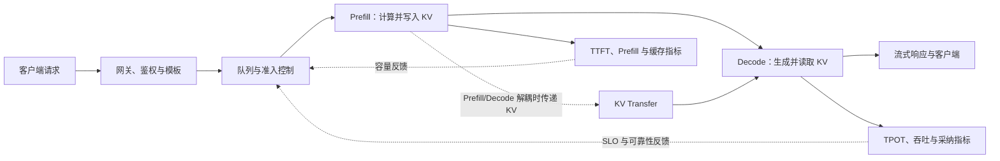

# 第六部分：推理、部署与服务进阶

训练结束并不意味着一个语言模型已经成为可用产品。训练得到的是参数文件；用户需要的是一个能够接受请求、及时产生结果、正确处理并发、在异常时保持可解释行为的系统。模型权重只是这个系统的一层，tokenizer、请求协议、调度器、显存管理、采样器、网络服务、监控和权限控制共同决定了用户最终看到的行为。

本部分从一次请求的时间线开始，依次讨论 Prefill/Decode、KV Cache、PagedAttention、连续批处理、推测解码、量化、服务架构、容量与成本、线上可靠性，以及端侧和端云协同。每一节都把几个容易混淆的层次拆开：论文提出的算法、框架提供的接口、为了说明机制而构造的数字，以及目标硬件上的实测结果，不应互相替代。

读者可以把整部分当作一条逐渐变宽的链路：先回答“一个 token 怎样被算出来”，再回答“多个请求怎样共享资源”，最后回答“这个系统怎样在真实设备和不稳定网络中运行”。

图中的直连表示同一执行池内连续处理；分离部署时，Prefill 计算出的 KV 状态要经过传输接口交给 Decode 池。观测指标连接回准入策略，表示负载和用户体验会影响请求接收与调度，不是说每个系统都必须自动闭环调参。

本章 Python 示例只依赖标准库，可把各代码块单独复制到 Python 3.10+ 环境运行。时延、容量和成本数字均为教学构造，不是目标硬件的性能承诺。

## 第 66 节：Prefill 与 Decode——一次生成请求的两种时间结构

### 66.1 先从一条请求的时间线看推理

设用户发送了一段长度为 S 的输入，模型最终生成 O 个 token。服务端并不是把这段文本当成一个不可分割的黑盒，而是经历了若干阶段：请求进入队列，tokenizer 把字符串变成 token，模型处理完整输入，采样出第一个输出 token，随后重复生成剩余 token，最后进行 detokenization 和网络发送。

可以把时间线画成这样：

~~~text
客户端发送
  -> 网络与排队
  -> tokenizer
  -> Prefill：读取完整 prompt，建立 KV Cache
  -> Decode 第 1 步：生成第一个输出 token
  -> Decode 第 2 步：生成下一个输出 token
  -> ...
  -> detokenization 与流式发送
  -> 客户端收到完整结果
~~~

这里最容易混淆的是“模型开始算”和“用户看到第一个字”。如果 tokenizer、排队和网络各占一部分时间，那么即使 GPU 的矩阵乘法很快，用户仍可能等待很久。因此性能分析必须先规定计时起点和终点：是从请求到达服务进程开始计时，还是从客户端发出请求开始计时；是统计第一个 token 产生，还是统计第一个字节到达客户端。

### 66.2 Prefill 为什么像批量矩阵计算

Prefill，也叫 prompt processing，接收完整输入序列。设 batch 中有 B 个请求，第 i 个请求的输入长度是 S_i，则这一次前向大致处理

~~~math
N_{\mathrm{prefill}}=\sum_{i=1}^{B}S_i
~~~

个 token。对于一个带因果遮罩的 self-attention 层，查询、键和值会同时为输入位置计算。长度为 S 的单条序列，其注意力分数矩阵的形状是 S × S；因此注意力部分存在随序列长度增长的二次项。实际模型还要进行 QKV 投影、输出投影、MLP、归一化和残差计算，不能只用注意力矩阵一项估算总成本。

Prefill 的一个重要特点是并行度高。输入中的许多 token 可以在一个或少数几个大矩阵乘法中一起处理，GPU 更容易获得较高的算力利用率。当 prompt 较长时，Prefill 计算和中间激活都增加，首 token 通常会变慢。用户对这一段时间的直接感受是 TTFT，即 Time To First Token。

对初学者来说，可以把 Prefill 想成“先把整道题读完并做一次集中整理”。模型要为每一层的每个历史位置生成可供后续查询的 K、V。对专家来说，Prefill 的关键不只是 FLOPs，还包括序列长度分布、padding 比例、attention kernel、激活峰值、KV 写入和调度器是否把不同长度的请求混在了同一个 batch 中。

若请求长度差异很大，使用最长序列填充整个 batch 会浪费计算。有效 token 数与填充 token 数可以分别记录：

~~~math
U_{\mathrm{prefill}}=\sum_{i=1}^{B}S_i,
\qquad
P_{\mathrm{pad}}=B\times S_{\max}-\sum_{i=1}^{B}S_i
~~~

P_pad 越大，说明静态 padding 越严重。现代推理系统常通过连续批处理、块状 KV 管理或按长度分组减少这种浪费，但每一种优化都可能增加调度复杂度。

### 66.3 Decode 为什么像反复读取状态的小步迭代

Prefill 完成后，模型已经为输入建立了 KV Cache。Decode 的每一步通常只接收一个新 token，计算它的 query、key、value，并让这个 query 读取历史位置的 key/value，然后输出下一个 token 的 logits。

假设 prompt 有 S 个 token，已经生成了 t 个 token，那么第 t+1 步要访问的历史长度约为 S+t。对一条请求，Decode 阶段需要进行大约 O 次迭代；每一步的矩阵规模小，却反复读取不断增长的 KV Cache。若并发不足，GPU 可能没有足够的独立请求来填满矩阵乘法，性能常表现为显存带宽或 kernel 启动开销受限，而不是纯算力受限。

把两个阶段并列起来：

~~~text
Prefill：一次处理许多输入 token，重点是算力、长序列 attention 和首 token 延迟
Decode ：每次处理少量新 token，重点是 KV 读取、显存带宽、调度和并发聚合
~~~

这也解释了两个看似矛盾的现象。增加 batch 可能让 Decode 的总吞吐上升，因为更多请求可以一起计算；但同一时刻的单请求 TPOT 可能变差，因为每一步要服务更多序列，显存访问和排队都增加。缩短 prompt 往往改善 TTFT，却不一定改善长回答的生成速度；限制最大输出长度则主要影响 Decode 的总时长和总成本。

### 66.4 把指标定义清楚，数字才可比较

至少要记录下面几类指标。

TTFT 是从规定起点到第一个输出 token 可交付的时间。若只测模型内核，可以写成：

~~~math
T_{\mathrm{TTFT}}\approx T_{\mathrm{queue}}+T_{\mathrm{tokenize}}+T_{\mathrm{prefill}}+T_{\mathrm{sample}}+T_{\mathrm{first\_send}}
~~~

TPOT（Time Per Output Token）通常描述首 token 之后每个输出 token 的平均间隔。若从第一个 token 到最后一个 token 的时间为 `T_decode`，且 `O>1`，则：

~~~math
T_{\mathrm{TPOT}}=\frac{T_{\mathrm{decode}}}{O-1}
~~~

当 `O <= 1` 时没有足够的 token 间隔，TPOT 应报告为 `N/A`；不能用人为的 1 个 token 代替真实分母。有些系统把 ITL（Inter-Token Latency）作为逐 token 间隔，并报告 P50、P95 或 P99，而不是一个平均数。平均值会掩盖少数请求在排队、抢占、显存回收或网络拥塞时的长尾。

端到端延迟可以分解为：

~~~math
T_{\mathrm{E2E}}=T_{\mathrm{queue}}+T_{\mathrm{input}}+T_{\mathrm{prefill}}+T_{\mathrm{decode}}+T_{\mathrm{output}}+T_{\mathrm{network}}
~~~

计时账本中的各项应互不重叠：例如 `T_input` 可以包含上传、校验和 tokenizer 时间，`T_output` 可以包含 detokenization 与序列化；如果把 tokenizer 已计入 `T_input`，就不要再加到 `T_prefill`。

吞吐量也有不同口径。输入吞吐、输出吞吐和总 token 吞吐不应混在一起：

~~~math
R_{\mathrm{out}}=\frac{\sum_{i=1}^{N}O_i}{T_{\mathrm{window}}},
\qquad
R_{\mathrm{total}}=\frac{\sum_{i=1}^{N}(S_i+O_i)}{T_{\mathrm{window}}}
~~~

如果一部分请求超时、被取消或返回了错误，单纯把已经生成的 token 相加会高估服务价值。可以额外报告 goodput：在满足质量、延迟和错误率约束的成功请求中，每秒完成多少请求或有效 token。

### 66.5 从算力和带宽两个方向判断瓶颈

一个简化的 roofline 视角很有帮助。若某阶段需要 F 次浮点运算，读取和写入 M 字节，设备峰值算力为 C_peak，显存带宽为 B_peak，则理想下界可以粗略写成：

~~~math
T_ideal ≥ max(F / C_peak, M / B_peak)
~~~

这里假设 `C_peak>0` 且 `B_peak>0`。这不是对真实时延的保证，因为还存在 kernel 启动、同步、通信、调度、缓存命中和框架开销。但它能帮助读者提出正确问题：如果 F/C_peak 很大，应该先关注矩阵形状、融合 kernel 和算力利用率；如果 M/B_peak 很大，应该先关注 KV 布局、数据类型、访存合并和 batch 组织。

Prefill 往往有更大的矩阵、更高的并行度，容易接近算力一侧；Decode 的单步工作量小而历史 KV 读取比例高，更容易接近带宽一侧。两者不是绝对分类，具体模型、硬件、序列长度和 batch 都会改变结果，必须通过 profiler 或设备计数器验证。

### 66.6 一个可运行的时间账本

下面的数字是教学构造，不代表任何特定 GPU。它把排队、Prefill、Decode 和网络尾部拆开，帮助读者理解为什么“每秒 token 数”不能替代 TTFT 和长尾指标。

输入是已分词后的 token 数、队列秒数和 Prefill/Decode 吞吐估值；`first_token_overhead_s` 合并采样与首 token 发送的固定开销，`output_send_s` 表示结束时的发送开销。这里不模拟 tokenizer、并发 batching 或真实网络。

~~~python
import math
from dataclasses import dataclass

@dataclass
class Request:
    name: str
    input_tokens: int
    output_tokens: int
    queue_s: float

def estimate(req, prefill_tps, decode_tps, output_send_s=0.03, first_token_overhead_s=0.01):
    if type(req.input_tokens) is not int or type(req.output_tokens) is not int:
        raise ValueError("token counts must be integers")
    if not isinstance(req.name, str) or not req.name.strip():
        raise ValueError("request name must be a non-empty string")
    timing_values = (
        req.queue_s,
        prefill_tps,
        decode_tps,
        output_send_s,
        first_token_overhead_s,
    )
    if any(not isinstance(value, (int, float)) or isinstance(value, bool) for value in timing_values):
        raise ValueError("timing inputs must be numeric")
    if not all(math.isfinite(value) for value in timing_values):
        raise ValueError("timing inputs must be finite")
    if req.input_tokens < 0 or req.output_tokens < 0 or req.queue_s < 0:
        raise ValueError("request sizes and queue time must be non-negative")
    if (
        prefill_tps <= 0
        or decode_tps <= 0
        or output_send_s < 0
        or first_token_overhead_s < 0
    ):
        raise ValueError("throughput must be positive and timing overheads non-negative")
    prefill_s = req.input_tokens / prefill_tps
    first_decode_s = 1 / decode_tps if req.output_tokens > 0 else 0.0
    first_token_overhead = first_token_overhead_s if req.output_tokens > 0 else 0.0
    ttft_s = (
        req.queue_s + prefill_s + first_decode_s + first_token_overhead
        if req.output_tokens > 0
        else None
    )
    decode_after_first_s = max(req.output_tokens - 1, 0) / decode_tps
    send_s = output_send_s if req.output_tokens > 0 else 0.0
    e2e_s = (
        req.queue_s
        + prefill_s
        + first_decode_s
        + first_token_overhead
        + decode_after_first_s
        + send_s
    )
    tpot_s = decode_after_first_s / (req.output_tokens - 1) if req.output_tokens > 1 else None
    request_output_rate_tps = (
        req.output_tokens / e2e_s
        if req.output_tokens > 0 and e2e_s > 0
        else None
    )
    return {
        "name": req.name,
        "ttft_s": round(ttft_s, 3) if ttft_s is not None else None,
        "tpot_ms": round(tpot_s * 1000, 2) if tpot_s is not None else None,
        "e2e_s": round(e2e_s, 3),
        "request_output_rate_tps": (
            round(request_output_rate_tps, 2)
            if request_output_rate_tps is not None
            else None
        ),
    }

requests = [
    Request("short_question", 120, 80, 0.04),
    Request("long_context", 6000, 120, 0.04),
    Request("queued_request", 120, 80, 0.42),
]

for req in requests:
    print(estimate(req, prefill_tps=24000, decode_tps=90))
~~~

> **代码状态：静态审阅，未运行（2026-10-29）**

一种可能的输出是：

~~~text
{'name': 'short_question', 'ttft_s': 0.066, 'tpot_ms': 11.11, 'e2e_s': 0.974, 'request_output_rate_tps': 82.14}
{'name': 'long_context', 'ttft_s': 0.311, 'tpot_ms': 11.11, 'e2e_s': 1.663, 'request_output_rate_tps': 72.14}
{'name': 'queued_request', 'ttft_s': 0.446, 'tpot_ms': 11.11, 'e2e_s': 1.354, 'request_output_rate_tps': 59.09}
~~~

这个模型中，长 prompt 主要拉高 TTFT，排队主要拉高首 token 和端到端延迟，而 Decode 速度由 decode_tps 控制。`request_output_rate_tps` 是单条请求把全部输出 token 除以端到端时间的教学指标，不等于并发服务的稳态输出吞吐。零输出请求没有 TTFT，TPOT 只在至少两个输出 token 时定义。真实系统还要把不同请求放入同一个调度窗口测量，因为 batch 会同时改变 Prefill 与 Decode 的速度。

### 66.7 资料告诉了我们什么，不能告诉我们什么

FlashAttention 论文说明了通过分块和片上存储减少 attention 外部内存读写的思路；FlashAttention-2 进一步讨论了并行划分和工作分配。它们说明一种 kernel 设计如何降低 IO，不等于任意模型、任意上下文和任意硬件都会获得相同倍数的加速。

Orca 论文把迭代级调度带入大模型服务讨论，后续的连续批处理系统在此基础上处理动态到达和动态结束的请求。论文或官方框架文档中的吞吐数字依赖模型、硬件、输入输出分布和测量脚本；读者在自己的系统中应重新记录这些条件。

阅读当前服务实现时，还要区分运行指标与客户端测量口径。[vLLM Production Metrics](https://docs.vllm.ai/en/latest/usage/metrics/) 列出队列、Prefill/Decode、KV 使用率、抢占、拒绝和 KV transfer 等观测项；[vLLM benchmark CLI](https://github.com/vllm-project/vllm/blob/main/docs/benchmarking/cli.md) 则分别定义 TTFT、ITL 和 TPOT 的客户端测量方式，推测解码一次交付多个 token 时尤其不能混用 ITL 与平均 TPOT。[GuideLLM goodput](https://vllm-project.github.io/guidellm/stable/reference/guidellm/schemas/benchmark/goodput/) 把符合给定 SLO 的请求作为有效产出；它回答的是“达标完成多少”，不等于 raw tokens/s。[vLLM 的 2026 分离式 Serving 指南](https://vllm-project.github.io/2026/09/29/disaggregated-serving-guide.html) 展示 render、Prefill、KV handoff、Decode 和 derender 的工程链路，同时列出传输、parser replay 与编排成本。它是当前实现案例，不能据此推出所有 workload 都会因 Prefill/Decode 分离而变快。

跨工具比较还要核对字段实际对应的时间区间。GuideLLM 的 goodput 配置中，TPOT SLO 对照的是排除首 token 的 inter-token latency；它不同于 GuideLLM 自己包含首 token 的 time-per-output-token，也不完全等于 vLLM 的 TPOT。名称相同不保证事件起点、聚合方法和分母相同，服务报告应记录工具版本及原始测量点。

资料入口：

- [FlashAttention](https://arxiv.org/abs/2205.14135)：attention 的 IO 感知实现。
- [FlashAttention-2](https://arxiv.org/abs/2307.08691)：并行化与负载划分改进。
- [Orca: A Distributed Serving System for Transformer-Based Generative Models](https://www.usenix.org/conference/osdi22/presentation/yu)：迭代级调度的系统背景。
- [NVIDIA Triton Speculative Decoding](https://docs.nvidia.com/deeplearning/triton-inference-server/user-guide/docs/llm_features/speculative_decoding_by_backend_type.html)：特定后端的 draft/target 组织方式与配置边界。

## 第 67 节：KV Cache——把上下文变成显存账本

### 67.1 为什么 Decode 不必重算整段历史

在因果 self-attention 中，第 t 个位置的 query 需要读取此前位置的 key 和 value。若每生成一个 token 都重新计算整个 prompt 和历史输出，很多 K/V 投影会被重复计算。KV Cache 的做法是：Prefill 时保存每一层已经算出的 K、V；Decode 时只为新 token 计算新的 K、V，然后把它们追加到缓存中。

这是一种典型的时间换空间：用显存保存中间状态，换取更少的重复计算。缓存不是模型参数，也不是用户可见的文本；它是与某个请求的 token 序列、模型版本、层结构和数据类型绑定的中间张量。

### 67.2 先写出形状，再写出字节数

为了避免漏乘一个维度，先假设：层数为 L，序列长度为 T，KV head 数为 H_kv，每个 head 的维度为 D，每个标量占 b 字节。每层有 K 和 V 两份缓存，因此单请求 KV Cache 的字节数近似为：

~~~math
M_{\mathrm{KV}}=2\times L\times T\times H_{\mathrm{kv}}\times D\times b
~~~

前面的 2 是 K 与 V，不是 FP16 的字节数。若使用 FP16 或 BF16，通常 b=2；若使用 FP8，理论上可接近 b=1，但还要加 scale、对齐和 kernel 的额外开销。

若 batch 中有 B 条长度不同的请求，准确的总量应按每条请求相加：

~~~math
M_{\mathrm{KV,total}}=\sum_{i=1}^{B}2\times L\times T_i\times H_{\mathrm{kv}}\times D\times b
~~~

把 T_i 错误地换成整个 batch 的最大长度，会高估实际使用；把它换成输入长度而忽略输出增长，则会低估长回答期间的峰值。

### 67.3 GQA 和 MQA 为什么能减少缓存

Multi-Head Attention 中，query head 数通常等于 key/value head 数。Grouped-Query Attention 让多个 query head 共享一组 K/V；Multi-Query Attention 更进一步，让所有 query head 共享 K/V。由于 KV Cache 只保存 K/V head，而不是 Q head，减少 H_kv 会直接减少缓存。

设 query head 数为 H_q，KV head 数为 H_kv，每个 KV head 平均服务 H_q/H_kv 个 query head。若其他维度不变，相对于同样层数和上下文的普通 MHA，缓存比例近似为：

~~~math
R_GQA ≈ H_kv / H_q
~~~

例如 H_q=32、H_kv=8 时，KV 部分理论上约为 MHA 的四分之一。实际速度还取决于 kernel 是否针对 GQA 优化、访存是否合并、质量是否因共享 K/V 而变化。减少缓存并不自动等于四倍端到端加速，因为 MLP、投影、采样和调度仍然存在。

### 67.4 一个具体的显存估算

考虑一个教学模型：L=32、H_kv=8、D=128、上下文 T=8192、BF16 每个元素 2 字节。则单请求 KV Cache 约为：

~~~math
M_{\mathrm{KV}}=2\times32\times8192\times8\times128\times2
~~~

换算成 MiB：

~~~math
M_{\mathrm{KV,MiB}}=\frac{M_{\mathrm{KV}}}{1024^2}\approx1024\,\mathrm{MiB}
~~~

也就是说，一个请求就可能占用约 1 GiB 的 KV Cache；如果同时服务 16 个类似长度的请求，缓存本身就可能接近 16 GiB，还没有计算权重、激活、通信缓冲、CUDA graph、runtime 工作区和碎片。

对于初学者，最重要的直觉是“上下文不是免费文字，而是会变成每层的 K/V 状态”。对于专家，必须继续追问：这个估算是否包含 prefix reuse，K/V 是否按每层独立分配，block 是否有内部浪费，动态 batch 的实际峰值是多少，量化 scale 是否常驻，以及系统是否把输入和已生成 token 分开记账。

### 67.5 KV Cache 量化不是简单地把数字除以二

把 KV 从 FP16 改成 INT8，理论存储量大约减半，但需要解决三个问题。

第一，量化粒度。可以按 tensor、按 head、按 token、按 channel 或按 group 计算 scale。粒度越细，误差往往越小，但 scale 元数据和 kernel 复杂度也增加。

第二，K 与 V 的统计特征不同。K 参与 QK^T，误差会影响注意力分数；V 参与加权求和，误差会直接进入输出表示。两者不能未经验证地共用同一套量化方案。

第三，量化发生在何处。若只量化存储、读取后转回高精度，显存占用可能下降，但带宽和反量化开销仍存在；若 kernel 原生在低精度上完成注意力，速度可能改善，但对硬件和数值稳定性的要求更高。

可以把一个带 scale 的近似写成：

~~~math
q=\mathrm{clip}\left(\mathrm{round}\left(\frac{x-z}{s}\right),q_{\min},q_{\max}\right),
\qquad
\hat{x}=s\times q+z
~~~

其中 s 是 scale，z 是 zero point。这个式子只是量化接口的基本抽象，实际实现还会处理对称量化、分组边界、离群值和累加精度。

近期的 serving 研究把低比特缓存、任务质量和并发吞吐放在一起评估。UltraQuant 将 KV 表示为 FP4，并在 AMD CDNA4 上用 FP8 query、UE8M0 group scale 和硬件 scaled-MFMA 路径执行。论文用来源于 Claude Code 的多轮 trace 做自适应 SLO 回放，在 MiniMax M2.5 和 Qwen3-235B 的特定配置中，报告的 SLO 合格请求吞吐分别是 BF16 基线的 2.71 倍和 4.38 倍；作者指出收益主要出现在长上下文、高并发且显存受限时。这是特定 GPU、kernel、模型和工作负载的结果，不能据此断言 4-bit KV 普遍更快或不损失质量。[UltraQuant arXiv v3](https://arxiv.org/abs/2606.20474v3)

### 67.6 既要算容量，也要算生命周期

KV Cache 的占用并不只是“创建”这一动作。一次请求至少经历：

~~~text
申请 -> 写入 Prefill token -> 追加 Decode token
     -> 可能被抢占或换出 -> 完成/取消 -> 回收
~~~

如果取消请求没有及时释放 block，显存会慢慢被“幽灵请求”占用；如果请求完成后缓存仍被错误复用，可能把一个用户的上下文泄露给另一个用户。若启用 prefix cache，缓存键必须包含足以区分上下文的身份：模型版本、token 序列、模板版本、相关 system/developer 内容和必要的运行时选项。只按原始文本哈希而忽略 tokenizer 或模板版本，会产生隐蔽的错误命中。

### 67.7 用纯 Python 检查 KV 账本

~~~python
import math
from dataclasses import dataclass

@dataclass
class ModelShape:
    layers: int
    kv_heads: int
    head_dim: int
    bytes_per_value: int

def kv_bytes_per_token(shape):
    if not all(type(value) is int for value in (
        shape.layers,
        shape.kv_heads,
        shape.head_dim,
        shape.bytes_per_value,
    )):
        raise ValueError("model dimensions must be integers")
    if any(value <= 0 for value in (
        shape.layers,
        shape.kv_heads,
        shape.head_dim,
        shape.bytes_per_value,
    )):
        raise ValueError("model dimensions and element size must be positive")
    return 2 * shape.layers * shape.kv_heads * shape.head_dim * shape.bytes_per_value

def kv_mib(shape, tokens):
    if type(tokens) is not int or tokens < 0:
        raise ValueError("token count must be a non-negative integer")
    return kv_bytes_per_token(shape) * tokens / (1024 * 1024)

shape = ModelShape(layers=32, kv_heads=8, head_dim=128, bytes_per_value=2)
for tokens in (1024, 4096, 8192):
    print(tokens, round(kv_mib(shape, tokens), 1))
~~~

> **代码状态：静态审阅，未运行（2026-10-29）**

输出应为：

~~~text
1024 128.0
4096 512.0
8192 1024.0
~~~

这个小程序只验证维度账本，不验证某个框架是否真的这样布局，也不包括 allocator 碎片、scale 和工作区。它的价值在于先把数量级算对，再用 profiler 验证实际峰值。

把估算接到准入决策上。若 80 GiB 卡上权重占 28 GiB、runtime/图捕获占 4 GiB、工作区预留 8 GiB，理论 KV 预算是 40 GiB。前面算出的 8K 请求约占 1 GiB，16 个并发占 16 GiB；长度升到 16K 后单请求约 2 GiB、同样 16 个请求占 32 GiB，账面余量从 24 GiB 降到 8 GiB。该线性账本只能筛掉明显不可行的方案；长尾输入/输出、碎片、突发 Prefill、scale 和临时 buffer 都会吃掉余量。容量承诺应按 P95/P99 长度与实际 allocator 压测，并留故障余量。

生命周期也要纳入显存账本：分别记录每请求和共享 KV、空闲与回收中 block、峰值/稳态、取消后的回收耗时和抢占次数。取消请求应释放私有 block，共享前缀则等最后一个引用离开；量化 KV 还需计入 scale 和反量化临时空间。多租户缓存键必须包含权限域，私有检索文档不能因公共 system 前缀相同而跨租户共享。对目标并发逐步升载，记录峰值和分配失败点；容量不足时明确采用拒绝、排队或可恢复抢占，不能静默截断历史后宣称答案等价。

KV 预算还应拆成 prefill 瞬时峰值和 decode 常驻量。长 prompt 进入时，运行时可能同时持有输入张量、临时 attention workspace 和逐步生成的 KV；decode 阶段则随着输出 token 增长而持续占用缓存。若容量表只按最终长度乘每 token 字节数，可能漏掉 prefill 峰值；若只测短 prompt 的稳态 decode，又会漏掉长输入突发。可以分别回放 8K 输入/短输出、短输入/8K 输出、输入输出都长三种形状，再把 TTFT、峰值显存和 KV 水位对齐。容量准入的长度估计必须使用模型 tokenizer 后的位置数，并在超预算时明确排队、降级、拒绝或截断的语义。

容量估计还要给生成阶段预留增长空间。假设 GQA 账本约为 128 KiB/token，预算 40 GiB、单请求已有 8K prompt，则单条 prompt KV 约 1 GiB；若允许继续生成 2K token，完整序列接近 1.25 GiB。20 条请求从输入阶段的 20 GiB 增长到约 25 GiB，尚未包括 block 浪费、临时 buffer 和长度不均。若准入只在 Prefill 完成时看水位，大量请求同时生成时仍可能突然触顶。服务可按最大生成预算预留，也可分段监控 KV 水位并在接近门槛时暂停新准入；被抢占请求要能从正确状态恢复，不能静默丢掉历史。容量指标因而应同时记录输入长度、已生成长度、预计剩余长度和实际 block 分配。

实际准入还要为并发长度相关性留余量。若 20 条请求都短，平均每条 1 GiB 的账本可能准确；若同一批请求来自一个长文档任务，长度会一起升高，平均值不能代表峰值。可以按请求组或租户估计 P95/P99 prompt 与 max-new-token 联合分布，并分别模拟全短、全长和长短混合三种批次。调度器在 KV 水位达到软门槛时可先暂停长请求准入，达到硬门槛后再选择排队或可恢复抢占；策略要报告被拒绝/抢占请求的完成率和额外 Prefill 成本。仅凭静态显存估算无法说明这种动态准入是否保住了 SLO。

### 67.8 资料与证据边界

- [GQA: Training Generalized Multi-Query Transformer Models](https://arxiv.org/abs/2305.13245)：共享 K/V 的架构取舍。
- [KIVI: A Tuning-Free Asymmetric 2bit Quantization for KV Cache](https://arxiv.org/abs/2402.02750)：KV Cache 低比特量化研究。
- [UltraQuant arXiv v3](https://arxiv.org/abs/2606.20474v3)：面向多轮 Agent serving 的 4-bit KV、质量与 SLO 合格吞吐联合评估；结果绑定论文配置。
- [vLLM PagedAttention design](https://docs.vllm.ai/en/latest/design/paged_attention.html)：历史设计页注明其不描述当前 vLLM 代码实现；可用于理解概念，具体实现需核对目标 release 或源码 revision。

## 第 68 节：PagedAttention 与 Prefix Cache——显存管理本身也是算法

### 68.1 为什么连续大数组会浪费显存

最直观的 KV Cache 实现是：为每条请求预留一段连续空间，长度等于最大上下文。它实现简单，却有三个问题。

第一，请求长度不同。一个只生成几十 token 的请求如果预留了几千 token 的空间，剩余部分就是内部浪费。

第二，请求动态结束。已经完成的请求留下的空洞未必能被下一条不同大小的请求有效利用，外部碎片会让“总空闲显存”大于“最大连续空闲空间”。

第三，输入共享。多条请求可能拥有相同的 system prompt、工具说明或文档前缀。若每条请求完整复制这段 K/V，显存和 Prefill 计算都被重复消耗。

PagedAttention 的核心思路不是改变 attention 的数学定义，而是把逻辑上的连续 token 序列映射到固定大小的物理 block。请求持有一个 block table，attention kernel 根据逻辑位置找到对应的物理 block。

### 68.2 逻辑页和物理页

设每个 block 能存 `K>0` 个 token，一条序列长度为 `T >= 0`，需要的逻辑 block 数为：

~~~math
N_{\mathrm{block}}=\left\lceil\frac{T}{K}\right\rceil
~~~

最后一个 block 往往没有填满，因此单条请求的内部浪费最多接近 K-1 个 token；相比按最大上下文整段预留，这个浪费通常更可控。系统维护一个空闲 block 池，把物理 block 分配给不同请求。

可以把映射画成：

~~~text
逻辑 token:  0 1 2 3 | 4 5 6 7 | 8 9 ...
逻辑 block:     L0    |    L1    |    L2
物理 block:     P7    |    P2    |    P9
~~~

attention 仍然按逻辑顺序读取 K/V；物理位置不连续并不改变因果关系。真正的性能取决于 kernel 能否高效地根据 block table 完成访存，以及 block 大小是否在内部浪费、索引开销和合并访存之间取得平衡。

### 68.3 Copy-on-Write 让共享前缀变得可管理

如果两个请求拥有相同前缀，可以让它们暂时共享同一批只读物理 block。某个请求继续生成新 token 时，只需要为新增位置申请 block；若要修改共享 block，则采用 copy-on-write，避免一个请求覆盖另一个请求的状态。

这种共享带来两个收益：

1. 相同前缀无需为每个请求复制完整 K/V。
2. Prefill 结果可以在后续请求中复用，减少重复计算。

但共享不是无条件安全的。缓存键必须覆盖完整的 token 前缀、模型权重或 adapter、tokenizer、chat template、位置编码与 attention mask 等影响 K/V 计算的配置，以及租户和权限范围。只影响后续 logits 采样的 temperature/top-p 通常不会改变已算出的 K/V，不必因此拆分缓存；会改变前缀 token 或 K/V 计算的 runtime 选项则必须进入缓存身份。一个用户的私有文档、权限判断或工具返回值如果被错误纳入跨租户共享范围，会形成信息泄露。

### 68.4 Prefix Cache 的命中与失效

prefix cache 的命中率不能只看字符串前缀相同。更稳妥的抽象是对规范化后的 token 前缀和运行时身份做哈希：

~~~math
h=\mathrm{Hash}(\mathrm{model\_revision},\mathrm{adapter\_revision},\mathrm{tokenizer\_revision},\mathrm{template\_version},\mathrm{token\_ids},\mathrm{position\_mask\_options},\mathrm{tenant\_scope})
~~~

若 h 命中，可以复用对应 token 范围的 K/V；若其中任意组成部分变化，就应视为不同缓存。缓存淘汰可以使用 LRU、按成本加权的 LRU，或综合“命中后节省的 Prefill 时间”和“占用的显存”来排序。

一个教学效用函数可以写成，其中 `M_blocks > 0`，`P_hit` 是命中概率，`epsilon > 0` 只是避免数值除零的稳定项：

~~~math
U_{\mathrm{cache}}=\frac{\Delta T_{\mathrm{prefill}}\times P_{\mathrm{hit}}}{M_{\mathrm{blocks}}+\varepsilon}
~~~

这不是标准算法，只是提醒我们：一个很少命中、却占用很多 block 的长前缀，未必比一个频繁命中的短前缀更值得保留。

Prefix cache 容量要用真实访问轨迹和目标命中率来估算。2026 年的 KVSET 预印本用 page-granular LRU stack distance 估计多个缓存容量下的命中率；作者报告的一条内部 Agent coding trace 中，95% 与 99% request coverage 分别约需 1 TiB 和 5 TiB，99.9% 在观测轨迹中没有收敛。这个结果只说明容量对工作负载和覆盖目标可能非常敏感，不是其他系统的容量建议；部署时应固定租户范围、缓存策略和请求轨迹后再定容量。[KVSET arXiv v1](https://arxiv.org/abs/2609.27746v1)

RAG 和 Agent memory 还会出现“内容相同、位置不同”的复用机会：同一检索片段可能出现在两条不同前缀之后，因此普通 prefix cache 无法直接复用它的 K/V。2026 年 9 月的 Tessera 预印本让检索侧提供上下文单元需求，再结合缓存驻留和生成负载协调可组合 K/V 状态；论文在其 RAG/Agent memory 负载中，与 SGLang 和 LMCache+EPIC 在相同请求率下比较，报告 mean TTFT 最高降低 3.6 倍，并称答案质量与底层组合策略相当。这个结果绑定原型、模型和负载。它复用的是满足位置与模型条件的片段状态，不是把任意相同文本的缓存块直接拼接；当前实现限于 RoPE 全注意力模型，不能外推到混合注意力、MLA 或所有生产部署。[Tessera arXiv v1](https://arxiv.org/abs/2609.32999v1) 与下一部分第 85 节的跨轮记忆相连。

### 68.5 Fragmentation、换出与请求生命周期

即使使用 block，仍可能出现三类浪费。

- 尾部浪费：最后一个 block 未填满。
- 预留浪费：调度器为即将生成的 token 预留太多 block。
- 版本浪费：模型或模板更新后，旧缓存仍占用空间但再也不会命中。

把 KV block 换到 CPU 内存或 NVMe 可以延缓显存耗尽，但会引入 PCIe、内存带宽和恢复延迟。换出策略应区分“暂时被抢占的请求”和“已经取消的请求”：前者可能值得保存，后者应尽快释放。若一个请求在流式输出中断，服务端还要把连接状态、采样状态和 block 回收放在同一个可审计的生命周期中。

### 68.6 从 block 分配看调度器的责任

调度器不应只问“还有多少显存”，还要问：

~~~text
剩余 block 能否容纳下一次 Prefill 和未来若干 Decode step？
哪些 block 可以共享，哪些必须私有？
请求取消时是否能立即回收？
缓存命中是否来自同一模型、同一模板和同一权限范围？
换出后恢复的 token 顺序和采样状态是否一致？
~~~

这些问题属于资源与正确性共同构成的系统协议。一个吞吐很高但偶尔把旧上下文混进新请求的实现，不是“质量略差”，而是缓存隔离错误。

### 68.7 一个简化的 block 分配器

下面的代码没有实现 attention，只用集合模拟 block 的申请、释放和共享引用计数。它展示了为什么释放一个共享前缀的请求后，物理 block 不能立刻归还给空闲池。

~~~python
class BlockPool:
    def __init__(self, count):
        if type(count) is not int or count <= 0:
            raise ValueError("block count must be a positive integer")
        self.free = set(range(count))
        self.refs = {}

    def allocate(self, n):
        if type(n) is not int or n <= 0:
            raise ValueError("allocation size must be a positive integer")
        if len(self.free) < n:
            raise RuntimeError("not enough blocks")
        blocks = sorted(self.free)[:n]
        for block in blocks:
            self.free.remove(block)
            self.refs[block] = 1
        return blocks

    def share(self, blocks):
        if not blocks:
            raise ValueError("shared block list must not be empty")
        if any(type(block) is not int for block in blocks):
            raise ValueError("block ids must be integers")
        if len(set(blocks)) != len(blocks):
            raise ValueError("a block list must not contain duplicates")
        if any(block not in self.refs for block in blocks):
            raise KeyError("cannot share an unknown or free block")
        for block in blocks:
            self.refs[block] += 1

    def release(self, blocks):
        if not blocks:
            raise ValueError("released block list must not be empty")
        if any(type(block) is not int for block in blocks):
            raise ValueError("block ids must be integers")
        if len(set(blocks)) != len(blocks):
            raise ValueError("a block list must not contain duplicates")
        for block in blocks:
            if block not in self.refs or self.refs[block] <= 0:
                raise KeyError(f"block is not owned: {block}")
        for block in blocks:
            self.refs[block] -= 1
            if self.refs[block] == 0:
                del self.refs[block]
                self.free.add(block)

pool = BlockPool(4)
prefix = pool.allocate(2)
pool.share(prefix)
tail = pool.allocate(1)
print("after_share", sorted(pool.free), pool.refs)
pool.release(prefix)
print("after_one_owner", sorted(pool.free), pool.refs)
pool.release(prefix)
pool.release(tail)
print("after_all_release", sorted(pool.free), pool.refs)
~~~

> **代码状态：静态审阅，未运行（2026-10-29）**

输出：

~~~text
after_share [3] {0: 2, 1: 2, 2: 1}
after_one_owner [3] {0: 1, 1: 1, 2: 1}
after_all_release [0, 1, 2, 3] {}
~~~

手算一个分页例子。若 block 容量 K=16 token，一条长 35 token 的序列需要 ceil(35/16)=3 个物理 block，共能容纳 48 token，尾块浪费 48-35=13 个 token。若旧式实现给每个请求都预留最大 8192 token，单条短请求可能留下 8157 个未用位置；分页并未消除尾部浪费，却把浪费上限压到一个 block 内。

再看共享前缀：两条请求都含 64 token 的 system/工具前缀，随后分别增长到 80 和 96 token。按 K=16，每条独立缓存分别需要 5 和 6 个 block，总共 11 个；若前 64 token 的 4 个 block 可以共享，两个请求只需这 4 个共享 block 加 1 个和 2 个私有尾块，共 7 个，节省 4 个 block。共享块引用计数从 2 降到 1 时不能释放；只有最后一个使用者离开，块才回到空闲池。这个例子说明 prefix cache 的收益来自实际共同 token 前缀和正确的生命周期管理，不是两个字符串“看起来相似”就可复用。

部署压测应分别测 block 大小、尾块浪费、共享比例和命中后节省的 Prefill。大 block 减少索引开销却增加尾部浪费，小 block 则增加 block table 与 allocator 工作；缓存淘汰可综合命中概率、节省计算和显存占用。例如某 64-token 前缀每小时命中 100 次、每次节省 20 ms，总计约 2 秒 GPU 时间；若它挤掉更常用的长前缀，净收益可能为负。该效用策略要用生产 trace 校准，不能当成 PagedAttention 的理论保证。

命中正确性高于命中率。用相同输入做冷/热 cache 重放，比较 token 输出、Prefill token 数、时延、block 回收和引用计数；若输出不同，检查 token 序列及模型 revision、adapter、position ids、mask、模板和权限是否都进入 cache key。字符串前缀相同不足以证明 KV 状态相同。

缓存保留策略也要考虑公平性与资源占用。一个共享前缀命中率高，可能长期占着大量 block，使低频租户的长请求持续被抢占；反过来，立刻淘汰刚完成请求的前缀会让相邻轮次重复做 Prefill。可为候选缓存记录命中次数、节省的 Prefill 时间、占用 block、最后访问时间和租户域，再比较 LRU、按节省计算/占用加权等淘汰策略。假设前缀 A 每次节省 5 ms、占 4 block，前缀 B 每次节省 30 ms、占 8 block，则按单次收益看 B 更值，但若 A 每分钟命中 100 次、B 只命中 5 次，总节省分别为 500 ms 和 150 ms，排序会反转。缓存策略应按真实 trace 的总净收益与租户公平性校准，命中率本身不是充分目标。

共享前缀通常需要不可变块或 copy-on-write 语义。两条请求引用同一份 64-token 前缀后，若其中一条继续生成，新的 token 应写入它自己的尾块；不能覆盖共享块里的已有 K/V。可以用两条不同续写做反事实：先共用前缀，再分别追加 A 与 B，检查另一条请求的 prefix hash、历史 logits 和引用计数未变化；A 完成释放后，B 仍应能继续生成，最后一条释放时才回收共享块。若只有单请求测试，引用计数与写时复制错误可能长期不被发现。这个正确性检查和命中率优化要并行进行，因为缓存共享越积极，隔离边界越重要。

### 68.8 资料与证据边界

- [Efficient Memory Management for Large Language Model Serving with PagedAttention](https://arxiv.org/abs/2309.06180)：PagedAttention 和 vLLM 系统设计。
- [KVSET](https://arxiv.org/abs/2609.27746v1)：用 LRU stack distance 对 serving trace 做 prefix-cache 工作集容量分析；作者给出的容量结果依赖内部 Agent coding workload。
- [vLLM Automatic Prefix Caching](https://docs.vllm.ai/en/latest/design/automatic_prefix_caching.html)：当前滚动文档中的具体实现入口，使用时需核对目标版本。
- [SGLang](https://arxiv.org/abs/2312.07104)：结构化生成中的 RadixAttention 与前缀复用。
- [Tessera](https://arxiv.org/abs/2609.32999v1)：检索驱动的可组合 K/V 复用与在线缓存管理；该预印本的模型支持和集群规模有限。

## 第 69 节：连续批处理与请求调度——让动态请求共同前进

### 69.1 静态 batch 的便利与局限

静态 batch 在训练中很自然：先收集固定数量的样本，padding 到相近长度，一次完成前向。但在线生成中，请求随时到达，输入长度不同，输出也在不同时间结束。如果等 batch 中所有请求都完成才开始下一轮，短请求会被长请求拖住；如果为最长请求预留空间，又会浪费显存。

连续批处理（continuous batching）把调度单位从“整批请求”改成“一个或多个迭代步”。每次 Decode 迭代结束后，已经完成的请求退出，新的请求可以加入；正在 Prefill 的请求也可以按策略分块加入。这样 GPU 的每一步都能重新组织有效工作。

初学者可以把它想成一条不断补位的生产线：一个工件完成后，下一件立即进入，不必等整组工件全部完成。专家则要进一步关注 token budget、KV block 余量、不同阶段的干扰、优先级和长尾公平性。

### 69.2 Decode-only continuous batching

最简单的连续批处理只对 Decode 请求做动态加入和退出。每轮调度器从活跃请求中取出一个 token 的工作，构造一个动态 batch，完成后更新每条请求的状态。

调度器至少保存：

~~~text
request_id
输入 token 数与当前位置
已生成 token 数和停止条件
KV block 表
采样器状态与随机数状态
优先级、截止时间、取消状态
流式连接和错误状态
~~~

如果只保存文本和 token 数，却没有保存采样器状态、模板版本或 block 表，抢占恢复后可能出现重复 token、跳过 token 或错误复用缓存。

### 69.3 Chunked Prefill 为什么必要

一个超长 prompt 进行 Prefill 时，可能长时间占用 GPU，导致已有 Decode 请求无法及时生成下一个 token。Chunked Prefill 把长输入切成若干块，在 Prefill 块和 Decode step 之间交错安排。

设一次调度迭代允许处理至多 Q 个 token，则一个长度为 S 的输入可分成：

~~~math
N_{\mathrm{chunk}}=\left\lceil\frac{S}{Q}\right\rceil
~~~

要求 `Q>0`。Q 较大，长 prompt 完成得快但可能阻塞 Decode；Q 较小，Decode 交互更平滑但 Prefill kernel 规模可能变小，调度开销增加。不存在脱离业务分布的最佳 Q；应同时观测长 prompt 的 TTFT、已有请求的 ITL、GPU 利用率和超时率。

### 69.4 Token budget 比 request count 更接近真实成本

把“每轮最多处理 32 个请求”当作唯一限制很危险，因为 32 个短请求与 32 个长请求的 token 工作量完全不同。更合理的是为每轮设置 token budget：

~~~math
N_{\mathrm{work}}=N_{\mathrm{prefill\_tokens}}+N_{\mathrm{decode\_tokens}}
\leq Q_{\mathrm{token}}
~~~

还可以把两类工作分开：

~~~math
w_{\mathrm{iter}}=\alpha\times N_{\mathrm{prefill}}+\beta\times N_{\mathrm{decode}}
\leq B_{\mathrm{iter}}
~~~

alpha 和 beta 是通过设备测量得到的相对成本，而不是固定的理论常数。若 Prefill 对算力更敏感，Decode 对带宽更敏感，单一 token 数仍可能不够，需要用分桶的代价模型估算。

### 69.5 公平性、截止时间和长请求

只按 FIFO 排队会让一个超长 prompt 阻塞后面的短交互；只按短请求优先又可能让长请求无限等待。调度可以综合等待时间、预计剩余工作和请求截止时间，例如定义一个教学优先级（其中 `a`、`b`、`c` 为非负权重，`R_i >= 0`）：

~~~math
P_i=a\times W_i+\frac{b}{1+R_i}+c\times D_i
~~~

其中 W_i 是等待时间，R_i 是预计剩余 token 工作量，D_i 是接近截止时间时的加权项。这个式子不是通用调度算法，真正系统还要加入租户配额、优先级策略和 GPU 拓扑。

重要的是防止 starvation：一个请求不能因为一直被认为“太长”而永远得不到资源。可以设置最长等待时间、每轮保留比例或可抢占的 Prefill 分片。

### 69.6 取消、抢占和恢复

流式生成中用户可能关闭页面或主动停止。取消应至少完成：

1. 停止继续调度新的 Decode step。
2. 关闭或标记流式连接。
3. 释放私有 KV block。
4. 减少共享 block 的引用计数。
5. 记录取消原因和已消耗 token。

抢占则更复杂。若把一个请求从 GPU 换出后稍后恢复，需要保存足够的 KV、已生成 token、采样状态和请求协议状态。只保存文本并重新 Prefill 可能正确但更慢；只保存部分 KV 可能更快但要严格验证位置索引和 block 映射。

### 69.7 资源可执行性检查与降级路径

一次调度决策前，系统应确认：

~~~text
当前 block 是否足够？
本轮 token budget 是否足够？
模型版本和请求模板是否一致？
流式连接是否仍然存在？
请求是否已经取消或超过截止时间？
采样参数和工具协议是否可以在当前 worker 执行？
~~~

如果资源不足，降级不应默默改变语义。可以排队、切小 Prefill、限制最大输出、迁移到另一 worker、使用较小模型，或返回明确的暂时繁忙错误。选择哪一种取决于业务；最糟糕的是系统随机截断上下文、伪造完整输出或在客户端看起来像成功但服务端其实失败。

### 69.8 一个教学调度器

下面的模拟器以 token budget 为约束，按等待轮数优先处理已到达的请求，并允许新请求在运行中加入。它不模拟真正的 GPU，只展示动态到达、分片和完成状态怎样共同影响调度。

~~~python
from dataclasses import dataclass

@dataclass
class Job:
    name: str
    remaining: int
    arrival: int = 0
    waiting: int = 0
    done_at: int | None = None

def run(jobs, budget):
    if type(budget) is not int or budget <= 0:
        raise ValueError("budget must be a positive integer")
    if not jobs:
        return []
    for job in jobs:
        if not isinstance(job.name, str) or not job.name.strip():
            raise ValueError("job name must be a non-empty string")
        if type(job.remaining) is not int or job.remaining <= 0:
            raise ValueError("remaining work must be a positive integer")
        if type(job.arrival) is not int or job.arrival < 0:
            raise ValueError("arrival must be a non-negative integer")
        job.waiting = 0
        job.done_at = None
    if len({job.name for job in jobs}) != len(jobs):
        raise ValueError("job names must be unique")
    pending = sorted(jobs, key=lambda job: (job.arrival, job.name))
    active = []
    tick = 0
    while pending or active:
        while pending and pending[0].arrival <= tick:
            active.append(pending.pop(0))
        if not active:
            tick = pending[0].arrival
            continue
        active.sort(key=lambda job: (-job.waiting, job.remaining, job.name))
        spent = 0
        served = set()
        for job in active:
            if spent >= budget:
                break
            step = min(2, job.remaining, budget - spent)
            job.remaining -= step
            spent += step
            served.add(id(job))
            if job.remaining == 0:
                job.done_at = tick + 1
        active = [job for job in active if job.remaining > 0]
        for job in active:
            if id(job) in served:
                job.waiting = 0
            else:
                job.waiting += 1
        tick += 1
    return [(job.name, job.done_at) for job in jobs]

jobs = [
    Job("short_a", 3, arrival=0),
    Job("long", 9, arrival=0),
    Job("late_short", 2, arrival=1),
]
print(run(jobs, budget=4))
~~~

> **代码状态：静态审阅，未运行（2026-10-29）**

输出：

~~~text
[('short_a', 2), ('long', 5), ('late_short', 2)]
~~~

这里的到达时间、等待轮数和 2-token 步长都是教学字段。真实服务需要把一个 step 对应到 token、block、kernel 和流式发送，并测量调度器本身的开销。

用一个短的调度轨迹看 chunked Prefill 的交换。设已有 8 条活跃 Decode 请求，每条在没有 Prefill 干扰时一次 Decode step 约 8 ms；此时新来一条 4096-token prompt。若把它作为不可分割任务，假设这次 Prefill 连续占用 96 ms，已有请求会在这段时间几乎停止前进，短期 ITL 可能接近增加 96 ms。把 prompt 以 Q=512 分成 8 个 chunk；如果每块测得约 12 ms，并让每个 chunk 与一次 Decode batch 交错，服务周期约为 12+8=20 ms，已有请求的单次间隔增加约 12 ms，而新 prompt 需经历多个交错周期才完成。数字是解释调度效应的假设，不是固定性能规律；若分块后 kernel 效率明显下降，长 prompt 的 TTFT 反而可能恶化。

token budget 也需要和 KV 余量联动。假设某轮上限为 640 token，调度器计划加入 512 个 Prefill token 和 8 个 Decode token，总计 520，算术上满足 budget；但如果这些请求的 KV block 不够，不能只因为 token 数有余量就继续调度。反过来，空闲 block 充足而单轮 token budget 已满，也不应突破计算/时延约束。实际决策是两个资源门同时通过，并且要记录某请求被容量、临时状态还是优先级推迟。

公平性可以观察“每个等待请求的最长等待时间”和“长请求完成时间”而不仅是平均延迟。短请求优先能提升平均值，却可能让大文档一直饥饿；纯 FIFO 则可能让一条长 Prefill 阻塞交互流。设置最大等待期限、为 Decode 保留预算、分片推进长 Prefill，并用到达时间和租户配额做审计，才能让优化结果对不同流量分桶都可解释。

调度还要区分“请求数”和“迭代 token 数”。一次 Decode step 对每个活跃序列通常产生一个位置的工作，而 Prefill chunk 可以一次带来很多位置；因此单看 batch size 不能推断本轮执行成本。调度器可以用标定得到的 Prefill/Decode 相对耗时预算，先保护交互请求的最大间隔，再用剩余时间推进长 prompt。标定应覆盖不同序列长度、不同并发和不同 kernel 配置；当模型升级或 attention backend 改变时，旧代价模型也要重新核对。

事故恢复同样会影响调度公平性。一个请求如果连续被抢占，每次恢复时都重新排到队尾，可能在高负载时长期无法完成；如果总是优先恢复它，又会让新请求受损。记录累计等待、已耗费 GPU 时间、剩余 token、KV 是否仍驻留，以及被抢占次数，才能对调度偏差进行复盘。线上策略可以设置最大抢占次数或最长等待门槛，但这些值必须由业务延迟目标和容量测试确定。

### 69.9 资料与证据边界

- [Orca](https://www.usenix.org/conference/osdi22/presentation/yu)：迭代级调度的系统背景。
- [Sarathi-Serve](https://arxiv.org/abs/2403.02310)：chunked prefill 与服务调度。
- [vLLM engine arguments](https://docs.vllm.ai/en/latest/configuration/engine_args.html)：具体 runtime 对 batch token 数等参数的暴露方式。

## 第 70 节：推测解码——用便宜候选减少目标模型的等待

### 70.1 为什么可以让两个模型合作生成

自回归模型通常一次只生成一个 token。若目标模型很大，而另一个较小的 draft model 能较快给出候选，就可以先让 draft model 连续提出若干 token，再让目标模型并行验证这段候选。目标模型接受其中连续正确的前缀，并在第一个不接受的位置使用自己的分布继续生成。

这就是 speculative decoding。它试图减少目标模型 Decode 的调用次数，而不是改变最终目标分布。若实现严格遵循接受—修正规则，在满足假设时可以保持目标模型的生成分布；若使用启发式接受、改变采样器或使用额外候选头，则应把它当作需要实测的近似方法。

### 70.2 接受规则的直觉

设 draft 分布为 `q(x)`，目标分布为 `p(x)`。对 draft 实际采样到的候选，要求 `q(x)>0`；目标模型计算同一位置的 `p(x)`，基本接受概率为：

~~~math
a(x)=\min\left(1,\frac{p(x)}{q(x)}\right)
~~~

若候选被拒绝，需要从一个修正分布继续采样。对完整词表计算时，`p` 和 `q` 都应是归一化分布；常见抽象写作：

~~~math
r(x)\propto\max\left(0,p(x)-q(x)\right)
~~~

在实际实现中，还要处理 top-k/top-p 截断、温度、随机数、EOS、词表一致性和浮点误差。公式说明的是分布校正思想，不应被简化成“目标模型只检查 draft 的字符串是否相同”。

### 70.3 速度收益由三个量共同决定

设 draft 每轮提出 K 个 token，目标模型验证一轮的时间为 T_v，draft 生成 K 个 token 的时间为 T_d，平均每轮接受 A 个 token，并把目标模型额外产生的修正 token 计入有效进展，则粗略速度可写成：

~~~math
R_{\mathrm{spec}}\approx\frac{\mathbb{E}[A]+1}{T_d+T_v}
~~~

普通目标模型逐 token 生成的速度可写成 R_target ≈ 1/T_target。只有当 R_spec > R_target 时，系统才真正加速。提高 K 不一定提高速度：候选越长，draft 成本越高，目标验证的显存和调度压力也可能增加；如果 draft 与 target 差异大，接受长度 A 反而下降。

要求 `T_d+T_v>0`；只有当 `R_spec` 高于普通目标模型的 `R_target` 时，系统才真正加速。决定收益的关键因素包括：

~~~text
draft 与 target 的分布相似度
目标模型验证多个位置时的并行效率
draft 模型或候选头的额外显存
采样温度和 top-p 对接受率的影响
batch 中不同请求的候选长度是否容易合并
~~~

### 70.4 一个简单的接受率实验

下面用两个离散分布模拟候选接受率。它只展示 min(1,p/q) 的平均值，不实现完整的修正采样。

~~~python
import math

def expected_acceptance(target, draft):
    if not target or not draft:
        raise ValueError("target and draft distributions must not be empty")
    probabilities = tuple(target.values()) + tuple(draft.values())
    if any(
        not isinstance(probability, (int, float))
        or isinstance(probability, bool)
        or not math.isfinite(probability)
        or probability < 0
        for probability in probabilities
    ):
        raise ValueError("probabilities must be finite non-negative real numbers")
    if abs(sum(target.values()) - 1.0) > 1e-9 or abs(sum(draft.values()) - 1.0) > 1e-9:
        raise ValueError("target and draft must sum to one")
    total = 0.0
    for token, q in draft.items():
        p = target.get(token, 0.0)
        total += q * min(1.0, p / q) if q else 0.0
    return total

target = {"a": 0.55, "b": 0.25, "c": 0.15, "d": 0.05}
close_draft = {"a": 0.50, "b": 0.28, "c": 0.17, "d": 0.05}
far_draft = {"a": 0.20, "b": 0.20, "c": 0.30, "d": 0.30}

print("close", round(expected_acceptance(target, close_draft), 3))
print("far", round(expected_acceptance(target, far_draft), 3))
~~~

> **代码状态：静态审阅，未运行（2026-10-29）**

输出：

~~~text
close 0.95
far 0.6
~~~

真实序列中的 token 分布会随上下文变化，接受事件也不是独立同分布的；这个数值实验只能帮助理解“候选质量决定验证收益”。

### 70.5 Medusa、EAGLE 与 draft model 不是同一个设计

外部 draft model 是一套独立模型，具有自己的参数、tokenizer 兼容要求和显存占用。Medusa 一类方法在目标模型上增加多个预测头，让模型从同一隐藏状态提出多个未来 token；EAGLE 一类方法使用目标模型隐藏状态构造更强的 draft 路径。它们都可以归入“多 token 候选—目标验证”的大方向，但训练目标、候选树、接受策略和部署成本不同。

树状候选可以增加覆盖范围，但也增加验证节点数。若候选树的有效分支数迅速膨胀，目标模型的并行验证工作可能超过节省的 Decode 轮数。工程上应报告：每轮候选数、接受 token 数、目标前向次数、总 token/s、额外显存、质量差异和不同温度下的结果，而不是只报告某一个最佳 prompt 的加速倍数。

### 70.6 什么时候它可能没有收益

以下情况常使推测解码收益很小：

1. draft 模型与 target 的词表或模板不兼容，需要额外转换。
2. 任务高度不确定，draft 的候选分布与 target 差异大。
3. batch 太小，目标模型本来已经接近单步极限。
4. 目标验证 kernel 无法高效处理候选长度。
5. 网络服务的瓶颈在排队、tokenizer 或输出发送，而不是 Decode。
6. 额外模型使显存紧张，降低了可服务并发。

因此，先做基线测量很重要。如果没有记录普通 Decode 的 TTFT、TPOT、GPU 显存和并发，无法知道推测解码究竟改善了哪一段。

速度还得算每轮工作量。假设普通目标模型每 token 需 6 ms；draft 提出 4 个候选耗时 2 ms，target 并行验证耗时 6 ms；若每轮平均接受 2 个 draft token，再由 target 产生 1 个修正/继续 token，则 8 ms 推进 3 个 token，约 2.67 ms/token，理想比值为 6/2.67≈2.25。若只接受 1 个，平均变为 4 ms/token；显存占用和验证时延还可能压低并发。单位置接受率只是候选与目标分布的局部关系，不能解释成生成准确率；验收应在真实任务并发下同时看质量、TTFT、TPOT、ITL、吞吐和 draft 占用。

还有一个指标陷阱：流式协议一次可以把多个已接受 token 一起发给客户端。假设 5 个输出 token 分三次到达：第 100 ms 发第一个，第 140 ms 发第二个，第 180 ms 一次发出最后三个。两个 streamed chunk 之间的间隔是 40 ms 和 40 ms，平均 ITL 为 40 ms；若首 token 时间为 100 ms、请求完成于 180 ms，则 TPOT=(180-100)/(5-1)=20 ms/token。两项都正确，却描述不同的测量粒度。若 dashboard 把 ITL 叫成 TPOT，或把一批 token 只算一次间隔，speculative decoding 的收益可能被高估或低估。报告时需说明 token 如何分组发送、计时终点和每请求聚合方法。

分布保证与性能结果也要分开验收。标准接受—修正算法可以在设定条件下保持目标分布，但某个实现仍可能有 tokenizer 不一致、随机数管理错误、EOS 处理差异或采样截断次序不一致。应先用可枚举的小词表比较目标分布与推测采样分布，再用固定 prompt 集做质量/分布差异检查，最后才测吞吐和延迟。速度更快但改变了采样行为时，应明确它是近似解码配置。

实测时至少固定 warmup 次数、prompt 集、随机种子、最大输出、停止条件和缓存状态。报告中把单流和并发结果分开，因为 draft 模型额外占用的带宽和显存会改变 batch capacity；不同吞吐点应同时看延迟分位数和合格请求率。

单个位置的接受率不能直接当成平均每轮接受 token 数，因为后续位置只有在前面都接受时才会被保留。若三位 draft 的条件接受概率依次为 0.9、0.7、0.5，则期望接受数是 $0.9+0.9\times0.7+0.9\times0.7\times0.5=1.845$，而不是三项平均值 0.7 乘 3 得 2.1。加上目标模型在拒绝处产生的修正 token，一轮平均推进约 2.845 token；真实接受事件还可能相关，必须从连续轨迹测量。若三位候选的 draft 前向、验证和同步总耗时为 9 ms，粗略约 3.16 ms/token；普通 Decode 为 6 ms/token 时，理想加速约 1.9 倍。真实并发、批处理和输出发送可能改变分母，因此这只是接受路径的手算，不是服务承诺。

接受率还要按拒绝位置和任务切片统计。短事实回答可能与 draft 高度一致，数学推导或代码生成却会在中间步骤快速分歧；把两类请求混成一个平均接受率，会误判高价值场景的收益。可记录每轮接受前缀长度、拒绝位置、target 修正 token 数和 draft 计算量，再按 prompt 长度、温度、输出长度和并发切片。若长输出速度提升但短答案 TTFT 变差，产品可能需要按请求路由到不同解码路径；路由器也要计入启动成本，不能让很短的请求先加载 draft 再立即结束。

### 70.7 资料与证据边界

- [Fast Inference from Transformers via Speculative Decoding](https://arxiv.org/abs/2211.17192)：推测解码的基本分布校正思路。
- [vLLM serving benchmark 的 ITL/TPOT 定义](https://github.com/vllm-project/vllm/blob/main/docs/benchmarking/cli.md)：在 speculative decoding 的多 token 输出场景中，两种指标的采样点不同；必须查看实际工具定义。
- [NVIDIA Triton speculative decoding 文档](https://docs.nvidia.com/deeplearning/triton-inference-server/user-guide/docs/llm_features/speculative_decoding_by_backend_type.html)：解释 draft/target 分工和收益依赖条件，属于特定后端的工程说明。
- [Medusa](https://arxiv.org/abs/2401.10774)：多个 decoding heads 加速生成。
- [EAGLE](https://arxiv.org/abs/2401.15077)：利用模型隐藏状态进行 speculative generation。

## 第 71 节：量化——把精度、内存和误差放进同一本账

### 71.1 量化到底改变了什么

量化用较少的 bit 表示权重、激活或 KV Cache。它的直接收益是减少存储和数据搬运；潜在收益是让更大的模型放入同一设备，或让低精度 kernel 提高吞吐。它的代价是舍入误差、离群值处理、额外 scale、算子支持和质量回退。

不要把“模型文件变小”“峰值显存下降”“推理更快”“质量不变”当成一个结论。四者可能同时发生，也可能只发生其中一两个。例如 runtime 读取 INT4 权重后立即解压到 FP16，包体和常驻权重下降了，但实际矩阵乘法仍在 FP16 上运行；若解压和转换成本很高，时延甚至会变差。

### 71.2 一个统一的量化近似

对一组浮点数 x，最简单的对称均匀量化可以写为：

~~~math
s=\frac{\max_i|x_i|}{2^{b-1}-1}
\qquad
q_i=\mathrm{clip}\left(\mathrm{round}\left(\frac{x_i}{s}\right),-(2^{b-1}-1),2^{b-1}-1\right)
\qquad
\hat{x}_i=s\times q_i
~~~

b 是 bit 数，通常要求 `b >= 2`；公式假设该组数据的最大绝对值为正。若整组值都是零，应单独定义零组表示；下面的教学代码将所有 `q_i` 设为 0，并用 `scale=1.0` 作为可反量化为零的哨兵值。s 越大，范围覆盖得越广，但小数的相对分辨率变差；s 越小，常见值精度更好，但离群值可能溢出。按整个 tensor 使用一个 scale 很简单，按 group 或 channel 使用多个 scale 通常更精细，却增加元数据和访存。

权重内存的粗略估计是：

~~~math
M_{\mathrm{weight}}\approx P\times\frac{b}{8}+M_{\mathrm{scale}}+M_{\mathrm{zero}}+M_{\mathrm{alignment}}
~~~

P 是参数数量。若 `P=7*10^9`、`b=4`，仅按理想 bit 数计算约为 3.5 GB；真实文件还会包含 group scale、zero point、张量布局、对齐和 runtime 元数据，不能直接把 3.5 GB 当作最终下载包大小。

### 71.3 Weight-only、W8A8 与 KV 量化

Weight-only quantization 主要量化权重，激活仍以 FP16/BF16 或其他格式计算。它对显存和带宽很有帮助，常见于大语言模型部署。

W8A8 等方案同时量化 weight 和 activation，更可能使用低精度矩阵乘法，但激活的动态范围和离群值使校准更困难。

KV Cache quantization 量化的是运行时状态。它对长上下文和高并发很重要，因为权重是相对固定的，KV 则随请求数和序列长度持续增长。KV 量化需要分别检查 K、V、不同层、不同 head 和不同上下文位置的误差，不能只在短输入上测一遍困惑度。

### 71.4 PTQ、QAT、GPTQ、AWQ 与 SmoothQuant

Post-Training Quantization（PTQ）在训练完成后使用校准数据估计 scale、排序或重构权重。它不需要重新进行完整训练，成本较低，但对校准样本覆盖和误差分配敏感。

Quantization-Aware Training（QAT）在训练过程中模拟量化误差，让模型参数适应低精度表示。它可能恢复部分质量，但需要额外训练资源和稳定的量化算子。

GPTQ 把量化看成逐层的近似重构问题，利用二阶信息近似降低权重输出误差；AWQ 强调保护对激活更敏感的权重通道；SmoothQuant 通过迁移 activation 与 weight 的量纲难度，使硬件友好的低精度计算更可行。它们的目标相近但假设和实现不同，不能只按名字判断谁一定更好。

### 71.5 误差要沿着任务链路测量

量化质量评估至少应分四层：

~~~text
数值层：量化误差、最大误差、均方误差、离群值比例
语言层：困惑度、长度、重复率、格式遵循
任务层：抽取、代码、数学、检索问答、工具调用
系统层：显存、TTFT、TPOT、吞吐、功耗、崩溃与长尾
~~~

一个模型在通用困惑度上只变化很小，不代表 JSON schema、代码编译或工具参数仍然可靠；反过来，某个困惑度变化也不一定意味着产品质量下降。必须使用与产品任务相同的评估集，并记录解码参数和上下文长度。

### 71.6 量化误差的一个小实验

~~~python
import math

def quantize_symmetric(values, bits):
    if not values:
        raise ValueError("quantization needs at least one value")
    if type(bits) is not int or bits < 2:
        raise ValueError("bits must be an integer greater than or equal to two")
    if any(
        not isinstance(value, (int, float))
        or isinstance(value, bool)
        or not math.isfinite(value)
        for value in values
    ):
        raise ValueError("values must be finite real numbers")
    limit = 2 ** (bits - 1) - 1
    scale = max(abs(value) for value in values) / limit
    if scale == 0:
        return [0 for _ in values], 1.0
    quantized = [max(-limit, min(limit, round(value / scale))) for value in values]
    return quantized, scale

values = [-1.0, -0.2, 0.1, 0.35, 3.8]
for bits in (8, 4):
    q, scale = quantize_symmetric(values, bits)
    restored = [item * scale for item in q]
    mse = sum((x - y) ** 2 for x, y in zip(values, restored)) / len(values)
    print(bits, q, round(scale, 4), round(mse, 6))
~~~

> **代码状态：静态审阅，未运行（2026-10-29）**

输出示意：

~~~text
8 [-33, -7, 3, 12, 127] 0.0299 8.7e-05
4 [-2, 0, 0, 1, 7] 0.5429 0.018908
~~~

这里的 3.8 是离群值，它把 scale 拉大，使 4-bit 表示普通小数时更粗糙。实际量化会使用 group scale、离群值处理或更复杂的重构目标；这个实验只说明“同一 scale 下，离群值会影响其他值的分辨率”。

### 71.7 端到端量化验收

一次量化版本的比较应固定：模型 checkpoint、tokenizer、chat template、采样参数、硬件、runtime 和输入输出分布。至少保留 FP16/BF16 基线，并记录：

1. 质量变化和置信区间。
2. 结构化输出可解析率。
3. 代码执行或测试通过率。
4. KV Cache 在长上下文下的峰值。
5. 并发变化时的 P95/P99。
6. 首次加载、模型转换和热运行时间。
7. 失败时是数值错误、算子不支持还是资源不足。

在示例中，4-bit scale 为 $3.8/7\approx0.5429$，量化结果 $[-2,0,0,1,7]$ 的 MSE 约 0.01891；8-bit MSE 约 0.000087。误差主要落在小数值上，因为离群值 3.8 拉大了 scale。这只说明五个标量的重构差别，不能直接预测模型输出质量。

部署比较要固定 checkpoint、tokenizer/template、硬件、runtime 和请求集，同时看任务质量、峰值内存和端到端性能。7B 权重按 4-bit 理想值约 3.5 GB；若每 128 个参数存 2 字节 scale，额外约 109 MB，尚未计对齐等开销。权重与 KV 是不同账：权重变小可能释放并发空间，而并发上升会增加 KV；若瓶颈在 KV 或网络，量化不一定改善 TPOT。加载转换的临时副本也可能造成冷启动峰值，因此常驻、加载和长上下文评估都要分开记录。

总体 MSE 较小仍可能掩盖少数敏感层或关键任务的输出变化。回归集应覆盖长上下文、数字与代码、结构化输出、工具参数和拒答边界；若某项退化，回看量化层、反量化误差和 kernel 路径。质量、内存、速度和加载稳定性分别报告，不能用一个“量化损失”概括。

输出端的变化可能比权重量化误差更直接影响决策。假设基线 logits 为 `[3,2,0]`，softmax 约为 `[0.705,0.259,0.035]`；量化后变为 `[2.8,2.2,0]`，概率约为 `[0.621,0.341,0.038]`。logit 的变化幅度不大，却明显缩小了前两类的差距，可能改变 top-1 选择或后续采样。真实输出还会经过多层误差传播，不能仅根据权重 MSE 判断；对分类/结构化任务应看 top-k 翻转、logit KL 和任务错误，对生成任务还要看完整序列分布和长输出累积。若风险集中在少数层，可用逐层精度回退实验定位，而不是把全部模型恢复到高精度。

量化校准集应覆盖目标请求，而不只是随机抽取若干文本。若训练域里很少出现长数字、罕见实体、代码常量或多语言混排，校准时遗漏这些模式，scale 可能针对常见激活很好、对少数关键值却很差。可以按层/通道记录最大值、分位数和饱和比例，再对敏感切片做逐组量化；对长上下文，检查位置越远误差是否积累。某一层恢复 BF16 后任务恢复、其他层不变，能提供误差来源的证据；若全模型一并升级，只能知道精度有关，不能定位瓶颈。量化 recipe 的校准数据版本和硬件 kernel 版本也应与模型 checkpoint 一起发布。

校准样本的覆盖率与误差阈值也要分开。若 10 万条校准文本中只有 12 条包含罕见格式，平均 MSE 很可能被常见文本主导；应单列这 12 条的量化误差和任务结果，并追加受控生成的边界输入。追加样本只用于测量，不可悄悄混入训练评估集，否则会让后续回归失去独立性。模型发布时保存量化配置、校准数据 hash、分组粒度、scale 策略和目标 kernel 版本，才能在升级后判断误差变化来自模型还是数值路径。

### 71.8 资料与证据边界

- [GPTQ](https://arxiv.org/abs/2210.17323)：后训练权重量化的代表性方法。
- [AWQ](https://arxiv.org/abs/2306.00978)：激活感知的权重保护思路。
- [SmoothQuant](https://arxiv.org/abs/2211.10438)：平滑 activation/weight 难度进行量化。
- [bitsandbytes 官方仓库](https://github.com/bitsandbytes-foundation/bitsandbytes)：量化层接口与硬件支持会随 release 变化，部署时应核对所用版本的文档和测试。

## 第 72 节：推理服务架构——从模型调用变成可观察的协议

### 72.1 服务不是一个 generate 函数

一个生产请求通常要经过这些组件：

~~~text
API 网关
  -> 身份、限流、请求校验
  -> tokenizer 与 chat template
  -> 路由器与请求队列
  -> 调度器与 KV block 管理
  -> 模型 worker、采样器、工具适配器
  -> 输出校验、流式编码、日志与指标
  -> 客户端
~~~

每一层都可能改变延迟和语义。网关重试可能造成重复请求；模板版本不同会改变 token 序列；worker 崩溃时若客户端已经收到半段流，重试是否会重复副作用；输出过滤器若截断 JSON，客户端应如何识别。这些都不是模型参数能够单独解决的。

### 72.2 为请求建立显式状态机

可以将一次请求抽象为：

~~~text
RECEIVED
  -> VALIDATED
  -> QUEUED
  -> PREFILLING
  -> DECODING
  -> STREAMING
  -> COMPLETED
~~~

异常状态应显式记录：CANCELLED、TIMEOUT、RESOURCE_ERROR、WORKER_ERROR、CLIENT_DISCONNECTED。状态转换需要幂等：一个已经完成的请求收到重复取消事件，不应再次释放 block；一个已经取消的请求不能被调度器重新加入 Decode batch。

可以把事件账本写成结构化记录：

~~~json
{
  "request_id": "r-019",
  "model_version": "assistant-2026-08",
  "template_version": "chat-v4",
  "events": [
    {"name": "queued", "time_ms": 0},
    {"name": "prefill_start", "time_ms": 41},
    {"name": "first_token", "time_ms": 198},
    {"name": "client_cancel", "time_ms": 463},
    {"name": "kv_released", "time_ms": 470}
  ],
  "input_tokens": 312,
  "output_tokens": 24,
  "terminal_state": "CANCELLED"
}
~~~

这类记录比一句“请求失败”更有诊断价值：它能区分排队慢、Prefill 慢、Decode 慢、客户端主动取消和资源回收异常。

### 72.3 流式输出的协议细节

流式输出让用户更早看到结果，却引入了半成品状态。服务端需要定义：

1. 每个事件是否带序号。
2. 客户端重连后能否从某个序号继续。
3. 结束事件与 usage 统计是否一定发送。
4. 错误发生在半段文本后时，客户端如何区分不完整回答。
5. 工具调用和普通文本是否使用不同事件类型。
6. 取消请求后，服务端是否还会发送已经排队的 token。

若输出是 JSON，逐 token 流式发送可能出现暂时无法解析的前缀。可以使用增量 parser，把“当前可解析字段”和“尚未闭合的字符串”分开记录；不能用简单的字符串截断假装得到合法 JSON。

### 72.4 路由：模型、硬件与上下文的匹配

路由器可能根据模型版本、任务类型、上下文长度、租户配额、隐私要求和当前负载选择 worker。一个简单的路由代价可以写成：

~~~math
C_j = w_t T_j + w_q Q_j + w_m M_j + w_r R_j
~~~

T_j 是预计延迟，Q_j 是排队代价，M_j 是显存或 token 资源占用，R_j 是失败/重试风险。权重只是产品策略，不能掩盖硬约束：如果 worker 不支持该模型、模板或最大上下文，就不应因为估计分数低而被选择。

路由还要考虑缓存亲和性。把相同前缀的请求随机分散到所有 worker，可能降低 prefix cache 命中；过度追求亲和性又可能让某个 worker 热点严重。因此缓存命中率与负载均衡必须一起测量。

### 72.5 限流、背压和重试

限流不只是限制 QPS。对于生成服务，更接近资源消耗的是输入 token、预期输出 token、并发请求数和 KV block。一个租户发送少量超长请求，可能比大量短请求更快耗尽显存。

背压要沿链路传播：队列接近容量时，网关应降低接收速率或返回明确的繁忙信号；如果网关仍无限接受请求，最终会把问题变成内存爆炸和大面积超时。

重试必须区分错误类型。网络连接在模型尚未开始执行时断开，通常可以安全重试；模型已经调用外部工具或写入业务系统后超时，则重试可能产生重复副作用。请求应带幂等键，外部动作应由执行器确认，而不是由客户端重试隐式决定。

### 72.6 观测三件套和模型专属指标

系统层通常需要 logs、metrics、traces：

~~~text
logs：单请求事件、错误原因、版本和采样配置
metrics：QPS、并发、TTFT、TPOT、P95/P99、token、显存、队列深度
traces：网关、tokenizer、调度、worker、工具与网络的时间跨度
~~~

模型服务还要加入：输入/输出 token 分布、cache hit ratio、block 使用率、抢占次数、取消率、结构化输出解析率、停止原因、采样拒绝次数和版本分桶质量。日志中的 prompt 与工具结果可能含敏感数据，应使用脱敏、访问控制和保留期限；“为了诊断全部保存原文”不是默认安全方案。

### 72.7 一个最小的服务审计器

~~~python
TERMINAL = {
    "COMPLETED",
    "CANCELLED",
    "TIMEOUT",
    "RESOURCE_ERROR",
    "WORKER_ERROR",
    "CLIENT_DISCONNECTED",
}

def audit(events):
    if not isinstance(events, (list, tuple)) or not events:
        raise ValueError("event list must not be empty")
    state = "RECEIVED"
    released = False
    errors = []
    for event in events:
        if not isinstance(event, dict) or not isinstance(event.get("name"), str):
            raise ValueError("each event must be a mapping with a string name")
        name = event["name"]
        if name == "queued" and state == "RECEIVED":
            state = "QUEUED"
        elif name == "prefill_start" and state == "QUEUED":
            state = "PREFILLING"
        elif name == "first_token" and state in {"PREFILLING", "DECODING"}:
            state = "STREAMING"
        elif name == "decode_step" and state in {"PREFILLING", "STREAMING", "DECODING"}:
            state = "DECODING"
        elif name == "completed" and state in {"STREAMING", "DECODING"}:
            state = "COMPLETED"
        elif name in {
            "cancelled",
            "timeout",
            "resource_error",
            "worker_error",
            "client_disconnected",
        } and state not in TERMINAL:
            state = {
                "cancelled": "CANCELLED",
                "timeout": "TIMEOUT",
                "resource_error": "RESOURCE_ERROR",
                "worker_error": "WORKER_ERROR",
                "client_disconnected": "CLIENT_DISCONNECTED",
            }[name]
        elif name in {
            "cancelled",
            "timeout",
            "resource_error",
            "worker_error",
            "client_disconnected",
        } and state in TERMINAL:
            pass
        elif name == "kv_released" and released:
            pass
        elif name == "kv_released" and state in TERMINAL:
            released = True
        else:
            errors.append((state, name))
    if state in TERMINAL and not released:
        errors.append((state, "missing_kv_release"))
    return state, errors

good = [
    {"name": "queued"}, {"name": "prefill_start"},
    {"name": "first_token"}, {"name": "completed"},
    {"name": "kv_released"},
]
bad = [{"name": "queued"}, {"name": "completed"}]
print("good", audit(good))
print("bad", audit(bad))
~~~

> **代码状态：静态审阅，未运行（2026-10-29）**

输出：

~~~text
good ('COMPLETED', [])
bad ('QUEUED', [('QUEUED', 'completed')])
~~~

这个审计器是教学构造，真实状态机需要覆盖 worker 重启、半流式错误、重复事件、客户端断开和共享 block 引用计数。

线上指标要从“引擎本身”延伸到“用户实际收到什么”。服务器记录的 Prefill 时间从 worker 开始执行算起，客户端 TTFT 则从发请求到收到首 token，二者之间还包括排队、模板化、网络和流式 flush。相同的指标名不一定代表相同测量点；对照压测报告时，应把端侧/服务端起止事件和统计分位数一并写清。

一个可诊断的最小 trace 至少包含 request id、model/template 版本、队列入队与出队、Prefill 开始与结束、Decode step、首 token、末 token、取消/超时、KV 回收和工具副作用状态。它既能解释慢在哪里，也能检查请求结束后资源是否真的回收。为了保护隐私，trace 可以只保存脱敏摘要与 token 数，并为确需原文的排障样本设置短保留期和访问审计。

### 72.8 Prefill/Decode 解耦与 KV 传输

当工作负载中长 prompt Prefill 明显挤压 Decode 的交互延迟时，可以把两种阶段放在独立资源池：Prefill worker 处理完整 prompt、生成首 token 并暂存 KV；KV connector 把对应状态交给 Decode worker，后者继续生成并流式返回。它让系统能分别扩展 Prefill 算力和 Decode 带宽，也允许为两个阶段使用不同的 GPU 配置；代价是 KV 传输、跨池路由、状态租约、失败恢复和额外网络流量。它不是对所有负载都更快的开关。

用一次请求的简化时间账本算这个权衡。假设共置 worker 的 Prefill 用时 80 ms、Decode 到结束用时 200 ms，则不计公共开销时为 280 ms。分离后若 KV 传输需 30 ms，串行路径成为 80+30+200=310 ms，单请求延迟反而多 30 ms。只有当 Prefill 与 Decode 可以独立批处理、提高总体资源利用率，或减少二者争抢带来的尾延迟时，集群层面的 goodput 才可能提高。故评估要在同一模型、请求分布和 GPU 预算下比较 TTFT、TPOT/P99、KV-transfer 失败和 goodput，并报告交换状态所用的带宽；不能只展示分离前后某个阶段的吞吐。

2026 年 vLLM 项目给出的 disaggregated serving 指南展示了 render、prefill、decode 和 derender 的分层示例，也列出 KV 传输和 parser 重放的额外成本。它是项目工程说明，体现特定版本的实现路径，不是独立的跨框架性能结论。读者可用它形成实验问题：当前瓶颈是否确实来自阶段互相干扰，跨节点 KV 传输是否足够快，调度器能否保持同一请求的模型、tokenizer、template 和 parser 一致。

选择性传输是这条链路上的另一种研究方案。2026 年 7 月的 SmartGen 预印本用 profile-based proactive transfer 先推送重要 KV，在 Decode 阶段并行按需获取缺失项，再利用空闲资源后台补齐其余缓存。论文在其 L20/eRDMA 测试平台的 GovReport 工作负载上报告 TTST 最多缩短到全量传输基线的约 1/4.3；在所测 LongBench 数据集上，后续解码表现和准确率接近全量缓存基线。结果绑定论文的模型、选择算法、网络和任务，不构成普遍加速保证。部署评估还要测选择遗漏后的等待、最终状态完整性、后续 token 延迟和任务质量，不能只看首个 KV 包到达时间。[SmartGen arXiv v1](https://arxiv.org/abs/2607.28150v1)。

- [vLLM 分离式 Serving 工程指南（2026-09-29）](https://vllm-project.github.io/2026/09/29/disaggregated-serving-guide.html)：项目博客给出 render/prefill/decode/derender 与 KV transfer 的接口示例，并披露当前实现的成本和开放限制；数字绑定作者测试配置。
- [vLLM production metrics](https://docs.vllm.ai/en/latest/usage/metrics/)：动态文档列出队列、Prefill/Decode、KV 使用率、抢占、拒绝和传输相关观测字段；上线时需绑定实际版本。
- [SmartGen](https://arxiv.org/abs/2607.28150v1)：选择性 K/V 传输的研究原型；TTST 结果绑定论文中的 L20/eRDMA 与 GovReport 配置，质量结果绑定 LongBench 子集。

流式服务还要把客户端取消传到调度器和缓存管理层。假设 100 个流式请求中有 20 个用户在生成 2 秒后断开，而原计划平均还要生成 18 秒；若服务端继续完成它们，就浪费了约 20×18=360 个“请求秒”的 decode 工作，并可能继续占用 KV block、挤压仍在线的请求。统计客户端断开率不够，还要记录取消传播时延、取消后实际生成 token 数、回收的 KV 容量和其他请求的排队变化。某些 kernel 或批处理阶段无法瞬间中断，因此要测取消到资源释放的分布；协议上也应区分用户取消、网络中断和服务端超时，避免把可恢复请求误报成模型失败。

### 72.9 资料与证据边界

- [vLLM documentation](https://docs.vllm.ai/en/latest/)：推理引擎的调度、量化与指标接口。
- [TensorRT-LLM documentation](https://nvidia.github.io/TensorRT-LLM/)：NVIDIA 生态中的构建和运行配置。
- [TensorRT-LLM 功能概览](https://docs.nvidia.com/tensorrt/index.html)：NVIDIA 官方入口展示其公开的 in-flight batching、paged KV cache 与量化支持，功能清单不构成目标 workload 的性能保证。
- [Text Generation Inference API reference（归档快照）](https://github.com/huggingface/text-generation-inference/blob/b4adbf2f6e2e721280bd0ea5f91d70f7d033f5ed/docs/source/reference/api_reference.md)：可用于理解该服务 runtime 的历史 API；仓库已归档，不应作为当前仍维护的 runtime 建议。

这些文档描述的是框架能力，不是业务服务的可靠性保证。网关重试、权限、日志保留和外部副作用仍需由产品系统自行设计。

## 第 73 节：容量规划与成本——吞吐数字必须落到单位有效任务

### 73.1 先区分训练账单和推理账单

训练成本主要由数据 token、训练步数、模型规模、并行策略、失败重跑和 checkpoint 保存决定；推理成本则由请求数量、输入输出长度、并发、峰值容量、空闲时间、模型副本和网络/存储开销决定。一个模型训练得很贵，并不说明每次推理一定贵；一个小模型如果请求量巨大、利用率低或需要大量副本，也可能产生很高的总账单。

推理成本可先用资源时间估算：

~~~math
C_{\mathrm{infra}}=\sum_j n_j\times p_j\times t_j+C_{\mathrm{storage}}+C_{\mathrm{network}}+C_{\mathrm{ops}}
~~~

n_j 是第 j 类设备数量，p_j 是单位时间价格，t_j 是占用时间。云厂商计费单位、预留实例、闲置率和多租户共享会改变实际账单，因此这个式子用于建立账本，不是报价单。

### 73.2 用 token 预算估算容量

在窗口时间 `W>0` 内，输入 token 总量为 `S_total`，输出 token 总量为 `O_total`，则平均 token 速率为：

~~~math
R_{\mathrm{in}}=\frac{S_{\mathrm{total}}}{W},
\qquad
R_{\mathrm{out}}=\frac{O_{\mathrm{total}}}{W}
~~~

如果单个 worker 在同一请求分布下能稳定处理 r_out 个输出 token/s，理想副本数下界约为：

~~~math
N_{\mathrm{replica}}\geq
\left\lceil\frac{R_{\mathrm{out}}}{r_{\mathrm{out}}\times U_{\mathrm{target}}}\right\rceil
~~~

要求 `r_out > 0` 且 `0 < U_target <= 1`。U_target 是目标利用率。不能把 GPU 利用率 100% 当作生产目标，因为突发流量、长尾、故障迁移和后台任务都需要余量。更重要的是分别测量短请求、长 prompt、长输出、混合流量和峰值突发；平均请求长度不足以决定 KV 峰值。

### 73.3 队列、并发和长尾

当到达速率接近服务能力时，队列等待时间会非线性增加。即使平均吞吐看起来没有下降，P99 也可能突然恶化。容量实验应逐步增加负载，记录：

~~~text
到达 QPS 与输入/输出 token 速率
活跃请求数与队列深度
TTFT、TPOT、E2E 的 P50/P95/P99
GPU 算力利用率、显存使用、KV block 使用
超时、取消、错误、重试和结构化输出失败
~~~

如果只报告“平均 tokens/s”，可能掩盖一个事实：服务通过让少数请求长时间等待来堆出高吞吐。一个交互产品需要同时约束首 token 和逐 token 长尾；一个离线批处理产品则可能更重视总完成时间和单位成本。

### 73.4 有效吞吐和单位成功成本

设总请求数为 `N`，满足任务正确性、延迟和安全约束的请求数为 `N_success`，窗口时间 `T_window>0`，总成本为 `C_total`，则可以报告：

~~~math
R_{\mathrm{good}}=\frac{N_{\mathrm{success}}}{T_{\mathrm{window}}}
\qquad
C_{\mathrm{success}}=
\begin{cases}
C_{\mathrm{total}}/N_{\mathrm{success}},&N_{\mathrm{success}}>0\\
\mathrm{N/A},&N_{\mathrm{success}}=0
\end{cases}
~~~

如果一个量化版本 token/s 更高，却导致结构化输出错误、工具调用失败或人工复核增加，那么 C_success 可能更高。把质量指标放入成本账本，才能比较“快但不可靠”和“慢一点但一次成功”的方案。`N_success=0` 时只能报告“本轮没有成功任务”，不能把总成本除以 1 后称为单位成功成本。

### 73.5 延迟预算的分配

假设产品要求端到端 P95 不超过 T_budget，可以先分配：

~~~math
T_budget = T_queue + T_prefill + T_decode + T_network + T_margin
~~~

T_margin 用于吸收调度、GC、日志和突发。若实测 P95 超标，不要只把问题归给模型：队列深度、tokenizer、序列化、TLS、客户端渲染和日志系统都可能贡献尾延迟。每一项要用 trace 验证。

### 73.6 一个容量与成本的教学计算

~~~python
import math
from math import ceil

def plan(arrival_qps, output_tokens, worker_tps, worker_price, hours, success_rate):
    values = (arrival_qps, output_tokens, worker_tps, worker_price, hours, success_rate)
    if not all(math.isfinite(value) for value in values):
        raise ValueError("planning inputs must be finite")
    if arrival_qps < 0 or output_tokens < 0 or worker_tps <= 0:
        raise ValueError("traffic and token counts must be non-negative; worker_tps must be positive")
    if worker_price < 0 or hours < 0 or not 0.0 <= success_rate <= 1.0:
        raise ValueError("price and hours must be non-negative; success_rate must be in [0, 1]")
    output_rate = arrival_qps * output_tokens
    replicas = ceil(output_rate / (worker_tps * 0.70))
    infra_cost = replicas * worker_price * hours
    requests = arrival_qps * hours * 3600
    successful = requests * success_rate
    cost_per_success = (
        infra_cost / successful
        if successful > 0
        else None
    )
    return {
        "output_rate": round(output_rate, 1),
        "replicas": replicas,
        "infra_cost": round(infra_cost, 2),
        "successful_requests": round(successful, 1),
        "cost_per_success": (
            round(cost_per_success, 6)
            if cost_per_success is not None
            else None
        ),
    }

print(plan(
    arrival_qps=2.0,
    output_tokens=180,
    worker_tps=650,
    worker_price=2.40,
    hours=1,
    success_rate=0.94,
))
~~~

> **代码状态：静态审阅，未运行（2026-10-29）**

输出：

~~~text
{'output_rate': 360.0, 'replicas': 1, 'infra_cost': 2.4, 'successful_requests': 6768.0, 'cost_per_success': 0.000355}
~~~

这个模型假设输出速率是唯一容量瓶颈，并用 70% 作为余量后的目标利用率；它没有计算输入 Prefill、KV 峰值、模型加载和突发流量。实际规划必须把这些因素加入压测。

### 73.7 评测集和负载集必须同时存在

离线质量评测回答“输出是否正确”，性能负载集回答“系统在什么请求形状下变慢”。两者应共享尽可能相近的输入分桶：短问答、长文档、代码、结构化输出、多轮对话、工具调用和取消请求。

每个版本至少保留一个固定基线和一个随机新样本。固定基线便于比较回归，随机样本可以发现过拟合到某套 benchmark 的问题。压测不能只发完全相同的 prompt，因为 prefix cache 可能把一个极端高命中率误当成普遍能力。

容量规划中的“吞吐”还要和“符合服务目标的吞吐”分开。假设 10 秒内完成 100 个请求，原始请求吞吐是 100/10=10 req/s；产品目标要求每条请求 TTFT≤1000 ms、TPOT≤40 ms，其中 82 条同时满足任务质量、安全门槛和两项时延约束，那么 goodput 是 82/10=8.2 个合格请求每秒。若这段窗口总成本为 24 个成本单位，单位成功成本为 24/82≈0.293；另一个配置完成 120 请求却只有 60 条满足门槛，原始吞吐 12 req/s 看似更高，goodput 只有 6/s，单位成功成本升到 24/60=0.4。成本单位可换成 GPU-hour 或货币，但两套配置的计时窗口和计费边界必须一致。

这些分母揭示了为什么 benchmark 结果要附带 SLO 和请求分布。均匀随机短 prompt 可能给出高吞吐，却没有覆盖生产中的长输入、长输出、缓存命中和多轮工具请求；高缓存命中还会大幅减少 Prefill 工作。负载集应覆盖目标流量的输入/输出长度联合分布，分别测冷 cache 与热 cache、不同并发和突发到达，再用任务评测判定哪些完成请求算成功。成功率若来自 judge，也要说明标注规则和人工校准。

同样的平均流量可能有完全不同的容量风险。每秒 2 个短请求与每秒 2 个长文档请求的输出 token 需求相同，但后者 Prefill 更多、KV 驻留更久，队列也更容易互相影响。应分别构造输入长度和输出长度的联合分布、并发峰值和突发窗口；然后对每个配置逐渐提高请求率，找到达到 TTFT/TPOT/P99 和质量门槛时的最大到达率。最终容量不是平均 tokens/s 的一个数，而是“给定请求分布与 SLO 时，可承载的成功负载”。

当一个 worker 容量接近上限时，增加副本也不是瞬间生效：权重加载、健康检查、路由预热和 prefix cache 冷启动会造成容量爬升期。自动扩缩容应同时参考队列长度、token 到达率、KV 水位和新副本 ready 时间，并为突发保留提前量。否则监控显示副本数已经增加，但正在排队的长请求仍可能超时。

成本报告应写明计价单位、空闲副本、重试和预热是否计入；否则只用 GPU 运行时间除以成功请求，会漏掉维持可用性的真实资源。

容量计划还应把成功成本与闲置冗余分开。两副本各承担 50% 负载可能比一个满载副本昂贵，但可以吸收故障和突发；在非高峰时，自动缩容可能降低成本，却要考虑模型加载与预热时间。可按一天的小时级请求曲线计算每个时段的合格请求数、SLO goodput、GPU-hours 和故障余量，再比较固定副本与弹性副本。若弹性策略节省 20% GPU-hours，却因冷启动使 3% 请求超过 TTFT 门槛，它是否合格取决于 SLO 的硬条件，而不能只看月账单。单位成本必须以满足质量与时延约束的请求为分母，并把扩缩容空窗和失败重试纳入分子。

还需为故障留容量。前面教学配置的平均输出需求是 360 token/s，每 worker 按 70% 利用率可承载约 455 token/s；若峰值升到平均值的 1.5 倍，即 540 token/s，至少需要 2 个副本。若还要求 N+1 容错，任一副本失效后仍需覆盖峰值，因此应配置 3 个；按每小时 2.40 个成本单位计算是 7.20/小时，而不是 4.80/小时。额外支出购买的是故障期间的容量余量，还要计入副本启动和权重加载的预热成本。

### 73.8 资料与证据边界

- [MLPerf Inference](https://mlcommons.org/benchmarks/inference-datacenter/)：数据中心推理测量的公开基准框架。
- [OpenAI latency optimization guide](https://platform.openai.com/docs/guides/latency-optimization)：服务延迟优化中的工程维度。
- [vLLM production metrics](https://docs.vllm.ai/en/latest/usage/metrics/)：队列时间、TTFT、TPOT、KV cache、抢占和请求成功等运行指标的版本化接口参考。
- [GuideLLM goodput 定义](https://vllm-project.github.io/guidellm/stable/reference/guidellm/schemas/benchmark/goodput/)：goodput 按满足配置 SLO 的请求计数；同名 latency 字段仍须核对工具自身的测量点。

公开基准便于横向理解，不能直接预测目标业务的 P99 或每次成功成本。容量结论必须附带硬件、模型、量化、请求分布、并发和测量窗口。

## 第 74 节：线上可靠性——把模型失败和系统失败分开处理

### 74.1 “输出不好”不是单一故障

一次用户投诉可能来自完全不同的原因：模型事实错误、检索证据过期、模板错位、采样参数改变、量化回退、上下文被截断、工具超时、客户端重复发送，或者服务端在半段流之后丢失了连接。如果把它们都标成“模型质量问题”，修复方向会完全错误。

可以先按故障位置分层：

~~~text
请求层：参数非法、身份、限流、重复请求
协议层：模板、角色、schema、停止条件、流式事件
资源层：显存、队列、worker、网络、磁盘
模型层：事实、推理、格式、拒答、解码
工具层：权限、超时、返回值、外部副作用
数据层：检索、版本、污染、隐私与日志
~~~

### 74.2 版本发布要同时管理权重和外围协议

一个模型版本不仅是一个权重文件。至少应绑定：

~~~text
model_id / checkpoint digest
tokenizer digest
chat template version
quantization format and calibration set version
runtime and kernel version
sampling defaults
tool schema and policy version
evaluation report
rollback target
~~~

如果只切换权重而保留旧模板，输入 token 边界可能改变；如果只升级 runtime，量化 kernel 或 stop 条件可能改变；如果工具 schema 没有随模型版本固定，服务端很难复现一次事故。

### 74.3 灰度、对照和回滚

新版本可以先接收一小部分真实流量，或使用影子流量只运行不返回。比较时应按请求分桶：长度、语言、任务、租户、设备、工具类型和风险级别。总体平均值可能掩盖某个重要分桶的明显退化。

回滚必须提前演练。一个可回滚版本需要具备兼容的 API、可加载的权重、对应 tokenizer/template、旧的缓存处理方式和数据迁移方案。已经产生外部副作用的工具调用不能通过“回滚模型”撤销，必须有业务层补偿或人工处理。

### 74.4 Fallback 不等于随意换模型

当主模型不可用时，备用模型可能上下文更短、工具能力不同、拒答策略不同或质量明显下降。降级策略应明确哪些任务可以转交、哪些任务只能返回可重试错误、哪些任务必须停止而不能静默改写。

例如：

~~~text
摘要任务：可以切到小模型，但保留长度和引用限制
代码修改：若备用模型没有工具执行能力，只能返回诊断，不应伪造已修改
支付/删除等动作：worker 不确定时停止并要求确认
普通闲聊：可以使用低成本模型并提示能力变化
~~~

这不是用户界面话术，而是系统语义的一部分。降级后如果输出格式、证据和权限边界改变，客户端需要知道如何处理。

### 74.5 质量、性能和安全的联合回归

每个版本都应运行三类回归。

第一类是确定性协议回归，例如 chat template 的 token 序列、工具 schema 解析、停止 token、JSON parser 和 KV 回收。

第二类是任务质量回归，例如事实性、代码执行、数学、长上下文检索、引用支持、拒答与允许请求的区分。

第三类是系统回归，例如并发压测、长时间运行、worker 重启、客户端取消、网络抖动、显存不足、混合精度和量化版本。

三类回归不能相互替代。质量集全通过，不代表取消时 block 会释放；压测吞吐上升，不代表工具参数仍然正确；安全样本没有违规，不代表日志没有泄露 prompt。

### 74.6 从 trace 找到第一处分歧

诊断时可以把一次“期望行为”和“实际行为”对齐，找到最早发生差异的事件：

~~~math
t_\star=\min\left\{t\mid\mathrm{expected}(e_t)\neq\mathrm{actual}(e_t)\right\}
~~~

如果第一处分歧发生在 tokenizer，后面的模型输出不应直接归因于解码；如果发生在检索文档版本，先修证据；如果模型已经产生正确工具参数但执行器拒绝，问题在权限或 schema；如果执行成功但客户端重复提交，问题在幂等协议。若整条 trace 没有发现分歧，`t_star` 不适用，应记录为 `N/A`，而不是伪造一个时间点。

### 74.7 一个回归矩阵的教学表示

~~~python
import math

cases = [
    {"name": "short_text", "quality": 0.96, "p95_s": 0.8, "safe": True},
    {"name": "long_context", "quality": 0.91, "p95_s": 3.4, "safe": True},
    {"name": "tool_call", "quality": 0.88, "p95_s": 2.1, "safe": True},
    {"name": "cancel_mid_stream", "quality": 1.0, "p95_s": 1.2, "safe": False},
]

def regression_report(rows, quality_min=0.90, p95_max=3.0):
    if not isinstance(rows, (list, tuple)) or not rows:
        raise ValueError("regression cases must not be empty")
    thresholds = (quality_min, p95_max)
    if any(not isinstance(value, (int, float)) or isinstance(value, bool) for value in thresholds):
        raise ValueError("regression thresholds must be numeric")
    if not all(math.isfinite(value) for value in thresholds):
        raise ValueError("regression thresholds must be finite")
    if quality_min < 0 or quality_min > 1 or p95_max < 0:
        raise ValueError("regression thresholds are out of range")
    failed = []
    for row in rows:
        values = (row["quality"], row["p95_s"])
        if any(not isinstance(value, (int, float)) or isinstance(value, bool) for value in values):
            raise ValueError("quality and p95 must be numeric")
        if not all(math.isfinite(value) for value in values):
            raise ValueError("quality and p95 must be finite")
        if not 0.0 <= row["quality"] <= 1.0 or row["p95_s"] < 0:
            raise ValueError("quality must be in [0, 1] and p95 must be non-negative")
        if not isinstance(row["safe"], bool):
            raise ValueError("safe must be a boolean")
        if row["quality"] < quality_min:
            failed.append((row["name"], "quality"))
        if row["p95_s"] > p95_max:
            failed.append((row["name"], "latency"))
        if not row["safe"]:
            failed.append((row["name"], "safety_or_cleanup"))
    return failed

print(regression_report(cases))
~~~

> **代码状态：静态审阅，未运行（2026-10-29）**

输出：

~~~text
[('long_context', 'latency'), ('tool_call', 'quality'), ('cancel_mid_stream', 'safety_or_cleanup')]
~~~

这里的 quality、safe 和阈值只是教学字段。真实评估应保存样本、版本、评审依据、失败事件和重现步骤，不能把一个布尔值当作完整安全结论。

### 74.8 可靠性数据也要保护隐私

服务诊断经常需要 prompt、模型输出、工具输入和错误 trace，但这些数据可能含个人信息、商业秘密或凭证。日志设计应优先记录 token 数、hash、版本、事件名和脱敏摘要；需要保留原文时，要有最小访问权限、加密、保留期限和删除流程。测试集也可能含真实用户数据，不能因为它位于“离线评估”环境就默认可以无限复制。

沿一次取消事故走一遍 trace：请求 R 在 t=0 到达网关，身份校验 5 ms、排队 40 ms、Prefill 120 ms，向客户端发出 3 个 token 后于第 230 ms 断开。结构化事件应关联 request id/幂等键、模板和 checkpoint 版本、队列与 Prefill/Decode span、已发送 token、取消来源、KV 释放确认和工具副作用。若第 250 ms 网关重试，幂等键应阻止重复执行不可逆动作；终态后例如 1 秒内确认私有 KV 回收也是可测门槛（具体阈值由负载与风险决定）。

trace 还要能解释客户端与服务端测量差异：客户端 TTFT 为 900 ms，而 queue 只有 80 ms、Prefill 300 ms，则余下约 520 ms 要从网络、模板/tokenizer、序列化和首包发送继续拆；服务端 Decode 为 15 ms/token、客户端 chunk gap 却是 70 ms，则要检查 flush、代理缓冲和批量发送。可靠性指标按版本、租户和请求长度分桶，报告 SLO goodput、P95/P99、清理失败与重复副作用；质量、时延和严重安全事件分别设发布门槛，不能用吞吐提升抵消未授权动作。

回滚也要验证状态兼容。旧版和新版可能使用不同模板、KV 格式、tokenizer 或工具 schema；保留上一版完整工件与路由配置，事故后决定排空、取消或迁移在途请求。回滚模型不能撤销已发生的外部副作用，仍需业务事务或补偿步骤。演练应能按 request id 重建“期望状态—实际事件—修复动作”，证明资源已清理、请求未重复执行且回滚行为恢复。

重试策略可能降低偶发错误，也可能把局部故障放大成拥塞。假设单次调用有 2% 的独立瞬时失败，最多尝试 3 次，理论上三次全失败的概率为 $0.02^3=0.000008$；但实际失败常受同一过载、同一坏版本或同一网络故障影响，并不独立。若 1000 个请求同时失败后立即重试，新增流量可能让原本过载的服务更慢。应使用指数退避、抖动、总请求 deadline 和幂等键，区分可重试的连接中断与不可重试的业务拒绝；对有副作用的工具调用，还要由业务事务确认前一次是否已经执行。可靠性指标要同时记录首次失败率、重试次数、最终成功率、额外 token/GPU 成本和重复副作用，不能只报重试后的成功率。

重试后成功率容易隐藏首轮退化。若 A 版本 1000 个请求首次成功 980 个，另 20 个重试后成功；B 版本首次成功只有 930 个，但重试 70 个后 65 个成功，两者最终成功率分别是 100% 和 99.5%，而 B 多消耗 50 次调用并增加队列压力。只有看最终成功率会把成本和响应时间藏起来。发布比较应并列首次成功、最终成功、重试次数、重试延迟、重复副作用和资源成本，并按错误类型区分偶发网络失败、模型错误和服务端容量不足。对同一故障反复重试通常没有收益，应在 deadline 用尽后返回明确状态并保留可恢复信息。

多个依赖串联时，端到端可用性通常低于单个组件。若一次请求必须依次经过网关、模型服务和工具服务，且三者各自可用性均为 99.9%，在故障相互独立的简化假设下，端到端可用性是 $0.999^3\approx99.70\%$；每 10,000 次请求约有 30 次会遇到至少一个组件不可用。真实故障往往相关，数字不能直接当作 SLO 预测，但它提醒我们记录每一段的超时、错误码和依赖关系。故障预算应分配到整条链路，并用 trace 找出失败首发点，而不是只引用模型容器的健康检查。

### 74.9 资料与证据边界

- [NIST AI Risk Management Framework](https://www.nist.gov/itl/ai-risk-management-framework)：风险识别、测量和治理的通用框架。
- [OWASP Top 10 for Large Language Model Applications](https://owasp.org/www-project-top-10-for-large-language-model-applications/)：提示注入、敏感信息泄露等应用层风险。
- [OpenTelemetry documentation](https://opentelemetry.io/docs/)：跨服务 trace 的观测基础。

这些资料帮助建立风险和观测语言，不能替代目标服务的权限审计、事故演练和业务验收。

## 第 75 节：端侧模型与端云协同——把推理放进真实设备

### 75.1 为什么端侧部署不是“把云端模型缩小”

云端服务通常拥有稳定的高性能 GPU、统一的 runtime、较大的内存和可集中更新的权重。手机、车载设备、浏览器和嵌入式设备则面对设备档位差异、内存压力、温度、电量、系统后台限制、网络断开和应用包体限制。

因此端侧的目标函数不只是质量最大化，而是同时满足：

~~~text
在目标设备上能加载
在热运行状态下仍可交互
在电量预算内完成任务
在离线或弱网时保持核心功能
在权限和更新机制下保护用户数据
~~~

### 75.2 端侧内存的完整账本

端侧峰值内存至少包括权重、KV Cache、运行时工作区、激活、tokenizer、UI 和系统余量：

~~~math
M_{\mathrm{peak}}=M_{\mathrm{weight}}+M_{\mathrm{KV}}+M_{\mathrm{workspace}}+M_{\mathrm{activation}}+M_{\mathrm{runtime}}+M_{\mathrm{app}}
~~~

理想量化权重大小可以粗略写成：

~~~math
M_{\mathrm{weight}}\approx P\times\frac{b_q}{8}+M_{\mathrm{meta}}
~~~

但“文件大小变小”不等于“运行峰值变小”。转换时可能同时存在原始模型、量化模型和临时 tensor；runtime 可能需要把部分权重展开到更高精度；NPU/GPU 还可能申请对齐的工作区。因此必须测冷启动、热运行和长上下文三个阶段的峰值。

把这笔账落到一个明确的设备预算上。假设一个 7B 模型使用 4-bit 权重，理想权重下界是 $7\times10^9\times4/8=3.5\times10^9$ 字节，约 3.26 GiB；再假设量化元数据占 0.15 GiB。若模型有 32 层、8 个 KV heads、每个 head 维度 128，KV 使用 BF16，那么每个 token 的 K/V 状态约为 $2\times32\times8\times128\times2=131{,}072$ 字节，也就是 128 KiB。2,048 个输入和输出 token 合计约占 256 MiB，即 0.25 GiB。

继续把运行时工作区、runtime 和应用/系统占用分别按 0.45、0.30 和 0.80 GiB 估算，峰值合计约为 $3.26+0.15+0.25+0.45+0.30+0.80=5.21$ GiB。假设该设备给应用进程的峰值预算是 4 GiB，这个配置就不能因为“7B 4-bit 权重只有 3.5 GB”而判为可部署。即使把上下文从 2,048 降到 1,024，也只省约 0.125 GiB，仍约需 5.09 GiB；主要矛盾在权重与运行时固定开销，应该评估更小的模型或不同执行方案。以上工作区和系统余量是教学假设，实际值必须在目标设备的热运行状态测量。

### 75.3 端侧压缩的几条路径

量化是最直接的路径。INT8、INT4 或更低精度可以减少权重和部分缓存，但要确认目标 CPU/GPU/NPU 是否有相应 kernel。若硬件只高效支持 INT8，INT4 可能只减少包体，却在运行时被解压，最终不一定更快。

知识蒸馏用 teacher 的输出或中间信号训练 student。一个教学目标可以写成：

~~~math
L_{\mathrm{distill}}=\alpha L_{\mathrm{label}}+(1-\alpha)\tau^2
\,D_{\mathrm{KL}}\left(p_{\mathrm{teacher}}^{(\tau)}\middle\Vert p_{\mathrm{student}}^{(\tau)}\right)
~~~

`tau > 0` 是温度，`p_teacher^(tau)` 和 `p_student^(tau)` 是经过同一温度软化并归一化的分布，通常 `0 <= alpha <= 1`。蒸馏适合任务边界清楚的场景，但 student 不会因为模仿一个 teacher 的少量输出就自动拥有 teacher 的全部能力。

剪枝可以删除权重、通道、attention head 或层。非结构化稀疏可能减少参数数量，却未必减少真实 kernel 的计算；结构化剪枝更容易获得设备级加速，但可能改变模型能力和转换工具的支持范围。

LoRA adapter 在部署时可以合并回 base 权重，减少额外分支；但合并后要重新验证量化、缓存和版本 hash，不能把“数学上可合并”当作 runtime 已正确合并。

架构选择也很关键：GQA/MQA 影响 KV Cache，hidden size 和层数影响权重与计算，tokenizer 影响输入长度，最大上下文影响内存，激活函数和 kernel 影响设备支持。端侧优化通常是架构、训练、量化和 runtime 的联合设计。

### 75.4 端侧 runtime 的选择

常见路线包括：

~~~text
llama.cpp / GGUF：跨平台 CPU/GPU 推理与量化生态
ONNX Runtime GenAI：模型转换、图执行和多硬件后端
TensorRT-LLM：NVIDIA GPU 上的优化 kernel 与 serving 能力
Core ML：Apple 设备的模型转换与系统集成
厂商 NPU SDK：针对特定 SoC 的算子和内存路径
WebGPU / WebNN：浏览器或跨平台环境的设备加速
~~~

选择 runtime 时，应逐项确认：算子覆盖、量化格式、KV Cache、流式生成、CPU/GPU/NPU fallback、模型转换稳定性、线程模型、许可证、调试工具和升级策略。模型在桌面 Python 环境中可以运行，不意味着转换后的图能在手机上运行；一个不支持的算子可能让整段图回退到 CPU，导致速度和功耗都失控。

### 75.5 端侧指标要覆盖用户能感知的部分

端侧应记录：

1. 包体大小和下载/更新时间。
2. 冷启动、模型加载和 TTFT。
3. 热运行的 tokens/s 与 P95。
4. 峰值内存和系统内存压力。
5. 电量消耗、温度和持续运行后的降频。
6. 不同设备档位的分布，而不是只看旗舰机。
7. 离线成功率、弱网切换、崩溃率和 ANR。
8. 版本更新、灰度和回滚成功率。

端侧延迟可用一个简化式理解：

~~~math
T_{\mathrm{edge}}=T_{\mathrm{load}}+\frac{S}{R_{\mathrm{prefill}}}+\frac{O}{R_{\mathrm{decode}}}+T_{\mathrm{detokenize}}+T_{\mathrm{ui}}
~~~

能耗则可粗略写成：

~~~math
E_{\mathrm{edge}}=P_{\mathrm{avg}}\times T_{\mathrm{edge}}
~~~

这里的平均功率会随温度、后台任务、屏幕状态和芯片频率改变；一次短时间 benchmark 得出的功率不能直接代表连续交互。

可以用一组明确标为假设的持续运行数据看出冷测和热测的差别：同一设备刚开始时以 24 token/s 生成 240 个 token，需要 10 秒；连续负载 15 分钟后，如果降频使速度降到 16 token/s，同样的输出要 15 秒。若这两种状态下功率分别约 5 W 和 4.5 W，单次能量就分别是 $5\times10=50$ J 与 $4.5\times15=67.5$ J。后者虽然功率较低，却因运行更久而多耗 35% 能量；所以端侧要同时记录持续吞吐、温度轨迹和每个成功任务的能耗，不能只挑启动后最快的一分钟报数。这些数值只演示计算，不是某种芯片的实测。

### 75.6 端云协同是一个受约束的路由问题

很多产品把任务分成三类：必须本地完成的隐私/离线任务，可以本地完成的简单任务，以及需要云端大模型的复杂任务。路由不能只按“端侧失败才送云端”，还要在执行前综合隐私、网络、设备、质量、成本和延迟。

设端侧候选必须满足：

~~~math
M_{\mathrm{edge}}\leq M_{\mathrm{budget}}
\qquad
S+O\leq C_{\mathrm{ctx,edge}}
\qquad
Q_{\mathrm{edge}}\geq Q_{\min}
~~~

在 `M_budget>0` 且速率项为正的可行候选中，可以比较一个教学代价：

~~~math
C_{\mathrm{edge}}=w_l\times T_{\mathrm{edge}}+w_e\times E_{\mathrm{edge}}+w_m\frac{M_{\mathrm{edge}}}{M_{\mathrm{budget}}}-w_p\times P_{\mathrm{privacy}}
~~~

~~~math
C_{\mathrm{cloud}}=w_l\times T_{\mathrm{cloud}}+w_c\times C_{\mathrm{api}}+w_n\times N_{\mathrm{network}}+w_p\times P_{\mathrm{privacy}}
~~~

符号的正负取决于定义；关键是把隐私偏好、网络风险和质量约束显式化。偏好分数不能替代硬性隐私策略：代码中的 `local_only` 表示请求禁止上传，端侧不可行时必须返回限制状态，而不是自动改路由到云端；网络层还要验证数据确实没有上传。

### 75.7 端侧安全与更新

端侧减少了上传数据的机会，却没有消除风险。模型权重可能被提取，应用可能被逆向；本地工具调用可能访问文件、通讯录或位置；离线模型无法即时获得新的安全策略；本地日志可能把敏感输入写入诊断系统。

端侧更新还要处理包体、设备兼容、灰度、回滚和安全补丁。模型、runtime、量化格式和硬件能力应有明确的兼容矩阵。更新失败时应保留可运行的旧版本；如果旧版本存在严重安全问题，则需要在产品层设计强制更新和离线降级边界。

### 75.8 一个端云路由演示

这个独立的教学模型设为 24 层、8 个 KV heads、每个 head 维度 64，缓存使用 BF16。按上一节的公式，每个 token 的 K/V 占用为 $2\times24\times8\times64\times2=49{,}152$ 字节，即 48 KiB 或 0.049152 MB。下面所有 `*_mb` 字段和 `memory_budget_mb` 都使用十进制 MB（1 MB = 1,000,000 字节）；它和第 67 节 32 层模型的 128 KiB/token 是不同配置，不能混用。

~~~python
import math
from dataclasses import dataclass

@dataclass
class EdgeModel:
    weight_mb: float
    runtime_mb: float
    kv_mb_per_token: float
    max_context: int
    prefill_tps: float
    decode_tps: float
    load_s: float
    power_w: float
    base_quality: float

@dataclass
class Request:
    name: str
    input_tokens: int
    output_tokens: int
    privacy: float
    complexity: float
    network_ok: bool
    local_only: bool = False
    cold_start: bool = False

def route(model, req, memory_budget_mb, quality_min):
    model_values = (
        model.weight_mb,
        model.runtime_mb,
        model.kv_mb_per_token,
        model.prefill_tps,
        model.decode_tps,
        model.load_s,
        model.power_w,
        model.base_quality,
    )
    routing_values = model_values + (memory_budget_mb, quality_min)
    if any(not isinstance(value, (int, float)) or isinstance(value, bool) for value in routing_values):
        raise ValueError("model and routing parameters must be numeric")
    if not all(math.isfinite(value) for value in routing_values):
        raise ValueError("model and routing parameters must be finite")
    if (
        model.weight_mb < 0
        or model.runtime_mb < 0
        or model.kv_mb_per_token < 0
        or model.prefill_tps <= 0
        or model.decode_tps <= 0
        or model.load_s < 0
        or model.power_w < 0
        or not 0.0 <= model.base_quality <= 1.0
        or type(model.max_context) is not int
        or model.max_context <= 0
    ):
        raise ValueError("model resource and quality fields are invalid")
    if not isinstance(req.name, str) or not req.name.strip():
        raise ValueError("request name must be a non-empty string")
    if type(req.input_tokens) is not int or type(req.output_tokens) is not int:
        raise ValueError("request token counts must be integers")
    request_values = (req.privacy, req.complexity)
    if any(not isinstance(value, (int, float)) or isinstance(value, bool) for value in request_values):
        raise ValueError("request scores must be numeric")
    if not all(math.isfinite(value) for value in request_values):
        raise ValueError("request fields must be finite")
    if any(type(value) is not bool for value in (req.network_ok, req.local_only, req.cold_start)):
        raise ValueError("network_ok, local_only, and cold_start must be booleans")
    if (
        req.input_tokens < 0
        or req.output_tokens < 0
        or not 0.0 <= req.privacy <= 1.0
        or not 0.0 <= req.complexity <= 1.0
        or memory_budget_mb <= 0
        or not 0.0 <= quality_min <= 1.0
    ):
        raise ValueError("request or routing budget is invalid")
    if memory_budget_mb <= 0 or not 0.0 <= quality_min <= 1.0:
        raise ValueError("memory budget must be positive and quality_min must be in [0, 1]")
    tokens = req.input_tokens + req.output_tokens
    memory = model.weight_mb + model.runtime_mb + tokens * model.kv_mb_per_token
    latency = (
        (model.load_s if req.cold_start else 0.0)
        + req.input_tokens / model.prefill_tps
        + req.output_tokens / model.decode_tps
    )
    energy = model.power_w * latency
    quality = model.base_quality - 0.22 * req.complexity
    feasible = (
        tokens <= model.max_context
        and memory <= memory_budget_mb
        and quality >= quality_min
    )
    if req.local_only:
        decision = "edge" if feasible else "local_limit_error"
    elif not req.network_ok:
        decision = "edge" if feasible else "offline_degrade"
    elif req.privacy >= 0.80 and feasible:
        decision = "edge"
    elif not feasible:
        decision = "cloud"
    else:
        cloud_s = 0.40 + req.input_tokens / 18000 + req.output_tokens / 130
        edge_score = latency + 0.02 * energy - 0.60 * req.privacy
        cloud_score = cloud_s + 0.35 * req.privacy + 0.15 * req.complexity
        decision = "edge" if edge_score <= cloud_score else "cloud"
    return decision, round(memory, 1), round(latency, 2), round(energy, 1), round(quality, 3)

model = EdgeModel(715.3, 320.0, 0.049152, 2048, 2200, 24, 0.45, 5.5, 0.86)
requests = [
    Request("private_note", 900, 120, 0.95, 0.25, True, local_only=True, cold_start=True),
    Request("code_debug", 1600, 480, 0.25, 0.90, True),
    Request("offline_intent", 60, 20, 0.70, 0.10, False, local_only=True),
    Request("long_contract", 3600, 500, 0.90, 0.55, True, local_only=True),
]

for req in requests:
    print(req.name, route(model, req, 1800, 0.72))
~~~

> **代码状态：静态审阅，未运行（2026-10-29）**

输出：

~~~text
private_note ('edge', 1085.4, 5.86, 32.2, 0.805)
code_debug ('cloud', 1137.5, 20.73, 114.0, 0.662)
offline_intent ('edge', 1039.2, 0.86, 4.7, 0.838)
long_contract ('local_limit_error', 1236.8, 22.47, 123.6, 0.739)
~~~

long_contract 的输入加输出超过了端侧上下文上限；由于 `local_only=True`，路由器拒绝上传并返回 `local_limit_error`。产品可以引导用户缩小范围，或在本地先做摘要；摘要本身仍要记录信息损失和隐私边界，不能假设压缩就自动安全。

### 75.9 端侧上线前的设备矩阵

一个可执行的设备矩阵至少包含：

~~~text
芯片与 NPU/GPU/CPU 后端
系统版本和内存档位
模型精度与 runtime 版本
冷启动、热运行、长上下文、连续对话
弱网、断网、切后台、低电量、过热降频
语言、tokenizer、结构化输出和取消操作
更新、失败恢复、回滚和隐私日志检查
~~~

测试结果应按设备分层报告。旗舰机上的 20 tokens/s 不能代表中端设备可用；短 prompt 的成功也不能代表长对话不会耗尽内存。端侧产品的“可用”是质量、延迟、能耗、稳定性和隐私共同满足，而不是某个 demo 能够生成一句话。

持续负载还会改变端侧速度。设备刚启动时，短跑可能得到 20 tokens/s；连续运行数分钟后，温控限制把频率压低到 12 tokens/s，长回答就会明显变慢。电量也可以从功率积分估算：若推理期间设备平均多消耗 8 W，持续 60 秒约消耗 480 J，即 0.133 Wh；对 15 Wh 电池约为 0.9%，这还没有计入屏幕、网络和后台任务。该数字只是帮助理解量级的假设值，真实产品应在多型号、不同电量和温度条件下测量持续吞吐、温升、能耗与质量，而不是用冷启动的单次延迟代替设备体验。

### 75.10 资料与证据边界

- [llama.cpp](https://github.com/ggml-org/llama.cpp)：跨平台本地推理和 GGUF 生态的工程参考。
- [ONNX Runtime GenAI](https://onnxruntime.ai/docs/genai/)：生成式模型运行时官方文档。
- [Apple Core ML documentation](https://developer.apple.com/documentation/coreml)：Apple 设备上的模型转换与执行接口。
- [MLPerf Inference: Edge](https://mlcommons.org/benchmarks/inference-edge/)：端侧推理测量的公开基准方向。

开源 runtime 或平台文档能够说明转换和执行接口，不能替代在目标设备矩阵上的功耗、发热、崩溃和隐私测试。论文与 benchmark 的数字也不应直接当作某个 App 的用户体验保证。

## 本部分的贯通案例：合同助手的一次完整请求

把前面十节放在一起，可以跟踪一条“比较两份合同并给出付款差异”的请求。本案例继续使用教学构造，不代表某个 serving 引擎的压测结果。先约定一组可核算的条件：两份合同和固定模板合计 18,000 个输入 token，答案最多生成 300 个 token；假设当前服务实例 Prefill 速率为 4,500 token/s、Decode 速率为 40 token/s，队列等待 0.35 秒，tokenize 与首 token 发送合计 0.20 秒。

单请求的 Prefill 约需 $18{,}000/4{,}500=4$ 秒，因此首 token 时间的粗略账本为 $0.35+0.20+4=4.55$ 秒；Decode 约需 $300/40=7.5$ 秒，平均 token 间隔为 $1/40=25$ 毫秒。这个估算没有包含网络抖动、动态批处理、调度抢占和输出长度变化，只能说明这条请求的阶段构成；一个请求的 4.55 秒不能当作服务的 P95。线上应按输入长度、并发量和缓存命中分桶，分别统计 TTFT、TPOT 与超时。

用户输入包含 18,000 个 token 的合同文本，要求输出差异、引用条款并生成结构化 JSON。系统首先在 API 层校验大小、身份和工具权限；tokenizer 与模板确定真实 token 数。由于输入很长，调度器不能只按请求数估算资源，而要为 Prefill、KV block 和后续 Decode 预留空间。

再用上一节的 KV 账本检查并发。若每个请求保留 18,300 个 token 的 K/V，按每 token 128 KiB 估算，单请求约占 $18{,}300\times128$ KiB，即约 2.23 GiB；四个同样长度的请求就接近 8.94 GiB，还没有算权重、工作区和 block 碎片。因此准入控制要依据可用 KV block 与长度分布做 admission，而不能只规定“最多四个用户”。如果合同模板有公共前缀，prefix cache 可能减少重复计算；涉及合同正文时仍要按租户和权限隔离，是否共享缓存块取决于实现和安全模型，不能仅凭字节相同跨用户复用。

服务进入 Prefill 后，TTFT 主要受长输入、排队和 chunk size 影响；进入 Decode 后，TPOT 受 KV 读取、批处理和输出长度影响。若目标模型使用 INT4 权重，系统还要检查 JSON 解析率和引用准确率，不能只看显存下降。

可以把量化后的候选放进一组 100 条教学 canary：假设 96 条 JSON 可解析、91 条每个付款差异都有支持它的原文引用；其中 20 条提出付款动作，8 条满足授权和业务条件、12 条是越权或状态不符请求，结果为 8/8 条有效动作通过业务校验、0/12 条越权请求产生外部副作用。这些数回答的是不同问题，不能平均成一个“质量分”；样本也必须按文档长度、扫描件/OCR、金额格式和租户权限分层。阈值要在看结果前由业务风险确定，以上数字只是说明报告口径。

当请求同时包含高风险的“提交付款”动作时，模型生成的工具参数必须经过独立 schema、权限和业务状态校验。即使模型输出了合法 JSON，也不代表外部动作可以自动执行。客户端在流式输出中断时，服务端要通过事件账本区分“已经计算但未发送”“已经发送部分文本”和“工具已经执行”。最后，离线评估应把质量、TTFT、TPOT、峰值显存、工具成功率和每次成功成本放在同一份报告里。

付款动作应单独走一次业务状态检查：先展示差异与来源，再要求有权限的用户确认；确认后重新读取当前合同版本和付款状态，检查额度、收款方和幂等键，再提交动作。若页面断线，客户端不能把“未收到成功响应”当成“服务端没有执行”；应先用请求 ID 查询事件账本，再决定是否重试。这样才能区分模型生成了参数、服务接受了动作、业务系统实际提交三种不同状态。

| 事件状态 | 可以确认的事实 | 安全的下一步 |
| --- | --- | --- |
| generated | 模型提出了工具参数 | 先校验 schema、引用、权限和业务状态 |
| approved | 用户明确确认了这一组参数 | 执行前再检查合同版本、额度和有效期 |
| committed | 业务系统返回了动作 ID | 用动作 ID 回查；不得盲目重复提交 |
| unknown | 请求中断，提交结果未知 | 查事件账本和下游状态，确认前不重试副作用 |

这个案例说明，推理部署不是若干孤立技巧的堆叠：

~~~text
模型结构影响 KV 账本
  -> KV 账本影响调度和并发
  -> 调度影响 TTFT、TPOT 和成本
  -> 量化影响显存、速度与任务质量
  -> 服务协议影响取消、重试与副作用
  -> 版本和观测决定系统能否复现与修复
~~~

一项优化只有在这条链路上带来可验证的净收益，才值得进入产品。论文中的算法结果、runtime 的 benchmark、教学代码的输出和目标系统的线上数据，应在报告中分栏保存，不能用其中一种证据替代另外三种。

Serving 让模型开始处理长文档、外部知识和真实工具时，系统问题会从“如何交付 token”转为“哪些上下文能成为证据、哪些动作可以执行、状态怎样跨轮保持”。下一部分沿同一请求继续进入长上下文、RAG、Agent 与 Memory：[长上下文、RAG 与 Agent](07-长上下文rag与agent.md)。
