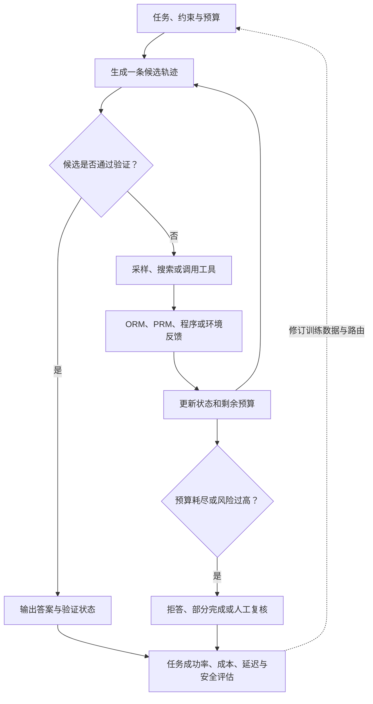

# 第八部分：Reasoning Model 与 Test-Time Compute

前一部分讨论了长上下文、RAG、工具、Agent 和 Memory。那些机制解决的是“读取什么、检索什么、调用什么、如何持续保存状态”。本部分转向另一个问题：当资料已经在手，模型能否把任务拆开、保持中间状态、检查自己的假设，并在必要时为难题投入更多推理计算。

本部分不把 reasoning 等同于输出一段很长的解释。一个可靠的推理系统至少有四个对象：

~~~text
generator：提出答案、步骤或候选动作
state：保存当前问题、部分解法和外部反馈
verifier：检查结果、过程或约束
controller：分配 token、采样、搜索、工具和人工确认预算
~~~

Chain-of-Thought、self-consistency、verifier、search、数学训练、代码执行反馈、合成推理数据和评估，分别解决这条链路中的不同环节。最后一节把它们放回一个产品系统中，说明为什么“更会推理”最终表现为数据、训练、运行时、评估和安全的共同变化。

下面的流程图把这些环节连在一起：生成、验证和控制不是三个可互换的“推理技巧”，而是一次受预算约束的循环。候选通过验证时可以结束；证据不足或验证失败时，控制器决定继续采样、展开分支、调用工具、缩短目标或转人工。离线评估再把失败分布反馈到数据和策略设计。

图中的循环不要求每个请求都执行多轮。直接回答是预算最小的一条策略；关键是在任务风险和历史分桶结果提示需要更多检查时，系统能说明为何加算、加了多少、得到什么证据，以及何时停止。

## 第 87 节：Chain-of-Thought——把隐式求解变成可检查的中间状态

### 87.1 从直接回答到显式中间状态

自回归模型可以直接把问题映射到答案：

~~~text
问题 -> 最终答案
~~~

对于“北京是哪个国家的首都”这种问题，直接生成很合适。对于多步数学、代码调试或多跳证据任务，模型需要在答案之前完成若干状态变化：

~~~text
理解条件 -> 定义变量 -> 选择方法 -> 执行步骤 -> 检查约束 -> 生成答案
~~~

如果这些状态都被压缩在很短的输出中，某一步出错后，后续 token 没有稳定的中间表示可以依赖。Chain-of-Thought，简称 CoT，要求模型生成一串中间推理步骤，再给出最终答案。它的价值不是“文字越多越聪明”，而是为多步求解提供了可继续读取的工作空间。

直接回答只需对问题进行一次条件生成；CoT 则先生成轨迹，再在轨迹条件下生成答案。两者的差异可以写成：

~~~math
p_\theta(y\mid x)
~~~

~~~math
p_\theta(r,y\mid x)
=p_\theta(r\mid x)\,p_\theta(y\mid x,r)
~~~

其中 $x$ 是问题，$r$ 是模型在 $x$ 条件下生成的中间轨迹，$y$ 是最终答案。第一式描述直接生成答案的条件分布；第二式表示先生成 $r$，再在 $(x,r)$ 条件下生成 $y$。实际系统再按选定的解码策略从这些分布产生输出；$r$ 不是预先提供给模型的输入。CoT 允许模型在生成答案之前多次更新上下文中的中间状态。

### 87.2 为什么中间步骤可能有帮助

第一，中间 token 提供了额外的计算位置。模型可以先生成变量定义和局部结论，再在后续位置使用它们，而不必一次完成从问题到答案的长距离映射。

第二，步骤把复杂任务拆成局部任务。一个“解方程”的整体映射可能很难，但“移项”“合并同类项”“除以系数”分别更容易检查。

第三，步骤可以作为外部验证接口。程序、符号计算器、单元测试或另一个模型可以检查局部结果，错误不再只能在最终答案处被发现。

第四，多步文本可能激活训练数据中的题解、证明、代码注释和教程模式。但这只是一个可能的机制，不等于模型拥有一条可被完整读取、且忠实描述内部决策的推理链。

设直接回答和 CoT 都在数据集 D 上评估，最终答案准确率为：

~~~math
A_m =
\frac{1}{|D|}
\sum_{(x_i,y_i)\in D}
\mathbf{1}[\hat y_i^{(m)}=y_i]
~~~

CoT 的答案收益是：

~~~math
\Delta A_{\mathrm{cot}}
= A_{\mathrm{cot}}-A_{\mathrm{direct}}
~~~

只有在两种策略使用同一任务集合、同一答案判定规则且 $|D|>0$ 时，$\Delta A_{\mathrm{cot}}$ 才能解释为答案准确率增量。若两条路径的拒答或格式失败规则不同，应先分别报告这些状态，再比较准确率。

如果 CoT 平均增加 n 个输出 token、延迟 T 和风险 R，一个仅用于比较的效用可以写成：

~~~math
U_{\mathrm{cot}}
= A_{\mathrm{cot}}
- \lambda_n n
- \lambda_T T
- \lambda_R R
~~~

这个式子不是发布指标，而是提醒我们：推理文本的收益要和资源以及误导风险一起测量。$n$、$T$ 和 $R$ 必须分别定义单位，$\lambda_n$、$\lambda_T$、$\lambda_R$ 负责把它们换算到同一比较尺度；不能把 token、毫秒和风险事件直接相加。

### 87.3 CoT、scratchpad、rationale 和 hidden reasoning

这些词描述的层面不同。

~~~text
CoT：通常指自然语言形式的分步推理轨迹
scratchpad：模型或程序用于暂存中间变量的工作区，可以是文字、表格或代码
rationale：向读者给出的理由，可能经过压缩、重写或事后生成
hidden reasoning：系统内部使用但不直接展示给用户的中间计算
~~~

一个产品可以让模型使用内部 scratchpad，只向用户展示结论、证据和简短解释；也可以保存结构化步骤供审计，但不把完整自然语言轨迹暴露给用户。用户可见的 rationale 不应自动被当作模型真正依赖的原因。

要区分两类问题：

~~~text
可读性：读者能否理解为什么得到这个答案
忠实性：修改或删除关键步骤，是否会改变模型的求解行为
~~~

可读性高不保证忠实性高。模型可能先得到答案，再生成一段语法流畅的解释；也可能真实使用了某些内部状态，却没有把它完整写出来。因此解释、证据和过程审计要分别设计。

### 87.4 Few-shot CoT 与 zero-shot CoT

Few-shot CoT 在提示中提供带步骤的示例：

~~~text
问题：一个班有 24 人，三分之一是女生，女生有多少人？
示例过程：总人数乘以女生比例，24 × 1/3 = 8。
示例答案：8 人。
~~~

示例不仅展示答案，还展示变量命名、步骤粒度和最终输出格式。示例错误、步骤过长或与目标任务不相似，都会把错误格式带进生成。

Zero-shot CoT 只给出“逐步分析”之类的提示。它成本低，但不同模型、语言和任务的稳定性差异较大。更可靠的系统通常明确最终答案字段、单位、是否允许工具和失败时的输出状态。

提示中的“逐步分析”不是训练。它可能触发模型已有的求解模式，也可能只让模型生成更长的模板。必须用 direct baseline、固定解码参数和分桶数据比较，而不能看到一段长文字就宣布推理能力提升。

### 87.5 忠实性：中间步骤是否真的被使用

CoT 的核心争议是：模型写出来的步骤是否是得到答案的原因。可以设计干预实验：

1. 找出一个可定位的关键步骤。
2. 只修改该步骤的数字、方向或前提。
3. 保持问题和其他文本不变。
4. 重新生成最终答案。
5. 比较答案变化、后续纠错和轨迹一致性。

定义原始推理为 r，干预后推理为 r'，输出函数为 f，则干预敏感度可写成：

~~~math
S_{\mathrm{int}}
= \frac{1}{N}
\sum_{i=1}^{N}
\mathbf{1}
[f(x_i,r_i)\ne f(x_i,r'_i)]
\qquad N>0
~~~

这里 $N$ 是完成原始/干预成对评估的样本数；分母为零时该指标记为 `N/A`。

如果关键步骤被改错，答案仍然总是不变，说明模型可能没有依赖这段文本；如果随便修改无关步骤也改变答案，说明系统可能对表面扰动过敏。两种结果都不能单独证明忠实性，还需要结合隐藏状态、工具调用、答案正确性和多次重复实验。

另一个有用的指标是“答案对但过程错”的比例：

~~~math
R_{\mathrm{lucky}}
=
\frac{
\sum_{i=1}^{N}
\mathbf{1}[\hat y_i=y_i]
\mathbf{1}[\mathrm{valid}(r_i)=0]
}{
\sum_{i=1}^{N} \mathbf{1}[\hat y_i=y_i]
},
\qquad \sum_{i=1}^{N}\mathbf{1}[\hat y_i=y_i]>0
~~~

如果没有任何回答正确的样本，$R_{\mathrm{lucky}}$ 没有定义，应记为 `N/A`。这个比例高时，单看 final accuracy 会高估模型的可迁移求解能力。

2026 年 TACL 论文 [KisMATH](https://aclanthology.org/2026.tacl-1.59/) 把一批数学 CoT 表示成因果依赖图，并在 1,671 道来自 MATH500、GSM8K 和 AIME 的问题及 15 个开源模型上做图对齐干预。作者报告部分推理节点会因干预而影响最终答案，这给“改步骤、看答案是否变化”提供了更结构化的研究范例。它的结论仍受数学题、自动抽取的图结构和特定开源模型约束；不能据此说所有用户可见 CoT 都忠实，也不能把干预敏感直接当作充分的忠实性证明。

### 87.6 过程监督与产品输出

CoT 可以作为训练样本，也可以只作为运行时工作区。若用于训练，应区分：

~~~text
结果监督：最终答案是否正确
过程监督：每个步骤是否成立、是否相关、是否保留条件
工具监督：调用和参数是否满足协议，执行结果是否被正确使用
安全监督：推理是否泄露秘密、越过权限或提出危险动作
~~~

对用户展示时，更适合返回：

~~~text
结论：答案或当前状态
依据：关键计算、证据或工具结果
不确定性：缺少什么、哪些条件未验证
动作状态：已完成、草稿、等待确认或未执行
~~~

完整内部推理可能包含错误假设、敏感策略和攻击者可利用的细节。隐藏内部轨迹并不意味着放弃可审计性；可以保存版本化的工具调用、验证结果、关键中间状态哈希和用户可读依据。

### 87.7 一个 CoT 过程审计器

下面的代码只审计模拟输出，不调用模型。它检查最终答案、算式步骤和关键步骤干预的结果，展示为什么答案正确不能替代过程检查。

~~~python
import operator
import re

STEP_RE = re.compile(r"(-?\d+)\s*([-+*])\s*(-?\d+)\s*=\s*(-?\d+)")
FINAL_RE = re.compile(r"(?:final|answer|答案)[:：]\s*([a-zA-Z0-9_-]+)", re.I)
OPS = {"+": operator.add, "-": operator.sub, "*": operator.mul}

def final_answer(text):
    if not isinstance(text, str):
        raise TypeError("text must be a string")
    match = FINAL_RE.search(text)
    return match.group(1).lower() if match else ""

def step_checks(text):
    if not isinstance(text, str):
        raise TypeError("text must be a string")
    checks = []
    equations = [part for part in re.split(r"[;,\n]", text) if "=" in part]
    for equation in equations:
        match = STEP_RE.search(equation)
        if not match:
            checks.append(None)
            continue
        left, op, right, stated = match.groups()
        try:
            expected = OPS[op](int(left), int(right))
            checks.append(expected == int(stated))
        except ValueError:
            checks.append(False)
    return checks

records = [
    {
        "id": "calculation",
        "gold": "6",
        "cot": "3 + 5 = 8; 8 - 2 = 6; final: 6",
        "perturbed": "3 + 5 = 9; 9 - 2 = 7; final: 7",
    },
    {
        "id": "lucky_answer",
        "gold": "13",
        "cot": "7 + 6 = 12; final: 13",
        "perturbed": "7 + 6 = 12; final: 13",
    },
    {
        "id": "no_formula",
        "gold": "positive",
        "cot": "the sentence is favorable; final: positive",
        "perturbed": "the sentence is unfavorable; final: negative",
    },
]

def validate_records(records):
    if not isinstance(records, list):
        raise ValueError("records must be a list")
    seen = set()
    for row in records:
        if not isinstance(row, dict):
            raise ValueError("each record must be an object")
        required = {"id", "gold", "cot", "perturbed"}
        if not required.issubset(row):
            raise ValueError("record fields are incomplete")
        if not isinstance(row["id"], str) or not row["id"]:
            raise ValueError("record id must be non-empty")
        if row["id"] in seen:
            raise ValueError("record ids must be unique")
        seen.add(row["id"])
        for field in ("gold", "cot", "perturbed"):
            if not isinstance(row[field], str) or not row[field].strip():
                raise ValueError(f"{field} must be non-empty text")

validate_records(records)

correct = 0
invalid_but_correct = 0
uncheckable_samples = 0
changed = 0
for row in records:
    answer_ok = final_answer(row["cot"]) == row["gold"]
    checks = step_checks(row["cot"])
    correct += answer_ok
    invalid_but_correct += int(answer_ok and any(check is False for check in checks))
    uncheckable_samples += int(not checks or any(check is None for check in checks))
    changed += int(final_answer(row["cot"]) != final_answer(row["perturbed"]))
    print(row["id"], "answer_ok=", answer_ok, "steps=", checks)

answer_accuracy = None if not records else round(correct / len(records), 3)
intervention_rate = None if not records else round(changed / len(records), 3)
print("answer_accuracy=", "N/A" if answer_accuracy is None else answer_accuracy)
print("invalid_but_correct=", invalid_but_correct)
print("uncheckable_samples=", uncheckable_samples)
print("intervention_rate=", "N/A" if intervention_rate is None else intervention_rate)
~~~

> **代码状态：已验证（2026-10-08；Python 3.12.9；标准库）**

输出：

~~~text
calculation answer_ok= True steps= [True, True]
lucky_answer answer_ok= True steps= [False]
no_formula answer_ok= True steps= []
answer_accuracy= 1.0
invalid_but_correct= 1
uncheckable_samples= 1
intervention_rate= 0.667
~~~

这组数据故意让三条最终答案都正确，但其中一条整数算式错误，另一条没有可检查的算式。审计器只识别整数加、减、乘；等式中出现其他运算或未识别格式会标为不可检查，即使同一段中另有可识别算式，也会计入不可检查样本。真实系统应把“没有步骤”“步骤错误”“不可检查”和“步骤通过”分开统计，不能把空列表当作成功。

### 87.8 失效模式、练习与证据边界

CoT 常见失效包括强制所有任务分步导致成本增加、把流畅语言当作正确性、把完整轨迹当作解释证明、示例中混入错误步骤，以及推理文本把不确定结论说成事实。应按任务复杂度决定是否使用 CoT，按证据和验证结果决定对外断言强度。

可以练习以下问题：为同一任务设计 direct 与 CoT baseline；构造答案正确但过程错误的样本；设计关键步骤干预；比较内部 scratchpad、用户解释和审计 trace 的字段；为高风险工具任务设计不展示完整推理的输出协议。

证据边界：

- [Chain-of-Thought Prompting](https://arxiv.org/abs/2201.11903)：少样本分步推理提示研究。
- [Zero-shot Reasoners](https://arxiv.org/abs/2205.11916)：零样本分步提示研究。
- [Language Models Do Not Always Say What They Think](https://arxiv.org/abs/2305.04388)：对 CoT 忠实性的干预研究。
- [KisMATH: Do LLMs Have Knowledge of Implicit Structures in Mathematical Reasoning?](https://aclanthology.org/2026.tacl-1.59/)：用因果 CoT 图和对齐干预研究数学推理步骤；结果限于作者构建的题目、图抽取方式和模型集合。

这些论文支持“中间步骤可能有用，但不自动等于忠实解释”的判断。不同模型、提示、任务和输出策略仍需独立测量。

## 第 88 节：Self-Consistency——用多条推理路径近似答案分布

### 88.1 从单条路径到答案聚合

一条 CoT 可能在第一步就走错。即使模型能够生成另一条正确路径，单次贪心解码也不会主动探索它。Self-consistency 的思路是：在相同问题上采样多条推理路径，抽取每条路径的答案，再聚合答案。

基本流程为：

~~~text
问题 x
-> 采样 N 条 reasoning path
-> 抽取并归一化答案 a_1...a_N
-> 多数投票、加权投票或 verifier 选择
-> 返回答案和一致性信号
~~~

如果隐藏推理路径为 r，理想答案概率可以写成：

~~~math
P(a\mid x)
= \sum_r P(a\mid x,r)P(r\mid x)
~~~

系统无法枚举所有 r，只能用 N 次采样近似：

~~~math
\hat P_N(a\mid x)
= \frac{1}{N}
\sum_{i=1}^{N}
\mathbf{1}[a_i=a]
,
\qquad N>0
~~~

最终多数答案为：

~~~math
\hat a
= \arg\max_a \hat P_N(a\mid x)
~~~

这是一种 test-time compute 方法，但它提升的是候选覆盖和聚合稳定性，不保证最终选择器一定找到正确答案。

### 88.2 为什么需要随机采样

如果每次都使用完全相同的 greedy 解码，N 次输出很可能一致，采样不会带来路径多样性。Temperature、top-p、随机种子、提示扰动和候选起点都可能影响路径分布。

温度改变 logits 分布：

~~~math
p_T(y_t\mid y_{<t},x)
= \mathrm{softmax}
\left(
\frac{z_t}{T}
\right),
\qquad T>0
~~~

T 较低时分布更尖锐，路径更相似；T 较高时探索更多，但也可能生成不合理步骤。top-p 进一步限制累计概率质量。参数选择应在真实任务上做消融，不存在适用于所有模型的固定温度。

### 88.3 多数投票的边界

假设单条路径独立得到正确答案的概率为 p，N 为奇数，多数投票正确概率可写成：

~~~math
P_{\mathrm{maj}}(N,p)
=
\sum_{j=(N+1)/2}^{N}
\binom{N}{j}
p^j(1-p)^{N-j}
~~~

这里要求 $N$ 为正奇数，且 $0\le p\le1$；公式只适用于二元正确/错误标签。若 $N$ 为偶数，需要先定义平票处理规则。当 $p$ 大于 0.5 且错误近似独立时，$N$ 增加通常提高多数正确概率。但大模型的路径共享参数、提示、训练偏差和早期解释，错误往往相关。可以用一个粗略有效样本数表示相关性损失：

~~~math
N_{\mathrm{eff}}
=\frac{N}{1+(N-1)\rho},
\qquad N>0,\quad 0\le\rho\le1
~~~

rho 越大，名义上的多次采样带来的新增信息越少。若模型系统性误解问题，多数投票只会更稳定地重复错误。

用 `p=0.4`、`N=3` 看两种目标的区别。至少出现一次正确候选的概率是：

~~~math
P_{hit}=1-(1-0.4)^3=1-0.216=0.784
~~~

但多数投票选对的概率只有 `3×0.4²×0.6+0.4³=0.352`。候选池中有正确答案，不代表聚合器能找到它；当单条路径的正确率低于 0.5 时，多数投票甚至会偏向错误答案。若任务有可靠 verifier，并假设“有正确候选时”它能以 0.8 的概率选中正确项，则最终正确率至多约为 `0.784×0.8=0.627`；这个数仍高于多数投票，但还要扣除 verifier 在无正确候选时误选、以及工具失败等情况。

再设五条候选的平均两两相关度约为 `rho=0.5`，有效样本数近似为 `5/(1+4×0.5)=1.67`，明显低于名义的 5 条。此近似只表示多样性损失的方向，不能当作严格统计估计；实务上应对重复答案、共同前缀、相同错误类型和扰动敏感性做分组统计。不同温度得到 5 条近似措辞、但共享同一错误假设的轨迹，不能算作五份独立证据。

### 88.4 答案抽取和归一化

Self-consistency 的输入不是完整自然语言，而是可比较的答案类别。以下表达可能等价：

~~~text
1/2
0.5
50%
答案为二分之一
~~~

系统需要明确：

1. 数值和单位是否分开比较。
2. 分数、小数和百分数如何归一化。
3. 中文数字如何处理。
4. 多个候选答案时取哪一个。
5. 缺少 final 字段时是否判为无效。
6. 开放式长答案是否改用 pairwise 或 verifier。

抽取器错误会把正确路径分成多个类别，降低表面一致性。抽取器本身也要有独立测试集，不能把它的错误归因于 generator。

### 88.5 加权投票和 verifier 选择

多数投票只使用出现次数。加权投票还使用路径质量分 v_i：

~~~math
score(a)
= \sum_{i=1}^{N}
w_i\mathbf{1}[a_i=a]
~~~

权重可以来自程序测试、PRM 分数、工具结果、路径置信度或成本惩罚。若 verifier 分数为 v_i，可用：

~~~math
w_i = \exp(v_i/\tau_v)
\qquad \tau_v>0
~~~

$v_i$ 是第 $i$ 条路径的 verifier 分数，$\tau_v$ 是正温度。$\tau_v$ 较小会让高分路径占据更大权重，较大则让权重差异变小；当温度增大时，权重趋近相等。模型自报置信度如果没有校准，不能直接当作可靠权重。

更强的流程是先让 verifier 检查每条路径，再选择最高分候选。它可以在少数路径正确而多数路径错误时救回答案，但引入了 verifier 的偏差、成本和攻击面。因此报告时要分别给出：

~~~text
oracle@N：候选集合中是否出现过正确解
selection accuracy：系统是否实际选中了正确解
cost per solved task：找到并选中正确解花了多少成本
~~~

### 88.6 一致性、熵和提前停止

答案分布熵为：

~~~math
H(A)
=-\sum_{a\in\mathcal{A}}
\hat P_N(a\mid x)\log\hat P_N(a\mid x)
~~~

第一名和第二名的票数差可以归一化为 margin：

~~~math
M_N
= \hat P_N(a_1\mid x)-\hat P_N(a_2\mid x)
~~~

低熵、高 margin 通常表示路径更集中，但不代表答案一定正确。上式对 $\hat P_N=0$ 的项按 $0\log0=0$ 处理；如果答案类别少于两个，margin 不适用。系统可以把它当作是否继续采样的信号，再通过一个独立 verifier 或抽样校准确定阈值。

提前停止需要避免“刚好连续三次相同就停止”这类过强规则。更稳妥的做法是同时看样本数下限、margin、答案稳定窗口、验证分和剩余预算。

### 88.7 一个投票与归一化实验

~~~python
from collections import Counter, defaultdict
from fractions import Fraction
import math
import re

FINAL_RE = re.compile(r"(?:final|answer)[:：]\s*([0-9./%a-zA-Z_-]+)", re.I)
TAU_V = 0.2

def normalize(raw):
    if not isinstance(raw, str) or not raw.strip():
        raise ValueError("answer text must be non-empty")
    text = raw.strip().lower().rstrip("。,. ")
    try:
        if text.endswith("%"):
            number = text[:-1]
            if not re.fullmatch(r"-?(?:\d+(?:\.\d+)?|\.\d+)", number):
                return text
            value = Fraction(number) / 100
        elif re.fullmatch(r"-?\d+/-?\d+", text):
            numerator, denominator = text.split("/", 1)
            value = Fraction(int(numerator), int(denominator))
        elif re.fullmatch(r"-?(?:\d+(?:\.\d+)?|\.\d+)", text):
            value = Fraction(text)
        else:
            return text
        return str(value.numerator) if value.denominator == 1 else f"{value.numerator}/{value.denominator}"
    except (ValueError, ZeroDivisionError):
        return text

def answer(text):
    match = FINAL_RE.search(text)
    return normalize(match.group(1)) if match else ""

def majority(rows):
    if not rows:
        return None
    return Counter(answer(row["text"]) for row in rows).most_common(1)[0][0]

def weighted(rows, tau_v=TAU_V):
    if isinstance(tau_v, bool) or not isinstance(tau_v, (int, float)):
        raise ValueError("tau_v must be numeric")
    if not math.isfinite(tau_v) or tau_v <= 0:
        raise ValueError("tau_v must be finite and positive")
    if not rows:
        return None
    max_score = max(row["verifier"] for row in rows)
    scores = defaultdict(float)
    for row in rows:
        weight = math.exp((row["verifier"] - max_score) / tau_v)
        scores[answer(row["text"])] += weight
    return max(scores.items(), key=lambda item: (item[1], item[0]))[0]

cases = [
    {
        "name": "scattered",
        "gold": "42",
        "rows": [
            {"text": "method A final: 42", "verifier": 0.8},
            {"text": "method B final: 42", "verifier": 0.7},
            {"text": "slip final: 41", "verifier": 0.2},
            {"text": "check final: 42", "verifier": 0.75},
            {"text": "wrong branch final: 40", "verifier": 0.25},
        ],
    },
    {
        "name": "equivalent_forms",
        "gold": "1/2",
        "rows": [
            {"text": "fraction final: 1/2", "verifier": 0.8},
            {"text": "decimal final: 0.5", "verifier": 0.7},
            {"text": "percent final: 50%", "verifier": 0.6},
            {"text": "wrong final: 2/3", "verifier": 0.3},
        ],
    },
    {
        "name": "shared_error",
        "gold": "17",
        "rows": [
            {"text": "copy final: 16", "verifier": 0.2},
            {"text": "copy final: 16", "verifier": 0.25},
            {"text": "copy final: 16", "verifier": 0.3},
            {"text": "careful final: 17", "verifier": 0.95},
        ],
    },
]

def validate_cases(cases):
    if not isinstance(cases, list):
        raise ValueError("cases must be a list")
    seen = set()
    for case in cases:
        if not isinstance(case, dict):
            raise ValueError("each case must be an object")
        if not isinstance(case.get("name"), str) or not case["name"]:
            raise ValueError("case name must be non-empty")
        if case["name"] in seen:
            raise ValueError("case names must be unique")
        seen.add(case["name"])
        if not isinstance(case.get("gold"), str) or not case["gold"]:
            raise ValueError("gold answer must be non-empty")
        rows = case.get("rows")
        if not isinstance(rows, list) or not rows:
            raise ValueError("each case needs at least one path")
        for row in rows:
            if not isinstance(row, dict) or not isinstance(row.get("text"), str):
                raise ValueError("path text must be a string")
            verifier = row.get("verifier")
            if isinstance(verifier, bool) or not isinstance(verifier, (int, float)):
                raise ValueError("verifier score must be numeric")
            if not math.isfinite(verifier):
                raise ValueError("verifier score must be finite")

validate_cases(cases)
assert normalize("not 4") != normalize("4")
assert normalize("0.5") == normalize("1/2")

for case in cases:
    maj = majority(case["rows"])
    wgt = weighted(case["rows"])
    print(case["name"], "majority=", maj, "weighted=", wgt, "gold=", case["gold"])

majority_hits = sum(majority(c["rows"]) == c["gold"] for c in cases)
weighted_hits = sum(weighted(c["rows"]) == c["gold"] for c in cases)
print("majority_accuracy=", "N/A" if not cases else round(majority_hits / len(cases), 3))
print("weighted_accuracy=", "N/A" if not cases else round(weighted_hits / len(cases), 3))
~~~

> **代码状态：已验证（2026-10-08；Python 3.12.9；标准库）**

输出：

~~~text
scattered majority= 42 weighted= 42 gold= 42
equivalent_forms majority= 1/2 weighted= 1/2 gold= 1/2
shared_error majority= 16 weighted= 17 gold= 17
majority_accuracy= 0.667
weighted_accuracy= 1.0
~~~

shared_error 展示了多数路径共享同一错误时的边界；weighted 投票之所以成功，是因为 verifier 分数更高，而不是因为少数天然更可靠。

### 88.8 成本、适用性与证据边界

若每条路径平均产生 n 个 token，采样 N 条，verifier 调用 k 次，则相对成本可写成：

~~~math
C_N
= N(c_{\mathrm{out}}n+c_{\mathrm{call}})
 + c_v k
~~~

串行延迟近似是所有路径耗时之和，并行延迟接近最长路径加聚合时间，但并行不会消除 token 消耗和 GPU 占用。Self-consistency 适合数学、短答案逻辑、代码候选和有明确 verifier 的任务；开放式创作、长摘要和极低延迟问答通常不适合简单多数投票。

候选覆盖与多数票的差别，以及路径相关导致的有效样本数损失，已在第 88.3 节用同一组数字展开。实际评估应同时报告候选池 oracle@N、聚合后的 selection accuracy、不同路径的错误重叠和总成本；不要把采样数直接当作独立证据数。

聚合器还需要知道自己收到的是什么。数学题常能把候选答案规范化成数值或表达式；自由回答若只按整句字符串投票，“退款到账”与“已完成退款”可能被当成两个答案，而语义相反的含糊句子也可能被误归到同一类。若先把输出抽成结构字段再投票，字段抽取本身又可能丢失单位、条件或时间范围。因而应把答案抽取器作为系统组件单独测：用人工标注的同义表达、单位变换、否定词和多个数值字段构成一组小测试，再分别报告原文一致率、规范化后的一致率和抽取错误率。多数票的提升必须扣除这层转换错误，才是端到端结果。

把收益换算成单位正确答案成本，能看出多采样何时不值得。假设 100 道题单次生成答对 60 道，每次平均消耗 1000 token；五路径投票后答对 68 道，但每题消耗约 5000 token。单次系统约用 100,000 token 得到 60 个正确答案，即约 1667 token/正确答案；多路径系统用 500,000 token 得到 68 个正确答案，约 7353 token/正确答案，准确率提高 8 个百分点，单位正确答案 token 成本却约为 4.4 倍。这个例子不含 verifier 与延迟成本；若题目高价值且正确率门槛重要，交换可能值得，若是低风险高频任务则未必。上线决策应先设准确率或安全门槛，再比较满足门槛的最低预算路径。

证据边界：

- [Self-Consistency Improves Chain of Thought Reasoning](https://arxiv.org/abs/2203.11171)：多路径采样和一致性聚合。
- [Training Verifiers to Solve Math Word Problems](https://arxiv.org/abs/2110.14168)：候选生成与验证器选择。

这些工作支持“多路径可以提高候选覆盖和聚合稳定性”的方法，但真实收益取决于路径相关性、答案抽取、verifier 和预算。

## 第 89 节：Verifier、ORM 与 PRM——把生成和评价拆成两个可测量模块

### 89.1 Verifier 的职责

Generator 负责提出候选，verifier 负责判断候选是否满足任务目标。Verifier 的输入可以包括问题 q、推理轨迹 r、答案 a、工具结果和约束；输出可以是布尔值、概率、排序分数、第一处错误或结构化失败原因。

~~~math
s_i = v_\phi(q,r_i,a_i)
~~~

如果有 $N>0$ 个候选，最简单的选择是：

~~~math
i^\star = \arg\max_i s_i,\qquad a^\star=a_{i^\star}
~~~

Verifier 不是天然真值源。它也可能偏好冗长文字、被漂亮但错误的推理欺骗、在分布外任务上失效或被 generator 针对。因此 verifier 自身需要独立数据、校准集和端到端评估。

### 89.2 ORM：看最终结果

Outcome Reward Model，简称 ORM，评价最终答案或任务是否成功。其监督标签通常是：

~~~math
z_i = \mathbf{1}[\mathrm{norm}(a_i)=\mathrm{norm}(a_i^\star)]
~~~

代码任务中 z_i 可以来自编译、公开/隐藏测试、静态扫描和执行约束；业务任务中可能来自外部状态查询。ORM 的 pointwise 损失可以写成：

~~~math
\mathcal{L}_{\mathrm{orm}}
=-\frac{1}{M}
\sum_{i=1}^{M}
\left[
z_i\log p_i+(1-z_i)\log(1-p_i)
\right]
,
\qquad M>0,\quad 0<p_i<1
~~~

也可以使用 pairwise ranking：

~~~math
\mathcal{L}_{\mathrm{pair}}
=-\log\sigma(s^+-s^-)
~~~

ORM 的优点是标注便宜、容易自动化、适合最终候选重排。它的弱点是看不到哪一步错，可能奖励“答案碰巧正确但过程错误”的候选。

### 89.3 PRM：看中间过程

Process Reward Model，简称 PRM，逐步评价推理。设第 i 条轨迹在第 t 步之前的历史为：

~~~math
h_{i,t}=(q,u_{i,1},\ldots,u_{i,t-1})
~~~

PRM 判断当前步骤 u_i,t 的质量：

~~~math
p_{i,t}=v_\psi(h_{i,t},u_{i,t})
~~~

步骤级二分类损失为：

~~~math
\mathcal{L}_{\mathrm{prm}}
=-\frac{1}{K}
\sum_{i,t}
\left[
z_{i,t}\log p_{i,t}
+(1-z_{i,t})\log(1-p_{i,t})
\right]
,
\qquad K>0,\quad 0<p_{i,t}<1
~~~

K 是所有轨迹的步骤标签总数，而不是候选条数。长轨迹的过程分数可以用平均、几何平均、最小值或平均 log 概率聚合：

~~~math
S_i^{\mathrm{mean}}
=\frac{1}{T_i}\sum_t p_{i,t}
,
\qquad T_i>0
~~~

~~~math
S_i^{\mathrm{min}}=\min_{1\le t\le T_i}p_{i,t},
\qquad T_i>0
~~~

~~~math
S_i^{\mathrm{logavg}}
=\frac{1}{T_i}\sum_{t=1}^{T_i}\log p_{i,t},
\qquad T_i>0,\quad 0<p_{i,t}\le1
~~~

平均分允许少量低分步骤，最小值更保守，平均 log 分数能避免长链路的乘积过度惩罚。若某个步骤分数为 0，$S_i^{\mathrm{logavg}}$ 应记为 $-\infty$ 或按任务协议标为不可用，不能用人为的 $\epsilon$ 把它伪装成有限分数。任何聚合方式都只是局部步骤质量的代理，不等于严格的最终成功概率。

第一处错误可以定义为：

~~~math
t_i^{\mathrm{err}}
=\min\{t:p_{i,t}<\tau\}
~~~

这里要求 $0\le p_{i,t}\le1$、$0\le\tau\le1$ 且 $1\le t\le T_i$。若不存在这样的 $t$，表示当前阈值下没有标出的错误，而不是证明整条路径一定正确；空集合的第一错步应记录为 `N/A`。

### 89.4 生成、评价和搜索的组合

Verifier 可以放在不同位置：

~~~text
生成完整候选 -> ORM 终局重排
生成多条候选 -> PRM 过程评分 -> 过滤后投票
每生成一步 -> PRM 评分 -> 剪枝、回退或继续
代码候选 -> 编译/测试/安全扫描 -> 修复或选择
业务动作 -> 策略、外部状态和用户确认 -> 执行
~~~

一个融合分数可以写成：

~~~math
S_i =
\lambda_o s_i^{\mathrm{ORM}}
+\lambda_p S_i^{\mathrm{PRM}}
+\lambda_r R_i
-\lambda_c C_i
-\lambda_s Risk_i
~~~

R_i 是规则或程序验证分，C_i 是 token、延迟或工具成本。硬约束不应只作为一个可被高质量文本抵消的软分数；安全违规、无权限和不可接受副作用应在候选进入排序前排除。

### 89.5 Verifier 数据和 hard negative

ORM 数据通常是问题、候选答案和最终标签；PRM 数据还需要每一步的标签、错误类型和标注来源。负样本不能只有明显乱码，还应包括：

1. 最终答案差一个数字。
2. 过程看起来合理但漏了条件。
3. 最终答案正确但中间步骤错误。
4. 通过公开测试但失败隐藏测试。
5. 引用存在但不能支持 claim。
6. 参数格式正确但越过资源权限。

Hard negative 让 verifier 学会任务边界，而不是只学“格式像不像”。标注者之间的分歧应被保留；对复杂证明，二元标签可能不如“支持、部分支持、冲突、无法判断”更准确。

### 89.6 Verifier 评估

离线指标包括 accuracy、precision、recall、AUC、pairwise ranking、first-error accuracy 和 ECE。更重要的是候选选择准确率：

~~~math
A_{\mathrm{select}}
=\frac{1}{M}\sum_j
\mathbf{1}[z_{j,i_j^\star}=1]
,
\qquad M>0
~~~

与 oracle@N 对比：

~~~math
A_{\mathrm{oracle@N}}
=\frac{1}{M}\sum_j
\mathbf{1}[\max_i z_{j,i}=1]
,
\qquad M>0
~~~

oracle@N 高而 A_select 低，说明 generator 已经产生正确候选，瓶颈在 verifier 或控制器。反过来两者都低，说明系统首先缺少可用候选。

ECE 可以写成：

~~~math
\mathrm{ECE}
=\sum_{b=1}^{B}
\frac{|\mathcal{B}_b|}{M}
\left|\mathrm{acc}(\mathcal{B}_b)-\mathrm{conf}(\mathcal{B}_b)\right|,
\qquad M>0,\quad B>0
~~~

Verifier 分数高但实际选择错误，会把所有上层 search 和 rerank 预算引向错误路径。

把 generator 的候选覆盖和 verifier 的选择能力分开算。假设 100 道题各生成 4 个候选，其中 42 道至少出现一个正确答案，oracle@4 就是 `42/100=0.42`。实际 verifier 只在 32 道题上选中正确候选，则 selection accuracy 为 `32/100=0.32`，在“候选池确实有正确答案”的题目中条件选择率为 `32/42≈0.762`。剩余 58 道题没有正确候选，换一个更准的 verifier 也无法直接解决；要先改善 generator、数据覆盖或调用外部工具。

PRM 的聚合方式同样会改变排序。轨迹 A 两步分数为 `[0.98,0.20]`，平均分是 `0.59`、最小值是 `0.20`；轨迹 B 为 `[0.70,0.70]`，平均与最小值都是 `0.70`。平均分会选 B，但这只是在“任何一步低分都可能破坏整题”的假设下更谨慎；如果低分步骤是一个无害的表述变化，最小值会过度惩罚。聚合规则应在完整轨迹成功标签上比较，而不是只挑看起来保守的公式。

阈值分类指标也不等价于 top-1 选择指标。假设 120 个步骤级判断中，`TP=45, FP=15, FN=10`，则 precision=`45/60=0.75`、recall=`45/55≈0.818`。但在候选排序任务里，即便这些 pooled 指标不错，只要每道题的最高分总被同一种错误推理占据，selection accuracy 仍可能很低。评估应保持问题分组，报告每题 top-1、候选池 oracle、各风险桶的错误选择与人工裁定结果。

### 89.7 一个 ORM/PRM 选择实验

~~~python
from fractions import Fraction
import math

def norm(value):
    if not isinstance(value, str) or not value.strip():
        raise ValueError("answer must be non-empty text")
    try:
        return Fraction(value.strip())
    except (ValueError, ZeroDivisionError) as exc:
        raise ValueError(f"answer must be a numeric fraction: {value!r}") from exc

def validate_steps(steps):
    if not isinstance(steps, list) or not steps:
        raise ValueError("steps must be a non-empty list")
    for value in steps:
        if isinstance(value, bool) or not isinstance(value, (int, float)):
            raise ValueError("each step score must be numeric")
        if not math.isfinite(value) or not 0 <= value <= 1:
            raise ValueError("each step score must be finite and in [0, 1]")

def process_score(steps):
    validate_steps(steps)
    return sum(steps) / len(steps)

def first_error(steps):
    validate_steps(steps)
    for index, value in enumerate(steps, 1):
        if value < 0.5:
            return index
    return None

def validate_problems(problems):
    if not isinstance(problems, list):
        raise ValueError("problems must be a list")
    seen_problems = set()
    for problem in problems:
        if not isinstance(problem, dict):
            raise ValueError("each problem must be an object")
        problem_id = problem.get("id")
        if not isinstance(problem_id, str) or not problem_id.strip():
            raise ValueError("problem id must be non-empty text")
        if problem_id in seen_problems:
            raise ValueError("problem ids must be unique")
        seen_problems.add(problem_id)
        if not isinstance(problem.get("gold"), str) or not problem["gold"].strip():
            raise ValueError("gold answer must be non-empty text")
        norm(problem["gold"])
        candidates = problem.get("candidates")
        if not isinstance(candidates, list) or not candidates:
            raise ValueError("each problem needs at least one candidate")
        seen_candidates = set()
        for candidate in candidates:
            if not isinstance(candidate, dict):
                raise ValueError("each candidate must be an object")
            candidate_id = candidate.get("id")
            if not isinstance(candidate_id, str) or not candidate_id.strip():
                raise ValueError("candidate id must be non-empty text")
            if candidate_id in seen_candidates:
                raise ValueError("candidate ids must be unique within a problem")
            seen_candidates.add(candidate_id)
            if not isinstance(candidate.get("answer"), str) or not candidate["answer"].strip():
                raise ValueError("candidate answer must be non-empty text")
            norm(candidate["answer"])
            model_score = candidate.get("model")
            if isinstance(model_score, bool) or not isinstance(model_score, (int, float)):
                raise ValueError("model score must be numeric")
            if not math.isfinite(model_score) or not 0 <= model_score <= 1:
                raise ValueError("model score must be finite and in [0, 1]")
            validate_steps(candidate.get("steps"))

problems = [
    {
        "id": "majority_wrong",
        "gold": "20",
        "candidates": [
            {"id": "a", "answer": "25", "model": 0.86, "steps": [0.95, 0.95]},
            {"id": "b", "answer": "25", "model": 0.81, "steps": [0.95, 0.95]},
            {"id": "c", "answer": "20", "model": 0.70, "steps": [0.95, 0.95]},
        ],
    },
    {
        "id": "lucky_answer",
        "gold": "4",
        "candidates": [
            {"id": "a", "answer": "4", "model": 0.91, "steps": [0.95, 0.05]},
            {"id": "b", "answer": "4", "model": 0.75, "steps": [0.95, 0.95]},
            {"id": "c", "answer": "7", "model": 0.66, "steps": [0.05, 0.95]},
        ],
    },
    {
        "id": "hard_negative",
        "gold": "9/2",
        "candidates": [
            {"id": "a", "answer": "4.5", "model": 0.73, "steps": [0.95, 0.95]},
            {"id": "b", "answer": "5", "model": 0.89, "steps": [0.95, 0.95]},
            {"id": "c", "answer": "9/2", "model": 0.78, "steps": [0.95, 0.95]},
        ],
    },
]

validate_problems(problems)

model_hits = 0
hybrid_hits = 0
first_errors = []
for problem in problems:
    for candidate in problem["candidates"]:
        candidate["orm"] = int(norm(candidate["answer"]) == norm(problem["gold"]))
        candidate["prm"] = process_score(candidate["steps"])
        candidate["hybrid"] = 0.6 * candidate["orm"] + 0.4 * candidate["prm"] - 0.01 * candidate["model"]
        first_errors.append(first_error(candidate["steps"]))
    model_choice = max(problem["candidates"], key=lambda item: item["model"])
    hybrid_choice = max(problem["candidates"], key=lambda item: item["hybrid"])
    model_hits += int(model_choice["orm"] == 1)
    hybrid_hits += int(hybrid_choice["orm"] == 1)
    print(problem["id"], "model=", model_choice["id"], "hybrid=", hybrid_choice["id"])

print("model_selection_accuracy=", "N/A" if not problems else round(model_hits / len(problems), 3))
print("hybrid_selection_accuracy=", "N/A" if not problems else round(hybrid_hits / len(problems), 3))
print("first_error_indices=", first_errors)
~~~

> **代码状态：已验证（2026-10-08；Python 3.12.9；标准库）**

输出：

~~~text
majority_wrong model= a hybrid= c
lucky_answer model= a hybrid= b
hard_negative model= b hybrid= a
model_selection_accuracy= 0.333
hybrid_selection_accuracy= 1.0
first_error_indices= [None, None, None, 2, None, 1, None, None, None]
~~~

这个例子把模型自评分、ORM 和 PRM 的作用拆开。hybrid 分数使用了参考答案标签模拟 ORM，因此不能把 1.0 当作真实模型性能；它只说明评价模块之间如何组合，以及为什么必须独立测试选择器。

PRM 的逐步分数还需要明确如何汇总成整条轨迹的分数。假设一条解法有 5 步，每步标成 0.9，直接取乘积会得到 $0.9^5\approx0.59$；取最小值则仍是 0.9；取平均也是 0.9。它们分别表达“所有步骤都成功的联合概率”（只有在分数校准且独立假设合理时才近似成立）、“最弱步骤”和“平均步骤质量”，并不是可互换的算术技巧。另一条只有两步、每步 0.8 的轨迹，乘积是 0.64，会胜过前一条的 0.59；按最小值则前一条胜出。候选长度和分数聚合会共同改变搜索结果，因此训练目标、推理时选轨迹规则和离线评估必须使用同一聚合定义，并专门检查长轨迹是否被系统性压低。

### 89.8 失效模式与证据边界

Verifier 会遇到 reward hacking、分布外失效、步骤标注不一致、对非标准正确解法过度惩罚、过度依赖同源 LLM judge 和成本过高等问题。解决方式包括 hard negative、人工校准、程序验证、独立模型、对抗测试和端到端回归。

评估时按第 89.6 节区分候选覆盖（oracle@N）和 verifier 实际选择（selection accuracy），再用分组 top-1、阈值 precision/recall 与独立人工/程序标签定位瓶颈。PRM 聚合方式的影响已在第 89.3 节展示；上线前应在长轨迹、非标准解法和分布外任务上校准，避免把陌生但合法的步骤当成错误。

Verifier 还会受到“多候选中挑最高分”的选择效应影响。假设一题的 4 个候选都错，单个错误候选被 verifier 假阳性地判过阈值的概率是 10%，并暂时假设这些事件独立；至少一个候选误过阈值的概率就是 $1-0.9^4\approx34.4\%$。若系统从多个候选里选分数最高者，实际被选中的候选分数分布会比普通校准集更偏向高分，静态校准误差可能低估选择后的风险。应在与线上相同的候选数、生成策略和选取规则下评估 selected candidate 的准确率与校准，并单独统计“候选池全错但仍选出高置信答案”的比例。独立性假设只是手算说明，真实候选错误相关时应直接从完整轨迹采样估计。

证据边界：

- [Training Verifiers to Solve Math Word Problems](https://arxiv.org/abs/2110.14168)：最终结果 verifier 与候选选择。
- [Let's Verify Step by Step](https://arxiv.org/abs/2305.20050)：结果监督、过程监督和步骤级数据。
- [PRM800K](https://github.com/openai/prm800k)：公开的过程监督数据与工具资料。

论文和公开数据支持 verifier 的训练与评估思路，不保证某个 verifier 在新领域、长轨迹或高风险工具动作上可靠。

## 第 90 节：Search、Tree-of-Thought 与 MCTS——把推理组织成有预算的探索

### 90.1 为什么需要搜索

单条 CoT 一旦在早期选择错误方法，后续 token 可能沿着错误方向持续生成。Self-consistency 会生成多条完整路径，但通常等到路径结束才聚合。Search 把选择提前到中间状态：先提出多个 thought，评价它们，再决定哪些状态继续展开、哪些状态回退或停止。

搜索不是把更多文本拼到 prompt 后面，而是引入了一个控制循环：

~~~text
状态 -> 候选动作 -> 新状态 -> 评价 -> 保留/剪枝/回退 -> 继续
~~~

这使 reasoning 变成一个有限资源下的状态空间探索问题。

### 90.2 状态、动作和终止条件

一个搜索节点至少需要：

~~~text
state：问题、已完成步骤、变量、工具结果和当前约束
action：下一步 thought、公式、代码修改或工具调用
transition：动作如何更新状态
value：状态对最终成功的预测
terminal：答案、测试、证明或预算是否达到终止条件
~~~

形式化表示为：

~~~math
s_{t+1}=T(s_t,a_t,o_{t+1})
~~~

~~~math
a_t\sim\pi_\theta(a\mid s_t)
~~~

~~~math
V_\phi(s_t)\approx P(\mathrm{success}\mid s_t)
~~~

一条轨迹为：

~~~math
\tau=(s_0,a_0,s_1,a_1,\ldots,s_T)
~~~

目标是在预算约束下寻找终局奖励高且风险可接受的轨迹：

~~~math
\tau^\star
=\arg\max_{\tau}
\left[
R(s_T)-\lambda_C C(\tau)-\lambda_R Risk(\tau)
\right]
~~~

如果没有明确的终止谓词，搜索可能把“继续想”误当作进展；如果没有状态去重，等价 thought 会反复消耗预算。

### 90.3 Chain、Tree 和 Graph

CoT 是线性链：

~~~text
step 1 -> step 2 -> step 3 -> answer
~~~

Tree-of-Thought，简称 ToT，把 thought 作为可展开节点：

~~~text
                         problem
                    /       |       \
                 idea A    idea B   idea C
                 /   \                |
              A1     A2               C1
               |             \        |
             fail           answer   answer
~~~

树允许多个分支从同一个父状态出发。若不同路径到达相同状态，图搜索可以合并节点，避免重复计算。对代码修复而言，状态可以是当前 patch 和测试结果；对数学而言，状态可以是方程变形和已证明条件；对 Agent 而言，状态还必须包括外部资源版本和权限。

### 90.4 BFS、DFS 与 Beam

BFS 按深度逐层展开，覆盖广但节点数容易爆炸。DFS 深入一条路径再回退，内存较小但可能在坏路径上浪费预算。Beam search 每层只保留评分最高的 B 个状态，是覆盖和成本之间的折中。

设第 d 层 frontier 为 F_d，每个状态产生 K 个候选：

~~~math
\mathcal{C}_{d+1}
=\{T(s,a)\mid s\in\mathcal{F}_d,\ a\in\pi_K(s)\}
~~~

选择下一层：

~~~math
\mathcal{F}_{d+1}
=\mathrm{TopB}_{s\in\mathcal{C}_{d+1}}
\left[V_\phi(s)-\lambda_C C(s)\right]
~~~

Beam 的主要风险是早期评价错误。一个初始分数低、但后续能到达正确答案的路径可能被剪掉；一个语言流畅但终局错误的 shortcut 可能被保留。因此要记录剪枝保真率，而不是只记录最终成功率。

### 90.5 MCTS 的探索—利用平衡

Monte Carlo Tree Search，简称 MCTS，重复执行四步：

~~~text
selection：从根节点选择值得探索的分支
expansion：为节点加入新的动作或 thought
simulation：继续生成到终局，或用 value 估计
backpropagation：把结果回传到经过的节点
~~~

常见 UCB 选择形式为：

~~~math
\mathrm{UCB}(s,a)
=\begin{cases}
 +\infty, & N(s,a)=0,\\
 \bar Q(s,a)+c\sqrt{\frac{\log N(s)}{N(s,a)}}, & N(s,a)>0.
\end{cases}
~~~

Q 是动作的历史平均回报，N(s) 是父状态访问次数，N(s,a) 是动作访问次数，c 控制探索强度。一次 rollout 得到奖励 r 后，可以用增量平均更新：

~~~math
Q_{\mathrm{new}}
=Q_{\mathrm{old}}
+\frac{r-Q_{\mathrm{old}}}{N(s,a)}
~~~

这里的增量平均只在更新后的 $N(s,a)>0$ 时成立；第一次访问应先把计数设为 1，再写入首个奖励。在 LLM 系统中，rollout 可以由 generator 完成，终局奖励可以来自测试、符号检查、ORM 或用户确认。若 reward 不可靠，MCTS 会把噪声反复传播到树上。

### 90.6 评价函数与剪枝

PRM 可以在每一步评价局部状态，ORM 通常只能在完整答案后评价。剪枝条件可写成：

~~~math
g(s)
=\mathbf{1}[V_\phi(s)\ge\tau_v]
\mathbf{1}[C(s)\le B_{\mathrm{remain}}]
\mathbf{1}[Policy(s)=\mathrm{allow}]
~~~

阈值太低，搜索成本爆炸；阈值太高，正确路径被提前删除。安全策略不应被质量分抵消：无权限动作、泄露秘密和不可接受副作用应直接停止分支。

### 90.7 搜索规模和预算

每个节点展开 K 个候选、最大深度 D 时，无剪枝树的节点上界为：

~~~math
N_{\mathrm{full}}(K,D)
=\begin{cases}
D+1, & K=1,\\
\frac{K^{D+1}-1}{K-1}, & K>1,
\end{cases}
\qquad K\ge1,\quad D\ge0
~~~

K=1 时节点数为 D+1。Beam B 下，展开量可粗略写为：

~~~math
N_{\mathrm{beam}}\le 1+D\cdot B\cdot K
~~~

总成本需要包括候选 token、verifier、工具和状态序列化：

~~~math
C_{\mathrm{search}}
=N_{\mathrm{expand}}
(c_{\mathrm{tok}}\bar n+c_v\bar k_v+c_t\bar k_t)
~~~

系统应记录最大深度、节点数、token、工具调用、墙钟时间、重复状态数和终止原因。

### 90.8 代码和数学中的搜索

代码修复天然有执行反馈：

~~~text
生成 patch -> 编译/测试 -> 读取失败用例 -> 修改 patch -> 再测
~~~

数学搜索则可能需要符号计算器、代入检查、PRM 或形式化证明。两者都要求把环境结果作为 observation 保存，而不是把错误字符串直接当成新的控制指令。

### 90.9 一个 Beam 与根节点 MCTS 实验

~~~python
from math import isfinite, log, sqrt

TERMINALS = {"wrong_18": 18, "wrong_42": 42, "correct_24": 24}
GRAPH = {
    "root": [
        {"label": "shortcut", "next": "shortcut", "value": 0.92},
        {"label": "factor", "next": "factor", "value": 0.70},
        {"label": "bruteforce", "next": "bruteforce", "value": 0.35},
    ],
    "shortcut": [{"label": "finish", "next": "wrong_18", "value": 0.88}],
    "factor": [
        {"label": "invariant", "next": "correct_24", "value": 0.76},
        {"label": "slip", "next": "wrong_42", "value": 0.61},
    ],
    "bruteforce": [{"label": "enumerate", "next": "correct_24", "value": 0.64}],
}

MAX_BEAM_DEPTH = 2

def validate_graph(graph, terminals):
    if not isinstance(graph, dict) or "root" not in graph:
        raise ValueError("graph must be an object containing root")
    if not isinstance(terminals, dict) or not terminals:
        raise ValueError("terminals must be a non-empty object")
    for state, actions in graph.items():
        if not isinstance(state, str) or not state:
            raise ValueError("graph states must be non-empty text")
        if not isinstance(actions, list) or not actions:
            raise ValueError("each non-terminal state needs actions")
        seen_labels = set()
        for action in actions:
            if not isinstance(action, dict):
                raise ValueError("each action must be an object")
            label = action.get("label")
            next_state = action.get("next")
            value = action.get("value")
            if not isinstance(label, str) or not label:
                raise ValueError("action label must be non-empty text")
            if label in seen_labels:
                raise ValueError("action labels must be unique per state")
            seen_labels.add(label)
            if not isinstance(next_state, str) or not next_state:
                raise ValueError("next state must be non-empty text")
            if next_state not in graph and next_state not in terminals:
                raise ValueError(f"unknown next state: {next_state}")
            if isinstance(value, bool) or not isinstance(value, (int, float)):
                raise ValueError("action value must be numeric")
            if not isfinite(value):
                raise ValueError("action value must be finite")
    for state, value in terminals.items():
        if not isinstance(state, str) or not state:
            raise ValueError("terminal states must be non-empty text")
        if isinstance(value, bool) or not isinstance(value, (int, float)):
            raise ValueError("terminal answer must be numeric")
        if not isfinite(value):
            raise ValueError("terminal answer must be finite")

def validate_positive_int(value, name):
    if isinstance(value, bool) or not isinstance(value, int) or value <= 0:
        raise ValueError(f"{name} must be a positive integer")

validate_graph(GRAPH, TERMINALS)

def terminal_reward(state):
    if state not in GRAPH and state not in TERMINALS:
        raise ValueError(f"unknown state: {state}")
    return int(TERMINALS.get(state) == 24)

def beam_search(beam_size, max_depth=MAX_BEAM_DEPTH):
    validate_positive_int(beam_size, "beam_size")
    validate_positive_int(max_depth, "max_depth")
    frontier = [{"state": "root", "path": [], "score": 0.0}]
    generated = 0
    for _ in range(max_depth):
        candidates = []
        for item in frontier:
            if item["state"] in TERMINALS:
                candidates.append(item)
                continue
            if item["state"] not in GRAPH:
                raise ValueError(f"unknown frontier state: {item['state']}")
            for action in GRAPH[item["state"]]:
                generated += 1
                reward = terminal_reward(action["next"])
                score = action["value"] + 1.5 * reward
                candidates.append({
                    "state": action["next"],
                    "path": item["path"] + [action["label"]],
                    "score": score,
                })
        candidates.sort(key=lambda item: item["score"], reverse=True)
        frontier = candidates[:beam_size]
    if not frontier:
        raise RuntimeError("beam search produced no states")
    best = max(frontier, key=lambda item: item["score"])
    return {
        "answer": TERMINALS.get(best["state"]),
        "success": bool(terminal_reward(best["state"])),
        "path": best["path"],
        "generated": generated,
    }

def rollout(action, max_steps=8):
    validate_positive_int(max_steps, "max_steps")
    if not isinstance(action, dict) or action.get("next") is None:
        raise ValueError("rollout action must contain next state")
    state = action["next"]
    for _ in range(max_steps):
        if state in TERMINALS:
            return terminal_reward(state)
        if state not in GRAPH:
            raise ValueError(f"unknown rollout state: {state}")
        action = max(GRAPH[state], key=lambda item: item["value"])
        state = action["next"]
    raise RuntimeError("rollout exceeded max_steps; graph may contain a cycle")

def root_mcts(rollouts=9, exploration=1.4):
    validate_positive_int(rollouts, "rollouts")
    if isinstance(exploration, bool) or not isinstance(exploration, (int, float)):
        raise ValueError("exploration must be numeric")
    if not isfinite(exploration) or exploration < 0:
        raise ValueError("exploration must be finite and non-negative")
    children = [
        dict(action, visits=0, reward_sum=0.0)
        for action in GRAPH["root"]
    ]
    total = 0
    for _ in range(rollouts):
        def ucb(child):
            if child["visits"] == 0:
                return float("inf")
            mean = child["reward_sum"] / child["visits"]
            bonus = exploration * sqrt(log(total + 1) / child["visits"])
            return mean + bonus + 0.05 * child["value"]

        child = max(children, key=ucb)
        child["reward_sum"] += rollout(child)
        child["visits"] += 1
        total += 1
    visited = [child for child in children if child["visits"] > 0]
    if not visited:
        raise RuntimeError("MCTS finished without a visited child")
    best = max(
        visited,
        key=lambda child: (
            child["reward_sum"] / child["visits"],
            child["value"],
        ),
    )
    return {
        "best_action": best["label"],
        "mean_reward": round(best["reward_sum"] / best["visits"], 3),
        "visits": {child["label"]: child["visits"] for child in children},
    }

print("beam1=", beam_search(1))
print("beam2=", beam_search(2))
print("mcts=", root_mcts())
~~~

> **代码状态：已验证（2026-10-08；Python 3.12.9；标准库）**

输出：

~~~text
beam1= {'answer': 18, 'success': False, 'path': ['shortcut', 'finish'], 'generated': 4}
beam2= {'answer': 24, 'success': True, 'path': ['factor', 'invariant'], 'generated': 6}
mcts= {'best_action': 'factor', 'mean_reward': 1.0, 'visits': {'shortcut': 1, 'factor': 4, 'bruteforce': 4}}
~~~

这是一个教学构造，不是完整 MCTS 引擎。它展示 beam=1 早期被高分 shortcut 误导，beam=2 保留 factor，以及根节点 bandit 给低访问分支探索机会。真实系统还要处理多层节点统计、状态去重、并行执行和取消。

### 90.10 并行推理：把预算用于不同分支

前面的 Beam 和 MCTS 说明控制器怎样决定“展开哪一个状态”。近年的另一条路线把预算用于并行生成多条推理轨迹，再用消息、摘要或聚合器综合结果。它不只是把同一条 CoT 写得更长：分支可以从不同中间假设出发，避免一个早期错误把整条串行轨迹带偏；代价是同时占用更多 KV Cache、批处理位置和协调步骤。

用一个理想化例子算墙钟时间。系统生成 8 条候选，每条 256 tokens，单路生成速率 40 tokens/s。串行总生成时间约为 `8×256/40=51.2` 秒。若有 4 个等速并行 worker，分两波完成，每波最长约 `256/40=6.4` 秒，两波约 12.8 秒；再加 2 秒汇总与验证，约 14.8 秒。两种方案都生成 2,048 tokens，推理 token 和能耗不会自动变少；并行方案只是用 4 倍 worker 资源换取较低等待时间。真实系统还要计入调度、KV 内存、通信、任务长短差异和负载干扰。

2026 年 ACL 论文 [PaCoRe](https://aclanthology.org/2026.acl-long.1253/) 探索多轮并行轨迹与消息传递式协调；[ParaThinker](https://aclanthology.org/2026.findings-emnlp.1469/) 把多个并行推理路径放进同一模型设计。作者报告的 HMMT/AIME 分数和延迟改善绑定各自模型、数据、token 预算与 KV reuse 条件，不能据此声称并行推理普遍优于串行搜索。读者应分别比较同 token、同延迟和同硬件预算下的 solve rate、P95、峰值显存、分支相关度和 verifier 错选率。

并行也不会消灭搜索问题。如果 8 条分支共享同一错误前提，汇总器只会把错误写得更完整；若每条分支都回传长篇文本，协调上下文可能比原问题更贵。实用系统应限制每支输出长度、先提取可检验主张或中间量，再传递紧凑 artifact；只有通过状态校验的结果才参与下一轮规划。

分支数和深度会很快放大评价开销。设每个状态最多扩展 4 个子状态，向前看 3 层，完整树要评价 $4+4^2+4^3=84$ 个节点（不含根节点）。若 beam width 固定为 2，并且每个保留状态都继续扩展，三层分别评价 4、8、8 个候选，总计 20 个；假设每次状态评价耗时 5 ms，串行评价时间从 $84\times5=420$ ms 降到 $20\times5=100$ ms。这个账本只算评价器，不包含生成、并行批处理、重复状态合并和队列等待；beam 省下的 64 次评价也可能剪掉唯一正确路径。因此应把分支宽度当成一个有质量代价的预算参数，记录每层被剪枝候选中后来可证明正确的比例，并与等预算随机扩展和单路径基线对照。

节点数量也不是完整成本。一个节点可能只需解析几项结构化变量，也可能需要生成数百 token、调用搜索接口并等待外部环境。更贴近运行时的账本应为每条边记录生成 token、评价器调用、工具等待、状态序列化和失败重试；否则树上“20 个节点”的方案可能比另一棵“40 个节点”的树更贵。比较算法时可以先在同一小任务上列出每个动作的成本，再用相同总预算运行 beam、MCTS 和单路径基线，报告成功率、平均延迟、尾延迟和失败类型。节点数只描述搜索形状，不自动等于 token、美元或用户等待时间。

### 90.11 失效模式与证据边界

搜索常见失效包括状态空间爆炸、错误 value 提前剪枝、重复状态、reward hacking、粒度过细、终止条件不清和只报告最优结果不报告成本。适用搜索的前提是状态可表示、动作可执行、评价函数至少部分可靠，并且预算足以覆盖有价值的分支。

证据边界：

- [Tree of Thoughts](https://arxiv.org/abs/2305.10601)：thought 级搜索、评价和回溯。
- [Language Agent Tree Search](https://arxiv.org/abs/2310.04406)：把树搜索、价值估计和环境反馈用于 Agent。
- [AlphaZero](https://arxiv.org/abs/1712.01815)：策略、价值和 MCTS 的经典组合。
- [PaCoRe](https://aclanthology.org/2026.acl-long.1253/) 与 [ParaThinker](https://aclanthology.org/2026.findings-emnlp.1469/)：分别阅读多轮消息协调和模型内并行轨迹的 test-time compute 方案。

这些论文说明搜索如何组织推理时计算；目标任务中的状态、动作、verifier 和成本仍需单独定义。

## 第 91 节：Test-Time Compute Scaling——把有限推理预算分给最值得计算的请求

### 91.1 训练时扩展与推理时扩展

训练时 scaling 通过更多参数、数据和训练 FLOPs 把能力写入模型参数；test-time compute scaling 在参数固定时增加生成、采样、验证、搜索、工具和等待时间，以提高本次任务的解题质量。

~~~text
训练时：更强的模型能力
推理时：更充分地调用已有能力
~~~

CoT 增加中间状态，self-consistency 增加候选路径，verifier 增加选择，search 增加结构化探索，工具反馈增加外部验证。它们都属于推理时预算的不同用法。

### 91.2 可扩展的预算维度

一次请求可以有多个预算：

~~~text
token budget：允许多少中间和最终 token
sample budget：允许多少候选路径
search budget：允许多少节点、深度和 rollout
verification budget：允许检查多少步骤或候选
tool budget：允许多少外部调用
time budget：用户最多等待多久
money budget：单请求可消耗的计算费用
risk budget：允许的外部副作用和数据暴露范围
~~~

将策略 m 在输入 x 上的成本写为：

~~~math
C(m,x)
=c_{\mathrm{in}}n_{\mathrm{in}}
+c_{\mathrm{out}}n_{\mathrm{out}}
+c_{\mathrm{call}}N
+c_{\mathrm{verify}}K_v
+c_{\mathrm{tool}}K_t
~~~

质量、延迟和风险共同决定效用：

~~~math
U(m,x)
=Q(m,x)
-\lambda_C C(m,x)
-\lambda_T T(m,x)
-\lambda_R R(m,x)
~~~

在预算集合 M 中动态选择：

~~~math
m^\star(x)
=\arg\max_{m\in\mathcal{M}}U(m,x)
\quad
\mathrm{s.t.}\quad
C(m,x)\le B_C,\ T(m,x)\le B_T
~~~

这比“所有请求默认深度思考”更接近产品系统。

#### 从前缀树看预算花在何处

预算表说明系统总共能花多少计算，但同样重要的是：计算作用在一条未完成轨迹、多个完整候选，还是尚未完成的分支上。一个 2026 年 8 月的 arXiv 预印本把推理时扩展按这一点分成三类；这是一种分析分类，不是效果排名或必须互斥的实现清单。

| 计算结构 | 计算发生的位置 | 典型方法 | 主要代价或失败条件 |
| --- | --- | --- | --- |
| 单轨迹顺序扩展 | 只有一条未完成的前缀，继续生成、反思或改变停止条件 | 较长 CoT、单轨迹自我修正 | 延迟沿轨迹累积；早期错误可能继续传递 |
| 完整候选后聚合 | 先生成多条完整答案，再投票或由 verifier 选择 | self-consistency、best-of-N | 候选相关会降低新增样本价值；聚合器可能选错 |
| 未完成前缀搜索 | 在候选完成前，对部分状态评分、扩展或剪枝 | Tree-of-Thought、beam search、MCTS | 评分偏差可能提前删掉正确分支，搜索成本随分支增长 |

这些结构可以组合，例如先在未完成前缀上搜索，再对完成的候选做终局聚合。读者比较两种推理策略时，除了 token、节点和墙钟时间，还要问选择发生在生成前、生成中还是生成后，候选是否能在完成前互相影响，以及停止规则是否改变总成本。这样才能分清“多写一条轨迹”和“把计算移到更有希望的分支”是不同的预算决策。

### 91.3 候选覆盖不等于最终正确

如果单条独立候选命中正确解的概率为 p，N 次采样后至少出现一个正确候选的概率为：

~~~math
P_{\mathrm{hit}}(N,p)
=1-(1-p)^N
~~~

这里假设每次采样独立且命中概率相同，要求整数 $N\ge0$ 且 $0\le p\le1$；它描述候选集合 coverage。令 $A_{\mathrm{final}}$ 表示系统最终输出正确的概率。如果最终选择器只能从这 $N$ 个候选中选一个，且不能在选择后改写答案，那么最终答案正确事件必然包含于候选命中事件：

~~~math
A_{\mathrm{final}}(N)
\le P_{\mathrm{hit}}(N,p)
~~~

若系统能在候选池外另行生成、修复或调用工具得到答案，这个上界不再适用。候选错误相关或模型系统性误解问题时，上面的独立同分布公式也不适用；更多计算可能几乎不带来收益，甚至把错误选择做得更稳定。

### 91.4 边际收益和提前停止

定义从预算 $N-1$ 增加到 $N$ 的准确率增益（$N\ge1$）：

~~~math
\Delta A_N=A_N-A_{N-1}
~~~

若单位成本带来的业务收益已经低于成本，继续增加采样并不划算。多数 margin、答案熵、verifier 分和剩余预算都可以参与提前停止：

~~~math
Stop_N
=\mathbf{1}[M_N\ge\tau_M]
\lor\mathbf{1}[H_N\le\tau_H]
\lor\mathbf{1}[V_N\ge\tau_V]
~~~

提前停止需要样本下限和校准，不能把偶然的早期一致当作确定正确。

### 91.5 自适应路由

可以按难度、风险、可验证性和不确定性选择模式：

~~~text
easy：direct
medium：短 CoT 或少量 self-consistency
hard：verifier、search 或执行反馈
high-risk：工具验证、引用、人工确认或保守输出
~~~

难度估计可以来自初次答案、答案分歧、历史分桶错误率、检索证据充分度和任务分类器。路由模型也会错，因此每次升级和降级都要记录理由、预算和结果，便于后续校准。

### 91.6 成本曲线和单位成功成本

评估时横轴可以是 token、采样数、搜索节点或延迟，纵轴可以是 accuracy、solve rate、安全率或业务成功率。单位成功任务成本为：

~~~math
CPS
=\frac{\sum_{i=1}^{N} C_i}{\sum_{i=1}^{N} y_i},
\qquad N>0,\quad \sum_{i=1}^{N}y_i>0
~~~

如果没有成功任务，CPS 应记为 `N/A`；不能用平滑项把全失败策略写成一个看似有效的成本。如果高预算策略只提高榜单准确率，却让 CPS 和 P95 延迟显著上升，就不一定适合生产。

### 91.7 一个自适应预算路由器

~~~python
from collections import Counter
from math import isfinite

REQUESTS = [
    {"id": "easy", "difficulty": "easy", "risk": "low", "verifiable": False},
    {"id": "math", "difficulty": "medium", "risk": "low", "verifiable": True},
    {"id": "code", "difficulty": "hard", "risk": "medium", "verifiable": True},
    {"id": "regulated", "difficulty": "medium", "risk": "high", "verifiable": False},
]

RESULTS = {
    "easy": {
        "direct": (True, False, 1.0, 0.8),
        "search": (True, False, 6.0, 4.0),
    },
    "math": {
        "direct": (False, False, 1.0, 0.8),
        "self_consistency": (True, False, 4.8, 1.8),
        "search": (True, False, 6.0, 4.0),
    },
    "code": {
        "direct": (False, False, 1.0, 0.8),
        "self_consistency": (False, False, 4.8, 1.8),
        "search": (True, False, 6.0, 4.0),
    },
    "regulated": {
        "direct": (False, True, 1.0, 0.8),
        "search": (False, False, 7.0, 5.0),
        "manual_review": (False, False, 0.2, 0.1),
    },
}

POLICIES = {"fixed_low", "fixed_high", "adaptive"}
DIFFICULTIES = {"easy", "medium", "hard"}
RISKS = {"low", "medium", "high"}

def validate_requests(requests):
    if not isinstance(requests, list):
        raise ValueError("requests must be a list")
    seen = set()
    for request in requests:
        if not isinstance(request, dict):
            raise ValueError("each request must be an object")
        request_id = request.get("id")
        if not isinstance(request_id, str) or not request_id:
            raise ValueError("request id must be non-empty text")
        if request_id in seen:
            raise ValueError("request ids must be unique")
        seen.add(request_id)
        if request.get("difficulty") not in DIFFICULTIES:
            raise ValueError("unknown difficulty")
        if request.get("risk") not in RISKS:
            raise ValueError("unknown risk")
        if not isinstance(request.get("verifiable"), bool):
            raise ValueError("verifiable must be boolean")

def validate_results(results, requests):
    if not isinstance(results, dict):
        raise ValueError("results must be an object")
    for request in requests:
        request_id = request["id"]
        modes = results.get(request_id)
        if not isinstance(modes, dict) or not modes:
            raise ValueError(f"missing results for {request_id}")
        for mode, result in modes.items():
            if not isinstance(mode, str) or not mode:
                raise ValueError("mode names must be non-empty text")
            if not isinstance(result, tuple) or len(result) != 4:
                raise ValueError("each result must be a four-item tuple")
            ok, violation, item_cost, item_latency = result
            if not isinstance(ok, bool) or not isinstance(violation, bool):
                raise ValueError("result flags must be boolean")
            if any(
                isinstance(value, bool)
                or not isinstance(value, (int, float))
                or not isfinite(value)
                or value < 0
                for value in (item_cost, item_latency)
            ):
                raise ValueError("cost and latency must be finite and non-negative")

validate_requests(REQUESTS)
validate_results(RESULTS, REQUESTS)

def route(request, policy):
    if policy not in POLICIES:
        raise ValueError(f"unknown policy: {policy}")
    if policy == "fixed_low":
        return "direct"
    if policy == "fixed_high":
        return "search"
    if policy != "adaptive":
        raise ValueError(f"unknown policy: {policy}")
    if request["risk"] == "high" and not request["verifiable"]:
        return "manual_review"
    if request["risk"] == "high":
        return "search"
    if request["difficulty"] == "hard":
        return "search"
    if request["difficulty"] == "medium":
        return "self_consistency"
    return "direct"

def evaluate(policy):
    solved = 0
    violations = 0
    cost = 0.0
    latency = 0.0
    modes = Counter()
    for request in REQUESTS:
        mode = route(request, policy)
        result = RESULTS[request["id"]][mode]
        ok, violation, item_cost, item_latency = result
        solved += int(ok)
        violations += int(violation)
        cost += item_cost
        latency += item_latency
        modes[mode] += 1
    total = len(REQUESTS)
    return {
        "solve_rate": "N/A" if not total else round(solved / total, 3),
        "violation_rate": "N/A" if not total else round(violations / total, 3),
        "total_cost": round(cost, 2),
        "avg_latency": "N/A" if not total else round(latency / total, 2),
        "modes": dict(modes),
        "manual_review_count": modes["manual_review"],
    }

reports = {policy: evaluate(policy) for policy in ["fixed_low", "fixed_high", "adaptive"]}
print("fixed_low=", reports["fixed_low"])
print("fixed_high=", reports["fixed_high"])
print("adaptive=", reports["adaptive"])
print("cost_saved=", round(reports["fixed_high"]["total_cost"] - reports["adaptive"]["total_cost"], 2))
~~~

> **代码状态：已验证（2026-10-08；Python 3.12.9；标准库）**

输出：

~~~text
fixed_low= {'solve_rate': 0.25, 'violation_rate': 0.25, 'total_cost': 4.0, 'avg_latency': 0.8, 'modes': {'direct': 4}, 'manual_review_count': 0}
fixed_high= {'solve_rate': 0.75, 'violation_rate': 0.0, 'total_cost': 25.0, 'avg_latency': 4.25, 'modes': {'search': 4}, 'manual_review_count': 0}
adaptive= {'solve_rate': 0.75, 'violation_rate': 0.0, 'total_cost': 12.0, 'avg_latency': 1.67, 'modes': {'direct': 1, 'self_consistency': 1, 'search': 1, 'manual_review': 1}, 'manual_review_count': 1}
cost_saved= 13.0
~~~

这个教学构造显示，固定低预算便宜但会在难题和高风险请求上失败；固定高预算仍无法把不可独立验证的高风险结果变成已解决任务；自适应路由将该请求转人工复核，在本例里以相同自动求解率降低成本。真实系统应分别报告自动解决率、待复核数量、违规率和成本，并用独立数据评估路由收益；示例数字不是模型保证。

### 91.8 把 wall-clock time 纳入推理预算

生成 token 数是计算预算的一种代理，不等于用户等待时间。Agent 请求还可能等待检索、代码执行、权限检查、重试和网络传输。一个不重叠的时间账本可以写成：

~~~math
T_{wall}=T_{queue}+T_{decode}+T_{tool}+T_{verify}+T_{network}
~~~

例如单条路径生成 300 tokens、速率 30 tokens/s，Decode 约需 10 秒；两个必须串行的工具各等待 6 秒，验证 2 秒，排队 3 秒，总计约 `10+12+2+3=27` 秒。若用户时限是 30 秒，表面上还有 3 秒余量，但一次重试或网络长尾就可能超时。若两个只读工具互相独立并行，工具段可以从 12 秒降至约 6 秒，总时间约 21 秒；若二者有数据依赖，则不能为了并行而提前调用。

另一个策略可能生成 4 条各 150-token 的独立候选。串行 Decode 在 30 tokens/s 下约需 20 秒；4 路并行理想上只需 5 秒，再加 2 秒聚合、8 秒工具等待、2 秒验证和 1 秒排队，共 18 秒。它消耗的总生成 token 同样是 600，但需要并行硬件和更多瞬时显存。比较时应同时限制总 token、硬件并发和 wall-clock deadline，不能只说某方案“用了相同预算”。

2026 年 ACL 的 [Timely Machine](https://aclanthology.org/2026.acl-long.211/) 把 Agent 推理预算按 wall-clock time 组织，并在工具时延不同的任务中比较时间策略；论文报告的模型行为绑定 Timely-Eval 与其训练配置。NeurIPS 2025 的 [Thinking-Optimal Scaling](https://proceedings.neurips.cc/paper_files/paper/2025/hash/3e22bea3b170f4c2aebb9c48d98ae64d-Abstract-Conference.html) 在数学任务上观察到部分领域的 CoT 过长会损害表现，并报告不同领域的合适长度分布不同。这两项工作把预算判断从“多算一点总会更好”推进为“针对任务与等待结构选择算力形态”，但都不能替目标业务决定统一 token 或秒数。

运行时策略也会反过来影响训练目标。NeurIPS 2025 的 [Rethinking Fine-Tuning when Scaling Test-Time Compute](https://proceedings.neurips.cc/paper_files/paper/2025/hash/e8f4eae0a41cab67fdead3aa6b77f083-Abstract-Conference.html) 在 pass@N 设置中研究 CE 训练与候选搜索的错配，并将过度自信作为其数学任务机制解释之一。阅读时应把作者在 MATH/MiniF2F 等设置里的结果限定在原论文模型、预算和采样方案内，不要改写成“交叉熵训练会普遍降低采样能力”。

把路由收益落到一个请求批次上。某服务一天收到 100 个待解数学请求：其中 A 类 40 个、B 类 35 个、C 类 25 个。历史分桶实验估计，再给每个请求增加一次两秒候选采样，三类请求的正确率分别提高 0.15、0.25、0.04；这只是用于演算的教学数据。若额外预算只有 80 秒，相当于能给 40 个请求各加一次采样。按“每秒新增正确请求数”排序，先给 B 类 35 个请求用完 70 秒，预计新增正确数 $35\times0.25=8.75$；余下 10 秒给 5 个 A 类请求，预计再增加 $5\times0.15=0.75$，合计 9.5 个期望正确请求。若平均分给 40 个 A 类请求，期望只增加 6 个；若都给 C 类，则为 1.6 个。这个比较假设分桶增益能迁移到当天请求、增益近似相加且没有服务拥塞；真实路由还要考虑请求难度、风险、拒答代价、各桶置信区间和用户等待上限。新鲜样本上估出的排序如果不确定，就应先探索并持续校准，而不是把一次离线均值写成固定调度规则。

落地时还要避免把某一天的边际收益冻结为永久策略。用户任务构成会随产品入口、季节和模型版本变化，B 类平均收益最高，不代表 B 类中的每个请求都该拿同一预算；同一请求也可能在第一次采样后出现足以停止的验证信号。可以用离线日志先估计“预算动作—分桶结果”的曲线，再在受控流量中记录分配概率、实际预算、成功结果和拒答/超时等护栏指标。若只记录加算后的答案，不保留未加算请求的可比样本，系统就无法判断收益究竟来自策略还是请求难度差异。

### 91.9 证据边界

- [Scaling LLM Test-Time Compute Optimally](https://arxiv.org/abs/2408.03314)：推理时计算与模型规模的分配研究。
- [Large Language Monkeys](https://arxiv.org/abs/2407.21787)：重复采样和推理计算扩展。
- [DeepSeek-R1](https://arxiv.org/abs/2501.12948)：强化学习、验证和推理时行为的公开研究报告。
- [Towards Thinking-Optimal Scaling of Test-Time Compute for LLM Reasoning](https://proceedings.neurips.cc/paper_files/paper/2025/hash/3e22bea3b170f4c2aebb9c48d98ae64d-Abstract-Conference.html)：研究数学领域 CoT 长度分布与推理收益的关系。
- [Rethinking Fine-Tuning when Scaling Test-Time Compute](https://proceedings.neurips.cc/paper_files/paper/2025/hash/e8f4eae0a41cab67fdead3aa6b77f083-Abstract-Conference.html)：分析特定 pass@N 数学设置中训练置信度与搜索的关系。
- [Timely Machine](https://aclanthology.org/2026.acl-long.211/)：Agent 工具时延下的 wall-clock test-time compute 和时间预算评估。

这些工作说明额外推理计算在可验证任务上可能有收益，但收益曲线、成本、路径相关性和产品路由需要目标系统实测。

## 第 92 节：数学推理训练——把题解、过程监督和验证闭合起来

### 92.1 数学训练不只是记答案

数学是 reasoning 研究常用的实验场，因为它具有多步结构、明确答案和部分可程序验证的特点。但高数学分数可能来自记忆题目、模板匹配或错误过程碰巧得到正确答案。训练目标应同时包含：

~~~text
读题和条件抽取
变量定义与建模
逐步推导和算术
约束、单位和边界检查
最终答案归一化
新题型、改写题和难度变体上的泛化
~~~

把题目记为 x，参考答案为 a*，候选解法为 r，步骤标签为 z_t。结果标签：

~~~math
z_{\mathrm{out}}
=\mathbf{1}[\mathrm{norm}(a)=\mathrm{norm}(a^\star)]
~~~

过程标签：

~~~math
z_t\in\{0,1\}
~~~

同一候选可以同时用于 CoT SFT、ORM、PRM、偏好数据和错误分析，但不同用途需要不同质量条件。

### 92.2 数据类型和训练目标

数学训练数据包括：

~~~text
question-answer：题目和最终答案
CoT solution：题目、分步解法和答案
process-labeled：每一步的正确性、错误类型和第一错步
preference pair：两个解法的相对质量
tool-verified：经计算器、符号系统或程序确认
hard negative：答案或格式接近正确但过程有关键错误
synthetic variation：同构题、改写题、难度和语言变体
~~~

CoT SFT 的 token 目标可以写成：

~~~math
\mathcal{L}_{\mathrm{sft}}
=-\frac{1}{Z}\sum_{i,t}
m_{i,t}\log p_\theta(y_{i,t}\mid x_i,y_{i,<t})
,
\qquad Z=\sum_{i,t}m_{i,t}>0
~~~

m_i,t 是 loss mask，Z 是有效 token 数。可以只监督 assistant 解法和答案，避免把题目文本当成需要复述的目标。

结果监督的 ORM 损失：

~~~math
\mathcal{L}_{\mathrm{orm}}
=-\frac{1}{M}\sum_{i,j}
\left[
z_{i,j}\log v_\phi(x_i,r_{i,j})
+(1-z_{i,j})\log(1-v_\phi(x_i,r_{i,j}))
\right]
,
\qquad M>0,\quad 0<v_\phi(x_i,r_{i,j})<1
~~~

步骤级 PRM 损失：

~~~math
\mathcal{L}_{\mathrm{prm}}
=-\frac{1}{K}\sum_{i,j,t}
\left[
z_{i,j,t}\log p_\psi(h_{i,j,t})
+(1-z_{i,j,t})\log(1-p_\psi(h_{i,j,t}))
\right]
,
\qquad K>0,\quad 0<p_\psi(h_{i,j,t})<1
~~~

M 是候选数，K 是步骤标签总数；两个分母不能混用。

### 92.3 CoT SFT 的收益和限制

高质量 CoT SFT 可以教会模型如何提取条件、组织步骤和输出答案。它的限制是：

1. 依赖题解正确性。
2. 可能把某一种解题风格当成唯一风格。
3. 不会自动惩罚错误推理。
4. 对新题型和分布外题目泛化有限。
5. 长过程可能增加冗余和训练成本。

因此题解应经过答案验证、步骤抽查、重复检测和难度分桶。漂亮的数学语言不是过程正确的证据。

### 92.4 结果监督、过程监督和 rejection sampling

结果监督便宜，适合大量筛选和 ORM；过程监督昂贵，但能定位第一错步和训练 PRM。Rejection sampling 可以对每道题采样多个解法，再按答案、过程、格式、重复和安全条件保留：

~~~math
\mathcal{D}_{\mathrm{keep}}
=\{(x,r)\mid z_{\mathrm{out}}=1,
S_{\mathrm{process}}\ge\tau_p,
\mathrm{Format}(r)=1,
\mathrm{Leak}(r)<\tau_l\}
~~~

“最终答案正确但过程错误”的样本不一定丢弃。它们可以作为 PRM negative、偏好 pair 或错误分析样本，但不应未经处理进入 CoT SFT。

### 92.5 合成题和难度覆盖

合成数学题要验证唯一性、条件一致性、答案、难度和与评估集的相似度。多解法可以提供 reasoning diversity，但不能为了多样性生成不成立的步骤。

难度分桶可按所需步骤数、符号复杂度、证明深度、工具依赖和人工标注。训练集和评估集都要保留桶分母：

~~~math
A_b
=\frac{\sum_i\mathbf{1}[difficulty_i=b]y_i}
{\sum_i\mathbf{1}[difficulty_i=b]},
\qquad N_b=\sum_i\mathbf{1}[difficulty_i=b]>0
~~~

只在简单题上提升，不能解释成通用数学推理能力提升。没有样本的难度桶应记为 `N/A`，不能把分母写成 0 后再用平滑项填补。

### 92.6 污染和泛化

数学 benchmark 公开度高，训练数据、题解、合成改写和 prompt 都可能带来污染。至少要检查：

~~~text
题干 exact/fuzzy match
答案和解题步骤相似度
公式结构和变量替换
评估题的改写版本
生成来源和时间
新构造的私有 holdout
~~~

污染风险可以表示为：

~~~math
\rho_{\mathrm{leak}}
=\frac{1}{N}\sum_i
\mathbf{1}\left[
\max_j sim(x_i^{eval},x_j^{train})\ge\tau
\right]
,
\qquad N=|D_{\mathrm{eval}}|>0,\quad |D_{\mathrm{train}}|>0
~~~

其中 $D_{\mathrm{eval}}$ 是待审计评估样本，$D_{\mathrm{train}}$ 是非空训练候选集合，$\tau$ 是预先设定的相似度阈值。它是风险估计，不是单凭相似度就能证明模型看过题目。泛化评估必须加入同构变体、数字替换、语言变化和新来源题目。

### 92.7 一个过程感知的数据过滤器

~~~python
from collections import Counter, defaultdict
from fractions import Fraction
import math
import re

CANDIDATES = [
    {"id": "linear_clean", "problem": "linear", "gold": "4", "answer": "4", "steps": [1, 1, 1]},
    {"id": "linear_lucky", "problem": "linear", "gold": "4", "answer": "4", "steps": [1, 0, 0]},
    {"id": "linear_wrong", "problem": "linear", "gold": "4", "answer": "5", "steps": [1, 1, 0]},
    {"id": "ratio_clean", "problem": "ratio", "gold": "12", "answer": "12", "steps": [1, 1, 1]},
    {"id": "ratio_lucky", "problem": "ratio", "gold": "12", "answer": "12", "steps": [1, 0, 1]},
    {"id": "geometry_clean", "problem": "geometry", "gold": "50", "answer": "50", "steps": [1, 1, 1, 1]},
]

DIFFICULTIES = {"easy", "medium", "hard"}

def validate_candidates(candidates):
    if not isinstance(candidates, list):
        raise ValueError("candidates must be a list")
    seen = set()
    for row in candidates:
        if not isinstance(row, dict):
            raise ValueError("each candidate must be an object")
        row_id = row.get("id")
        if not isinstance(row_id, str) or not row_id:
            raise ValueError("candidate id must be non-empty text")
        if row_id in seen:
            raise ValueError("candidate ids must be unique")
        seen.add(row_id)
        for field in ("problem", "gold", "answer"):
            if not isinstance(row.get(field), str) or not row[field].strip():
                raise ValueError(f"{field} must be non-empty text")
        steps = row.get("steps")
        if not isinstance(steps, list) or not steps:
            raise ValueError("steps must be a non-empty list")
        for value in steps:
            if isinstance(value, bool) or not isinstance(value, (int, float)):
                raise ValueError("step labels must be numeric")
            if not math.isfinite(value) or value not in (0, 1):
                raise ValueError("step labels must be finite 0/1 values")

validate_candidates(CANDIDATES)

def normalize(text):
    if not isinstance(text, str):
        raise TypeError("answer must be text")
    value = " ".join(text.strip().lower().split()).rstrip("。.!?")
    if not value:
        raise ValueError("answer must be non-empty")
    try:
        if value.endswith("%") and re.fullmatch(r"-?(?:\d+(?:\.\d+)?|\.\d+)%", value):
            number = Fraction(value[:-1]) / 100
        elif re.fullmatch(r"-?\d+/-?\d+", value):
            numerator, denominator = value.split("/", 1)
            number = Fraction(int(numerator), int(denominator))
        elif re.fullmatch(r"-?(?:\d+(?:\.\d+)?|\.\d+)", value):
            number = Fraction(value)
        else:
            return value
        return str(number.numerator) if number.denominator == 1 else f"{number.numerator}/{number.denominator}"
    except (ValueError, ZeroDivisionError):
        return value

assert normalize("not 4") != normalize("4")
assert normalize("0.5") == normalize("1/2")
assert normalize("50%") == normalize("1/2")

def final_ok(row):
    return normalize(row["answer"]) == normalize(row["gold"])

def process_score(row):
    if not row["steps"]:
        raise ValueError("cannot score an empty path")
    return sum(row["steps"]) / len(row["steps"])

def first_error(row):
    for index, value in enumerate(row["steps"], 1):
        if not value:
            return index
    return None

final_only = [row for row in CANDIDATES if final_ok(row)]
process_aware = [row for row in final_only if process_score(row) >= 0.8]
noise = [row for row in final_only if row not in process_aware]
errors = Counter(first_error(row) for row in CANDIDATES)

by_problem = defaultdict(list)
for row in CANDIDATES:
    by_problem[row["problem"]].append(row)
pairs = []
for rows in by_problem.values():
    good = [row for row in rows if row in process_aware]
    bad = [row for row in rows if row not in process_aware]
    pairs.extend((left["id"], right["id"]) for left in good for right in bad)

print("final_only=", [row["id"] for row in final_only])
print("process_aware=", [row["id"] for row in process_aware])
print("process_noise=", [row["id"] for row in noise])
print("first_error_buckets=", dict(errors))
print("preference_pairs=", pairs)
~~~

> **代码状态：已验证（2026-10-08；Python 3.12.9；标准库）**

输出：

~~~text
final_only= ['linear_clean', 'linear_lucky', 'ratio_clean', 'ratio_lucky', 'geometry_clean']
process_aware= ['linear_clean', 'ratio_clean', 'geometry_clean']
process_noise= ['linear_lucky', 'ratio_lucky']
first_error_buckets= {None: 3, 2: 2, 3: 1}
preference_pairs= [('linear_clean', 'linear_lucky'), ('linear_clean', 'linear_wrong'), ('ratio_clean', 'ratio_lucky')]
~~~

geometry 只有一个过程正确的候选，没有相同问题下的负样本，因此不会产生 preference pair。这个细节很重要：按问题分桶构造偏好数据时，应只保留同时存在正、负候选的桶；否则空 pair 会污染统计，也会让后续训练代码误以为每个问题都贡献了一条偏好样本。

这个过滤器仍然只是教学构造。真实数据还需要检查步骤边界、标签一致性、答案解析、题目污染、同构变体和人工抽检，不能把一个 `process_score` 阈值当作过程正确性的充分条件。

### 92.8 训练目标、推理预算与可检索轨迹

监督微调通常最大化参考答案轨迹的 token likelihood；pass@N 则看 N 次尝试中是否至少有一次成功。两者不是同一个目标：模型把某个参考解法的概率推高，不一定会保留多种有效解法，也不一定让采样结果覆盖更多题目。训练报告因此要同时看单次准确率、pass@N、候选多样性、答案置信度和每个成功任务的 token/秒成本。

用 100 道题作一个候选覆盖例子。模型 A 每次采样的单次正确率是 40%，但五次采样几乎总是重复同一批 40 道题；它的 pass@5 仍接近 40%。模型 B 的单次正确率也为 40%，但不同采样更常解决不同题目，五次联合后覆盖 78 道，则 pass@5 为 78%。这两个数是人为构造的集合，不是依据边际正确率就能推导的真实模型结果；它说明需要观察样本间的错误重叠，而不只看平均 loss 或 greedy accuracy。

NeurIPS 2025 的 [Rethinking Fine-Tuning when Scaling Test-Time Compute](https://proceedings.neurips.cc/paper_files/paper/2025/hash/e8f4eae0a41cab67fdead3aa6b77f083-Abstract-Conference.html) 在其数学实验中报告，CE 训练与 pass@N 可能错配，并把过度自信作为机制解释；[Thinking-Optimal Scaling](https://proceedings.neurips.cc/paper_files/paper/2025/hash/3e22bea3b170f4c2aebb9c48d98ae64d-Abstract-Conference.html) 则研究不同数学领域的推理长度分布。它们共同提醒：训练时拟合的轨迹、推理时如何采样、选择器怎样使用候选，要放在同一个评估协议里检查；不能把论文结果翻译成“CE 有害”或“短 CoT 更好”的普遍结论。

另一个连接第七部分 RAG 的新方向是检索已求解的过程，而非检索事实文档。[ThinkRetrieve](https://aclanthology.org/2026.findings-emnlp.1703/) 在每一步推理时获取相似题目的解题轨迹，论文摘要报告其在 1.5B—8B 模型及若干数学/科学基准上的结果，最高包括 AIME 2025 的相对提升。这个设计的关键假设是“结构相似的解题过程可迁移”；错误示例、题目污染或不匹配的中间步骤都可能把模型引向错误模板。评估必须记录检索语料时间边界、题目相似度、步骤引用、重复率和无检索对照。

EMNLP 2026 的 [RAG over Thinking Traces Can Improve Reasoning Tasks](https://aclanthology.org/2026.emnlp-main.1964/) 则研究把生成的 thinking traces 建成检索语料，并用离线结构化方式让轨迹更便于检索，再以 retrieve-then-generate 流程测试数学、代码和科学基准。它与 ThinkRetrieve 都检索解题轨迹，但论文设置、轨迹加工方式、模型和评估任务不同；两者共同支持“检索对象可以是方法过程”，不意味着轨迹检索已经能跨领域替代事实检索、过程验证或模型自身求解。

可以手工走一次“轨迹可借鉴，但数字不能照抄”的过程。目标题是 $3x+2=14$，检索到的相似题为 $2y+5=13$，其轨迹先把常数移到等式右侧，再除以变量系数：$2y=8$，所以 $y=4$。目标题可沿用“先隔离变量项”的结构，但必须把目标题自己的数值代入：$3x=14-2=12$，再算 $x=12/3=4$。若另一个近邻题是 $3z-2=14$，它的移项方向相反，直接复制“减去常数”的操作就会得到错误状态。这个小例子说明，检索到的过程应被当作候选策略或局部模板，系统仍须重新绑定当前题目的系数、符号和条件，并用代回检查：$3\times4+2=14$。评测时可以统计检索轨迹与目标题的操作结构一致率、数字/符号重新绑定错误率，以及最终验证通过率；相似度高本身不代表步骤可迁移。

训练端与推理端可以通过同一套失败标签形成闭环，但标签的用途不同。训练数据筛选可剔除符号误用、无效等式和答案偶然正确的轨迹；运行时 verifier 则要决定眼前候选能否接受，不能用一个训练集平均分代替逐题判断；评估集负责判断这套策略是否迁移到未见题。若把测试集中的失败直接回灌训练，之后再在同一题上报告提升，就失去独立评估的含义。每一轮闭环都应保存样本来源、时间、检索语料版本和是否用于训练，确保成绩变化可以追溯到真实泛化而非题目记忆。

因此合成推理数据的验收要同时回答三个问题：答案是否正确，过程是否能被检查，样本是否扩大了模型面对新题时的解法覆盖。只保留最终正确样本可能保留了偶然猜中的轨迹；只追求长而完整的过程又会增加 token 和错误步骤。数据过滤器、verifier 和 test-time router 应共享失败类别，但各自使用适合本层的验收指标。

- [Rethinking Fine-Tuning when Scaling Test-Time Compute](https://proceedings.neurips.cc/paper_files/paper/2025/hash/e8f4eae0a41cab67fdead3aa6b77f083-Abstract-Conference.html)：特定 pass@N 数学设置下的训练—搜索错配研究。
- [Towards Thinking-Optimal Scaling of Test-Time Compute for LLM Reasoning](https://proceedings.neurips.cc/paper_files/paper/2025/hash/3e22bea3b170f4c2aebb9c48d98ae64d-Abstract-Conference.html)：不同数学领域的 CoT 长度分布与表现研究。
- [ThinkRetrieve](https://aclanthology.org/2026.findings-emnlp.1703/)：在中间推理步骤检索已求解示例轨迹的 test-time scaling 方案。
- [RAG over Thinking Traces Can Improve Reasoning Tasks](https://aclanthology.org/2026.emnlp-main.1964/)：把生成思考轨迹作为检索语料，并在指定数学、代码与科学基准中评估；数字和收益受论文模型、语料处理及测试协议约束。

## 第 93 节：代码推理与执行反馈——让程序结果参与求解

### 93.1 代码答案和文字答案不是同一种对象

一个普通问答的输出通常是文本。系统可以根据语言流畅性、引用格式或一个结果标签来判断它是否可接受。代码推理的输出则多了一层约束：模型生成的字符串必须先成为合法程序，再在指定环境中运行，并且满足测试、资源和协议要求。

可以把过程写成：

~~~text
自然语言任务
-> 程序候选
-> 语法/类型检查
-> 受限执行
-> 测试或性质验证
-> 运行反馈
-> 修复、重写或停止
~~~

设问题为 x，模型生成程序为 p，执行环境为 e，测试集合为 T。一次执行不是“模型说它正确了”，而是环境返回观察结果：

~~~math
o = E(p,e,T)
~~~

其中 E 是执行器，o 可以包含编译状态、标准输出、异常、每个测试的结果、运行时间和内存峰值。下一轮程序由模型根据问题和反馈生成：

~~~math
p_{t+1}
=G_\theta(x,p_t,o_t)
~~~

这条式子表达了一个关键变化：模型不再只能依赖自己的文字判断，而可以读取外部系统对候选程序的结果。外部反馈不一定正确或完整，但它通常比“请再次检查”更具体。

### 93.2 从静态推理到可执行推理

代码推理可以分成几种强度不同的反馈。

| 反馈层次 | 检查内容 | 能回答的问题 | 不能保证的事情 |
| --- | --- | --- | --- |
| 词法和语法 | token、括号、缩进、AST | 程序能否被解析 | 逻辑是否正确 |
| 类型和接口 | 参数类型、返回值、函数签名 | 是否符合调用协议 | 边界输入是否正确 |
| 静态规则 | 未定义变量、危险调用、复杂度提示 | 是否存在明显缺陷 | 运行时路径是否全部覆盖 |
| 单元测试 | 已知输入与期望输出 | 是否通过这些例子 | 未知输入是否正确 |
| 性质测试 | 不变量、单调性、交换律等 | 是否满足抽象约束 | 性质本身是否足够 |
| 集成测试 | 多模块、数据库、网络或工具链 | 能否在系统中协作 | 所有生产流量都安全 |
| 资源测试 | 时间、内存、并发和调用次数 | 是否在预算内完成 | 结果语义一定正确 |

“通过编译”只是最低层次的成功。“通过可见测试”也只是证据的一部分，因为测试集合可能没有覆盖真正会失败的输入。相反，一个具体的失败堆栈通常能指出错误发生在哪个阶段，因而适合作为下一次生成的条件。

### 93.3 HumanEval、代码生成和 pass@k

代码生成研究常把任务表示成函数签名、自然语言描述和测试。HumanEval 这类工作推动了一个重要的评估习惯：不要只看一个生成结果，而要测量从多次候选中能否找到至少一个通过测试的程序。

对某个问题采样 n 个候选，其中 c 个通过评估测试，常见的无放回估计写成：

~~~math
\widehat{pass@k}
=1-\frac{\binom{n-c}{k}}{\binom{n}{k}}
~~~

$n$、$c$、$k$ 均为整数，分别表示候选总数、通过测试的候选数和允许检查的候选数；定义域为 $n\ge1$、$0\le c\le n$、$1\le k\le n$。当 $n-c<k$ 时，分子按 $\binom{n-c}{k}=0$ 处理。这个无放回估计回答的是“从候选池抽查 $k$ 个时至少有一个通过测试的概率”，不是“系统一定会选中成功解”。如果生成器产生了正确程序，但选择器先挑了错误程序，实际用户成功率仍然可能很低。

因此至少要同时记录：

~~~text
pass@1：一次生成直接成功
pass@k：k 个候选中出现成功解的估计
selection@k：系统在 k 个候选中实际选中的成功率
repair@r：最多 r 轮反馈修复后的成功率
cost per solved task：成功任务平均花费的生成与执行资源
~~~

`pass@k` 适合衡量候选覆盖，`selection@k` 更接近产品行为，`repair@r` 才能说明执行反馈是否真的改变了结果。把它们写成一个数字，会丢掉生成、验证和选择之间的差异。

### 93.4 执行反馈回路的状态机

一个实用的代码推理回路可以拆成六个状态。

1. `specify`：提取函数签名、输入输出、约束、禁止副作用和资源预算。
2. `generate`：生成一个或多个程序候选，并保留版本号。
3. `inspect`：解析 AST，检查导入、文件访问、网络访问、无限循环风险和协议字段。
4. `execute`：在隔离环境中运行可接受的候选，设置超时、内存和进程限制。
5. `verify`：运行单元测试、隐藏测试、性质测试或工具检查。
6. `repair_or_stop`：根据错误类别决定修复、换候选、请求人工确认或返回未完成状态。

状态转移可以表示为：

~~~math
s_{t+1}
=\delta(s_t,a_t,o_t),
\qquad
a_t\sim\pi_\theta(\cdot\mid x,s_t,o_{<t})
~~~

s_t 是第 t 轮状态，a_t 是模型或控制器采取的动作，o_t 是执行器返回的观察。`delta` 不一定由神经网络完成，它可以是确定性的工作流代码。把状态转移交给控制器，有助于限制模型不能自行宣布“测试已经通过”。

执行器返回的反馈应该结构化，而不是只拼接一大段日志：

~~~text
status: syntax_error | runtime_error | test_failure | timeout | pass
failed_test: 测试名称或编号
input_summary: 脱敏后的输入摘要
expected: 期望结果
observed: 实际结果
traceback: 截断后的异常位置
resource: 时间、内存和调用次数
~~~

完整环境日志可能包含密钥、路径、用户数据或内部服务地址。给模型的反馈应该经过脱敏、截断和字段白名单处理；可审计原始日志则放在权限隔离的记录系统中。

### 93.5 测试反馈如何变成训练信号

如果只有最终的通过/失败标签，可以做结果监督或强化学习。若能知道是语法错误、边界错误还是超时，则可以构造更细的错误类别和修复样本。

设第 i 个候选的所有测试通过指示为 y_i，部分测试通过比例为 q_i，归一化运行成本为 c_i，安全违规指示为 h_i，一个教学性的奖励可以写成：

~~~math
R_i
=w_y y_i
 +w_q q_i
 -w_c c_i
 -w_h h_i
~~~

y_i 是二值的完整通过信号，q_i 只能表示已测测试中的部分结果，c_i 和 h_i 分别反映资源与风险。这个式子适合解释信号组成，不代表所有任务都应使用线性奖励。对安全违规设很大的惩罚，也不能替代在执行前阻断危险动作。

部分通过率有一个容易被忽略的缺点：模型可能专门拟合可见测试，而不是实现题目要求。例如测试只覆盖正数，模型就生成只对正数工作的实现。解决办法包括隐藏测试、性质测试、输入变换、人工抽查和专门的反例生成。

代码推理中的奖励投机常见于以下情况：

~~~text
修改测试而不是修改程序
读取评估器内部答案
硬编码可见样例
捕获异常并伪造成功输出
消耗过多资源让评估器超时
调用环境中不应开放的文件或网络
~~~

所以训练环境和评估环境必须隔离；测试结果应来自可信执行器，不能让候选程序修改判分逻辑；评估集还需要加入不公开的同构变体。

### 93.6 一个带执行反馈的修复循环

下面的例子只在进程内执行书中固定的两段受控源码，用来展示反馈结构。它不是安全沙箱，也不应直接用于执行用户提交的代码。实际系统至少需要独立进程、超时、资源限制、系统调用策略和文件系统隔离。

~~~python
import re

TESTS = [(1, 2, 3), (0, 5, 5), (-2, 7, 5)]
MAX_SOURCE_CHARS = 10_000

def validate_tests(tests):
    if not isinstance(tests, list) or not tests:
        raise ValueError("tests must be a non-empty list")
    for case in tests:
        if not isinstance(case, tuple) or len(case) != 3:
            raise ValueError("each test must be a three-item tuple")

def validate_candidates(candidates):
    if not isinstance(candidates, list) or not candidates:
        raise ValueError("candidates must be a non-empty list")
    for source in candidates:
        if not isinstance(source, str) or not source.strip():
            raise ValueError("each source must be non-empty text")
        if len(source) > MAX_SOURCE_CHARS:
            raise ValueError("source exceeds the example size limit")

validate_tests(TESTS)

def evaluate(source):
    if not isinstance(source, str) or not source.strip():
        raise ValueError("source must be non-empty text")
    if len(source) > MAX_SOURCE_CHARS:
        raise ValueError("source exceeds the example size limit")
    namespace = {}
    try:
        compile(source, "candidate.py", "exec")
        exec(source, {"__builtins__": {}}, namespace)
        function = namespace.get("add")
        if not callable(function):
            return {"passed": 0, "total": len(TESTS), "feedback": "missing add"}
        passed = 0
        for index, (left, right, expected) in enumerate(TESTS, 1):
            observed = function(left, right)
            if observed != expected:
                return {
                    "passed": passed,
                    "total": len(TESTS),
                    "feedback": (
                        f"case {index}: input=({left}, {right}), "
                        f"expected={expected}, got={observed}"
                    ),
                }
            passed += 1
        return {"passed": passed, "total": len(TESTS), "feedback": "all tests passed"}
    except Exception as exc:
        message = re.sub(r"\s+", " ", f"{type(exc).__name__}: {exc}").strip()
        return {"passed": 0, "total": len(TESTS), "feedback": message}

candidates = [
    "def add(a, b):\n    return a - b\n",
    "def add(a, b):\n    return a + b\n",
]

validate_candidates(candidates)

for attempt, source in enumerate(candidates, 1):
    report = evaluate(source)
    print(
        f"attempt={attempt} passed={report['passed']}/{report['total']} "
        f"feedback={report['feedback']}"
    )
    if report["passed"] == report["total"]:
        break
~~~

> **代码状态：已验证（2026-10-08；Python 3.12.9；标准库）**

输出：

~~~text
attempt=1 passed=0/3 feedback=case 1: input=(1, 2), expected=3, got=-1
attempt=2 passed=3/3 feedback=all tests passed
~~~

第一轮反馈不仅说“答案错误”，还指出了输入、期望值和实际值。模型可以据此定位运算符，而不是盲目重写整段程序。示例中的第二轮候选是预先写好的，真实系统应记录每一轮源码、反馈、测试集合和停止原因，以便分析修复是否真正有效。

### 93.7 代码执行并不等于代码理解

通过测试说明某个候选在给定检查下表现良好，不说明模型理解了程序的语义。至少要区分四种成功：

~~~text
语法成功：程序能解析
测试成功：已知样例通过
性质成功：抽象不变量通过
任务成功：在独立数据和目标环境中达到要求
~~~

例如排序函数通过三个样例，可能仍然在重复元素、空列表、非 ASCII 文本或超大输入上失败。测试覆盖率也不能直接等价于语义覆盖率；执行了某一行，不表示该行在所有重要状态下都正确。

对代码 Agent 还要测试工具协议。函数名、参数类型、返回 JSON、异常状态和幂等性都属于任务的一部分。一个查询数据库的程序即使返回了正确数值，如果没有关闭连接、泄露了原始记录或违反了只读约束，也不应被视为完整成功。

### 93.8 证据边界

- [Evaluating Large Language Models Trained on Code](https://arxiv.org/abs/2107.03374)：HumanEval 与代码生成评估，支持以函数测试衡量候选程序表现。
- [CodeRL](https://arxiv.org/abs/2207.01780)：利用测试反馈训练代码生成策略的研究。
- [Teaching Large Language Models to Self-Debug](https://arxiv.org/abs/2304.05128)：讨论通过反馈和自我调试改善代码生成。

这些论文支持“执行反馈可以成为代码推理信号”的研究判断，但不能推出某个模型在任意仓库、任意依赖和任意安全环境中都能自主修复代码。HumanEval 的函数级任务与生产软件的依赖、权限、并发和数据治理差异很大；部署结论必须来自目标代码库上的独立测试。

## 第 94 节：自我改进与合成推理数据——从一次求解走向数据闭环

### 94.1 “自我改进”到底改了什么

模型生成一段更长的文字，不等于模型已经自我改进。至少有四种不同过程经常被混在一起：

~~~text
运行时自我修正：同一请求内重新思考、检查或改写
候选筛选：采样多个答案，用验证器保留更好的答案
教师蒸馏：用更强模型或工具生成数据，训练较小模型
持续自训练：把经过筛选的新样本加入训练集，更新模型参数
~~~

前两种可以不更新参数，收益只发生在当前请求；后两种会改变数据分布或模型参数，需要独立评估。把“多采样后选一个”称为“模型学会了新知识”，通常是不准确的。

设初始问题分布为 P_0(x)，生成器为 G_\theta，验证器为 V。一次合成数据流程为：

~~~math
r_j\sim G_\theta(\cdot\mid x),
\qquad
q_j=V(x,r_j),
\qquad
\mathcal{D}_{\mathrm{keep}}
=\{(x,r_j)\mid q_j\ge\tau\}
~~~

其中 r_j 是第 j 个候选解，q_j 是验证分，τ 是保留阈值。只有将保留数据用于更新参数，才进入真正的训练闭环：

~~~math
\theta_{k+1}
=\mathrm{Train}
\left(\theta_k,\mathcal{D}_k^{\mathrm{keep}}\right)
~~~

验证器如果有系统性偏差，循环会把偏差不断写回模型。因而“自动产生很多数据”不是闭环的终点，独立验证、数据去重和分布监控更重要。

### 94.2 从 STaR 到合成指令数据

STaR 类方法的核心直觉是：先用少量带推理过程的种子样本引导模型生成更多解法，保留能够得到正确答案的推理，再用这些样本继续训练。它把“模型能否生成可用过程”和“训练后能否更频繁生成可用过程”连接起来。

Self-Instruct 一类工作关注从少量种子任务扩展指令、输入和输出；WizardLM 等工作探索用更复杂的指令变换提升任务多样性；phi-1 和 Orca 等工作则说明高质量、合成或解释型数据的组成对小模型能力可能非常重要。它们研究对象和训练配方不同，不能归纳成同一个算法，但共同提醒我们：数据质量、难度和教师信号往往比样本数量更决定结果。

一个合成推理样本至少可以表示为：

~~~text
(task, solution, final_answer, process_labels,
 source, verifier_trace, difficulty, variant_id)
~~~

`source` 记录样本来自人工、教师模型、程序生成还是工具；`verifier_trace` 记录答案或步骤如何被验证；`difficulty` 和 `variant_id` 支持分桶和去重。如果只保存题目和答案，后续无法判断模型究竟学到了过程、格式还是题目记忆。

### 94.3 合成数据流水线的五个阶段

一个可追溯的流水线可以按下面顺序组织。

1. **任务种子**：选择人工题、真实日志、程序模板或形式化约束，明确允许的答案空间。
2. **候选生成**：改变解法、语言、数字、输入规模和工具路径，产生多个候选。
3. **自动验证**：使用单元测试、符号计算、数据库约束、答案匹配或规则检查。
4. **人工与模型抽检**：专门检查自动验证覆盖不到的过程、语义和安全问题。
5. **去重和分层**：按题面、公式结构、解法骨架和来源去重，再按难度、语言、长度和失败类型分桶。

每一步都要保留拒绝原因。只保存“通过样本”，会让数据团队看不到生成器最容易错在哪里，也无法判断阈值变化是否只是改变了样本数量。

### 94.4 结果正确、过程正确和教学价值

一个最终答案正确的样本可能有三种状态：

~~~text
过程正确：每个关键推导都成立
偶然正确：过程存在错误，但错误没有改变最终答案
不可判定：缺少足够步骤或验证信息
~~~

三者不能进入同一个 SFT 桶。过程正确样本适合教模型解题；偶然正确样本可用于错误识别、偏好学习或 PRM 负样本；不可判定样本可以保留用于研究覆盖率，但不应被标成正向推理示范。

设过程标签为 z_t，最终结果为 z_out，教学样本的保留条件可以写成：

~~~math
I_{\mathrm{teach}}
=z_{\mathrm{out}}
\cdot
\mathbf{1}\left[
\frac{1}{T}\sum_{t=1}^{T}z_t\ge\tau_p
\right]
\cdot
\mathbf{1}[\mathrm{trace\_complete}=1],
\qquad T>0
~~~

τ_p 是过程质量阈值，T 是可判断步骤数。这个式子没有解决标签本身的可靠性，只是把“答案正确”和“过程足够可信”显式分开。

### 94.5 多样性、难度和数据混合

合成数据最容易出现的表面成功是规模变大，但题目只是同一个模板的改名。可以从四个层次检查多样性：

~~~text
表面多样性：词汇、语言、数字和格式变化
结构多样性：变量关系、程序控制流和证明骨架变化
策略多样性：不同算法、工具和解法路径
分布多样性：不同来源、领域、长度和失败类型
~~~

只改数字可能提高表面多样性，却不改变真正的推理结构。只采集正确样本则会丢失错误边界；只采集最难样本又可能让模型忽略基础操作。因此混合数据要按任务、难度、来源和标签质量保留分母。

若数据桶 b 的目标权重为 α_b，训练时一个简单的混合损失可以写成：

~~~math
\mathcal{L}
=\sum_{b=1}^{B}
\alpha_b\mathcal{L}_b,
\qquad
\alpha_b\ge0,
\qquad
\sum_{b=1}^{B}\alpha_b=1
~~~

α_b 不是“桶越难就越大”的固定规则。它应结合样本质量、训练稳定性、目标分布和独立验证结果调整。否则模型可能为了追求困难题分数，牺牲基础题准确率和格式可靠性。

### 94.6 一个可追溯的合成样本筛选器

下面的示例把答案、过程、验证、重复和难度条件放在同一个过滤器中。分数只是人为构造的演示信号，不能替代数学证明或程序验证。

~~~python
from collections import Counter
import math

SAMPLES = [
    {
        "id": "seed_1",
        "task": "linear",
        "answer_ok": True,
        "process_score": 1.0,
        "verified": True,
        "novelty": 0.92,
        "difficulty": "easy",
        "source": "human",
    },
    {
        "id": "teacher_1",
        "task": "linear",
        "answer_ok": True,
        "process_score": 0.55,
        "verified": True,
        "novelty": 0.88,
        "difficulty": "easy",
        "source": "teacher",
    },
    {
        "id": "teacher_2",
        "task": "ratio",
        "answer_ok": True,
        "process_score": 0.94,
        "verified": True,
        "novelty": 0.91,
        "difficulty": "medium",
        "source": "teacher",
    },
    {
        "id": "synthetic_copy",
        "task": "ratio",
        "answer_ok": True,
        "process_score": 0.96,
        "verified": True,
        "novelty": 0.20,
        "difficulty": "medium",
        "source": "teacher",
    },
    {
        "id": "unverified",
        "task": "geometry",
        "answer_ok": True,
        "process_score": 0.98,
        "verified": False,
        "novelty": 0.95,
        "difficulty": "hard",
        "source": "teacher",
    },
    {
        "id": "wrong_process",
        "task": "geometry",
        "answer_ok": True,
        "process_score": 0.40,
        "verified": True,
        "novelty": 0.93,
        "difficulty": "hard",
        "source": "teacher",
    },
]

DIFFICULTIES = {"easy", "medium", "hard"}
SOURCES = {"human", "teacher", "synthetic"}

def validate_samples(samples):
    if not isinstance(samples, list):
        raise ValueError("samples must be a list")
    seen = set()
    for row in samples:
        if not isinstance(row, dict):
            raise ValueError("each sample must be an object")
        row_id = row.get("id")
        if not isinstance(row_id, str) or not row_id:
            raise ValueError("sample id must be non-empty text")
        if row_id in seen:
            raise ValueError("sample ids must be unique")
        seen.add(row_id)
        if not isinstance(row.get("task"), str) or not row["task"]:
            raise ValueError("task must be non-empty text")
        for field in ("answer_ok", "verified"):
            if not isinstance(row.get(field), bool):
                raise ValueError(f"{field} must be boolean")
        for field in ("process_score", "novelty"):
            value = row.get(field)
            if isinstance(value, bool) or not isinstance(value, (int, float)):
                raise ValueError(f"{field} must be numeric")
            if not math.isfinite(value) or not 0 <= value <= 1:
                raise ValueError(f"{field} must be finite and in [0, 1]")
        if row.get("difficulty") not in DIFFICULTIES:
            raise ValueError("unknown difficulty")
        if row.get("source") not in SOURCES:
            raise ValueError("unknown source")

validate_samples(SAMPLES)

def keep(row, process_threshold=0.8, novelty_threshold=0.7):
    for threshold in (process_threshold, novelty_threshold):
        if isinstance(threshold, bool) or not isinstance(threshold, (int, float)):
            raise ValueError("thresholds must be numeric")
        if not math.isfinite(threshold) or not 0 <= threshold <= 1:
            raise ValueError("thresholds must be finite and in [0, 1]")
    return (
        row["answer_ok"]
        and row["verified"]
        and row["process_score"] >= process_threshold
        and row["novelty"] >= novelty_threshold
    )

kept = [row for row in SAMPLES if keep(row)]
rejected = [row for row in SAMPLES if row not in kept]
bucket_counts = Counter(row["difficulty"] for row in kept)
source_counts = Counter(row["source"] for row in kept)

print("kept=", [row["id"] for row in kept])
print("rejected=", [row["id"] for row in rejected])
print("difficulty=", dict(bucket_counts))
print("source=", dict(source_counts))
~~~

> **代码状态：已验证（2026-10-08；Python 3.12.9；标准库）**

输出：

~~~text
kept= ['seed_1', 'teacher_2']
rejected= ['teacher_1', 'synthetic_copy', 'unverified', 'wrong_process']
difficulty= {'easy': 1, 'medium': 1}
source= {'human': 1, 'teacher': 1}
~~~

这个过滤器有两个值得保留的习惯。第一，`verified` 和 `process_score` 是两个不同字段；高过程分不能替代外部验证。第二，过滤后要重新统计来源和难度，否则数据集可能悄悄只剩某一种教师、某一个难度桶或某一种题型。

### 94.7 反馈闭环中的确认偏差

当生成器和验证器来自同一个模型家族时，可能出现共同错误。生成器写出一段看似完整的证明，验证器又根据语言流畅性给高分，训练后模型更擅长生成这种形式，但数学正确率没有真正提升。解决方法包括：

~~~text
让程序、符号系统或外部数据承担可验证部分
使用不同提示、不同模型或不同随机种子做交叉检查
保留私有题目和同构变体
人工检查高影响样本和阈值附近样本
报告拒绝率、错误类型和验证器与人工的一致性
~~~

另一个问题是数据分布塌缩。若每轮只保留最高分候选，模型会不断生成最熟悉的格式；如果训练集里没有失败过程、长尾题型和反例，下一轮生成器的探索能力会下降。可以保留受控比例的困难负样本、不同解法和验证不确定样本，但要为它们设置不同训练用途。

### 94.8 污染、泄漏和合成数据的时间边界

合成改写不一定产生新知识。题目换了数字，解法骨架仍可能和评估集相同；教师模型可能已经见过公开 benchmark；生成 prompt、答案解析器和后处理规则也可能把评估答案带回训练集。

数据记录至少包含生成时间、来源版本、教师版本、prompt 模板、验证器版本、评估集合版本和去重指纹。对公开题目要做 exact match、模糊相似度、公式结构和同构模板检查；对高价值评估要保留生成后才揭示的 holdout。

举一个去重账本。假设生成 1,000 道候选题，先查出 30 道与现有题面完全相同；再在剩下的候选中找到 120 道结构同构、只换了变量名或数字的题。若只做精确文本去重，会把 970 道报告成“新题”；增加结构检查后，真正进入新颖候选池的是 850 道，即 85%。这个比例仍不等于 85% 的新推理能力，因为题目可能换了表面形式但仍由同一模板解决。后续还要按结构/策略类别抽样人工复核，并在独立 holdout 上分别比较直接回答、训练数据见过的模板和未见结构，才能判断合成数据是否扩大了迁移范围。

2026 年 ICLR 论文 [Learning from Synthetic Data Improves Multi-hop Reasoning](https://proceedings.iclr.cc/paper_files/paper/2026/hash/9e95016eceae77e945b84554b0f1bb49-Abstract-Conference.html) 研究用规则生成、承载虚构知识的合成数据做多跳推理 RL；作者报告在若干真实 QA 基准上的迁移结果，并把收益解释为知识组合能力的学习。这为“合成数据可以训练组合操作，而不只教事实内容”提供了一个研究案例，但结论限于其规则、模型、RL 配方和评测集。

ICLR 2026 的 [Native Reasoning Models](https://proceedings.iclr.cc/paper_files/paper/2026/hash/ccf6d8b4a1fe9d9c8192f00c713872ea-Abstract-Conference.html) 提出从普通问答对生成自身推理轨迹，并把推理过程作为潜变量优化，以探索专家 CoT 标注和外部可验证奖励不足的任务。它是训练目标和数据生成的一种研究方案，不证明所有不可验证任务都能仅靠自生成轨迹可靠学习；仍需区分真实答案提升、过程质量、策略塌缩和评估泄漏。

### 94.9 证据边界

- [STaR: Bootstrapping Reasoning With Reasoning](https://arxiv.org/abs/2203.14465)：用成功推理轨迹迭代扩展训练数据的研究。
- [Self-Instruct](https://arxiv.org/abs/2212.10560)：从少量种子生成指令数据的自举方法。
- [WizardLM](https://arxiv.org/abs/2304.12244)：复杂指令演化与合成指令数据研究。
- [Textbooks Are All You Need](https://arxiv.org/abs/2306.11644)：高质量数据组成与小模型训练的研究案例。
- [Orca](https://arxiv.org/abs/2306.02707)：利用解释型教师信号进行模型训练的研究案例。

这些资料支持“经过验证的数据构造和数据组成会影响推理能力”的判断，但不同研究的模型规模、数据过滤、训练预算和评估集合不同，不能直接比较其中的增益大小。合成数据只有在独立、未污染、分桶的评估上仍然有效，才说明它改善了目标能力。

## 第 95 节：Reasoning Model 评估——从一个分数扩展到能力剖面

### 95.1 为什么单一准确率不够

Reasoning Model 往往会使用更多输出 token、更多候选或更多工具调用。它在一个 benchmark 上提高准确率，可能同时增加延迟、成本、格式错误或过度自信。评估因此不能只问“答对了多少”，还要问“在什么题上答对、如何答对、花了多少资源、失败时是否诚实”。

一个能力剖面可以包含：

~~~text
结果正确性：最终答案与参考答案是否一致
过程可靠性：关键步骤、约束和工具结果是否成立
泛化：改写、数字替换、跨语言和新来源上的表现
鲁棒性：干扰、格式变化、长输入和错误工具反馈下的表现
校准：置信度是否与实际正确率匹配
效率：token、调用次数、延迟、内存和单位成功成本
安全：是否泄露、越权、执行危险动作或在不确定时硬答
~~~

这些维度可能互相冲突。例如更长的推理轨迹可能提升数学准确率，却让响应时间变长；更严格的拒答策略可能减少危险回答，却增加对正常请求的拒答。评估报告应保留分项结果，不要用一个加权平均掩盖这种变化。

### 95.2 任务、数据和分桶

至少建立三层测试集。

第一层是公开基准，用于与已有研究沟通。数学可参考 GSM8K、MATH 和 Minerva，代码可参考 HumanEval 一类函数级任务。第二层是改写与反事实集合，例如替换数字、打乱无关条件、改变单位、改写语言和插入干扰信息。第三层是目标系统集合，来自真实但脱敏的任务、工具协议、代码仓库或业务约束。

结果正确和过程可接受需要组成一个二维账本。假设 100 道题中，最终答案正确 80 道，过程检查通过 68 道，两者同时成立 62 道。于是“答案对但过程失败”有 18 道，“过程合格但答案错”有 6 道，两者都失败 14 道。若只报最终 80%，会把依赖偶然抵消错误的答案和可靠求解混在一起；若只报过程通过率 68%，又会把写得合规但算错的轨迹当成成功。数学证明或代码修改对这两类失败的代价不同，因此应把四格分布与最终任务效用、人工复核率和运行成本一起报告。

小样本上的百分比也需要不确定性。若 100 道独立测试题上准确率为 $\hat p=0.8$，二项比例标准误近似为 $\sqrt{0.8\times0.2/100}=0.04$；用粗略正态区间估计，95% 范围约为 $0.8\pm1.96\times0.04$，即约 72.2% 到 87.8%。这个区间不适用于题目成簇、重复变体或抽样偏差严重的数据，也不是模型差异的成对检验。若新系统只比旧系统高 3 个百分点，单看这 100 题无法稳妥区分真实提升和题目抽样波动；需要样本级配对结果、更多代表性样本，并按难度和任务类别分层检查。对安全类稀有错误，还要报告分母和事件数，不能让总体准确率掩盖零星但高损害的失败。

对同一批题比较两个系统时，应保留每道题的配对结果。若 A、B 都答对，或都答错，这道题对“谁更好”的差值没有方向；真正提供差异证据的是 A 对 B 错与 A 错 B 对这两组 discordant cases。比如 100 题里 A 独自答对 9 题、B 独自答对 12 题，净差是 3 题，但只看 80% 与 83% 的总分会丢掉这 21 个分歧样本的结构。还应检查这组题是否集中在一个难度桶、某种提示格式或某个答案解析边界。显著性计算能回答波动是否与零相容，不能替研究者判断 3 题的差异对目标用户有没有实际价值。

每道题应有结构化元数据：

~~~text
task_id, domain, difficulty, language, answer_type,
requires_tool, requires_long_context, risk_level,
source_time, contamination_status
~~~

分桶准确率为：

~~~math
A_b
=
\frac{1}{N_b}
\sum_{i:\,bucket(i)=b}
\mathbf{1}[\hat y_i=y_i],
\qquad N_b>0
~~~

N_b 是桶 b 中有效样本数。报告桶结果时还要给出 N_b；一个只有很少样本的高难度桶出现大幅波动，不能和大样本基础桶直接比较。

### 95.3 结果、过程和选择器指标

最终答案准确率是：

~~~math
A
=\frac{1}{N}
\sum_{i=1}^{N}
\mathbf{1}[\hat y_i=y_i],
\qquad N>0
~~~

如果模型生成多条候选，可以分别报告候选池和最终选择器：

~~~math
A_{\mathrm{oracle}@k}
=\frac{1}{N}\sum_i
\mathbf{1}\left[
\exists j\le k:\ y_{i,j}=1
\right],
\qquad N>0,\quad k>0
~~~

~~~math
A_{\mathrm{select}@k}
=\frac{1}{N}\sum_i
\mathbf{1}[y_{i,\,\hat j_i}=1],
\qquad N>0,\quad k>0
~~~

y_{i,j} 表示第 i 道题的第 j 个候选是否正确，\hat j_i 是系统选择的候选。前者衡量候选生成能力，后者衡量生成器、验证器和控制器合在一起的能力。两者差距大时，优先检查选择器和验证器，而不是继续增加采样数。

过程评估不能只统计“步骤数”。可以检查：

~~~text
第一错误位置是否被发现
每一步引用的前提是否仍然成立
中间变量是否与最终答案一致
工具返回值是否真的被使用
删除或替换关键步骤后答案是否合理变化
过程标签与外部验证、人工判断的一致性
~~~

如果每一步有二值标签 z_t，过程正确率可写为：

~~~math
P_{\mathrm{step}}
=\frac{1}{K}\sum_{i,t}z_{i,t},
\qquad K>0
~~~

K 是所有已标注步骤的数量。它不等于“整条解法正确率”；一条解法只要有一个关键步骤错误，最终可能就不可用。因此还可以报告全程通过比例和第一错步分布。

### 95.4 代码任务的 pass@k 与重复采样成本

代码任务要同时记录生成和执行成本。若每个候选生成 token 数为 L_j，执行时间为 t_j，单位价格和机器成本分别为 c_tok、c_exec，则一条任务的近似成本为：

~~~math
C_{\mathrm{task}}
=c_{\mathrm{tok}}\sum_{j=1}^{k}L_j
 +c_{\mathrm{exec}}\sum_{j=1}^{k}t_j
 +C_{\mathrm{tool}}
~~~

成功任务的单位成本可以写成：

~~~math
C_{\mathrm{solved}}
=
\frac{\sum_{i=1}^{N}C_i}
 {\sum_{i=1}^{N}\mathbf{1}[\mathrm{solved}_i=1]},
\qquad N>0,\quad \sum_{i=1}^{N}\mathbf{1}[\mathrm{solved}_i=1]>0
~~~

当成功数为零时，$C_{\mathrm{solved}}$ 没有定义，应明确报告“没有成功任务”，而不是把一个平滑后的数误解为有效成本。

如果增加 k 使 pass@k 上升，但 selection@k 不变，说明候选中有正确答案而选择器没有找到它；如果 selection@k 上升但成本增长更快，则需要比较单位成功成本和延迟分位数，而不是只看准确率。

### 95.5 校准、拒答与不确定性

Reasoning Model 可能在长篇错误推理之后给出很高置信度。置信度 q_i 的校准可以用 Brier score 衡量：

~~~math
\mathrm{Brier}
=\frac{1}{N}\sum_{i=1}^{N}(q_i-y_i)^2,
\qquad N>0,\quad 0\le q_i\le1
~~~

q_i 是模型或系统给出的正确概率，y_i 是最终是否正确的 0/1 标签，越低通常越好。还可以把 q 分成若干区间，比较每个区间的平均置信度与实际准确率，得到 Expected Calibration Error：

~~~math
\mathrm{ECE}
=\sum_{b=1}^{B}
\frac{|I_b|}{N}
\left|
\mathrm{acc}(I_b)-\mathrm{conf}(I_b)
\right|,
\qquad N>0,\quad B>0
~~~

I_b 是置信度桶，`acc` 是桶内准确率，`conf` 是桶内平均置信度。若模型没有可靠的概率输出，可以使用 verifier 分数、投票 margin 或经过校准的选择器分数，但必须在独立校准集上估计阈值。

拒答也要拆开统计：

~~~math
R_{\mathrm{abstain}}
=\frac{N_{\mathrm{correct\ abstentions}}}
{N_{\mathrm{unsafe\ or\ unanswerable}}},
\qquad N_{\mathrm{unsafe\ or\ unanswerable}}>0
~~~

~~~math
R_{\mathrm{overrefusal}}
=\frac{N_{\mathrm{benign\ incorrectly\ rejected}}}
{N_{\mathrm{benign}}},
\qquad N_{\mathrm{benign}}>0
~~~

拒答率本身没有好坏方向；关键是对不可回答请求的识别，以及对正常请求的保留。

### 95.6 鲁棒性和反事实评估

一个推理系统可能通过记忆题面或利用格式线索取得高分。反事实测试要尽量只改变一个因素：

~~~text
替换数字，保持关系不变
改变题面语言，保持逻辑结构不变
加入不相关条件，检查是否误用
改变答案选项顺序
把工具返回值改成合法但不同的结果
打乱证据顺序，检查是否仍能定位依据
改变输出格式要求，检查协议是否稳定
~~~

对于原始任务 x 和变体 x'，可以报告性能差：

~~~math
\Delta_{\mathrm{cf}}
=A(x)-A(x')
~~~

差异大不一定说明模型“不会推理”，但说明它对该扰动敏感，需要进一步定位是语言理解、答案抽取、工具协议还是求解步骤出了问题。

### 95.7 一个小型评估器

下面的代码在固定记录上计算结果准确率、候选池 oracle@k、最终选择准确率、Brier score 和单位成功成本。它把“候选中有正确答案”和“系统选对答案”明确分开。

~~~python
import math

TASKS = [
    {
        "gold": 42,
        "candidates": [
            {"answer": 41, "score": 0.9, "tokens": 40, "time": 0.20},
            {"answer": 42, "score": 0.7, "tokens": 45, "time": 0.25},
        ],
        "selected": 1,
        "confidence": 0.70,
    },
    {
        "gold": 17,
        "candidates": [
            {"answer": 16, "score": 0.8, "tokens": 35, "time": 0.18},
            {"answer": 16, "score": 0.75, "tokens": 36, "time": 0.19},
        ],
        "selected": 0,
        "confidence": 0.90,
    },
    {
        "gold": 9,
        "candidates": [
            {"answer": 9, "score": 0.6, "tokens": 30, "time": 0.15},
            {"answer": 8, "score": 0.5, "tokens": 32, "time": 0.16},
        ],
        "selected": 0,
        "confidence": 0.80,
    },
]

def validate_tasks(tasks):
    if not isinstance(tasks, list):
        raise ValueError("tasks must be a list")
    for task in tasks:
        if not isinstance(task, dict) or "gold" not in task:
            raise ValueError("each task needs a gold answer")
        candidates = task.get("candidates")
        if not isinstance(candidates, list) or not candidates:
            raise ValueError("each task needs at least one candidate")
        selected = task.get("selected")
        if isinstance(selected, bool) or not isinstance(selected, int):
            raise ValueError("selected must be an integer index")
        if not 0 <= selected < len(candidates):
            raise ValueError("selected index is out of range")
        confidence = task.get("confidence")
        if isinstance(confidence, bool) or not isinstance(confidence, (int, float)):
            raise ValueError("confidence must be numeric")
        if not math.isfinite(confidence) or not 0 <= confidence <= 1:
            raise ValueError("confidence must be finite and in [0, 1]")
        for candidate in candidates:
            if not isinstance(candidate, dict) or "answer" not in candidate:
                raise ValueError("each candidate needs an answer")
            score = candidate.get("score")
            if isinstance(score, bool) or not isinstance(score, (int, float)):
                raise ValueError("candidate score must be numeric")
            if not math.isfinite(score) or not 0 <= score <= 1:
                raise ValueError("candidate score must be finite and in [0, 1]")
            tokens = candidate.get("tokens")
            if isinstance(tokens, bool) or not isinstance(tokens, int) or tokens < 0:
                raise ValueError("tokens must be a non-negative integer")
            elapsed = candidate.get("time")
            if isinstance(elapsed, bool) or not isinstance(elapsed, (int, float)):
                raise ValueError("time must be numeric")
            if not math.isfinite(elapsed) or elapsed < 0:
                raise ValueError("time must be finite and non-negative")

validate_tasks(TASKS)

def selected_ok(task):
    choice = task["candidates"][task["selected"]]
    return choice["answer"] == task["gold"]

oracle = sum(any(row["answer"] == task["gold"] for row in task["candidates"]) for task in TASKS)
selected = sum(selected_ok(task) for task in TASKS)
brier = (
    None
    if not TASKS
    else sum(
        (task["confidence"] - int(selected_ok(task))) ** 2 for task in TASKS
    ) / len(TASKS)
)
total_cost = sum(
    candidate["tokens"] * 0.001 + candidate["time"] * 0.1
    for task in TASKS
    for candidate in task["candidates"]
)

print("oracle_at_2=", "N/A" if not TASKS else round(oracle / len(TASKS), 3))
print("selection_at_2=", "N/A" if not TASKS else round(selected / len(TASKS), 3))
print("brier=", "N/A" if brier is None else round(brier, 4))
print("solved_cost=", "N/A" if selected == 0 else round(total_cost / selected, 4))
~~~

> **代码状态：已验证（2026-10-08；Python 3.12.9；标准库）**

输出：

~~~text
oracle_at_2= 0.667
selection_at_2= 0.667
brier= 0.3133
solved_cost= 0.1655
~~~

在第一道题里，正确候选存在且被选中；第二道题没有正确候选；第三道题正确候选存在并被选中，所以这里 oracle@2 与 selection@2 相同。若把第一道题的 `selected` 改成 0，oracle@2 仍是 0.667，而 selection@2 会下降，这正是两类指标的区别。

### 95.8 评估协议和可复现性

同一模型的推理分数可能受提示模板、系统指令、采样温度、最大 token、答案解析器、工具版本和重试策略影响。评估记录至少要包含：

~~~text
模型和 checkpoint 标识
tokenizer 与模板版本
解码参数和随机种子
最大输出、最大候选数和超时
工具与依赖版本
答案抽取和归一化规则
每个桶的分母、失败原因和成本
评估集哈希、来源时间和污染检查
~~~

如果一次实验使用了很多提示、温度和采样数，只报告表现最好的一次，会产生选择偏差。应预先声明主要指标，或完整报告搜索过的配置范围。

还要说明所说的“可复现”是哪一种。**精确重放**要求在相同样本、权重、分词器、模板、解码配置、随机流、软件栈和硬件条件下，重建同一批候选、验证信号、停止决策和汇总结果，适合审计和回归。**分布可复现**要求独立重跑后，对同一个目标统计量得到统计上相容的估计；它需要按实际采样与聚合协议估计不确定性。固定随机种子可以帮助重放一次运行，却不能说明重复采样、题目差异或评审器调用带来的波动。对于多候选准确率，应对完整的生成、选择和停止流程重采样并重新计算指标；共享文档或上下文的题目应按簇抽样。这个区分来自该研究的评估建议，适合作为报告设计参照，不是跨硬件逐位一致的保证。

相关工作：[Test-Time Scaling in Reasoning LLMs: Inference Regimes, Evaluation, and Reproducibility](https://arxiv.org/abs/2608.04001)，arXiv 预印本，2026-08。

### 95.9 资料边界

- [GSM8K 数据集（OpenAI 官方仓库）](https://github.com/openai/grade-school-math)：小学数学文字题与多步计算评估。
- [Measuring Mathematical Problem Solving With the MATH Dataset](https://arxiv.org/abs/2103.03874)：数学多领域、竞赛式问题评估。
- [Solving Quantitative Reasoning Problems With Language Models](https://arxiv.org/abs/2206.14858)：Minerva 对数学和科学定量推理的研究。
- [Training Verifiers to Solve Math Word Problems](https://arxiv.org/abs/2110.14168)：结果验证器与候选解选择。
- [Let’s Verify Step by Step](https://arxiv.org/abs/2305.20050)：过程监督和步骤级验证研究。
- [Evaluating Large Language Models Trained on Code](https://arxiv.org/abs/2107.03374)：代码任务与多候选评估。
- [FOL-Traces: Verified First-Order Logic Reasoning Traces at Scale](https://aclanthology.org/2026.findings-eacl.115/)：提供程序化核验的一阶逻辑轨迹和步骤诊断任务；作者报告的模型分数绑定其逻辑数据、任务构造和模型集合。

这些资料提供了任务和指标的研究起点。公开 benchmark 的分数不能替代目标系统的能力剖面；尤其是工具权限、长上下文、隐私、安全和成本约束，通常需要自行构造测试集和运行协议。

## 第 96 节：从 Chat Model 到 Reasoning Model——把训练、运行时和产品合在一起

### 96.1 这不是简单的模型标签替换

Chat Model 和 Reasoning Model 常被说成两个类别，但更准确的理解是：它们强调的优化目标和运行时策略不同，边界并非完全由名称决定。

Chat Model 通常优先关注指令遵循、对话连续性、表达质量、工具协议和较低延迟。Reasoning Model 则通常把更多计算放到任务分解、候选生成、验证、搜索或工具反馈上，接受更高 token、延迟和控制开销，以换取复杂任务上的成功率。

一个普通对话系统可以接入 verifier 和代码执行器而表现出推理行为；一个被标作 reasoning 的模型在简单任务上也可以采用短路径。因而不能根据输出是否很长、名称是否带 reasoning，推断模型内部一定采用了某种训练方法。闭源模型尤其不能臆测其隐藏推理细节。

可以沿五条轴比较系统：

| 轴 | 直接对话系统 | 更强调推理的系统 |
| --- | --- | --- |
| 生成预算 | 通常较短、固定或弱自适应 | 可按难度增加 token、候选或搜索 |
| 监督信号 | 指令、偏好、结果和安全 | 结果、过程、验证、工具反馈和搜索轨迹 |
| 运行控制 | 单次生成或少量重试 | 路由、采样、验证、修复和提前停止 |
| 输出协议 | 直接回答、结构化字段 | 结论、依据、验证状态和未完成状态 |
| 主要代价 | 低延迟、低成本 | 更高推理成本、复杂度和失败面 |

这张表描述的是倾向，不是绝对分类。真正重要的是系统在目标任务上是否有可测、可解释的收益。

### 96.2 从 Chat 到 Reasoning 的六个改造面

如果要把一个已有对话模型用于复杂任务，不能只把 system prompt 改成“请认真思考”。至少要检查六个面。

**第一，数据。** 增加经过验证的多步解法、反例、工具轨迹、修复记录和不确定样本，并区分最终答案正确与过程正确。

**第二，训练目标。** 除了 next-token loss，还可以使用结果验证、步骤标签、偏好比较、执行通过率或强化学习信号。每种信号都有噪声，不能把一个高分 verifier 当成事实本身。

**第三，验证器。** 数学可以使用符号或数值检查，代码可以使用编译和测试，知识任务可以使用来源与证据一致性检查。没有外部验证时，所谓自我检查往往只是另一段模型文本。

**第四，运行时。** 设计 direct、self-consistency、search、tool-use 和 repair 等路径，给每条路径设置 token、时间、调用和风险预算。

**第五，输出协议。** 对外展示结论、关键依据、验证状态和不确定性；内部保留可审计的调用记录，不把一段看似流畅的长文本直接当作证明。

**第六，评估。** 观察复杂任务成功率、简单任务回归、成本、延迟、校准、拒答、工具错误和安全事件。只有这六面一起改善，才可以说系统的复杂任务处理能力发生了可验证变化。

### 96.3 一个统一的路由目标

对请求 x，系统可以从不同策略集合 Π 中选择路径 π。每条路径有成功概率、资源成本和风险：

~~~math
U(\pi\mid x)
=P_{\mathrm{success}}(\pi\mid x)
-\lambda_c C(\pi\mid x)
-\lambda_t T(\pi\mid x)
-\lambda_r R(\pi\mid x)
~~~

C 是 token、工具和机器成本，T 是延迟，R 是安全、隐私或错误动作风险。λ_c、λ_t、λ_r 是产品对各类代价的权重。对一个简单的问候请求，长搜索路径的成本可能远高于收益；对一个要修改生产数据库的请求，即使延迟增加，也可能需要更严格的验证和人工确认。

难度路由器可以先估计任务特征：

~~~text
是否需要多步计算
是否需要外部资料或工具
是否存在可执行验证
失败后果是否高
是否要求严格格式
是否超过直接回答的历史置信区间
~~~

路由器本身也会错。它需要在独立数据上校准，并设置低置信度回退路径。不能让一个未经评估的分类器决定所有高风险请求使用最短路径。

### 96.4 贯通案例：从自然语言任务到可验证结果

考虑一个简化的库存分析请求：

> 根据本周订单记录，计算每个商品的净销量；检查退货数量不能大于发货数量；若发现异常，说明异常行并给出可复核的计算。

它看起来像一个普通问答，但实际包含四个子任务：

~~~text
理解字段和业务定义
计算 shipped - returned
检查 returned <= shipped
把异常行与原始记录对应起来
~~~

直接生成自然语言答案有两个风险：模型把字段含义理解错，或算对了大多数行却漏掉异常行。更稳妥的路径是让模型生成结构化计算计划或短程序，再由执行器在脱敏数据上运行，最后让验证器检查不变量。

数据记录可以表示为：

~~~text
row = (sku, shipped, returned)
net(row) = shipped - returned
valid(row) = 0 <= returned <= shipped
~~~

整批数据的异常率为：

~~~math
R_{\mathrm{invalid}}
=\frac{1}{N}
\sum_{i=1}^{N}
\mathbf{1}[\mathrm{valid}(row_i)=0]
~~~

最终报告不能只给净销量，还要携带异常行标识、计算版本、输入摘要和验证结果。若输入字段缺失，应返回“无法验证”，而不是猜测缺失值。

### 96.5 一个最小的端到端控制器

下面的代码不调用模型，而是用固定候选模拟三种路径：简单任务直接回答，数学任务使用候选和验证器，数据任务执行确定性规则。重点是控制器如何统一记录路线、验证状态和成本。

~~~python
from dataclasses import dataclass
import math

@dataclass
class Result:
    task_id: str
    route: str
    answer: object
    verified: bool
    cost: float
    note: str

def validate_task_list(tasks):
    if not isinstance(tasks, list):
        raise ValueError("tasks must be a list")
    seen = set()
    for task in tasks:
        if not isinstance(task, dict):
            raise ValueError("each task must be an object")
        task_id = task.get("id")
        if not isinstance(task_id, str) or not task_id:
            raise ValueError("task id must be non-empty text")
        if task_id in seen:
            raise ValueError("task ids must be unique")
        seen.add(task_id)
        route_fields = [
            "direct_answer" in task,
            "candidates" in task,
            "rows" in task,
        ]
        if sum(route_fields) != 1:
            raise ValueError("each task must describe exactly one route")
        if "candidates" in task:
            if "gold" not in task or not isinstance(task["candidates"], list):
                raise ValueError("math task needs gold and a candidate list")
            for candidate in task["candidates"]:
                if not isinstance(candidate, dict) or "answer" not in candidate:
                    raise ValueError("each math candidate needs an answer")
                score = candidate.get("score")
                if isinstance(score, bool) or not isinstance(score, (int, float)):
                    raise ValueError("candidate score must be numeric")
                if not math.isfinite(score) or not 0 <= score <= 1:
                    raise ValueError("candidate score must be finite and in [0, 1]")
        if "rows" in task and not isinstance(task["rows"], list):
            raise ValueError("inventory rows must be a list")

def validate_inventory_rows(rows):
    if not rows:
        return
    seen_skus = set()
    for row in rows:
        if not isinstance(row, dict):
            raise ValueError("each inventory row must be an object")
        sku = row.get("sku")
        if not isinstance(sku, str) or not sku:
            raise ValueError("sku must be non-empty text")
        if sku in seen_skus:
            raise ValueError(f"duplicate SKU: {sku}")
        seen_skus.add(sku)
        for field in ("shipped", "returned"):
            value = row.get(field)
            if isinstance(value, bool) or not isinstance(value, (int, float)):
                raise ValueError(f"{field} must be numeric")
            if not math.isfinite(value) or value < 0:
                raise ValueError(f"{field} must be finite and non-negative")

def solve_direct(task):
    if "direct_answer" not in task:
        raise ValueError("direct task needs direct_answer")
    return Result(task["id"], "direct", task["direct_answer"], True, 1.0, "short path")

def solve_math(task):
    candidates = task.get("candidates")
    if not isinstance(candidates, list):
        raise ValueError("math task needs a candidate list")
    if "gold" not in task:
        raise ValueError("math task needs a gold answer")
    valid = [row for row in candidates if row["answer"] == task["gold"]]
    if valid:
        chosen = max(valid, key=lambda row: row["score"])
        return Result(
            task["id"],
            "self_consistency+verifier",
            chosen["answer"],
            True,
            4.0,
            f"checked {len(candidates)} candidates",
        )
    return Result(task["id"], "math_fallback", None, False, 4.0, "no verified candidate")

def solve_inventory(task):
    rows = task.get("rows")
    if not isinstance(rows, list):
        raise ValueError("inventory task needs a row list")
    validate_inventory_rows(rows)
    invalid = []
    net = {}
    for row in rows:
        sku = row["sku"]
        shipped = row["shipped"]
        returned = row["returned"]
        net[sku] = shipped - returned
        if returned < 0 or returned > shipped:
            invalid.append(sku)
    verified = bool(rows) and not invalid
    if not rows:
        note = "no inventory rows"
    else:
        note = "all invariants passed" if verified else f"invalid rows: {invalid}"
    return Result(task["id"], "execute+invariant", net, verified, 2.5, note)

tasks = [
    {"id": "greeting", "direct_answer": "hello"},
    {
        "id": "equation",
        "gold": 42,
        "candidates": [
            {"answer": 41, "score": 0.9},
            {"answer": 42, "score": 0.7},
            {"answer": 42, "score": 0.8},
        ],
    },
    {
        "id": "inventory",
        "rows": [
            {"sku": "A", "shipped": 10, "returned": 2},
            {"sku": "B", "shipped": 4, "returned": 6},
        ],
    },
]

validate_task_list(tasks)

results = [
    solve_direct(tasks[0]),
    solve_math(tasks[1]),
    solve_inventory(tasks[2]),
]

for result in results:
    print(result)
verified_rate = "N/A" if not results else round(sum(row.verified for row in results) / len(results), 3)
print("verified_rate=", verified_rate)
print("total_cost=", round(sum(row.cost for row in results), 2))
~~~

> **代码状态：已验证（2026-10-08；Python 3.12.9；标准库）**

输出：

~~~text
Result(task_id='greeting', route='direct', answer='hello', verified=True, cost=1.0, note='short path')
Result(task_id='equation', route='self_consistency+verifier', answer=42, verified=True, cost=4.0, note='checked 3 candidates')
Result(task_id='inventory', route='execute+invariant', answer={'A': 8, 'B': -2}, verified=False, cost=2.5, note="invalid rows: ['B']")
verified_rate= 0.667
total_cost= 7.5
~~~

这个案例中，库存程序仍然计算出了 B 的净值 -2，但 `verified=False`，因为退货大于发货。计算结果和业务结论被分开保存，使用者可以看到异常，而不是把一个数值当成已经确认的事实。若任务要求写回库存系统，控制器还应在写入前增加权限检查、幂等键和人工确认；本例只完成读取和分析。

### 96.6 从实验到发布的比较方法

要判断 reasoning 路径是否值得上线，至少做四组对照：

~~~text
direct baseline：单次直接回答
longer-prompt baseline：只增加说明，不增加外部验证
reasoning path：采样、验证、修复或搜索
oracle analysis：只用于估计候选池上限，不作为产品结果
~~~

在同一任务切分、同一输入、同一工具权限和可比预算下，比较：

~~~math
\Delta A=A_{\mathrm{reasoning}}-A_{\mathrm{direct}}
~~~

~~~math
\Delta C=C_{\mathrm{reasoning}}-C_{\mathrm{direct}}
~~~

~~~math
\mathrm{efficiency\ gain}
=\frac{A_{\mathrm{reasoning}}-A_{\mathrm{direct}}}
{C_{\mathrm{reasoning}}-C_{\mathrm{direct}}},
\qquad C_{\mathrm{reasoning}}>C_{\mathrm{direct}}
~~~

这不是唯一的效率定义，但能迫使实验同时记录收益和增量成本。还要观察简单任务回归：复杂路径可能提高难题，却因为过度解释、工具误用或格式变化损害简单请求。

### 96.7 失败后的产品状态

推理系统不是只有“成功”和“失败”两个状态。对外协议可以使用：

~~~text
completed：结果已生成且通过所需验证
completed_with_warnings：结果可用，但存在未验证条件
needs_confirmation：需要用户确认高影响动作
partial：部分子任务完成，剩余部分缺少资料或权限
unanswerable：现有输入不足以得出可靠结论
failed：执行器、工具或模型路径失败
~~~

状态字段必须由控制器根据证据设置，不能让模型在自然语言中随意声称“已完成”。例如工具调用超时后，模型可以生成一个猜测性的答案，但系统状态仍应是 `failed` 或 `partial`；否则用户无法区分计算结果与模型补全。

### 96.8 训练和部署的共同边界

推理训练、运行时搜索和产品控制会互相影响。训练阶段若只奖励长过程，部署阶段可能产生冗余 token；若只奖励最终答案，模型可能学会答案投机；若只使用模型自评，验证器偏差会进入参数；若只追求 benchmark，工具权限和真实失败模式会被忽略。

部署反馈也不能未经筛选直接回流训练。应先做隐私处理、来源标记、执行验证、人工抽检、污染检查和版本隔离。对于高风险动作，成功执行一次不等于策略安全；还要测试拒绝危险请求、权限边界、异常回滚和重复调用。

预算策略也要和任务切片一起算。假设 100 个请求中 80 个是简单任务、20 个是难题；简单任务直接回答成功 76 个，难题直接回答成功 8 个。若只把难题路由到更强路径，难题成功升到 12 个，新增 4 个成功；但假设这 20 次复杂路径各消耗 5 个成本单位，原先直接路径每次 1 单位，那么新增成本是 80 单位，增量收益为每 20 单位换 1 个额外成功。这个数字未必值得，取决于失败后果、延迟约束和可否拒答；若强路径只在其中更难的 8 个请求触发，收益和成本会不同。实验应记录路由混淆矩阵、每条路径的成功率与资源，而不仅是全体平均准确率，否则分类器把任务错分后的代价会被平均值隐藏。

### 96.9 资料边界与贯通判断

- [Training Language Models to Follow Instructions with Human Feedback](https://arxiv.org/abs/2203.02155)：指令微调、偏好反馈和对齐训练的公开研究。
- [DeepSeek-R1](https://arxiv.org/abs/2501.12948)：公开讨论强化学习、验证信号和推理行为的研究报告。
- [Scaling LLM Test-Time Compute Optimally](https://arxiv.org/abs/2408.03314)：推理时计算分配与模型规模、测试时预算之间的研究。
- [Tree of Thoughts](https://arxiv.org/abs/2305.10601)：通过搜索组织多个思考分支的研究。
- [Let’s Verify Step by Step](https://arxiv.org/abs/2305.20050)：步骤级验证和过程监督的研究。

这些资料共同支持一个谨慎的系统结论：Reasoning Model 不是把聊天模型换一个名字，而是把数据、验证器、推理预算、控制器、工具和评估协议组合成一条更长的求解链。论文中的方法、公开报告中的实验和某个产品的内部实现不能互相替代；真正的系统结论必须在目标任务、目标工具、目标成本和目标安全约束下重复测量。

当一个系统能够在简单任务上走短路径，在复杂任务上生成候选、执行验证、修复错误，在证据不足时明确返回未完成状态，并且所有这些状态都能被独立评估时，才算把“会聊天”推进到了“可控地处理复杂任务”。

这些设计判断来自具体论文和公开实验，但论文摘要和排行榜都不能代替对方法、分母、对照组与失败条件的复核。下一部分把推理时计算的证据问题推广为论文阅读方法，并训练读者把开放问题写成可证伪实验：[论文精读与开放研究题](09-论文精读与开放研究题.md)。
