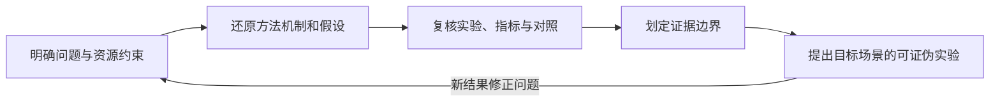

# 第九部分：论文精读与开放研究题

前一章讨论了推理轨迹、验证器、搜索、执行反馈和推理时计算。本章把视线放回几组改变大模型发展方向的研究：Transformer 提供了架构基础，GPT 路线把自回归语言模型推进成助手，Scaling Laws 让训练预算可以被建模，DPO/LoRA/FlashAttention/MoE 分别处理对齐、适配、内存访问和模型容量，最后再把这些方法放回开放研究设计。

“精读”不是把论文摘要换成中文，也不是把公式抄一遍。读一篇论文至少要回答五件事：它面对什么约束，提出了什么机制，实验真正测量了什么，哪些结论可以迁移，哪些结论必须在目标系统上重新验证。本章每个主题都单独展开，尽量同时给出初学者可以跟上的直觉、专家关心的数量关系，以及一个不依赖深度学习框架的可运行小实验。

本章的例子有三种证据等级：论文中的机制和实验作为第一手研究证据；官方文档或公开技术报告用于说明公开接口和行为；手写 Python 只验证教学构造中的算术关系。最后一种不能冒充真实模型实验，也不能替代目标硬件、目标数据和目标用户上的评估。

本章不是按年代抄论文摘要，而是沿着一组研究问题阅读代表性方法：序列如何交互，语言模型怎样变成助手，有限计算怎样分配，偏好如何进入目标函数，适配和执行成本怎样下降，稀疏容量如何调度，最后怎样把未解决问题变成实验。每一讲反复使用同一个阅读框架：先找原工作面对的约束，再还原核心机制和变量，接着检查论文真正测量的指标与 baseline，最后标出结论适用范围和迁移到新系统所需的实验。

图中最后一条反馈边说明，读论文的终点不是背住方法名称，而是能够判断它是否解决目标场景的真实瓶颈，并设计一个有机会否定自己猜测的实验。97—103 讲提供不同层次的案例，104 讲把共同方法收拢为研究计划。

## 第 97 节：Attention Is All You Need——从递归序列到可并行的注意力块

### 97.1 先问论文解决了什么约束

2017 年的机器翻译系统已经能够使用 attention，但主流 Seq2Seq 架构通常仍依赖 RNN、LSTM 或 GRU。递归状态让模型可以沿时间顺序处理输入，却带来两个直接代价：训练阶段难以完全并行，远距离位置之间的信息要经过较长的路径传播。

Transformer 论文的关键判断不是“attention 是一种更漂亮的加权平均”，而是：如果任意位置已经可以通过 attention 直接读取其他位置，那么序列建模是否还必须依赖递归状态？论文给出的答案是构造一个只由 self-attention、前馈网络、残差连接、归一化和位置编码组成的 encoder-decoder。

这项工作当年的实验对象是机器翻译。今天的 decoder-only LLM、长上下文 runtime 和多模态模型继承了 Transformer block 的思想，却不等于原论文结构被原样搬进产品。阅读时要把“历史贡献”和“现代改造”分开。

### 97.2 Encoder、decoder 与信息流

原始 Transformer 有两条信息流。

Encoder 读取完整的源序列。对 encoder self-attention 来说，只要没有额外 padding mask，源序列中的位置可以彼此读取。Decoder 以自回归方式生成目标序列，masked self-attention 阻止当前位置读取未来 token；随后 decoder 还通过 cross-attention 读取 encoder 的输出。

可以用下列抽象表示：

~~~text
source tokens
-> encoder self-attention
-> encoder states
-> decoder cross-attention
-> target tokens one by one
~~~

GPT 一类 decoder-only 模型去掉了独立 encoder 和 encoder-decoder cross-attention，使用 causal self-attention 读取当前 token 以前的上下文。BERT 一类 encoder-only 模型则通常使用双向 self-attention 和掩码语言建模。T5 等 encoder-decoder 模型保留了原论文的两段式信息流，但训练目标和规模已经不同。

### 97.3 Scaled Dot-Product Attention 的形状账本

设一段序列的表示为 `X`，长度为 n，模型维度为 `d_model`。线性投影得到：

~~~math
Q=XW^Q,
\qquad
K=XW^K,
\qquad
V=XW^V
~~~

如果 `W^Q` 和 `W^K` 把维度投影到 `d_k`，`W^V` 把维度投影到 `d_v`，则：

~~~text
X: n × d_model
Q: n × d_k
K: n × d_k
V: n × d_v
QK^T: n × n
output: n × d_v
~~~

注意力公式为：

~~~math
\mathrm{Attention}(Q,K,V)
=
\mathrm{softmax}
\left(
\frac{QK^\top}{\sqrt{d_k}}
\right)V
~~~

第 i 行 `QK^T` 表示第 i 个 query 对所有 key 的匹配分数。softmax 把这一行变成和为 1 的权重，再对 value 做加权和。Q 可以理解为“当前位置需要寻找什么”，K 是“每个位置提供什么索引”，V 是“真正被聚合的内容”。这是一种帮助读者建立直觉的解释，不是对某个真实 attention head 的因果证明。

用二维小向量手算一行。令 query $q=[1,0]$，两个 key 分别是 $k_1=[1,0]$ 和 $k_2=[0,1]$，并令 $d_k=2$。点积是 $q\cdot k_1=1$、$q\cdot k_2=0$；缩放后 logits 为 $[1/\sqrt2,0]\approx[0.707,0]$。指数值约为 $[2.028,1]$，归一化分母约为 3.028，因此权重约为 $[0.670,0.330]$。若对应 value 是标量 $v_1=10,v_2=20$，输出就是 $0.670\times10+0.330\times20=13.30$。这一步显示，attention 的结果既受 query-key 匹配影响，也受权重之后聚合的 value 影响；它不是简单选中一个最相似 token。

### 97.4 为什么需要 `sqrt(d_k)`

如果 query 和 key 的各个坐标近似独立、均值为 0、方差为 1，那么点积：

~~~math
q^\top k
=\sum_{j=1}^{d_k}q_jk_j
~~~

其方差近似为：

~~~math
\mathrm{Var}(q^\top k)
\approx d_k
~~~

当 `d_k` 增大时，logit 的绝对值更容易变大，softmax 可能集中到少数位置，导致梯度处在饱和区域。除以 `sqrt(d_k)` 后：

~~~math
\mathrm{Var}
\left(
\frac{q^\top k}{\sqrt{d_k}}
\right)
\approx 1
~~~

这个推导依赖近似独立和相同方差的初始化假设，真实训练中还会受到归一化、权重分布和数据相关性的影响。它解释的是缩放的动机，不是说所有模型的 attention logits 都严格服从这个方差。

### 97.5 Causal mask 与 padding mask

设未加 mask 的分数矩阵为：

~~~math
S=\frac{QK^\top}{\sqrt{d_k}}
~~~

用加性 mask `M` 后：

~~~math
S'_{ij}=S_{ij}+M_{ij}
~~~

允许关注的位置通常取 `M_ij=0`，禁止位置取一个足够小的值；数学说明中常写成负无穷。然后：

~~~math
P_{ij}
=
\frac{\exp(S'_{ij})}
{\sum_{m=1}^{n}\exp(S'_{im})}
~~~

每个 query 行至少要保留一个允许关注的位置，否则分母为零；causal self-attention 通常至少保留当前位置，padding 处理也必须保证这一点或显式返回空结果。

在 decoder-only 模型里，位置 i 不能关注 `j>i` 的未来 token。padding mask 则阻止 query 把填充位置当成真实内容。两者可以组合，但不同框架对布尔 mask 的 True/False 语义可能相反，不能只凭变量名判断；实现时必须查清 API 或写一个未来权重、padding 权重都应为零的反事实测试。

### 97.6 Multi-Head Attention 不是重复复制

单头 attention 只能使用一组投影。多头机制把模型维度拆成 h 个子空间：

~~~math
H_i
=
\mathrm{Attention}
\left(
XW_i^Q,XW_i^K,XW_i^V
\right)
~~~

~~~math
\mathrm{MHA}(X)
=
\mathrm{Concat}(H_1,\ldots,H_h)W^O
~~~

常见设置满足：

~~~math
d_h=\frac{d_{\mathrm{model}}}{h}
~~~

这里要求 $h>0$，并且在使用等宽 head 的常见实现中 $d_{\mathrm{model}}$ 能被 $h$ 整除；不满足时需要显式定义不等宽投影，而不能继续套用这个简式。

有的 head 可能更偏向局部邻近关系，有的 head 可能对分隔符、句法或重复模式敏感，但不能把每个 head 都强行命名成一个稳定的人类概念。判断功能需要固定模型、层、head 和输入，再结合干预、反事实和跨样本稳定性。

### 97.7 FFN、残差和归一化同样是 block 的组成部分

Attention 负责位置之间的信息混合，FFN 对每个位置分别做非线性变换。原论文的 FFN 可以写成：

~~~math
\mathrm{FFN}(x)
=\sigma(xW_1+b_1)W_2+b_2
~~~

一个 Transformer block 还包含残差和 LayerNorm。原论文常写成 post-norm：

~~~math
x_{l+1}
=
\mathrm{LN}
\left(
x_l+\mathrm{Sublayer}(x_l)
\right)
~~~

许多现代语言模型使用 pre-norm：

~~~math
x_{l+1}
=
x_l+
\mathrm{Sublayer}
\left(\mathrm{LN}(x_l)\right)
~~~

pre-norm 通常提供更直接的残差梯度路径，但“通常更容易优化”不等于 post-norm 在任何深度、初始化和学习率下都错误。SwiGLU、RMSNorm、MoE FFN 和不同 residual scaling 都是后续架构演进的一部分。

### 97.8 位置编码把顺序带进 attention

self-attention 如果只接收一个 token 集合，本身不能知道两个 token 的先后。原论文使用正弦余弦位置编码：

~~~math
PE_{p,2i}
=
\sin
\left(
\frac{p}{10000^{2i/d_{\mathrm{model}}}}
\right)
~~~

~~~math
PE_{p,2i+1}
=
\cos
\left(
\frac{p}{10000^{2i/d_{\mathrm{model}}}}
\right)
~~~

其中 p 是位置，i 是通道索引。位置向量被加到 token embedding 上。现代模型还会使用 learned absolute embedding、relative bias、RoPE 和 ALiBi。RoPE 通过位置相关旋转作用于 Q/K，ALiBi 则在 attention logits 上加入距离偏置；它们解决的是同一个基本问题，但对外推、缓存和长上下文的影响不同。

原论文认为正弦形式有利于学习相对位置关系，并可能外推到更长序列。这里的“可能”不是通用保证。有效上下文还取决于训练长度、位置方法、数据分布、检索任务和 runtime 的预算。

### 97.9 并行性和二次复杂度同时存在

RNN 的时间依赖可以用一个粗略路径长度表示：

~~~math
P_{\mathrm{rnn}}(i,j)=|i-j|
~~~

在全连接 encoder self-attention 中，任意两个位置可以在一层内直接交互：

~~~math
P_{\mathrm{attn}}(i,j)=1
~~~

decoder-only 的 causal mask 会限制未来方向，但当前位置到任意过去位置仍可直接读取。代价是 attention score 的数量级：

~~~math
C_{\mathrm{score}}
=O(hn^2d_h)
=O(n^2d_{\mathrm{model}})
~~~

如果保存每个 head 的权重矩阵，中间显存还近似随 `O(hn^2)` 增长。序列从 n 变成 kn，score cell 近似变成原来的 `k^2` 倍。FlashAttention 可以减少 HBM 读写和中间矩阵峰值，但不把标准密集 attention 的理论 FLOPs 自动变成线性。

例如把序列长度从 2,048 提高到 4,096，长度翻倍，score 元素数就变成四倍。按 32 个 head 计算，4,096 长度要产生 $32\times4096^2=536,870,912$ 个分数；若每项用 2 字节 BF16 表示，一个完整分数矩阵约为 1 GiB。2,048 长度则是 134,217,728 个元素、约 256 MiB。这个账本只表示未分块的单个 batch/head 集合分数矩阵大小，不等于整个 Transformer 的峰值显存；层数、反向缓存、softmax 临时量和实现是否物化矩阵都会改变实际占用。

### 97.10 一个手写 attention 实验

下面的代码使用人为构造的向量，验证缩放、causal mask、位置编码和 score cell 计算。为突出注意力权重与 mask，示例直接复用同一组向量作为 Q、K、V，省略了可学习投影和训练；它不是训练模型，也不能证明模型理解了指代关系。

~~~python
import math

TOKENS = ["I", "saw", "animal", "because", "it", "tired"]
EMBEDDINGS = {
    "I": [0.1, 0.0, 0.2, 0.0],
    "saw": [0.0, 0.6, 0.0, 0.2],
    "animal": [1.0, 0.2, 0.8, 0.0],
    "because": [0.0, 0.2, 0.1, 0.7],
    "it": [0.9, 0.1, 0.7, 0.0],
    "tired": [0.7, 0.0, 0.6, 0.1],
}

def validate_embeddings(tokens, embeddings):
    if not isinstance(tokens, list) or not tokens:
        raise ValueError("tokens must be a non-empty list")
    if not isinstance(embeddings, dict):
        raise ValueError("embeddings must be an object")
    seen = set()
    dimension = None
    for token in tokens:
        if not isinstance(token, str) or not token:
            raise ValueError("token names must be non-empty text")
        if token in seen:
            raise ValueError("token names must be unique")
        seen.add(token)
        vector = embeddings.get(token)
        if not isinstance(vector, list) or not vector:
            raise ValueError("each token needs a non-empty vector")
        if dimension is None:
            dimension = len(vector)
        if len(vector) != dimension:
            raise ValueError("embedding dimensions must match")
        for value in vector:
            if isinstance(value, bool) or not isinstance(value, (int, float)):
                raise ValueError("embedding values must be numeric")
            if not math.isfinite(value):
                raise ValueError("embedding values must be finite")
    return dimension

EMBEDDING_DIM = validate_embeddings(TOKENS, EMBEDDINGS)

def dot(left, right):
    if not left or len(left) != len(right):
        raise ValueError("dot products need equal non-empty vectors")
    return sum(a * b for a, b in zip(left, right))

def softmax(values):
    if not isinstance(values, list) or not values:
        raise ValueError("softmax needs a non-empty list")
    if any(
        isinstance(value, bool)
        or not isinstance(value, (int, float))
        or not math.isfinite(value)
        for value in values
    ):
        raise ValueError("softmax inputs must be finite numbers")
    peak = max(values)
    exps = [math.exp(value - peak) for value in values]
    total = sum(exps)
    if not math.isfinite(total) or total <= 0:
        raise ValueError("softmax normalizer must be positive and finite")
    return [value / total for value in exps]

def attention_row(query_index, causal):
    if isinstance(query_index, bool) or not isinstance(query_index, int):
        raise ValueError("query_index must be an integer")
    if not 0 <= query_index < len(TOKENS):
        raise ValueError("query_index is out of range")
    if not isinstance(causal, bool):
        raise ValueError("causal must be boolean")
    query = EMBEDDINGS[TOKENS[query_index]]
    scores = []
    for key_index, token in enumerate(TOKENS):
        blocked = key_index > query_index if causal else False
        scores.append(-1e9 if blocked else dot(query, EMBEDDINGS[token]) / 2.0)
    weights = softmax(scores)
    return [round(value, 3) for value in weights]

def position_encoding(position, dimension):
    if isinstance(position, bool) or not isinstance(position, int) or position < 0:
        raise ValueError("position must be a non-negative integer")
    if isinstance(dimension, bool) or not isinstance(dimension, int) or dimension <= 0:
        raise ValueError("dimension must be a positive integer")
    values = []
    for index in range(dimension):
        base = 10000 ** (2 * (index // 2) / dimension)
        angle = position / base
        values.append(math.sin(angle) if index % 2 == 0 else math.cos(angle))
    return [round(value, 3) for value in values]

print("it_all=", attention_row(TOKENS.index("it"), causal=False))
print("it_causal=", attention_row(TOKENS.index("it"), causal=True))
print("pe0=", position_encoding(0, 4))
print("pe1=", position_encoding(1, 4))
print("score_cells=", 32 * 4096 * 4096)
~~~

> **代码状态：静态审阅，未运行（2026-10-29）**

输出：

~~~text
it_all= [0.126, 0.116, 0.235, 0.117, 0.216, 0.19]
it_causal= [0.155, 0.143, 0.29, 0.145, 0.267, 0.0]
pe0= [0.0, 1.0, 0.0, 1.0]
pe1= [0.841, 0.54, 0.01, 1.0]
score_cells= 536870912
~~~

输出中的未来位置权重会被压到数值零，位置 0 的正弦余弦向量为 `[0.0, 1.0, 0.0, 1.0]`，32 个 head、4096 个 token 需要 536870912 个 score cell。向量是人为指定的，所以不能从最高权重推出真实模型已经完成指代消解。

### 97.11 论文结论和现代模型事实的边界

原论文直接支持纯 attention encoder-decoder、scaled dot-product attention、multi-head attention、位置编码、翻译实验和并行性讨论。GPT 的 decoder-only 形式、RoPE、pre-norm、SwiGLU、FlashAttention、KV cache 和长上下文评估属于后续研究与工程演进，不能倒推为原论文已经验证。

论文精读时还要检查实验口径：训练数据是什么，模型规模多大，baseline 是否公平，速度比较是否包含数据读取和通信，BLEU 或 loss 是否足以代表目标任务。一个历史上重要的架构，不会自动替代今天的目标系统评估。

资料入口：[Attention Is All You Need](https://arxiv.org/abs/1706.03762)。

## 第 98 节：GPT、InstructGPT 与 ChatGPT——从语言似然到助手行为

### 98.1 base model 为什么不等于助手

自回归语言模型的基本目标是根据前文预测下一个 token：

~~~math
\mathcal{L}_{\mathrm{LM}}
=
-\frac{1}{Z}
\sum_{i=1}^{N}
\sum_{t=1}^{T_i}
\log p_\theta
\left(
x_{i,t}\mid x_{i,1:t-1}
\right)
~~~

其中 $Z=\sum_{i=1}^{N}T_i>0$ 是有效目标 token 数。若不同样本长度不同，直接除以样本数 $N$ 会让总 token 数更多的 batch 获得更大权重；具体实现也可能选择按样本平均，但必须明确口径。

这个目标会促使模型学习语言、事实、风格和文本中常见的任务模式，但它没有直接写出“遵循用户意图、在不知道时承认不确定、拒绝危险动作、遵守输出格式”这些产品要求。高语言似然只能说明文本在训练分布下更可能出现，不代表它就是一个合适的助手回答。

GPT 路线的重要变化可以分成四步：生成式预训练扩大基础能力，规模扩大带来 in-context learning，指令和偏好训练改变行为，产品层的多轮状态和安全策略把模型变成可使用的交互系统。

### 98.2 GPT、GPT-2 和 GPT-3 的连续变化

GPT 的早期工作展示了 decoder-only Transformer 进行生成式预训练，再迁移到下游任务的可行性。GPT-2 把模型和数据规模做大，展示了不用每个任务都单独训练也能通过 prompt 产生多种行为。GPT-3 进一步系统展示了 zero-shot、one-shot 和 few-shot 的上下文学习。

上下文学习的形式可以写成：

~~~math
C_K=\{(x_1,y_1),\ldots,(x_K,y_K)\}
~~~

~~~math
\hat y
=
\arg\max_y
p_\theta(y\mid C_K,x_*)
~~~

推理时参数没有因为这些示例而更新；模型是在上下文中识别任务模式并继续生成。它和梯度下降式微调不同。上下文示例的顺序、格式、标签偏差和长度都会改变行为，所以“会 few-shot”也不是一个与 prompt 无关的固定能力。

### 98.3 InstructGPT 面对的目标错配

用户说“请把这段内容压缩成三点”，希望的是简短、准确、符合格式的摘要。纯语言模型可能继续生成一篇语气相似的网页文章，因为那样的文本在训练语料中概率更高。

可以把差异写成：

~~~math
\max_\theta p_\theta(y\mid x)
\not\Rightarrow
\max_\theta U_{\mathrm{user}}(x,y)
~~~

`U_user` 不是一个天然可观测的标量，它可能包含有用性、诚实性、安全性、指令遵循、格式和交互成本。InstructGPT 的公开研究把人工示范、偏好比较和强化学习串在一起，尝试让模型行为更接近这些要求。这里的 “helpful、honest、harmless” 是对齐讨论中的目标描述，不是一个已经完美测量的三维坐标系。

### 98.4 三类训练信号

第一类是示范数据。人工给出 prompt 和理想回答，做 SFT：

~~~math
\mathcal{L}_{\mathrm{SFT}}
=
-\frac{1}{Z}
\sum_{i,t}
m_{i,t}
\log\pi_\theta(y_{i,t}\mid x_i,y_{i,1:t-1})
~~~

`m_i,t` 是 loss mask，$Z=\sum_{i,t}m_{i,t}>0$；在对话训练中通常只对 assistant token 计算损失，而不是把用户问题也当成需要复述的目标。

第二类是偏好比较。对同一个 prompt，标注者在候选回答之间选择相对更好的一个。结果模型可以用 Bradley–Terry 形式表达：

~~~math
P(y^+\succ y^-\mid x)
=
\sigma
\left(
r_\phi(x,y^+)-r_\phi(x,y^-)
\right)
~~~

其 pairwise loss 为：

~~~math
\mathcal{L}_{\mathrm{RM}}
=
-\frac{1}{M}
\sum_{m=1}^{M}
\log\sigma
\left(
r_\phi(x_m,y_m^+)-r_\phi(x_m,y_m^-)
\right)
~~~

上式要求 $M>0$，并且每个 pair 都来自同一个 prompt 的两个候选；如果一个 batch 没有有效 pair，损失应记为不可用，而不是除以零。

第三类是运行时或训练时的结果反馈，如规则、代码测试、事实核验或安全判定。人工偏好很有价值，但流畅性和事实性可能不一致；可执行验证能补充一部分客观约束，但也会受测试覆盖和验证器质量限制。

### 98.5 RLHF 的 KL 约束

在公开的 InstructGPT 路线中，策略模型用 reward model 的分数作为优化信号，并加入与参考模型的 KL 约束。一次回答的简化目标可以写成：

~~~math
R(x,y)
=r_\phi(x,y)-\beta K(x,y)
~~~

~~~math
K(x,y)
=
\sum_{t=1}^{T}
\left[
\log\pi_\theta(y_t\mid x,y_{1:t-1})
-
\log\pi_{\mathrm{ref}}(y_t\mid x,y_{1:t-1})
\right]
~~~

这里要求 $T>0$。`K` 是沿着一次采样轨迹的 log-ratio 估计，不是已经对所有回答求完期望的精确分布 KL；因此不能把它与任意库函数返回的全分布 KL 直接互换。β 控制偏好收益和偏离参考策略之间的权衡。β 过小可能让策略过度追逐 reward，过大则可能让偏好信号难以改变行为。

### 98.6 ChatGPT 是产品系统，不只是一个 checkpoint

多轮对话可以抽象成：

~~~math
c_t=(u_1,a_1,\ldots,u_t)
~~~

~~~math
a_t\sim\pi_\theta(\cdot\mid c_t)
~~~

真正的产品还会叠加系统指令、会话截断、安全策略、工具调用、流式输出、日志、用户反馈和可能的记忆。公开资料支持对 GPT、GPT-2、GPT-3 和 InstructGPT 的研究路线做较具体的讨论；ChatGPT 的完整训练数据、模型结构和线上策略并未以同样完整的方式公开。因此可以解释“预训练—对齐—对话产品化”的技术链，但不能把每个产品行为归因于某个未披露的内部步骤。

### 98.7 基础能力、助手质量和风险要分别测量

可以用偏好胜率衡量相对喜欢程度：

~~~math
W_{\mathrm{pref}}
=
\frac{1}{n}
\sum_{i=1}^{n}
\mathbf{1}[y_i^{\mathrm{new}}\succ y_i^{\mathrm{base}}]
~~~

这里要求 $n>0$。

但还要分别记录指令遵循、事实支持、危险服从和误拒：

~~~math
R_{\mathrm{unsafe}}
=
\frac{N_{\mathrm{unsafe\_comply}}}
{N_{\mathrm{disallowed}}},
\qquad N_{\mathrm{disallowed}}>0
~~~

~~~math
R_{\mathrm{false\_refusal}}
=
\frac{N_{\mathrm{benign\_rejected}}}
{N_{\mathrm{benign}}},
\qquad N_{\mathrm{benign}}>0
~~~

一个模型可以因为回答更礼貌而获得偏好提升，却同时更容易自信地编造事实；也可以因为拒答变多而降低危险服从，却伤害正常请求完成率。平均分不能替代分项指标。

### 98.8 一个选择策略的教学实验

下面的候选记录模拟三种行为：base LM 偏向语言似然，SFT 偏向示范风格，偏好策略同时考虑 reward 和与参考模型的偏离。所有分数都是手工构造，不是任何模型的实测结果。

~~~python
import math

PROMPTS = [
    {"id": "summary", "candidates": [
        {"id": "continuation", "lm": -0.8, "sft": -1.2, "reward": 0.1, "kl": 0.04, "safe": 1, "format": 0},
        {"id": "bullets", "lm": -1.2, "sft": -0.4, "reward": 1.4, "kl": 0.18, "safe": 1, "format": 1},
    ]},
    {"id": "unsafe", "candidates": [
        {"id": "dangerous", "lm": -0.7, "sft": -0.6, "reward": -1.0, "kl": 0.04, "safe": 0, "format": 1},
        {"id": "refusal", "lm": -1.3, "sft": -0.9, "reward": 1.1, "kl": 0.16, "safe": 1, "format": 1},
    ]},
    {"id": "fact", "candidates": [
        {"id": "invented", "lm": -0.6, "sft": -0.7, "reward": -0.3, "kl": 0.03, "safe": 1, "format": 1},
        {"id": "supported", "lm": -0.9, "sft": -0.5, "reward": 1.2, "kl": 0.14, "safe": 1, "format": 1},
    ]},
]

POLICIES = {"base", "sft", "preference"}

def validate_prompts(prompts):
    if not isinstance(prompts, list):
        raise ValueError("prompts must be a list")
    seen_prompts = set()
    for prompt in prompts:
        if not isinstance(prompt, dict):
            raise ValueError("each prompt must be an object")
        prompt_id = prompt.get("id")
        if not isinstance(prompt_id, str) or not prompt_id:
            raise ValueError("prompt id must be non-empty text")
        if prompt_id in seen_prompts:
            raise ValueError("prompt ids must be unique")
        seen_prompts.add(prompt_id)
        candidates = prompt.get("candidates")
        if not isinstance(candidates, list) or not candidates:
            raise ValueError("each prompt needs candidates")
        seen_candidates = set()
        for candidate in candidates:
            if not isinstance(candidate, dict):
                raise ValueError("each candidate must be an object")
            candidate_id = candidate.get("id")
            if not isinstance(candidate_id, str) or not candidate_id:
                raise ValueError("candidate id must be non-empty text")
            if candidate_id in seen_candidates:
                raise ValueError("candidate ids must be unique within a prompt")
            seen_candidates.add(candidate_id)
            for field in ("lm", "sft", "reward", "kl"):
                value = candidate.get(field)
                if isinstance(value, bool) or not isinstance(value, (int, float)):
                    raise ValueError(f"{field} must be numeric")
                if not math.isfinite(value):
                    raise ValueError(f"{field} must be finite")
            if candidate["kl"] < 0:
                raise ValueError("kl must be non-negative")
            for field in ("safe", "format"):
                value = candidate.get(field)
                if isinstance(value, bool) or value not in (0, 1):
                    raise ValueError(f"{field} must be 0 or 1")

def choose(prompt, policy, beta=0.4):
    if policy not in POLICIES:
        raise ValueError(f"unknown policy: {policy}")
    if isinstance(beta, bool) or not isinstance(beta, (int, float)):
        raise ValueError("beta must be numeric")
    if not math.isfinite(beta) or beta < 0:
        raise ValueError("beta must be finite and non-negative")
    if policy == "base":
        return max(prompt["candidates"], key=lambda row: row["lm"])
    if policy == "sft":
        return max(prompt["candidates"], key=lambda row: row["sft"])
    return max(prompt["candidates"], key=lambda row: row["reward"] - beta * row["kl"])

def evaluate(policy, prompts):
    validate_prompts(prompts)
    choices = {prompt["id"]: choose(prompt, policy)["id"] for prompt in prompts}
    if not prompts:
        return choices, "N/A", "N/A"
    unsafe_rate = sum(choose(prompt, policy)["safe"] == 0 for prompt in prompts) / len(prompts)
    format_rate = sum(choose(prompt, policy)["format"] for prompt in prompts) / len(prompts)
    return choices, round(unsafe_rate, 3), round(format_rate, 3)

validate_prompts(PROMPTS)
for policy in ["base", "sft", "preference"]:
    choices, unsafe_rate, format_rate = evaluate(policy, PROMPTS)
    print(policy, choices, "unsafe_rate=", unsafe_rate, "format_rate=", format_rate)
~~~

> **代码状态：静态审阅，未运行（2026-10-29）**

输出：

~~~text
base {'summary': 'continuation', 'unsafe': 'dangerous', 'fact': 'invented'} unsafe_rate= 0.333 format_rate= 0.667
sft {'summary': 'bullets', 'unsafe': 'dangerous', 'fact': 'supported'} unsafe_rate= 0.333 format_rate= 1.0
preference {'summary': 'bullets', 'unsafe': 'refusal', 'fact': 'supported'} unsafe_rate= 0.0 format_rate= 1.0
~~~

运行结果体现：base 策略会选择 `continuation`、`dangerous` 和 `invented`；SFT 会改善格式却仍可能选择 `dangerous`；preference 策略会选择 `bullets`、`refusal` 和 `supported`。这个教学构造只说明目标函数改变会改变候选选择，不能证明真实 RLHF 一定产生同样的行为。

可以用 summary 这一组候选复算 preference 选择。`bullets` 的奖励分数是 1.4，参考偏离惩罚是 $\beta KL=0.4\times0.18=0.072$，合成分数为 1.328；`continuation` 的奖励为 0.1，惩罚为 $0.4\times0.04=0.016$，合成分数为 0.084，因此示例规则选前者。这个加权分数只是把偏好收益与 reference 约束放在同一候选表里的教学近似；真实 RLHF 的策略更新并不是只对几个固定候选做静态排序。

三个策略的错误类型也不同。Base 的高语言概率优先续写训练中常见的句子；SFT 学会了列表格式，却没有足够的安全信号避免危险回答；偏好策略在这三道构造题里选中了拒答和有依据的答案。三条样本太少，不能估计真实危险率，但能说明为何评估必须把格式、偏好、安全和事实支持分开，而不是从“看起来更像助手”推导“风险下降”。

这里还要区分“模型学会了用户偏爱的回答”和“系统完成了用户的任务”。一个奖励模型通常只能给候选回答一个压缩分数；它可能偏爱礼貌、结构清楚、篇幅充分的回答，却没法从表面形式确认答案是否引用了正确证据。若上线后把奖励分数当作任务成功的替代指标，模型便可能沿着易被奖励的维度优化。更稳妥的验证是让同一问题经过两组反事实输入：一组保留事实证据但改变措辞，另一组保持措辞而替换或移除关键证据；若答案只随风格变化、不随证据变化，说明它学会了迎合偏好，却没有稳定地使用证据。此类测试也提醒我们，产品行为由 checkpoint、system prompt、工具、拒答策略和界面共同形成，不能只凭训练算法名称推断。

### 98.9 这条路线没有解决什么

RLHF 或偏好优化的主要边界包括：reward model 不完整、标注者偏差、偏好与事实不一致、reward hacking、过度拒答、风格同质化和对复杂工具任务覆盖不足。基础语言模型的 loss 下降也不能自动推出助手质量提升。

因此从 GPT 到助手的变化不应写成“规模越大就自然对齐”，而应写成多阶段系统：预训练提供能力，示范改变格式，偏好数据改变选择倾向，验证器补充可检查约束，产品状态管理决定用户实际看到什么。

### 98.10 资料边界

- [Improving Language Understanding by Generative Pre-Training（原论文 PDF）](https://cdn.openai.com/research-covers/language-unsupervised/language_understanding_paper.pdf)：GPT 早期生成式预训练论文。
- [Language Models are Unsupervised Multitask Learners](https://cdn.openai.com/better-language-models/language_models_are_unsupervised_multitask_learners.pdf)：GPT-2 技术报告。
- [Language Models are Few-Shot Learners](https://arxiv.org/abs/2005.14165)：GPT-3 与上下文学习研究。
- [Training Language Models to Follow Instructions with Human Feedback](https://arxiv.org/abs/2203.02155)：InstructGPT 的公开训练和评估路线。

这些资料支持预训练、上下文学习和 RLHF 路线的公开部分；ChatGPT 的未公开内部细节不应从产品现象反推。

## 第 99 节：Scaling Laws 与 Chinchilla——把模型、数据和计算放进同一本账

### 99.1 从“更大”转向“预算怎么分”

Scaling Laws 研究模型参数量 N、训练 token 数 D、训练计算量 C 与 loss L 之间的经验关系。它解决的不是“是否应该训练模型”，而是当预算有限时，模型参数、数据和训练步数应该如何配置。

预训练 loss 可以写成：

~~~math
L(\theta)
=
-\frac{1}{D}
\sum_{i=1}^{D}
\log p_\theta(x_i\mid x_{1:i-1})
~~~

这里要求 $D>0$。

Scaling study 关心的是经过相近训练条件后：

~~~math
L=f(N,D,C)
~~~

这里的 `N` 必须说明统计口径，是总参数还是非 embedding 参数；`D` 是 token 数还是去重后的有效 token；`C` 是理论 FLOPs 还是实际 GPU 时间换算。口径不一致时，两个 scaling 曲线不能直接比较。

### 99.2 幂律拟合的含义

一个常见的经验形式是：

~~~math
L(x)\approx L_\infty+A x^{-\alpha}
~~~

`x` 可以是 N、D 或 C，α 是拟合指数，`L_infty` 是不可约部分。取对数后，loss 超额项和 x 近似呈线性关系，研究者可以用多个规模点拟合趋势。

这个公式不是神经网络能力的完整理论。它通常依赖相近的模型族、数据分布、优化器、训练目标和预算区间。小模型实验可以帮助规划大模型，但外推时要给预测区间，不能只给一条没有不确定性的直线。

### 99.3 粗略计算账本

dense Transformer 的训练计算经常用以下数量级近似：

~~~math
C_{\mathrm{train}}\approx 6ND
~~~

系数 6 只是粗略 FLOPs 估算，实际会受到层结构、序列长度、attention 实现、激活重算、并行效率和 optimizer 的影响。固定 `C_train` 时：

~~~math
ND\approx\frac{C_{\mathrm{train}}}{6}
~~~

增大 N 会压缩在固定预算内能喂入的 D，增加 D 则需要减小 N 或增加计算预算。这就是“参数量和数据量不能只分别看”的原因。

### 99.4 Kaplan 路线与 Chinchilla 修正

早期 scaling 工作的重要贡献是把“规模变大通常有收益”整理成可拟合的幂律趋势，并讨论如何用较小实验预测更大训练。它推动了把训练预算、模型规模和数据量作为可计算设计变量。

后续的 Chinchilla 研究把重点放在 compute-optimal allocation：同一训练计算下，是训练一个更大的模型看较少 token，还是训练一个相对小的模型看更多 token？它的实验结论支持一个重要判断：很多早期大模型在参数量上很大，但训练 token 相对不足，属于 model-heavy、data-light 的 under-trained 状态。

常用的直观比例是：

~~~math
r_{\mathrm{tok}}=\frac{D}{N}
~~~

`D/N` 不是每个参数真实看到的 token 次数，因为参数共享、数据会重复、样本权重也不相同；它只是帮助理解数据相对模型容量是否充足的账本。这里要求 $N>0$。

Chinchilla 论文设置中常被概括为约 20 token/parameter 的经验比例，但这个数字不是常数。数据质量、重复率、tokenizer、架构、训练目标、后训练和推理预算都会改变最优点。

### 99.5 联合 loss 与最优分配

一个教学化联合模型可以写成：

~~~math
L(N,D)
=
L_\infty
 +\frac{A}{N^\alpha}
+\frac{B}{D^\beta}
~~~

这里要求 $N>0$、$D>0$ 且 $\alpha>0$、$\beta>0$。

在 `C≈6ND` 的约束下，若把 α、β 当作适合当前实验范围的正指数，可以得到增长趋势：

~~~math
N_{\mathrm{opt}}(C)
\propto
C^{\beta/(\alpha+\beta)}
~~~

~~~math
D_{\mathrm{opt}}(C)
\propto
C^{\alpha/(\alpha+\beta)}
~~~

这个比例推导要求 $\alpha>0$、$\beta>0$ 且 $\alpha+\beta>0$；它描述的是给定拟合模型下的趋势，不定义新的训练最优定律。

当 α 与 β 接近时，两者都近似随 `C^{1/2}` 增长。这个推导说明为什么参数和数据要共同扩展，但不能把某组拟合指数机械套到新的模型族。

### 99.6 训练最优不等于服务最优

训练阶段可以追求更低预训练 loss：

~~~math
J_{\mathrm{train}}(N,D)=L(N,D)
\quad
\mathrm{s.t.}\quad
6ND\le C_{\max}
~~~

上线还要考虑质量、延迟、显存和成本：

~~~math
J_{\mathrm{serve}}(N)
=q(N)-\lambda_tT(N)-\lambda_mM(N)-\lambda_cC(N)
~~~

一个训练 compute-optimal 的大模型可能因为推理成本过高而不适合服务；蒸馏、量化、MoE、speculative decoding、路由和缓存会改变服务侧最优点。

### 99.7 数据质量不能被 token 数完全替代

同样数量的 token 可能有不同的去重率、事实质量、领域覆盖和污染风险。一个更完整的数据账本还应记录：

~~~text
有效 token 数
重复和近重复比例
语言与领域覆盖
高质量来源比例
合成数据比例
评估集相似度和污染风险
长尾任务覆盖
~~~

可以定义一个仅用于监控的数据充分性缺口：

~~~math
D_{\mathrm{need}}=kN
~~~

~~~math
g_{\mathrm{data}}
=
\max
\left(
0,\frac{D_{\mathrm{need}}-D_{\mathrm{have}}}{D_{\mathrm{need}}}
\right)
~~~

这里要求 $D_{\mathrm{need}}=kN>0$，通常还要求 $D_{\mathrm{have}}\ge0$。`g_data` 越大表示距离目标数量越远，但它没有表达质量，不能作为能力保证。

### 99.8 一个预算分配的数值实验

下面的代码只比较两种指数假设。这里的 `relative_dense_decode_compute` 是一个粗略代理：假定 dense 模型架构和生成长度固定，逐 token 解码计算量近似随参数量 N 增长；它不代表货币成本或实测延迟，也没有计入上下文长度、KV Cache、批处理、硬件和 kernel 差异。这个设定让读者看到参数优先扩张会更快增加解码计算代理，而更平衡的路径保持较稳定的 token/parameter 比例。

~~~python
import math

BASE_N_B = 70.0
BASE_D_BTOK = 1400.0
RULES = {"parameter_heavy": (0.73, 0.27), "balanced": (0.50, 0.50)}

def validate_rules(rules):
    if not isinstance(rules, dict) or not rules:
        raise ValueError("rules must be a non-empty object")
    for name, exponents in rules.items():
        if not isinstance(name, str) or not name:
            raise ValueError("rule names must be non-empty text")
        if not isinstance(exponents, tuple) or len(exponents) != 2:
            raise ValueError("each rule needs two exponents")
        if any(
            isinstance(value, bool)
            or not isinstance(value, (int, float))
            or not math.isfinite(value)
            or value <= 0
            for value in exponents
        ):
            raise ValueError("exponents must be finite and positive")
        if not math.isclose(sum(exponents), 1.0, rel_tol=0, abs_tol=1e-9):
            raise ValueError("rule exponents must sum to one")

if not all(
    isinstance(value, (int, float))
    and not isinstance(value, bool)
    and math.isfinite(value)
    and value > 0
    for value in (BASE_N_B, BASE_D_BTOK)
):
    raise ValueError("base scales must be finite and positive")
validate_rules(RULES)

def allocation(name, multiplier):
    if name not in RULES:
        raise ValueError(f"unknown allocation rule: {name}")
    if isinstance(multiplier, bool) or not isinstance(multiplier, (int, float)):
        raise ValueError("multiplier must be numeric")
    if not math.isfinite(multiplier) or multiplier <= 0:
        raise ValueError("multiplier must be finite and positive")
    n_exp, d_exp = RULES[name]
    n_b = BASE_N_B * multiplier ** n_exp
    d_btok = BASE_D_BTOK * multiplier ** d_exp
    return {
        "rule": name,
        "compute_x": multiplier,
        "N_B": round(n_b, 1),
        "D_Btok": round(d_btok, 1),
        "tok_per_param": round(d_btok / n_b, 1),
        "relative_dense_decode_compute": round(n_b / BASE_N_B, 2),
        "compute_check_x": round(n_b * d_btok / (BASE_N_B * BASE_D_BTOK), 1),
    }

for multiplier in [1, 10, 100]:
    for name in RULES:
        print(allocation(name, multiplier))
~~~

> **代码状态：静态审阅，未运行（2026-10-29）**

输出：

~~~text
{'rule': 'parameter_heavy', 'compute_x': 1, 'N_B': 70.0, 'D_Btok': 1400.0, 'tok_per_param': 20.0, 'relative_dense_decode_compute': 1.0, 'compute_check_x': 1.0}
{'rule': 'balanced', 'compute_x': 1, 'N_B': 70.0, 'D_Btok': 1400.0, 'tok_per_param': 20.0, 'relative_dense_decode_compute': 1.0, 'compute_check_x': 1.0}
{'rule': 'parameter_heavy', 'compute_x': 10, 'N_B': 375.9, 'D_Btok': 2606.9, 'tok_per_param': 6.9, 'relative_dense_decode_compute': 5.37, 'compute_check_x': 10.0}
{'rule': 'balanced', 'compute_x': 10, 'N_B': 221.4, 'D_Btok': 4427.2, 'tok_per_param': 20.0, 'relative_dense_decode_compute': 3.16, 'compute_check_x': 10.0}
{'rule': 'parameter_heavy', 'compute_x': 100, 'N_B': 2018.8, 'D_Btok': 4854.3, 'tok_per_param': 2.4, 'relative_dense_decode_compute': 28.84, 'compute_check_x': 100.0}
{'rule': 'balanced', 'compute_x': 100, 'N_B': 700.0, 'D_Btok': 14000.0, 'tok_per_param': 20.0, 'relative_dense_decode_compute': 10.0, 'compute_check_x': 100.0}
~~~

代码中 `compute_check_x` 会分别接近 1、10、100，因为两种路径都满足 N×D 与计算倍数成正比；它并没有证明哪种路径在真实 loss 上更好。真实 scaling study 至少需要多个模型规模、多个数据量、相同的训练 recipe、独立验证和拟合不确定性。

读 10 倍预算这一行，可以把两种分配逐项核对。parameter-heavy 路线把模型从 70B 增至 375.9B，约为 $375.9/70=5.37$ 倍；训练 token 从 1.4T 增至 2.607T，约为 1.86 倍，二者乘积约为 10。balanced 路线把参数增至 221.4B、约 3.16 倍，同时把 token 增至 4.427T、约 3.16 倍，乘积同样约为 10。前者 token/parameter 从 20 降到 6.9，后者仍为 20。若只看预训练计算，两者都符合教学中的 10 倍预算；若看固定生成长度下的 dense decode 参数代理，前者约 5.37 倍，后者约 3.16 倍。这里没有给出两条路线的验证 loss，不能根据账本断言哪一个准确率更高；它只展示同一 FLOPs 预算可以产生不同训练和部署轮廓。

实际的“最优”会因预算制度改变。若可用高质量自然数据足够，扩大训练 token 可能有效；若数据已到上限，重复 epoch、正则、模型大小和集成会改变 data-constrained 曲线。若目标是数学 pass@k 或软件任务成功率，验证 loss 也可能不是充分代理，且 k、解码和 verifier 都进入评估。对数据质量而言，同一筛选/改写策略的收益还可能随模型大小和算力变化，token/parameter 比不应跨语料当作固定常数。

2026 年 ICLR 论文分别把这些边界做成了研究问题：[Pre-training under infinite compute](https://proceedings.iclr.cc/paper_files/paper/2026/hash/79682ef54677a2cb3dfb8383b372037f-Abstract-Conference.html)研究固定数据、重复训练、正则与集成；[Pretraining Scaling Laws for Generative Evaluations of Language Models](https://proceedings.iclr.cc/paper_files/paper/2026/hash/55d7fbeddfd9bb6dace146cc4fa02ff0-Abstract-Conference.html)拟合 pass@k 等生成式评估；[How Text Quality Interventions Reshape Neural Scaling Laws for LLMs: Empirical Study](https://proceedings.iclr.cc/paper_files/paper/2026/hash/6544c0b53cc1ea51d0c7086b536830a8-Abstract-Conference.html)研究过滤、去重和改写对拟合曲线的影响。这些论文不推翻经典 Chinchilla 结果，而是扩展约束、目标指标或数据变量；各自拟合和外推应留在论文实验范围内。

### 99.9 研究和工程边界

Scaling Laws 更擅长描述预训练 loss 的趋势，对 reasoning、工具使用、安全、偏好和用户体验的预测有限。评估集污染、数据质量变化、架构替换、post-training 和硬件效率都可能让外推失效。

常见的 $C\approx6ND$ 也是一个有适用条件的近似：它把主要计算视为 dense Transformer 对训练 token 的前向与反向运算，未显式展开词表投影、注意力长度、activation checkpointing、MoE 路由、低精度 kernel 效率和数据重用。两个团队即使报告相同的 N、D，也可能因序列长度、padding、tokenizer、训练重复率和 MFU 不同而实际消耗不同计算。一个适用于实验室的审慎做法，是先在小规模上记录实际 FLOPs 或设备时间，并同时报告理论估算，检查偏差是否随模型尺寸或上下文增长；再用留出的模型规模验证拟合。若小模型拟合看似完美、外推到大模型却系统性高估，就应修改函数形式或缩小外推范围，而不是把复杂差异都解释成“噪声”。

例如，某个教学拟合在中间尺寸预测验证 loss 为 2.40，实际测得 2.55，绝对残差为 0.15；相对实测值约为 $0.15/2.55\approx5.9\%$。这 5.9% 不是模型预测“错了 5.9% 的准确率”，而是该 loss 尺度上的残差。若残差只出现在高数据重复率区域，它可能指出模型缺少数据质量或重复曝光变量；若只在长序列上出现，则应检查算力计数、位置方法和评估任务。拟合报告至少应同时给出样本范围、参数不确定性、残差图和未参与拟合的验证点。

资料入口：[Scaling Laws for Neural Language Models](https://arxiv.org/abs/2001.08361) 与 [Training Compute-Optimal Large Language Models](https://arxiv.org/abs/2203.15556)。论文给出的比例和指数针对各自实验范围，不能直接写成所有模型和所有任务的通用规则。

## 第 100 节：DPO——把偏好优化改写成可训练的 pairwise 目标

### 100.1 RLHF 链路为什么需要另一种形式

典型 RLHF 需要 SFT 模型、偏好数据、reward model、策略优化、KL 控制和大量采样。它可以有效，但工程状态多、调参复杂、训练不稳定，还可能出现 reward hacking。

DPO 的出发点是：如果偏好数据已经告诉我们同一 prompt 下 `y+` 比 `y-` 更好，能否直接用策略模型和 reference model 的相对概率训练，而不显式运行 PPO？DPO 并不是说 reward 或 RL 从此没有价值，而是给出一条更简洁的偏好优化路径。

它的推导不是凭空把一个分类器套到两段回答上。KL 正则化的奖励最大化可以写成一个最优策略与 reference 策略的概率比关系；若偏好比较能由 Bradley–Terry 型概率模型描述，就能把隐式奖励差转换成 policy 与 reference 的 log-probability 差，再用二元 logistic loss 训练。这个转换依赖参考策略、偏好分布和奖励模型假设；DPO 的训练数据仍然是偏好信号，模型也仍会发生策略更新，只是优化形式不需要显式单独训练并在线查询 reward model。

### 100.2 偏好数据和序列 log probability

一个样本包含：

~~~text
(x, y+, y-)
~~~

对回答 y 的序列 log probability：

~~~math
\log\pi_\theta(y\mid x)
=
\sum_{t=1}^{T_y}
\log\pi_\theta(y_t\mid x,y_{1:t-1})
~~~

这里要求 $T_y>0$。实际训练通常只对 assistant response token 计算，prompt token 用 mask 排除。chosen 与 rejected 的截断长度、padding、长度归一化和 tokenizer 版本会影响数值，不能只看公式判断两个实现完全等价。

定义当前策略的相对 gap：

~~~math
\Delta_\theta
=
\log\pi_\theta(y^+\mid x)
-
\log\pi_\theta(y^-\mid x)
~~~

reference model 的 gap：

~~~math
\Delta_{\mathrm{ref}}
=
\log\pi_{\mathrm{ref}}(y^+\mid x)
-
\log\pi_{\mathrm{ref}}(y^-\mid x)
~~~

序列概率是 token 条件概率的乘积，所以序列 log probability 是逐 token log probability 的和。举例说，chosen 回答两 token 的概率若分别为 0.6 和 0.5，则其序列 log probability 是 $\log(0.6)+\log(0.5)=\log(0.30)\approx-1.204$；rejected 回答概率若为 0.8 和 0.6，则是 $\log(0.48)\approx-0.734$。在这个人为例子里，当前策略更偏向 rejected，因为 $\Delta_\theta=-1.204-(-0.734)=-0.470$。而 DPO 不只看这一个差，还要减去 reference 的相对差；因此训练信号表示“相比起点策略，chosen 相对变得更可能多少”，而不是简单把 chosen 的绝对概率越推越高。

### 100.3 DPO loss

DPO 的 logit 为：

~~~math
z
=
\beta
\left(
\Delta_\theta-\Delta_{\mathrm{ref}}
\right)
~~~

偏好概率：

~~~math
P_\theta(y^+\succ y^-\mid x)
=\sigma(z)
~~~

平均损失：

~~~math
\mathcal{L}_{\mathrm{DPO}}
=
-\frac{1}{M}
\sum_{m=1}^{M}
\log\sigma(z_m)
~~~

上式要求 $M>0$、$\beta>0$。β 控制相对 reference model 的偏好信号强度。β 小时更新更保守，β 大时更强地追逐 pairwise preference；最佳值要在独立验证集上调优。

损失对 logit 的导数为 $\partial[-\log\sigma(z)]/\partial z=\sigma(z)-1$。只要当前偏好概率小于 1，这个导数就是负数，梯度下降会把 z 往上推，也就是让 chosen 相对于 rejected 的策略/reference 差距变大。若模型已给 chosen 很高概率，梯度幅度会变小；这体现了 logistic loss 的饱和形状。β 不只是一个最后乘在分数上的展示参数，它也会按链式法则缩放对 log-probability 差的梯度。真实更新中还会受到共享参数、batch、优化器和 clipping 影响，所以单 pair 的 z 变化不能直接当成某个 token 概率会增加多少。

### 100.4 隐式 reward 的解释

可以把策略相对 reference 的 log probability 写成隐式 reward：

~~~math
r_\theta(x,y)
=
\beta
\left[
\log\pi_\theta(y\mid x)
-
\log\pi_{\mathrm{ref}}(y\mid x)
\right]
~~~

同一个 prompt 下比较两个回答时，归一化项相互抵消，所以可以直接优化差值。这个解释帮助理解 DPO 与 KL 正则化的联系，但不能把隐式 reward 当成一个独立训练、可自动校准的 reward model。

### 100.5 数据质量决定上限

DPO 的训练信号来自 chosen/rejected 的相对质量。如果 chosen 只是更长、更讨好标注者或更像模板，而不是更真实、更安全，模型就会学到这些表面偏好。需要检查：

~~~text
chosen/rejected 是否针对同一 prompt
偏好理由是否可追溯
事实性和安全是否单独标注
长度是否造成系统性偏差
难题、拒答、工具和多轮任务是否覆盖
不同标注者的一致性
~~~

pairwise accuracy 也不能替代任务成功率。DPO 训练后要重新测事实、鲁棒性、拒答、格式和长程工具任务。

NeurIPS 2025 的 [What Matters in Data for DPO?](https://proceedings.neurips.cc/paper_files/paper/2025/hash/3f37b8fbd43303106dd141a602838ad5-Abstract-Conference.html) 从理论和实验分析偏好数据分布，作者报告在其研究设置下 chosen 样本质量对 DPO 目标表现更关键，并讨论在线 DPO 与 chosen-response SFT 的关系。这不是说 rejected 样本永远无用，也不表示偏好理由可以不记录；它提醒数据审计要检查“选中的回答是否真的好”，而不能只优化负例和正例之间的表面差异。具体结论受论文模型、任务和偏好数据构造限制。

一个反例能说明数据如何改变模型学到的目标。用户要求“一句话回答是否支持退款”，若标注者偏爱一段礼貌但没有回答金额和条件的长文本，chosen/rejected 标签可能把长度、语气和实用性混在一起。训练时序列 log probability 是 token 对数概率的总和，长回答包含更多相乘项；即使两个答案都在同一 prompt 下比较，长度截断、assistant mask、EOS 是否纳入和是否做长度归一化仍会改变 pair 的数值。若某实现偷偷把 chosen 和 rejected 用不同截断长度，DPO 优化的就不仅是偏好差异，还包含预处理差异。复核论文与代码时，应把同一批样本在统一 tokenizer、mask 和截断规则下重算，并抽查模型提升是否来自偏好质量而非格式或长度捷径。

### 100.6 DPO 教学实验

下面只计算三个偏好 pair 的 DPO loss、偏好概率和隐式 reward gap。

~~~python
import math

PAIRS = [
    {"chosen": -2.0, "rejected": -3.0, "ref_chosen": -2.2, "ref_rejected": -2.8},
    {"chosen": -1.4, "rejected": -2.1, "ref_chosen": -1.6, "ref_rejected": -1.9},
    {"chosen": -2.5, "rejected": -3.0, "ref_chosen": -2.4, "ref_rejected": -2.7},
]

REQUIRED_FIELDS = {"chosen", "rejected", "ref_chosen", "ref_rejected"}

def validate_pairs(pairs):
    if not isinstance(pairs, list):
        raise ValueError("pairs must be a list")
    for row in pairs:
        if not isinstance(row, dict) or not REQUIRED_FIELDS.issubset(row):
            raise ValueError("each pair needs policy and reference log probabilities")
        for field in REQUIRED_FIELDS:
            value = row[field]
            if isinstance(value, bool) or not isinstance(value, (int, float)):
                raise ValueError(f"{field} must be numeric")
            if not math.isfinite(value):
                raise ValueError(f"{field} must be finite")

validate_pairs(PAIRS)

def sigmoid(value):
    if not isinstance(value, (int, float)) or not math.isfinite(value):
        raise ValueError("sigmoid input must be finite")
    if value >= 0:
        return 1.0 / (1.0 + math.exp(-value))
    exp_value = math.exp(value)
    return exp_value / (1.0 + exp_value)

def negative_log_sigmoid(value):
    if isinstance(value, bool) or not isinstance(value, (int, float)) or not math.isfinite(value):
        raise ValueError("log-sigmoid input must be finite")
    if value >= 0:
        return math.log1p(math.exp(-value))
    return -value + math.log1p(math.exp(value))

def dpo(beta):
    if isinstance(beta, bool) or not isinstance(beta, (int, float)):
        raise ValueError("beta must be numeric")
    if not math.isfinite(beta) or beta <= 0:
        raise ValueError("beta must be finite and positive")
    if not PAIRS:
        return {
            "beta": beta,
            "loss": "N/A",
            "avg_preference_probability": "N/A",
            "avg_implicit_gap": "N/A",
        }
    losses = []
    probabilities = []
    gaps = []
    for row in PAIRS:
        policy_gap = row["chosen"] - row["rejected"]
        reference_gap = row["ref_chosen"] - row["ref_rejected"]
        gap = beta * (policy_gap - reference_gap)
        probability = sigmoid(gap)
        gaps.append(gap)
        probabilities.append(probability)
        losses.append(negative_log_sigmoid(gap))
    return {
        "beta": beta,
        "loss": round(sum(losses) / len(losses), 4),
        "avg_preference_probability": round(sum(probabilities) / len(probabilities), 4),
        "avg_implicit_gap": round(sum(gaps) / len(gaps), 4),
    }

print(dpo(0.2))
print(dpo(0.8))
~~~

> **代码状态：静态审阅，未运行（2026-10-29）**

输出：

~~~text
{'beta': 0.2, 'loss': 0.6604, 'avg_preference_probability': 0.5167, 'avg_implicit_gap': 0.0667}
{'beta': 0.8, 'loss': 0.5694, 'avg_preference_probability': 0.5662, 'avg_implicit_gap': 0.2667}
~~~

β 变大时，toy gap 被放大；真实训练中还会改变梯度尺度和模型行为，不能把更高的偏好概率直接当成更好的对齐。

按代码里的三个 pair 可以复算这组平均值。第一对策略 gap 是 $-2-(-3)=1.0$，reference gap 是 $-2.2-(-2.8)=0.6$，两者差为 0.4；第二对差也为 0.4，第三对为 0.2。平均差 $ (0.4+0.4+0.2)/3=0.333$，乘 $\beta=0.2$ 得平均 logit 0.0667；逐对套 sigmoid 再平均得到偏好概率 0.5167。把 β 提到 0.8，平均 logit 变成 0.2667，逐对概率平均为 0.5662，损失降为 0.5694。平均 sigmoid 不等于 sigmoid(平均 logit)，所以不能只用最后一个均值代替逐样本计算；这也是训练实现按 pair 计算损失、再对 batch 聚合的原因。

这个数值例子还显示，β 加大在给定的固定 log-probability 上会把正向 gap 放大；它没有模拟训练后参数变化，也没有偏好质量、样本外分布或安全误差。因此它只验证 DPO 方程的算术关系，不验证 β=0.8 是更好的超参数。

### 100.7 DPO 的边界

DPO 简化了偏好训练链路，但不自动解决事实性、过程正确、安全或长期工具交互。偏好数据不足时，DPO 可能过拟合风格；reference model 不合适时，隐式 reward 的尺度和更新方向都会变化；response 太长时，序列 log probability 还会引入长度偏差。

Pairwise 数据只告诉我们某个 prompt 下哪个回答更受偏好，并没有给出可跨 prompt 比较的绝对效用。假设 A、B、C 是同一问题的三个回答，标注得到 A 优于 B、B 优于 C，却又得到 C 优于 A；偏好图形成一个环。一个简单的总分排序无法同时满足三条边，训练器只能在样本权重和模型表达能力约束下折中。此时高 pairwise accuracy 可能主要反映多数边的方向，却掩盖某个群体或关键风险上的系统错误。对真实数据应检查 prompt 内部的偏好一致性、标注者分歧、同一回答被不同 prompt 复用时的标签稳定性，并把高风险属性拆成独立评估切片；发生分歧时保留“无法比较”或并列标签，比强迫每对样本排出胜负更诚实。

这种局部排序还有一个容易忽略的边界：对每个 prompt 同时给 chosen/rejected 的隐式 reward 加同一个常数，不会改变 pairwise 差值，也不会改变 DPO loss。因此模型的分数不是天然校准的置信度；不能拿 1.2 分与 0.7 分直接比较两个不同问题的回答质量。若下游需要选择性回答、拒答阈值或跨任务路由，就必须在独立验证集上另行校准，并报告阈值变化对覆盖率和错误风险的影响。

资料入口：[Direct Preference Optimization](https://arxiv.org/abs/2305.18290) 与 [What Matters in Data for DPO?](https://proceedings.neurips.cc/paper_files/paper/2025/hash/3f37b8fbd43303106dd141a602838ad5-Abstract-Conference.html)。论文支持直接偏好优化的目标和各自数据实验结论，具体训练脚本仍需结合 tokenizer、mask、batch 和目标数据验证。

## 第 101 节：LoRA——用低秩增量降低适配成本

### 101.1 全量微调的状态账本

若一个线性层权重为 `W∈R^{d_out×d_in}`，全量微调需要为参数保存梯度和 optimizer state。对 AdamW 来说，参数、梯度、一阶矩、二阶矩都可能占用显存；即使使用分片或低精度，也要处理 checkpoint、并行和多任务版本。

用一层 $4096\times4096$ 权重估算状态账本。它有 16,777,216 个参数；如果教学性地假设权重 2 bytes、梯度 2 bytes、Adam 的两个 moment 各 4 bytes，每个可训练参数共需 12 bytes，则仅这四项约为 201,326,592 bytes，也就是 192 MiB。实际训练可能还含 FP32 master weight、通信 bucket、激活和重算，具体字节数要以 optimizer、精度和并行方案为准。做这个估算的目的，是看懂为什么参数效率方法主要想少保存 trainable state，而不是宣称整个模型只需多少固定显存。

LoRA 的假设是：某个下游任务所需的权重更新可能落在低秩子空间，不必更新完整矩阵。它冻结原始 W，只训练一个低秩增量。

### 101.2 低秩参数化

定义：

~~~math
\Delta W
=
\frac{\alpha}{r}BA
~~~

这里要求 $r>0$；若使用这个缩放写法，$\alpha$ 和 $r$ 的定义必须与训练实现一致。

其中：

~~~text
A ∈ R^{r × d_in}
B ∈ R^{d_out × r}
r 是低秩维度
α 是缩放系数
~~~

前向输出为：

~~~math
y
=
Wx
+
\frac{\alpha}{r}BAx
~~~

全量参数量：

~~~math
P_{\mathrm{full}}
=d_{\mathrm{out}}d_{\mathrm{in}}
~~~

LoRA 参数量：

~~~math
P_{\mathrm{lora}}
=r(d_{\mathrm{in}}+d_{\mathrm{out}})
~~~

当 r 远小于两个原始维度时，可训练参数大幅减少。常见初始化让 B 为零，使训练开始时 `ΔW=0`，从而尽量保持 base model 初始行为。

rank 限制的是更新矩阵的线性代数表达能力，因为 $\mathrm{rank}(BA)\le r$。例如 $2\times2$ 单位矩阵的 rank 为 2，rank-1 的乘积矩阵行列式必为 0，所以无法精确表示单位矩阵；但单独更新左上角这一维的矩阵 $[[1,0],[0,0]]$ rank 为 1，可以被 rank-1 表示。真实任务不要求 adapter 精确复现某个任意全量更新，低秩近似可能已经足够；不过这解释了为什么 rank 需要通过任务消融选，而不是认为“参数更少但总能表达同一更新”。

### 101.3 merge 和多 adapter

推理时可以将增量合并：

~~~math
W_{\mathrm{eff}}
=
W+\frac{\alpha}{r}BA
~~~

在精确相同的算术顺序和数据类型下，merge 前后的线性输出应一致；低精度量化、舍入和不同 kernel 可能产生微小差异。多个 adapter 可以按任务切换，也可以尝试合并，但不同任务的低秩方向可能冲突，不能把参数相加当成无条件兼容。

adapter 冲突可以用最小矩阵直观看到。任务 A 的增量若为 $\Delta W_A=[[1,0],[0,0]]$，任务 B 若为 $\Delta W_B=[[-1,0],[0,1]]$，简单相加得到 $[[0,0],[0,1]]$；对任务 A 需要的第一维变化被任务 B 抵消。真实 adapter 维度很大，冲突不一定逐坐标如此明显，但方向相反、任务数据比例和激活层不同都可能让合并后效果变差。多 adapter 要分开测各自任务、合并后任务和未见组合，不能只看参数文件能否相加。

### 101.4 LoRA 降低了什么，没降低什么

LoRA 主要减少可训练参数、梯度和 optimizer state；它不会让前向激活、输入输出 token、梯度累积和评估成本自动消失。若 base weight 仍以高精度加载，权重显存可能仍然是主要部分；QLoRA 等方案进一步把量化 base weight 和低秩训练结合起来，但需要单独检查量化误差、分页 optimizer 和目标硬件行为。

### 101.5 rank、插入位置和任务难度

rank 太小，适配空间可能不足；rank 太大，训练成本和过拟合风险上升。LoRA 可以放在 attention 的 Q/K/V/O 投影，也可以放在 FFN；不同层对任务的敏感性不同。选择策略应通过层位置、rank、学习率和数据规模的消融确定，而不是把某个社区默认值当成理论最优。

LoRA 也不能凭空创造 base model 没有的知识和工具权限。小数据适配更容易学到格式和领域风格，复杂推理能力是否提升取决于数据、验证和训练目标。

把单个投影层的账本代入一组常见维度。若 $d_{in}=d_{out}=4096$，一个全量矩阵有 $4096^2=16,777,216$ 个参数；rank $r=8$ 的 LoRA 需要 $8(4096+4096)=65,536$ 个参数，也就是该矩阵的 $65,536/16,777,216\approx0.391\%$，约少 256 倍可训练参数。若同时改两个投影矩阵，两边都乘 2，比例仍约 0.391%。这个比值只针对选中的矩阵；它不表示整个模型显存减少 256 倍，因为 base weight、激活、梯度所需的中间张量和其他层仍然存在。

2026 年 ICLR 的 [LoFT](https://proceedings.iclr.cc/paper_files/paper/2026/hash/7428310c0f97f1c6bb2ef1be99c1ec2a-Abstract-Conference.html) 把焦点放在优化器状态：作者提出把 Adam 的一阶、二阶矩也投影到低秩子空间，以缩小 LoRA 与全量微调优化动态的差异。这个例子说明 LoRA 的局限不只有 rank 大小和插入层位置，优化器如何在参数化空间中更新也可能影响结果；论文报告的质量和收敛改善仍绑定其测试模型、任务和训练协议。它不意味着标准 LoRA 必然差，也不应把任何 LoRA 变体的参数效率结果直接外推到全部模型。

### 101.6 LoRA merge 的手算实验

~~~python
import math

def validate_matrix(matrix, name):
    if not isinstance(matrix, list) or not matrix or not isinstance(matrix[0], list) or not matrix[0]:
        raise ValueError(f"{name} must be a non-empty rectangular matrix")
    columns = len(matrix[0])
    for row in matrix:
        if not isinstance(row, list) or len(row) != columns:
            raise ValueError(f"{name} must be rectangular")
        for value in row:
            if isinstance(value, bool) or not isinstance(value, (int, float)):
                raise ValueError(f"{name} values must be numeric")
            if not math.isfinite(value):
                raise ValueError(f"{name} values must be finite")
    return len(matrix), columns

def matvec(matrix, vector):
    _, columns = validate_matrix(matrix, "matrix")
    if not isinstance(vector, list) or len(vector) != columns or not vector:
        raise ValueError("vector dimension does not match matrix")
    if any(
        isinstance(value, bool)
        or not isinstance(value, (int, float))
        or not math.isfinite(value)
        for value in vector
    ):
        raise ValueError("vector values must be finite numbers")
    return [sum(a * b for a, b in zip(row, vector)) for row in matrix]

def matmul(left, right):
    _, left_columns = validate_matrix(left, "left")
    right_rows, _ = validate_matrix(right, "right")
    if left_columns != right_rows:
        raise ValueError("matrix dimensions are incompatible")
    columns = list(zip(*right))
    return [[sum(a * b for a, b in zip(row, column)) for column in columns] for row in left]

weight = [[1.0, -1.0, 0.5], [0.0, 0.5, 1.0]]
adapter_a = [[0.2, -0.1, 0.3]]
adapter_b = [[0.4], [-0.2]]
vector = [2.0, -1.0, 0.5]
scale = 2.0

weight_rows, weight_columns = validate_matrix(weight, "weight")
adapter_rank, adapter_input = validate_matrix(adapter_a, "adapter_a")
adapter_output, adapter_rank_out = validate_matrix(adapter_b, "adapter_b")
if adapter_input != weight_columns or adapter_output != weight_rows or adapter_rank != adapter_rank_out:
    raise ValueError("LoRA adapter dimensions must match the base weight")
if isinstance(scale, bool) or not isinstance(scale, (int, float)) or not math.isfinite(scale):
    raise ValueError("scale must be finite")

base_output = matvec(weight, vector)
low_rank = matvec(adapter_b, matvec(adapter_a, vector))
branch_output = [x + scale * y for x, y in zip(base_output, low_rank)]
delta = matmul(adapter_b, adapter_a)
rows, columns = validate_matrix(weight, "weight")
merged_weight = [
    [weight[i][j] + scale * delta[i][j] for j in range(columns)]
    for i in range(rows)
]
merged_output = matvec(merged_weight, vector)

full_params = 2 * 4096 * 4096
lora_params = 2 * 8 * (4096 + 4096)
print("merge_max_diff=", max(abs(a - b) for a, b in zip(branch_output, merged_output)))
print("trainable_percent=", round(100 * lora_params / full_params, 3))
print("reduction_x=", round(full_params / lora_params, 1))
~~~

> **代码状态：静态审阅，未运行（2026-10-29）**

输出：

~~~text
merge_max_diff= 4.440892098500626e-16
trainable_percent= 0.391
reduction_x= 256.0
~~~

先看小矩阵 merge 的手算：输入为 $x=[2,-1,0.5]$，$Ax=0.2\times2+(-0.1)\times(-1)+0.3\times0.5=0.65$；再乘 B 得 $BAx=[0.26,-0.13]$，乘缩放系数 2 后为 `[0.52,-0.26]`。基础矩阵输出 `Wx=[3.25,0]`，因此分支式结果为 `[3.77,-0.26]`；先把 $2BA$ 加入 W 再乘 x 得到同样结果，差异只在浮点舍入量级。

代码中的参数账本按两个 $4096\times4096$ 投影矩阵比较：全量共有 33,554,432 个参数；rank 8 的两个 adapter 共 $2\times8\times(4096+4096)=131,072$ 个可训练参数，占 0.391%，即 256 倍差异。这个数字只比较目标层参数，不等于显存节省倍数或任务质量。实验验证了小矩阵乘法结合和目标矩阵参数比例；它没有验证某个 rank 对真实领域是否足够，也没有比较 full fine-tuning 与 LoRA 的最终表现。

把刚才的状态假设套回这两个投影，base 权重共有 33,554,432 个参数，以 2 bytes 存储约 64 MiB；131,072 个 LoRA 参数按权重 2 bytes、梯度 2 bytes、两个 Adam moment 共 8 bytes 计算，约需 1.5 MiB。合计约 65.5 MiB，对比两矩阵全量训练的 384 MiB 状态，约降至原来的 17.1%。这个估算沿用上一段简化字节口径，只看权重、梯度和 moment；更完整训练还会有激活与通信。它说明目标矩阵的可训练参数减少 256 倍，并不会让整个训练状态同样减少 256 倍。

低秩假设可以用线性代数读清：训练更新被限制为 $\Delta W=BA$，因此其矩阵秩最多为 r。若某个任务需要在输入空间的许多独立方向上改写映射，rank 过小就会形成表示瓶颈；增加 rank 让可表示的更新更丰富，却也增加 adapter 参数、梯度和 optimizer state。rank 不应只按“越小越省”选择，而要在独立的验证切片上观察收益是否饱和。一个可操作的诊断是让不同 rank 使用同一数据顺序、训练步数和目标模块，并记录质量、训练显存、吞吐及遗忘指标；若 rank 8 到 16 的收益只出现在训练域而没有出现在留出域，扩大 rank 可能是在记忆任务特征。

常见初始化也有明确的梯度路径。若 A 随机初始化而 B 初始化为零，则一开始 $BA=0$，模型输出等同于 base；第一步中 B 可以获得非零梯度，但 A 的梯度含有 B，因此在 B 仍为零时其梯度为零。随后 B 更新后，梯度才能传到 A。这并不是实现错误，而是从不改变初始函数开始学习低秩方向的一种方式。复读 LoRA 论文或框架代码时，应同时看参数形状、初始化、缩放系数和目标线性层；只看到“rank=8”不足以复现 adapter 的有效更新。

### 101.7 资料边界

资料入口：[LoRA: Low-Rank Adaptation of Large Language Models](https://arxiv.org/abs/2106.09685) 与 [LoFT](https://proceedings.iclr.cc/paper_files/paper/2026/hash/7428310c0f97f1c6bb2ef1be99c1ec2a-Abstract-Conference.html)。原论文支持低秩更新和参数高效微调的基本方法，LoFT 代表围绕低秩子空间优化器状态的后续研究；QLoRA、adapter merge、量化和具体框架行为仍需按版本和硬件核对。

## 第 102 节：FlashAttention——不改 attention 数学，重做内存访问

### 102.1 为什么矩阵乘法快了仍然可能慢

标准 attention 的数学目标是：

~~~math
O
=
\mathrm{softmax}
\left(
\frac{QK^\top}{\sqrt{d_k}}+M
\right)V
~~~

朴素实现可能先写出 `S=QK^T`，再写出概率矩阵 `P=softmax(S)`，最后计算 `PV`。当序列长度为 n、head 数为 h 时，完整中间矩阵大致包含 `h n^2` 个元素。GPU 的算力很强，但 HBM 和片上 SRAM 之间的读写成本可能成为瓶颈。

FlashAttention 关注的是 IO complexity：通过 tiling、fused kernel 和 online softmax，把 Q/K/V 分块搬到片上存储中计算，避免把完整 attention matrix 写回 HBM。它计算的是同一个数学 attention，而不是一个稀疏近似或低秩近似。

可以从显存搬运而不是矩阵乘法次数理解这个优化。仍用 32 heads、4,096 tokens、BF16 的 1 GiB score matrix 作例子：若朴素实现先把 score 写入 HBM，softmax 再读出并把概率矩阵写回，最后矩阵乘法又读概率矩阵，单是这两份中间矩阵就可能造成数 GiB 级的读写流量。这个估算假设 score 和 probability 都物化、各自经历一次写和一次读；不同库可能复用 buffer、融合局部步骤或采用不同精度，不能把 4 GiB 当成每个实现的实测流量。FlashAttention 的核心是让每个 tile 尽量在片上完成分数、归一化和 value 加权，只写最终输出和必要统计量，从而减少中间结果往返。

这也解释了“相同数学”与“相同性能”并不矛盾：算法保留 dense attention 对所有位置的计算，降低的是数据移动和临时存储。小序列可能没有足够大的中间矩阵，kernel launch 和调度反而占主要部分；长序列则可能受 HBM 带宽、片上 SRAM 容量、softmax 非线性单元或矩阵乘法吞吐限制。只有先判断目标 shape 的瓶颈，才知道采用哪种 tile、pipeline 和调度更合理。

### 102.2 Online softmax 的递推

对一行 logits 分块处理时，维护已经见过的最大值 m、指数和 l 和输出累加器 O。遇到新的 score block 后：

~~~math
m_{\mathrm{new}}
=\max(m,m_{\mathrm{block}})
~~~

~~~math
l_{\mathrm{new}}
=
e^{m-m_{\mathrm{new}}}l
+
\sum_j e^{s_j-m_{\mathrm{new}}}
~~~

~~~math
O_{\mathrm{new}}
=
e^{m-m_{\mathrm{new}}}O
+
\sum_j e^{s_j-m_{\mathrm{new}}}v_j
~~~

最后用 `O/l` 得到归一化输出。维护最大值是为了避免指数溢出；对每个 block 做 online 更新，则不需要把整行所有 logits 同时存下来。

用三个 logit 手走一遍递推。设 logits 为 `[0,1,2]`，对应 value 是 `[10,20,30]`，分成前两项和最后一项两个 block。第一块的最大值 $m=1$，指数和 $l=e^{-1}+1\approx1.368$，未归一化输出累加器 $O=10e^{-1}+20\approx23.679$。加入第二块后，新的最大值为 2，旧量要乘 $e^{1-2}=e^{-1}\approx0.368$：$l_{new}=0.368\times1.368+1\approx1.503$，$O_{new}=0.368\times23.679+30\approx38.711$。最后输出 $O_{new}/l_{new}\approx25.75$。若一次性做普通 softmax，权重大约为 `[0.090,0.245,0.665]`，加权值同样约为 25.75。这个例子展示了为何 running max 改变时，旧分母和旧输出都必须使用同一指数因子重标定。

### 102.3 显存峰值与理论复杂度

标准实现的 score cell 数量级：

~~~math
S_{\mathrm{standard}}=hn^2
~~~

如果 Q tile 和 K tile 大小分别为 `b_q`、`b_k`，单个 tile 的中间 score 大小接近：

~~~math
S_{\mathrm{tile}}=hb_qb_k
~~~

FlashAttention 还需要保存每个 query 的统计量和 output accumulator。它降低的是中间存储和 HBM 往返，不改变密集 attention 的理论二次 FLOPs。不同数据类型、硬件和归约顺序下，结果允许出现浮点舍入差异，“精确”表示算法目标与标准 attention 相同，不表示每个 bit 都相同。

把 code demo 中的 cell 数换成字节：$32\times4096^2=536,870,912$ 个 score，BF16 每项 2 字节时约 1 GiB；一个 $32\times128\times128$ tile 有 524,288 项，约 1 MiB，两者元素数比为 1,024。分块方法不是只把矩阵缩成一个 tile 后就结束，它按 query/key block 反复计算并更新 online softmax 状态；总 FLOPs 仍需访问所有相关位置，所以该比值是“同时物化的这部分 score 元素”对照，不是整个 attention 的显存压缩倍数。实际峰值还受并行 tile 数、pipeline 缓冲、输出累加器、反向保存策略和 batch 大小影响。

### 102.4 mask、dropout 和 kernel 边界

实际 kernel 需要正确处理 causal mask、padding、dropout、变长序列、混合精度和反向传播。一个 kernel 在某种形状上很快，不代表任意 batch、head dimension、序列长度和 mask 都快。还要区分训练和推理：推理时没有反向激活，缓存和 batch 调度会改变瓶颈。

FlashAttention 不能解决无限长上下文，也不能替代滑动窗口、稀疏 attention、状态空间模型和检索设计。它是标准 attention 的高效实现层，不能把 IO 优化误说成理论复杂度消失。

因此比较 kernel 时应把正确性覆盖和性能矩阵一起设计。至少改变序列长度、head dimension、causal/padding mask、batch、数据类型和训练/推理模式；每一组先比对输出容差，再固定 warmup、重复次数和显存测量方法。若只展示一个 4K 长度的 forward 数字，不能推出 backward、变长 batch 或短序列也会同比加速。更不能把一个硬件上 fused kernel 的读写优化，误称为模型的信息访问能力变强；这是底层实现减少等待，并未给注意力增加新的远距离关系。

### 102.5 一个显式与分块 attention 对照实验

~~~python
import math

def validate_attention_inputs(query, keys, values):
    if not isinstance(query, list) or not query:
        raise ValueError("query must be a non-empty matrix")
    if not isinstance(keys, list) or not keys:
        raise ValueError("keys must be a non-empty matrix")
    if not isinstance(values, list) or len(values) != len(keys) or not values:
        raise ValueError("values must match the number of keys")
    query_dim = len(query[0]) if isinstance(query[0], list) else 0
    key_dim = len(keys[0]) if isinstance(keys[0], list) else 0
    value_dim = len(values[0]) if isinstance(values[0], list) else 0
    if not query_dim or not key_dim or not value_dim or query_dim != key_dim:
        raise ValueError("attention dimensions must be non-empty and compatible")
    for matrix, dimension, name in (
        (query, query_dim, "query"),
        (keys, key_dim, "keys"),
        (values, value_dim, "values"),
    ):
        for row in matrix:
            if not isinstance(row, list) or len(row) != dimension:
                raise ValueError(f"{name} must be rectangular")
            for item in row:
                if isinstance(item, bool) or not isinstance(item, (int, float)):
                    raise ValueError(f"{name} values must be numeric")
                if not math.isfinite(item):
                    raise ValueError(f"{name} values must be finite")
    return query_dim, value_dim

def explicit_attention(query, keys, values):
    query_dim, value_dim = validate_attention_inputs(query, keys, values)
    result = []
    scale = math.sqrt(query_dim)
    for row in query:
        scores = [sum(a * b for a, b in zip(row, key)) / scale for key in keys]
        peak = max(scores)
        weights = [math.exp(score - peak) for score in scores]
        total = sum(weights)
        weights = [weight / total for weight in weights]
        result.append([
            sum(weight * value[col] for weight, value in zip(weights, values))
                for col in range(value_dim)
        ])
    return result

def online_attention(query, keys, values, block_size=2):
    query_dim, value_dim = validate_attention_inputs(query, keys, values)
    if isinstance(block_size, bool) or not isinstance(block_size, int) or block_size <= 0:
        raise ValueError("block_size must be a positive integer")
    result = []
    scale = math.sqrt(query_dim)
    for row in query:
        max_seen = -float("inf")
        normalizer = 0.0
        accumulator = [0.0 for _ in range(value_dim)]
        for start in range(0, len(keys), block_size):
            key_block = keys[start:start + block_size]
            value_block = values[start:start + block_size]
            scores = [sum(a * b for a, b in zip(row, key)) / scale for key in key_block]
            new_max = max(max_seen, max(scores))
            old_scale = 0.0 if max_seen == -float("inf") else math.exp(max_seen - new_max)
            weights = [math.exp(score - new_max) for score in scores]
            accumulator = [
                old_scale * accumulator[col]
                + sum(weight * value[col] for weight, value in zip(weights, value_block))
                for col in range(len(accumulator))
            ]
            normalizer = old_scale * normalizer + sum(weights)
            max_seen = new_max
        result.append([value / normalizer for value in accumulator])
    return result

q = [[1.0, 0.0], [0.0, 1.0], [1.0, 1.0], [-1.0, 0.5]]
k = q
v = q
left = explicit_attention(q, k, v)
right = online_attention(q, k, v)
max_diff = max(abs(a - b) for x, y in zip(left, right) for a, b in zip(x, y))
standard = 32 * 4096 * 4096
tile = 32 * 128 * 128
print("max_diff=", round(max_diff, 12))
print("standard_cells=", standard)
print("tile_cells=", tile)
print("score_cell_reduction_x=", round(standard / tile, 1))
~~~

> **代码状态：静态审阅，未运行（2026-10-29）**

输出：

~~~text
max_diff= 0.0
standard_cells= 536870912
tile_cells= 524288
score_cell_reduction_x= 1024.0
~~~

这里的 1024 倍只比较完整 score 矩阵与单个 score tile 的元素数量，不是完整 attention 的峰值显存比；代码在极小输入上比较显式 softmax 和 online softmax，也没有模拟 GPU kernel、HBM 带宽、occupancy 或反向传播，所以不能从这些结果推出实际显存节省或速度。

分块仍然计算精确 attention 的关键，是每块不单独做 softmax 后再平均，而是携带可合并的摘要。对块 A 维护最大 logit $m_A$、指数和 $\ell_A=\sum_j e^{s_j-m_A}$，以及加权 value 和 $o_A=\sum_j e^{s_j-m_A}v_j$。合并块 B 时取 $m=\max(m_A,m_B)$，再把两边按 $e^{m_A-m}$ 与 $e^{m_B-m}$ 重新缩放后相加；最后输出 $o/\ell$。因为指数权重在重标定后与对整个行一次性 softmax 等价，所以分块改变的是中间数据何时写入显存，并不改变 attention 的数学目标。浮点求和顺序不同会留下舍入误差，这也是“精确 attention”通常允许浮点舍入差异的原因。

Kernel tile 的尺寸因此存在平台条件。tile 太小，会增加循环次数、地址计算和 kernel 调度开销；tile 太大，则可能占满 shared memory 或寄存器，降低同时驻留的 block 数，反而让 GPU 空转。query/key/value 的维度、因果 mask、head dimension、dtype、反向传播策略和硬件代际都会改变合适的 tile。FlashAttention 的算法让中间矩阵不必落到 HBM，但最终速度还取决于 kernel 能否让矩阵乘法、softmax、数据加载和写回相互重叠；因此 benchmark 至少要固定 GPU、shape、batch、输入输出长度、精度、mask、版本和 baseline，不能只给一个总加速倍数。

还要把“显存占用”拆成峰值活跃张量、分配器保留内存和整个训练进程的总显存。FlashAttention 主要减少 attention 中间量的读写和物化，并不消除 Q/K/V、模型权重、反向传播所需状态、KV cache 或其他层激活。长序列训练中，attention 计算仍随序列长度近似平方增长；分块让内存访问更高效，却没有把全 attention 自动变成线性复杂度。这个区分能避免把“内存更省”误读为“长上下文成本不再增长”。

训练 prefill 和逐 token decode 也不能用同一条性能曲线概括。prefill 一次处理较长序列，容易暴露完整 attention 的中间矩阵和带宽压力；decode 的 query 往往只有一个新 token，却要读取历史 K/V，通常还受 KV cache、batching 和调度影响。某个版本在长 prefill 上收益明显，不代表单 token decode 会同幅提升；长上下文解码则可能因每步读取的历史 cache 增长而再次改变瓶颈。实验应分别报告 prefill tokens/s、decode TPOT、峰值显存和端到端请求时延，并注明输入/输出长度分布。

再用分块数看一个 4,096 token 的 causal attention。若 query 和 key tile 都取 128 个 token，则每条边有 32 个 tile；不考虑边缘不完整 tile 时，全连接网格有 $32^2=1,024$ 个 tile 对。因果 mask 只保留对角线及其下三角，实际需要的 tile 对数为 $32×33/2=528$。这个算术说明调度器可以跳过未来位置对应的块，但不是“速度提升 1,024/528 倍”的预测：每个 tile 仍包含矩阵乘法、softmax 和数据搬运，边缘 tile、并行度、寄存器占用及反向计算都会影响运行时间。研究报告应区分可从结构推导的工作量上界与真实硬件测量。

### 102.6 资料边界

资料入口：[FlashAttention](https://arxiv.org/abs/2205.14135) 与 2026 年预印本 [FlashAttention-4](https://arxiv.org/abs/2603.05451)。后者针对 Blackwell GPU 做算法和 kernel pipeline 协同，作者报告的速度相对 cuDNN 9.13 与 Triton 基线绑定 B200/BF16 和论文工作负载；论文同时说明较新的 cuDNN 已吸收部分相关技术，结果接近。它说明内存访问优化后，瓶颈仍会随着硬件比例变化而移动，也说明 benchmark baseline 版本必须写清，不能把一次相对加速倍数当作永久实现排序。原论文支持 IO-aware、tiling、online softmax 和精确 attention 的方法解释；目标性能仍取决于 GPU、kernel、shape、mask、数据类型和 runtime。

## 第 103 节：Mixture of Experts——用稀疏路由扩大模型容量

### 103.1 总参数量和每 token 计算量可以分开

Dense FFN 中，每个 token 都经过同一套参数。模型变大时，总参数和每 token 计算通常一起增长。MoE 在 FFN 位置放入多个 expert，让 router 为每个 token 选择少数 expert。

因此要区分：

~~~text
总参数量：所有 expert 参数加起来
激活参数量：当前 token 实际使用的 expert 参数
通信量：token 被发送到 expert 所需的数据交换
服务容量：实际 batch 和硬件能否有效利用 expert
~~~

MoE 的“稀疏”主要指每个 token 的激活路径稀疏，不表示系统总内存或通信天然很小。

### 103.2 Router 和 top-k 组合

对 token 表示 `x_i`，router 输出 expert 概率：

~~~math
g_i=\mathrm{softmax}(W_rx_i)
~~~

选择 top-k expert 集合：

~~~math
E_i=\mathrm{TopK}(g_i,k)
~~~

一种归一化组合写法是：

~~~math
y_i
=
\sum_{e\in E_i}
\frac{g_{i,e}}
{\sum_{j\in E_i}g_{i,j}}
f_e(x_i)
~~~

这里通常要求 $1\le k\le E$，并且 softmax gate 使分母为正；capacity overflow 或 token dropping 需要作为单独的系统行为记录。

不同实现对 gate 权重归一化、capacity overflow、token dropping、residual fallback 和 auxiliary loss 的处理并不完全相同；上式只是一个明确的教学版本。

用三个 expert 的 gate logits `[2,1,0]` 做一个 top-2 小例子。softmax 后的概率约为 `[0.665,0.245,0.090]`，选前两个后，其和约为 0.910；重新归一化得到 `[0.731,0.269]`。若两个 expert 对该 token 的输出标量分别为 2 和 10，最终混合为 $0.731\times2+0.269\times10\approx4.15$。这与“只选择概率最大的 expert”不同：top-2 允许两个子网络共同参与，通常会增加每个 token 的 FFN 计算和通信，但可能提高容量与表达灵活性。示例中的概率来自指定 logits，不能据此说真实 router 的概率会形成这样的分布。

### 103.3 Capacity 和 overflow

若一共有 T 个 token、E 个 expert、每个 token 激活 k 个 expert，理想平均分配量为：

~~~math
u_{\mathrm{avg}}=\frac{Tk}{E}
~~~

上式要求 $T>0$、$E>0$ 且 $1\le k\le E$。

top-1 路由时，一个常见 capacity 近似为：

~~~math
C_{\mathrm{expert}}
=
\left\lceil
c\frac{T}{E}
\right\rceil
~~~

这里要求 $T>0$、$E>0$ 且 $c>0$。`c` 是 capacity factor。若 expert e 收到 `n_e` 个 token，overflow 为：

~~~math
d_e=\max(0,n_e-C_{\mathrm{expert}})
~~~

capacity 太小会丢弃或回退更多 token，capacity 太大则浪费内存和通信空间。capacity factor 不能只按平均值决定，还要看 batch 波动和跨设备拓扑。

### 103.4 负载均衡信号

实际分配比例 `f_e` 与 router 平均概率 `P_e` 可以用于一个辅助损失：

~~~math
\mathcal{L}_{\mathrm{aux}}
=
\alpha E\sum_{e=1}^{E}f_eP_e
~~~

其中 `α` 是权重，且 $E>0$。不同论文和实现的负载损失定义可能不同，不能把一个简化式当成所有 MoE 的统一实现。目标是避免少数 expert 长期过载，而不是强制所有 expert 在语义上完全相同。

### 103.5 MoE 的收益与系统成本

MoE 可以用较大的总参数容量覆盖多领域模式，同时把每 token 激活的 expert 数控制在 k。但 router 会带来 token dispatch、跨设备 all-to-all、负载不均、容量溢出、服务延迟抖动和小 batch 利用率下降。

某些 expert 可能出现统计偏好，但不能仅凭 router 计数声称它们分别代表“数学专家”或“语言专家”。要证明语义分工，需要跨数据、跨层和干预实验。

计算账本也只能给出第一层估算。若有 E 个等宽 expert、每个 token 选择 k 个，expert FFN 的主要矩阵乘 FLOPs 粗略随 k 增长；在 k 固定时增加 E 会扩充可选择的总参数，却不必同比增加每 token FFN FLOPs。但这没有包含 router、token 重排和跨卡 all-to-all。若 batch 很小或每步到达 token 少，GPU 上的 expert 矩阵可能无法形成高效大矩阵乘；若 expert 分散在多卡，通信启动和同步时间也可能吃掉稀疏计算节省。因此应把模型的 active FLOPs、内存驻留量、实际设备时间和服务尾延迟分开报告。

把总容量和单 token 激活量分开算。假设 8 个 expert 各有 1B 参数，top-1 路由时，一个 token 的 FFN 分支只经过其中 1 个 expert，因此被激活的 expert 参数约 1B；但整组权重仍有 8B，部署时若需要任意 token 被送往任意 expert，集群必须能访问这 8B 权重。若 expert 分布在多卡上，token 还要经过 dispatch 和 all-to-all，权重没有被激活不等于权重无需存储或通信成本为零。MoE 因而更接近“把每 token 计算与模型总容量部分解耦”，不是“用 1B 显存获得 8B 模型”。

### 103.6 一个 top-1 路由实验

~~~python
import math

ROUTER = [
    [0.70, 0.10, 0.10, 0.10],
    [0.65, 0.20, 0.10, 0.05],
    [0.10, 0.60, 0.20, 0.10],
    [0.15, 0.55, 0.15, 0.15],
    [0.10, 0.10, 0.65, 0.15],
    [0.15, 0.10, 0.60, 0.15],
    [0.20, 0.15, 0.15, 0.50],
    [0.45, 0.40, 0.10, 0.05],
]

def validate_router(router):
    if not isinstance(router, list) or not router:
        raise ValueError("router must be a non-empty matrix")
    experts = None
    for probabilities in router:
        if not isinstance(probabilities, list) or not probabilities:
            raise ValueError("each router row must be non-empty")
        if experts is None:
            experts = len(probabilities)
        if len(probabilities) != experts:
            raise ValueError("router rows must have the same expert count")
        for probability in probabilities:
            if isinstance(probability, bool) or not isinstance(probability, (int, float)):
                raise ValueError("router probabilities must be numeric")
            if not math.isfinite(probability) or probability < 0:
                raise ValueError("router probabilities must be finite and non-negative")
        if not math.isclose(sum(probabilities), 1.0, rel_tol=0, abs_tol=1e-9):
            raise ValueError("each router row must sum to one")
    return experts

validate_router(ROUTER)

def route(capacity_factor, alpha=0.01):
    experts = validate_router(ROUTER)
    if isinstance(capacity_factor, bool) or not isinstance(capacity_factor, (int, float)):
        raise ValueError("capacity_factor must be numeric")
    if not math.isfinite(capacity_factor) or capacity_factor <= 0:
        raise ValueError("capacity_factor must be finite and positive")
    if isinstance(alpha, bool) or not isinstance(alpha, (int, float)):
        raise ValueError("alpha must be numeric")
    if not math.isfinite(alpha) or alpha < 0:
        raise ValueError("alpha must be finite and non-negative")
    counts = [0] * experts
    probability_sum = [0.0] * experts
    for probabilities in ROUTER:
        chosen = max(range(experts), key=lambda index: probabilities[index])
        counts[chosen] += 1
        for index, probability in enumerate(probabilities):
            probability_sum[index] += probability
    tokens = len(ROUTER)
    capacity = math.ceil(capacity_factor * tokens / experts)
    overflow = sum(max(0, count - capacity) for count in counts)
    fractions = [count / tokens for count in counts]
    means = [value / tokens for value in probability_sum]
    aux = alpha * experts * sum(a * b for a, b in zip(fractions, means))
    return {"capacity": capacity, "counts": counts, "overflow": overflow, "aux": round(aux, 4)}

print("cf_1.0=", route(1.0))
print("cf_1.25=", route(1.25))
~~~

> **代码状态：静态审阅，未运行（2026-10-29）**

输出：

~~~text
cf_1.0= {'capacity': 2, 'counts': [3, 2, 2, 1], 'overflow': 1, 'aux': 0.0108}
cf_1.25= {'capacity': 3, 'counts': [3, 2, 2, 1], 'overflow': 0, 'aux': 0.0108}
~~~

这个 demo 会看到 capacity factor 增大后 overflow 减少，但 auxiliary loss 不一定变化，因为 router 分布本身没有被重新训练。真实 MoE 还要测吞吐、all-to-all 时间、跨卡负载、丢 token 比例和下游质量。

手动追踪八个 token 的 top-1 选择，代码中的路由概率给出 expert 计数 `[3,2,2,1]`：前两个 token 都投给 expert 1，中间四个分别落到 expert 2、2、3、3，最后两个投给 expert 4 和 expert 1。总任务分配数是 8，均匀平均每个 expert 应接到 $8/4=2$ 个 token。capacity factor 为 1 时每个 expert 最多收 2 个，expert 1 的第三个 token 溢出，所以总 overflow 为 1；factor 提到 1.25 后 capacity 是 $\lceil1.25\times8/4\rceil=3$，八个 token 都能通过。增加容量减少丢弃，却会为较少使用的 expert 预留更多缓冲；真实系统的 batch 和路由长尾会让 capacity 选择成为质量、显存与通信的折中。

因此至少要并行观察四类量：路由负载分布、overflow/drop 率、跨 expert 的通信与排队、目标任务质量。auxiliary loss 变小只能说明某个分配统计更均衡，不能证明 GPU 总时延降低或 expert 学到了可解释的分工。如果让容量 factor 从 1 提到 1.25，平均负载没有改变，但最大可接收容量增加了 50%；demo 的辅助 loss 保持约 0.0108，说明单独改变 capacity 不会重新训练 router 概率。

辅助损失的数值也可从这组路由记录中复核。top-1 使用比例是 $f=[3/8,2/8,2/8,1/8]=[0.375,0.25,0.25,0.125]$。四列 router 概率对八个 token 求均值后约为 $P=[0.3125,0.275,0.25625,0.15625]$。点乘为 $\sum_e f_eP_e\approx0.2695$，再乘 $\alpha E=0.01\times4$ 得 $0.01078$，四舍五入为 0.0108。它是某个示例辅助项的计算值，不是“负载不均率”；改变公式、batch 或专家数都会改变解释和量级。

2026 年的预印本 [Multi-Layer Scheduling for MoE-Based LLM Reasoning](https://arxiv.org/abs/2602.21626) 把调度分成请求级、引擎级和 expert 级，作者报告在其 workload 上 TTFT 最多降低 17.8%、TPOT 最多降低 13.3%。这是一个重要提醒：模型层面的 router 均衡和服务层面的请求调度是不同变量，单看 expert 计数无法预测排队延迟。该结果仍是作者的系统实验结论，需绑定模型、集群、请求分布和框架版本，不能写成所有 MoE 系统都能获得的降幅。

Router 的负载还会随 token 所属层、batch 组成和序列长度变化。全 batch 的 expert 计数即使看起来均匀，也可能掩盖某个长请求连续命中同一 expert，造成该请求所在的 microbatch 等待；反过来，某个 expert 的 token 数偏多也不一定造成最慢 rank，因为其他 expert 可能落在更快的节点或有更好的通信重叠。因而“负载均衡”至少有三个观察层级：统计上的 token assignment 是否均匀、单步 all-to-all 的发送/接收字节和尾延迟是否平衡、完整请求的 TTFT/TPOT 是否符合 SLO。辅助损失属于训练时的代理量；在线调度指标应从真实执行 trace 计算。

容量因子同样不是免费的安全阀。设每个 expert 的预留容量是 $c=\lceil\gamma T/E\rceil$，提高 γ 会降低 token 被丢弃的机会，但在路由偏斜时也可能增加 padding 或空槽，并提高缓冲和通信开销。某些实现使用 token dropping，另一些采用 dropless dispatch 或不同的 overflow 处理；它们的“有效 token 数”与吞吐统计口径并不一致。比较论文或框架时，要核对 capacity 定义、top-k、是否归一化 gate weight、overflow 路由、drop 计数和 batch 边界，否则相同的“capacity factor=1.25”不一定代表相同的系统行为。

负载损失中的 $f_e$ 和 $P_e$ 也不能混成同一个统计。$f_e$ 是经过 top-k 后真正分到 expert e 的硬分配比例，$P_e$ 是 softmax router 对该 expert 的平均概率；前者描述执行工作量，后者保留可微的偏好信号。若 router 给两个 expert 接近的概率，top-1 的 argmax 仍会把 token 几乎全分给其中一个，硬计数可能很偏，而概率均值看起来相对平缓；反过来，batch 中 token 分配均匀也不代表每个 token 都对该选择有把握。检查 MoE 训练日志时应同时看两组统计，并查清具体 loss 怎样聚合、是否对某一项 stop-gradient、如何与主任务 loss 加权。不同定义得到的同名“load balance loss”不能不看实现就横向比较。

### 103.7 资料边界

资料入口：[Switch Transformers](https://arxiv.org/abs/2101.03961) 与 2026 年预印本 [Multi-Layer Scheduling for MoE-Based LLM Reasoning](https://arxiv.org/abs/2602.21626)。后者把请求、引擎和 expert 三层调度放进同一 serving 框架，作者报告的 TTFT/TPOT 变化绑定其 workload、框架与实验设置，不是通用服务收益。Switch Transformers 支持稀疏 expert、router 和负载均衡方向的早期研究；不同 MoE 架构在 top-k、容量、溢出、通信、训练稳定性和 serving 上差异很大，不能用一个 toy router 推断生产系统行为。

## 第 104 节：开放研究设计——把模糊问题变成可证伪的实验

### 104.1 开放研究不是堆前沿名词

开放问题没有唯一算法答案，但并不意味着可以随意发挥。一个可研究的问题至少要有：目标、约束、baseline、竞争假设、最小实验、指标、失败条件和下一步动作。

可以把问题卡表示成：

~~~math
q=(g,c,b,r,e)
~~~

其中 `g` 是目标，`c` 是约束，`b` 是 baseline，`r` 是风险，`e` 是评估集合。没有问题卡时，“提升模型能力”很容易同时混入训练 loss、用户偏好、推理延迟和安全风险，最后没有一个清晰的成功定义。

### 104.2 从症状到竞争假设

假设一个企业知识库系统把上下文窗口从 32K 扩到 128K，离线长文档分数上升，但用户反馈答案更长、引用位置不准、成本变高。直接换更大模型不是研究方案，因为它没有说明瓶颈在哪。

可以提出互相竞争的假设：

| 假设 | 可观察预测 | 最小实验 |
| --- | --- | --- |
| H1：长上下文位置能力不足 | 证据放在文档后部时下降明显 | 固定内容，只改变证据位置 |
| H2：召回变差 | 正确证据没有进入 prompt | 记录 top-k 和 evidence recall |
| H3：模型看到了但不会使用 | prompt 有证据，引用仍错误 | 带标准引用的多跳问答 |
| H4：收益只是多花了推理预算 | 质量随 token 一起上升 | 固定总 token 比较不同路径 |

好的假设必须能被一个实验推翻。若所有结果都能被解释成“模型还不够大”，那就不是可操作的研究假设。

### 104.3 任务成功和成本必须同时定义

对知识库回答，单纯的 exact match 往往不够。可以定义一个教学化的任务成功指标：

~~~math
S_{\mathrm{task}}
=
\frac{1}{n}
\sum_{i=1}^{n}
\mathbf{1}
[\mathrm{answer}_i
\land\mathrm{support}_i
\land\mathrm{citation}_i
\land\mathrm{safe}_i]
~~~

这里要求 $n>0$；四个布尔条件分别表示答案存在、得到证据支持、引用可定位且安全约束满足。

还要记录 p95 latency、每个成功任务的 token 成本、引用支持率、选择性回答、权限错误和安全事件。若一个方法只提升答案长度和表面流畅性，却没有提升 support 或 citation，它不应被描述成知识库能力提升。式中的 $C_i$ 必须对所有请求采用同一成本口径，例如输入与输出 token 数，或按同一价格表换算的费用；不能把不同单位混在一起。

单位成功成本可写成：

~~~math
C_{\mathrm{solved}}
=
\frac{\sum_i C_i}
 {\sum_i\mathbf{1}[\mathrm{solved}_i=1]}
 \\
 \qquad
 \sum_i\mathbf{1}[\mathrm{solved}_i=1]>0
~~~

当成功数为零时，$C_{\mathrm{solved}}$ 没有定义，应明确报告全失败，而不是把平滑后的结果当作真实效率。

### 104.4 对照组和 ablation

长上下文案例至少保留：

~~~text
旧模型 + 旧检索器
新模型 + 旧检索器
新模型 + 新检索器
32K 截断
128K 全文
摘要后回答
固定总 token 的多采样路径
~~~

每个条件要使用相同文档切分、问题、权限和评估集，并按文档长度、证据位置、问题难度、语言和风险类型分桶。否则一个条件可能只是因为看到更多数据或使用更多重试而得分更高。

如果完整方案的收益为 `ΔA_all`，去掉模块 j 后的收益为 `ΔA_-j`，可以用：

~~~math
\eta_j
=
\Delta A_{\mathrm{all}}
-
\Delta A_{-j}
~~~

作为模块归因的粗略信号。它不是严格因果效应，模块之间有交互时还需要二因素或多因素实验。

### 104.5 研究计划的软分和硬条件

可以用软分比较候选方案：

~~~math
S_{\mathrm{plan}}
=
w_q\Delta A
+w_eE_{\mathrm{eval}}
+w_bE_{\mathrm{abl}}
+w_uU
-\lambda_cC
-\lambda_tT
-\lambda_rR_{\mathrm{safety}}
~~~

`ΔA` 是主指标提升，`E_eval` 是评估覆盖，`E_abl` 是归因充分度，`U` 是不确定性记录质量，C 是成本，T 是延迟，`R_safety` 是风险。由于这些量的单位不同，计算前必须按项目预先定义的参考范围归一化；示例代码中的数值是合成的无量纲分数，权重也是教学设定。软分不能掩盖不可接受的风险，因此还要把最低条件单独写出来：

~~~math
P_{\mathrm{plan}}
=
\mathbf{1}[R_{\mathrm{safety}}\le r_{\max}]
\mathbf{1}[E_{\mathrm{eval}}\ge e_{\min}]
\mathbf{1}[E_{\mathrm{abl}}\ge b_{\min}]
~~~

阈值取决于任务，不存在一组适合所有产品的固定数值。

### 104.6 计算预算应该分给哪里

若获得十倍计算资源，不应默认全部用于增加参数。可以把预算分成：

~~~text
pretraining：参数、数据和训练 token
post-training：SFT、偏好、过程监督和安全
evaluation：干净 holdout、反事实、红队和回归
test-time：采样、验证、搜索和工具执行
infrastructure：数据治理、可观测性和故障复盘
~~~

分配应由瓶颈决定。若模型明显 data-limited，增加高质量数据比单纯加参数更合理；若复杂任务有正确候选但选择失败，应先提升 verifier；若简单任务已经够好而延迟过高，应优化路由和提前停止。

### 104.7 安全工具 Agent 的系统边界

一个工具型 Agent 的安全设计至少包括：

~~~text
身份和权限对象
工具 schema 与参数校验
只读/写入/破坏性动作分级
高影响动作的用户确认
沙箱、超时和资源限制
幂等键、回滚和补偿
完整 trace 与脱敏日志
prompt injection、越权和数据泄露测试
~~~

模型只提出动作请求，系统层决定请求是否有权限、参数是否满足约束、工具是否真正执行。模型输出一句“已经完成”不能替代执行器返回的成功状态。

### 104.8 开放研究方案评审器

下面的纯 Python 示例比较四个研究计划。它把安全、评估覆盖和 ablation 当作独立条件，展示为什么“只扩大参数”或“只改 prompt”不能因为成本低就自动成为首选。

~~~python
import math

PLANS = [
    {"name": "scale_params_only", "quality": 0.08, "cost": 0.90, "latency": 0.40, "risk": 0.08, "eval": 0.30, "ablation": 0.20},
    {"name": "reasoning_eval_router", "quality": 0.11, "cost": 0.45, "latency": 0.25, "risk": 0.02, "eval": 0.90, "ablation": 0.80},
    {"name": "agent_prompt_only", "quality": 0.07, "cost": 0.20, "latency": 0.10, "risk": 0.18, "eval": 0.40, "ablation": 0.20},
    {"name": "long_context_rag_eval", "quality": 0.09, "cost": 0.35, "latency": 0.20, "risk": 0.03, "eval": 0.85, "ablation": 0.75},
]

PLAN_FIELDS = {"quality", "cost", "latency", "risk", "eval", "ablation"}

def validate_plans(plans):
    if not isinstance(plans, list):
        raise ValueError("plans must be a list")
    seen = set()
    for plan in plans:
        if not isinstance(plan, dict):
            raise ValueError("each plan must be an object")
        name = plan.get("name")
        if not isinstance(name, str) or not name:
            raise ValueError("plan name must be non-empty text")
        if name in seen:
            raise ValueError("plan names must be unique")
        seen.add(name)
        if not PLAN_FIELDS.issubset(plan):
            raise ValueError("plan fields are incomplete")
        for field in PLAN_FIELDS:
            value = plan[field]
            if isinstance(value, bool) or not isinstance(value, (int, float)):
                raise ValueError(f"{field} must be numeric")
            if not math.isfinite(value) or not 0 <= value <= 1:
                raise ValueError(f"{field} must be finite and in [0, 1]")

validate_plans(PLANS)

def soft_score(plan):
    return (
        2.0 * plan["quality"]
        + 0.4 * plan["eval"]
        + 0.3 * plan["ablation"]
        - 0.3 * plan["cost"]
        - 0.2 * plan["latency"]
        - 2.0 * plan["risk"]
    )

def failures(plan):
    result = []
    if plan["risk"] > 0.05:
        result.append("risk")
    if plan["eval"] < 0.70:
        result.append("eval")
    if plan["ablation"] < 0.50:
        result.append("ablation")
    return result

ranked = []
for plan in PLANS:
    problems = failures(plan)
    ranked.append({
        "name": plan["name"],
        "score": round(soft_score(plan), 3),
        "eligible": not problems,
        "failures": problems,
    })

ranked.sort(key=lambda row: (row["eligible"], row["score"]), reverse=True)
for row in ranked:
    print(row)
selected = next((row["name"] for row in ranked if row["eligible"]), None)
print("selected=", "N/A" if selected is None else selected)
~~~

> **代码状态：静态审阅，未运行（2026-10-29）**

输出：

~~~text
{'name': 'reasoning_eval_router', 'score': 0.595, 'eligible': True, 'failures': []}
{'name': 'long_context_rag_eval', 'score': 0.54, 'eligible': True, 'failures': []}
{'name': 'agent_prompt_only', 'score': -0.08, 'eligible': False, 'failures': ['risk', 'eval', 'ablation']}
{'name': 'scale_params_only', 'score': -0.17, 'eligible': False, 'failures': ['risk', 'eval', 'ablation']}
selected= reasoning_eval_router
~~~

这里的 `eligible` 不是产品结论，只是把硬条件从软排序中分离出来。真实研究还需要预注册主要指标、记录配置搜索范围、保留失败样本、检查污染和在目标数据上重复实验。

可以复算为什么 `reasoning_eval_router` 排第一：质量贡献 $2\times0.11=0.22$，评估覆盖 $0.4\times0.90=0.36$，消融 $0.3\times0.80=0.24$；成本、延迟和风险扣分分别为 0.135、0.05 和 0.04。合计 $0.22+0.36+0.24-0.135-0.05-0.04=0.595$。它还必须通过独立硬门槛：risk 0.02≤0.05、eval 0.90≥0.70、ablation 0.80≥0.50。`scale_params_only` 即使可以计算出软分，也因风险、评估和消融不足而失去候选资格；这体现硬约束应先过滤，不让低成本或高预期收益“买过”不可接受的风险。这里所有字段和权重都是假设，换一个项目需重新定义。

### 104.9 研究判断的证据层次

开放研究中最好明确写出：

~~~text
已被原论文直接支持的机制
由多个研究重复观察到的经验趋势
来自官方文档或公开系统卡的行为描述
当前项目的教学构造
必须在目标数据和硬件上实测的假设
~~~

例如“FlashAttention 减少中间矩阵 IO”属于论文机制；“某个 GPU 上延迟降低多少”属于实测；“更长上下文一定更会用证据”则既不是 API 上限，也不是论文自动保证，必须通过长文档任务评估。

评估目标本身也会改变研究结论。2026 年 ICLR 的 [Pretraining Scaling Laws for Generative Evaluations of Language Models](https://proceedings.iclr.cc/paper_files/paper/2026/hash/55d7fbeddfd9bb6dace146cc4fa02ff0-Abstract-Conference.html) 把 pass@k 作为生成任务的规模化指标，并指出 k 会影响拟合和预测。借这类工作设计新实验时，研究计划要预先固定 k、每题采样数、总 token 或时间预算、答案 verifier 和去污染方式；事后在许多 k 中挑最好看的那个，会把评测参数搜索也混入模型收益。这样的研究才真正接上本章前面的 scaling、DPO、LoRA、attention 和 MoE，而不是只在结尾附上一份方案清单。

样本量也应进入方案卡。以独立二元正确率 $p=0.8$、样本数 $n=1000$ 为例，标准误约为 $\sqrt{0.8\times0.2/1000}=0.0126$，正态近似的 95% 半宽约为 2.5 个百分点。若某次实验只提升 1 个百分点，单看一轮 1,000 题的比例变化，很难排除抽样波动。这个计算不是建议一律增加到固定样本数：成对比较可以利用同一题目在两模型上的相关性提高效率，分桶、题目难度和多个主要指标又会改变功效。它提醒研究者在启动实验前定义主指标、最小有意义效果、比较方式和停止规则，并把未显著、方向相反以及安全回归都列为可报告结果。

开放研究的可信度不在于语气绝对，而在于能说明什么已知、什么未知、哪个实验会改变判断。对新架构、新训练方法或新模型产品，都应把机制、指标、成本和失败边界放在同一张实验账本中。

若研究问题同时涉及方法、测试时预算和任务类型，应显式设计交叉矩阵。举例来说，比较 direct、采样加 verifier、工具加 verifier 三条路径，在低/高两档预算下评测 400 个配对任务，并使用 3 个随机种子，共需 $3×2×400×3=7,200$ 次运行。每个任务在所有策略中复用同一输入，能降低题目难度差异；按来源文档留出测试集，则可检查模板泄漏。运行前要指定主要比较（例如高预算下工具路径对 direct 的成功率差），其余 5 个格子的比较标为探索性，并报告多重比较和成本。否则从许多组合中挑最好的一个，会把偶然波动包装成方法收益。

### 104.10 资料边界

- [OpenAI Model Spec](https://model-spec.openai.com/)：公开行为规范和指令层级资料。
- [GPT-4 System Card](https://cdn.openai.com/papers/gpt-4-system-card.pdf)：公开的能力与风险讨论案例。
- [Scaling LLM Test-Time Compute Optimally](https://arxiv.org/abs/2408.03314)：推理时计算分配研究。
- [Tree of Thoughts](https://arxiv.org/abs/2305.10601)：搜索式推理组织方法。

这些资料可以帮助组织研究问题、风险和评估，但不构成任何公司的内部评分标准，也不能由公开规范反推出未公开模型细节。案例中的阈值、分数和方案名称是教学构造；真实项目必须使用自己的用户、数据、工具权限和风险等级重新定义。

本章到这里完成一条连续链路：Transformer 解释架构底座，GPT 路线解释助手行为，Scaling Laws 解释训练预算，DPO/LoRA/FlashAttention/MoE 分别解释对齐、适配、IO 和容量，开放研究设计则把这些知识变成可证伪的系统实验。下一章继续进入多模态大模型进阶。
