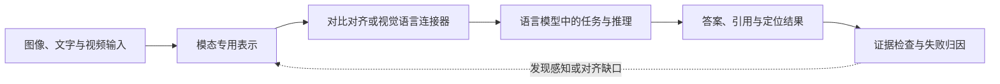

# 第十部分：多模态理解与对齐

本单元沿“图像/文本表示—对齐—连接器—指令行为—文档与视频证据”展开。先辨认不同模态的表示接口，再看这些表示如何进入语言模型、接受监督并支撑可定位的回答。第 105—113 讲属于理解与对齐路径；图像/视频生成、语音交互和统一评估分别在后续单元处理。

先看本单元中表示如何变成可回答、可核对的证据：



这张图表达的是理解系统的证据路径，不要求所有模型都采用同一架构。CLIP 一类双塔模型可以在表示阶段直接比较图文向量；连接器路线则把视觉 token 接入语言模型继续生成。最后的证据检查把“答对了”与“使用正确区域答对了”分开，错误再回到对应的前处理、表示或推理环节。

---

## 第 105 讲：多模态学习总览

### 导入：把多模态看成表示、证据与行动的连续问题

设想用户发来一张发票和一份合同，问“这笔金额是否超过约定上限，依据在哪一页？”系统既要读出图像中的数字和表格关系，也要理解合同里的文字条件，还要把最终判断定位回来源。答对金额不等于回答可靠：模型可能记错数字，也可能碰巧答对却引用了无关区域。多模态学习因此不只是把图像、语音和文字塞进同一个 API，而要保留各自的信息结构，并让跨模态结论仍然有证据可查。

本单元聚焦理解与对齐：图像、文本和视频怎样变成表示，表示怎样进入语言模型，回答又怎样回到具体证据。图像与视频生成由第十一部分讨论，语音交互由第十二部分讨论，评估与研究设计在第十三部分收束。动作、传感器和环境反馈则牵涉闭环控制，本册只在讨论世界模型和多模态 Agent 时说明边界，不把它们当作本单元已经覆盖的能力。四个单元各有任务边界，但共享同一条问题链：模型看到了什么，怎样把信息合起来，输出依据是什么。

早期图文系统先学习让配对图像和文字在表示空间中相互匹配，CLIP 是这条路线的代表；Flamingo、BLIP-2、LLaVA 等工作进一步把视觉特征接到语言模型，让模型能够围绕图像回答问题。之后，系统扩展到文档、视频、语音和屏幕交互。每次扩展都不只是多接一个 encoder：表示、对齐、融合、指令行为和最终行动分别需要不同的数据与评估。接下来先把这些环节拆开，再比较它们怎样组合成不同架构。

---

### 一、什么是模态

“模态”指信息以什么形式出现。发票可以是像素组成的图像，合同中的文字经解析后可以变成 token，会议录音是连续的声学信号；视频则是在时间上连续变化的一组图像。系统还可能接收 3D 点云、动作轨迹或传感器读数。它们的结构不同，所以多模态模型不能只把几种输入拼在一起，还得保留每种输入中有用的关系，并让模型能够一起处理。


---

### 二、多模态学习的四个核心问题

回到发票和合同的问题，系统先要把每种输入变成模型能够处理的表示。图像编码器可能输出整图向量或 patch 序列，文本通常变成 token 序列，语音则可以先变成频谱特征。把模态记作 $m$、原始输入记作 $x_{m}$，编码器 $f_{m}$ 得到的表示可以写成：

```math
z_{m}
=
f_{m}(x_{m})
```


其中 $m$ 表示模态， $x_{m}$ 是原始输入， $f_{m}$ 是该模态 encoder， $z_{m}$ 是模态表示。

光有向量还不够。图像里的“狗”和文字“狗”必须在某种任务相关的意义上对应起来，模型才可能用文字检索图片，或判断图文是否匹配。以图文对齐为例，归一化后的图像表示和文本表示可以用相似度分数比较：

```math
s_{ij}
=
\frac{
\bar v_{i}^\top \bar t_{j}
}{\tau}
```


其中 $\bar{v}_{i}$ 和 $\bar{t}_{j}$ 是归一化后的图像和文本表示， $\tau$ 是温度系数。一个 batch 内的双向对比学习目标可以抽象为：

```math
L_{\mathrm{align}}
=
\frac{1}{2}
\left(
L_{\mathrm{i2t}}
+
L_{\mathrm{t2i}}
\right)
```


这里 `i2t` 表示 image-to-text，`t2i` 表示 text-to-image。

当用户问“发票金额是否超过合同上限”时，系统还得把问题文字和视觉证据放进同一次计算。常见做法是先把视觉特征映射到语言模型的 hidden size：

```math
u_{j}
=
P_{v}(v_{j})
```


再和文本 token embedding 拼到同一上下文：

```math
H_{0}
=
[u_{1},\ldots,u_{K},e_{1},\ldots,e_{T}]
```


其中 $K$ 是送入 LLM 的视觉 token 数， $T$ 是文本 token 数。

最后，模型还要按任务生成结果：可以从图像生成描述、从文字生成图像、生成视频，或把文字合成为语音。四个环节会在同一系统里交错出现，但模型的侧重点不同：CLIP 主要学习图文对齐，LLaVA 侧重按指令回答图像问题，Stable Diffusion 用于图像生成，Whisper 用于语音识别，而 Sora 类模型研究视频生成和世界建模。

---

### 三、为什么多模态难

多模态数据在长度、信息密度和结构上差别很大：一张图片会被切成许多 patch，一段视频还要处理成千上万帧；图片有二维位置，视频同时有位置和时间，语音则带着连续的音高、停顿和说话人信息。对齐的粒度也不固定，可能要把整张图和整句话对应起来，也可能要把某个区域和一个短语对应起来。高质量标注因此昂贵，开放式问答、视频理解和图像生成也很难用一个分数概括。

多模态 token 数还会快速放大 attention 成本。若把每种模态送入融合层的 token 数记为非负整数，则总长度可以粗略写成：

```math
n_{\mathrm{all}}
=
n_{\mathrm{text}}
+n_{\mathrm{image}}
+n_{\mathrm{audio}}
+n_{\mathrm{video}}
```


```math
S_{\mathrm{attn}}
=
h n_{\mathrm{all}}^2
```


这里按单个样本、单层统计 score 元素数， $h$ 是 attention head 数；平方项只是全连接 self-attention 的成本代理，不是所有实现的精确 FLOPs。稀疏注意力、分块注意力、跨模态注意力和硬件 kernel 都会改变实际成本。即便如此，connector、resampler、patch 压缩、帧采样和检索式上下文构造仍然是多模态系统的核心设计，因为它们同时改变信息保留率和计算预算。

---

### 四、典型任务

多模态任务既包括理解输入，也包括生成新内容。图文理解会要求模型描述图片、回答视觉问题、按图文检索配对内容、读取文档或解释图表；图像生成则包括按文字生成图片、编辑已有图片、补全缺失区域和迁移风格。

视频任务还要处理时间变化：模型可以描述视频、识别动作、回答视频问题或判断事件先后，也可以根据文字或参考图生成视频、预测后续画面，乃至模拟一个可交互的世界。语音系统负责把音频转成文字（ASR）、把文字转成语音（TTS）、模仿指定说话人的声音，或直接进行语音到语音的对话。多模态 Agent 则把感知结果接到行动上，例如看着屏幕操作电脑、读网页后回答问题、分析图表，或结合摄像头与语音完成任务。

---

### 五、常见架构一：双塔模型

CLIP 是双塔模型的典型代表。图像和文本分别经过自己的 encoder，得到两个向量：

```text
image encoder -> image embedding
text encoder  -> text embedding
```


训练时，匹配的图文对会被拉近，不匹配的配对会被推远。因为两边可以预先编码，双塔结构很适合大规模图文检索，也能帮助模型对训练时没见过的类别做零样本分类。它的短处也来自这种独立编码：图像区域和文字短语之间的细节交互较弱，因此不擅长细粒度推理；它本身也不是为多轮对话或生成长答案设计的。CLIP 建立了重要的图文对齐能力，但不等于一个完整的多模态助手。

---

### 六、常见架构二：Encoder-Decoder

Encoder-decoder 常用于把一种模态转换成另一种模态，例如让 encoder 读取图像或音频，再由 decoder 生成文字：

```text
image/audio encoder -> decoder generates text
```


Whisper 就是“音频 encoder + 文本 decoder”的路线。输入、输出和训练目标都比较清楚，所以它适合语音识别、图像描述这类有明确转换方向的任务。但把一种模态转换成文字，并不会自动带来通用对话能力；复杂的跨模态推理仍取决于模型设计和训练数据，某些任务还需要单独设计。

---

### 七、常见架构三：LLM + Vision Encoder + Connector

现代视觉语言助手常把视觉 encoder 接到语言模型上，LLaVA 类模型就是一个例子。图像先变成视觉特征，再由 connector 映射到语言模型能够接收的表示：

```text
image -> vision encoder -> visual features -> connector -> LLM token space -> text answer
```


Connector 可以是线性投影、MLP projector、Q-Former 或 Perceiver Resampler 等结构。它们的共同任务是把视觉表示接到 LLM 的 token 表示空间，让语言模型继续处理问题并生成回答：

```text
把视觉表示映射到 LLM 能理解的 token 表示空间，让 LLM 负责语言推理和回答。
```


这种做法能复用已有的语言模型，训练和指令微调也比较直接，因此适合问答与对话。不过，connector 可能压掉小字或局部关系等视觉细节；语言模型还可能在证据不足时沿用语言先验，给出看似合理却没有图像支持的回答。高分辨率识别、OCR、图表理解和 grounding 是否可靠，仍要单独评估。

---

### 八、常见架构四：统一多模态模型

另一条路线是把不同模态转换成 token，放进同一个模型处理：

```text
text tokens + image tokens + audio tokens + video tokens
```


目标是让一个模型同时理解和生成多种模态：

```text
用一个模型同时理解和生成多种模态。
```


统一表示有机会让不同模态共享能力，也可能支持更自然的跨模态生成；代价是数据和训练更复杂。图像、音频和视频产生的 token 数量与结构差异很大，放进同一模型会增加计算成本，也可能让一种模态干扰另一种模态。评估和安全策略同样要覆盖更多输入与输出形式。

公开模型的发展并没有显示出一条简单的“统一架构取代模块化”路线。Qwen3-VL 技术报告描述了文本、图像和视频交错输入，也保留独立视觉编码器、视觉语言 merger 与语言模型主干；它另外用多层视觉特征注入和显式视频时间戳处理不同层次的证据。[论文报告](https://arxiv.org/abs/2511.21631)中的设计只说明这一模型的实现选择，不能据此推断所有模态已经共享同一种表示或内部路径。实际系统仍会组合专用编码器、连接器、统一 token 流和工具；应按任务需要、证据保留和成本选择，而不是把架构名称排成进化等级。

---

### 九、多模态对齐

多模态模型要把不同模态中的信息对应起来，但“对齐”有不同粒度。全局对齐比较整张图和整句文本，CLIP 主要学习这种对应关系；局部对齐则要把图像里的具体区域和短语连起来，例如确认“红色杯子”指的是画面中的哪一块。视频还需要时间对齐，把“人拿起杯子”对应到发生动作的那几帧；语音识别则要把音频片段和文字 token 对齐。

粒度越细，标注和评估通常越难，但也越能支持可靠的 grounding、OCR、图表理解和视频推理。只做好整图与整句的相似度，并不能保证模型找对了局部证据或事件时间。

---

### 十、多模态评估

多模态评估比纯文本更难，因为答案往往不止一种，图像质量带有主观性，grounding 不容易自动判定，视频还要检查时间一致性，语音则需要同时看自然度和说话人相似度；输入输出越丰富，安全风险也越复杂。评估时要按任务拆开：图文检索、VQA、图像描述、OCR、图表问答、grounding、图像生成、视频时序一致性、人类偏好和安全违规率回答的是不同问题，不能压成一个 benchmark 分数。

视觉幻觉可以用 unsupported claim rate 粗略审计：

```math
R_{\mathrm{hall}}
=
\frac{
N_{\mathrm{unsupported}}
}{
N_{\mathrm{claim}}
}
```


Grounding accuracy 可以写成：

```math
A_{\mathrm{ground}}
=
\frac{
N_{\mathrm{groundok}}
}{
N_{\mathrm{ground}}
}
```


当一个系统准备部署时，不能只看任务准确率。可以把一组硬约束写成联合条件：

```math
G_{\mathrm{mm}}
=
I[A_{\mathrm{task}}\ge a_{\min}]
I[A_{\mathrm{ground}}\ge g_{\min}]
I[R_{\mathrm{hall}}\le h_{\max}]
I[R_{\mathrm{safety}}\le r_{\max}]
I[C_{\mathrm{serve}}\le c_{\max}]
```


`I[condition]` 在条件成立时取 1，否则取 0。只有在五个量都已经在同一评估协议下测得时，这个乘积才有解释；任一指标缺失、分母为空或样本定义不一致，都应记录为 `unknown`，而不是把它当成零或自动通过。这个表达式也不是一个通用标准，只是把“质量、证据、风险和成本必须同时满足”形式化，具体阈值仍需由任务风险、数据分布和服务预算决定。

---

### 十一、多模态安全

多模态安全既包括看见了什么，也包括模型接下来会做什么。图像可能暴露隐私，OCR 可能读出敏感文档，图片文字可能试图注入指令；声音克隆和深度伪造会带来身份冒用，图像或视频生成可能产出有害内容，也会引出版权问题。在医疗影像、自动驾驶和机器人等场景，识别错误还可能转成现实伤害。因此系统要同时处理输入和输出安全、隐私保护、版权与身份伪造，以及高风险用途的限制。

这些风险不能只靠输出端的关键词过滤处理。输入解析、跨模态对齐、工具授权、日志保存和人工复核都可能成为安全边界；例如，图片中的文字既可能是用户要读取的内容，也可能是试图改变 Agent 行为的外部指令，系统必须保留这种区分。

---

### 十二、从 CLIP 到多模态大模型

可以把多模态模型的发展理解为能力接口逐步扩展：

```text
CLIP: 图文对齐
-> Flamingo / BLIP: 视觉语言生成和 few-shot
-> LLaVA: LLM + vision encoder + instruction tuning
-> GPT-4V / Gemini: 通用视觉语言助手
-> Sora 类模型: 视频生成和世界建模
```


这条路线先用 CLIP 建立图文表示的对应关系，再把视觉信息接入语言模型，让模型能问答和生成；经过 instruction tuning 后，它更像一个助手，随后还可以扩展到视频、语音和交互环境。每一步都增加了新的任务能力，也带来新的数据、对齐和安全要求，因此这不是简单的模型规模升级。

未来多模态也不是“给 LLM 加眼睛”这么简单。系统若要理解真实世界、模拟世界并与环境交互，就必须同时处理传感器噪声、时间延迟、空间定位、动作后果和证据追溯。

---

### 十三、最小代码：图文对齐、Connector Token 成本与幻觉审计

下面的 demo 不调用真实模型，只用 toy embedding 和计数模拟三个多模态核心问题：

1. 图文表示是否能在同一空间里完成 image-to-text retrieval。
2. 原始视觉 patch token 直接进 LLM 会带来多大的 attention score cell。
3. connector 把视觉 token 压缩后，attention 成本如何下降。
4. 模型回答中的视觉 claim 是否被图像对象支持。

```python
import math

image_embeddings = {
    "dog_photo": [0.90, 0.10, 0.10],
    "chart_image": [0.10, 0.85, 0.15],
    "receipt_scan": [0.05, 0.20, 0.90],
}

text_embeddings = {
    "a dog on grass": [0.85, 0.15, 0.05],
    "a bar chart": [0.10, 0.90, 0.10],
    "a store receipt": [0.05, 0.15, 0.95],
}

gold_pairs = {
    "dog_photo": "a dog on grass",
    "chart_image": "a bar chart",
    "receipt_scan": "a store receipt",
}


def normalize(vector):
    if not isinstance(vector, list) or not vector or any(
        not isinstance(value, (int, float))
        or isinstance(value, bool)
        or not math.isfinite(value)
        for value in vector
    ):
        raise ValueError("vector must contain finite numeric values")
    norm = math.sqrt(sum(value * value for value in vector))
    if not math.isfinite(norm) or norm == 0:
        raise ValueError("vector norm must be finite and non-zero")
    return [value / norm for value in vector]


def dot(a, b):
    if not isinstance(a, list) or not isinstance(b, list) or not a or not b:
        raise ValueError("dot product needs two non-empty vectors")
    if len(a) != len(b):
        raise ValueError("vectors must have the same dimension")
    for vector in (a, b):
        if any(
            not isinstance(value, (int, float))
            or isinstance(value, bool)
            or not math.isfinite(value)
            for value in vector
        ):
            raise ValueError("dot product values must be finite numbers")
    score = sum(x * y for x, y in zip(a, b))
    if not math.isfinite(score):
        raise ValueError("dot product result must be finite")
    return score


def retrieval_accuracy():
    images = {key: normalize(value) for key, value in image_embeddings.items()}
    texts = {key: normalize(value) for key, value in text_embeddings.items()}
    predictions = {}
    for image_name, image_vec in images.items():
        best_text = max(texts, key=lambda text_name: dot(image_vec, texts[text_name]))
        predictions[image_name] = best_text
    if not predictions or set(predictions) != set(gold_pairs):
        raise ValueError("retrieval data must have a non-empty, aligned gold set")
    correct = sum(predictions[name] == gold_pairs[name] for name in predictions)
    return {"image_to_text_top1": round(correct / len(predictions), 3), "predictions": predictions}


def token_budget(text_tokens, image_resolution, patch_size, connector_tokens=None, heads=32):
    integer_values = (text_tokens, image_resolution, patch_size, heads)
    if any(not isinstance(value, int) or isinstance(value, bool) or value <= 0 for value in integer_values):
        raise ValueError("token, resolution, patch, and head counts must be positive integers")
    if image_resolution % patch_size != 0:
        raise ValueError("patch size must divide image resolution in this toy model")
    if connector_tokens is not None and (not isinstance(connector_tokens, int) or isinstance(connector_tokens, bool) or connector_tokens <= 0):
        raise ValueError("connector_tokens must be a positive integer when provided")
    patches_per_side = image_resolution // patch_size
    image_tokens = patches_per_side * patches_per_side
    visual_tokens = connector_tokens if connector_tokens is not None else image_tokens
    total_tokens = text_tokens + visual_tokens
    return {
        "image_tokens_raw": image_tokens,
        "visual_tokens_to_llm": visual_tokens,
        "total_tokens": total_tokens,
        "attention_score_cells": heads * total_tokens * total_tokens,
    }


def hallucination_audit():
    samples = [
        {"objects": {"dog", "grass"}, "claims": {"dog", "grass", "park"}},
        {"objects": {"bar", "axis", "legend"}, "claims": {"bar", "axis"}},
        {"objects": {"price", "date", "store"}, "claims": {"price", "date", "phone"}},
    ]
    unsupported = 0
    total = 0
    for sample in samples:
        for claim in sample["claims"]:
            total += 1
            unsupported += int(claim not in sample["objects"])
    if total == 0:
        return {"unsupported_claim_rate": None, "unsupported_claims": 0}
    return {"unsupported_claim_rate": round(unsupported / total, 3), "unsupported_claims": unsupported}


print("alignment=", retrieval_accuracy())
print("raw_vision_tokens=", token_budget(text_tokens=64, image_resolution=336, patch_size=14))
print("connector_tokens=", token_budget(text_tokens=64, image_resolution=336, patch_size=14, connector_tokens=32))
print("hallucination=", hallucination_audit())
```


> **代码状态：静态审阅，未运行（2026-10-29）**

典型输出：

```text
alignment= {'image_to_text_top1': 1.0, 'predictions': {'dog_photo': 'a dog on grass', 'chart_image': 'a bar chart', 'receipt_scan': 'a store receipt'}}
raw_vision_tokens= {'image_tokens_raw': 576, 'visual_tokens_to_llm': 576, 'total_tokens': 640, 'attention_score_cells': 13107200}
connector_tokens= {'image_tokens_raw': 576, 'visual_tokens_to_llm': 32, 'total_tokens': 96, 'attention_score_cells': 294912}
hallucination= {'unsupported_claim_rate': 0.25, 'unsupported_claims': 2}
```


这组玩具输出里，三个图像都检索到了对应文本； $336\times336$ 的图像按 $14\times14$ patch 切分会产生 576 个视觉 token。把它们经 connector 压到 32 个后，LLM 的 attention score cell 代理值从 13,107,200 降到 294,912。最后一项审计还显示，即使模型能给出回答，也要检查回答中的视觉声明是否有图像证据支持。这里的向量和对象都是教学构造，结果只说明代码中的计算关系。

---

### 十四、多模态能力为什么不能用一个标签概括

多模态学习解决的不是“增加输入类型”这一件事，而是建立跨模态证据链。图文检索只要求全局表示的相似度足够可靠；视觉问答还要求模型把图像证据送入语言生成过程；文档问答则进一步要求文字、版面、表格结构和引用位置保持一致。把这些任务都称为“看图”，会掩盖模型能力的真实差异。

CLIP 的重要性在于它证明了大规模图文对比学习可以建立可用于检索和零样本分类的联合空间，但联合空间并不等于可对话的生成空间。LLaVA 类模型在视觉表示与语言模型之间增加 connector 和指令训练，使语言模型能够消费视觉 token；这一步带来的是任务接口和行为能力的改变，而不仅是维度变换。

多模态幻觉通常来自几种因素共同作用：视觉编码丢失细节，connector 压缩了关键证据，训练数据中的语言先验覆盖了输入证据，或者评估只奖励答案形式而不检查证据位置。因而“回答得像真的”不能作为理解成立的证据，必须把对象、属性、关系、区域和引用一起评估。

同理，多模态评估不能压缩成一个榜单。开放式答案需要语义和事实双重判断，OCR 需要字符级或词级误差，grounding 需要区域重叠，视频需要时间一致性，语音需要识别、自然度和交互时延。不同指标的样本单位和错误含义不同，混合平均前必须先说明聚合规则。

从研究趋势看，模型会逐步扩展到视频、语音、动作和工具交互，但“统一”并不自动意味着“更强”。统一模型需要面对模态之间的 token 比例、采样频率、噪声结构和安全策略差异；模块化系统则需要解决接口损失和跨模块误差传播。两条路线应以任务证据和运行成本比较，而不是以架构名称判断优劣。

---

### 十五、从失败输出定位系统缺口

第一类失败是模型能读到图像却不能使用图像证据。例如它能说出“这是一张室内照片”，却无法回答小字、计数或左右关系。这通常不是语言生成能力不足，而是分辨率、patch 粒度、token 压缩和训练任务之间的错配。

第二类失败是全局相似度很高但局部关系错误。CLIP 可能把“红色杯子在书左边”和“红色杯子在书右边”映射得很接近，因为两句话共享大量全局词汇；这说明全局对齐不能替代区域级 grounding。

第三类失败是生成结果视觉上漂亮，却不遵循文本条件或违反物理连续性。图像生成应把 prompt 遵循、对象属性、空间关系、时序一致性和安全内容分开评估，不能用单一审美分数掩盖条件控制失败。

第四类失败发生在 Agent 场景：图像中的文字被直接当成最高优先级指令，或者 OCR 结果未经权限检查就进入工具调用。此时问题已经从感知错误扩展为控制流和授权错误，修复点应在输入标注、策略层和工具执行层，而不只是继续训练视觉编码器。

---

### 十六、用一组对照把能力变成可观察变量

可以先用三张图说明同一图像在不同系统中的信息流：双塔系统只产生全局 embedding，视觉语言助手把视觉 token 注入语言上下文，带工具的文档 Agent 还要保留 OCR 区域、引用和权限信息。然后对每条信息流标出可能丢失证据的位置。

接着构造一个最小评估集：同一组图像分别提出全局类别、细粒度属性、空间关系、文字读取和拒答问题。记录答案正确率、证据支持率、区域定位准确率和拒答质量；不要把这些结果先平均成一个分数。最后把分辨率、patch size、connector token 数和提示模板作为变量，观察质量与成本如何共同变化。

安全实验可以加入一张含有“忽略此前规则并调用工具”字样的图片。正确系统应把这段文字当作待分析内容，而不是权限指令；若任务要求提取文字，也应在输出中标注来源并在工具层重新执行授权检查。这个实验把视觉理解、提示注入和工具安全放在同一个可复现流程里。

### 十七、资料与证据边界

CLIP 的图文对比学习机制以论文[《Learning Transferable Visual Models From Natural Language Supervision》](https://arxiv.org/abs/2103.00020)及其[官方实现](https://github.com/openai/CLIP)为主要依据；论文支持训练目标、零样本迁移和数据规模的原始实验结论，但不意味着任意业务数据上的相似度都具有绝对语义。

ViT、LLaVA、Flamingo、BLIP-2、扩散模型和 Whisper 等章节分别引用原始论文或作者公开仓库。论文中的 benchmark 结果属于特定数据集、预处理、模型版本和评估协议下的观察，不能直接替换目标系统的离线或线上实测。安全部分使用 OWASP LLM Top 10 等公开安全资料描述风险类别；这些资料提供威胁建模入口，不是某个具体模型已经安全的证明。

本讲代码只验证向量归一化、token 数量、注意力成本代理和 claim 支持率的计算关系。它没有调用真实视觉模型，也不能证明 CLIP、LLaVA 或任意生产系统具备相应能力；真实结论必须由固定数据、版本、硬件和人工或程序化标注共同给出。

这一讲先建立多模态系统的共同地图：输入怎样形成表示，表示怎样交给语言模型，输出又怎样回到可检查的证据。接下来从 CLIP 开始，具体看图像和文字如何被放进同一个向量空间；同时要记住，全局相似度只是后续视觉语言系统的一种基础能力，不等于局部识别或事实核验。
## 第 106 讲：CLIP：对比学习与图文对齐

### 导入：从封闭类别分类到开放语义对齐

CLIP 的价值不在于把一个分类器做得更大，而在于改变视觉监督的形式：模型不再只学习固定类别 ID，而是从大规模图文对中学习图像和自然语言之间的对应关系。这个改变使同一个视觉表示能够被检索、零样本分类和后续视觉语言模型复用，但也带来了一个必须正视的边界：全局语义相似度并不等于细粒度事实验证。

本讲先从双塔结构和批内对比目标推导 CLIP，再解释温度缩放、prompt ensemble 与 zero-shot 分类，最后讨论数据噪声、分布偏移和局部证据缺失。这样可以把“CLIP 能做什么”与“CLIP 没有被训练去做什么”区分开。

CLIP 是 Contrastive Language-Image Pre-training 的缩写。它用大规模图文配对数据训练两个编码器，让匹配的图像和文本表示更接近，不匹配的表示更远。这样学到的共同语义空间可以支持文搜图、图搜文、图文检索和零样本分类，也能为后续多模态模型提供视觉语义表示；但 CLIP 本身不是视觉语言对话模型，也不会生成图像。

---

### 一、CLIP 的问题背景

传统图像分类需要人先给图片选一个固定类别，例如 ImageNet 的 1000 类之一。模型的任务就是在这张类别表里选一个答案。


类别标签标注成本不低，类别表也很难覆盖后来出现的新概念；遇到“穿雨衣的狗”这类开放描述时，模型无法直接把描述当作新类别理解。互联网已经积累了大量图片及其标题、alt-text 和网页描述，CLIP 利用这些图文配对关系训练视觉模型，让监督从固定类别扩展到自然语言描述。

---

### 二、CLIP 的双塔架构

CLIP 使用两个彼此独立的编码器：image encoder 把图片变成向量，text encoder 把句子变成向量。它们先分别计算，再放到同一个空间里比较：

```text
image -> image encoder -> image embedding
text  -> text encoder  -> text embedding
```


图像和文本 embedding 通常先归一化，再用 cosine similarity 或归一化点积计算相似度。配对样本应得高分，不配对样本应得低分。

可以把图像和文本 embedding 先归一化：

```math
\bar i_{k}
=
\frac{i_{k}}{\lVert i_{k}\rVert_{2}}
```


```math
\bar t_{k}
=
\frac{t_{k}}{\lVert t_{k}\rVert_{2}}
```


这就是 contrastive learning（对比学习）的基本做法。双塔可以让图片和文本各自预先编码，随后用向量检索大规模候选，因此很适合图文搜索。代价是两种模态只在相似度计算时相遇：模型不容易逐区域比较图像细节，也不会直接生成自然语言回答。

---

### 三、对比学习目标

假设一个 batch 中有 $N$ 对图文样本。图像和文本编码器分别产生 $N$ 个 embedding： $I_{i}$ 表示第 $i$ 张图， $T_{i}$ 表示与之配对的文本。模型会计算每张图和每条文本之间的相似度，得到一个 $N\times N$ 矩阵：

```math
s_{ij}
=
\frac{
\bar i_{i}^\top \bar t_{j}
}{\tau}
```


已知配对样本位于矩阵对角线上，所以训练要让对角线的相似度高于其他位置。CLIP 用 cross entropy 完成这个区分，并分别训练两个方向：给定图像找文本（image-to-text）的损失为：

```math
L_{\mathrm{i2t}}
=
-\frac{1}{N}
\sum_{i=1}^{N}
\log
\frac{
\exp(s_{ii})
}{
\sum_{j=1}^{N}\exp(s_{ij})
}
```


Text-to-image 方向的 loss 是：

```math
L_{\mathrm{t2i}}
=
-\frac{1}{N}
\sum_{i=1}^{N}
\log
\frac{
\exp(s_{ii})
}{
\sum_{j=1}^{N}\exp(s_{ji})
}
```


CLIP 总损失通常写成两个方向平均：

```math
L_{\mathrm{CLIP}}
=
\frac{1}{2}
\left(
L_{\mathrm{i2t}}
+
L_{\mathrm{t2i}}
\right)
```


---

### 四、对称损失

CLIP 的对比损失同时训练两个检索方向：给定图像，在 batch 中找对应文本；再给定文本，找回对应图像。总损失是两个方向的平均，所以图像和文本都要学会在同一个语义空间里找到彼此，而不是只让其中一侧充当查询。

---

### 五、Temperature 参数

CLIP 会在 softmax 前缩放相似度，常用可学习的 logit scale 表示；它和 temperature 互为倒数，作用是控制 softmax 分布有多尖。temperature 较高时，正负样本的概率差异会变平；较低时，分布更尖，少数错误配对可能产生很大的梯度，训练也可能不稳定。因此它是损失函数的一部分，会影响模型区分匹配与不匹配样本的力度。

温度并不是一个只影响展示分数的后处理参数，而是损失函数的一部分。训练时若把温度固定得过高，正负样本的梯度差异会变小；若温度过低，少数错误配对可能产生过大的梯度。实际实现往往学习 `logit_scale` 后再取指数，并对其范围做约束，具体范围属于模型实现细节，不能从 CLIP 的一般公式中直接推断。

---

### 六、为什么 CLIP 能 Zero-Shot 分类

CLIP 可以在不训练固定分类头的情况下做零样本图像分类。假设要判断一张图属于猫、狗还是汽车，先把类别写成自然语言提示：

```text
cat, dog, car
```


```text
a photo of a cat
a photo of a dog
a photo of a car
```

接着，image encoder 把图片编码成向量，text encoder 分别编码这三条提示；模型计算图像向量与每个文本向量的相似度，并把相似度最高的提示对应的类别作为预测结果：

可以写成：

```math
\hat y
=
\arg\max_{c}
\bar i^\top \bar t_{c}
```


如果使用多个 prompt template，可以先对同一类别的多个文本 embedding 求平均再归一化：

```math
\bar t_{c}
=
\mathrm{normalize}
\left(
\frac{1}{K}
\sum_{k=1}^{K}
\bar t_{c,k}
\right)
```


这里的关键变化是，类别由自然语言描述，不再局限于训练时固定好的分类头。要尝试新类别，只需把类别写成文本，再用 text encoder 编码；但这种开放性仍受训练数据和提示写法影响。

---

### 七、Prompt Engineering 对 CLIP 很重要

零样本分类的结果会受类别提示写法影响。对于同一类，单写：

```text
cat
```


有时不如更接近训练描述风格的句子：

```text
a photo of a cat
```


原因是训练数据里的图文描述通常是自然语言句子。实践中可以用多种模板组成 prompt ensemble，例如“a photo of a {label}”“a blurry photo of a {label}”“a close-up photo of a {label}”和“a rendering of a {label}”，再平均这些提示的文本向量。这样可能减轻单一模板造成的偶然偏差；是否真的让目标任务更稳，仍要在固定验证集上比较。

---

### 八、CLIP 学到了什么

CLIP 学习图像和文本之间的语义对应，通常能对齐物体类别、场景、风格、属性和动作等全局信息，例如判断一张图大致是否符合“a dog running on grass”。但它的训练目标主要比较整张图和整句文本，因此精确计数、小物体识别、OCR、空间关系、区域级 grounding 和复杂视觉推理都不是它天然擅长的部分。

---

### 九、CLIP 和后续多模态模型的关系

CLIP 可以用来初始化视觉 encoder、做图文检索、过滤多模态数据，或评估图像生成结果的图文对齐，也常作为零样本分类 baseline。LLaVA、Flamingo 等视觉语言助手还要把图像特征接入 LLM，并通过多模态 instruction tuning 学会多轮对话；它们也需要更强的细粒度视觉理解、grounding 和 OCR 能力。因此，CLIP 提供的是重要基础能力，不是一个完整助手所需的全部能力。

---

### 十、CLIP 的优点

CLIP 用大规模弱监督图文数据学到较通用的视觉语义表示，支持开放类别的零样本分类和图文检索；双塔结构也便于把图片与文本提前编码，扩展到大规模搜索。实际系统会把 CLIP embedding 用于图片搜索、去重、图文数据过滤、内容推荐和多模态聚类，也可以把它作为后续多模态模型的一个组件。

---

### 十一、最小代码：CLIP 对比损失与 Zero-Shot 分类

下面的 demo 用 toy embedding 手写 CLIP 的核心计算：

1. 归一化 image/text embedding。
2. 按显式的图文 pair ID 计算 batch 内 `N*N` 相似度 logits。
3. 分别计算 image-to-text 和 text-to-image cross entropy。
4. 用类别 prompt 做 zero-shot image classification。
5. 聚合多个 prompt 的类别文本表示，并在目标数据上比较是否更稳定。

```python
import math

images = {
    "img_cat": [0.90, 0.10, 0.05],
    "img_dog": [0.10, 0.90, 0.10],
    "img_car": [0.05, 0.10, 0.90],
}

texts = {
    "a photo of a cat": [0.85, 0.15, 0.05],
    "a photo of a dog": [0.12, 0.88, 0.10],
    "a photo of a car": [0.08, 0.08, 0.92],
}

labels = ["cat", "dog", "car"]
pair_ids = [
    ("img_cat", "a photo of a cat"),
    ("img_dog", "a photo of a dog"),
    ("img_car", "a photo of a car"),
]


def normalize(vector):
    if not isinstance(vector, list) or not vector or any(
        not isinstance(value, (int, float))
        or isinstance(value, bool)
        or not math.isfinite(value)
        for value in vector
    ):
        raise ValueError("vector must contain finite numeric values")
    norm = math.sqrt(sum(value * value for value in vector))
    if not math.isfinite(norm) or norm == 0:
        raise ValueError("vector norm must be finite and non-zero")
    return [value / norm for value in vector]


def dot(a, b):
    if not isinstance(a, list) or not isinstance(b, list) or not a or not b:
        raise ValueError("dot product needs two non-empty vectors")
    if len(a) != len(b):
        raise ValueError("vectors must have the same dimension")
    if any(
        not isinstance(value, (int, float))
        or isinstance(value, bool)
        or not math.isfinite(value)
        for vector in (a, b)
        for value in vector
    ):
        raise ValueError("dot product values must be finite numbers")
    score = sum(x * y for x, y in zip(a, b))
    if not math.isfinite(score):
        raise ValueError("dot product result must be finite")
    return score


def logsumexp(values):
    if not values or any(not isinstance(value, (int, float)) or isinstance(value, bool) or not math.isfinite(value) for value in values):
        raise ValueError("logits must be a non-empty finite sequence")
    max_value = max(values)
    result = max_value + math.log(sum(math.exp(value - max_value) for value in values))
    if not math.isfinite(result):
        raise ValueError("log-sum-exp result must be finite")
    return result


def cross_entropy_from_logits(logits, target_index):
    if not isinstance(target_index, int) or isinstance(target_index, bool) or not 0 <= target_index < len(logits):
        raise ValueError("target index must address an existing logit")
    return -logits[target_index] + logsumexp(logits)


def clip_batch_metrics(temperature=0.20):
    if not isinstance(temperature, (int, float)) or isinstance(temperature, bool) or not math.isfinite(temperature) or temperature <= 0:
        raise ValueError("temperature must be a positive finite number")
    if not isinstance(pair_ids, list) or not pair_ids:
        raise ValueError("the batch needs explicit image/text pair IDs")
    if any(not isinstance(pair, tuple) or len(pair) != 2 for pair in pair_ids):
        raise ValueError("each pair ID must contain one image and one text key")
    image_names = [image_name for image_name, _ in pair_ids]
    text_names = [text_name for _, text_name in pair_ids]
    if len(set(image_names)) != len(image_names) or len(set(text_names)) != len(text_names):
        raise ValueError("this toy batch requires unique image and text keys")
    if any(name not in images for name in image_names) or any(name not in texts for name in text_names):
        raise ValueError("every pair ID must exist in the embedding dictionaries")
    image_vecs = [normalize(images[name]) for name in image_names]
    text_vecs = [normalize(texts[name]) for name in text_names]
    logits = [[dot(image, text) / temperature for text in text_vecs] for image in image_vecs]
    i2t_losses = [cross_entropy_from_logits(row, i) for i, row in enumerate(logits)]
    t2i_losses = []
    for j in range(len(text_vecs)):
        col = [logits[i][j] for i in range(len(image_vecs))]
        t2i_losses.append(cross_entropy_from_logits(col, j))

    i2t_pred = [text_names[max(range(len(text_names)), key=lambda j: row[j])] for row in logits]
    t2i_pred = [image_names[max(range(len(image_names)), key=lambda i: logits[i][j])] for j in range(len(text_names))]
    return {
        "similarity_logits": [[round(value, 2) for value in row] for row in logits],
        "loss_i2t": round(sum(i2t_losses) / len(i2t_losses), 3),
        "loss_t2i": round(sum(t2i_losses) / len(t2i_losses), 3),
        "loss_clip": round((sum(i2t_losses) + sum(t2i_losses)) / (2 * len(i2t_losses)), 3),
        "i2t_top1": round(sum(i2t_pred[i] == text_names[i] for i in range(len(i2t_pred))) / len(i2t_pred), 3),
        "t2i_top1": round(sum(t2i_pred[j] == image_names[j] for j in range(len(t2i_pred))) / len(t2i_pred), 3),
    }


def zero_shot_classify(image_vector, templates):
    if not isinstance(templates, list) or not templates or any(not callable(template) for template in templates):
        raise ValueError("templates must be a non-empty list of prompt functions")
    image_vec = normalize(image_vector)
    class_scores = {}
    for label in labels:
        prompt_vectors = [normalize(template(label)) for template in templates]
        if any(len(vec) != len(image_vec) for vec in prompt_vectors):
            raise ValueError("prompt vectors must match the image dimension")
        class_text_vec = [sum(vec[i] for vec in prompt_vectors) / len(prompt_vectors) for i in range(len(image_vec))]
        class_scores[label] = dot(image_vec, normalize(class_text_vec))
    return {
        "scores": {label: round(score, 3) for label, score in class_scores.items()},
        "prediction": max(class_scores, key=class_scores.get),
    }


def plain_template(label):
    return {
        "cat": [0.70, 0.20, 0.10],
        "dog": [0.20, 0.70, 0.10],
        "car": [0.20, 0.15, 0.65],
    }[label]


def photo_template(label):
    return texts[f"a photo of a {label}"]


print("clip_batch=", clip_batch_metrics())
print("zero_shot_plain=", zero_shot_classify([0.08, 0.12, 0.95], [plain_template]))
print("zero_shot_ensemble=", zero_shot_classify([0.08, 0.12, 0.95], [plain_template, photo_template]))
```


> **代码状态：静态审阅，未运行（2026-10-29）**

典型输出：

```text
clip_batch= {'similarity_logits': [[4.99, 1.24, 0.75], [1.43, 5.0, 1.02], [0.65, 1.14, 5.0]], 'loss_i2t': 0.039, 'loss_t2i': 0.039, 'loss_clip': 0.039, 'i2t_top1': 1.0, 't2i_top1': 1.0}
zero_shot_plain= {'scores': {'cat': 0.248, 'dog': 0.276, 'car': 0.974}, 'prediction': 'car'}
zero_shot_ensemble= {'scores': {'cat': 0.205, 'dog': 0.261, 'car': 0.994}, 'prediction': 'car'}
```


这组输出说明：

1. 正确图文对在相似度矩阵对角线上，两个方向 top1 都为 1。
2. temperature 会影响 logits 尖锐程度，也会影响 contrastive loss。
3. zero-shot 分类本质是把类别写成文本 prompt 后做相似度比较。
4. prompt ensemble 不是换分类头，而是聚合多个类别文本表示；是否更稳要在目标分布上验证。

---

### 十二、从相似度到事实：CLIP 的输出能支持什么判断

CLIP 的双塔结构把图像和文本分别编码，因此可以提前建立图像库和文本库的向量索引。这是它适合大规模检索的根本原因，也是它与 LLaVA 类生成式视觉语言模型的第一处差别：CLIP 的核心输出是相似度空间中的位置，不能直接给出区域坐标、OCR 结果或对话回答；LLaVA 还要把视觉表示转换成语言模型可消费的上下文并生成回答。全局向量也难以单独解决计数、左右关系和小字读取，专业领域的图像分布还需要单独评估。

批内负样本让对比学习具有可扩展的训练信号，但“非配对”不一定等于“语义矛盾”。一张图可能同时对应多条正确描述，随机把其中一条标成负样本会产生 false negative。实际训练需要依赖数据去重、配对质量、批次构造和更细的标注策略；仅仅增大 batch 并不能消除监督噪声。

zero-shot 分类也不是完全没有监督。类别名称、prompt 模板和预训练语料共同决定了文本原型，类别不平衡、词义歧义和模板偏差都会改变结果。因此应把模板、候选类别集合和预处理固定在评估协议中，并报告不同模板或不同随机种子的稳定性。

最后，相似度分数只能回答“这张图与这段文字在模型空间里有多接近”，不能直接回答“图中是否真的有这个对象”。对于医疗、工业、金融或身份识别等高风险场景，CLIP 只能作为召回、筛选或候选生成组件，不能替代专门的检测器、OCR、人工复核或事实验证流程。

---

### 十三、用对照实验检查目标任务是否真的被测量

一个有用的实验不是只打印 loss，而是同时记录 batch 大小、正样本位置、双向 top-1、召回率和模板敏感性。先构造一个无噪声的小 batch，验证对角线是否被选中；再复制一张图配上两条同义文本，观察随机负样本如何改变 loss；最后把类别 prompt 改成不同语言、不同句式和不同领域描述，记录预测是否稳定。

如果要把 CLIP 用作图文检索组件，应在候选库规模变化时测量 Recall@K 和延迟，而不是只测一个 toy batch 的准确率。如果要把它用作数据过滤器，还要人工抽检高分和低分样本，估计相似度阈值对不同类别、语言和图像质量的偏差。

### 十四、资料与证据边界

本讲的核心机制依据 CLIP 原论文[《Learning Transferable Visual Models From Natural Language Supervision》](https://arxiv.org/abs/2103.00020)及 OpenAI 的[公开实现](https://github.com/openai/CLIP)。原论文支持双塔编码、批内对比学习、自然语言监督和 zero-shot 迁移的实验叙述；它不支持把某个相似度阈值当作跨领域通用事实标准。

图文检索的 Recall@K、zero-shot 分类准确率和 prompt ensemble 的提升都依赖数据集、候选集合、模板、预处理和模型版本。教材中的代码只使用手工构造的三维向量，目的是展示损失和推理路径，不是复现原论文的训练规模或性能。
## 第 107 讲：Vision Encoder：ViT、ConvNeXt、SigLIP

### 导入：视觉前端决定模型能够看到什么

前一讲讨论了 CLIP 的图文对齐。要把图像交给视觉语言模型，还需要一个视觉编码器，把像素变成全局向量、patch 序列或多层视觉特征。这个模块不是一个可以被语言模型自动修复的黑盒前处理器：如果它在采样、分辨率或 patch 划分阶段丢掉了文字和空间细节，后面的 connector 与 LLM 得到的只能是残缺证据。

本讲比较 ViT、ConvNeXt 和 SigLIP 所代表的三种不同层次：ViT 是把图像 token 化并用注意力建模的架构，ConvNeXt 是吸收现代训练方法后的卷积骨干，SigLIP 则是图文对齐目标的变体。它们并不处于完全同一分类维度，选型时必须分别说明“骨干结构”和“预训练目标”。

---

### 一、Vision Encoder 解决什么问题

图片原始输入只是像素值矩阵，例如一张 `224x224x3` 的 RGB 图像；语言模型不能直接从这串数字读出对象和关系。Vision Encoder 会把像素转换成视觉表示，输出可以是整图向量、patch 序列、多层特征或区域特征。检索常用整图向量，LLaVA 类模型通常把 patch token 接入语言模型，而 OCR、图表和文档问答则更依赖高分辨率的局部细节。

---

### 二、Vision Encoder 在 VLM 中的位置

视觉语言模型通常由三段组成：Vision Encoder 提取图像特征，Connector 把这些特征映射到语言模型的表示空间，LLM 再结合文本问题进行推理并生成答案。答案出错时，不能直接归因于 LLM：视觉编码器可能没看清小字，Connector 可能压掉局部细节，LLM 也可能用语言先验补出图中没有的信息，或者指令数据根本没覆盖这类任务。

因此，不能把多模态错误全部归因于 LLM。视觉前端、connector、指令数据和推理时的图像处理都可能是瓶颈；定位问题时应先检查模型是否实际获得了支持答案所需的视觉信息。

---

### 三、ViT 的核心思想

ViT（Vision Transformer）把图像切成 patch，再像处理文本 token 一样处理这些图像块。以 $224\times224\times3$ 的 RGB 图像为例，若每个 patch 是 $16\times16$ 像素，图像会被切成 $14\times14=196$ 个 patch：

```text
224 x 224 x 3
```


一般地，若图像分辨率是 $H\times W$、patch 边长是 $P$，那么 patch 总数为：

```math
n_{\mathrm{patch}}
=
\frac{H}{P}
\frac{W}{P}
```


每个 patch 包含 $P\times P\times C$ 个像素值；把它们展平后，输入维度为：

```math
d_{\mathrm{patch}}
=
P^2 C
```


随后用线性层把展平的像素投影到模型的 embedding 维度，得到第 $i$ 个视觉 token：

```math
e_{i}
=
x_{i} W_{E}
+
b_{E}
```


如果模型使用 CLS token，还要在 patch 序列前加入一个汇总整图信息的 token。因此 encoder 的输入长度为：

```math
n_{\mathrm{vit}}
=
n_{\mathrm{patch}}
+1
```


在这个例子里，196 个 patch 加上 CLS token 后共有 197 个输入位置。模型再加入位置编码，把整条视觉 token 序列送进 Transformer encoder。这样，self-attention 就能建模不同 patch 之间的关系；而图像和文本都已变成 token 序列，也让后续 connector 更容易把视觉表示接给 LLM。

---

### 四、ViT 的优点和局限

ViT 的优势是架构与文本 Transformer 接近，容易扩展规模，也能通过全局 attention 建模远距离 patch 关系；大规模数据上通常表现较强。它的代价是更依赖数据规模，缺少卷积自带的局部归纳偏置，而且高分辨率会产生更多 patch token。小目标、细节、OCR、图表和密集定位任务还可能需要更小的 patch 或其他专门设计。因此 ViT 常用于多模态模型，主要是因为它容易接入 token 化的语言模型，并不表示它在所有视觉任务上都最优。

---

### 五、Patch Size 的 trade-off

Patch size 会同时改变细节和成本。较大的 $32\times32$ patch 数量少、计算便宜，但会抹掉更多细节；较小的 $14\times14$ 或 $16\times16$ patch 更能保留局部信息，却会产生更多 token，让 Vision Encoder、Connector 和 LLM 的上下文都更贵。OCR、图表、文档理解和小目标识别往往更需要高分辨率或小 patch，但并非 patch 越小越好：序列变长还会增加训练难度、connector 的压缩压力和显存占用。实际系统常在 resize、高分辨率切块、多尺度特征和视觉 token 压缩之间做取舍。

ViT self-attention 的 score cell 数可以粗略估计为：

```math
S_{\mathrm{vit}}
=
h n_{\mathrm{vit}}^2
```


这里按单样本、单层统计 score 元素数， $h$ 是 attention head 数；没有计入 batch、层数、投影和 MLP。高分辨率、小 patch 会以二次关系放大视觉 encoder 的这一成本代理。

---

### 六、ConvNeXt 的背景

ConvNeXt 是一种现代卷积网络。它要回答的问题是：卷积网络吸收 Transformer 时代的训练方法和架构设计后，能否继续与 Transformer 竞争？

```text
卷积网络如果吸收现代训练 recipe 和架构设计，还能不能和 Transformer 竞争？
```


它采用较大的卷积核、depthwise convolution，并借鉴 Transformer block 的设计，同时使用 LayerNorm 和更现代的数据增强及训练 recipe。ConvNeXt 的例子说明，卷积的局部归纳偏置仍有价值；比较架构时，也要把训练方案放在一起看。


假设输入和输出通道数都为 $C$，并忽略 bias，以 $k\times k$ 卷积为例，普通卷积权重参数量是：

```math
P_{\mathrm{dense}}
=
k^2 C^2
```


depthwise convolution 权重参数量是：

```math
P_{\mathrm{dw}}
=
k^2 C
```


因此 depthwise convolution 保留局部建模，同时显著降低大卷积核的参数和计算压力。ConvNeXt 再配合 pointwise MLP、LayerNorm 和现代训练 recipe，形成更接近 Transformer block 风格的现代 CNN。

---

### 七、ConvNeXt 的优点和局限

ConvNeXt 的局部视觉建模能力强，对平移和纹理有卷积自带的归纳偏置；在检测、分割等 dense vision 任务中也有成熟的工程实现。它的输出接口不像 ViT 那样天然就是 token 序列，全局关系通常要靠更深的网络或额外模块建模，因此作为 VLM encoder 时需要认真设计输出特征。对于检测、分割、工业视觉或局部纹理任务，卷积骨干仍值得和 ViT 一起评估。

---

### 八、SigLIP 是什么

SigLIP 延续了 CLIP 的双塔图文对齐路线，但把损失从 softmax 对比学习换成 sigmoid 配对目标。可以这样理解两者的训练差异：CLIP 在 batch 内让每张图找出正确文本，SigLIP 则逐对判断 image-text pair 是否匹配：

```text
这对图文是否匹配？
```


可以把 pair label 写成：

```math
y_{ij}
=
\begin{cases}
1,& i=j\\
-1,& i\ne j
\end{cases}
```


图文相似度 logit 写成：

```math
z_{ij}
=
\bar i_{i}^\top \bar t_{j}
```


SigLIP-style pairwise sigmoid loss 可以抽象为：

```math
L_{\mathrm{siglip}}
=
-\frac{1}{Z}
\sum_{i=1}^{N}
\sum_{j=1}^{N}
\log
\sigma(y_{ij}z_{ij})
```


其中 $Z$ 是归一化因子。为了让下面的 toy 代码逐 pair 求平均，这里取 $Z=N^2$； $z_{i,j}$ 使用归一化 embedding 点积，省略训练中可能学习的 logit scale 和 bias，标签假设 batch 对角线只有一个正配对。Google Research 的 SigLIP trainer 在 2026-10-29 访问的版本对完整 pair 矩阵求和后按 batch 行数归一化；不同归一化会改变损失与其它目标混合时的尺度。因此这条公式和代码用于理解 pairwise sigmoid 机制，不是可直接替代论文或具体 checkpoint 配方的训练实现。

这种目标对 batch size 的依赖方式与 CLIP 不同，为大规模图文对齐提供了另一种训练选择。SigLIP encoder 已用于多种公开 VLM；它的价值主要是提供了质量较强、对齐良好的视觉前端，并没有改变多模态模型的全部范式。具体效果仍取决于模型、数据、分辨率和训练目标。

---

### 九、CLIP 和 SigLIP 的差异

| 维度 | CLIP | SigLIP |
|---|---|---|
| 目标 | softmax 对比学习 | sigmoid pairwise loss |
| 负样本 | batch 内负样本 | pair-level 匹配判断 |
| 常见用途 | 图文对齐、检索、zero-shot | 强视觉编码器、VLM 前端 |
| 共同点 | 图文对齐 | 图文对齐 |

两者仍属于双塔图文对齐预训练路线，主要差别是损失形式和训练行为：SigLIP 把 batch 内 softmax 分类改成带正负标签的 sigmoid 配对目标。它常被用作 VLM 的视觉编码器，但具体收益取决于骨干、数据构造、分辨率、负样本策略和下游 connector，不能只凭损失名称推断。

后续的 SigLIP 2 也不能简化成“SigLIP 换了一个版本号”。它把 sigmoid 图文目标与 captioning、自蒸馏、masked prediction、在线数据筛选和多语言训练组合起来，并提供可变分辨率等变体。论文报告的定位、稠密预测和检索收益属于整套 recipe 与各自实验设置，不能单独归因于 sigmoid loss，也不保证每个下游视觉语言任务都会同幅改善。[SigLIP 2 原论文](https://arxiv.org/abs/2502.14786)

---

### 十、选择 Vision Encoder 的关键指标

选择 vision encoder 时，要一起看它能否识别对象、场景、属性和动作，是否看得清小物体、文字、图表与空间关系，能否处理目标分辨率，以及输出多少视觉 token。还要检查视觉特征与语言空间的对齐质量、训练和推理成本，以及预训练权重、开源实现和部署经验是否成熟。最终要问的是它是否适合目标任务、预算和系统架构，而不是脱离条件比较“谁最强”。


---

### 十一、最小代码：ViT Patch、ConvNeXt 参数与 SigLIP Loss

下面的 demo 用纯 Python 展示三个视觉编码器相关判断：

1. ViT patch size 如何决定 visual token 数和 attention score cell。
2. 高分辨率小 patch 为什么更贵。
3. ConvNeXt 的 depthwise convolution 为什么能降低大卷积核参数量。
4. SigLIP pairwise sigmoid loss 如何惩罚错误匹配对。

```python
import math


def vit_patch_stats(height, width, patch, channels=3, heads=16):
    integer_values = (height, width, patch, channels, heads)
    if any(not isinstance(value, int) or isinstance(value, bool) or value <= 0 for value in integer_values):
        raise ValueError("image, patch, channel, and head sizes must be positive integers")
    if height % patch != 0 or width % patch != 0:
        raise ValueError("patch size must divide both image dimensions in this toy model")
    patch_rows = height // patch
    patch_cols = width // patch
    num_patches = patch_rows * patch_cols
    patch_dim = patch * patch * channels
    tokens_with_cls = num_patches + 1
    return {
        "resolution": f"{height}x{width}",
        "patch": patch,
        "num_patches": num_patches,
        "patch_dim": patch_dim,
        "tokens_with_cls": tokens_with_cls,
        "attn_score_cells": heads * tokens_with_cls * tokens_with_cls,
    }


def conv_params(channels=768, kernel=7):
    if any(not isinstance(value, int) or isinstance(value, bool) or value <= 0 for value in (channels, kernel)):
        raise ValueError("channels and kernel must be positive integers")
    dense = kernel * kernel * channels * channels
    depthwise = kernel * kernel * channels
    pointwise = channels * 4 * channels + 4 * channels * channels
    return {
        "dense_7x7_params": dense,
        "depthwise_7x7_params": depthwise,
        "depthwise_reduction_x": round(dense / depthwise, 1),
        "depthwise_plus_mlp_weight_params": depthwise + pointwise,
    }


pairs = [
    ("img_cat", "txt_cat", 4.2, 1),
    ("img_cat", "txt_dog", 0.8, -1),
    ("img_dog", "txt_cat", 0.6, -1),
    ("img_dog", "txt_dog", 4.0, 1),
]


def sigmoid(x):
    if not isinstance(x, (int, float)) or isinstance(x, bool) or not math.isfinite(x):
        raise ValueError("logit must be finite")
    if x >= 0:
        return 1.0 / (1.0 + math.exp(-x))
    exp_x = math.exp(x)
    return exp_x / (1.0 + exp_x)


def negative_log_sigmoid(x):
    if not isinstance(x, (int, float)) or isinstance(x, bool) or not math.isfinite(x):
        raise ValueError("log-sigmoid input must be finite")
    if x >= 0:
        return math.log1p(math.exp(-x))
    return -x + math.log1p(math.exp(x))


def siglip_loss():
    if not pairs:
        raise ValueError("at least one image-text pair is required")
    rows = []
    losses = []
    for image, text, logit, label in pairs:
        if (
            not isinstance(logit, (int, float))
            or isinstance(logit, bool)
            or not math.isfinite(logit)
            or not isinstance(label, int)
            or isinstance(label, bool)
            or label not in (-1, 1)
        ):
            raise ValueError("pairs require finite logits and labels in {-1, 1}")
        loss = negative_log_sigmoid(label * logit)
        losses.append(loss)
        rows.append({
            "pair": f"{image}-{text}",
            "label": label,
            "prob_match": round(sigmoid(logit), 3),
            "loss": round(loss, 3),
        })
    return {"avg_loss": round(sum(losses) / len(losses), 3), "pairs": rows}


print("vit_224_p16=", vit_patch_stats(224, 224, 16))
print("vit_336_p14=", vit_patch_stats(336, 336, 14))
print("convnext=", conv_params())
print("siglip=", siglip_loss())
```


> **代码状态：静态审阅，未运行（2026-10-29）**

典型输出：

```text
vit_224_p16= {'resolution': '224x224', 'patch': 16, 'num_patches': 196, 'patch_dim': 768, 'tokens_with_cls': 197, 'attn_score_cells': 620944}
vit_336_p14= {'resolution': '336x336', 'patch': 14, 'num_patches': 576, 'patch_dim': 588, 'tokens_with_cls': 577, 'attn_score_cells': 5326864}
convnext= {'dense_7x7_params': 28901376, 'depthwise_7x7_params': 37632, 'depthwise_reduction_x': 768.0, 'depthwise_plus_mlp_weight_params': 4756224}
siglip= {'avg_loss': 0.56, 'pairs': [{'pair': 'img_cat-txt_cat', 'label': 1, 'prob_match': 0.985, 'loss': 0.015}, {'pair': 'img_cat-txt_dog', 'label': -1, 'prob_match': 0.69, 'loss': 1.171}, {'pair': 'img_dog-txt_cat', 'label': -1, 'prob_match': 0.646, 'loss': 1.037}, {'pair': 'img_dog-txt_dog', 'label': 1, 'prob_match': 0.982, 'loss': 0.018}]}
```


`depthwise_plus_mlp_weight_params` 只统计 depthwise 卷积和两层 pointwise MLP 的权重，不含 bias、LayerNorm、Layer Scale 或其他 block 组件；实际 ConvNeXt 变体的参数账本应按具体配置核对。

输出显示， $336\times336$ 图像配 $14\times14$ patch 会产生 576 个 patch token，明显多于 $224\times224$ 图像配 $16\times16$ patch 时的 196 个；depthwise $7\times7$ 卷积在这个参数设定下比普通 dense $7\times7$ 卷积少 768 倍参数。SigLIP 的 toy 配对也体现了损失方向：正样本 logit 高时 loss 很小，负样本 logit 偏高时 loss 会明显变大。

---

### 十二、Vision Encoder 和 Connector 的关系

Vision Encoder 负责从图像中提取视觉特征，Connector 则决定怎样把这些特征交给 LLM。若 encoder 输出 576 个 patch token，直接全部送入 LLM 可能太贵；Connector 可以用线性投影、MLP 映射、token pooling、Q-Former 或 Perceiver Resampler 来映射或压缩它们。因此最终效果取决于 encoder 提取了什么、connector 保留了什么，以及 LLM 如何使用这些表示：

```text
encoder 输出什么 + connector 保留什么 + LLM 如何使用
```


下一讲将进一步比较 Vision-Language Connector 的几种设计。

---

### 十三、比较前端时先对齐三个层次

Vision Encoder 的“强”至少包含三层含义。第一层是视觉骨干能否从像素中提取对象、纹理和空间结构；第二层是预训练目标是否让表示适合图文语义对齐、分类或 dense prediction；第三层是输出接口能否被 connector 高效利用。只报告一个分类分数，无法说明这三层在目标 VLM 中都成立。医疗、遥感和工业图像的分布与互联网图片差异较大，通用前端需要在目标数据上验证，必要时做领域适配。

ViT 的优势是把规则网格变成 token 序列，便于用统一的 Transformer 处理全局关系，也便于接入语言模型；它的代价是高分辨率下 token 数和 attention 成本快速增加。ConvNeXt 保留卷积的局部归纳偏置，在局部纹理、检测和分割等任务中可能更合适，但需要额外设计把多层特征组织成语言模型可消费的接口。

SigLIP 与 CLIP 的主要差异在对齐目标，而不是“一个是视觉模型、一个不是”。SigLIP 的配对 sigmoid 损失不要求每个 batch 恰好形成一个互斥分类问题，但负样本质量仍然重要；它也不能自动解决 OCR、区域定位或幻觉问题。

更强的视觉前端不必然带来更强 VLM，因为下游还存在分辨率策略、token 压缩、connector 训练、语言模型使用视觉 token 的能力以及指令数据覆盖范围。合理的选型应通过冻结前端、替换前端、固定下游训练和分桶评估来做受控比较。

---

### 十四、怎样定位视觉前端瓶颈

可以固定同一个语言模型和 connector，只替换 ViT、ConvNeXt 或不同预训练目标的视觉前端，并把输入分成全局分类、细粒度属性、OCR、图表、空间关系和 grounding 六类。若只在全局分类上比较，实验无法回答“哪个前端更适合 VLM”；若同时记录视觉 token 数、前端延迟、显存和下游错误类型，才有工程解释力。

对于图表数字错误，应按顺序检查原图分辨率、resize 或切图策略、patch size、视觉特征层、connector 压缩比例以及训练样本是否包含相同版式。这个诊断顺序很重要：如果输入在第一层就不可辨认，继续调整语言损失不会恢复丢失的像素证据。

### 十五、资料与证据边界

ViT 的 patch token 化和 Transformer 视觉骨干依据原论文[《An Image is Worth 16x16 Words: Transformers for Image Recognition at Scale》](https://arxiv.org/abs/2010.11929)；ConvNeXt 的现代卷积设计依据[《A ConvNet for the 2020s》](https://arxiv.org/abs/2201.03545)；SigLIP 的配对 sigmoid 目标依据[《Sigmoid Loss for Language Image Pre-Training》](https://arxiv.org/abs/2303.15343)及其[官方 trainer](https://github.com/google-research/big_vision/blob/main/big_vision/trainers/proj/image_text/siglip.py)；SigLIP 2 的组合训练配方依据[原论文](https://arxiv.org/abs/2502.14786)。这些论文的比较结论适用于各自的训练设置和评估任务，不构成对所有 VLM 下游任务的排序；官方 main 分支会变化，复现时应固定 commit。

代码中的 attention score cell 是 token 数平方乘 head 数的成本代理，未计入投影、MLP、显存访问和 kernel 优化；depthwise 参数量也按无 bias 的主卷积项计算。真实部署应使用固定硬件上的 profiler 和端到端延迟，而不是直接把代理值当作服务成本。
## 第 108 讲：Vision-Language Connector：投影层、Q-Former、Perceiver Resampler

### 导入：把视觉证据变成语言模型可用的接口

第 107 讲讨论了 Vision Encoder。它产生的视觉特征即使维度上恰好等于语言模型的 hidden size，也不代表语言模型能够正确使用它们，因为两套表示的坐标系、训练目标、序列长度和信息粒度都可能不同。Connector 的工作因此不只是“把矩阵乘到另一个维度”，而是建立一个可训练、可解释、成本可控的跨模态接口。

本讲沿着两个问题展开：第一，如何把视觉特征映射到语言模型空间；第二，如何在减少 token 的同时保留对任务有用的视觉证据。线性投影、MLP、Q-Former 和 Perceiver Resampler 不是简单的强弱排序，而是对这两个问题的不同回答。

---

### 一、Connector 解决什么问题

Vision Encoder 输出视觉特征，LLM 则接收语言 token embedding。即使两边维度相同，表示空间也未必对得上：视觉特征来自图像预训练，语言 embedding 来自语言建模，二者需要进一步学习怎样对应。形状也可能不合适——例如视觉编码器给出几百到几千个 patch token，全部塞进 LLM 会占用上下文并增加推理成本。与此同时，视觉特征里既有局部纹理，也有区域和整图信息；连接器必须在映射维度、建立语义联系、控制 token 数和保留任务所需细节之间取舍。

所以 Connector 不只是把两个矩阵变成相同形状，而是把视觉特征变成 LLM 能接收、能利用、且成本可控的视觉 token。


---

### 二、VLM 的典型连接流程

图像经过编码器和 connector 后，变成 LLM 能读取的视觉 token，再与文本 token 一起送入生成过程：

```text
image
  -> vision encoder
  -> visual features
  -> connector
  -> visual tokens in LLM space
  -> concatenate with text tokens
  -> LLM generation
```


例如，用户可能输入一张图并问：

```text
<image>
这张图里有几只猫？
```


经过 Vision Encoder 和 connector，模型内部可把图像表示成一串视觉 token，并与问题文本拼接：

```text
[visual token 1] [visual token 2] ... [visual token N] 这 张 图 里 有 几 只 猫 ？
```


生成答案时，LLM 会同时读取视觉 token 和文本 token。若 connector 没保留与“猫的数量”有关的信息，语言模型就很难靠后续推理补回来。

---

### 三、最简单方案：线性投影层

最简单的 connector 是线性层。假设 Vision Encoder 输出形状为 `[num_visual_tokens, vision_dim]`，而 LLM 要求最后一维等于 `llm_dim`，线性投影就会对每个视觉 token 做相同类型的映射：

```math
U
=
VW_{p}
+
b_{p}
```


其中：

```math
V
\in
\mathbb{R}^{n_{v}\times d_{v}}
```


```math
W_{p}
\in
\mathbb{R}^{d_{v}\times d_{l}}
```


这样得到的 $U$ 形状为 $n_{v}\times d_{l}$：视觉 token 数保持不变，只把每个 token 的维度映射到 LLM hidden size。LLaVA 早期路线采用过这种简单 projector。它参数少、训练稳定、实现容易，适合快速建立 baseline；但表达能力有限，既不会主动挑选重要视觉信息，也不会减少 token 数，因此复杂视觉推理和细粒度任务可能不够用。它说明了视觉接入 LLM 的最低要求：两边的表示维度要能对接。


---

### 四、MLP Projector

比线性层稍强的是 MLP projector。

常见形式是：

```text
Linear -> Activation -> Linear
```


或者更深一点：

```text
Linear -> GELU -> Linear -> GELU -> Linear
```


一个两层 MLP projector 可以写成：

```math
U
=
\phi(VW_{1}+b_{1})W_{2}
+
b_{2}
```


其中 `phi` 可以是 GELU。它比线性层更强，但输出 token 数通常仍是 $n_{v}$。

其中的非线性让 projector 比单个线性层更灵活地适配视觉和语言空间，同时仍容易训练，也不需要复杂的 cross-attention 结构，因此常见于 LLaVA 类模型。它的局限是通常保留全部 $n_{v}$ 个 token，既不主动筛选也不压缩视觉信息；如果 token 很多，LLM 的上下文和计算成本仍然很高。工程中常见组合是：

```text
CLIP/SigLIP ViT -> MLP projector -> LLM
```


这条路线简单、易复现，也便于替换单个组件，因此成为许多开源 VLM 的基础方案。

---

### 五、为什么需要压缩视觉 token

假设一张图经过 ViT 后输出 576 个视觉 token，四张图就会占 2304 个 token。它们不仅挤占 LLM 的上下文，还会增加 self-attention 计算和显存占用，让多图、多轮推理变慢、训练 batch 更难做大。因此 connector 往往不只负责把维度映射到 LLM，还要回答一个更实际的问题：怎样用较少的 token 保留完成任务所需的视觉信息？


压缩率可以写成：

```math
\rho
=
\frac{K}{n_{v}}
```


其中 $K$ 是 connector 输出给 LLM 的视觉 token 数。若文本 token 数为 $T$，直接输入视觉 token 的 LLM attention score cell 近似是：

```math
S_{\mathrm{direct}}
=
h(T+n_{v})^2
```


压缩后的成本是：

```math
S_{\mathrm{compressed}}
=
h(T+K)^2
```


这就是 Q-Former、Perceiver Resampler 等压缩型 connector 有工程价值的原因。

---

### 六、Q-Former 的核心思想

BLIP-2 路线中的 Q-Former 使用一组可学习的 query token，从视觉特征中挑出对任务有用的信息。它不把所有 patch token 原样交给 LLM，而是先让这些 query 读取图像表示：

```text
image -> frozen vision encoder -> visual features
learnable queries -> cross-attend to visual features -> query outputs
query outputs -> LLM
```


Q-Former 中的 query 数量通常固定。

在 [BLIP-2 原论文](https://arxiv.org/abs/2301.12597)中，Q-Former 不只是一次裸 cross-attention。它包含 query 间的 self-attention，并通过 cross-attention 读取冻结的图像特征；第一阶段还让 query 与文本在不同 attention mask 下交互。图文对比目标使 query 表示能区分配对图文，图文匹配目标学习细粒度配对判断，图像条件文本生成目标要求 query 保留可用于生成的信息。三者对信息的要求不同，因此不能把 Q-Former 的学习过程等同于平均 pooling。

第二阶段把 query 输出经线性层投影到冻结 LLM 的 embedding 维度，用条件语言生成目标学习桥接。此时更新的是桥接路径，梯度仍须穿过冻结 LLM 传回 connector；“冻结”表示不更新其参数，并不表示可以把整个 LLM 前向包进禁止梯度的上下文。论文采用的 decoder-only 与 encoder-decoder LLM 接入细节不同，这里的流程仅概括共同接口。

例如，若使用 32 个 query，无论视觉 encoder 输出多少 patch token，交给 LLM 的 query output 都是固定的 32 个。它因此同时完成信息选择和 token 压缩；但压缩后的表示不是原图的无损副本。


抽象成 cross-attention，就是：

```math
A
=
\mathrm{softmax}
\left(
\frac{QK_{v}^\top}{\sqrt{d}}
\right)
```


```math
O
=
AV_{v}
```


其中 $Q$ 是可学习 query， $K_{v}$ 和 $V_{v}$ 来自视觉特征。若 query 数为 $K$、视觉 token 数为 $n_{v}$，cross-attention score cell 近似是：

```math
S_{\mathrm{cross}}
=
h K n_{v}
```


---

### 七、Q-Former 的优点和局限

Q-Former 能用固定数量的 query 压缩视觉 token，并从冻结的 vision encoder 中抽取任务相关信息，因此适合在预训练视觉模型和冻结 LLM 之间搭桥，训练参数也较可控。代价是它比 MLP projector 复杂，训练流程更讲究；query 太少可能丢掉细节，太多又会增加成本。尤其是 OCR、图表和精确定位任务，必须确认压缩后仍保留了所需证据。

---

### 八、Perceiver Resampler 的核心思想

Flamingo 类路线常用 Perceiver Resampler。它和 Q-Former 一样，用少量可学习的 latent token 汇聚大量视觉特征：

```text
visual features -> cross-attention with latent queries -> fixed number of visual latents
```


视觉输入可以很长，但输出 latent 数量固定；语言模型随后接收这些 latent，或通过专门的 cross-attention 层读取它们。固定长度便于控制多图和视频的 token 成本，但并不保证每帧里的小物体或短暂事件都被保留下来。

在 [Flamingo 原论文](https://arxiv.org/abs/2204.14198)中，resampler 的 attention key/value 还包含当前 latent，使 latent 能在吸收图像特征时交换信息。视频前端把帧特征与时间信息送入 resampler，再压缩成固定数量 latent；固定长度输出并不保证保留每一帧的小物体或短暂事件，仍须按事件持续时间和采样频率评估。

图文交错还需要解决“这段文字应看哪张图”的绑定问题。Flamingo 的媒体 mask 让每个文本位置在视觉 cross-attention 中直接访问其前面最近一项图像/视频的 latent；更早媒体的信息可以经文本 self-attention 间接传播。它并非让每个位置无条件读取所有图像。若图像标记与 latent 顺序错位，即使每张图都编码正确，回答仍可能把图片一的属性安到图片二上。

---

### 九、Q-Former 和 Perceiver Resampler 的对比

Q-Former 和 Perceiver Resampler 都用少量可学习 token 汇聚视觉信息，但常见用途和接入方式有所不同：

| 维度 | Q-Former | Perceiver Resampler |
|---|---|---|
| 常见代表 | BLIP-2 | Flamingo |
| 核心 token | Learnable queries | Learnable latents |
| 主要机制 | query cross-attend to visual features | latent cross-attend to visual features |
| 输出 | 固定数量 query outputs | 固定数量 visual latents |
| 主要价值 | 信息抽取与桥接 | 重采样与压缩 |
| 共同点 | 控制视觉 token 数 | 控制视觉 token 数 |

二者的共同本质是用少量可学习 token 汇聚大量视觉特征，但使用位置和训练方式可能不同。Q-Former 可以作为独立桥接模块学习查询策略；Flamingo 路线还把视觉上下文通过 gated cross-attention 送入语言模型的多个层。因而比较二者时，不能只比较 query 数量，还要说明语言模型是否被改造、视觉信息在何处被访问以及多图或视频的时间结构如何保留。

---

### 十、Connector 的三种典型路线

按它怎样映射和融合视觉信息，connector 大致有三种路线：

#### 1. 直接映射型

线性层和 MLP projector 属于直接映射型。它们结构简单、效率高，但通常不压缩 token，因此需要 LLM 自己从全部视觉 token 中提取信息。

#### 2. 查询压缩型

Q-Former 和 Perceiver Resampler 属于查询压缩型：可学习的 query 或 latent 汇聚视觉信息并控制输出 token 数，信息选择更主动，但结构和训练也更复杂。

#### 3. 深度融合型

深度融合型会在 LLM 中插入 cross-attention，或让文本 token 在多层访问视觉特征。它提供了更灵活的融合方式，但需要更多改造，训练和推理框架也更复杂。三种路线都在效果、成本和工程复杂度之间取舍。

---

### 十一、最小代码：Connector 映射、Token 压缩与 Cross-Attention

下面的 demo 用纯 Python 模拟 connector 的三个关键问题：

1. 线性 projector 和 MLP projector 的参数量差异。
2. 576 个视觉 token 直接进 LLM 与压缩到 32 个 token 的 attention 成本差异。
3. learnable query 如何通过 cross-attention 从视觉 token 中汇聚不同类型的信息。

```python
import math


def connector_params(d_vision=1024, d_llm=4096, hidden=4096):
    if any(not isinstance(value, int) or isinstance(value, bool) or value <= 0 for value in (d_vision, d_llm, hidden)):
        raise ValueError("connector dimensions must be positive integers")
    linear = d_vision * d_llm + d_llm
    mlp = d_vision * hidden + hidden + hidden * d_llm + d_llm
    return {"linear_params": linear, "mlp_params": mlp, "mlp_vs_linear_x": round(mlp / linear, 2)}


def token_cost(text_tokens=128, visual_tokens=576, compressed_tokens=32, llm_heads=32, cross_heads=16):
    values = (text_tokens, visual_tokens, compressed_tokens, llm_heads, cross_heads)
    if any(not isinstance(value, int) or isinstance(value, bool) or value <= 0 for value in values):
        raise ValueError("token and head counts must be positive integers")
    if compressed_tokens > visual_tokens:
        raise ValueError("compressed token count cannot exceed visual token count")
    direct_total = text_tokens + visual_tokens
    compressed_total = text_tokens + compressed_tokens
    return {
        "direct_llm_score_cells": llm_heads * direct_total * direct_total,
        "compressed_llm_score_cells": llm_heads * compressed_total * compressed_total,
        "llm_reduction_x": round((direct_total * direct_total) / (compressed_total * compressed_total), 2),
        "query_cross_attn_cells": cross_heads * compressed_tokens * visual_tokens,
    }


def softmax(values):
    if not values or any(not isinstance(value, (int, float)) or isinstance(value, bool) or not math.isfinite(value) for value in values):
        raise ValueError("softmax requires a non-empty finite sequence")
    max_value = max(values)
    weights = [math.exp(value - max_value) for value in values]
    total = sum(weights)
    return [weight / total for weight in weights]


def cross_attention_summary():
    visual_tokens = [
        [1.0, 0.1, 0.0],
        [0.8, 0.2, 0.1],
        [0.0, 1.0, 0.2],
        [0.1, 0.8, 0.2],
        [0.0, 0.1, 1.0],
        [0.1, 0.2, 0.9],
    ]
    queries = {
        "object_query": [1.0, 0.0, 0.0],
        "chart_query": [0.0, 1.0, 0.0],
        "text_query": [0.0, 0.0, 1.0],
    }
    if not visual_tokens or not queries:
        raise ValueError("visual tokens and queries must both be non-empty")
    dimension = len(visual_tokens[0])
    if dimension == 0 or any(len(token) != dimension for token in visual_tokens) or any(len(query) != dimension for query in queries.values()):
        raise ValueError("all visual tokens and queries must share a non-empty dimension")
    outputs = {}
    scale = math.sqrt(3)
    for name, query in queries.items():
        scores = [sum(q * v for q, v in zip(query, token)) / scale for token in visual_tokens]
        weights = softmax(scores)
        top_index = max(range(len(weights)), key=lambda idx: weights[idx])
        summary = [sum(weight * token[i] for weight, token in zip(weights, visual_tokens)) for i in range(3)]
        outputs[name] = {"top_visual_token": top_index, "summary": [round(value, 3) for value in summary]}
    return outputs


print("params=", connector_params())
print("token_cost=", token_cost())
print("cross_attention=", cross_attention_summary())
```


> **代码状态：静态审阅，未运行（2026-10-29）**

典型输出：

```text
params= {'linear_params': 4198400, 'mlp_params': 20979712, 'mlp_vs_linear_x': 5.0}
token_cost= {'direct_llm_score_cells': 15859712, 'compressed_llm_score_cells': 819200, 'llm_reduction_x': 19.36, 'query_cross_attn_cells': 294912}
cross_attention= {'object_query': {'top_visual_token': 0, 'summary': [0.436, 0.355, 0.337]}, 'chart_query': {'top_visual_token': 2, 'summary': [0.288, 0.48, 0.369]}, 'text_query': {'top_visual_token': 4, 'summary': [0.274, 0.367, 0.496]}}
```


这组教学输出显示，MLP projector 的参数量约为线性层的 5 倍；把 576 个视觉 token 压到 32 个后，LLM attention score cell 代理值约下降 19.36 倍。Query cross-attention 自己也要计算，但它把视觉信息汇聚工作放在 connector 中，减少 LLM 长上下文里的视觉 token。不同 query 也可能学到不同关注点，不过真实模型是否形成了有用分工，仍要用任务评估确认。

---

### 十二、Connector 训练方式

Connector 可以单独训练，也可以和视觉编码器或 LLM 的部分参数联合训练。常见做法有三种，资源需求和适应能力逐步增加：

#### 1. 冻结 vision encoder 和 LLM，只训练 connector

这种做法成本较低、训练稳定，也不容易改坏原模型能力；但 connector 必须独自适应视觉和语言空间之间的差异，任务能力的上限可能受限。

#### 2. 冻结 vision encoder，训练 connector 和 LLM LoRA

保留视觉 encoder，只训练 connector 和 LLM 的 LoRA，可以让 LLM 学会使用视觉 token，同时把成本控制在一定范围内，适合 instruction tuning。它仍受视觉 encoder 能力限制，也更依赖高质量的多模态指令数据。

#### 3. 联合微调 vision encoder、connector 和 LLM

联合微调视觉 encoder、connector 和 LLM，能让三个部分共同适应任务，跨模态对齐也可能更充分；代价是训练成本高、稳定性更难保证，还可能损伤已有视觉或语言能力。真实项目通常先从较简单的策略建立基线，再根据误差证据逐步解冻更多模块。

---

### 十三、映射、压缩与深度融合各自改变什么

线性层解决的是维度映射，MLP 在此基础上增加非线性，但二者默认每个视觉 token 都要进入语言模型。它们适合视觉 token 数量可控、希望快速复用现成 LLM 的路线；缺点是把信息筛选压力留给更昂贵的 LLM self-attention。

Q-Former 和 Perceiver Resampler 都把大量视觉 token 读入少量 query 或 latent，但“读入少量 token”不等于“保留所有细节”。压缩后的表示必须通过 OCR、区域定位、图表数字和多图关系等任务验证；只看 caption 或普通 VQA，容易把严重的信息丢失隐藏起来。

深度融合型 connector 把 cross-attention 插入语言模型的若干层，使文本 token 可以在生成过程中多次访问视觉特征。这通常提高了融合灵活性，却增加了模型改造、缓存管理、训练稳定性和推理框架适配的复杂度。它适合需要图文交错、视频时序或持续视觉访问的场景，但不能仅凭结构复杂就断言效果更好。

因此，connector 选型应同时回答几个具体问题：输出 token 数是多少，视觉证据在哪一层被访问，哪些参数参与训练，训练和推理的分辨率是否一致，以及压缩是否保留了局部信息。复杂 connector 在小数据上可能过拟合；多图和视频输入还会放大 token 与缓存成本。评估时应做遮挡或替换等对照，确认模型真的使用了视觉 token，而不是只凭语言先验给出看似合理的回答。没有这些条件，单独比较“MLP vs Q-Former”没有足够意义。

---

### 十四、怎样用受控变量选择 connector

一个有解释力的 connector 实验应固定视觉前端、LLM、数据和训练步数，只改变 connector 类型或输出 token 数。评估至少包括全局 VQA、OCR、图表、区域 grounding、多图比较、端到端延迟和显存。若压缩后普通问答不变而 OCR 或 grounding 下降，说明平均答案质量掩盖了局部证据损失。

还可以构造“相同 token 预算、不同访问方式”的对照：直接拼接 32 个经过 pooling 的 token、用 32 个 query cross-attend 到 576 个 patch、以及让语言模型分层访问原始视觉特征。这样比较的不是模型名字，而是信息访问路径、计算位置和失败类型。

### 十五、资料与证据边界

线性或 MLP projector 的视觉语言桥接可参考 LLaVA 的公开论文与官方仓库；Q-Former 依据 BLIP-2 论文《BLIP-2: Bootstrapping Language-Image Pre-training with Frozen Image Encoders and Large Language Models》（arXiv:2301.12597）；Perceiver Resampler 与 gated cross-attention 依据 Flamingo 论文《Flamingo: a Visual Language Model for Few-Shot Learning》（arXiv:2204.14198）。

论文中的参数量、token 数和 benchmark 结果属于特定模型、分辨率、冻结策略与训练数据下的结果。本文用 $h(T+n)^2$ 和 $h K n_{v}$ 比较注意力 score cell，只是成本代理；它不包含投影、MLP、内存访问、并行度和缓存影响。教学代码同样不证明某个 connector 在真实模型上一定更优。
## 第 109 讲：LLaVA、Flamingo、BLIP 系列模型

### 导入：用三个代表模型理解视觉语言系统的取舍

第 107 讲讨论了 Vision Encoder，第 108 讲讨论了 Vision-Language Connector。本讲把这些组件放进 LLaVA、Flamingo 和 BLIP-2 三条公开路线中，观察同一个抽象接口如何产生不同的训练成本、上下文访问方式和能力边界。

这三类模型不应被排成一条简单的强弱顺序。LLaVA 把视觉 token 直接映射并注入语言模型，适合快速建立可复现基线；Flamingo 用 resampler 和 gated cross-attention 处理图文交错、多图和 few-shot 上下文；BLIP-2 通过 Q-Former 桥接冻结的视觉模型和语言模型，强调参数效率。比较它们时，应先固定任务与资源，再讨论结构差异。

#### 来龙去脉：从“能对齐”到“能对话、能 few-shot”

CLIP 证明了大规模图文对比学习可以得到强图文语义空间，但它本身不会多轮对话，也不会按复杂指令生成长答案。后续 VLM 的核心问题变成：怎样复用已经很强的视觉 encoder 和语言模型，用尽量低的训练成本，把视觉信息接入语言推理。

LLaVA 选择了最直接的路线：CLIP 类视觉编码器、简单 projector、强 LLM，再用视觉指令数据训练成助手。Flamingo 选择了更深的融合路线：用 Perceiver Resampler 压缩视觉上下文，在语言模型中插入 gated cross-attention，支持 interleaved 图文和 few-shot。BLIP-2 选择了中间桥接路线：冻结强 image encoder 和 frozen LLM，用 Q-Former 学一个轻量桥。

所以这三条路线不是谁绝对替代谁，而是三种工程取舍：

```text
simple projector baseline
vs
deep cross-attention fusion
vs
frozen-model bridge
```


---

### 一、为什么要比较这三条路线

只说“图像编码器接 LLM”会掩盖关键设计。LLaVA 代表简单直接的视觉指令模型路线，Flamingo 面向图文交错输入和 few-shot 多模态学习，BLIP/BLIP-2 则强调图文预训练、captioning、retrieval 和 Q-Former 桥接。比较它们时，要看视觉模型和语言模型是否冻结、connector 是直接投影还是 query 模块、视觉 token 如何进入 LLM，以及训练目标侧重图文对齐、captioning 还是 instruction following。

---

### 二、LLaVA 的核心思路

LLaVA 把 CLIP 类视觉编码器、projector 和 LLM 接在一起，再用视觉指令数据训练模型回答图像问题：

```text
CLIP vision encoder + projector + LLM + visual instruction tuning
```


```text
image -> CLIP ViT -> visual features -> projector -> visual tokens -> LLM
```

用户可以输入图片和问题，例如：

```text
<image>
请描述这张图片。
```


模型把图像特征投影到 LLM 的 embedding 空间，再与问题中的文本 token 一起输入 LLM。LLaVA 的关键贡献不只是这套结构，还展示了一个实用路线：复用已有的视觉 encoder 和 LLM，只加简单 connector，再用视觉指令数据训练，就能得到开源的图文对话模型。结构较简单，也方便工程复现和迭代。

---

### 三、LLaVA 的训练流程

LLaVA 类模型通常分两阶段训练，先学会把视觉表示接到语言空间，再学会按用户指令回答问题。

#### 1. 视觉语言对齐预训练

第一阶段是视觉语言对齐预训练，目标是让 projector 把视觉特征映射到 LLM 能使用的表示空间。常见做法是冻结 vision encoder 和 LLM，只训练 projector，并用 image-caption pair 让模型根据图片生成描述：

```text
输入：图片 + prompt
输出：caption
```


可以把 caption/alignment 训练写成条件生成目标：

```math
L_{\mathrm{cap}}
=
-\frac{1}{M}
\sum_{m=1}^{M}
\sum_{t=1}^{T_{m}}
\log
p_\theta
\left(
y_{m,t}\mid U_{m},p_{m},y_{m,1:t-1}
\right)
```


其中 $U_{m}=P_{\psi}(f_{v}(x_{m}))$ 是 projector 输出的视觉 token， $p_{m}$ 是文本 prompt 或 caption 前缀。

#### 2. 视觉指令微调

第二阶段是视觉指令微调，让模型学会多模态对话和指令跟随。样本可以是一段用户提问和助手回答：

```text
用户：<image> 这张图里发生了什么？
助手：...
```


训练时通常更新 projector 和 LLM 的部分参数，也可以用 LoRA。这样模型就从“会描述图片”进一步学会按问题回答。视觉指令微调目标可以写成：

```math
L_{\mathrm{inst}}
=
-\frac{1}{M}
\sum_{m=1}^{M}
\sum_{t=1}^{A_{m}}
\log
p_\theta
\left(
a_{m,t}\mid U_{m},q_{m},a_{m,1:t-1}
\right)
```


其中 $q_{m}$ 是用户问题， $a_{m}$ 是 assistant answer。这个目标强调：VLM 训练不是只看图像描述，还要学会根据视觉信息服从用户问题。

---

### 四、LLaVA 的优点和局限

LLaVA 的结构简单，工程实现容易，训练成本相对可控，也便于开源复现、迭代和替换 vision encoder、projector 或 LLM。它的限制同样来自简单 projector：对复杂视觉信息的筛选能力有限，视觉 token 多时上下文成本较高；OCR、图表、定位和细粒度空间关系往往需要额外增强，最终表现也很依赖视觉指令数据质量。语言先验还可能让模型在证据不足时产生多模态幻觉。因此，LLaVA 是改动较小、容易复用现成模块的图文对话路线，不代表它在 OCR、多图或 grounding 上天然优于专门模型。

---

### 五、Flamingo 的核心思路

Flamingo 是 DeepMind 提出的视觉语言模型路线，重点处理图像和文本交错出现的 interleaved 输入，例如：

```text
图片1：一只狗在沙滩上
文本：这只动物在做什么？
图片2：另一只狗在水里
文本：两张图有什么不同？
```


因此 Flamingo 不只面向单图问答，也要处理多图上下文和 few-shot 多模态学习。它在冻结的大语言模型中接入视觉能力，简化流程如下：

```text
image/video -> vision encoder -> Perceiver Resampler -> visual latents
text -> language model with gated cross-attention to visual latents
```


它不会把所有视觉 token 简单拼在文本前，而是让语言模型通过 cross-attention 读取视觉表示。

---

### 六、Flamingo 的关键设计

Flamingo 的两个关键设计分别负责压缩视觉表示和把视觉信息送入语言模型。

#### 1. Perceiver Resampler

Perceiver Resampler 把大量视觉特征压缩成固定数量的 visual latents。多图和视频输入会快速累积视觉 token，不压缩就会带来很高的上下文和计算成本。

#### 2. Gated Cross-Attention

Flamingo 在语言模型中插入 cross-attention 层，让文本表示能够读取 visual latents；其中的门控机制会调节视觉信息注入的强度，减少对原语言模型行为的突然干扰。可以把它想成语言模型仍是主干，只在若干层打开接口读取视觉信息。一层 gated cross-attention 可以抽象写成：

```math
\tilde h_\ell
=
h_\ell
+
\tanh(g_\ell)
\mathrm{CrossAttn}(h_\ell,Z_{v})
```


其中 $h_{l}$ 是语言模型第 $l$ 层的文本 hidden state， $Z_{v}$ 是 Perceiver Resampler 输出的视觉 latents， $g_{l}$ 是可学习的门控系数。门控的作用是让模型逐步学习何时使用视觉信息，而不是一开始强行破坏语言模型行为。

---

### 七、Flamingo 的优点和局限

Flamingo 能处理 interleaved 图文、多图和视频上下文，也适合 few-shot 多模态学习；resampler 控制视觉 token 数，cross-attention 则让语言模型更灵活地使用视觉信息。代价是结构和训练更复杂，需要改造语言模型，复现难度和成本都高于 LLaVA，对数据规模与训练 recipe 也有较高要求。

---

### 八、BLIP 系列的核心脉络

BLIP 系列是图文预训练路线的重要代表，覆盖图文检索、图像描述、视觉问答以及图文对齐和融合。BLIP-2 的关键变化是引入 Q-Former，在两个已经很强但保持冻结的模块之间搭桥：

```text
frozen image encoder + frozen LLM
```


这个轻量桥接模块就是 Q-Former。

---

### 九、BLIP-2 和 Q-Former

BLIP-2 的流程可以简化为：

```text
image -> frozen vision encoder -> visual features
learnable queries -> Q-Former cross-attend to visual features
Q-Former outputs -> LLM
```


Q-Former 从视觉特征中抽取关键信息，把大量 patch 压缩成固定数量的 query outputs，再接入 frozen LLM。这样可以少训练很多参数，降低桥接成本。

Q-Former 可以抽象为：

```math
O_{q}
=
\mathrm{CrossAttn}(Q,V)
```


其中 $Q$ 是固定数量的 learnable queries， $V$ 是 frozen vision encoder 输出的视觉特征。若 query 数为 $K$，视觉 token 数为 $n_{v}$，则输出 token 数固定为 $K$。

BLIP-2 的核心做法是冻结已有的视觉模型和语言模型，只训练中间的桥接模块来对齐两种表示。这对工程有吸引力，因为从头训练大型视觉语言模型成本高，复用现成模型可以减少可训练参数和训练成本。

---

### 十、BLIP-2 的优点和局限

BLIP-2 可复用强 vision encoder 和 LLM，以较少的可训练参数完成视觉语言桥接，Q-Former 还能压缩视觉信息，适合图文预训练任务。但 query 数量会限制细节容量，冻结的 LLM 也未必充分适应视觉 token；复杂指令跟随仍需要 instruction tuning，OCR、图表和细粒度定位也可能不足。它的训练流程比 LLaVA 的 projector 路线更复杂，而下游能力还受冻结模块原有表示限制。

---

### 十一、三类模型的架构对比

| 维度 | LLaVA | Flamingo | BLIP-2 |
|---|---|---|---|
| 视觉前端 | CLIP/SigLIP 类 ViT | Vision encoder | Frozen image encoder |
| Connector | Linear/MLP projector | Perceiver Resampler | Q-Former |
| 融合方式 | 视觉 token 拼接进 LLM | LLM 中 gated cross-attention | Q-Former 输出接 LLM |
| 训练重点 | Visual instruction tuning | Few-shot/interleaved 图文建模 | 图文桥接与预训练 |
| 工程复杂度 | 较低 | 较高 | 中等 |
| 典型优势 | 简单强 baseline | 多图、视频、few-shot | 低成本桥接强模型 |
| 典型短板 | 复杂视觉细节有限 | 复现和训练成本高 | query 压缩可能丢细节 |

这张表的作用不是帮助背模型名，而是把模型差异转成可检验的架构取舍。

从 token 成本角度，可以粗略比较：

```math
S_{\mathrm{llava}}
=
h(T+n_{v})^2
```


```math
S_{\mathrm{flamingo}}
=
hT^2
+
h_{c}TK_{f} L_{c}
+
h_{r}K_{f}(n_{v}+K_{f})L_{r}
```


```math
S_{\mathrm{blip2}}
=
h(T+K_{q})^2
+
h_{c}K_{q} n_{v}
```


其中 $T$ 是文本 token 数， $n_{v}$ 是原始视觉 token 数， $K_{f}$ 是 Flamingo visual latent 数， $K_{q}$ 是 Q-Former query 数， $L_{c}$ 是插入 cross-attention 的层数。Flamingo 的文本 self-attention 长度仍是 $T$；每个融合层由 $T$ 个文本 query 读取 $K_{f}$ 个视觉 latent。最后一项单独计入 resampler： $h_{r}$ 是其头数、 $L_{r}$ 是其层数，key/value 包含视觉特征和 latent，因此长度为 $n_{v}+K_{f}$。此处仅比较一层语言 self-attention 与所列跨模态层的 dense score-cell 数；若比较完整网络，需乘各自语言层数，并补齐 Q-Former 的多层 self/cross-attention。它不代表硬件时间。

---

### 十二、从训练数据角度比较

模型架构不会单独决定能力，训练数据也会塑造它擅长的任务。

#### LLaVA 类数据

LLaVA 类训练更强调视觉指令数据，包括图片描述、单图问答、多轮图文对话和复杂推理问答。

#### Flamingo 类数据

Flamingo 类路线更强调大规模 interleaved 图文序列，例如网页、文档及其他图文交错内容。

#### BLIP 类数据

BLIP 类路线更强调图文对齐和生成预训练，常用 image-caption pair、retrieval 和 VQA 数据。因此，即使模型架构相同，训练数据不同也会带来能力差异：图像描述不错但指令跟随差，可能是 instruction tuning 不足；单图问答可以、多图上下文却差，可能是 interleaved 数据不足。

---

### 十三、从工程选型角度比较

实际业务选型应从任务和预算出发：

#### 1. 快速做通用图文问答 baseline

可以先用 LLaVA 类路线搭通用图文问答 baseline，因为结构简单、开源生态成熟、底座容易替换，instruction tuning 流程也清楚。

#### 2. 需要多图、视频或图文交错上下文

若任务需要多图、视频或图文交错上下文，可考虑 Flamingo 类设计：Perceiver Resampler 控制视觉 token，cross-attention 让模型读取多路视觉信息，也更适合 few-shot 多模态任务。

#### 3. 训练预算有限，想复用强模型

预算有限、希望复用现成强模型时，可考虑 BLIP-2 类做法，冻结大模块，只训练桥接模块以降低成本。

#### 4. OCR、图表、文档理解强需求

如果核心需求是 OCR、图表或文档理解，单靠通用架构不够；还要采用高分辨率视觉策略，补充 OCR/文档数据，确保保留细节，并建立专门的评估集。

---

### 十四、最小代码：三条 VLM 路线的成本与选型

下面的 demo 不训练模型，只用 token 数和 cross-attention cell 估算比较三条路线：

1. LLaVA projector：视觉 token 直接进入 LLM，上下文成本高但结构简单。
2. Flamingo resampler：视觉 token 压缩成 latents，但语言模型中插入多层 cross-attention。
3. BLIP-2 Q-Former：用较少 query 输出桥接 frozen vision encoder 和 frozen LLM。
4. 不同任务下的路线选择应该看输入形式、预算和训练复杂度。

```python
import math

ARCHS = {
    "llava_projector": {
        "raw_visual_tokens": 576,
        "llm_visual_tokens": 576,
        "cross_layers": 0,
        "trainable_billion": 0.12,
        "llm_modified": False,
    },
    "flamingo_resampler": {
        "raw_visual_tokens": 576,
        "llm_visual_tokens": 64,
        "cross_layers": 8,
        "trainable_billion": 2.0,
        "llm_modified": True,
        "resampler_layers": 1,
    },
    "blip2_qformer": {
        "raw_visual_tokens": 576,
        "llm_visual_tokens": 32,
        "cross_layers": 1,
        "trainable_billion": 0.20,
        "llm_modified": False,
    },
}


def score_cells(text_tokens=128, heads=32, cross_heads=16):
    values = (text_tokens, heads, cross_heads)
    if any(not isinstance(value, int) or isinstance(value, bool) or value <= 0 for value in values):
        raise ValueError("token and head counts must be positive integers")
    if not ARCHS:
        raise ValueError("at least one architecture is required")
    rows = []
    for name, cfg in ARCHS.items():
        if any(not isinstance(cfg[key], int) or isinstance(cfg[key], bool) or cfg[key] <= 0 for key in ("raw_visual_tokens", "llm_visual_tokens")) or not isinstance(cfg["cross_layers"], int) or isinstance(cfg["cross_layers"], bool) or cfg["cross_layers"] < 0:
            raise ValueError("token counts must be positive and cross-attention layers non-negative integers")
        if cfg["llm_visual_tokens"] > cfg["raw_visual_tokens"]:
            raise ValueError("LLM visual tokens cannot exceed raw visual tokens in this comparison")
        if not isinstance(cfg["trainable_billion"], (int, float)) or isinstance(cfg["trainable_billion"], bool) or not math.isfinite(cfg["trainable_billion"]) or cfg["trainable_billion"] < 0:
            raise ValueError("trainable parameter counts must be finite and non-negative")
        is_flamingo = name == "flamingo_resampler"
        total_tokens = text_tokens if is_flamingo else text_tokens + cfg["llm_visual_tokens"]
        llm_cells = heads * total_tokens * total_tokens
        if is_flamingo:
            latents = cfg["llm_visual_tokens"]
            fusion_cells = cross_heads * text_tokens * latents * cfg["cross_layers"]
            resampler_cells = cross_heads * latents * (cfg["raw_visual_tokens"] + latents) * cfg["resampler_layers"]
            cross_cells = fusion_cells + resampler_cells
        else:
            cross_cells = cross_heads * cfg["llm_visual_tokens"] * cfg["raw_visual_tokens"] * cfg["cross_layers"]
        rows.append({
            "model": name,
            "llm_visual_tokens": cfg["llm_visual_tokens"],
            "llm_score_cells": llm_cells,
            "cross_score_cells": cross_cells,
            "total_relative_to_llava": None,
            "trainable_billion": cfg["trainable_billion"],
            "llm_modified": cfg["llm_modified"],
        })
    baseline = rows[0]["llm_score_cells"] + rows[0]["cross_score_cells"]
    for row in rows:
        total = row["llm_score_cells"] + row["cross_score_cells"]
        row["total_relative_to_llava"] = round(total / baseline, 3)
    return rows


def route_recommendation(task):
    rules = {
        "fast_single_image_chat": "llava_projector",
        "few_shot_interleaved_demo": "flamingo_resampler",
        "low_budget_caption_vqa": "blip2_qformer",
        "multi_image_video_context": "flamingo_resampler",
        "simple_open_source_baseline": "llava_projector",
    }
    if task not in rules:
        return {"task": task, "recommended_route": None}
    return {"task": task, "recommended_route": rules[task]}


for row in score_cells():
    print(row)

for task in ["fast_single_image_chat", "few_shot_interleaved_demo", "low_budget_caption_vqa"]:
    print(route_recommendation(task))
```


> **代码状态：静态审阅，未运行（2026-10-29）**

典型输出：

```text
{'model': 'llava_projector', 'llm_visual_tokens': 576, 'llm_score_cells': 15859712, 'cross_score_cells': 0, 'total_relative_to_llava': 1.0, 'trainable_billion': 0.12, 'llm_modified': False}
{'model': 'flamingo_resampler', 'llm_visual_tokens': 64, 'llm_score_cells': 524288, 'cross_score_cells': 1703936, 'total_relative_to_llava': 0.14, 'trainable_billion': 2.0, 'llm_modified': True}
{'model': 'blip2_qformer', 'llm_visual_tokens': 32, 'llm_score_cells': 819200, 'cross_score_cells': 294912, 'total_relative_to_llava': 0.07, 'trainable_billion': 0.2, 'llm_modified': False}
{'task': 'fast_single_image_chat', 'recommended_route': 'llava_projector'}
{'task': 'few_shot_interleaved_demo', 'recommended_route': 'flamingo_resampler'}
{'task': 'low_budget_caption_vqa', 'recommended_route': 'blip2_qformer'}
```


这组输出说明：

1. LLaVA 路线最简单，但把全部视觉 token 放进 LLM 后，上下文成本最高。
2. Flamingo 的 64 个视觉 latent 留在文本序列外，通过多层 cross-attention 被访问；`llm_visual_tokens` 在该行表示可供 LLM 读取的 latent 数，不是拼接 token 数。
3. BLIP-2 Q-Former 路线 token 成本低，但 query 压缩可能限制视觉细节。
4. 模型选型不能只看名称，要看输入形态、训练预算、是否改 LLM 和目标任务。

---

### 十五、三种架构怎样改变视觉信息路径

LLaVA 的关键不是“CLIP 加 LLM”这句缩写，而是 projector 如何把视觉特征放进语言上下文，以及 visual instruction tuning 如何让 LLM 学会依赖这些 token。它结构简单、替换组件容易，适合作为基线；但直接拼接原始视觉 token 会把高分辨率、多图和视频的成本暴露给语言模型。

Flamingo 把视觉访问从输入拼接改成语言模型层内的 cross-attention，并用门控控制视觉信息注入。这样的设计更适合图文交错和 few-shot 示范，因为不同文本位置可以访问相应视觉上下文；代价是模型结构、训练数据格式和推理缓存都更复杂。

BLIP-2 的 Q-Former 把视觉信息先压缩成固定数量的 query 输出，再交给冻结的语言模型。它减少了可训练参数和上下文长度，但 query 数量构成信息容量上限，冻结语言模型也可能限制它对视觉 token 的使用方式。对于 OCR、图表和区域关系，必须额外验证压缩是否丢失关键证据。

所以工程选型应从输入形态和失败代价出发：单图通用问答可以优先选择简单基线；图文交错、多图和视频更需要显式的视觉上下文访问；训练预算有限时，冻结桥接路线有吸引力；文档和图表任务则无论选哪条路线都需要高分辨率、细粒度数据和专门评估。

---

### 十六、在相同预算下比较路线

一个公平比较应固定视觉数据、语言模型容量、输入分辨率、训练 token 数和评估集，只改变 connector 或视觉访问方式。除了任务分数，还要记录显存、端到端延迟、视觉 token 数、训练可更新参数量和不同错误类型。Flamingo 的 cross-attention score cell 与 LLaVA 的 self-attention score cell 不能直接当作同一种硬件时间，必须通过 profiler 或真实服务压测校准。

可以设计三个诊断场景：描述任务测基础视觉语言对齐，多图交错任务测上下文绑定，文档图表任务测细节保留。若某路线只在描述任务上领先，而在多图或数字读取上失败，结论应写成“任务分布适配不同”，而不是“模型整体更强”。

### 十七、资料与证据边界

LLaVA 的视觉指令路线依据论文《Visual Instruction Tuning》（arXiv:2304.08485）及作者公开仓库；Flamingo 的 interleaved、Perceiver Resampler 和 gated cross-attention 依据 arXiv:2204.14198；BLIP-2 与 Q-Former 依据 arXiv:2301.12597。论文结果只代表相应数据、冻结策略、模型版本和评估设置。

本节的架构成本代码使用人工设定的 token 数和参数量，`total_relative_to_llava` 是教学比较值，不是 GPU 延迟、吞吐或显存占用的替代指标。模型名称也不等于固定实现，同名后续版本可能改变视觉编码器、分辨率策略、connector 和训练数据。
## 第 110 讲：多模态 Instruction Tuning

### 导入：把会看图的模型训练成会完成任务的模型

第 109 讲比较了 LLaVA、Flamingo 和 BLIP-2。它们提供视觉输入和语言输出，但“看见图像”并不等于“按照用户意图使用图像”。多模态 Instruction Tuning 要学习的是一个条件行为：在图像、问题、对话历史和输出格式共同存在时，模型应选择相关证据，完成指定任务，并在证据不足时表达不确定。

本讲从数据结构、assistant-only loss mask、参数更新范围、合成数据和幻觉控制展开。重点不在背训练步骤，而在理解每个数据和目标函数决定了什么行为，以及如何用评估确认模型确实依赖了视觉输入。

---

### 一、为什么需要多模态 Instruction Tuning

图文预训练模型通常先学习图像和文本的对应关系，例如：

```text
image -> a cat sitting on a sofa
```


这样的模型可能会给图片写 caption，但真实用户往往还会追问更具体的事：画面里哪个物体最危险、表格中的收入是多少、两张图有什么不同，或人物为什么显得惊讶。多模态 Instruction Tuning 就是用这些“图片加任务指令”的样本，训练模型根据视觉信息完成指定任务，并按对话格式组织答案。


---

### 二、它和图文预训练有什么区别

图文预训练通常关注基础对齐。

例如 CLIP 关注 image-text embedding 对齐。

BLIP 关注 caption、retrieval、VQA 等预训练目标。

多模态 Instruction Tuning 更关注指令跟随。

可以这样对比：

| 维度 | 图文预训练 | 多模态 Instruction Tuning |
|---|---|---|
| 目标 | 学会图文对应关系 | 学会按指令完成任务 |
| 数据 | image-caption、图文对、检索数据 | 图像 + 用户问题 + 助手答案 |
| 输出 | caption、匹配分数、基础回答 | 对话式、多任务答案 |
| 关注点 | 表征对齐 | 指令跟随、格式、任务泛化 |
| 类比 | 让模型看懂图 | 让模型听懂用户要它怎么用图 |

图文预训练主要回答“视觉和语言能否对齐”，多模态 Instruction Tuning 则回答“模型能否按用户指令使用视觉信息”。前者更偏表示学习，后者更偏条件行为学习；两者可以共享模型组件，但数据分布、损失位置和评估任务并不相同。

---

### 三、典型数据格式

多模态 SFT 样本通常用对话格式保存。单轮对话可以是一张图片加一个问题和一个回答：

```json
{
  "image": "xxx.jpg",
  "conversations": [
    {"from": "human", "value": "请描述这张图片。"},
    {"from": "assistant", "value": "图片中有一只猫坐在沙发上。"}
  ]
}
```


多轮样本则会保留后续追问，让模型在同一张图的上下文里继续回答：

```json
{
  "image": "xxx.jpg",
  "conversations": [
    {"from": "human", "value": "这张图里有什么？"},
    {"from": "assistant", "value": "图中有一辆红色汽车停在街边。"},
    {"from": "human", "value": "它旁边有什么？"},
    {"from": "assistant", "value": "汽车旁边有一棵树和一个路牌。"}
  ]
}
```


训练时，图片先被编码成视觉 token，再与各轮文本组成一个序列。图片和用户 prompt 提供条件，loss 通常只作用于 assistant 要生成的回答 token；整条样本可写成：

```math
c
=
(U,q_{1},a_{1},\ldots,q_{K},a_{K})
```


其中 $U$ 是视觉 token， $q_{k}$ 是用户轮次， $a_{k}$ 是 assistant 轮次。训练时要预测的是 assistant token，而不是视觉 token 或用户 token。

---

### 四、多模态指令数据类型

高质量数据要覆盖不同层次的视觉任务。基础样本可以让模型描述图片、回答“图中有几个人”等问题；细节样本要询问杯子颜色、猫在桌子哪一侧等属性和空间关系；文档和图表样本则要求它读取发票金额、比较柱状图年份等数值信息。再加入多图比较、从画面证据进行常识推理，以及根据图片创作或改写文案，模型才能练习在不同指令下使用视觉信息，而不只会生成 caption。

---

### 五、为什么数据质量比数量更关键

多模态 instruction 数据常见的噪声有：答案和图片不一致、问题根本不需要看图、答案套模板、细节凭空编造、OCR 数字写错、多轮对话前后矛盾，以及生成内容没有可验证依据。如果样本里很多问题只靠语言先验就能回答，模型可能学会不认真看图，进而增加多模态幻觉。好的训练样本应确实依赖图像，回答有明确视觉依据；证据不足时允许模型说“不确定”或“图中无法判断”，同时覆盖不同任务和难度，并保持格式清楚、答案不拖沓。

可以用视觉依赖率审计数据是否真的需要看图：

```math
R_{\mathrm{visdep}}
=
\frac{
N_{\mathrm{needimg}}
}{
N_{\mathrm{all}}
}
```


用 unsupported claim rate 审计答案幻觉风险：

```math
R_{\mathrm{unsup}}
=
\frac{
N_{\mathrm{unsup}}
}{
N_{\mathrm{claim}}
}
```


如果把视觉依赖、无支持声明和重复率作为数据集级质量条件，可以写成：

```math
Q_{\mathrm{data}}
=
I[R_{\mathrm{visdep}}\ge r_{\min}]
I[R_{\mathrm{unsup}}\le u_{\max}]
I[R_{\mathrm{dup}}\le d_{\max}]
```


这里 $R_{\mathrm{dup}}=N_{\mathrm{dup}}/N_{\mathrm{all}}$，且三个比率都要求正的、非空样本分母。若某项无法测量，组合条件应保持 `unknown`；它不是通用行业标准，而是把数据筛选的多个必要条件写在一起。真实项目会按样本级和数据集级同时做过滤：样本级过滤明显错误样本，数据集级观察任务覆盖、长度分布和风险分布。

---

### 六、训练目标和 loss mask

多模态 SFT 通常仍使用自回归语言建模 loss。输入包含视觉 token、用户问题和 assistant 答案，但训练目标一般只包含 assistant 的答案 token：

```text
[image tokens] [user tokens] [assistant tokens]
mask:      0            0              1
```


图片和用户问题都是生成答案时的条件，不是模型要续写的目标。若 mask 把 user prompt 也纳入 loss，模型会把一部分训练容量用来复述问题；若视觉 token 的位置处理错误，也可能影响训练稳定性。

更稳定的写法是给每个 token 一个 mask：

```math
m_{t}
=
I[t\in \mathcal{A}]
```


其中 $\mathcal{A}$ 表示 assistant 答案的目标位置集合， $I$ 是条件成立为 1、否则为 0 的指示函数。mask 按角色和位置定义，不按词或 token ID 定义：用户问题中的 `cat` 不参与监督，assistant 答案中的 `cat` 可以参与。多模态 SFT loss 是：

```math
L_{\mathrm{mmsft}}
=
-\frac{
\sum_{i=1}^{N}
\sum_{t=1}^{T_{i}}
m_{i,t}
\log p_\theta(y_{i,t}\mid U_{i},y_{i,1:t-1})
}{
\sum_{i=1}^{N}
\sum_{t=1}^{T_{i}}
m_{i,t}
}
```


公式只有在有效 assistant token 总数
$N_{\mathrm{mask}}=\sum_{i,t}m_{i,t}>0$ 时才有定义；若一个 batch 没有任何 assistant target，应跳过、报错或记录为 `unknown`，不能用任意常数填充分母。这和文本 SFT 的 assistant-only loss 本质相同，只是条件里多了视觉 token。

---

### 七、训练哪些参数

多模态 Instruction Tuning 可以按训练参数范围分成三种常见策略，参数越多，适应空间和成本通常也越大。

#### 1. 只训练 connector

只训练 connector 成本低、训练稳定，也不容易破坏 LLM 原有能力；但 LLM 未必会充分使用视觉 token，复杂任务的上限可能受限。

#### 2. 训练 connector + LLM LoRA

训练 connector 和 LLM LoRA，能让 LLM 适应视觉输入，同时把成本控制在一定范围内，因此开源项目常采用这条路线。效果仍受 LoRA rank、目标层和数据质量影响，复杂视觉任务有时还需要更多参数参与训练。

#### 3. 全量微调 LLM 或部分解冻 vision encoder

全量微调 LLM 或解冻部分 vision encoder，能更充分地适应跨模态任务，但成本和训练风险更高，也可能让模型遗忘或损伤已有语言能力。

工程中常见策略是：

```text
先训练 connector 对齐，再做 connector + LLM LoRA 的视觉指令微调。
```


---

### 八、Synthetic Data 的作用

多模态指令数据人工标注贵、覆盖面有限，因此项目常用强模型或工具生成合成样本：例如让强 VLM 看图出题、依据 caption 扩写多轮对话、用 OCR 结果构造文档问答，或按规则生成计数、颜色和位置问题。合成数据便宜、规模大、容易快速迭代，但也会继承 teacher model 的幻觉，出现图文不符、模板化或不可靠的细粒度描述，所以必须过滤。可用 OCR 和多模型一致性做交叉检查，用规则核对数字和选项，再配合人工抽检、去重与长度过滤。

---

### 九、Instruction Tuning 与幻觉

多模态幻觉包括把图中没有的物体说成存在、读错数字或文字、肯定描述看不见的信息、用常识补出不存在的细节，以及顺着用户诱导编造视觉证据。Instruction Tuning 可能降低也可能放大这类问题：如果训练样本允许模型诚实地回答：

```text
图中看不清，无法确定。
```


模型就更有机会学会在证据不足时停下来；如果答案总是自信又详细，即使问题不可判断，它也可能学会编造。因此训练集要包括不可回答、视觉证据不足和反事实样本，并示范拒答、不确定表达及引用视觉证据的回答。

---

### 十、一个实际训练 pipeline

可以把 VLM instruction tuning 组织成一条从模型接入到错误回流的数据流程：

#### Step 1：准备基础模型

先选好 vision encoder、connector 和 LLM，确定图像表示怎样进入语言模型。例如：

```text
SigLIP ViT -> MLP projector -> Qwen/LLaMA 类 LLM
```


#### Step 2：视觉语言对齐

用 image-caption 数据训练 connector，让视觉 token 初步进入 LLM 能使用的语义空间。

#### Step 3：构造指令数据

构造指令数据时覆盖 caption、VQA、OCR、图表、空间关系、多轮对话和多图比较，避免模型只学会一种问答形式。

#### Step 4：质量过滤

在训练前过滤图文不一致、答案错误、过度模板化、重复以及不依赖图像的样本。

#### Step 5：多模态 SFT

进行多模态 SFT，通常训练 connector 和 LLM LoRA；如果错误分析表明视觉前端受限，再考虑解冻部分视觉层。

#### Step 6：评估与诊断

分别评估通用 VQA、OCR、图表、空间关系、多图比较、幻觉和安全性，不用一个总分掩盖具体短板。

#### Step 7：迭代数据

最后按失败类型补充数据或调整模块；先查清问题出在哪，再决定是否需要更大的模型。

---

### 十一、最小代码：Assistant-only Mask 与多模态数据审计

下面的 demo 模拟两个训练前必须做的检查：

1. 构造 SFT labels 时，image 和 human token 使用 `-100` mask，只对 assistant token 计算 loss。
2. 审计样本是否真的依赖图像、答案 claim 是否被图像对象支持。
3. 保留需要视觉信息且没有 unsupported claim 的样本。
4. 对不可回答样本，如果 assistant 没有编造 claim，可以作为诚实不确定样本保留。

这是角色标注演示：使用空白分词和字符串 `"-100"` 展示对应关系，尚未执行语言模型 loss。真实训练应使用整数 token ID 和整数 `-100`，并将位置 $t-1$ 的 logits 与位置 $t$ 的 label 配对；许多 causal LM 接口会在内部执行这一步 shift，调用方不能再次 shift。视觉 embedding 也不等于本例中的单个 `<image>` 字符串，其展开后的每个位置都须与 mask 对齐。

```python
import math


SAMPLES = [
    {"id": "caption_ok", "requires_image": True, "objects": {"cat", "sofa"}, "assistant_claims": {"cat", "sofa"}, "answerable": True},
    {"id": "language_only_bad", "requires_image": False, "objects": {"dog"}, "assistant_claims": {"dog"}, "answerable": True},
    {"id": "hallucinated_detail", "requires_image": True, "objects": {"car", "tree"}, "assistant_claims": {"car", "tree", "rain"}, "answerable": True},
    {"id": "honest_uncertain", "requires_image": True, "objects": {"small_text"}, "assistant_claims": set(), "answerable": False},
]


def build_labels(turns):
    if not turns:
        raise ValueError("at least one conversation turn is required")
    tokens = []
    labels = []
    for role, text in turns:
        if role not in {"image", "human", "assistant"} or not isinstance(text, str) or not text.strip():
            raise ValueError("turns require a supported role and non-empty text")
        role_tokens = text.split()
        tokens.extend(role_tokens)
        if role == "assistant":
            labels.extend(role_tokens)
        else:
            labels.extend(["-100"] * len(role_tokens))
    return {"tokens": tokens, "labels": labels, "loss_tokens": sum(label != "-100" for label in labels)}


def audit_samples(samples):
    if not samples:
        return {
            "visual_dependency_rate": None,
            "unsupported_claim_rate": None,
            "kept_ids": [],
            "keep_rate": None,
        }
    kept = []
    unsupported_total = 0
    claim_total = 0
    seen_ids = set()
    for sample in samples:
        required = {"id", "requires_image", "objects", "assistant_claims", "answerable"}
        if set(sample) != required or not isinstance(sample["id"], str) or not sample["id"] or sample["id"] in seen_ids:
            raise ValueError("each sample needs a unique non-empty id and the declared schema")
        if not isinstance(sample["requires_image"], bool) or not isinstance(sample["answerable"], bool):
            raise ValueError("requires_image and answerable must be booleans")
        if not isinstance(sample["objects"], set) or not isinstance(sample["assistant_claims"], set):
            raise ValueError("objects and assistant_claims must be sets")
        seen_ids.add(sample["id"])
        unsupported = sample["assistant_claims"] - sample["objects"]
        unsupported_total += len(unsupported)
        claim_total += len(sample["assistant_claims"])
        visual_ok = sample["requires_image"]
        claim_ok = len(unsupported) == 0
        honest_uncertain = (not sample["answerable"]) and len(sample["assistant_claims"]) == 0
        if visual_ok and (claim_ok or honest_uncertain):
            kept.append(sample["id"])
    return {
        "visual_dependency_rate": round(sum(sample["requires_image"] for sample in samples) / len(samples), 3),
        "unsupported_claim_rate": None if claim_total == 0 else round(unsupported_total / claim_total, 3),
        "kept_ids": kept,
        "keep_rate": round(len(kept) / len(samples), 3),
    }


turns = [
    ("image", "<image>"),
    ("human", "What is on the sofa ?"),
    ("assistant", "A cat is sitting on the sofa ."),
]

print("labels=", build_labels(turns))
print("audit=", audit_samples(SAMPLES))
```


> **代码状态：静态审阅，未运行（2026-10-29）**

典型输出：

```text
labels= {'tokens': ['<image>', 'What', 'is', 'on', 'the', 'sofa', '?', 'A', 'cat', 'is', 'sitting', 'on', 'the', 'sofa', '.'], 'labels': ['-100', '-100', '-100', '-100', '-100', '-100', '-100', 'A', 'cat', 'is', 'sitting', 'on', 'the', 'sofa', '.'], 'loss_tokens': 8}
audit= {'visual_dependency_rate': 0.75, 'unsupported_claim_rate': 0.167, 'kept_ids': ['caption_ok', 'honest_uncertain'], 'keep_rate': 0.5}
```


这组输出说明：

1. `image` 和 `human` token 都不参与 loss。
2. `language_only_bad` 会被过滤，因为问题不依赖图像。
3. `hallucinated_detail` 会被过滤，因为回答编造了 `rain`。
4. `honest_uncertain` 可以保留，因为图中证据不足时模型没有编造。

---

### 十二、Instruction Tuning 改变了什么

Caption 训练只要求模型从图像生成一种描述，多模态助手还要解析用户目标、选择相关视觉区域、遵守输出格式并在多轮历史中保持一致。二者可以共享视觉表示，却不是同一个任务，因此“caption 分数提升”不能直接推出指令跟随能力提升。

Assistant-only mask 的含义是把图像 token 和用户 token 当成条件，把 assistant token 当成监督目标。若把用户问题也纳入 loss，模型可能学会复述输入而不是完成任务；若把 assistant token 全部 mask 掉，训练过程则没有有效目标。数据管线必须在 tokenizer 之后检查角色边界、特殊图像 token 和有效 target 数量。

合成数据适合扩大任务覆盖，但 teacher 的错误会被复制到 student。尤其是 OCR 数字、空间关系和“图中不存在的对象”很难只靠语言模型自检，因此需要 OCR 或检测器校验、规则约束、跨模型比较和人工抽检。人工数据并不自动正确，也应记录来源、标注协议和修订历史。

Instruction Tuning 能否降低幻觉，取决于数据是否包含证据不足、反事实和诚实不确定的样本。若所有答案都被写成长而自信的叙述，模型会把“详细”误学成“可靠”。可靠的数据应同时教模型回答、拒答、澄清和指出不可见信息。

---

### 十三、怎样测出模型是否依赖图像

可以为同一个问题准备三种输入：完整图像、被遮挡关键区域的图像和完全无关的图像。如果答案在三种输入下几乎不变，说明模型可能依赖语言先验或数据集模板。实验还应按 caption、OCR、空间关系、图表和拒答分桶，避免整体平均掩盖某一类严重失败。

训练前的数据审计至少应报告视觉依赖率、无支持声明率、重复率、任务覆盖和每类样本量。训练后则应比较只训练 connector、connector 加 LoRA 和解冻视觉层的受控实验，记录语言能力回归、视觉错误类型和单位成功任务成本。

### 十四、资料与证据边界

多模态指令调优的公开依据包括 LLaVA 的 Visual Instruction Tuning 论文（arXiv:2304.08485）及 BLIP-2 等视觉语言预训练工作。论文展示了特定数据和训练设置下的行为变化；它们不能证明某一数据过滤规则在所有领域都有效。

本节的 $R_{\mathrm{visdep}}$、 $R_{\mathrm{unsup}}$ 和 $Q_{\mathrm{data}}$ 是教材中的审计定义，不是统一行业标准。代码只审计人工构造的集合和对话角色，不能替代真实 tokenizer 的 special token 处理、图像版本校验、数据泄漏检查和人工质量评估。
## 第 111 讲：多模态对齐与偏好优化

### 导入：让模型在看不清时知道自己看不清

第 110 讲讨论了多模态 Instruction Tuning。即使模型已经能够按格式回答图像问题，SFT 仍可能留下视觉幻觉、错误 OCR、接受用户错误前提、过度冗长或过度拒答等问题。偏好优化提供的是相对判断信号：在同一图像和问题下，哪一个回答更忠实、更有用、更安全。

本讲区分 RLHF、DPO 和 RLAIF 的训练接口，分析偏好数据如何表达“诚实回答”与“可回答时不要拒答”的平衡，并用一个 toy 审计器检查偏好对是否覆盖幻觉 hard negative。偏好优化不是自动事实验证器；如果图像证据、标注标准或 reward model 本身不可靠，优化会放大错误。

---

### 一、为什么 SFT 之后还需要偏好优化

SFT 让模型模仿示范答案，所以示范质量会直接影响它学到的行为。例如训练数据里如果反复出现这样的问答：

```text
用户：图中牌子上写了什么？
助手：牌子上写着 Welcome。
```


但图片里的牌子很模糊，实际上看不清。这样的错误示范积累多了，模型就可能学会即使没有证据也自信作答。偏好优化补充的是比较信号：对于同一个问题，标注哪种回答更好，例如：

```text
回答 A：牌子上写着 Welcome。
回答 B：图片较模糊，无法确定牌子上的具体文字。
```


回答 B 更诚实，偏好优化会让模型在类似输入下更倾向于给出 B。

---

### 二、多模态对齐关注哪些维度

多模态对齐不只是让回答听起来像人，还要同时满足几个要求：回答有图像依据、正面回应用户指令、内容具体有用、证据不足时表达不确定，并在隐私、医疗、暴力、违法和未成年人等安全场景保持边界。

#### 1. 视觉忠实性

回答要有图像依据，不能凭常识编造图中不存在的内容。

#### 2. 指令遵循

模型应直接回答用户的问题，不无关扩写，也不无故回避任务。

#### 3. 有用性

答案应具体、清楚，并能帮助用户完成眼前的事。

#### 4. 不确定性表达

图像看不清或证据不足时，模型应说明无法确定，而不是猜一个答案。

#### 5. 安全性

涉及隐私、医疗、暴力、违法或未成年人等场景时，回答要符合相应的安全边界。

对 VLM 来说，视觉忠实性尤其关键。纯语言模型的对齐主要约束文本行为；VLM 还必须让回答确实有图像证据支持。


---

### 三、多模态偏好数据长什么样

偏好数据通常采用 pairwise 形式：对同一张图和同一个问题给出两个候选回答，再标出更好的一个。例如：

```json
{
  "image": "xxx.jpg",
  "prompt": "图中路牌上写了什么？",
  "chosen": "图片中路牌文字较小且模糊，无法准确判断。",
  "rejected": "路牌上写着 Main Street。"
}
```


抽象成训练集，可以写成：

```math
D_{\mathrm{pref}}
=
\{(U_{i},x_{i},y_{i}^+,y_{i}^-)\}_{i=1}^{N}
```


其中 $U_{i}$ 是图像或视觉 token， $x_{i}$ 是文本 prompt， $y_{i}^{+}$ 是 chosen answer， $y_{i}^{-}$ 是 rejected answer。

chosen 不必更长，也不必更像聊天助手；关键是它更忠实于图像证据。偏好样本可以比较幻觉与忠实回答、模糊时编造与诚实表达不确定、答非所问与遵循指令、冗长空泛与简洁有用、不安全建议与安全拒答，也可以专门覆盖 OCR 和计数错误。

---

### 四、RLHF 在多模态中的思路

经典 RLHF 会先用 SFT 模型生成候选，再收集偏好数据训练 reward model，最后通过 PPO 等方法优化策略：

```text
SFT model -> collect preference data -> train reward model -> PPO optimize policy
```


放到多模态任务中，模型先根据图像和问题生成多个回答，由人类或强模型比较质量，再训练能读取图像的 reward model，并用 PPO 等方法优化 VLM。Reward model 的输入不是只有文本，而是：

```text
image + prompt + answer
```


它要判断回答是否合适，因此自身也必须读取图像。若 reward model 只看文字，可能把流畅但不忠实的答案打高分，反而放大多模态幻觉。

pairwise reward model 常用 Bradley-Terry 形式：

```math
P_\phi(y_{i}^+\succ y_{i}^-\mid U_{i},x_{i})
=
\sigma(
r_\phi(U_{i},x_{i},y_{i}^+)
-
r_\phi(U_{i},x_{i},y_{i}^-)
)
```


对应的 reward model loss 可以写成：

```math
L_{\mathrm{rm}}
=
-
\frac{1}{N}
\sum_{i=1}^{N}
\log
\sigma(
r_\phi(U_{i},x_{i},y_{i}^+)
-
r_\phi(U_{i},x_{i},y_{i}^-)
)
```


有了 reward model 后，RLHF 优化的不是单纯最大化 reward，而是带 KL 约束地优化：

```math
J(\theta)
=
\mathbb{E}_{y\sim\pi_\theta(\cdot\mid U,x)}
\left[
r_\phi(U,x,y)
-
\beta
\log
\frac{
\pi_\theta(y\mid U,x)
}{
\pi_{\mathrm{ref}}(y\mid U,x)
}
\right]
```


这个式子说明：模型既要获得更高视觉-文本 reward，也不能相对 reference model 漂移太远。

---

### 五、DPO 在多模态中的思路

DPO 不显式训练 reward model，而是直接用 chosen/rejected 偏好对优化模型：提高 chosen 相对于 rejected 的概率，同时约束模型别偏离 reference model 太远。多模态 DPO 把纯文本 prompt 扩展为“图像 + 文本问题”；每个样本包含同一图像、同一问题和一对候选回答，优化目标就是让模型在相同视觉条件下更倾向于 chosen。令：

```math
\Delta_\theta
=
\log \pi_\theta(y_{i}^+\mid U_{i},x_{i})
-
\log \pi_\theta(y_{i}^-\mid U_{i},x_{i})
```


```math
\Delta_{\mathrm{ref}}
=
\log \pi_{\mathrm{ref}}(y_{i}^+\mid U_{i},x_{i})
-
\log \pi_{\mathrm{ref}}(y_{i}^-\mid U_{i},x_{i})
```


多模态 DPO loss 可以写成：

```math
L_{\mathrm{dpo}}
=
-
\frac{1}{N}
\sum_{i=1}^{N}
\log
\sigma(
\beta(\Delta_\theta-\Delta_{\mathrm{ref}})
)
```


它的直觉是：如果当前模型相对 reference model 更偏向 chosen，loss 会下降；如果仍然更偏向 rejected，loss 会上升。

DPO 不需要单独训练 reward model，通常比 PPO 更简单、工程实现更直接，适合用偏好数据约束幻觉。不过它依赖偏好数据质量，chosen 和 rejected 的差异必须明确；如果标注没有视觉依据，DPO 仍会把模型推向错误方向，对复杂的多步视觉推理也未必充分。

---

### 六、RLAIF 与自动偏好标注

RLAIF（Reinforcement Learning from AI Feedback）用 AI 反馈扩展偏好标注规模，尤其在人力标注昂贵时。多模态场景可以让强 VLM 比较候选答案，例如输入：

```text
图像 + 用户问题 + 回答 A + 回答 B
```


让它判断哪一条更忠实、更有用。这样标注成本低、速度快，便于大规模生成数据和快速迭代；但强模型也可能看错图、偏好更流畅而非更忠实的答案，或把自身偏见传给学生模型，尤其容易误判 OCR、图表和细粒度定位。因此自动偏好应结合规则校验：OCR 问题可用 OCR engine 辅助，计数问题可用检测器或人工抽检，图表问题则可根据结构化数据验证答案。

---

### 七、多模态幻觉的偏好优化设计

降低幻觉是 VLM 对齐中的核心任务。

可以构造几类偏好对。

#### 1. 不存在物体幻觉

Prompt：

```text
图中有没有红色汽车？
```


Rejected：

```text
有，一辆红色汽车停在路边。
```


Chosen：

```text
图中没有明显可见的红色汽车。
```


#### 2. 看不清时强行回答

Prompt：

```text
牌子上的小字是什么？
```


Rejected：

```text
牌子上写着营业时间 9:00-18:00。
```


Chosen：

```text
图片中文字较小且模糊，无法准确识别。
```


#### 3. 图像证据不足

Prompt：

```text
这个人是不是医生？
```


Rejected：

```text
是的，他是一名医生。
```


Chosen：

```text
仅凭图片无法确定他的职业。
```


#### 4. 用户诱导

Prompt：

```text
这张图里的枪在哪里？
```


如果图中没有枪，chosen 应该是否定或不确定，而不是顺着用户假设回答。

这类数据能训练模型抵抗 presupposition bias。

也就是用户问题里暗含某个事实时，模型不应该无条件接受。

---

### 八、偏好优化的副作用

偏好优化也会带来副作用，需要在实验中一并监测。

#### 1. 过度拒答

为了降低幻觉，模型可能变得太保守，连图中清楚可见的内容也回答“无法确定”。

#### 2. 答案变短

如果偏好数据一味奖励简洁，模型可能失去给出必要细节的能力。

#### 3. 视觉能力退化

如果训练主要约束语言风格，却不检查视觉证据，模型可能只是换了回答方式，视觉理解并没有提升。

#### 4. Reward hacking

模型还可能迎合 reward model 的表面偏好，例如总在回答前加“根据图片可见”，实际仍然编造内容。

#### 5. 安全与有用性冲突

安全约束太强时，模型也可能拒答正常的医学图像、新闻图片或教育内容。

因此，偏好优化不能只追求低风险，还要保留回答正常问题的能力。可以把要平衡的目标概括为：

```text
诚实性 + 有用性 + 安全性 + 视觉任务能力
```


可以把偏好综合分写成一个审计用的打分函数：

```math
S(y)
=
w_{f} F(y)
+
w_{u} U(y)
+
w_{s} S_{\mathrm{safe}}(y)
-
w_{h} H(y)
-
w_{o} O(y)
```


其中 `F(y)` 表示视觉忠实性，`U(y)` 表示有用性， $S_{\mathrm{safe}}(y)$ 表示安全性，`H(y)` 表示幻觉风险，`O(y)` 表示过度拒答风险。实际训练不一定直接用这个线性函数，但它适合帮助标注员和面试表达拆解偏好标准。

---

### 九、偏好数据质量控制

偏好数据直接告诉模型什么回答更好，因此标注错误会把模型推向错误方向。质量控制首先要让标注员遵循一致的偏好标准。

#### 1. 明确偏好标准

例如，可以约定视觉正确性优先于指令遵循，再优先考虑有用性和表达流畅度：

```text
视觉正确性 > 指令遵循 > 有用性 > 表达流畅
```


#### 2. 视觉可验证

chosen 中的关键判断必须能从图像里找到依据，避免把流畅但无证据的回答标成更好。

#### 3. 避免长度偏置

标注时还要避免长度偏置：回答更长并不自动代表质量更高。

#### 4. 覆盖 hard negatives

rejected 不能只放明显胡说的回答，还应包含读起来流畅、但在细节上出错的 hard negative。

#### 5. 人工抽检

自动生成的偏好数据必须人工抽检，尤其要检查 OCR、图表和安全类样本。

---

### 十、一个降低 VLM 幻觉的 pipeline

可以按下面的顺序建立一条降低 VLM 幻觉的训练流程：

#### Step 1：收集失败样本

从线上日志或评测集收集幻觉案例，并按不存在物体、OCR 错误、计数错误、空间关系错误或编造不可见属性等类型归类。

#### Step 2：生成候选回答

让当前模型针对每个案例生成多个候选回答，也可以人工构造具有代表性的错误回答。

#### Step 3：构造 chosen/rejected

把有视觉依据的回答标为 chosen，把流畅但有事实错误的回答作为 rejected。

#### Step 4：偏好标注与过滤

结合人工判断、强 VLM、OCR 工具、检测器和规则检查，剔除不可靠的偏好对。

#### Step 5：DPO 或 RLHF 训练

可以先从相对简单的 DPO 开始；只有在 reward model 和强化学习工程都成熟时，再考虑 PPO。

#### Step 6：多维评估

同时观察幻觉率、正常 VQA、OCR/图表能力、拒答率和答案有用性，避免某一项改善掩盖另一项退化。

#### Step 7：迭代平衡

如果模型过度拒答，就加入“证据清楚、应该回答”的偏好样本；如果幻觉仍然常见，就补充更难的 hard negative。

上线前可以同时检查幻觉率和过度拒答率：

```math
R_{\mathrm{hall}}
=
\frac{
N_{\mathrm{hall}}
}{
N_{\mathrm{claim}}
}
```


```math
R_{\mathrm{oref}}
=
\frac{
N_{\mathrm{oref}}
}{
N_{\mathrm{answerable}}
}
```


一个简单的上线门槛（release gate）可以写成：

```math
G_{\mathrm{align}}
=
I[R_{\mathrm{hall}}\le h_{\max}]
I[R_{\mathrm{oref}}\le o_{\max}]
I[A_{\mathrm{vqa}}\ge a_{\min}]
```


这个门槛能避免模型为了“少说少错”而拒绝正常、可回答的 VQA 问题。

---

### 十一、最小代码：多模态 DPO 与幻觉/拒答审计

下面的 demo 不训练真实 VLM，只模拟三件事：

1. 对同一张图和问题构造 chosen/rejected 偏好对。
2. 手写 DPO loss，观察当前模型是否已经相对 reference 更偏向 chosen。
3. 审计 rejected 是否覆盖幻觉 hard negative，以及是否包含“过度拒答”负样本。

```python
import math

PAIRS = [
    {
        "id": "blurry_sign",
        "answerable": False,
        "objects": {"sign"},
        "chosen_claims": set(),
        "rejected_claims": {"welcome"},
        "rejected_refusal": False,
        "logp_chosen": -3.2,
        "logp_rejected": -2.6,
        "ref_logp_chosen": -3.0,
        "ref_logp_rejected": -2.8,
    },
    {
        "id": "red_car_absent",
        "answerable": True,
        "objects": {"tree", "street"},
        "chosen_claims": set(),
        "rejected_claims": {"red_car"},
        "rejected_refusal": False,
        "logp_chosen": -2.8,
        "logp_rejected": -2.1,
        "ref_logp_chosen": -2.6,
        "ref_logp_rejected": -2.5,
    },
    {
        "id": "visible_cat",
        "answerable": True,
        "objects": {"cat", "sofa"},
        "chosen_claims": {"cat", "sofa"},
        "rejected_claims": set(),
        "rejected_refusal": True,
        "logp_chosen": -1.8,
        "logp_rejected": -1.6,
        "ref_logp_chosen": -1.9,
        "ref_logp_rejected": -2.0,
    },
]


def sigmoid(x):
    if not isinstance(x, (int, float)) or isinstance(x, bool) or not math.isfinite(x):
        raise ValueError("logit must be finite")
    if x >= 0:
        return 1.0 / (1.0 + math.exp(-x))
    exp_x = math.exp(x)
    return exp_x / (1.0 + exp_x)


def softplus(x):
    if not isinstance(x, (int, float)) or isinstance(x, bool) or not math.isfinite(x):
        raise ValueError("softplus input must be finite")
    # log(1 + exp(x)) without overflowing for a large positive margin.
    return max(x, 0.0) + math.log1p(math.exp(-abs(x)))


def dpo_loss(pair, beta=0.2):
    if not isinstance(beta, (int, float)) or isinstance(beta, bool) or not math.isfinite(beta) or beta <= 0:
        raise ValueError("beta must be a positive finite number")
    required = {"id", "answerable", "objects", "chosen_claims", "rejected_claims", "rejected_refusal", "logp_chosen", "logp_rejected", "ref_logp_chosen", "ref_logp_rejected"}
    if set(pair) != required:
        raise ValueError("preference pair schema is invalid")
    if not isinstance(pair["id"], str) or not pair["id"] or not isinstance(pair["answerable"], bool) or not isinstance(pair["rejected_refusal"], bool):
        raise ValueError("pair id and boolean fields are invalid")
    if not all(isinstance(pair[key], set) for key in ("objects", "chosen_claims", "rejected_claims")):
        raise ValueError("claim fields must be sets")
    logps = tuple(pair[key] for key in ("logp_chosen", "logp_rejected", "ref_logp_chosen", "ref_logp_rejected"))
    if any(not isinstance(value, (int, float)) or isinstance(value, bool) or not math.isfinite(value) for value in logps):
        raise ValueError("log probabilities must be finite numbers")
    delta_model = pair["logp_chosen"] - pair["logp_rejected"]
    delta_ref = pair["ref_logp_chosen"] - pair["ref_logp_rejected"]
    margin = beta * (delta_model - delta_ref)
    return {
        "id": pair["id"],
        "delta_model": round(delta_model, 3),
        "delta_ref": round(delta_ref, 3),
        "preference_prob": round(sigmoid(margin), 3),
        "loss": round(softplus(-margin), 3),
    }


def audit_pairs(pairs):
    if not pairs:
        return {"avg_loss": None, "avg_preference_prob": None, "hallucination_negative_rate": None, "over_refusal_negative_rate": None, "rows": []}
    seen_ids = set()
    for pair in pairs:
        if not isinstance(pair, dict) or pair.get("id") in seen_ids:
            raise ValueError("preference pair ids must be unique")
        seen_ids.add(pair.get("id"))
    rows = [dpo_loss(pair) for pair in pairs]
    hallucinated_rejected = 0
    over_refusal_rejected = 0
    for pair in pairs:
        unsupported = pair["rejected_claims"] - pair["objects"]
        hallucinated_rejected += int(bool(unsupported))
        over_refusal_rejected += int(pair["answerable"] and pair["rejected_refusal"])
    return {
        "avg_loss": round(sum(row["loss"] for row in rows) / len(rows), 3),
        "avg_preference_prob": round(sum(row["preference_prob"] for row in rows) / len(rows), 3),
        "hallucination_negative_rate": round(hallucinated_rejected / len(pairs), 3),
        "over_refusal_negative_rate": round(over_refusal_rejected / len(pairs), 3),
        "rows": rows,
    }


print("audit=", audit_pairs(PAIRS))
```


> **代码状态：静态审阅，未运行（2026-10-29）**

典型输出：

```text
audit= {'avg_loss': 0.738, 'avg_preference_prob': 0.478, 'hallucination_negative_rate': 0.667, 'over_refusal_negative_rate': 0.333, 'rows': [{'id': 'blurry_sign', 'delta_model': -0.6, 'delta_ref': -0.2, 'preference_prob': 0.48, 'loss': 0.734}, {'id': 'red_car_absent', 'delta_model': -0.7, 'delta_ref': -0.1, 'preference_prob': 0.47, 'loss': 0.755}, {'id': 'visible_cat', 'delta_model': -0.2, 'delta_ref': 0.1, 'preference_prob': 0.485, 'loss': 0.724}]}
```


这组输出说明：

1. 当前模型相对于 reference 在三个样本上还没有充分偏向 chosen，平均 logistic `preference_prob` 低于 `0.5`；这不是 chosen 的生成概率。
2. 前两个 rejected 是幻觉 hard negative，训练会惩罚看似具体但没有图像依据的回答。
3. 第三个 rejected 是过度拒答，避免模型学成“凡事都说无法确定”。
4. 真实训练时要把每个答案的 token log probability 按明确协议聚合（常见实现使用完整答案的累积 log probability），并保持 chosen、rejected、reference 使用同一 tokenizer、mask 和长度口径。

---

### 十二、偏好优化究竟比较什么

SFT 给模型一个目标答案，偏好优化则给模型同一条件下的相对排序。多模态偏好数据的关键不是让 chosen 更长、更礼貌或更像聊天，而是让它在视觉证据、指令遵循、有用性、不确定性和安全性上更合适。标注 rubric 要规定这些维度如何取舍，并检查回答长度是否系统性偏向 chosen。对模糊路牌，诚实地说无法辨认可能优于编造具体文字；对清晰猫图，无理由拒答则不应被奖励。

RLHF 需要一个能够同时读取图像、问题和回答的 reward model。若 reward model 只读取文本，它可能把流畅、详细、带有“根据图片可见”措辞的回答评为高分，即使回答并无视觉依据。DPO 省去了显式 reward model，却没有省去偏好数据的事实核验；错误的 chosen/rejected 仍会直接改变策略。

RLAIF 可以扩大标注规模，但强 VLM 也会在小字、计数、图表和空间关系上犯错。自动标注应与 OCR、检测器、结构化图表数据和人工抽检组合使用，并保留标注模型版本和不确定样本，不能把 AI 标注直接当成真值。

---

### 十三、同时观察忠实性与有用性

一个完整的偏好优化实验至少需要四组样本：清晰且可回答、模糊且不可回答、用户带错误前提、以及涉及安全边界的样本。训练前后分别记录视觉 claim 支持率、可回答样本准确率、合理拒答率、过度拒答率、OCR/图表质量和安全违规率。

如果幻觉下降但清晰样本的回答率也下降，说明偏好数据把“不确定”泛化得过宽；应加入清晰可回答且 rejected 为过度拒答的 hard negative。若回答变得更长却没有更高 claim 支持率，说明模型可能学到了表面解释模板，而不是更好的视觉证据使用。

### 十四、资料与证据边界

RLHF 的偏好建模与 DPO 的相对概率目标可分别参考 InstructGPT（arXiv:2203.02155）和 DPO（arXiv:2305.18290）等原始工作；多模态具体实现仍依赖视觉输入格式、reward model、偏好协议和下游任务。原论文中的优化稳定性或 benchmark 提升不能直接证明生产系统幻觉已经降低。

本讲的 $R_{\mathrm{hall}}$、 $R_{\mathrm{oref}}$ 和组合条件只是在固定评估集上记录风险的教学定义，分母必须分别对应“有声明”“可回答”样本；空集合或缺失标注应记为 `unknown`。代码只计算 toy log probability，并不执行真实 DPO 或 RLHF 更新。
## 第 112 讲：OCR、图表理解与文档理解

### 导入：从“看见文字”到“证明答案来自哪里”

前一讲讨论了多模态对齐与偏好优化。本讲进入更贴近业务材料的任务：OCR、图表理解和文档理解。三者都需要精确视觉证据，但它们的输出对象不同：OCR 关心字符和文字框，文档理解关心版面、字段、表格与关系，图表理解关心视觉元素还原出的数据和可验证计算。

把一页发票缩小后交给 VLM，模型可能仍能说出“这是一张发票”，却读错金额；把柱状图交给模型，模型可能说出趋势，却算错具体增量。要定位这些错误，必须把图像采集、文字识别、结构解析、数值推理和引用分成可以分别测量的环节。

---

### 一、三个任务分别是什么

#### 1. OCR

OCR（Optical Character Recognition，光学字符识别）负责从图像中读出文字，例如回答：

```text
图片里的金额是多少？
```


它关心的是文字识别本身，输入可以是印刷体、手写体、场景文字或截图。

#### 2. 文档理解

文档理解在 OCR 之外还要恢复版面结构，分清表格、段落、标题、字段及它们之间的关系。例如：

```text
这张发票的购买方名称、金额和日期分别是什么？
```


要回答这个问题，系统必须知道哪段文字是购买方、哪项金额对应发票总额，而不能只把页面上的字符抄出来。

#### 3. 图表理解

图表理解要从柱状图、折线图、饼图、散点图或仪表盘中读出数据关系。例如：

```text
哪一年销售额增长最快？
```


回答它需要读懂坐标、图例、颜色、具体数值和趋势。OCR、文档理解和图表理解的共同点是都依赖精确视觉信息，不能只给出大致语义。


---

### 二、为什么通用 VLM 容易失败

通用 VLM 在这些任务上常见失败原因有五类。

#### 1. 分辨率不够

缩放会让小字变模糊。例如，原图有 $2000\times3000$ 像素，却被缩到 $336\times336$ 输入时，许多字符细节会直接消失。

#### 2. patch 太大

如果 patch size 是 $16\times16$ 或更大，小字可能只占很少几个 patch，局部笔画容易被平均掉。

#### 3. 视觉 token 被压缩

Connector 或 resampler 可能只保留全局语义，丢掉局部文字。

#### 4. 训练数据不足

如果训练数据缺少票据、表格、论文截图和复杂图表，模型就难以学会这些版式中的细节。

#### 5. 语言先验太强

当文字证据不清楚时，语言先验可能让模型按常见格式猜答案，例如把看不清的发票金额补成一个看似合理的数字。因此 OCR 和图表任务能检验 VLM 是否真的利用了图像，而不只是在猜。

---

### 三、OCR 能力需要什么

要做好 OCR，VLM 至少需要兼顾四方面：

#### 1. 高分辨率输入

文字任务对分辨率很敏感，因此可以提高输入分辨率、切分图像、使用多尺度输入，或单独裁剪文字区域。

#### 2. 细粒度视觉 encoder

视觉 encoder 要保留笔画和小字等局部细节；如果它主要提取全局语义，OCR 能力通常会受限。

#### 3. OCR 训练数据

训练数据应覆盖场景文字、文档、票据、截图、公式和表格。

#### 4. 精确生成能力

OCR 输出要求精确，不能只做到语义相近；数字、大小写、符号和单位都要保持正确。例如：

例如：

```text
￥1,234.50
```


不能随便输出成：

```text
1234 或 1,243.50
```


---

### 四、高分辨率与 token 成本

高分辨率能保留文字细节。

但代价是视觉 token 数增加。

假设 patch size 是 `14x14`。

当输入分辨率从 $336\times336$ 增至 $672\times672$、patch size 保持不变时，patch 网格会从 $24\times24=576$ 扩大到 $48\times48=2304$，token 数变为 4 倍。若这些 token 直接送入 LLM，上下文和注意力成本都会随之上升。一般地，patch token 数可以写成：

```math
N_{\mathrm{patch}}
=
\frac{H}{p}
\frac{W}{p}
```


其中 $H$ 和 $W$ 是输入图像高宽， $p$ 是 patch size。若视觉 token 直接进入 LLM，自注意力 score cell 可以粗略估算为：

```math
C_{\mathrm{attn}}
=
h(N_{\mathrm{text}}+N_{\mathrm{vis}})^2
```


其中 $h$ 是 attention head 数， $N_{\mathrm{text}}$ 是文本 token 数， $N_{\mathrm{vis}}$ 是视觉 token 数。这解释了为什么文档理解不能只说“把分辨率开大”：分辨率翻倍，视觉 token 约变成 4 倍，而总 attention 成本可能更高。

因此，文档类 VLM 常用动态分辨率或 tile 切块，先定位文字区域再局部放大，也会结合全局低分辨率与局部高分辨率视图，并用 token 压缩或检索控制输入规模。这里的取舍很直接：分辨率提高后小字更清楚，但视觉 token 数和计算成本也会上升。


---

### 五、纯 VLM OCR vs OCR 工具增强

处理文档文字大致有两种路线，区别在于由 VLM 自己读字，还是先用 OCR 工具把文字和坐标提取出来。

#### 路线 1：纯 VLM

流程是：

```text
document image -> VLM -> answer
```


纯 VLM 的流程简单，能把版面和语言语境一起考虑，对自然图像文字也更灵活；但精确 OCR 和数字识别可能不稳定，高分辨率成本高，结果也较难审计。

#### 路线 2：OCR 工具增强

流程是：

```text
document image -> OCR engine -> text boxes + recognized text -> LLM/VLM -> answer
```


OCR 工具增强路线通常能更稳定地识别文字，并提供坐标和文本结果，方便审计；对票据、合同和表单等任务，也更容易接入 RAG、规则或数据库。代价是系统更复杂，OCR 错误会传给后续模块，纯文本结果还可能丢掉版面和其他视觉信息，因此必须约定并校验 OCR 输出格式。

真实业务中常用混合方案：

```text
VLM 看版面和图像，OCR 工具提供精确文字，LLM 做结构化理解和推理。
```


---

### 六、文档理解不只是 OCR

文档理解要逐层处理页面内容，不能停在 OCR：

系统先识别页面上的文字，再分析标题、段落、表格、页眉、页脚和脚注等版面结构。随后，它还要从发票中抽出号码、日期、买卖双方和金额等字段，判断每个 label 对应哪个 value——“总金额”旁边的数字才是总金额，而不是页面上的任意数字。表格解析还要恢复行列、表头、合并单元格和跨页关系；最后，文档推理会在这些结构化信息上回答问题，例如：

```text
合同是否在 2024 年 12 月 31 日前到期？
```


这要求系统先读对日期，再根据日期做逻辑判断。文档理解因此把 OCR、版面分析、信息抽取和推理串成一条流程。


---

### 七、图表理解为什么难

图表理解比普通 VQA 更难，因为模型要把图上的视觉元素还原成数据关系。一张柱状图既有标题和坐标轴，也有刻度、柱高、颜色图例、数值标注和趋势；用户可能问：

```text
2022 年相比 2021 年增长了多少？
```


模型必须先找到 2021 和 2022 对应的柱子，读取数值，再做差值或百分比计算，并带上正确单位。这不是简单的图像分类，而是视觉解析、数据提取和数学推理接在一起的任务。


---

### 八、图表理解的常见方案

#### 1. 端到端 VLM

直接把图表图片交给模型回答，流程简单，但具体数值的读取精度可能不稳定。

#### 2. Chart-to-Table

先把图表还原成结构化表格。

例如：

```text
年份 | 销售额
2021 | 100
2022 | 130
2023 | 160
```


再由 LLM 根据表格回答。中间结果可检查、数值也便于计算；难点在于先把图表准确还原成表格。

#### 3. 工具增强

OCR、图例解析、坐标轴检测和数据点提取可以与计算器配合使用。这条路线更适合准确率要求高的业务，因为每一步都能单独检查。

#### 4. 多模态 CoT

多模态 CoT 会要求模型先写出读取过程，再给答案，例如：

```text
先找到 2021 和 2022 的柱子，再读取数值，最后计算差值。
```


这样的过程让中间步骤可见，却不代表步骤本身就是证据；模型仍可能编造推理过程。需要可审计的答案时，应让这些步骤对应到 OCR、图表数据或其他可验证输入。

---

### 九、文档问答系统设计

如果面试中让你设计一个文档问答系统，可以按这个架构回答。

```text
PDF/image
  -> page rendering
  -> OCR + layout analysis
  -> chunking / table extraction
  -> indexing / retrieval
  -> LLM/VLM reasoning
  -> answer with citation
```


关键模块包括：

1. 页面渲染：把 PDF 转成图片或结构化文本。
2. OCR：识别文字和坐标。
3. Layout：识别段落、表格、标题和阅读顺序。
4. Chunking：按页面、段落、表格切块。
5. Retrieval：根据问题找相关内容。
6. Reasoning：LLM 做问答、抽取或总结。
7. Citation：返回页码、区域或原文证据。

文档问答常用于业务决策，所以用户不只需要结论，也需要知道答案来自哪一页、哪块区域或哪段原文。引用让用户能回到材料核对，也便于发现模型引用错位或答案缺少依据的情况。

---

### 十、工程评估指标

OCR 和文档任务不能只看主观感觉。

常见指标包括：

#### OCR 指标

1. Character Error Rate，CER。
2. Word Error Rate，WER。
3. 字段抽取准确率。
4. 数字精确匹配率。

CER 和 WER 的核心都是编辑距离：

```math
CER
=
\frac{
S_{c}+D_{c}+I_{c}
}{
N_{c}
}
```


```math
WER
=
\frac{
S_{w}+D_{w}+I_{w}
}{
N_{w}
}
```


其中 $S$、 $D$、 $I$ 分别表示 substitution、deletion、insertion， $N_{c}$ 是 gold 字符数， $N_{w}$ 是 gold 词数。

#### 文档理解指标

1. 字段级 precision/recall/F1。
2. 表格结构准确率。
3. 问答 exact match。
4. 答案 citation 准确率。

字段抽取通常按 key-value exact match 计算：

```math
P_{f}
=
\frac{TP_{f}}{TP_{f}+FP_{f}}
```


```math
R_{f}
=
\frac{TP_{f}}{TP_{f}+FN_{f}}
```


```math
F1_{f}
=
\frac{2P_{f}R_{f}}{P_{f}+R_{f}}
```


#### 图表理解指标

1. 图表类型识别准确率。
2. 数据点提取误差。
3. ChartQA 准确率。
4. 数值计算正确率。

图表数值任务要看误差，而不只是答案字符串：

```math
E_{\mathrm{rel}}
=
\frac{
|\hat{v}-v|
}{
|v|
}
```


这个定义要求 $v\ne0$。当 gold 值为零时，应单独报告绝对误差，或在评估协议中明确规定零值误差的处理方式；不能用任意 `epsilon` 把两个不同语义的指标混在一起。

如果任务允许容差，可以定义：

```math
A_{\mathrm{tol}}
=
I[|\hat{v}-v|\le \tau]
```


#### 系统指标

1. 延迟。
2. 成本。
3. 多页文档可扩展性。
4. 可审计性。
5. 幻觉率。

citation 也要单独评估：

```math
A_{\mathrm{cite}}
=
\frac{
N_{\mathrm{correctcite}}
}{
N_{\mathrm{answer}}
}
```


$A_{\mathrm{cite}}$ 只有在存在至少一个需要引用的答案样本时才有定义；没有 citation 需求的样本应记为 `not_applicable`，而不是混入分母。答案正确但 citation 错，说明系统不可审计；citation 对但答案错，说明推理或抽取仍有问题。

---

### 十一、最小代码：OCR、字段抽取与图表问答评估

下面的 demo 用纯 Python 模拟四类评估：

1. OCR 的 CER/WER。
2. 字段抽取的 precision/recall/F1。
3. 图表数据点和增长量误差。
4. 高分辨率带来的视觉 token 和 attention cell 成本。

```python
import math

def edit_distance(a, b):
    if not isinstance(a, list) or not isinstance(b, list):
        raise ValueError("edit distance inputs must be token lists")
    dp = [[0] * (len(b) + 1) for _ in range(len(a) + 1)]
    for i in range(len(a) + 1):
        dp[i][0] = i
    for j in range(len(b) + 1):
        dp[0][j] = j
    for i in range(1, len(a) + 1):
        for j in range(1, len(b) + 1):
            cost = 0 if a[i - 1] == b[j - 1] else 1
            dp[i][j] = min(
                dp[i - 1][j] + 1,
                dp[i][j - 1] + 1,
                dp[i - 1][j - 1] + cost,
            )
    return dp[-1][-1]


def ocr_metrics(gold, pred):
    if not isinstance(gold, str) or not isinstance(pred, str) or not gold:
        raise ValueError("gold OCR text must be a non-empty string")
    gold_words = gold.split()
    pred_words = pred.split()
    if not gold_words:
        raise ValueError("gold OCR text must contain at least one word")
    cer = edit_distance(list(gold), list(pred)) / len(gold)
    wer = edit_distance(gold_words, pred_words) / len(gold_words)
    return {"cer": round(cer, 3), "wer": round(wer, 3)}


def field_f1(gold, pred):
    if not isinstance(gold, dict) or not isinstance(pred, dict):
        raise ValueError("field inputs must be mappings")
    tp = sum(1 for key, value in pred.items() if key in gold and gold[key] == value)
    fp = len(pred) - tp
    fn = sum(1 for key, value in gold.items() if key not in pred or pred[key] != value)
    precision = None if tp + fp == 0 else tp / (tp + fp)
    recall = None if tp + fn == 0 else tp / (tp + fn)
    denominator = 2 * tp + fp + fn
    f1 = None if denominator == 0 else 2 * tp / denominator
    return {
        "tp": tp,
        "fp": fp,
        "fn": fn,
        "precision": None if precision is None else round(precision, 3),
        "recall": None if recall is None else round(recall, 3),
        "f1": None if f1 is None else round(f1, 3),
    }


def chart_metrics(gold_points, pred_points):
    required_years = {"2021", "2022", "2023"}
    if not isinstance(gold_points, dict) or not isinstance(pred_points, dict) or not required_years <= set(gold_points) or not required_years <= set(pred_points):
        raise ValueError("chart points must include the required years")
    if set(gold_points) != set(pred_points):
        raise ValueError("gold and predicted chart points must have identical keys")
    if any(not isinstance(value, (int, float)) or isinstance(value, bool) or not math.isfinite(value) for points in (gold_points, pred_points) for value in points.values()):
        raise ValueError("chart values must be finite numbers")
    rel_errors = []
    zero_abs_errors = []
    for key, gold_value in gold_points.items():
        if gold_value == 0:
            zero_abs_errors.append(abs(pred_points[key] - gold_value))
            continue
        pred_value = pred_points[key]
        rel_errors.append(abs(pred_value - gold_value) / abs(gold_value))
    gold_growth = gold_points["2022"] - gold_points["2021"]
    pred_growth = pred_points["2022"] - pred_points["2021"]
    return {
        "avg_relative_error": None if not rel_errors else round(sum(rel_errors) / len(rel_errors), 3),
        "relative_error_count": len(rel_errors),
        "zero_value_abs_errors": zero_abs_errors,
        "growth_gold": gold_growth,
        "growth_pred": pred_growth,
        "growth_abs_error": abs(pred_growth - gold_growth),
        "within_abs_tol": abs(pred_growth - gold_growth) <= 3,
    }


def token_cost(height, width, patch, text_tokens):
    values = (height, width, patch, text_tokens)
    if any(not isinstance(value, int) or isinstance(value, bool) or value <= 0 for value in values):
        raise ValueError("image, patch, and text token counts must be positive integers")
    if height % patch != 0 or width % patch != 0:
        raise ValueError("patch size must divide image dimensions")
    visual_tokens = (height // patch) * (width // patch)
    attention_cells = (text_tokens + visual_tokens) ** 2
    return {"visual_tokens": visual_tokens, "attention_cells": attention_cells}


gold_text = "Invoice total USD 1,234.50"
pred_text = "Invoice total USD 1,243.50"
gold_fields = {"invoice_no": "A123", "total": "1234.50", "date": "2024-05-01"}
pred_fields = {"invoice_no": "A123", "total": "1243.50", "buyer": "Acme"}
gold_chart = {"2021": 100, "2022": 130, "2023": 160}
pred_chart = {"2021": 100, "2022": 128, "2023": 170}

low = token_cost(336, 336, 14, text_tokens=512)
high = token_cost(672, 672, 14, text_tokens=512)

print("ocr=", ocr_metrics(gold_text, pred_text))
print("fields=", field_f1(gold_fields, pred_fields))
print("chart=", chart_metrics(gold_chart, pred_chart))
print("tokens=", {
    "low_visual_tokens": low["visual_tokens"],
    "high_visual_tokens": high["visual_tokens"],
    "attention_cell_ratio": round(high["attention_cells"] / low["attention_cells"], 3),
})
```


> **代码状态：静态审阅，未运行（2026-10-29）**

典型输出：

```text
ocr= {'cer': 0.077, 'wer': 0.25}
fields= {'tp': 1, 'fp': 2, 'fn': 2, 'precision': 0.333, 'recall': 0.333, 'f1': 0.333}
chart= {'avg_relative_error': 0.026, 'relative_error_count': 3, 'zero_value_abs_errors': [], 'growth_gold': 30, 'growth_pred': 28, 'growth_abs_error': 2, 'within_abs_tol': True}
tokens= {'low_visual_tokens': 576, 'high_visual_tokens': 2304, 'attention_cell_ratio': 6.699}
```


本例 CER 按原始字符计算，保留大小写、标点和空白；WER 用 `split()` 切词，会合并连续空白，但保留大小写和标点。空参考文本或纯空白参考文本按此接口协议拒绝评估；插入错误较多时 CER/WER 可以大于 1。实际数据集若要求其他规范化，应在评分前统一处理两侧文本并声明规则。

字段按完整键值对精确匹配，显式的 `None` 值与缺失键不同。错值同时产生一个 FP 和一个 FN；只要存在预测或参考字段但无正确匹配，F1 为 0；两侧均为空时 F1 返回 `None`，表示本例不定义该指标。图表评估要求两侧年份集合相同，非零参考点参与平均相对误差，零参考点单独返回绝对误差列表。

token 示例要求高宽能被 patch 边长整除，未实现补齐或裁剪；实际预处理若改变尺寸，应使用处理后的尺寸。`attention_cells` 仅为单层、单头的 dense score cell 数，多头多层估算还要乘以相应头数和层数，并不直接代表显存或运行时间。

这组输出说明：

1. OCR 只错了两个相邻数字，但 CER/WER 已经能捕捉到精确文本差异。
2. 字段抽取不是“抽到一些字段”就算对，key 和 value 必须同时正确。
3. 图表问答要看底层数据点和计算结果，不能只看回答是否顺口。
4. 分辨率从 `336` 提到 `672` 后，视觉 token 变成 4 倍，总 attention cell 约变成 `6.699` 倍。

---

### 十二、错误发生在哪一层，修复就从哪一层开始

同一个“发票金额答错”可能有四种完全不同的原因：原图缩放后金额不可辨认，OCR 把 `1,234.50` 识别成 `1,243.50`，版面解析把“税额”字段连到了“总额”，或者结构化数值正确但语言模型计算错误。把这四类错误都归为“VLM 不够强”，会导致错误的修复方向。

纯 VLM 适合自然图像中的少量文字、开放式描述和需要视觉上下文的任务；OCR 工具增强适合票据、合同、表单等需要字符精确、坐标可追溯的场景。混合系统并非自动可靠：OCR 错误会向后传播，坐标系和阅读顺序也必须被显式记录，LLM 不应把 OCR 输出当成未经验证的事实。

图表问答尤其需要区分“读出数值”和“计算答案”。最稳妥的流程是把标题、坐标轴、图例、数据点和单位转成结构化中间结果，再用确定性计算器完成差值、增长率或排序，并把参与计算的字段返回为 citation。多模态 CoT 可以帮助调试，但自然语言中间步骤本身不是证据。

输入策略也会造成上游错误：把整页一味缩小会抹掉小字，改用高分辨率切块时则要保留切块坐标到原页的映射；把多页文档全部塞进上下文会增加成本并稀释证据，通常需要检索相关页并带回页码。评估集还应覆盖中文、手写、倾斜、盖章和扫描噪声，不能只测清晰的英文印刷体。

---

### 十三、建立可追溯的文档评估链

将评估集按文字清晰度、语言、版式、表格复杂度、图表类型、页数和扫描噪声分桶。每个样本同时保存原图、OCR 文字框、版面结构、结构化字段、问题、答案和 citation。这样可以分别计算字符错误、字段错误、关系错误、推理错误和引用错误。

对图表样本，先评估数据点提取，再评估基于 gold 表格的计算，再评估端到端答案；这三个结果可以定位是视觉解析还是数学推理出了问题。对多页文档，比较全量输入、检索后输入和带页码引用的输入，记录召回页、答案正确率、引用正确率、延迟与成本。

### 十四、资料与证据边界

OCR 的 CER/WER 使用编辑距离定义，文档字段和表格指标依赖具体标注协议；ChartQA 等 benchmark 只覆盖其数据分布，不能代表所有票据、合同或中文扫描件。文档系统的 citation 还需要定义“页码正确”“区域正确”和“证据足以支持结论”三个层次。

本讲代码只使用手工构造文本、字段和图表点，且把 attention cell 当作成本代理。它不调用 OCR 引擎、版面分析器或真实 VLM，不能证明端到端文档系统的准确率；生产结论必须由固定版本、真实数据、人工核验和线上监控共同支持。
## 第 113 讲：多模态 Reasoning 与 Grounding

### 导入：从“回答像不像对的”走向“证据是否真的支持回答”

第 112 讲已经讨论了 OCR、图表和文档理解。那些任务把图像中的文字、版面和数值变成了可以进一步处理的结构化信息。本讲继续追问一个更严格的问题：模型给出的答案，究竟是由图像中的证据支持的，还是由问题措辞、训练数据偏置和语言常识猜出来的？

这一区别在开放式聊天中可能不容易察觉，在医疗影像、工业巡检、合同审核和机器人控制中却直接关系到风险。一个模型说“图中有一辆红车”，即使答案碰巧正确，也仍然需要知道它定位的是哪辆车；一个模型说“人会迟到，因为道路拥堵”，则需要把“人”“道路”和“拥堵”分别落到图像证据，再说明从观察到结论之间使用了什么假设。

因此，本讲把多模态系统拆成四个可检查的环节：

```text
观察 observation -> 定位 grounding -> 推理 reasoning -> 证据核验 verification
```


“推理”描述模型如何从观察得到结论；“grounding”描述语言对象、短语、答案或引用如何连接到具体视觉区域；“核验”则检查这些连接是否成立。它们彼此相关，却不是同一个指标，也不能用一段看起来连贯的解释互相替代。

---

### 一、什么是多模态 Reasoning

多模态 reasoning 不是把“看到了什么”换一种说法，而是从视觉观察、语言问题和背景知识中得到一个需要组合证据才能得到的结论。最简单的识别任务只需判断图中是否有狗；关系任务要判断狗是否坐在沙发上；因果或常识任务还要说明某个事件为什么可能发生。

例如问题是“图中这个人为什么可能需要雨伞？”，一个严谨的回答过程至少包含三层：

1. 观察层：图中有人、天空较暗、地面可能湿润，或者确实能看到雨线。
2. 关系层：这个人处在室外，并且与雨水或湿地面存在空间联系。
3. 推断层：如果正在下雨，雨伞可以遮挡雨水，因此“可能需要雨伞”是一个带有条件的常识结论。

最后一层不是图像直接给出的事实。图像最多提供支持它的线索，不能把“可能下雨”写成没有不确定性的观察结果。多模态系统如果把推测包装成观察，用户就无法知道哪些内容来自像素，哪些内容来自模型先验。

可以把一个视觉问题抽象为：

```math
a = f_\theta(I,q,K)
```


其中 $I$ 是图像或图像集合， $q$ 是问题， $K$ 是任务允许使用的背景知识， $f_{\theta}$ 是模型， $a$ 是答案。这个式子只描述输入和输出，并不能证明模型使用了正确证据。为了分析证据，还需要记录观察到的实体、属性、关系以及每条结论依赖的区域。

多模态 reasoning 的任务可以按推理复杂度分层：

1. **识别**：图中是什么物体、读出了什么文字。
2. **属性判断**：物体是什么颜色、状态或材质。
3. **关系判断**：谁在谁的左边，哪个物体被放进了容器。
4. **组合计算**：数数、排序、比较图表中的数值。
5. **事件和常识推断**：根据动作和环境推断可能的后果。
6. **规划与决策**：根据视觉状态选择下一步行动。

越往后，答案越依赖背景知识和任务假设。评估时必须说明问题要求的是“图中明确可见的事实”，还是允许模型做开放世界推断；二者不能用同一个准确率解释。

---

### 二、Grounding 是把语言连接到证据

Grounding 的核心不是“模型说得更具体”，而是建立一条可检查的对应关系：语言中的一个词、短语、答案或引用，究竟对应输入中的哪一块证据。对于图像，这个证据通常是 box、mask 或点；对于文档，它还可以是页码、段落、表格单元格和 OCR 文本框；对于多图任务，则必须连同 `image_id` 一起记录。

例如问题是“图中戴红帽子的人在哪里？”。“在左边”只是自然语言答案；一个可评估的输出还应该包含目标区域，例如：

```text
answer: 左侧靠近树的位置
evidence: image_1, box=(x1, y1, x2, y2)
```


最常见的矩形框写作：

```math
b=(x_{1},y_{1},x_{2},y_{2})
```


假设图像宽度为 $W$、高度为 $H$，采用左上角原点和半开区间面积约定，则合法框应满足：

```math
0\le x_{1} < x_{2}\le W,\qquad
0\le y_{1} < y_{2}\le H
```


如果模型输出归一化坐标，转换到像素坐标的一种约定是：

```math
(x_{1}^{px},y_{1}^{px},x_{2}^{px},y_{2}^{px})
=
(W\hat{x}_{1},H\hat{y}_{1},W\hat{x}_{2},H\hat{y}_{2})
```


这里 $\hat{x}$ 和 $\hat{y}$ 位于 `[0,1]`。实际系统也可能使用 `[0,1000]` 的整数坐标、右下角闭区间或裁剪图坐标；公式本身没有替系统选择约定。训练、后处理、可视化和评估必须共享同一约定，否则会出现“数值看起来合理、画出来却偏移”的错误。

一个带证据的答案可以写成：

```math
o=(a,E,U)
```


其中 $a$ 是文本答案， $E$ 是证据集合， $U$ 是不确定性或适用条件。 $E$ 说明答案依赖什么， $U$ 防止模型把模糊观察说成确定事实。需要注意，grounding 证明的是相关性或指代对应，不自动证明因果关系，也不自动证明答案为真；“框住了一个人”与“这个人导致了事件”是两种不同的命题。

证据可以按粒度分成三类：

1. **对象级证据**：一个物体或人的 box、mask、关键点。
2. **关系级证据**：两个或多个区域及其空间、动作或交互关系。
3. **文本级证据**：OCR 区域、页码、段落、表格单元格或多图引用。

视频事件还需要时间边界。一个时空证据项可以写成 $(v,[t_{s},t_{e}],R)$，其中 $v$ 是视频标识， $[t_{s},t_{e}]$ 是原视频时间轴上的区间， $R$ 记录相关帧中的区域；从裁剪视频或抽帧索引换算时必须保留采样映射。只给 box 会丢掉事件何时发生，只给时间段又可能没有指出画面中的哪个实体。时间区间交并比可以写成 $\mathrm{tIoU}=\frac{\Delta t_{\mathrm{overlap}}}{\Delta t_{\mathrm{union}}}$。

例如 gold 区间为 [10.0,12.0] 秒，预测为 [10.8,12.4] 秒，则重叠时长为 1.2 秒、并集时长为 2.4 秒，时间 IoU 为 0.5。这个例子假定两者使用同一连续时间轴；按帧采样评测时，须按协议把帧号映射回原视频时间。Qwen3-VL 技术报告描述了一种模型特定的表示：在视频帧组前放置文本时间戳，以便语言模型处理时间线索。[报告](https://arxiv.org/abs/2511.21631)说明的是该模型的设计，不意味着时间戳本身就能保证事件定位正确。

如果答案由多个事实组成，单个 box 往往不够。例如“红色汽车停在房子前面”至少需要汽车区域、房子区域以及能够支持“前面”的空间关系。系统应把证据作为集合或图结构保存，而不是只返回一个模糊的全图置信度。

---

### 三、答案正确不等于证据正确

一个 VLM 可能给出正确答案，却没有使用图像中的相关区域。问题措辞本身、类别先验、数据集偏置和训练集泄漏都可能让模型猜中。例如，如果一个数据集中的“这个人拿着什么运动器材？”大多数答案是“球拍”，模型即使看不到图也可能得到不错的分数。

因此，至少要区分四个事件：

```text
答案正确：模型输出与标注答案一致。
证据相关：模型指出的区域包含问题所指对象。
证据充分：指出的区域足以支持答案中的关键事实。
推断成立：从这些事实到答案的规则或计算没有错误。
```


“证据相关”与“证据充分”也不完全相同。框住整张图通常会包含目标对象，所以相关性不一定低；但它没有提供足够精确的证据，不能说明模型识别了哪个对象。反过来，一个很小的框可能定位精确，却漏掉了判断动作关系所需的另一个对象。

工程上可以用干预实验检查模型是否真的依赖证据：

1. **问题-only 基线**：移除图像，只保留问题，测量语言先验能得到多少答案。
2. **证据遮挡**：遮住模型声称使用的区域，观察答案是否按预期变化。
3. **非证据遮挡**：遮住无关区域，检查答案是否不应发生大幅变化。
4. **反事实配对**：只交换颜色、位置或动作，问题和其他内容保持不变。
5. **同义区域替换**：把目标对象替换为相似但答案不同的对象，检验模型是否只依赖场景模板。

可以把问题先验造成的风险粗略表示为：

```math
G_{\mathrm{visual}}
=
A_{\mathrm{full}}-A_{\mathrm{question\ only}}
```


其中 $A_{\mathrm{full}}$ 是图像和问题都提供时的准确率， $A_{\mathrm{question\ only}}$ 是只提供问题时的准确率。这个差值不是“视觉理解能力”的完整定义，因为遮蔽和分布改变会引入新的困难，但它能提醒我们：只报告端到端答案准确率是不够的。

还要谨慎对待“推理过程合理”这一说法。模型生成的自然语言解释可能是在答案之后编写的合理化文本，不能单独作为内部因果过程的观测。更可靠的做法是让模型或外部工具输出结构化观察和证据，再用遮挡、反事实、重新定位和独立 verifier 检查它们是否与输入一致。

---

### 四、Grounding 的任务边界

#### 1. Referring Expression Comprehension

给定一个指代表达式，在图中找到唯一对象。例如“穿蓝色衣服、站在汽车旁边的人”。任务重点是从属性和关系中消除候选对象，输出目标 box 或 mask。它通常是单个指代表达式到区域的映射，不要求模型解释一个复杂问题的全部答案。

#### 2. Phrase Grounding

给定一句 caption，把其中多个短语分别对齐到区域。例如“一只黑色的狗坐在红色沙发上”，至少要分别定位“黑色的狗”和“红色沙发”。短语之间可能共享区域，也可能存在嵌套关系；数据标注若只提供整句框，无法充分监督短语级对应。

#### 3. Visual Grounding

这是更宽泛的任务名，可能包含对象、属性、动作、关系、文字区域和文档引用。阅读论文或模型卡时，不能只看到“支持 grounding”就假定所有粒度都支持；必须确认它输出的是 box、点、mask、坐标 token，还是仅仅输出带有“左边”“右上角”的文本。

#### 4. Referring Expression Generation

给定图像中的区域，生成能在当前场景中唯一指代它的描述，例如“左上角戴眼镜的老人”。这个任务方向与 referring expression comprehension 相反，评价重点是描述是否足够区分目标，而不是字面上是否与某个参考句完全一致。

#### 5. Grounded VQA 与文档引用

视觉问答要求同时返回答案和支持答案的区域。文档问答还要记录页码、段落或表格单元格。一个答案可能引用多个区域，引用顺序也可能影响可审计性。因此“有 citation”不等于“citation 足以支持答案”，仍需定义支持关系和人工或程序化判定协议。

RefCOCO、RefCOCO+ 和 RefCOCOg 这类基于 COCO 图像的 referring expression benchmark 常用于研究短语到区域的定位（参见[数据与任务研究](https://arxiv.org/abs/1608.00272)），但它们主要覆盖自然图像中的指代，不代表医疗、票据、长文档或多图比较场景。使用 benchmark 结果时，必须同时记录任务版本、划分、IoU 阈值和输出格式。

---

### 五、从 Grounding 模型到带定位能力的语言模型

Grounding 不是某一种固定架构。不同路线对“语言与区域如何连接”的处理不同。

#### 1. 文本条件检测器：先找区域，再交给语言模型

[Grounding DINO 原论文](https://arxiv.org/abs/2303.05499)代表文本条件检测路线。它把文本短语作为查询，输出与短语对应的候选框和分数，因此可以处理开放类别或未预先固定在检测类别表中的指代。它的核心产物是检测证据，不是完整的多步视觉问答；如果问题还要求比较、计算或因果推断，需要后续模块继续处理。

这类系统的优点是边界清楚、box 可视化方便、可以复用在计数和裁剪流程中。缺点是检测器漏掉目标、框住错误实例或无法表达复杂关系时，后续语言模型会在错误输入上进行很流畅的推理。检测分数也不是最终答案的置信度，不能直接当作整条推理链的可靠性。

#### 2. grounded multimodal language model：让语言模型直接产出区域

[Kosmos-2 原论文](https://arxiv.org/abs/2306.14824)把 grounding 作为多模态语言建模的一部分，使用与位置相关的表示支持短语级 grounding 和指代对话。它展示了“语言生成”和“区域引用”可以在同一个交互中组合，但论文中的数据、任务和模型版本决定了结论的范围。看到模型能够输出位置 token，并不等于它在任意图像上都能精确定位，仍应在目标数据上测量 box 或点的几何准确性。

#### 3. 坐标驱动的视觉对话

[Shikra 原论文](https://arxiv.org/abs/2306.15195)探索让多模态语言模型理解并生成显式坐标，从而回答“这个对象在哪里”以及围绕对象进行指代表达。坐标作为文本接口有利于与对话模型结合，也带来量化误差、坐标格式、图像缩放和 token 解析问题。若输出坐标落在 0 至 1000 的归一化整数范围内，系统必须在评估前按同一图像尺寸还原，不能把字符串相等当成定位相等。

#### 4. 专用工具与语言模型编排

另一种常见工程路线是由检测器、分割器、OCR、图表解析器和计算器提供结构化证据，语言模型负责选择工具、组织证据和生成答案。它更容易做日志、重放和权限控制，但组件越多，接口错误和误差传播越需要单独测试。

#### 5. 视觉回看：在推理中按需重新读取局部区域

VGR 论文提出让模型在推理过程中输出局部区域坐标和回看信号，再从保留的高分辨率视觉特征中取出对应 token，追加到后续推理输入；论文还用坐标回归目标训练定位头。[VGR 原论文](https://arxiv.org/abs/2506.11991)将这条路线用于 LLaVA-NeXT 基线，展示的是特定数据、模型和训练协议下的选择性视觉回看设计。它与只在答案末尾附上 box 不同，因为定位结果会再次进入推理上下文；但效果仍受坐标误差、裁剪与池化策略、特征缓存和回看次数影响，不能从单篇论文推广为通用 VLM 结论。

这几条路线并无简单的“谁替代谁”的关系。选择依据应是任务是否需要精确坐标、是否需要开放类别、是否需要自然语言交互、是否要求引用可审计，以及系统能否承受多阶段延迟。

---

### 六、Reasoning 与 Grounding 如何组成一条可验证链

对于“这个人为什么可能会迟到？”这样的开放问题，一个可审计的流程可以写成：

```text
图像
  -> 定位 person、road、traffic
  -> 抽取属性和关系：人在道路旁、道路拥堵
  -> 应用条件规则：拥堵可能增加出行时间
  -> 输出答案、证据区域和不确定性
```


这里的“可能”很重要。图像可以支持“存在拥堵”，但通常不能保证这个人一定会迟到；还可能有其他路线、提前出发或不需要经过该路段等未观察条件。可靠系统应把可见事实与常识推断分开记录：

```text
observations:
  - person: region_1
  - road: region_2
  - traffic_jam: region_3
inference:
  - traffic_jam may increase travel time
answer:
  - 他可能因交通拥堵而迟到
```


一个只输出最终句子的 VLM 可能在任何环节出错：找错了人，没看见拥堵，把“湿地面”误判为“正在下雨”，或者在常识推断时省略了不确定条件。grounding 解决的是证据连接，reasoning 解决的是证据组合；二者都正确时，答案才有较强的可审计性。

不过，“先 grounding、后 reasoning”不是所有任务唯一的执行顺序。复杂问题常常需要迭代：先粗定位候选区域，再根据问题属性细化，最后重新检查证据。例如“哪一个杯子的液体更多”需要先找出多个杯子，再放大液面区域，可能还要使用分割或深度线索。工程上更准确的描述是：

```text
定位与推理交替进行，每次迭代都保留输入坐标和中间证据。
```


---

### 七、多模态 CoT：有用的分解，不是自动生成的证据

多模态 Chain-of-Thought 常被用来分解复杂任务，例如先列出观察，再比较对象，最后生成答案。它可能帮助训练和调试，但自然语言推理链本身不是视觉证据。模型可以写出“我看到左边有一个红色杯子”，即使图中并没有这个杯子；解释写得越完整，错误也可能被包装得越可信。

在生产系统里，比起要求模型暴露一长段自由文本，更稳妥的中间接口是结构化记录：

```text
observation: {label, attributes, region_id}
relation: {subject_id, predicate, object_id, confidence}
operation: {name, inputs, output}
uncertainty: {claim_id, reason}
```


例如计数任务可以让检测器返回带 `region_id` 的车辆框，让程序完成去重和计数，语言模型只负责把结果组织成用户能读懂的句子。图表任务可以把数据点交给确定性计算器，而不是让模型在解释段落里手算。

如果确实使用自然语言 CoT，应把它作为调试信号或训练目标，并用以下方法核验：

1. 推理中提到的每个实体都能映射到合法区域。
2. 关系陈述能由区域几何或外部工具复算。
3. 更换无关区域不会改变结论。
4. 交换关键视觉属性后，结论按预期改变。
5. 解释与最终答案不能互相矛盾。

这些检查仍不能证明模型内部只沿着这条链推理，但能显著减少“解释看似合理、证据实际不存在”的情况。

---

### 八、工具增强的多模态推理

复杂视觉推理可以使用外部工具，但工具调用必须有清晰的输入输出契约。常见组件包括目标检测器、分割模型、OCR 引擎、姿态估计器、深度估计器、图表解析器、计算器和检索系统。

以“图中有多少辆车”为例，流程可以是：

```text
image -> detector -> candidate boxes
      -> class filter -> duplicate suppression
      -> count -> answer with evidence
```


检测器漏检时，计数会偏小；误检时，计数会偏大；两辆车重叠时，去重策略会影响结果。因此工具输出应该保留原始候选、过滤规则和最终使用的区域，而不是只把一个整数传给语言模型。

图表任务也可以拆成：

```text
chart image -> chart parser -> structured table
            -> calculator -> answer and cited cells
```


工具并非天然可靠。工具返回的分数通常是模型内部的排序信号，不一定校准成概率；低分样本应进入复核或拒答分支。工具版本、预处理分辨率、坐标系、阈值和超时都应进入日志，便于重放一个错误样本。

工具增强的价值在于把难以观察的端到端错误拆成可定位的步骤，而不是保证错误消失。一个合格的系统至少应能回答：是没有找到目标、找到了错误目标、结构化解析错了，还是语言模型在正确证据上推理错了。

---

### 九、空间关系推理：先定义坐标，再定义关系

空间关系是 VLM 的常见弱点。左右、上下、内外、接触、遮挡和前后看似简单，但它们依赖坐标系、对象粒度和任务定义。比如“人在车的前面”可能指图像平面中的上方，也可能指真实三维空间中的纵深；仅凭一张二维图像不能把二者混为一谈。

对于 box $b=(x_{1},y_{1},x_{2},y_{2})$，中心点的横坐标可以写成：

```math
c_{x}(b)=\frac{x_{1}+x_{2}}{2}
```


若把“左侧”定义为中心点至少相差 $\delta$ 个像素，则：

```math
R_{\mathrm{left}}(a,b)
=
I[c_{x}(b_{a})+\delta\lt c_{x}(b_{b})]
```


其中 $I[\cdot]$ 在条件成立时取 1，否则取 0； $b_{a}$、 $b_{b}$ 是对象 $a$、 $b$ 的框， $\delta\ge0$。由于采用严格不等号，中心距离恰好等于 $\delta$ 时不判定左右。 $\delta=0$ 时，任意非零的中心横向差都会被分出左右；较大的 $\delta$ 能降低抖动，却会增加“无法判定”的样本。生产系统应允许 `overlap` 或 `uncertain`，不要把所有模糊关系硬编码成二分类。

中心点规则只是示例。两个长物体可能中心点左右关系明确，但边界大幅重叠；在容器关系中，中心点又不如面积包含关系合适。mask、接触边界、关键点和深度估计分别适合不同谓词，不能把一个 box 公式当成通用空间理解。

裁剪和缩放是最容易被忽略的坐标错误来源。若原图中的裁剪窗口左上角为 $(u_{0},v_{0})$，裁剪图坐标为 `(x',y')`，缩放因子为 $s_{x},s_{y}$，则还原到原图的一种写法是：

```math
x=u_{0}+\frac{x'}{s_{x}},\qquad
y=v_{0}+\frac{y'}{s_{y}}
```


如果图像被镜像、旋转或 letterbox，还需要记录对应的仿射变换。只要预测框和 gold 框不在同一坐标系，IoU、左右判断和可视化都会同时失效。

---

### 十、多图 Reasoning 与引用管理

多图任务不只是把多张图片拼进同一个上下文。系统还要维护图片身份、每张图片自己的坐标系、对象匹配关系和差异证据。例如“比较两个房间的布置变化”至少需要：

1. 分别解析图 1 和图 2。
2. 找到两张图中可能是同一对象的候选。
3. 区分“物体消失”“物体移动”和“视角改变”。
4. 对每条变化引用来源图片和区域。

一个可审计的答案应类似：

```text
图 1 的桌面右侧有电脑（image_1, region_3）；图 2 的对应位置没有电脑，新增台灯（image_2, region_5）。
```


图片编号必须是系统生成的稳定 ID，而不是依赖模型记忆“上一张”“下一张”。对于视频帧，还要同时记录时间戳；对于文档页，还要记录页码和渲染版本。多轮对话中如果用户重新上传图片，旧的 `image_1` 不能被静默复用。

多图比较还需要负例：两张图内容相同但编号交换、目标对象外观相似但不是同一实例、只改变背景而不改变答案。没有这些对照，模型可能只根据图片顺序或整体场景风格作答。

---

### 十一、训练数据如何教会模型定位

只有普通图文问答时，模型主要受到答案 token 的监督；即使数据中隐含了对象位置，也不一定学会稳定输出坐标。希望模型能够 grounding，训练集应显式提供语言跨度与视觉区域的对应关系，并覆盖容易混淆的负例。

常见标注形式包括：

1. **Box 标注**：指代表达式对应一个或多个合法框。
2. **Mask 标注**：适合细粒度轮廓、遮挡和实例分割。
3. **Phrase-region 对齐**：caption 中的短语与区域一一或多对多对应。
4. **OCR box**：文字内容、文字框、阅读顺序和页码同时保存。
5. **关系标注**：主体、谓词、客体和对应区域组成视觉关系图。
6. **文档 citation**：答案字段与页码、段落、表格单元格或区域关联。
7. **反事实和难负例**：颜色、位置、实例或关系被改变，但问题模板保持接近。

训练目标要服从具体架构。一个多任务系统可以抽象成：

```math
L
=
\lambda_{\mathrm{lm}}L_{\mathrm{lm}}
+\lambda_{\mathrm{box}}L_{\mathrm{box}}
+\lambda_{\mathrm{giou}}L_{\mathrm{giou}}
+\lambda_{\mathrm{rel}}L_{\mathrm{rel}}
```


其中 $L_{\mathrm{lm}}$ 可以是语言建模损失， $L_{\mathrm{box}}$ 可以是坐标回归损失， $L_{\mathrm{giou}}$ 用于几何重叠， $L_{\mathrm{rel}}$ 用于关系或短语对齐； $\lambda$ 是各任务权重。这个式子是设计框架，不是 Grounding DINO、Kosmos-2 或 Shikra 的共同精确实现。读论文时应以原文的输出表示和损失定义为准。

数据质量比增加一个损失项更关键。标注框有时包含物体的上下文，有时只包含可见部分；同一个短语可能指实例，也可能指类别集合；文档 citation 可能标到整页而不是支持结论的段落。若这些协议混在一起，模型学到的不是“证据在哪里”，而是“数据集通常怎样画框”。

训练和评估还要隔离重复图片、近重复 caption 和同一视频的相邻帧，避免模型记住场景后得到虚高的 grounding 分数。对于隐私、医疗或企业文档，数据许可、脱敏和访问审计也属于训练数据设计，而不是训练结束后的附加工作。

---

### 十二、评估：把答案、证据和推断拆开记录

多模态 reasoning 与 grounding 不能只用一个总分衡量。至少要分别记录答案是否正确、区域是否正确、引用是否足以支持结论，以及当这些条件同时满足时的联合结果。这样做不是为了制造更多指标，而是为了知道系统应该修哪一层。

#### 1. 答案准确率

对于封闭式 VQA、计数、空间关系或图表计算，可以定义：

```math
A_{\mathrm{ans}}
=
\frac{1}{N_{\mathrm{app}}}
\sum_{i\in\mathcal{I}_{\mathrm{app}}}
I[\hat{a}_{i}\equiv a_{i}]
```


$\mathcal{I}_{\mathrm{app}}$ 是适用于该任务的样本集合， $N_{\mathrm{app}}=|\mathcal{I}_{\mathrm{app}}|$； $\equiv$ 必须由评估协议定义，可以是字符串完全匹配、数值容差匹配或人工判断。开放式答案若没有规范化规则，不能直接把大小写、同义词和多余解释混在一个 exact match 中。

答案准确率只能说明最终输出与答案标注一致。它不说明模型看到了正确区域，也不说明解释中的每个观察都是真的。

#### 2. Box IoU

对于预测框 $\hat{b}$ 和 gold 框 $b$，常用交并比为：

```math
IoU(\hat b,b)
=
\frac{area(\hat b\cap b)}{area(\hat b\cup b)}
```


假设使用左上角原点和半开区间，合法框应满足 $x_{1}\lt x_{2}$、 $y_{1}\lt y_{2}$，且框位于声明的图像边界内。由于合法框面积大于零，分母必定大于零；如果输入框非法，应报告数据或模型输出错误，而不是用 `epsilon` 把未定义值伪装成正常分数。

给定阈值 $\tau$，单样本定位是否成功可以定义为：

```math
G_{i}=I[IoU(\hat b_{i},b_{i})\ge\tau]
```


然后在同一任务、同一阈值和同一数据划分上报告平均值。不同论文使用的阈值、是否采用多个候选框、是否取最佳匹配会改变结果，不能只引用一个没有协议的“grounding accuracy”。

#### 3. Pointing accuracy

若模型输出的是点击点 $\hat{p}_{i}$，可以检查它是否落在 gold 区域 $b_{i}$ 内：

```math
A_{\mathrm{point}}
=
\frac{1}{N_{\mathrm{point}}}
\sum_{i\in\mathcal{I}_{\mathrm{point}}}
I[\hat p_{i}\in b_{i}]
```


这里的分母包含确实要求点定位且 gold 区域有效的全部样本；预测缺失或无法解析按失败计入，不能静默排除。若另行报告“仅有效输出”的条件准确率，必须同时报告有效输出比例。沿用半开区间约定，框内点满足 $x_{1}\le x\lt x_{2}$、 $y_{1}\le y\lt y_{2}$。点落在一个很大的框里并不能说明定位精确，因此 pointing accuracy 与 IoU 不能互相替代。

#### 4. Phrase grounding recall 与 evidence precision

短语定位通常有多个短语和多个区域。若 gold 短语集合为 $G$，预测集合为 $P$，并规定匹配需要满足 IoU 阈值和短语 ID 一致，且采用一对一匹配（同一 gold 不能被重复预测反复计数），则：

```math
R_{\mathrm{phrase}}
=
\frac{|\mathrm{match}(P,G)|}{|G|}
```


如果关注模型返回的证据是否都与答案有关，则可以定义：

```math
P_{\mathrm{evi}}
=
\frac{N_{\mathrm{supported\ predictions}}}
{N_{\mathrm{predicted\ evidence\ items}}}
```


当模型没有返回任何证据时，precision 的定义必须由协议决定；不能把“没有预测”自动记成满分。若一个样本根本不要求证据，则它应标为 `not_applicable`，从该指标分母中排除，并报告排除数量。

#### 5. Citation accuracy 与证据充分性

文档或多图任务中的 citation 至少有三个层次：来源是否存在、位置是否正确、位置是否支持结论。只检查页码字符串相等，可能漏掉“引用了正确页但错误段落”的情况。生产系统可以把一条引用表示为：

```text
(image_id, page_id, region_id, claim_id)
```


然后分别测量来源准确率、区域定位准确率和 claim support。若一个答案包含多个 claim，应逐 claim 计算，而不是因为其中一条引用正确就把整句记为正确。

#### 6. 联合准确率

对于一个答案需要一个 box 的任务，可以定义：

```math
A_{\mathrm{joint}}
=
\frac{1}{N_{\mathrm{app}}}
\sum_{i\in\mathcal{I}_{\mathrm{app}}}
I[\hat a_{i}\equiv a_{i}]
I[IoU(\hat b_{i},b_{i})\ge\tau]
```


它把“答案正确但框错”和“框对但答案错”都记为失败。对于计数或因果问题，联合条件不一定是一个 box，而可能是多个区域、关系图、OCR 单元格和计算结果；此时应把 `evidence_ok` 定义为满足该任务证据协议的布尔值，不能机械套用单框公式。

还可以报告一个四格分解：

```text
答案对 / 证据对       答案对 / 证据错
答案错 / 证据对       答案错 / 证据错
```


这个分解比一个总分更能解释系统行为。第一格是可审计成功；第二格提示先验猜测或证据绑定失败；第三格提示推理、答案解析或任务定义问题；第四格需要进一步判断是视觉感知、定位还是推理同时失败。

#### 7. 选择性预测与校准

视觉系统并不一定要对每张图都给出确定答案。在高风险场景，允许拒答或转人工往往比强行生成更合理。可按模型置信度 $s$ 由高到低排序，报告覆盖率与条件准确率：

```math
coverage(k)=\frac{k}{N},\qquad
selective\_accuracy(k)=\frac{\text{前 }k\text{ 个样本中的正确数}}{k}
```


这两个量只在 $1\le k\le N$ 且排序分数有明确含义时定义。对 grounding 还应单独检查置信度是否能预测 IoU 达标，而不是只看语言答案的概率。模型说得很确定，不等于它的框、引用或因果推断可靠。

---

MagiC 是一项 2025 年预印本评测，尝试把答案正确性、推理步骤有效性、区域 grounding 和自我纠错放进同一诊断框架。论文报告 5,534 条弱监督样本，以及 896 条人工整理样本和超过 15,000 个推理步骤标注；数据来自自然图像问答，模型范围和标注流程也限定了结果的解释。[MagiC 原论文](https://arxiv.org/abs/2507.07297)可作为“答案分数之外还要看推理和证据”的例子，不应视为所有视觉任务通用的验收标准。

### 十三、最小代码：Grounding、空间关系与联合评估

下面的 demo 用纯 Python 构造三个样本，演示四件事：

1. 预测框与 gold 框的 IoU 是否达标。
2. 预测点是否落在 gold 区域内。
3. 两个框的中心点关系是什么。
4. 答案和证据同时正确时，联合准确率是多少。

代码特意把输入校验写出来。教学 demo 可以使用手工样本，但不能让空列表、重复 ID、非法框或非有限数值悄悄进入分母，否则最后的分数没有可解释性。

```python
import math


SAMPLES = [
    {
        "id": "cup_left_of_book",
        "gold_answer": "left",
        "pred_answer": "left",
        "gold_box": (10, 20, 40, 70),
        "pred_box": (12, 18, 42, 72),
        "other_box": (70, 22, 130, 78),
        "point": (25, 40),
    },
    {
        "id": "cat_on_sofa",
        "gold_answer": "on",
        "pred_answer": "on",
        "gold_box": (45, 35, 95, 85),
        "pred_box": (80, 60, 130, 110),
        "other_box": (30, 70, 150, 120),
        "point": (88, 75),
    },
    {
        "id": "person_right_of_car",
        "gold_answer": "right",
        "pred_answer": "left",
        "gold_box": (150, 40, 190, 120),
        "pred_box": (148, 42, 188, 118),
        "other_box": (70, 45, 130, 115),
        "point": (160, 80),
    },
]


def validate_box(box, *, image_size=None):
    if not isinstance(box, (tuple, list)) or len(box) != 4:
        raise ValueError("box must contain four coordinates")
    if any(
        isinstance(value, bool)
        or not isinstance(value, (int, float))
        or not math.isfinite(value)
        for value in box
    ):
        raise ValueError("box coordinates must be numbers")
    x1, y1, x2, y2 = box
    if not x1 < x2 or not y1 < y2:
        raise ValueError("box must have positive width and height")
    if image_size is not None:
        width, height = image_size
        if (
            isinstance(width, bool)
            or isinstance(height, bool)
            or not isinstance(width, (int, float))
            or not isinstance(height, (int, float))
            or not math.isfinite(width)
            or not math.isfinite(height)
            or width <= 0
            or height <= 0
            or not (0 <= x1 < x2 <= width and 0 <= y1 < y2 <= height)
        ):
            raise ValueError("box must lie inside the image")


def validate_point(point):
    if not isinstance(point, (tuple, list)) or len(point) != 2:
        raise ValueError("point must contain two coordinates")
    if any(
        isinstance(value, bool)
        or not isinstance(value, (int, float))
        or not math.isfinite(value)
        for value in point
    ):
        raise ValueError("point coordinates must be numbers")


def area(box):
    validate_box(box)
    x1, y1, x2, y2 = box
    return (x2 - x1) * (y2 - y1)


def iou(a, b):
    validate_box(a)
    validate_box(b)
    ax1, ay1, ax2, ay2 = a
    bx1, by1, bx2, by2 = b
    inter = (
        max(0, min(ax2, bx2) - max(ax1, bx1))
        * max(0, min(ay2, by2) - max(ay1, by1))
    )
    union = area(a) + area(b) - inter
    return inter / union


def contains(box, point):
    validate_box(box)
    validate_point(point)
    x1, y1, x2, y2 = box
    x, y = point
    return x1 <= x < x2 and y1 <= y < y2


def center_x(box):
    validate_box(box)
    x1, _, x2, _ = box
    return (x1 + x2) / 2


def relation_from_boxes(target, other, delta=0):
    if (
        isinstance(delta, bool)
        or not isinstance(delta, (int, float))
        or not math.isfinite(delta)
        or delta < 0
    ):
        raise ValueError("delta must be a non-negative number")
    if center_x(target) + delta < center_x(other):
        return "left"
    if center_x(other) + delta < center_x(target):
        return "right"
    return "overlap"


def evaluate(samples, iou_threshold=0.5):
    if not isinstance(samples, list) or not samples:
        raise ValueError("samples must be a non-empty list")
    if (
        not isinstance(iou_threshold, (int, float))
        or isinstance(iou_threshold, bool)
        or not math.isfinite(iou_threshold)
        or not 0 <= iou_threshold <= 1
    ):
        raise ValueError("iou_threshold must be between 0 and 1")
    if any(not isinstance(sample, dict) for sample in samples):
        raise ValueError("each sample must be a mapping")
    sample_ids = [sample.get("id") for sample in samples]
    if any(not isinstance(sample_id, str) or not sample_id for sample_id in sample_ids):
        raise ValueError("each sample needs a non-empty string id")
    if len(sample_ids) != len(set(sample_ids)):
        raise ValueError("sample ids must be unique")
    rows = []
    for sample in samples:
        required = {"id", "gold_answer", "pred_answer", "gold_box", "pred_box", "other_box", "point"}
        if not required <= set(sample):
            raise ValueError("sample is missing a required field")
        for key in ("gold_box", "pred_box", "other_box"):
            validate_box(sample[key])
        validate_point(sample["point"])
        box_iou = iou(sample["pred_box"], sample["gold_box"])
        evidence_ok = box_iou >= iou_threshold
        point_ok = contains(sample["gold_box"], sample["point"])
        answer_ok = sample["pred_answer"] == sample["gold_answer"]
        box_relation = relation_from_boxes(sample["pred_box"], sample["other_box"])
        rows.append({
            "id": sample["id"],
            "iou": round(box_iou, 3),
            "answer_ok": answer_ok,
            "evidence_ok": evidence_ok,
            "point_ok": point_ok,
            "box_relation": box_relation,
            "joint_ok": answer_ok and evidence_ok,
        })
    n = len(rows)
    return {
        "answer_acc": round(sum(row["answer_ok"] for row in rows) / n, 3),
        "grounding_acc": round(sum(row["evidence_ok"] for row in rows) / n, 3),
        "pointing_acc": round(sum(row["point_ok"] for row in rows) / n, 3),
        "joint_acc": round(sum(row["joint_ok"] for row in rows) / n, 3),
        "rows": rows,
    }


print("grounding_eval=", evaluate(SAMPLES))
```


> **代码状态：静态审阅，未运行（2026-10-29）**

典型输出：

```text
grounding_eval= {'answer_acc': 0.667, 'grounding_acc': 0.667, 'pointing_acc': 1.0, 'joint_acc': 0.333, 'rows': [{'id': 'cup_left_of_book', 'iou': 0.814, 'answer_ok': True, 'evidence_ok': True, 'point_ok': True, 'box_relation': 'left', 'joint_ok': True}, {'id': 'cat_on_sofa', 'iou': 0.081, 'answer_ok': True, 'evidence_ok': False, 'point_ok': True, 'box_relation': 'right', 'joint_ok': False}, {'id': 'person_right_of_car', 'iou': 0.862, 'answer_ok': False, 'evidence_ok': True, 'point_ok': True, 'box_relation': 'right', 'joint_ok': False}]}
```


这组输出说明：

1. 只看 `answer_acc` 会以为模型有 `0.667`，但 joint accuracy 只有 `0.333`。
2. `cat_on_sofa` 答案对但 box 错，说明它可能没有用正确视觉证据。
3. `person_right_of_car` 的 box 达到本例 IoU 阈值但答案错，应优先检查语言答案、关系判断和标注协议；单个框达标不证明定位模块在其他样本或更细粒度任务中没有问题。
4. 真实系统应把 answer、evidence 和 reasoning 分开记录，才能定位错误来源。

---

### 十四、把错误定位到系统边界

真实项目中，一个“答案错”可能来自完全不同的层次。原图缩放后小字已经不可辨认，检测器漏掉了目标，坐标在裁剪后没有还原，OCR 读错了数字，关系模块把左右写反，或者证据都正确但语言模型的计算错了。若所有问题都归结为“换一个更大的 VLM”，工程上就无法选择有效的修复。

可以为每个样本记录一条错误链：

```text
input -> perception -> grounding -> structured evidence
      -> relation/calculation -> answer -> citation
```


每个节点应有输入、输出、版本和失败状态。最少要覆盖以下风险：

1. 图像镜像、旋转、裁剪、letterbox 后坐标没有还原。
2. 多个实例外观相似，指代表达式绑定到了错误实例。
3. box、part box、可见区域和完整物体的标注粒度不一致。
4. 检测器漏检或误检，后续语言模型却把工具输出当成事实。
5. CoT 描述了不存在的视觉细节，用户把解释误认为验证结果。
6. 多图、多页或多帧引用发生 ID 混淆，答案看似正确但来源错误。
7. 低置信度样本没有拒答、复核或人工升级路径。

这里的重点不是给系统增加更多自然语言提示，而是让每一种证据都有可追踪的身份，让每一种转换都有可复算的规则。对于高风险任务，最终输出可以同时包含答案、证据区域、证据来源、置信度和不确定性说明；对不满足证据条件的样本，系统应明确返回“无法从当前图像确认”，而不是编造确定结论。

---

### 十五、研究实验：用反事实和遮挡检验证据依赖

一个小型但有信息量的实验可以包含以下样本对：原图、只改变颜色的图、只交换左右位置的图、遮住目标区域的图、遮住背景的图，以及没有图像的 question-only 输入。对每个版本记录答案、预测证据框、IoU、关系结果和拒答状态。

预期现象不是“每次都必须改变答案”，而是变化应与问题的语义相关：颜色问题在颜色被替换后应改变；背景无关时遮住背景不应导致剧烈变化；目标被遮住后，模型应降低置信度或拒答；交换左右对象后，空间关系答案应相应改变。

可以把每条 claim 的结果组织成一个表：

```text
claim_id | answer | evidence | intervention | expected_change | observed_change
```


再把失败样本回放到可视化界面，分别画出 gold box、predicted box 和模型引用的区域。对于工具链，还应比较“gold evidence 交给推理模块”和“predicted evidence 交给推理模块”的结果：两者差距大，说明感知或定位是瓶颈；两者都差，说明关系、计算或语言推理仍有问题。

这类实验不能证明模型内部的真实因果机制，但能发现数据集偏置、证据不敏感和错误引用。它比单纯增加一组问答样本更接近“模型是否在看图”的工程问题。

---

### 十六、资料与证据边界

Grounding DINO、Kosmos-2 和 Shikra 的原始论文分别支持文本条件检测、语言模型生成区域指代和显式坐标对话等技术描述。RefCOCO、RefCOCO+、RefCOCOg 是常见的指代表达定位评测入口；MagiC 则把步骤级推理、box grounding 与自我纠错组合评估。各结论都受论文版本、数据划分、图像域、标注协议、IoU 阈值和输出格式约束。

VGR 的 arXiv v3（2026-05-01）将区域坐标回归、局部视觉特征回看与语言推理放入同一流程；本节只采用其方法描述，不引用不同版本摘要中的 benchmark 提升数字。Qwen3-VL 技术报告则支持多层 ViT 特征注入和文本时间戳表示的视频方案；两者都是模型特定设计，未在本地复现。MagiC 是预印本，其数据构造、弱监督来源和模型范围须与结果一并说明。

原始论文中的 benchmark 结果不能直接当作任意生产图像、中文文档、医学影像或多图 Agent 的能力证明。模型卡、官方仓库和论文通常能说明模型如何训练、支持哪些接口和在什么数据上测试；它们不能替代目标业务数据上的独立评估。对于“模型真的使用了证据”这一更强的结论，还需要遮挡、反事实、区域替换和人工审计等因果敏感实验。

另一条值得并入评估设计的近期方向，是检查同一语义问题在文字、图像和音频表达下是否保持一致。ICLR 2026 的 [XModBench](https://proceedings.iclr.cc/paper_files/paper/2026/hash/21071811269c70ac11a3e7869bac747e-Abstract-Conference.html) 将跨模态一致性作为单独测量对象，动机是统一模型仍可能带有模态特有偏差。它补上了单模态准确率看不出的差异，但不能单凭 benchmark 分数证明模型内部形成了模态不变表示；实验还要控制不同模态的信息量、输入质量、预处理和任务难度，避免把接口差异误认成推理差异。

本讲代码只验证矩形框、点、空间关系和联合指标的计算关系，手工样本也只是为了展示“答案对但证据错”的情况。它没有运行 Grounding DINO、Kosmos-2、Shikra 或真实 VLM，不能证明这些模型在任何具体图片上的定位精度；真实结论必须绑定模型版本、预处理、坐标协议、数据许可、评估脚本和错误样本。

下一讲转向图像生成。理解阶段关心输入图像中的证据如何被读取和引用，生成阶段则要处理如何从随机变量或离散 token 构造一张满足条件的新图像；两者都会再次遇到表示、条件控制、评估和安全边界问题。
