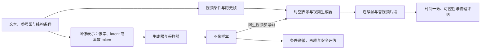

# 第十一部分：图像与视频生成模型

本单元从生成目标出发，比较扩散模型、潜空间扩散、自回归图像生成和视频时空建模。阅读时要把“生成得像”拆成可观察任务：条件如何输入、生成过程如何迭代、哪些因素影响成本，以及静态图像质量为何不能代替时间一致性。具体生成模型与多模态路线由第十五册继续展开。

本单元的生成路径可以先用“条件—表示—采样—时序—评估”串起来：



两条支路共享条件控制和生成建模，但视频还必须维持跨帧对象、运动和事件关系。后文从图像生成机制逐步走到视频与世界模型，最后把“画面逼真”拆成能单独检查的属性。

---

## 第 114 讲：图像生成模型总览

### 导入：从生成像素到学习条件分布

前面的章节主要讨论模型如何读取图像、文字和文档。本讲把方向反过来：给定随机变量和条件，模型如何构造一张新的图像？这个问题表面上像“把 prompt 翻译成像素”，实质上涉及概率分布、表示空间、条件控制、采样算法、评价协议和安全边界。

同一个 prompt 可以对应很多合理图像。生成模型不是在寻找一张唯一正确的答案，而是在学习条件分布：

~~~math
p_\theta(x\mid c)
~~~


其中 x 表示图像，c 表示文本、类别、参考图、姿态或其他条件，theta 表示模型参数。采样时，模型要从这个分布中产生一个或多个样本；评估时，既要问样本是否逼真，也要问它是否遵守条件、是否有足够多样性、是否满足安全和成本要求。

图像理解关心“这张图里有什么”；图像生成关心“在条件约束下，哪些图像是合理的，以及怎样从中采样”。理解和生成都需要表示与条件控制，但生成还要面对一个额外问题：合理答案通常不止一个，因此“与标注完全相同”往往不是合适的唯一标准。

---

### 一、图像生成模型究竟在学习什么

#### 1. 无条件生成与条件生成

无条件生成关注图像本身的分布：

~~~math
p_\theta(x)
~~~


条件生成关注给定条件下的图像分布：

~~~math
p_\theta(x\mid c)
~~~


条件不一定是完整的自然语言指令。深度图主要约束几何结构，mask 主要约束哪些区域可以修改，参考图可能约束身份、颜色或构图。设计系统时必须说明每种条件的作用边界，不能把“支持参考图”理解成“完全复制参考图”。

如果模型能够直接计算概率密度，训练目标常写成负对数似然：

~~~math
L_{\mathrm{NLL}}(\theta)
=
-\sum_{i=1}^{n}\log p_\theta(x_i\mid c_i)
~~~


这里的求和也可以改成样本平均，二者只相差一个与参数无关的缩放。这个公式是共同目标的抽象表达，不是所有路线都会直接、精确地计算 p_theta(x|c)：VAE 使用变分下界，Flow 使用可逆变换计算密度，自回归模型逐 token 分解概率，Diffusion 通常优化去噪目标，GAN 则通过对抗博弈间接逼近数据分布。

#### 2. 生成不是重建

autoencoder 的重建任务是把给定图片压缩后还原；生成任务还要求模型从新的随机变量出发，产生训练集中没有逐像素出现过、但仍符合数据分布的样本。

~~~text
重建：给定这张图，能否还原它？
采样：给定新的随机变量，能否生成合理的新图？
~~~


一个模型重建清晰，不代表它的潜空间适合随机采样；一个模型生成样本逼真，也不代表它会遵守文本条件。后文几条路线的差异，正是它们对可重建、可采样和可控这三个目标的取舍不同。

#### 3. 生成质量不是单一维度

实际系统通常同时关心：

1. 真实感和局部细节。
2. 条件遵循，例如对象、属性和数量。
3. 构图、空间关系和文字可读性。
4. 样本之间的多样性。
5. 风格或身份的一致性。
6. 推理延迟、显存和单位成本。
7. 版权、隐私和安全风险。

这些目标可能互相冲突。例如提高 guidance 强度可能让 prompt 中的主体更加明显，却造成颜色过饱和；加入强参考图约束可能提高身份一致性，却降低创造空间。因此评价之前要先定义业务成功条件。

---

### 二、五条生成路线的全局地图

| 路线 | 核心变量 | 训练直觉 | 生成方式 | 主要优势 | 主要限制 |
| --- | --- | --- | --- | --- | --- |
| VAE | 连续潜变量 | 重建加分布正则 | 从潜变量解码 | 潜空间连续，概率解释清晰 | 高频细节可能被平滑 |
| GAN | 生成样本与判别器 | 生成器和判别器博弈 | 一次前向生成 | 采样快，图像锐利 | 训练不稳定，可能模式坍塌 |
| Normalizing Flow | 可逆变量变换 | 最大化精确似然 | 先采样再逆变换 | 密度可计算，采样可逆 | 可逆结构和显存约束强 |
| 自回归 | 离散视觉 token | 下一 token 预测 | 按序生成 token | 与语言建模统一 | 高分辨率序列长，串行慢 |
| Diffusion | 连续带噪状态 | 学习反向去噪 | 多步从噪声采样 | 质量和条件控制强 | 多步采样成本高 |

这张表只能建立方向感，不能用“主流”替代技术判断。GAN 仍适合一些低延迟或特定领域的生成器；自回归模型可以把文本、图像和其他序列统一建模；Normalizing Flow 在需要显式 likelihood 的场景仍有理论价值；Diffusion 的优势是训练目标、样本质量和条件接口形成了较好的工程组合。近年文生图和视频论文还常出现 Flow Matching，但它不是与这五条路线互斥的第六类：它描述如何训练连续向量场，可以选择扩散概率路径，也可以选择其他路径。

---

### 三、VAE：用连续潜空间组织图像

VAE 可以看作概率化的 autoencoder。编码器不直接输出一个确定向量，而是输出近似后验分布：

~~~math
q_\phi(z\mid x)
~~~


解码器从潜变量生成图像分布：

~~~math
p_\theta(x\mid z)
~~~


常用先验是标准正态分布 p(z)=N(0,I)。训练时最大化证据下界，等价于最小化负 ELBO：

~~~math
L_{\mathrm{VAE}}
=
-\mathbb{E}_{z\sim q_\phi(z\mid x)}
\left[\log p_\theta(x\mid z)\right]
+
D_{\mathrm{KL}}
\left(q_\phi(z\mid x)\Vert p(z)\right)
~~~


第一项要求重建图像，第二项要求潜变量分布接近一个可采样的先验。KL 项不是让所有样本的 z 都相同，而是约束分布形状。若重建项过弱，图像细节会丢失；若正则过弱，潜空间可能不规则，随机采样容易落到训练数据没有覆盖的区域。

VAE 的潜空间通常可以进行连续插值。给定两个潜变量 z_a 和 z_b，可以构造：

~~~math
z(\lambda)=(1-\lambda)z_a+\lambda z_b,\qquad 0\le\lambda\le1
~~~


这并不保证像素会线性变化，但常常比离散 token 插值更自然。VAE 的代价是重建目标容易偏向平均解，尤其在像素级高频细节上可能显得模糊。

现代系统中，VAE 不一定是最终的高质量生成器，却经常承担图像压缩和解码角色。Latent Diffusion 先用图像 autoencoder 把像素图变为较低空间分辨率的 latent，再在 latent 中进行扩散；因此 VAE 的重建质量会成为整个系统的上限之一。

---

### 四、GAN：让生成器在判别压力下变逼真

GAN 包含生成器 G 和判别器 D。生成器把随机变量 z 映射成样本 G(z)，判别器输出输入为真实样本的概率。经典 minimax 目标是：

~~~math
\min_G\max_D V(D,G)
=
\mathbb{E}_{x\sim p_{\mathrm{data}}}[\log D(x)]
+
\mathbb{E}_{z\sim p_z}[\log(1-D(G(z)))]
~~~


判别器希望真实样本得到高分、生成样本得到低分；生成器希望生成样本被判别器当成真实。实际工程常使用 non-saturating generator loss：

~~~math
L_G^{\mathrm{NS}}
=
-\mathbb{E}_{z\sim p_z}[\log D(G(z))]
~~~


公式中的 D(x) 应位于 0 和 1 之间；如果实现使用 logits，应该调用数值稳定的 binary cross entropy with logits，而不是用一个极小常数掩盖 log(0)。

GAN 采样快，因为生成阶段通常只需一次生成器前向计算；它也能产生锐利纹理。然而，生成器可能反复产生少数容易骗过判别器的模式，这种现象称为 mode collapse。此时单张图很逼真，样本集合却缺少多样性。只看精选图片，会把“局部逼真”误认为“分布覆盖充分”。

条件 GAN 可以把文本、类别或其他信号输入生成器和判别器，但复杂自然语言组合通常需要更细的跨模态建模。GAN 的历史贡献也不能简化成“过时”：图像翻译、高效生成和判别式反馈等思想仍影响着后续系统。

---

### 五、Normalizing Flow：用可逆变换得到显式密度

Normalizing Flow 选择一个容易采样的基础变量 z，并使用可逆函数把它映射成图像 x。如果：

~~~math
z=f_\theta(x)
~~~


则变量变换公式为：

~~~math
p_X(x)
=
p_Z(f_\theta(x))
\left|
\det
\frac{\partial f_\theta(x)}{\partial x}
\right|
~~~


生成时从 z 服从 p_Z 的分布中采样，再计算 x=f_theta^{-1}(z)。可逆性让密度、编码和采样在理论上都很清晰，但也带来结构约束：每一层必须可逆，Jacobian 行列式要能高效计算，内存和计算量不能随分辨率失控。

Normalizing Flow 的“似然高”不等于“人类觉得图像好”。似然衡量模型密度与数据分布的匹配，视觉质量、多样性和条件遵循仍要另外评估。它的价值在于提供精确概率建模的基准，帮助我们区分“概率模型解释清晰”和“最终样本更符合人类视觉偏好”这两个问题。

这里的 Normalizing Flow 指通过可逆映射和 Jacobian 行列式追踪密度的模型。近年文献中的 Flow Matching 与它有数学联系，但不能与这个表格行直接画等号：Flow Matching 训练连续正规化流的时间依赖向量场，使其逼近一条预先选择的概率路径上的目标速度场；条件构造可以让训练不必先数值模拟整条 ODE。该路径可以采用扩散路径，也可以使用非扩散路径，所以它与 Diffusion 有交叠，而不是一个互斥的新家族。[Flow Matching 原论文](https://arxiv.org/abs/2210.02747)

用一个标量直线路径看训练信号。把噪声端记为 $x_0=0$，数据端记为 $x_1=4$，并选 $x_t=(1-t)x_0+tx_1$。当 $t=0.25$ 时，状态是 $x_t=1$，目标速度 $u_t=x_1-x_0=4$。如果模型给出 $v_\theta(x_t,t)=3.5$，这一对样本的平方速度误差为 $(3.5-4)^2=0.25$。这是固定噪声—数据配对、直线路径下的教学例子，不是总体向量场误差或生成质量指标；真实模型要在许多样本和时间点上学习，再由 ODE 数值求解器生成。

---

### 六、自回归图像模型：把图像变成序列

自回归路线通常先用离散 autoencoder 把图像编码成视觉 token：

~~~text
image -> visual tokenizer -> v_1, v_2, ..., v_N
~~~


如果图像被表示为 N 个 token，条件生成目标为：

~~~math
p_\theta(v\mid c)
=
\prod_{i=1}^{N}
p_\theta(v_i\mid c,v_{1:i-1})
~~~


训练时可以并行计算所有位置的 next-token loss，生成时却必须按顺序解码。若图像有 N 个视觉 token，至少需要 N 次自回归决策；缓存可以减少重复计算，但不能消除串行依赖。

这条路线的优点是接口统一，文字、图像 token 和其他离散符号可以放进一个序列模型。限制是视觉 token 数会随分辨率增长，序列过长时注意力和生成延迟都很高。视觉 tokenizer 的压缩率还会影响细节：压缩太强，序列短但重建丢失；压缩太弱，细节保留却让生成成本上升。

自回归模型的 token-level likelihood 也不能直接替代最终质量。模型可能准确预测常见纹理，却在“画三只猫”“让杯子位于书的左侧”等组合关系上失败。因此需要单独测试对象存在性、属性、数量和空间关系。

---

### 七、Diffusion：把复杂生成拆成许多次去噪

Diffusion 的关键转换是：不要求模型一次从随机变量画出整张图，而是先定义一个固定的加噪过程，再学习如何从不同噪声强度恢复信息。

给定干净样本 x_0，前向过程逐步加入高斯噪声。令 alpha_t=1-beta_t，并定义 alpha_bar_t 为从第 1 步到第 t 步的 alpha 连乘，则可以直接构造第 t 步的状态：

~~~math
x_t
=
\sqrt{\bar{\alpha}_t}x_0
+
\sqrt{1-\bar{\alpha}_t}\epsilon,
\qquad
\epsilon\sim\mathcal{N}(0,I)
~~~


训练时随机选择 t 和噪声 epsilon，让网络根据 x_t、t 和条件 c 预测噪声、干净样本或其他参数化目标。一个常见的简化目标是：

~~~math
L_{\mathrm{diff}}
=
\mathbb{E}_{x_0,\epsilon,t,c}
\left[
\left\|
\epsilon-\epsilon_\theta(x_t,t,c)
\right\|_2^2
\right]
~~~


这里的均方误差不是让模型直接学会像素平均，而是在不同噪声等级上学习一个去噪方向。生成时从近似高斯噪声开始，使用采样器反复调用网络，逐步得到低噪状态。

Diffusion 适合多条件控制，是因为每一个去噪步骤都可以接收文本、参考图或结构条件。它的主要成本也来自这里：一个样本需要多次网络前向，且高分辨率状态很大。少步采样、蒸馏、缓存和更高效的网络结构，都是在减少每个样本的去噪工作。

本讲只建立直觉和统一符号。反向概率、变分目标、DDPM、DDIM 和 classifier-free guidance 的细节放在下一讲，避免总览和完整推导混成一段公式堆叠。

---

### 八、Latent Diffusion：在更小的表示空间里采样

像素空间的状态大小随图像宽高直接增长。Latent Diffusion 先使用图像 autoencoder：

~~~text
image -> encoder -> z_0
z_0 -> diffusion denoising -> z
z -> decoder -> image
~~~


假设像素图包含 H_x W_x C_x 个元素，latent 包含 H_z W_z C_z 个元素，则元素数量的粗略压缩比为：

~~~math
\rho_{\mathrm{elem}}
=
\frac{H_xW_xC_x}{H_zW_zC_z}
~~~


以 512 x 512 x 3 压到 64 x 64 x 4 为例，比例是 48。这不是端到端 FLOPs 的精确缩放：U-Net 或 DiT 的通道宽度、卷积、attention、VAE 编解码和显存访问都会改变真实成本。但它解释了为什么在 latent 中扩散通常更容易支持较高分辨率。

压缩会引入信息损失。过度压缩可能使小文字、细线和局部几何无法恢复；latent diffusion 的整体质量因此同时取决于 autoencoder 的重建能力和 denoiser 的生成能力。调试时应分开测量：

1. 只编码再解码时的重建质量。
2. latent denoiser 生成的结构和纹理质量。
3. 从文本或其他条件到最终图像的遵循程度。
4. VAE 解码器带来的颜色和细节偏差。

Stable Diffusion 是 latent diffusion 家族中的代表性公开路线。它的低成本不是免费获得的：仍需承担 VAE 编解码、文本编码、多个采样步和高分辨率后处理成本。不同版本、分辨率和推理实现之间不能直接用一个固定倍数比较。

---

### 九、一个文生图系统如何工作

典型 text-to-image pipeline 可以拆成：

~~~text
prompt
  -> text encoder
  -> condition representation
random latent
  -> denoising network + sampler
  -> generated latent
  -> VAE decoder
  -> image checks and output
~~~


#### 1. 文本编码器

文本编码器把 prompt 变成 token 表示。不同系统可能使用 CLIP、T5 或其他 Transformer，词表、最大长度、池化方式和训练数据都不同。不要假定所有模型对同一 prompt 的截断和权重方式相同。

#### 2. 去噪网络

U-Net 通过卷积多尺度地处理空间特征，DiT 等路线则把 latent patch 或 token 交给 Transformer。网络输入通常包含当前带噪状态、时间步和条件表示，输出噪声、速度或其他参数化量。

#### 3. 采样器

采样器把网络输出转换成下一个时间状态。DDPM、DDIM、Euler、DPM-Solver 等算法在随机性、步数、稳定性和速度上不同。采样器不是无关紧要的后处理插件：换采样器可能改变图像结构、细节和 guidance 效果。

#### 4. VAE 解码器

latent 通过解码器还原为像素图。输出的颜色范围、缩放系数、分辨率和后处理都属于接口契约。部署时常见的错误之一，是训练和推理使用了不一致的 latent scaling 或图像归一化。

#### 5. 安全与质量检查

系统可以在 prompt、latent 或最终图像阶段进行安全检查，也可以检查图像尺寸、格式、文字、重复内容和业务规则。过滤器只能提供风险信号，不能证明内容绝对安全；误拒和漏检都应该进入监控。

#### 6. 放大和精修

高分辨率放大、局部精修或第二阶段模型可以提升细节，但会增加延迟、成本和误差传播。若精修器改变了人物身份、文字或布局，应把它视为另一个生成阶段单独评估，而不是把所有质量归因于基础模型。

---

### 十、文本条件与 Classifier-Free Guidance

文本条件通常通过 cross-attention 或其他条件调制进入去噪网络。抽象表示为：

~~~math
\epsilon_\theta(x_t,t,c)
~~~


Classifier-Free Guidance 同时使用无条件预测和有条件预测：

~~~math
\hat{\epsilon}_\theta
=
\epsilon_\theta(x_t,t,\varnothing)
+
s
\left(
\epsilon_\theta(x_t,t,c)
-
\epsilon_\theta(x_t,t,\varnothing)
\right)
~~~


c 是条件，空集合表示无条件分支，s 是 guidance scale。当 s 增大时，采样方向通常更偏向条件分支；但更强不是更正确，过大的值可能带来过饱和、结构重复和不自然细节。实际效果取决于模型训练、噪声阶段、采样器和 prompt。

许多实现为了得到两种预测，会把有条件和无条件输入拼成一个 batch，因此一次采样步的网络计算可能近似翻倍。推理成本不能只看步数，还要看每步有几次网络调用、latent 大小和是否启用了 refiner。可以用一个粗略代理表示：

~~~math
T_{\mathrm{sample}}
\approx
K\cdot C_{\mathrm{call}}\cdot T_{\mathrm{denoise}}
+
T_{\mathrm{text}}
+
T_{\mathrm{decode}}
~~~


其中 K 是采样步数，C_call 是每步网络调用数。这个式子不是硬件性能模型，但能帮助定位“为什么改一个 guidance 配置后延迟增加”。

---

### 十一、从 prompt 到结构控制

自然语言适合描述语义，但不擅长精确指定每个对象的坐标、姿态和边界。可控生成因此引入显式结构条件：

1. Sketch 或 Canny 边缘。
2. 深度图。
3. 人体姿态关键点。
4. 分割图和布局框。
5. 参考图像。
6. Inpainting mask。
7. 局部文字或其他外部约束。

ControlNet 的代表性思想是在基础扩散网络旁边加入条件分支，让边缘、姿态或深度等输入影响去噪特征，同时尽可能保留基础模型的生成能力。一个抽象的条件去噪目标可以写成：

~~~math
L_{\mathrm{ctrl}}
=
\mathbb{E}_{x_0,\epsilon,t,c,u}
\left[
\left\|
\epsilon-\epsilon_\theta(x_t,t,c,u)
\right\|_2^2
\right]
~~~


u 是结构条件。这个式子说明条件进入模型，但没有说明具体的零卷积、特征注入或控制权重；具体实现必须以对应论文和代码为准。

Inpainting 把问题改成“只在指定区域生成，同时保留上下文”。它需要记录 mask 的定义方向：是 1 表示待修改，还是 1 表示保留区域？如果训练和推理相反，模型会把应该保护的区域重绘。边缘、深度和 mask 都有自己的坐标、分辨率和预处理协议，控制图变形后即使生成图很漂亮，也可能没有遵守用户要求。

---

### 十二、质量、控制和成本的相互牵制

#### 1. 质量与多样性

生成器过度集中在少数高概率模式时，单张图可能更稳定，但样本多样性下降。要报告多样性，至少要固定条件、改变随机种子并测量样本间相似度或人工差异；只展示一张精选图片没有代表性。

#### 2. Prompt 遵循与审美

图像可以很美，却漏掉关键对象、属性或数量；也可以严格包含 prompt 中的词，却构图僵硬。应把主体存在性、属性正确、关系正确和整体偏好分开标注。

#### 3. 采样步数与延迟

若每个样本需要 K 次去噪调用，减少 K 通常能降低延迟，但质量变化不一定单调。不同 sampler 的步数不能直接横向比较，必须固定硬件、分辨率、batch、精度和 warm-up。

#### 4. Guidance 与真实感

guidance 太低可能条件弱，太高可能过饱和或出现重复伪影。调参应在固定 prompt 集和多个随机种子上进行，不应根据一张幸运样本选择设置。

#### 5. 结构控制与创造性

边缘、姿态和布局约束越强，结构越稳定；但留给模型补全纹理和构图的自由度越小。业务需求应先确定哪些信息必须保留，哪些信息允许创造。

#### 6. 安全过滤与可用性

严格过滤降低部分风险，却可能误伤医学、教育和新闻场景；宽松过滤提高可用性，却要求更强的审计、分级和人工复核。安全不是一个单独的二分类开关，而是输入策略、生成策略、输出检查和申诉流程的组合。

---

### 十三、如何评估图像生成

#### 1. FID 的含义与边界

Fréchet Inception Distance 通常在固定特征提取器上，把真实图和生成图的特征近似成高斯分布：

~~~math
\mathrm{FID}
=
\lVert\mu_r-\mu_g\rVert_2^2
+
\mathrm{Tr}
\left(
\Sigma_r+\Sigma_g
-
2(\Sigma_r\Sigma_g)^{1/2}
\right)
~~~


r 和 g 分别表示 real 与 generated，mu 是特征均值，Sigma 是协方差。FID 越低通常表示两组图在该特征空间的统计距离越近，但它依赖特征提取器、图像预处理、样本数量和数据分布。它不直接衡量 prompt 遵循、文字正确、安全和人类审美，也可能把多样性和逼真度混合成一个值。

#### 2. Inception Score

Inception Score 可以写成：

~~~math
\mathrm{IS}
=
\exp
\left(
\mathbb{E}_{x}
D_{\mathrm{KL}}
\left(
p(y\mid x)\Vert p(y)
\right)
\right)
~~~


它希望单图的类别分布明确，同时整个样本集覆盖多个类别。它依赖分类器的标签空间，因此对开放域文生图、艺术风格和细粒度 prompt 的解释能力有限。不能把 IS 与 FID 当作互相可换算的分数。

#### 3. 文本对齐

CLIPScore 或其他图文相似度可以衡量图像和 prompt 在一个共享表示空间中的接近程度：

~~~math
S_{\mathrm{align}}
=
\cos(f_I(x),f_T(c))
~~~


它适合做批量筛选和相对比较，但相似度高不代表对象数量、空间关系和文字都正确；编码器本身的偏置会传递到分数。对于“生成三只猫”“海报文字必须完全一致”这类任务，应使用专项检测、OCR 或人工协议。

#### 4. 人类偏好与专项测试

人类评估应写清楚任务、比较方式、随机化和标注者协议。单张绝对打分容易受到尺度漂移影响，成对比较和盲测常更稳定。专项评估可以覆盖：

1. prompt 中每个对象是否存在。
2. 颜色、材质、数量和动作是否符合。
3. 左右、遮挡和布局是否正确。
4. 文字 OCR 是否正确。
5. 参考身份或风格是否保持。
6. 安全策略是否按预期工作。
7. 多个随机种子下的成功率、延迟和成本。

一个合格的报告应保存 prompt 版本、负面条件、随机种子、采样器、步数、分辨率、模型权重、硬件和后处理。只给出一张最好看的图，不能作为模型能力结论。

---

### 十四、最小代码：比较路线目标和采样成本

下面的代码不生成真实图像，而是用小向量验证几个关系：VAE 的重建与 KL、GAN 的二元交叉熵、Diffusion 的噪声预测 MSE、自回归 token 数以及 latent 元素压缩比。它故意拒绝空列表、长度不一致、非有限数和越界概率，让公式中的定义域在代码里也可见。

~~~python
import math


def finite_values(values, name):
    values = list(values)
    if not values:
        raise ValueError(f"{name} must be non-empty")
    if any(
        not isinstance(value, (int, float))
        or isinstance(value, bool)
        or not math.isfinite(value)
        for value in values
    ):
        raise ValueError(f"{name} must contain finite numbers")
    return values


def mean(values, name):
    values = finite_values(values, name)
    return sum(values) / len(values)


def mse(a, b):
    a = finite_values(a, "a")
    b = finite_values(b, "b")
    if len(a) != len(b):
        raise ValueError("mse inputs must have equal length")
    return mean([(x - y) ** 2 for x, y in zip(a, b)], "squared errors")


def bernoulli_nll(probabilities, name):
    probabilities = finite_values(probabilities, name)
    if any(not 0.0 < probability < 1.0 for probability in probabilities):
        raise ValueError(f"{name} probabilities must be strictly between 0 and 1")
    return mean([-math.log(probability) for probability in probabilities], name)


def kl_diag_standard_normal(mu, log_var):
    mu = finite_values(mu, "mu")
    log_var = finite_values(log_var, "log_var")
    if len(mu) != len(log_var):
        raise ValueError("mu and log_var must have equal length")
    terms = [
        math.exp(log_variance) + mean_value ** 2 - 1.0 - log_variance
        for mean_value, log_variance in zip(mu, log_var)
    ]
    return 0.5 * sum(terms)


x = [0.20, 0.70, 0.10, 0.90]
x_recon = [0.25, 0.62, 0.18, 0.82]
mu = [0.10, -0.20, 0.05]
log_var = [-0.40, 0.20, 0.00]
recon_loss = mse(x, x_recon)
kl_loss = kl_diag_standard_normal(mu, log_var)
vae_objective = recon_loss + 0.1 * kl_loss

d_real = [0.88, 0.76, 0.91]
d_fake = [0.21, 0.35, 0.18]
d_loss = bernoulli_nll(d_real, "d_real") + bernoulli_nll(
    [1.0 - probability for probability in d_fake],
    "one_minus_d_fake",
)
g_loss = bernoulli_nll(d_fake, "d_fake")

epsilon = [0.12, -0.35, 0.08, 0.40]
epsilon_pred = [0.10, -0.30, 0.11, 0.33]
diffusion_loss = mse(epsilon, epsilon_pred)

prompt_tokens = 18
image_tokens = 32 * 32
if not isinstance(prompt_tokens, int) or isinstance(prompt_tokens, bool) or prompt_tokens <= 0:
    raise ValueError("prompt_tokens must be a positive integer")
if not isinstance(image_tokens, int) or isinstance(image_tokens, bool) or image_tokens <= 0:
    raise ValueError("image_tokens must be a positive integer")
ar_token_budget = prompt_tokens + image_tokens

pixel_elements = 512 * 512 * 3
latent_elements = 64 * 64 * 4
steps = 30
cfg_network_calls = 2
if not all(
    isinstance(value, int) and not isinstance(value, bool) and value > 0
    for value in (pixel_elements, latent_elements, steps, cfg_network_calls)
):
    raise ValueError("cost quantities must be positive integers")

result = {
    "vae": {
        "recon_mse": round(recon_loss, 6),
        "kl": round(kl_loss, 6),
        "objective_beta_0.1": round(vae_objective, 6),
    },
    "gan": {
        "discriminator_loss": round(d_loss, 6),
        "generator_loss": round(g_loss, 6),
    },
    "diffusion": {
        "noise_prediction_mse": round(diffusion_loss, 6),
    },
    "autoregressive": {
        "image_tokens": image_tokens,
        "total_sequence_tokens": ar_token_budget,
        "decode_calls": image_tokens,
    },
    "latent_diffusion": {
        "pixel_elements": pixel_elements,
        "latent_elements": latent_elements,
        "element_reduction": round(pixel_elements / latent_elements, 2),
        "denoising_calls": steps * cfg_network_calls,
    },
}
print(result)
~~~


> **代码状态：静态审阅，未运行（2026-10-29）**

典型输出应与代码完全一致：

~~~text
{'vae': {'recon_mse': 0.005425, 'kl': 0.072111, 'objective_beta_0.1': 0.012636}, 'gan': {'discriminator_loss': 0.453846, 'generator_loss': 1.441756}, 'diffusion': {'noise_prediction_mse': 0.002175}, 'autoregressive': {'image_tokens': 1024, 'total_sequence_tokens': 1042, 'decode_calls': 1024}, 'latent_diffusion': {'pixel_elements': 786432, 'latent_elements': 16384, 'element_reduction': 48.0, 'denoising_calls': 60}}
~~~


这里的 48.0 只是元素数量比，不是端到端加速比；真实系统还要运行文本编码、VAE、调度器和安全检查。代码也没有实现任何生成模型，它只把抽象目标变成可运行的数值关系。若把它扩展成实验，应固定模型权重和输入集，分别记录重建、生成、条件遵循、延迟和成本。

---

### 十五、从失败样本反推系统问题

生成系统的错误常常被一句“图不好看”掩盖。更有用的分析方式是把失败拆成条件、采样、解码和后处理几个边界：

1. Prompt 中的对象没有出现，可能是文本编码、训练分布或条件注入问题。
2. 对象出现但颜色或数量错误，可能是组合泛化和空间绑定问题。
3. 构图正确但文字乱码，应该使用 OCR 专项评估，不能用 FID 替代。
4. 参考图身份不稳定，可能是参考编码、条件强度或 denoiser 忽略了局部特征。
5. 低分辨率正常、放大后变形，可能是 upscaler 或精修阶段引入的错误。
6. 输出符合内容但被过滤，说明安全策略和产品目标需要分级，而不一定是生成器质量问题。
7. 质量不错但延迟超预算，需要减少 latent 大小、网络调用、采样步数或后处理阶段。

对一个固定 prompt，可以保存多个随机种子，并记录：

~~~text
prompt, seed, model_version, sampler, steps, resolution,
guidance, control_inputs, output_hash, latency, cost, safety_result
~~~


这样才可以判断是随机波动、模型回归还是配置变化。生成图片也应保存输入条件和版本信息，否则失败样本无法复现，任何“改进”都可能只是换了随机种子。

---

### 十六、资料与证据边界

本讲关于 VAE 的概率编码依据 Kingma 与 Welling 的 VAE 原始论文；GAN 的 minimax 目标依据 Goodfellow 等人的原始论文；可逆密度建模可参考 RealNVP；离散视觉 token 路线可参考 VQ-VAE 和 DALL-E 等工作；Diffusion 的加噪、去噪和噪声预测目标以 DDPM 原始论文为主要入口；Latent Diffusion 的压缩空间路线以 Rombach 等人的 LDM 论文为主要入口；ControlNet 的结构条件分支以其原始论文和官方实现为依据；FID 的定义来自 Heusel 等人的评估论文，图文相似度评估可参考 CLIPScore 工作。

这些论文支持各自提出的方法、公式和实验协议，不支持把某个 benchmark 分数直接推广到任意模型版本、中文文字、商业素材或生产流量。官方仓库可以补充配置、权重和实现细节，但“代码能运行”不等于“生成质量在目标业务上成立”。生成图片的版权、训练数据许可和安全结论还需要查看具体模型的许可证、数据来源、服务条款和独立审计。

本讲只做路线级教学和可复现的数值小实验，没有调用真实生成模型，也没有声称某个模型在当前日期一定是最强。真正的模型比较应锁定版本、分辨率、采样器、随机种子、prompt 集、评估脚本、硬件和成本口径。下一讲将把 Diffusion 的前向过程、反向过程、目标函数和采样算法逐步展开。
## 第 115 讲：Diffusion Model 基础

### 导入：把生成问题改写成连续的去噪问题

Diffusion model 的核心想法不是让网络一次画出完整图像，而是把一个难问题拆成许多噪声等级下的局部问题。训练时，从真实图像出发逐步加入高斯噪声；模型学习在给定当前噪声状态和时间步时，应该朝哪个方向恢复数据结构。生成时，从接近纯高斯噪声的状态出发，反复执行这个去噪更新。

对初学者来说，可以把它想成一张清晰照片被逐渐调成雪花噪声，然后训练一个“知道当前噪声有多重的修复器”。对专家来说，关键不在“先加噪再去噪”这句口号，而在于固定的前向 Markov 链、可学习的反向条件分布、噪声参数化和数值采样器之间如何拼接。不同参数化可以共享相同的生成思想，但训练权重、采样公式和工程行为并不完全相同。

本讲使用 DDPM 的记号建立基础，再说明 DDIM、classifier-free guidance、U-Net 和 DiT 如何接入这条链。完整系统还可能在 latent 而不是像素上运行；这不改变扩散过程的数学结构，只改变 x_t 所代表的状态空间。

---

### 一、从一张图到一串带噪状态

令 x_0 表示真实图像或 latent。前向过程固定一个长度为 T 的噪声调度，不学习参数：

~~~math
q(x_t\mid x_{t-1})
=
\mathcal{N}
\left(
\sqrt{\alpha_t}\,x_{t-1},
(1-\alpha_t)I
\right)
~~~


其中：

- t 是时间步，通常取 1,2,...,T；
- beta_t 是第 t 步的噪声增量，要求 0<beta_t<1；
- alpha_t=1-beta_t；
- I 是与状态维度相同的单位矩阵。

逐步写成：

~~~text
x_0 -> x_1 -> x_2 -> ... -> x_T
~~~


随着 t 增大，信号系数下降，噪声系数上升。只有在调度和总步数合适时，x_T 才能近似标准高斯分布；“最后一定是纯噪声”是教学直觉，不是对任意 beta 序列都成立的数学事实。

令：

~~~math
\bar{\alpha}_t
=
\prod_{s=1}^{t}\alpha_s
~~~


利用高斯分布的可合成性，可以跳过中间状态，直接构造第 t 步：

~~~math
x_t
=
\sqrt{\bar{\alpha}_t}\,x_0
+
\sqrt{1-\bar{\alpha}_t}\,\epsilon,
\qquad
\epsilon\sim\mathcal{N}(0,I)
~~~


这条闭式公式是训练高效的关键。训练不需要为每张图真的执行 t 次加噪，只需随机抽取 t，采样一次噪声 epsilon，即可得到对应的 x_t。

当 \bar{\alpha}_t 较大时，x_t 仍保留较多原图信息；当它较小时，状态主要由噪声组成。对初学者来说，这就是“信号旋钮”和“噪声旋钮”；对专家来说，它决定了不同时间步的条件数、梯度尺度和训练样本分布。

---

### 二、反向过程：学习从噪声回到数据

前向过程 q 是已知的，生成时需要近似其反方向。我们定义一个带参数的反向模型：

~~~math
p_\theta(x_{t-1}\mid x_t,c)
=
\mathcal{N}
\left(
\mu_\theta(x_t,t,c),
\Sigma_\theta(x_t,t,c)
\right)
~~~


c 可以是空条件、类别、文本 embedding、参考图或其他控制信号。生成流程从一个接近标准高斯的 x_T 开始：

~~~math
x_T\sim\mathcal{N}(0,I)
~~~


然后按 T,T-1,...,1 的顺序采样：

~~~text
x_T -> x_{T-1} -> ... -> x_1 -> x_0
~~~


反向过程不是简单地把前向公式的箭头倒过来。前向过程知道 x_0，反向生成时只有当前状态 x_t；模型必须从训练数据中学习在当前噪声等级下，哪些方向更符合数据分布。

DDPM 常见实现让网络预测噪声：

~~~math
\epsilon_\theta(x_t,t,c)\approx\epsilon
~~~


由闭式加噪公式可以反推出干净样本的估计：

~~~math
\hat{x}_0
=
\frac{
x_t-\sqrt{1-\bar{\alpha}_t}\,
\epsilon_\theta(x_t,t,c)
}{
\sqrt{\bar{\alpha}_t}
}
~~~


这个 \hat{x}_0 只是当前预测下的估计，不是模型已经恢复出的真实训练图片。采样器会结合它、当前状态和噪声调度，构造下一步的 x_{t-1}。不同 sampler 对均值、方差、时间步跳跃和随机项的处理不同，所以“网络预测了噪声”并不能唯一决定采样算法。

---

### 三、训练目标：预测什么并不只有一种选择

最经典的简化目标是噪声预测 MSE：

~~~math
L_{\mathrm{simple}}
=
\mathbb{E}_{x_0,\epsilon,t,c}
\left[
\left\|
\epsilon-\epsilon_\theta(x_t,t,c)
\right\|_2^2
\right]
~~~


训练步骤可以拆成：

1. 从数据集中采样 x_0。
2. 随机采样时间步 t。
3. 采样 epsilon 服从 N(0,I)。
4. 用闭式公式生成 x_t。
5. 让网络根据 x_t、t 和 c 预测 epsilon。
6. 反向传播预测误差。

这个目标与 DDPM 的变分推导有联系，但工程实现常使用带权或简化版本。不同时间步的损失权重、是否对高噪声样本重加权，都会改变训练动态。因此不能看到“用了 MSE”就推断所有 diffusion 实现完全相同。

#### 1. 预测干净样本

模型也可以直接预测 x_0，再使用相应的转换公式计算反向更新。x_0 预测在低噪声阶段更直观，但不同时间步的数值尺度和裁剪策略需要谨慎处理。

#### 2. 预测速度 v

一种常见的 velocity 参数化为：

~~~math
v_t
=
\sqrt{\bar{\alpha}_t}\,\epsilon
-
\sqrt{1-\bar{\alpha}_t}\,x_0
~~~


它可以在 x_0 和 epsilon 之间建立稳定转换。给定 x_t、时间步和 v_t，采样器可以按约定恢复噪声或干净样本。epsilon、x_0 和 v 不是三个完全不同的生成原理，而是同一个去噪问题的不同坐标表达；但是损失权重、数值范围和推理代码必须保持一致。这里的 v-prediction 是扩散目标的一种参数化；Flow Matching 中的向量场也常用 v 表示，但它定义沿概率路径推动状态变化的方向，两者不能因此共享同一采样更新。

#### 3. 预测参数化的工程契约

一个 checkpoint 的模型输出不能脱离 scheduler 单独理解。必须同时记录：

~~~text
prediction_type, beta_schedule, timestep_convention,
latent_scaling, variance_type, sampler
~~~


如果训练时模型输出的是 v，推理时却按 epsilon 解释，图像通常会出现严重结构和颜色错误。许多“模型质量突然下降”的问题，最终不是网络权重损坏，而是参数化或调度器配置不匹配。

---

### 四、为什么局部预测可以生成整张图

训练样本覆盖了很多图像、很多时间步和很多噪声实例。网络逐渐学习到：在某个噪声等级下，局部状态中哪些模式更可能来自真实数据，哪些方向会把状态推向低概率区域。

生成开始时，纯噪声不包含一个确定对象，但它是一个允许的随机起点。第一次去噪只提供粗略方向，后续步骤在较低噪声下逐渐补全布局、边缘、纹理和局部细节。模型不是先“知道最终猫图长什么样”再执行绘画，而是在一系列条件分布中逐步采样。

从概率角度看，反向链把复杂的 p(x_0) 变成多个相邻状态之间的条件转移；从工程角度看，每一步调用同一个去噪网络，只改变时间步和当前状态。二者结合后，网络不需要直接学习从任意噪声一次跳到高维图像的全部映射。

这也解释了扩散模型的局限：如果训练数据没有提供某种组合关系，或者条件编码在中间步骤没有有效进入网络，反复去噪不会自动创造出可靠的计数、文字或空间推理能力。多步采样增加的是计算预算，不是凭空增加监督信息。

---

### 五、Noise Schedule 与信噪比

噪声 schedule 决定每个时间步信号和噪声的比例。一个常用的观测量是：

~~~math
\mathrm{SNR}_t
=
\frac{\bar{\alpha}_t}{1-\bar{\alpha}_t}
~~~


在这个定义下，SNR_t 越大，x_t 中信号相对越强；SNR_t 越小，状态越接近噪声。不同 schedule 通过安排 beta_t 或等价的 cumulative alpha，决定模型在训练期间看到哪些难度的样本。

常见方案包括：

1. 线性 beta schedule。
2. cosine schedule。
3. sigmoid 或其他连续 log-SNR 设计。

噪声加得过快，图像信息会在很少的步数内消失，模型面对的恢复问题更难；噪声加得过慢，则需要更长的时间链，训练和采样成本增加。schedule 还影响不同时间步的梯度贡献，不能只根据“最后的噪声看起来像不像高斯”来判断好坏。

对初学者来说，可以把 schedule 看成一条从清晰到模糊的课程表。对专家来说，应同时观察 alpha_bar、log-SNR、损失权重、训练时间步采样分布和采样器使用的时间网格。训练 scheduler 与推理 scheduler 也不必逐项相同，但它们必须遵守模型所期待的参数化和状态尺度。

---

### 六、时间步 embedding：网络必须知道当前处在哪一层噪声

同一幅 x_t 在不同时间步的含义不同。若网络不知道 t，就无法判断当前应该修复大结构还是只处理细节。因此去噪网络会把时间步编码成向量，再注入残差块、注意力层或其他条件模块。

常见做法是用正弦、余弦或可学习映射产生时间 embedding。这里的时间步不是图像中的空间位置；它表示噪声过程的状态。模型输入通常可以抽象为：

~~~math
h
=
F_\theta(x_t,\mathrm{time\_embed}(t),c)
~~~


高噪声阶段，网络更需要确定整体轮廓、布局和大尺度语义；低噪声阶段，网络更需要修复纹理、边缘和局部颜色。但这是一种有用的分析直觉，不代表网络在内部拥有严格分离的两个模块。真实作用还取决于架构、训练分布和采样路径。

---

### 七、文本条件与 Classifier-Free Guidance

无条件扩散只学习图像分布；文生图要学习条件分布：

~~~math
p_\theta(x\mid c)
~~~


常见做法是先用 text encoder 得到文本表示，再通过 cross-attention 或条件调制注入去噪网络：

~~~text
prompt -> text encoder -> text embeddings
x_t + time embedding + text embeddings -> denoiser -> prediction
~~~


Classifier-Free Guidance，简称 CFG，让同一个模型同时学会有条件和无条件预测。训练时以一定概率丢弃条件，使模型既能计算：

~~~math
\epsilon_{\mathrm{cond}}
\qquad\text{和}\qquad
\epsilon_{\mathrm{uncond}}
~~~


采样时按如下方式组合：

~~~math
\hat{\epsilon}
=
\epsilon_{\mathrm{uncond}}
+
s
\left(
\epsilon_{\mathrm{cond}}
-
\epsilon_{\mathrm{uncond}}
\right)
~~~


这里的 s 是差分写法中的 guidance 系数：s=0 返回无条件预测，s=1 返回条件预测，继续增大则沿条件差异方向外推。原始 CFG 论文常写成 $\epsilon_{\mathrm{cond}}+w(\epsilon_{\mathrm{cond}}-\epsilon_{\mathrm{uncond}})$，对应关系是 $s=1+w$；软件接口的 `guidance_scale` 还要按具体 pipeline 和版本核对。例如 Diffusers v0.35.1 的经典 Stable Diffusion pipeline 以 `guidance_scale=1` 表示不启用 CFG。[原始 CFG 论文](https://arxiv.org/abs/2207.12598)；[Diffusers v0.35.1 pipeline](https://github.com/huggingface/diffusers/blob/v0.35.1/src/diffusers/pipelines/stable_diffusion/pipeline_stable_diffusion.py)。括号中的差值可理解为条件相对于无条件预测带来的方向；更强外推可能提升 prompt 遵循，也可能造成过饱和、重复结构、细节不自然和多样性下降，不能替代更好的训练数据和结构控制。

如果实现把有条件和无条件输入拼成一个 batch，一次采样步需要近似两份网络计算。粗略成本可以写成：

~~~math
C_{\mathrm{CFG}}
\approx
2S\cdot C_{\mathrm{net}}
+
C_{\mathrm{decode}}
~~~


其中 S 是采样步数，C_net 是单次去噪网络成本。实际实现可能通过批处理、缓存或其他技术改变吞吐，但计算量不会因为把两次输入写在一个 batch 中就凭空消失。

---

### 八、DDPM、DDIM 与其他采样器

#### 1. DDPM

DDPM 按训练链的时间方向逐步采样。对一个常见的高斯反向形式，可以写成：

~~~math
x_{t-1}
=
\mu_\theta(x_t,t,c)
+
\sigma_t z,
\qquad
z\sim\mathcal{N}(0,I)
~~~


在最后一步通常不再加入随机噪声，具体边界由实现定义。DDPM 的推导清晰，但若使用很多时间步，采样成本较高。

#### 2. DDIM

DDIM 使用与训练扩散过程相关的非马尔可夫采样路径，可以在更稀疏的时间网格上更新。先根据网络输出得到 \hat{x}_0，在确定性 eta=0 的一种简化写法下：

~~~math
x_{t'}
=
\sqrt{\bar{\alpha}_{t'}}\,\hat{x}_0
+
\sqrt{1-\bar{\alpha}_{t'}}\,
\epsilon_\theta(x_t,t,c)
~~~


这里 t'<t，且真实实现还要根据所选参数化、时间步和随机性项进行对应变换。eta 非零时会加入额外随机项；不同库对时间步索引、方差和边界的实现也可能不同。因此这条式子用于解释 DDIM 的核心结构，不应当当作所有 DDIM 代码的逐行实现。

#### 3. 求解器与蒸馏

Euler、Heun、DPM-Solver 等方法把去噪过程看作连续或离散动力系统，用更高效的数值更新减少网络调用。蒸馏方法则让少步模型学习多步教师的行为。比较采样器时，应固定模型、prompt、随机种子、分辨率、精度和硬件；“20 步”在不同 sampler 之间不是同一个质量预算。

---

### 九、采样步数、骨干网络与计算成本

如果每个样本需要 S 次去噪网络调用，可以用下式做粗略成本估计：

~~~math
C_{\mathrm{sample}}
\approx
S\cdot C_{\mathrm{net}}
+
C_{\mathrm{text}}
+
C_{\mathrm{decode}}
+
C_{\mathrm{post}}
~~~


CFG 可能让 C_net 近似翻倍；refiner、upscaler 和安全检查则会增加后续阶段成本。真实延迟还受 batch、kernel、显存带宽、CPU-GPU 同步和并发影响，因此公式是成本拆解工具，不是精确性能预测。

#### 1. U-Net

U-Net 使用下采样、上采样和 skip connection 处理空间特征。多尺度路径帮助网络同时看大轮廓和局部细节，cross-attention 可以把文本条件接入 latent 特征。它是许多 latent diffusion 系统的经典骨干。

#### 2. DiT

DiT 把 latent patch 或视觉 token 输入 Transformer。若 latent 的空间大小是 H_z x W_z，patch 边长是 P，并假设二者整除，则 patch token 数为：

~~~math
N_{\mathrm{patch}}
=
\frac{H_zW_z}{P^2}
~~~


全连接 self-attention 的 score cell 数量可粗略记为：

~~~math
C_{\mathrm{attn}}
=
N_{\mathrm{patch}}^2
~~~


这解释了为什么提高 latent 分辨率或减小 patch 会快速增加计算和显存压力。DiT 不是“把 U-Net 的每一层机械替换成 Transformer”，而是另一种 backbone 和 scaling 设计；实际网络还包括时间条件、文本条件、位置编码和输出参数化。

---

### 十、最小代码：加噪、预测噪声、CFG 与成本

下面用一维向量模拟扩散过程，不生成真实图像。它验证五个关系：

1. beta schedule 如何产生 alpha 和 cumulative alpha。
2. 如何用闭式公式构造任意时间步的 x_t。
3. 噪声预测误差如何映射到 x_0 估计。
4. CFG 如何组合有条件和无条件预测。
5. DiT token 数和 CFG 网络调用如何影响成本代理。

代码把空向量、非法 beta、越界时间步、长度不一致和非有限数显式拒绝。这样做是为了让公式的定义域在实验中可见，而不是用 max(1, denominator) 或静默截断掩盖问题。

~~~python
import math


def finite_vector(values, name):
    values = list(values)
    if not values:
        raise ValueError(f"{name} must be non-empty")
    if any(
        isinstance(value, bool)
        or not isinstance(value, (int, float))
        or not math.isfinite(value)
        for value in values
    ):
        raise ValueError(f"{name} must contain finite numbers")
    return values


def same_length(a, b, name):
    a = finite_vector(a, f"{name}.a")
    b = finite_vector(b, f"{name}.b")
    if len(a) != len(b):
        raise ValueError(f"{name} inputs must have equal length")
    return a, b


def add(a, b):
    a, b = same_length(a, b, "add")
    return [x + y for x, y in zip(a, b)]


def sub(a, b):
    a, b = same_length(a, b, "sub")
    return [x - y for x, y in zip(a, b)]


def scale(value, vector):
    vector = finite_vector(vector, "vector")
    if (
        isinstance(value, bool)
        or not isinstance(value, (int, float))
        or not math.isfinite(value)
    ):
        raise ValueError("scale must be a finite number")
    return [value * x for x in vector]


def mse(a, b):
    a, b = same_length(a, b, "mse")
    return sum((x - y) ** 2 for x, y in zip(a, b)) / len(a)


def round_vector(vector, digits=4):
    return [round(value, digits) for value in finite_vector(vector, "vector")]


betas = [0.02, 0.06, 0.10, 0.14]
if any(
    isinstance(beta, bool)
    or not isinstance(beta, (int, float))
    or not math.isfinite(beta)
    or not 0.0 < beta < 1.0
    for beta in betas
):
    raise ValueError("betas must be finite values strictly between 0 and 1")

alphas = [1.0 - beta for beta in betas]
alpha_bars = []
running = 1.0
for alpha in alphas:
    running *= alpha
    alpha_bars.append(running)

x0 = [0.80, -0.40, 0.10, 0.55]
epsilon = [0.30, -1.00, 0.50, 0.20]
t_index = 2
if not isinstance(t_index, int) or isinstance(t_index, bool) or not 0 <= t_index < len(alpha_bars):
    raise ValueError("t_index is outside the schedule")

alpha_bar_t = alpha_bars[t_index]
signal = math.sqrt(alpha_bar_t)
noise = math.sqrt(1.0 - alpha_bar_t)
xt = add(scale(signal, x0), scale(noise, epsilon))

epsilon_pred = [0.26, -0.90, 0.55, 0.18]
loss = mse(epsilon, epsilon_pred)
x0_hat = scale(1.0 / signal, sub(xt, scale(noise, epsilon_pred)))
x0_mse = mse(x0, x0_hat)

epsilon_uncond = [0.20, -0.70, 0.35, 0.10]
epsilon_cond = [0.26, -0.90, 0.55, 0.18]
guidance_scale = 5.0
if (
    not isinstance(guidance_scale, (int, float))
    or isinstance(guidance_scale, bool)
    or not math.isfinite(guidance_scale)
):
    raise ValueError("guidance_scale must be numeric")
epsilon_guided = add(
    epsilon_uncond,
    scale(guidance_scale, sub(epsilon_cond, epsilon_uncond)),
)

steps = 30
net_ms = 42.0
decode_ms = 18.0
if not isinstance(steps, int) or isinstance(steps, bool) or steps <= 0:
    raise ValueError("steps must be a positive integer")
if not all(isinstance(value, (int, float)) and not isinstance(value, bool)
           and math.isfinite(value) and value >= 0
           for value in (net_ms, decode_ms)):
    raise ValueError("latency values must be finite and non-negative")
no_cfg_latency = steps * net_ms + decode_ms
cfg_latency = steps * 2 * net_ms + decode_ms

latent_h = 64
latent_w = 64
patch = 2
if not all(isinstance(value, int) and not isinstance(value, bool) and value > 0
           for value in (latent_h, latent_w, patch)):
    raise ValueError("DiT dimensions must be positive integers")
if latent_h % patch or latent_w % patch:
    raise ValueError("patch must divide latent dimensions")
dit_tokens = (latent_h // patch) * (latent_w // patch)
attention_cells = dit_tokens * dit_tokens

result = {
    "schedule": {
        "alpha_bars": round_vector(alpha_bars),
        "snr_at_t": round(alpha_bar_t / (1.0 - alpha_bar_t), 4),
    },
    "forward_process": {
        "x_t": round_vector(xt),
        "signal_strength": round(signal, 4),
        "noise_strength": round(noise, 4),
    },
    "training": {
        "epsilon_mse": round(loss, 6),
        "x0_hat": round_vector(x0_hat),
        "x0_reconstruction_mse": round(x0_mse, 6),
    },
    "cfg": {
        "scale": guidance_scale,
        "guided_epsilon": round_vector(epsilon_guided),
        "latency_ratio": round(cfg_latency / no_cfg_latency, 2),
    },
    "dit_cost": {
        "tokens": dit_tokens,
        "attention_score_cells": attention_cells,
    },
}

print(result)
~~~


> **代码状态：静态审阅，未运行（2026-10-29）**

典型输出应与代码完全一致：

~~~text
{'schedule': {'alpha_bars': [0.98, 0.9212, 0.8291, 0.713], 'snr_at_t': 4.8507}, 'forward_process': {'x_t': [0.8525, -0.7776, 0.2978, 0.5835], 'signal_strength': 0.9105, 'noise_strength': 0.4134}, 'training': {'epsilon_mse': 0.003625, 'x0_hat': [0.8182, -0.4454, 0.0773, 0.5591], 'x0_reconstruction_mse': 0.000747}, 'cfg': {'scale': 5.0, 'guided_epsilon': [0.5, -1.7, 1.35, 0.5], 'latency_ratio': 1.99}, 'dit_cost': {'tokens': 1024, 'attention_score_cells': 1048576}}
~~~


这个 demo 没有运行真实 U-Net、DiT 或 sampler，只验证向量层面的计算关系。latency_ratio 是人为给定网络和解码耗时后的成本代理，不是任何 GPU 的实测结果；attention_score_cells 也只是全连接 attention 的数量级代理。

---

### 十一、如何定位扩散系统的失败

扩散系统的失败不能都归结为“模型不够大”。可以沿着数据、参数化、调度器、条件、采样和解码边界逐层检查：

1. 训练图像归一化、latent scaling 或 VAE 接口不一致，导致所有结果颜色或结构异常。
2. 模型预测类型是 v，推理代码却按 epsilon 解码。
3. beta schedule、时间步索引或 scheduler 配置不匹配 checkpoint。
4. CFG 过高导致过饱和、重复结构，过低则条件遵循弱。
5. 采样步数或时间网格不适合当前 sampler，出现细节丢失或噪声残留。
6. 文本 encoder 截断、语言分布或训练图文对齐不足，导致 prompt 中的属性被忽略。
7. latent patch 太多，DiT 的显存和延迟超出预算。
8. VAE 解码或后处理阶段引入颜色、文字和局部细节错误。

调试时应保存模型版本、scheduler 配置、prediction type、prompt、随机种子、分辨率、采样器、步数和输出哈希。只有这样才能区分模型回归、随机波动和配置错误。

---

### 十二、研究实验：把去噪有效变成可测量结果

可以构造一个小型实验，固定一批 x_0、噪声向量和时间步，比较不同噪声调度与不同预测参数化：

1. 对每个样本计算 x_t、真实噪声和预测噪声。
2. 报告 epsilon MSE、x_0 重建误差和不同 SNR 桶的误差。
3. 用同一个 checkpoint 比较不同 sampler 和步数。
4. 固定 prompt 与随机种子，测量 CFG scale 对条件遵循、自然性和延迟的影响。
5. 分别记录 VAE decode、denoiser、text encoder 和安全检查的耗时。

对图像生成，不能只看最后的图片。应同时保留中间 x_t 可视化、预测的 x_0、最终输出和失败标签。对条件生成，还可以做 prompt 反事实：只改颜色、数量或空间关系，观察对应评估是否变化。实验的目标不是证明一个固定配置“最好”，而是找出质量、成本和错误类型之间的关系。

---

### 十三、资料与证据边界

DDPM 原始论文支持前向加噪、反向建模和噪声预测目标；DDIM 原始论文支持非马尔可夫、可缩短步数的采样路径；Classifier-Free Diffusion Guidance 论文支持条件与无条件预测组合的基本方法；DiT 原始论文支持以 Transformer 作为 diffusion backbone 的路线。具体库中的 scheduler、方差、时间步索引、prediction type 和 latent scaling，应以对应实现和模型配置为准。

这些论文的 benchmark 结果只在其数据、模型、采样设置和评估协议下成立，不能直接证明任意文生图服务在中文文字、商业素材、人物身份或高分辨率场景中表现相同。代码示例只验证一维向量和成本代理，没有运行真实扩散模型，也不能证明某个 schedule、CFG 或 sampler 在生产系统中一定更好。

生成模型的规模规律也开始被当作独立研究对象。ICLR 2026 的 [Scaling Laws for Diffusion Transformers](https://proceedings.iclr.cc/paper_files/paper/2026/hash/880d8999c07a8efc9bbbeb0c38f50765-Abstract-Conference.html) 在论文指定的计算范围内拟合 DiT 生成质量，并把拟合用于更大预算预测。读这类结果要分开实验测得的点和曲线外推点；训练目标、数据、评估器和 FLOPs 口径变化都可能改变曲线。该研究补充了“算力—模型—质量”比较视角，不表示任意文生图模型都遵循同一组指数，也不构成新采样方法。

下一讲进入 Latent Diffusion 与 Stable Diffusion。那里会进一步解释 VAE 压缩、latent scaling、文本条件和开源 pipeline 如何组合成一个可部署的文生图系统。
## 第 116 讲：Latent Diffusion 与 Stable Diffusion

### 导入：把扩散计算搬到更合适的表示空间

上一讲介绍了 Diffusion 的前向加噪、反向去噪和采样器。本讲继续回答一个工程问题：如果每一步去噪都直接处理高分辨率像素，成本为什么会迅速失控？Latent Diffusion 的答案是先训练一个图像 autoencoder，把像素压缩到较小的潜空间，再在潜空间中扩散，最后解码回图像。

经典 Stable Diffusion 1.x/2.x 可以作为这条路线的清晰教材案例：

~~~text
图像 -> VAE encoder -> latent
文本 -> text encoder
latent + 文本条件 -> U-Net 去噪器 + sampler
去噪后的 latent -> VAE decoder -> 图像
~~~


这里的“Stable Diffusion”不能被理解成一个永远固定的单一架构名称。后续版本和同名生态中的模型可能更换文本编码器、去噪骨干、条件接口、分辨率和参数化。本文用经典 latent diffusion pipeline 解释基本机制，并在涉及具体 checkpoint 时明确哪些结论只对某个版本成立。

LDM 论文支持“在感知压缩空间中去噪可以降低计算压力”的方法论；具体模型的 VAE、latent scaling、文本编码器、采样器、许可证和训练数据，仍必须以对应模型卡、配置和官方实现为准。

---

### 一、为什么直接在像素空间扩散很贵

设图像张量的高、宽和通道数分别为 H_x、W_x、C_x，像素元素数量为：

~~~math
N_{\mathrm{pix}}
=
H_xW_xC_x
~~~


例如一张 512 x 512 x 3 的图像包含：

~~~math
512\times512\times3=786432
~~~


Diffusion 还要重复运行去噪网络。若采样步数为 S，每步网络成本粗略为 C_pix，像素空间的核心成本可以写成：

~~~math
C_{\mathrm{pixel}}
\approx
S\cdot C_{\mathrm{pix}}
~~~


这不是精确 FLOPs 公式，因为卷积、attention、显存访问、batch 和硬件 kernel 都会影响真实延迟，但它揭示了两个放大因素：状态越大，每一步越贵；步骤越多，重复成本越高。

分辨率从 512 x 512 提高到 1024 x 1024 时，像素面积变为 4 倍。若网络结构和通道规模也随分辨率增加，实际成本还可能因 attention 和多尺度特征进一步上升。直接在像素上做高分辨率扩散因此很难同时满足训练吞吐、显存和线上延迟。

---

### 二、Latent Diffusion 的基本结构

Latent Diffusion 先用图像 autoencoder 完成感知压缩：

~~~text
x -> E_\psi(x)=z
z -> D_\psi(z)=x_hat
~~~


其中 E_\psi 是 encoder，D_\psi 是 decoder，z 是比像素图更小的连续表示。扩散过程不再作用于 x，而作用于 z：

~~~text
x -> encoder -> z_0
z_0 -> diffusion denoising -> z
z -> decoder -> generated image
~~~


如果 latent 的空间尺寸是 H_z x W_z、通道数是 C_z，则 latent 元素数量为：

~~~math
N_{\mathrm{lat}}
=
H_zW_zC_z
~~~


元素数量的压缩比可以写成：

~~~math
\rho_{\mathrm{elem}}
=
\frac{N_{\mathrm{pix}}}{N_{\mathrm{lat}}}
=
\frac{H_xW_xC_x}{H_zW_zC_z}
~~~


以 512 x 512 x 3 到 64 x 64 x 4 为例：

~~~math
\rho_{\mathrm{elem}}
=
\frac{786432}{16384}
=
48
~~~


这个 48 倍是元素数量比，不是端到端加速比。真实系统还要支付 VAE 编解码、文本编码、去噪网络的通道成本、采样器调度、后处理和安全检查。但它足以解释为什么潜空间扩散比像素空间扩散更容易训练、推理和部署。

需要把“空间尺寸缩小 8 倍”和“计算一定降低 64 倍”区分开。通道数、网络宽度、attention 分辨率和 kernel 实现都会改变实际比例。模型卡中的 latent shape 与 scaling factor 也属于 checkpoint 契约，不能从一个 Stable Diffusion 版本推断到另一个版本。

---

### 三、VAE 不是无关紧要的压缩器

VAE 的目标不是只把张量尺寸变小，而是在压缩率和可重建信息之间取得平衡。一个合格的 latent 应尽量保留：

1. 物体结构和布局。
2. 颜色、材质和主要纹理。
3. 对生成任务有用的语义信息。
4. decoder 能够恢复的局部细节。

可以抽象写成：

~~~math
z=E_\psi(x),
\qquad
\hat{x}=D_\psi(z)
~~~


训练目标可能包含重建项、感知项和潜变量正则：

~~~math
L_{\mathrm{AE}}
=
\lambda_{\mathrm{rec}}L_{\mathrm{rec}}(x,\hat{x})
+
\lambda_{\mathrm{perc}}L_{\mathrm{perc}}(x,\hat{x})
+
\lambda_{\mathrm{reg}}L_{\mathrm{reg}}(z)
~~~


不同实现的具体损失并不相同。公式只是说明三种压力：像素或结构要能重建，感知特征要相近，潜空间要有可用的分布结构。

如果 VAE 过度压缩，小文字、细线、手指和局部几何会在进入 diffusion 之前就丢失；如果 VAE 重建能力不足，去噪器即使生成了合理 latent，decoder 也可能带来模糊、色偏或纹理伪影。因此应分别测试原图经过 encoder-decoder 的重建质量、diffusion 生成 latent 的结构质量，以及 decoder 对生成 latent 的颜色和细节影响。

实际 pipeline 还可能在 VAE 输出后乘一个版本相关的 latent scaling factor，或在解码前做逆缩放。这个因子不是数学上普遍固定的常数，必须从 pipeline 配置中读取。训练和推理缩放不一致，会让去噪器看到错误的状态尺度。

---

### 四、经典 Stable Diffusion 的模块分工

以经典 latent diffusion pipeline 为例，系统可以拆成：

~~~text
prompt
  -> text encoder -> text embeddings
random latent
  -> U-Net denoiser + sampler
denoised latent
  -> VAE decoder -> image
~~~


#### 1. VAE

VAE encoder 把训练图像变成 latent，VAE decoder 把最终 latent 还原为像素图。推理阶段主要使用 decoder，但 img2img 和训练阶段还需要 encoder。

#### 2. Text Encoder

Text encoder 把 prompt 变成 token-level 条件表示。早期 Stable Diffusion checkpoint 常使用 CLIP text encoder，不同版本可能使用不同文本编码器、词表、最大长度和截断规则。不要假定相同 prompt 在不同 checkpoint 中会得到相同 token 序列。

#### 3. U-Net denoiser

U-Net 接收带噪 latent、时间步和文本条件，输出噪声、x_0 或其他参数化目标。它通过下采样、上采样和 skip connection 同时处理全局结构和局部细节，并在部分层使用 cross-attention 注入文本。

#### 4. Sampler

sampler 根据网络输出、时间步和 noise schedule 更新 latent。DDIM、Euler、DPM-Solver 等 sampler 的随机性、步数和数值更新不同。换 sampler 不只是换一个展示层参数，可能会改变结构、细节、速度和 guidance 的效果。

#### 5. Safety 与后处理

生产 pipeline 还可能包含 prompt 检查、图像安全检查、尺寸和格式转换、upscaler、refiner、watermark 或审计日志。这些模块的输出不应被混入基础 U-Net 的能力结论。

---

### 五、训练：在 latent 中学习条件去噪

给定图文对 (x,c)，经典训练流程可以拆成以下步骤。

#### 1. 编码图像

使用 VAE encoder 得到 latent：

~~~math
z_0=E_\psi(x)
~~~


#### 2. 编码文本

使用 text encoder 得到条件 token 表示：

~~~math
e=\tau_\phi(c)
~~~


#### 3. 采样时间步和噪声

随机采样 t 和高斯噪声 epsilon，再按扩散闭式公式生成：

~~~math
z_t
=
\sqrt{\bar{\alpha}_t}z_0
+
\sqrt{1-\bar{\alpha}_t}\epsilon
~~~


#### 4. 预测去噪目标

U-Net 接收 z_t、t 和 e：

~~~math
\hat{\epsilon}
=
\epsilon_\theta(z_t,t,e)
~~~


#### 5. 计算训练损失

最常见的抽象形式是：

~~~math
L_{\mathrm{LDM}}
=
\mathbb{E}_{z_0,\epsilon,t,c}
\left[
\left\|
\epsilon-\epsilon_\theta
\left(z_t,t,\tau_\phi(c)\right)
\right\|_2^2
\right]
~~~


这里的 epsilon-prediction 只是最容易解释的一种参数化。实际 checkpoint 也可能预测 v 或 z_0，还可能对不同时间步使用不同损失权重。比较模型时必须同时记录 prediction type、noise schedule、训练分辨率、latent scaling 和推理 scheduler。

如果训练时模型使用的是 v-prediction，推理时把输出当作 epsilon 处理，结果通常会出现结构、颜色和噪声残留问题。这类故障常常被误判成“模型退化”，实质上是配置契约不匹配。

---

### 六、推理：从随机 latent 到图像

推理时没有真实图像，只有 prompt 和随机种子。

#### 1. 编码 prompt

~~~text
prompt -> text encoder -> text embeddings
~~~


#### 2. 初始化 latent

从高斯噪声采样一个与目标分辨率对应的 latent：

~~~math
z_T\sim\mathcal{N}(0,I)
~~~


#### 3. 反复去噪

sampler 按它自己的时间步网格调用 U-Net：

~~~text
z_T -> z_{t_1} -> z_{t_2} -> ... -> z_0
~~~


这里的 t_1,t_2,... 不一定包含训练时的全部时间步。少步 sampler 会在更稀疏的网格上近似反向过程，质量和稳定性取决于模型与 sampler 的组合。

#### 4. 解码 latent

最后使用 VAE decoder：

~~~math
\hat{x}=D_\psi(z_0)
~~~


推理可复现至少需要记录 prompt、负面 prompt（如果该 pipeline 使用）、随机种子、模型权重、VAE、text encoder、sampler、步数、guidance、分辨率、精度和后处理。只保存一张输出图，无法证明下一次运行使用了同一配置。

---

### 七、Cross-Attention 如何注入文本

在 U-Net 的某个空间层，设 latent 特征为 h，文本 token embedding 为 e。cross-attention 通常把图像特征作为 query，把文本表示映射成 key 和 value：

~~~math
Q=hW_Q,
\qquad
K=eW_K,
\qquad
V=eW_V
~~~


注意力输出为：

~~~math
\mathrm{Attn}(Q,K,V)
=
\mathrm{softmax}
\left(
\frac{QK^\top}{\sqrt{d}}
\right)V
~~~


如果 latent 有 N_z 个空间 token，文本有 N_c 个 token，score 矩阵的元素数量约为：

~~~math
C_{\mathrm{xattn}}
=
N_zN_c
~~~


它让不同空间位置可以从文本序列中读取不同条件。例如“red car under a blue sky”中的颜色、主体和场景词可以在去噪过程的不同层提供条件信号。

但 attention map 不是严格的因果解释。一个词对应高 attention，并不自动证明该词决定了某个像素；attention 还会受到层、时间步、归一化和多个条件路径影响。它适合作为调试线索，不能单独作为“模型确实按这个词生成”的证明。

---

### 八、为什么 latent diffusion 能够降低计算与硬件压力

Stable Diffusion 的重要性不只在一张模型架构图，而在于它把几个工程选择组合起来：

1. VAE 把扩散状态压缩到更小空间。
2. 文本条件通过成熟的 Transformer 表示注入。
3. U-Net 提供多尺度空间处理。
4. sampler 允许在质量和速度之间调节。
5. checkpoint、推理库和微调工具形成开放生态。

这使研究者可以在相对有限的硬件上进行推理、LoRA 微调、结构控制和图像编辑。但“更容易运行”不等于“没有成本”：高分辨率、更多采样步、多个控制分支、refiner 和安全检查仍会显著增加显存和延迟。部署时应报告单位图片成本、并发、峰值显存和失败率，而不是只给出一个模型参数量。

---

### 九、LoRA：只学习低秩增量

LoRA 解决的是参数高效微调问题。对一个冻结的线性层权重：

~~~math
W\in\mathbb{R}^{d_{\mathrm{out}}\times d_{\mathrm{in}}}
~~~


LoRA 不直接更新完整的 W，而是学习低秩增量：

~~~math
W_{\mathrm{eff}}
=
W+\Delta W,
\qquad
\Delta W=BA
~~~


其中：

~~~math
A\in\mathbb{R}^{r\times d_{\mathrm{in}}},
\qquad
B\in\mathbb{R}^{d_{\mathrm{out}}\times r},
\qquad
r\ll\min(d_{\mathrm{in}},d_{\mathrm{out}})
~~~


新增参数量约为：

~~~math
P_{\mathrm{LoRA}}
=
r(d_{\mathrm{in}}+d_{\mathrm{out}})
~~~


而完整矩阵参数量是：

~~~math
P_{\mathrm{full}}
=
d_{\mathrm{in}}d_{\mathrm{out}}
~~~


低秩假设的含义不是“任务很简单”，而是认为某个适配方向可以用较小的子空间近似。rank、插入层、学习率和缩放系数决定表达能力与过拟合风险。

LoRA 的优点是参数少、训练快、容易分享，也可以分别保存风格、角色和产品适配器。缺点是多个 LoRA 叠加时可能相互干扰；权重过大可能导致风格污染、身份僵化或结构失真。它降低的是微调参数和存储成本，不会自动修复基础模型的文字、计数和空间推理缺陷。

---

### 十、DreamBooth 与 Textual Inversion

这两种方法都可用于个性化，但修改对象不同。

#### 1. DreamBooth：更新模型以记住特定主体

DreamBooth 用少量主体图片，让模型把一个稀有标识与特定人物、宠物或产品绑定。训练目标通常包含主体重建和类别先验保持：

~~~math
L_{\mathrm{DB}}
=
L_{\mathrm{subj}}
+
\lambda_{\mathrm{prior}}L_{\mathrm{prior}}
~~~


先验保持的意图是避免模型把某个类别整体过拟合成少量主体图片的外观。它的表达能力通常比只学习一个 token 更强，但需要更新更多参数，过拟合、身份泄露和训练数据许可风险也更突出。

#### 2. Textual Inversion：只学习新的文本 embedding

Textual Inversion 冻结扩散模型和文本编码器的大部分参数，只学习一个或多个新 token embedding e_star：

~~~math
\min_{e_\star}
\mathbb{E}
\left[
\left\|
\epsilon
-
\epsilon_\theta
\left(
z_t,t,\tau_\phi(c,e_\star)
\right)
\right\|_2^2
\right]
~~~


它非常轻量，分享一个 embedding 文件即可；但一个或少量 token 的容量有限，复杂主体、动作和多条件关系可能表达不足。

可以这样区分：

| 方法 | 主要更新对象 | 适合场景 | 主要风险 |
| --- | --- | --- | --- |
| LoRA | 若干层的低秩权重 | 风格、角色、领域适配 | 叠加冲突和过拟合 |
| DreamBooth | 更大范围模型参数 | 特定主体和身份 | 过拟合、隐私和版权 |
| Textual Inversion | 新 token embedding | 轻量概念绑定 | 表达能力有限 |

这三者不是严格互斥的产品按钮。实际项目可能组合使用，但组合会增加版本、权重和可复现性管理难度。

---

### 十一、ControlNet：把结构条件变成可学习分支

Prompt 适合描述语义，不擅长精确给出姿态、边缘和布局。ControlNet 类方法引入额外结构条件 u，例如：

1. Canny 边缘。
2. Depth map。
3. Pose skeleton。
4. Segmentation map。
5. Line art。
6. Normal map。

一个抽象的控制残差可以写成：

~~~math
h_l'
=
h_l+s_lg_l(u)
~~~


其中 h_l 是第 l 层基础特征，g_l(u) 是控制分支产生的残差，s_l 是控制强度。对应的条件噪声预测目标可以抽象为：

~~~math
L_{\mathrm{ctrl}}
=
\mathbb{E}
\left[
\left\|
\epsilon
-
\epsilon_\theta
\left(
z_t,t,\tau_\phi(c),u
\right)
\right\|_2^2
\right]
~~~


原始 ControlNet 的实现包含复制预训练 U-Net 部分结构、冻结或复用主干，以及用零初始化卷积逐渐接入控制分支等具体设计。上式用于建立概念，不意味着任何“加残差”的网络都等价于原始 ControlNet。

控制强度太低，结构条件不起作用；太高，生成结果可能僵硬、纹理不自然或过度服从错误的控制图。控制图还必须和图像使用同一坐标、分辨率和预处理协议。姿态检测错了，ControlNet 会很稳定地生成错误姿态，这正是“可控”与“正确”之间的区别。

---

### 十二、Img2Img、Inpainting 与 Outpainting

#### 1. Img2Img：在参考图附近重新采样

Img2Img 先把参考图编码到 latent，再加入一定噪声，最后在 prompt 条件下去噪。简化表达为：

~~~math
z_t
=
\sqrt{\bar{\alpha}_t}\,E_\psi(x_{\mathrm{init}})
+
\sqrt{1-\bar{\alpha}_t}\,\epsilon
~~~


噪声强度越大，原图约束越弱，prompt 的重绘空间越大；噪声强度越小，构图和身份通常更容易保留。真实 pipeline 可能以 strength 转换为时间步区间，具体映射由 scheduler 实现决定。

#### 2. Inpainting：只修改指定区域

假设 m=1 表示待生成区域、m=0 表示保留区域，一个简化融合为：

~~~math
z_t
=
m\odot z_t^{\mathrm{gen}}
+
(1-m)\odot z_t^{\mathrm{init}}
~~~


这里 m 必须和 latent 的空间尺寸对齐，或者先经过明确的下采样和广播。不同库可能把 1 定义为保留区域，不能只凭习惯猜测。真实 inpainting 还要处理边界融合、上下文重新加噪、mask 模糊和 scheduler 更新；直接拼接两个 latent 不保证无缝结果。

#### 3. Outpainting：扩展原图边界

Outpainting 可以视为更大画布上的 inpainting：原图所在区域作为保留上下文，新增边界作为待生成区域。它依赖 mask、扩展后的坐标和边缘上下文，容易出现光照、透视、纹理和人物身份不一致。成功率应分别评估边界连续性、主体保持和新增区域的条件遵循。

这些能力的共同点是：在扩散采样过程中加入图像、区域或结构条件；它们不等于模型“理解了原图”，而是不同形式的条件生成和重绘。

---

### 十三、工程取舍与可复现性

Stable Diffusion 系统的关键取舍包括：

#### 1. 分辨率与成本

分辨率增大通常会增大 latent 空间，进而增加去噪网络、attention 和 VAE 的成本。高分辨率生成应记录实际峰值显存和每张图延迟。

#### 2. 采样步数与质量

更多步数可能提高稳定性，但收益递减且不同 sampler 不可直接横比。必须固定模型、硬件、精度和 prompt 集。

#### 3. CFG 与自然性

CFG 加强条件方向，但过高会造成过饱和、重复和构图僵硬；还会增加条件与无条件网络计算。

#### 4. LoRA 或控制权重与泛化

权重太低，适配器不起作用；权重太高，风格和结构可能污染基础模型。不同 adapter 的组合顺序、缩放和冲突应进入实验记录。

#### 5. VAE 与细节

更换 VAE 可能改变颜色、锐度和文字细节。VAE 不能被当成无关紧要的可替换文件。

#### 6. 安全、版权与身份

人物、商标、艺术家风格和企业素材的微调涉及许可、隐私和可追溯性。安全过滤既可能漏检，也可能误拒；应按场景记录审核结果，而不是只看一个总拦截率。

建议保存以下元数据：

~~~text
model, vae, text_encoder, adapter, control_model,
sampler, steps, guidance, strength, seed, resolution,
precision, prompt, negative_prompt, output_hash
~~~


没有这些信息，失败样本不能复现，所谓“调参变好”可能只是换了随机种子。

---

### 十四、最小代码：压缩、注意力、LoRA、Control 与 mask

下面的 demo 不依赖深度学习框架，用小向量验证五个机制：latent 元素压缩、加噪与噪声 MSE、cross-attention、LoRA 参数量和局部 inpainting。它不会训练 VAE/U-Net，也不会生成图片，因此输出数值不能代表真实模型画质或 prompt 遵循能力。

~~~python
import math


def finite_vector(values, name):
    values = list(values)
    if not values:
        raise ValueError("%s must be non-empty" % name)
    if any(
        isinstance(value, bool)
        or not isinstance(value, (int, float))
        or not math.isfinite(value)
        for value in values
    ):
        raise ValueError("%s must contain finite numbers" % name)
    return values


def dot(a, b):
    a = finite_vector(a, "a")
    b = finite_vector(b, "b")
    if len(a) != len(b):
        raise ValueError("dot inputs must have equal length")
    return sum(x * y for x, y in zip(a, b))


def add(a, b):
    a = finite_vector(a, "a")
    b = finite_vector(b, "b")
    if len(a) != len(b):
        raise ValueError("add inputs must have equal length")
    return [x + y for x, y in zip(a, b)]


def scale(value, vector):
    vector = finite_vector(vector, "vector")
    if (
        isinstance(value, bool)
        or not isinstance(value, (int, float))
        or not math.isfinite(value)
    ):
        raise ValueError("scale must be a finite number")
    return [value * x for x in vector]


def mse(a, b):
    a = finite_vector(a, "a")
    b = finite_vector(b, "b")
    if len(a) != len(b):
        raise ValueError("mse inputs must have equal length")
    return sum((x - y) ** 2 for x, y in zip(a, b)) / len(a)


def softmax(values):
    values = finite_vector(values, "logits")
    peak = max(values)
    exps = [math.exp(value - peak) for value in values]
    total = sum(exps)
    return [value / total for value in exps]


def round_vector(vector, digits=4):
    return [round(value, digits) for value in finite_vector(vector, "vector")]


pixel_elements = 512 * 512 * 3
latent_elements = 64 * 64 * 4
if not all(
    isinstance(value, int) and not isinstance(value, bool) and value > 0
    for value in (pixel_elements, latent_elements)
):
    raise ValueError("element counts must be positive integers")
compression = pixel_elements / latent_elements

z0 = [0.70, -0.20, 0.10, 0.45]
epsilon = [0.30, -0.80, 0.50, 0.20]
epsilon_pred = [0.25, -0.70, 0.48, 0.18]
alpha_bar = 0.82
if not 0.0 < alpha_bar < 1.0:
    raise ValueError("alpha_bar must be strictly between 0 and 1")
zt = add(
    scale(math.sqrt(alpha_bar), z0),
    scale(math.sqrt(1.0 - alpha_bar), epsilon),
)
ldm_loss = mse(epsilon, epsilon_pred)

latent_tokens = [[0.8, 0.1], [0.2, 0.7]]
text_tokens = [[1.0, 0.0], [0.0, 1.0], [0.7, 0.7]]
values = [[0.6, 0.0], [0.0, 0.5], [0.3, 0.3]]
if len(text_tokens) != len(values):
    raise ValueError("attention keys and values must align")
if not text_tokens or any(len(key) != len(text_tokens[0]) for key in text_tokens):
    raise ValueError("text keys must be non-empty and have equal width")
if any(len(value) != len(values[0]) for value in values) or not values:
    raise ValueError("attention values must be non-empty and have equal width")

attended = []
attention_maps = []
for query in latent_tokens:
    logits = [dot(query, key) / math.sqrt(2.0) for key in text_tokens]
    weights = softmax(logits)
    attention_maps.append(round_vector(weights))
    out = [
        sum(weights[i] * values[i][j] for i in range(len(values)))
        for j in range(2)
    ]
    attended.append(round_vector(out))

d_in = 768
d_out = 320
rank = 8
if not all(
    isinstance(value, int) and not isinstance(value, bool) and value > 0
    for value in (d_in, d_out, rank)
):
    raise ValueError("LoRA dimensions must be positive integers")
if rank > min(d_in, d_out):
    raise ValueError("rank must not exceed either matrix dimension")
full_params = d_in * d_out
lora_params = rank * (d_in + d_out)

base_feature = [0.40, -0.10, 0.20]
control_residual = [0.30, 0.50, -0.20]
control_scale = 0.7
controlled_feature = add(
    base_feature,
    scale(control_scale, control_residual),
)

mask = [1, 0, 1, 0]
generated_latent = [0.9, 0.9, -0.4, -0.4]
init_latent = [0.1, 0.2, 0.3, 0.4]
if any(value not in (0, 1) for value in mask):
    raise ValueError("mask must be binary")
if not mask or len(mask) != len(generated_latent) or len(mask) != len(init_latent):
    raise ValueError("mask and latent vectors must have equal non-zero length")
inpaint_latent = [
    mask[i] * generated_latent[i] + (1 - mask[i]) * init_latent[i]
    for i in range(len(mask))
]

result = {
    "compression": {
        "pixel_elements": pixel_elements,
        "latent_elements": latent_elements,
        "ratio": round(compression, 2),
    },
    "ldm_training": {
        "z_t": round_vector(zt),
        "noise_mse": round(ldm_loss, 6),
    },
    "cross_attention": {
        "attention_maps": attention_maps,
        "attended_latent_tokens": attended,
        "score_cells": len(latent_tokens) * len(text_tokens),
    },
    "lora": {
        "full_params": full_params,
        "lora_params": lora_params,
        "reduction": round(full_params / lora_params, 2),
    },
    "control": {
        "scale": control_scale,
        "controlled_feature": round_vector(controlled_feature),
    },
    "inpainting": {
        "mask": mask,
        "mixed_latent": round_vector(inpaint_latent),
    },
}
print(result)
~~~


> **代码状态：静态审阅，未运行（2026-10-29）**

典型输出应与代码完全一致：

~~~text
{'compression': {'pixel_elements': 786432, 'latent_elements': 16384, 'ratio': 48.0}, 'ldm_training': {'z_t': [0.7612, -0.5205, 0.3027, 0.4923], 'noise_mse': 0.003325}, 'cross_attention': {'attention_maps': [[0.4006, 0.2442, 0.3552], [0.2646, 0.3768, 0.3586]], 'attended_latent_tokens': [[0.3469, 0.2287], [0.2663, 0.296]], 'score_cells': 6}, 'lora': {'full_params': 245760, 'lora_params': 8704, 'reduction': 28.24}, 'control': {'scale': 0.7, 'controlled_feature': [0.61, 0.25, 0.06]}, 'inpainting': {'mask': [1, 0, 1, 0], 'mixed_latent': [0.9, 0.2, -0.4, 0.4]}}
~~~


这里的 48.0 只是元素数量比；LoRA 的 28.24 是这个线性层的参数量比；attention score cells 是一个矩阵大小代理。三者都不是端到端质量或延迟指标。

---

### 十五、从失败样本定位问题

Stable Diffusion 的失败应沿着 pipeline 分层定位：

1. prompt 被截断或 text encoder 不适合目标语言，导致条件没有进入模型。
2. latent scaling、VAE 或图像归一化不匹配，导致颜色和结构普遍异常。
3. U-Net 参数化与 scheduler 不匹配，导致噪声残留或图像崩坏。
4. CFG、LoRA 或 ControlNet 权重过高，导致过饱和、风格污染或结构僵硬。
5. mask 坐标、分辨率或 1/0 语义错误，导致 inpainting 修改了错误区域。
6. sampler 和步数不适合当前 checkpoint，导致质量和速度不符合预期。
7. VAE、refiner、upscaler 或后处理阶段改变了文字、身份和局部细节。
8. 输出内容虽然符合 prompt，却触发安全、版权或身份风险。

对每个失败样本保存中间 latent、预测的 x_0（如果 pipeline 能提供）、mask、control map、attention 调试信息和最终图像。这样才能判断问题发生在条件编码、去噪、解码还是后处理，而不是笼统地增加 prompt 长度。

---

### 十六、研究实验：把扩展方法放到同一评价协议

可以固定一个 prompt 集和一组参考图，分别比较基础模型、LoRA、ControlNet 和 inpainting：

1. 对基础模型和 adapter 使用相同随机种子、分辨率、sampler 和步数。
2. 测量对象存在性、属性正确率、布局或姿态偏差、文字 OCR 和人工偏好。
3. 对 LoRA 改变 rank 和权重，观察主体相似度、风格一致性和基础能力退化。
4. 对 ControlNet 改变控制强度，测量结构条件遵循与自然性。
5. 对 inpainting 改变 mask 边界，测量修改区域准确性和未修改区域保持率。
6. 记录 VAE、text encoder、denoiser、ControlNet 和后处理的延迟与显存。

实验报告应区分“生成得好看”“遵守了控制条件”“没有破坏原图”“输出可安全使用”四种结论。单张精选图、attention 热图或低 loss 都不能替代这些任务级指标。

---

### 十七、资料与证据边界

LDM 原始论文支持感知压缩空间、条件扩散和高分辨率合成的基本路线；Stable Diffusion 的官方实现和模型卡补充具体 checkpoint 的组件、配置和许可证。LoRA 原始论文支持低秩适配器的参数高效微调方法；DreamBooth 论文支持少量主体图像的个性化方法；Textual Inversion 论文支持只优化新 token embedding 的路线；ControlNet 原始论文和官方实现支持结构条件分支的具体设计；SDEdit、Stable Diffusion 官方 pipeline 文档和相关 inpainting 工作可作为图像编辑的资料入口。

这些资料分别支持方法和特定实验，不支持把一个 checkpoint 的效果推广到所有 Stable Diffusion 版本、中文文字、商业素材或生产流量。尤其要注意：模型仓库能说明代码和权重如何使用，不能自动证明训练数据有权用于目标商业场景；LoRA、DreamBooth 和人物身份微调还要单独审查隐私、版权和肖像权。

本讲代码只验证小向量、参数量和成本代理，没有运行真实 VAE、U-Net、ControlNet 或 sampler。真正的工程结论必须绑定模型版本、VAE、text encoder、scheduler、预处理、硬件、提示词集、随机种子和独立评估脚本。下一讲进入 DALL·E 路线与自回归图像生成，比较另一条“把图像变成 token 序列”的生成思路。
## 第 117 讲：DALL·E 路线与自回归图像生成

### 导入：把图像变成可以预测的序列

第 111、112 讲讨论了 Diffusion 和 Stable Diffusion。那条路线在连续的像素或 latent 空间中反复去噪；本讲讨论另一种思路：先把图像压缩成离散 code，再像语言模型预测文字一样预测这些 code。DALL·E 1 是这条历史路线的代表。

这个转换看似只是换了一种数据格式，实际上改变了模型的生成顺序、训练目标、错误传播方式和推理成本。读完本讲，应该能解释图像为什么需要 tokenizer，VQ-VAE、VQGAN 与 dVAE 分别解决什么问题，也能把 DALL·E 1 的自回归方案和 DALL·E 2 的 prior-plus-diffusion 方案区分开来。

---

### 一、自回归图像生成的直觉

语言模型生成文本时，是一个 token 一个 token 地生成。

例如：

```text
The -> cat -> sits -> on -> the -> mat
```


自回归图像生成想做类似的事。

先把图像表示成离散 token 序列：

```text
image -> [img_token_1, img_token_2, ..., img_token_N]
```


然后训练 Transformer 建模：

```math

p_\theta(v_1,\ldots,v_N\mid u_1,\ldots,u_M)

```


其中 $u_i$ 是文本 token，$v_i$ 是图像 token。

按链式法则展开：

```math

p_\theta(v\mid u)
=
\prod_{i=1}^{N}p_\theta(v_i\mid u_1,\ldots,u_M,v_1,\ldots,v_{i-1})

```


生成时从文本 prompt 开始，逐个生成图像 token。

最后把图像 token 解码成图片。

---

### 二、为什么图像需要 token 化

文本天然是离散 token。

图像天然是连续像素。

如果直接把每个像素当 token，序列太长。

例如 `256x256x3` 图像有接近 20 万个数值。

直接自回归生成像素非常慢。

所以需要图像 tokenizer。

它把图像压缩成更短的离散 token 序列。

例如：

```text
256x256 image -> 32x32 discrete codes -> 1024 image tokens
```


每个 image token 来自一个 codebook。

类似文本 token 来自词表。

这使得图像可以进入 Transformer 的序列建模框架。

如果 tokenizer 的空间压缩率为 $f$，图像大小为 $H\times W$，离散图像 token 数可以粗略写成：

```math

N_{\mathrm{img}}
=
\frac{H}{f}\cdot\frac{W}{f}

```


拼接文本后总序列长度是：

```math

L=M+N_{\mathrm{img}}

```


标准 Transformer 自注意力 score cell 数量约为：

```math

C_{\mathrm{attn}}
=
L^2

```


自回归生成还需要逐 token 采样，因此解码调用数大约是：

```math

C_{\mathrm{decode}}
\approx
N_{\mathrm{img}}

```


把这个预算逐步算一遍。设图像分辨率为 $512\times512$，tokenizer 将每个 8×8 像素块压成一个空间 token，则图像 token 网格是 $64\times64$，共 $4,096$ 个 token。若文本部分有 $M=77$ 个 token，拼接后的长度 $L=77+4,096=4,173$，全连接注意力的 score cell 代理是 $4,173^2=17,413,929$；逐 token 生成还要做 4,096 次图像 token 决策。若把 tokenizer 的空间下采样倍率提高到 16，图像 token 降为 $32\times32=1,024$，总长度为 $1,101$，score cell 代理为 $1,212,201$，约少 14.36 倍，而串行决策少 4 倍。这个对照只展示序列成本；更强压缩也可能损失小字、边缘和局部几何，必须同时测 tokenizer 重建质量。

这就是高分辨率自回归图像生成变慢的根本原因：序列越长，训练 attention 成本和推理逐 token 成本都会上升。

这里要区分训练和推理：训练时可以并行计算整段序列的 next-token loss，主要压力是 $L^2$ 级别的 attention；自回归推理虽然每一步只新增一个 token，但必须重复执行很多步。KV cache 可以避免重复计算历史 key/value，把单步计算从“重新处理全部前缀”降下来，却不能消除 $N_{\mathrm{img}}$ 次生成和缓存占用。因此，tokenizer 压缩率同时影响训练显存、推理延迟和生成质量。

---

### 三、VQ-VAE、VQGAN、dVAE 的作用

这些模型都可以看成图像 tokenizer 或离散表示学习模块。

#### 1. VQ-VAE

Vector Quantized VAE。

它把图像编码成离散 codebook index。

流程是：

```text
image -> encoder -> continuous features -> nearest codebook entries -> discrete tokens
discrete tokens -> decoder -> reconstructed image
```


核心价值：

```text
把连续图像压缩成离散 token。
```


设 encoder 输出连续特征 $h_{ij}$，codebook 为 $\{e_1,\ldots,e_K\}$，VQ 量化会选择最近的 code：

```math

k_{ij}
=
\arg\min_k \lVert h_{ij}-e_k\rVert_2^2

```


```math

z_{q,ij}=e_{k_{ij}}

```


典型 VQ-VAE 目标包括重建项、codebook 更新项和 commitment 项：

```math

L_{\mathrm{vq}}
=
L_{\mathrm{rec}}(x,\hat{x})
+
\lVert \mathrm{sg}(h)-e\rVert_2^2
+
\beta\lVert h-\mathrm{sg}(e)\rVert_2^2

```


其中 $\mathrm{sg}$ 表示 stop-gradient。

#### 2. VQGAN

VQGAN 在 VQ-VAE 基础上加入感知损失和对抗训练。

目标是让重建图像更清晰、更真实。

可以抽象写成：

```math

L_{\mathrm{vqgan}}
=
L_{\mathrm{vq}}
+
\lambda_{\mathrm{perc}}L_{\mathrm{perc}}
+
\lambda_{\mathrm{adv}}L_{\mathrm{adv}}

```


#### 3. dVAE

DALL·E 早期使用 dVAE 将图像离散化。

可以理解为一种用于图像 token 化的离散 VAE。

这些 tokenizer 的质量直接决定自回归图像生成上限。

如果 tokenizer 重建质量差，后面的 Transformer 再强也会受限。

---

### 四、DALL·E 早期路线

DALL·E 早期路线可以简化为两阶段。

这里说的“DALL·E 早期路线”有明确的历史语境，不等于今天所有图像 token 模型的固定配置。DALL·E 1 论文展示的是一个大规模自回归 Transformer：图像先由离散 VAE 压缩成 $32\times32$ 个离散 code，再和文本 token 拼成序列。论文中的模型规模、数据量和 codebook 设置是该实验的具体选择，不能当成所有 tokenizer 或所有自回归图像模型的通用超参数。
可查阅原论文 [Zero-Shot Text-to-Image Generation](https://arxiv.org/abs/2102.12092)。它是历史路线的证据，不是对今天文生图系统速度、质量或安全性的承诺。

#### Stage 1：训练图像 tokenizer

先训练一个 dVAE，把图像压缩成离散 image tokens。

例如：

```text
image -> image tokens
image tokens -> reconstructed image
```


#### Stage 2：训练自回归 Transformer

把文本 token 和图像 token 拼成一个序列。

例如：

```text
[text tokens] [image tokens]
```


可以写成：

```math

s=(u_1,\ldots,u_M,v_1,\ldots,v_N)

```


训练 Transformer 预测下一个 token。

目标类似语言模型：

```math

L_{\mathrm{ar}}
=
-\sum_{i=1}^{M+N}\log p_\theta(s_i\mid s_1,\ldots,s_{i-1})

```


如果只强调图像生成部分，也可以只统计 image token 的条件负对数似然：

```math

L_{\mathrm{img}}
=
-\sum_{i=1}^{N}
\log p_\theta(v_i\mid u_1,\ldots,u_M,v_1,\ldots,v_{i-1})

```


生成时：

1. 输入文本 prompt。
2. Transformer 自回归生成 image tokens。
3. dVAE decoder 把 tokens 解码成图像。

这条路线非常自然：

```text
把图文统一成 token 序列，用 Transformer 做统一建模。
```


---

### 五、自回归图像生成的优点

#### 1. 建模形式统一

文本和图像都变成 token。

可以统一用 Transformer 处理。

#### 2. 训练目标简单

next-token prediction 成熟、稳定。

和语言模型训练范式一致。

#### 3. 适合离散多模态建模

文本、图像、音频、动作都可以 token 化后统一建模。

#### 4. 可以显式建模 token 依赖

每个图像 token 条件于之前 token，理论上可以捕捉复杂结构依赖。

#### 5. 与 LLM scaling 经验接近

可以借鉴语言模型在数据、参数和计算上的 scaling 规律。

---

### 六、自回归图像生成的局限

#### 1. 序列太长

图像 token 数远多于文本。

高分辨率图像尤其困难。

```math

N_{\mathrm{img}}
\propto
HW

```


#### 2. 生成慢

自回归必须一个 token 一个 token 生成。

无法像 diffusion 某些并行去噪那样高效。

```math

T_{\mathrm{gen}}
\approx
N_{\mathrm{img}}\cdot T_{\mathrm{step}}

```


#### 3. 误差累积

前面 token 生成错，会影响后面 token。

#### 4. 局部细节和全局结构平衡困难

图像既需要全局布局，也需要局部纹理。

序列顺序会影响建模难度。

#### 5. Tokenizer 瓶颈

离散 codebook 表达能力有限。

重建损失会影响最终生成质量。

这也是为什么 diffusion 后来在高质量文生图中更主流。

---

### 七、Diffusion 与自回归生成的核心差异

可以这样对比。

| 维度 | 自回归图像生成 | Diffusion 图像生成 |
|---|---|---|
| 表示 | 离散 image tokens | 连续像素或 latent |
| 训练目标 | next-token prediction | denoising / noise prediction |
| 生成方式 | 逐 token 生成 | 多步去噪 |
| 速度瓶颈 | token 序列长 | denoising steps 多 |
| 优势 | 统一序列建模 | 图像质量高、控制灵活 |
| 难点 | 高分辨率慢、tokenizer 瓶颈 | 推理步数、采样成本 |

两者不是绝对对立。

现代模型也会混合使用 tokenization、diffusion、Transformer backbone 等思想。

---

### 八、DALL·E 系列的演进主线

DALL·E 系列可以粗略看成文生图路线的演进。

#### DALL·E 1

偏自回归 token 生成路线。

使用离散图像表示和 Transformer 生成 image tokens。

#### DALL·E 2

引入 CLIP latent 和 diffusion decoder。

大致思路是：

```text
text -> CLIP text embedding -> image representation -> diffusion decoder -> image
```


更强调语义对齐和 diffusion 生成。

更具体地说，DALL·E 2 用一个 prior 学习“文本 CLIP embedding 到图像 CLIP embedding”的条件分布，再由 diffusion decoder 根据图像 embedding 生成像素图像。它不再把图像生成完全交给一个从左到右预测离散 image token 的 Transformer；文本语义对齐和高分辨率图像合成被拆成了两个阶段。
对应论文是 [Hierarchical Text-Conditional Image Generation with CLIP Latents](https://arxiv.org/abs/2204.06125)。这里的“prior + decoder”是论文公开的路线概括，不能据此推断所有后续闭源系统仍沿用相同组件。

#### 后续路线

后续文生图系统普遍吸收 diffusion、强 text encoder、偏好优化、安全过滤和编辑能力。

重点从“能生成图”转向：

1. 更强 prompt 遵循。
2. 更好文字生成。
3. 更强编辑能力。
4. 更安全可控。
5. 更高分辨率和一致性。

---

### 九、自回归路线为什么仍然重要

虽然 diffusion 很强，自回归图像生成仍然重要。

原因包括：

1. 它提供统一多模态 token 建模范式。
2. 它和 LLM 技术栈天然接近。
3. 图像、视频、动作、音频都可以 token 化。
4. 多模态生成可能需要统一序列模型。
5. 离散 token 有利于规划、编辑和组合。

例如一些多模态模型会把图像编码成 visual tokens，再和文本 token 一起由 Transformer 建模。

这种思想和 DALL·E 早期路线一脉相承。

---

### 十、现代自回归图像生成改进方向

为了解决序列长和生成慢的问题，有很多改进方向。

#### 1. 更强 tokenizer

用更高质量的 VQ tokenizer 降低重建损失。

#### 2. 多尺度生成

先生成低分辨率结构，再生成高分辨率细节。

#### 3. Masked token modeling

不是严格从左到右生成，而是并行预测部分 mask token。

#### 4. 分层 token

粗粒度 token 表示布局，细粒度 token 表示细节。

#### 5. 更高效 attention

减少长图像 token 序列的注意力成本。

#### 6. 混合 diffusion

用自回归生成结构 token，再用 diffusion 生成细节。

这些方向说明：

```text
未来图像生成不一定是单一路线，可能是自回归、diffusion、tokenizer 和 Transformer 的混合。
```


---

### 十一、最小代码：VQ Tokenizer 与自回归图像 Token 生成

下面这个 demo 用小向量模拟 DALL-E 早期路线的两个关键阶段：

1. 用 codebook 把连续 patch feature 量化成离散 image tokens。
2. 用条件 next-token 概率计算 image token NLL，并逐 token 生成一个小图像 token 序列。
3. 对比不同分辨率和压缩率下的 image token 数、总序列长度和 attention score cells。

```python
import math


def dist2(a, b):
    if len(a) != len(b) or not a:
        raise ValueError("distance inputs must have equal non-empty length")
    return sum((x - y) ** 2 for x, y in zip(a, b))


def nearest_code(feature, codebook):
    if not codebook:
        raise ValueError("codebook must be non-empty")
    distances = [dist2(feature, code) for code in codebook]
    token = min(range(len(codebook)), key=lambda idx: distances[idx])
    return token, distances[token]


def nll(probs):
    if not probs or any(
        isinstance(p, bool) or not isinstance(p, (int, float))
        or not math.isfinite(p) or not 0.0 < p <= 1.0
        for p in probs
    ):
        raise ValueError("probabilities must be finite values in (0, 1]")
    return -sum(math.log(p) for p in probs) / len(probs)


def round_vec(values, ndigits=4):
    return [round(v, ndigits) for v in values]


codebook = [
    [0.0, 0.0],
    [1.0, 0.0],
    [0.0, 1.0],
    [1.0, 1.0],
]

patch_features = [
    [0.90, 0.10],
    [0.20, 0.85],
    [0.80, 0.75],
    [0.05, 0.15],
]

image_tokens = []
quant_errors = []
for feature in patch_features:
    token, error = nearest_code(feature, codebook)
    image_tokens.append(token)
    quant_errors.append(error)

reconstructed = [codebook[token] for token in image_tokens]
recon_mse = sum(
    dist2(feature, recon)
    for feature, recon in zip(patch_features, reconstructed)
) / (len(patch_features) * len(patch_features[0]))

text_tokens = [101, 42]
sequence = text_tokens + image_tokens

# Teacher forcing 下，假设模型给 gold image token 的概率如下。
gold_probs = [0.62, 0.55, 0.48, 0.71]
image_token_nll = nll(gold_probs)

# 一个 toy 自回归转移表：根据上一个 token 选择下一个 token。
transition = {
    42: {1: 0.65, 2: 0.20, 3: 0.15},
    1: {2: 0.60, 3: 0.25, 0: 0.15},
    2: {3: 0.52, 1: 0.28, 0: 0.20},
    3: {0: 0.58, 2: 0.30, 1: 0.12},
    0: {0: 0.40, 1: 0.35, 2: 0.25},
}

generated = []
prev = text_tokens[-1]
for _ in range(4):
    candidates = transition[prev]
    token = max(candidates, key=candidates.get)
    generated.append(token)
    prev = token

def sequence_cost(image_size, downsample, text_len):
    if any(
        isinstance(value, bool) or not isinstance(value, int) or value <= 0
        for value in (image_size, downsample, text_len)
    ):
        raise ValueError("image size, downsample, and text length must be positive integers")
    if image_size % downsample:
        raise ValueError("downsample must divide image size")
    image_token_count = (image_size // downsample) ** 2
    total_len = text_len + image_token_count
    return {
        "image_tokens": image_token_count,
        "total_len": total_len,
        "attention_cells": total_len * total_len,
        "decode_calls": image_token_count,
    }


cost_256 = sequence_cost(image_size=256, downsample=8, text_len=len(text_tokens))
cost_512 = sequence_cost(image_size=512, downsample=8, text_len=len(text_tokens))
cost_512_compact = sequence_cost(image_size=512, downsample=16, text_len=len(text_tokens))

result = {
    "vq_tokenizer": {
        "image_tokens": image_tokens,
        "quant_errors": round_vec(quant_errors),
        "recon_mse": round(recon_mse, 5),
    },
    "autoregressive_training": {
        "sequence": sequence,
        "image_token_nll": round(image_token_nll, 4),
        "perplexity": round(math.exp(image_token_nll), 4),
    },
    "autoregressive_generation": {
        "prompt_tokens": text_tokens,
        "generated_image_tokens": generated,
    },
    "cost": {
        "size_256_down8": cost_256,
        "size_512_down8": cost_512,
        "size_512_down16": cost_512_compact,
    },
}

print(result)
```


> **代码状态：静态审阅，未运行（2026-10-29）**

典型输出（codebook 和转移表都是人工构造的 toy 数据）：

```text
{'vq_tokenizer': {'image_tokens': [1, 2, 3, 0], 'quant_errors': [0.02, 0.0625, 0.1025, 0.025], 'recon_mse': 0.02625}, 'autoregressive_training': {'sequence': [101, 42, 1, 2, 3, 0], 'image_token_nll': 0.5381, 'perplexity': 1.7127}, 'autoregressive_generation': {'prompt_tokens': [101, 42], 'generated_image_tokens': [1, 2, 3, 0]}, 'cost': {'size_256_down8': {'image_tokens': 1024, 'total_len': 1026, 'attention_cells': 1052676, 'decode_calls': 1024}, 'size_512_down8': {'image_tokens': 4096, 'total_len': 4098, 'attention_cells': 16793604, 'decode_calls': 4096}, 'size_512_down16': {'image_tokens': 1024, 'total_len': 1026, 'attention_cells': 1052676, 'decode_calls': 1024}}}
```


这个 demo 的面试表达是：

```text
自回归图像生成的关键不是直接逐像素生成，而是先用 VQ/dVAE 类 tokenizer 把图像压缩成离散 code，再让 Transformer 条件建模 image token 序列。它的训练目标像语言模型一样清晰，但高分辨率时 image token 数、attention 成本和逐 token 采样调用都会迅速增长。
```


---

### 十二、真实项目中的坑

#### 1. 忽略 tokenizer 质量

图像 tokenizer 重建不好，生成上限会很低。

#### 2. 只看训练 loss

next-token loss 低不一定代表图像好看或 prompt 对齐好。

#### 3. 序列长度爆炸

高分辨率下 image tokens 太多，训练和推理都很慢。

#### 4. 生成顺序设计不合理

图像是二维结构，硬拉平成一维序列会引入建模困难。

#### 5. 误以为自回归路线已经被淘汰

不准确。

它在统一多模态 token 建模中仍然有价值。

---

### 十三、把路线差异说清楚

面试或技术评审中，最容易出现的错误不是记错模型名称，而是把不同层次的概念混为一谈。自回归图像生成通常并不等于逐像素生成：现代路线先用 tokenizer 把图像压缩成离散 code，再预测 code 序列。DALL·E 1 也不是 DALL·E 系列永远不变的实现；前者以 dVAE 和自回归 Transformer 为主，DALL·E 2 则把文本到图像的语义映射交给 prior，把图像合成交给 diffusion decoder。

和 diffusion 比较时，应同时说明三件事。第一，表示不同：前者建模离散 image token，后者在像素或 latent 的连续空间中去噪。第二，生成过程不同：前者严格按序列位置逐 token 生成，后者在若干个时间步上更新整幅状态。第三，瓶颈不同：前者受 tokenizer 压缩率、序列长度和误差累积影响，后者受去噪步数、网络成本和采样器影响。不能用某个 benchmark 的单一分数替代这三层机制比较。

Tokenizer 的压缩率也不是越高越好。压缩得越狠，序列越短，attention 和逐 token 解码越便宜；但小文字、边缘、纹理和局部几何可能不可逆地丢失。一个有意义的实验应该同时测重建质量、token 数、训练 loss、生成质量和 prompt 对齐，而不是只报告其中一项。

### 十四、常见误区

#### 误区 1：自回归图像生成就是逐像素生成

不一定。

现代自回归图像生成通常先用 tokenizer 把图像压缩成离散 token，而不是直接逐像素生成。

#### 误区 2：DALL·E 一直都是同一种技术路线

不准确。

DALL·E 系列经历了从自回归离散 token 生成到结合 CLIP、diffusion decoder 等路线的演进。

#### 误区 3：Diffusion 出现后自回归图像生成没有意义

不准确。

自回归路线在统一多模态 token 建模、离散规划和 LLM 融合中仍然重要。

#### 误区 4：Tokenizer 压缩率越高越好

不一定。

压缩率高会缩短序列，但可能损失细节，降低重建和生成质量。

#### 误区 5：next-token loss 低就说明生成质量好

不一定。

图像生成还要看感知质量、prompt 对齐、多样性和人类偏好。

---

### 十五、从图像 token 走向统一多模态序列

自回归路线的长期价值不只在于替代某一种文生图模型。图像、视频、音频和动作都可以通过 tokenizer 变成离散序列，于是同一个 Transformer 可以学习跨模态条件、组合和规划。代价是不同模态的 token 速率、空间结构和误差敏感度差异很大，不能因为接口统一，就假设它们的学习难度和评估方式也统一。

因此，现代系统可能采用混合方案：先用自回归模型规划粗粒度结构或事件，再用 diffusion 补足连续细节；也可能使用多尺度 token、masked token prediction 或分层解码减少严格串行带来的延迟。判断一条路线是否值得采用，最终要回到目标分辨率、可接受延迟、重建质量、条件遵循和部署成本。

原始资料方面，DALL·E 1 论文支持“离散 VAE 加自回归 Transformer”的历史路线，DALL·E 2 论文支持“CLIP latent prior 加 diffusion decoder”的路线。它们是方法论文和特定实验的证据，不代表今天所有闭源文生图系统的内部实现。

下一讲从空间序列进入时空序列：视频生成必须在每一帧的画质之外，维护跨帧的对象、运动和场景关系。
## 第 118 讲：视频生成模型基础

### 导入：从单帧质量走向时间连续性

前面几讲讨论了图像的连续生成和离散 token 生成。视频生成在这些问题之上增加了时间维度：模型不但要生成每一帧，还要决定对象怎样移动、镜头怎样变化，以及上一帧留下的状态如何影响下一帧。

视频可以写成一组按时间排列的图像：

可以写成：

```text
video = [frame_1, frame_2, ..., frame_T]
```


为了避免和 diffusion timestep 混淆，本讲后面用 $F$ 表示视频帧数，用 $\tau$ 表示扩散过程中的噪声步。

这意味着视频生成不仅要每一帧好看。

还要帧与帧之间连贯。

这就是视频生成比图像生成难得多的原因。

---

### 一、视频生成解决什么问题

视频生成模型的目标是根据条件生成视频。

常见任务包括：

1. Text-to-Video：文本生成视频。
2. Image-to-Video：图片生成视频。
3. Video-to-Video：视频编辑或风格迁移。
4. Frame Interpolation：帧插值。
5. Video Prediction：根据过去帧预测未来帧。
6. Motion Transfer：迁移动作。
7. Controllable Video Generation：用姿态、深度、轨迹控制视频。

文生视频例子：

```text
一只金毛犬在海边奔跑，夕阳，电影感镜头。
```


模型需要生成：

1. 金毛犬外观。
2. 海边场景。
3. 奔跑动作。
4. 夕阳光照。
5. 镜头运动。
6. 多帧时间连续性。

---

### 二、视频比图像多了什么难点

图像生成关注单帧质量。

视频生成至少多了五个难点。

#### 1. 时间一致性

同一个对象在不同帧中应该保持一致。

例如一只狗不能前一帧是金毛，后一帧变成哈士奇。

#### 2. 运动合理性

动作要连续、自然。

人走路时四肢运动不能乱跳。

#### 3. 物理一致性

物体运动要符合基本物理规律。

例如球落下应该受重力影响。

#### 4. 镜头一致性

镜头移动、缩放、视角变化要连贯。

不能随机跳切。

#### 5. 长程依赖

长视频中，角色、场景、动作目标要保持一致。

这比单张图像难很多。

核心一句话：

```text
视频生成 = 图像质量 + 时间一致性 + 运动建模。
```


---

### 三、视频数据表示

视频可以看成四维张量。

例如：

```text
T x H x W x C
```


更正式地写，概念表示可以是：

```math

x_{1:F}
\in
\mathbb{R}^{F\times H\times W\times C}

```


其中：

1. `T` 是上面代码块里的帧数记号，后文公式统一写作 $F$。
2. `H` 是高度。
3. `W` 是宽度。
4. `C` 是通道数。

这里的 `T x H x W x C` 是教学中的概念 shape。真实 PyTorch 里常见布局可能是 `B x C x T x H x W`，不要把数学表示和框架内存布局混在一起。

如果使用 latent video diffusion，通常先把每帧压缩到较小 latent：

```math

z_0
\in
\mathbb{R}^{F\times h\times w\times d}

```


其中：

```math

h=\frac{H}{r},
\quad
w=\frac{W}{r}

```


$r$ 是空间下采样倍率，$d$ 是 latent channel 数。

如果把视频切成时空 token，token 数可以粗略写成：

```math

N_{\mathrm{video}}
=
F\cdot
\frac{H}{p_{\mathrm{h}}}
\cdot
\frac{W}{p_{\mathrm{w}}}

```


如果先在 latent 空间做 patch，则把 $H,W$ 换成 $h,w$ 即可。

相比图像 `H x W x C`，视频多了时间维度 `T` 或 $F$。

这会带来巨大计算成本。

例如 16 帧 `512x512` 视频，相当于处理 16 张图。

如果还要高分辨率、长时长、多步 diffusion，成本会非常高。

所以视频生成模型经常需要：

1. latent space 压缩。
2. 时空 patch。
3. 分层生成。
4. 短片段生成。
5. 后处理插帧或超分。

---

### 四、视频生成的典型路线

视频生成有几条常见技术路线。

#### 1. Frame-wise Generation

逐帧生成图像。

优点是简单，可以复用图像生成模型。

缺点是时间一致性差。

#### 2. Video Diffusion

把整段视频当成时空数据，在视频 latent 上做 diffusion。

优点是能联合建模时间和空间。

缺点是计算成本高。

#### 3. Image-to-Video Motion Model

给定首帧或参考图，生成后续运动。

适合让静态图片动起来。

#### 4. Autoregressive Video Token Model

把视频 token 化，然后按时间或时空顺序生成 token。

优点是统一到序列模型。

缺点是 token 数非常多。

#### 5. Hybrid Model

例如先生成关键帧，再插帧；先生成低分辨率视频，再超分；先规划运动，再生成细节。

现代强视频模型通常是混合路线。

ICLR 2025 的 Pyramid Flow 给出一个具体组合：它用统一的 flow-matching 目标把空间分辨率金字塔组织成生成轨迹，只有最后阶段处理全分辨率；在自回归视频生成中，再用时间金字塔压缩高分辨率历史，并以单个 DiT 联合训练。这个例子说明 flow matching、Transformer 去噪骨干和自回归时间扩展可以出现在同一系统里，分类时应分别描述训练目标、网络和序列组织方式。[Pyramidal Flow Matching 原论文](https://arxiv.org/abs/2410.05954)的实验只支持其公开数据、模型和评估协议，不能据此概括所有视频系统。

---

### 五、Video Diffusion 的核心思想

Video Diffusion 可以看作 Diffusion Model 的视频版本。

视频扩散的早期代表工作可参考 [Video Diffusion Models](https://arxiv.org/abs/2204.03458)。它支持“把视频当作带时间维度的数据进行联合去噪”这一教学主线；不同系统可能使用 3D U-Net、分解式时空模块、Transformer 或更复杂的 latent 表示，不能由这一个公式判断具体实现。

它要建模的是条件视频分布：

```math

p_\theta(x_{1:F}\mid c)

```


其中 $c$ 可以是文本、参考图、历史帧、姿态、深度、轨迹或其他控制条件。

图像 diffusion 处理的是：

```text
image latent
```


视频 diffusion 处理的是：

```text
video latent = [latent_frame_1, ..., latent_frame_T]
```


训练时：

```text
clean video latent -> add noise -> noisy video latent
```


模型学习：

```text
noisy video latent + text condition + timestep -> noise
```


生成时：

```text
random video noise -> denoise step by step -> video latent -> decode frames
```


和图像 diffusion 的区别是：

```text
去噪网络必须同时理解空间结构和时间变化。
```


如果在 latent 空间训练，可以把视频 latent 记为 $z_0$。前向加噪可以写成：

```math

z_\tau
=
\sqrt{\bar{\alpha}_\tau}z_0
+
\sqrt{1-\bar{\alpha}_\tau}\epsilon

```


其中：

```math

\epsilon\sim\mathcal{N}(0,I)

```


常见噪声预测训练目标是：

```math

L_{\mathrm{video}}
=
\mathbb{E}_{z_0,\epsilon,\tau,c}
\left[
\lVert
\epsilon-\epsilon_\theta(z_\tau,\tau,c)
\rVert_2^2
\right]

```


这和图像 diffusion 的形式相似，但 $z_0$ 多了时间维度，去噪网络要同时恢复空间细节和跨帧运动。

---

### 六、3D U-Net 与时空注意力

图像 diffusion 常用 2D U-Net。

视频 diffusion 可以把 U-Net 扩展到时间维度。

#### 1. 3D U-Net

使用 3D convolution 或时空卷积。

它不仅看空间邻域，还看时间邻域。

优点：

1. 能建模局部时间运动。
2. 结构直观。
3. 适合短视频片段。

缺点：

1. 计算成本高。
2. 长程依赖能力有限。

#### 2. Temporal Attention

在每个空间位置上跨时间做 attention。

例如跟踪同一个像素区域随时间变化。

#### 3. Spatial-Temporal Attention

同时建模空间和时间 token 之间的关系。

能力强，但成本高。

如果一帧 latent 有 $N_{\mathrm{s}}=hw$ 个空间位置，整段视频有 $F N_{\mathrm{s}}$ 个时空 token，那么 full spatial-temporal attention 的 score cell 数量约为：

```math

C_{\mathrm{full}}
\approx
(F N_{\mathrm{s}})^2

```


#### 4. Factorized Attention

把空间 attention 和时间 attention 拆开做。

例如：

```text
先做每帧内部 spatial attention，再做跨帧 temporal attention。
```


这样能降低计算成本。

先做每帧空间 attention，再在每个空间位置做时间 attention，成本可以粗略写成：

```math

C_{\mathrm{fact}}
\approx
F N_{\mathrm{s}}^2
+
N_{\mathrm{s}}F^2

```


当 $F$ 和 $N_{\mathrm{s}}$ 都不小的时候，$C_{\mathrm{fact}}$ 往往远小于 $C_{\mathrm{full}}$。这就是很多视频模型采用空间模块、时间模块或 temporal layer 增量微调的原因。

---

### 七、最小代码：视频 latent、时空 attention 成本与时间一致性

下面这个 demo 不生成真实视频，而是用小向量和成本估算模拟视频生成最关键的四件事：

1. `512x512` 视频压缩到 latent 后的 shape 和 token 数。
2. full spatial-temporal attention 与 factorized attention 的成本差异。
3. video diffusion 的闭式加噪和噪声预测 MSE。
4. 相邻帧 embedding cosine、toy FVD 和采样成本 proxy。

这里的 toy FVD 只是对小型人工特征计算“均值差 + 对角方差差”的教学距离；真实 FVD 需要固定的视频特征提取器、真实视频与生成视频样本集以及协方差估计。两者的数值没有可比性，toy 分数只能帮助理解“分布差异”的概念。

```python
import math


def mean(values):
    values = list(values)
    if not values:
        raise ValueError("values must be non-empty")
    return sum(values) / len(values)


def mse(a, b):
    a, b = list(a), list(b)
    if not a or len(a) != len(b):
        raise ValueError("mse inputs must have equal non-empty length")
    return mean((x - y) ** 2 for x, y in zip(a, b))


def add(a, b):
    return [x + y for x, y in zip(a, b)]


def sub(a, b):
    return [x - y for x, y in zip(a, b)]


def scale(value, vector):
    return [value * x for x in vector]


def dot(a, b):
    return sum(x * y for x, y in zip(a, b))


def norm(a):
    return math.sqrt(dot(a, a))


def cosine(a, b):
    denom = max(norm(a) * norm(b), 1e-12)
    return dot(a, b) / denom


def round_vec(vector, ndigits=4):
    return [round(x, ndigits) for x in vector]


def latent_shape(frames, height, width, downsample, channels):
    if any(
        isinstance(value, bool) or not isinstance(value, int) or value <= 0
        for value in (frames, height, width, downsample, channels)
    ):
        raise ValueError("video dimensions must be positive integers")
    if height % downsample or width % downsample:
        raise ValueError("downsample must divide height and width")
    return (frames, height // downsample, width // downsample, channels)


def attention_cells(frames, latent_h, latent_w, patch):
    if any(
        isinstance(value, bool) or not isinstance(value, int) or value <= 0
        for value in (frames, latent_h, latent_w, patch)
    ) or latent_h % patch or latent_w % patch:
        raise ValueError("attention dimensions must be positive and divisible")
    tokens_per_frame = (latent_h // patch) * (latent_w // patch)
    total_tokens = frames * tokens_per_frame
    full = total_tokens * total_tokens
    factorized = frames * tokens_per_frame * tokens_per_frame + tokens_per_frame * frames * frames
    return {
        "tokens_per_frame": tokens_per_frame,
        "total_tokens": total_tokens,
        "full_cells": full,
        "factorized_cells": factorized,
        "reduction": round(full / factorized, 2),
    }


def temporal_consistency(frame_embeddings):
    if len(frame_embeddings) < 2:
        raise ValueError("at least two frames are required")
    scores = [
        cosine(frame_embeddings[i], frame_embeddings[i + 1])
        for i in range(len(frame_embeddings) - 1)
    ]
    return round(mean(scores), 4)


def mean_vector(features):
    if not features or not features[0]:
        raise ValueError("features must be non-empty vectors")
    dims = len(features[0])
    if any(len(row) != dims for row in features):
        raise ValueError("feature vectors must have equal width")
    return [mean(row[i] for row in features) for i in range(dims)]


def diag_variance(features, mu):
    dims = len(mu)
    return [
        mean((row[i] - mu[i]) ** 2 for row in features)
        for i in range(dims)
    ]


def frechet_diag(real_features, gen_features):
    if not real_features or not gen_features:
        raise ValueError("real and generated features must be non-empty")
    mu_r = mean_vector(real_features)
    mu_g = mean_vector(gen_features)
    var_r = diag_variance(real_features, mu_r)
    var_g = diag_variance(gen_features, mu_g)
    mean_term = sum((a - b) ** 2 for a, b in zip(mu_r, mu_g))
    var_term = sum(
        a + b - 2.0 * math.sqrt(max(a * b, 0.0))
        for a, b in zip(var_r, var_g)
    )
    return round(mean_term + var_term, 4)


frames = 16
height = 512
width = 512
downsample = 8
latent_channels = 4
patch = 4
shape = latent_shape(frames, height, width, downsample, latent_channels)
_, latent_h, latent_w, _ = shape
cost_16 = attention_cells(frames, latent_h, latent_w, patch)
cost_64 = attention_cells(64, latent_h, latent_w, patch)

betas = [0.02, 0.06, 0.10, 0.14]
alphas = [1.0 - beta for beta in betas]
alpha_bars = []
running = 1.0
for alpha in alphas:
    running *= alpha
    alpha_bars.append(running)

z0 = [0.80, -0.40, 0.15, 0.55]
epsilon = [0.30, -1.00, 0.50, 0.20]
tau_index = 2
alpha_bar_tau = alpha_bars[tau_index]
z_tau = add(
    scale(math.sqrt(alpha_bar_tau), z0),
    scale(math.sqrt(1.0 - alpha_bar_tau), epsilon),
)
epsilon_pred = [0.26, -0.90, 0.56, 0.18]
noise_mse = mse(epsilon, epsilon_pred)

stable_embeddings = [
    [1.00, 0.00, 0.10],
    [0.98, 0.05, 0.12],
    [0.96, 0.10, 0.11],
    [0.94, 0.15, 0.10],
]
flicker_embeddings = [
    [1.00, 0.00, 0.10],
    [-0.10, 0.99, 0.20],
    [0.95, -0.10, 0.05],
    [0.20, 0.98, -0.10],
]

real_video_features = [
    [0.90, 0.10, 0.30],
    [0.85, 0.12, 0.33],
    [0.88, 0.08, 0.31],
]
good_gen_features = [
    [0.86, 0.11, 0.32],
    [0.83, 0.10, 0.30],
    [0.87, 0.09, 0.34],
]
bad_gen_features = [
    [0.40, 0.70, 0.05],
    [0.30, 0.80, 0.10],
    [0.52, 0.64, 0.02],
]

denoise_steps = 25
cfg_calls = 2
sample_work_16 = denoise_steps * cfg_calls * cost_16["factorized_cells"]
sample_work_64 = denoise_steps * cfg_calls * cost_64["factorized_cells"]

result = {
    "latent": {
        "shape_F_h_w_d": shape,
        "latent_elements": frames * latent_h * latent_w * latent_channels,
    },
    "attention_cost": {
        "frames_16": cost_16,
        "frames_64_total_tokens": cost_64["total_tokens"],
        "frames_64_factorized_cells": cost_64["factorized_cells"],
        "factorized_growth_64_vs_16": round(
            cost_64["factorized_cells"] / cost_16["factorized_cells"], 2
        ),
    },
    "video_diffusion": {
        "alpha_bars": round_vec(alpha_bars),
        "z_tau": round_vec(z_tau),
        "noise_prediction_mse": round(noise_mse, 6),
    },
    "temporal_eval": {
        "stable_adjacent_cosine": temporal_consistency(stable_embeddings),
        "flicker_adjacent_cosine": temporal_consistency(flicker_embeddings),
        "toy_fvd_good": frechet_diag(real_video_features, good_gen_features),
        "toy_fvd_bad": frechet_diag(real_video_features, bad_gen_features),
    },
    "sample_cost_proxy": {
        "steps": denoise_steps,
        "cfg_network_calls": cfg_calls,
        "frames_16_work": sample_work_16,
        "frames_64_work": sample_work_64,
        "growth_64_vs_16": round(sample_work_64 / sample_work_16, 2),
    },
}

print(result)
```


> **代码状态：静态审阅，未运行（2026-10-29）**

典型输出（FVD 和一致性分数都只是人工 embedding 上的 toy 结果）：

```text
{'latent': {'shape_F_h_w_d': (16, 64, 64, 4), 'latent_elements': 262144}, 'attention_cost': {'frames_16': {'tokens_per_frame': 256, 'total_tokens': 4096, 'full_cells': 16777216, 'factorized_cells': 1114112, 'reduction': 15.06}, 'frames_64_total_tokens': 16384, 'frames_64_factorized_cells': 5242880, 'factorized_growth_64_vs_16': 4.71}, 'video_diffusion': {'alpha_bars': [0.98, 0.9212, 0.8291, 0.713], 'z_tau': [0.8525, -0.7776, 0.3433, 0.5835], 'noise_prediction_mse': 0.0039}, 'temporal_eval': {'stable_adjacent_cosine': 0.9985, 'flicker_adjacent_cosine': -0.0592, 'toy_fvd_good': 0.0007, 'toy_fvd_bad': 0.6707}, 'sample_cost_proxy': {'steps': 25, 'cfg_network_calls': 2, 'frames_16_work': 55705600, 'frames_64_work': 262144000, 'growth_64_vs_16': 4.71}}
```


这个 demo 的面试表达是：

```text
视频生成的难点不是把图像模型调用 F 次，而是时空 token、attention 成本、denoising steps 和跨帧一致性一起增长。Factorized attention、latent diffusion、分层生成、插帧和超分，本质上都是在质量、时间一致性和成本之间做工程化折中。
```


---

### 八、文生视频的条件控制

文生视频的输入通常是文本 prompt。

文生视频可以写成：

```math

p_\theta(x_{1:F}\mid y)

```


其中 $y$ 是文本 prompt。

但文本要控制的不只是画面内容。

还包括：

1. 主体。
2. 场景。
3. 动作。
4. 镜头运动。
5. 风格。
6. 时间变化。

例如：

```text
一辆红色跑车沿着山路高速行驶，镜头从侧面跟拍，电影感。
```


模型需要理解：

1. 红色跑车是什么。
2. 山路是什么。
3. 高速行驶的运动。
4. 侧面跟拍的镜头语言。
5. 电影感风格。

这比文生图 prompt 更复杂。

因为 prompt 中包含动作和时间描述。

如果使用 classifier-free guidance，可以沿用图像 diffusion 中的条件组合方式：

```math

\hat{\epsilon}
=
\epsilon_\theta(z_\tau,\tau,\varnothing)
+
s\left(
\epsilon_\theta(z_\tau,\tau,y)
-
\epsilon_\theta(z_\tau,\tau,\varnothing)
\right)

```


其中 $s$ 是 guidance scale。视频里 $s$ 太高也可能带来过度锐化、纹理闪烁或运动不自然。

---

### 九、Image-to-Video

Image-to-Video 是给定一张图，让它动起来。

输入：

```text
reference image + optional text prompt
```


输出：

```text
video
```


可以写成：

```math

p_\theta(x_{1:F}\mid x_{\mathrm{ref}},y)

```


其中 $x_{\mathrm{ref}}$ 是参考图，$y$ 是可选文本条件。

如果需要约束首帧身份或主体，可以抽象写一个 identity consistency 项：

```math

L_{\mathrm{id}}
=
1-\cos(g(x_1),g(x_{\mathrm{ref}}))

```


这里 $g$ 是身份或语义 embedding 函数。真实系统不一定直接用这个公式训练，但它能说明 Image-to-Video 的关键不是“让图动起来”，而是“动起来之后还像原图”。

它的核心挑战是：

1. 保持首帧主体一致。
2. 生成合理运动。
3. 避免身份漂移。
4. 避免背景扭曲。
5. 控制运动幅度。

例如给一张人物照片，prompt 是：

```text
让人物微笑并轻轻转头。
```


模型需要改变表情和姿态，但不能把人脸身份变掉。

这要求模型同时具备图像保持能力和运动生成能力。

---

### 十、视频一致性的常见问题

视频生成常见失败包括：

#### 1. Identity Drift

角色外观逐帧变化。

#### 2. Object Flickering

物体闪烁、消失、出现。

#### 3. Texture Crawling

纹理像在表面游动。

#### 4. Motion Jitter

运动抖动、不平滑。

#### 5. Geometry Collapse

人体、手、物体形状崩坏。

#### 6. Background Warping

背景不合理扭曲。

#### 7. Temporal Inconsistency

前后帧逻辑不一致。

这些问题本质上说明：

```text
模型没有稳定维护跨帧状态。
```


---

### 十一、长视频为什么难

短视频生成已经难，长视频更难。

原因包括：

1. 计算量随帧数增长。
2. 长程一致性难维护。
3. 剧情和事件需要规划。
4. 场景切换需要控制。
5. 角色身份要长期保持。
6. 训练数据标注和质量控制困难。
7. 评估更复杂。

生成 4 秒视频和生成 1 分钟视频不是简单扩大帧数。

长视频需要：

```text
故事规划 + 镜头规划 + 角色一致性 + 物理一致性 + 局部细节生成
```


这也是 Sora 类模型让大家关注“世界模型”的原因。

下一讲会专门讲这个直觉。

从成本角度看，可以用一个粗略公式理解采样压力：

```math

C_{\mathrm{sample}}
\approx
S_{\mathrm{denoise}}
\cdot
K_{\mathrm{cfg}}
\cdot
C_{\mathrm{denoiser}}(F,h,w)

```


其中 $S_{\mathrm{denoise}}$ 是去噪步数，$K_{\mathrm{cfg}}$ 是每步网络调用次数，$C_{\mathrm{denoiser}}$ 是单次视频去噪网络成本。帧数 $F$、latent 分辨率 $h,w$、CFG 和采样步数都会把成本推高。

---

### 十二、视频生成评估

视频生成评估比图像更难。

常见维度包括：

#### 1. 单帧质量

每一帧是否清晰、美观、无明显崩坏。

#### 2. 时间一致性

角色、物体、背景是否跨帧稳定。

#### 3. 运动质量

动作是否自然、平滑、符合物理。

#### 4. Prompt 对齐

视频是否符合文本中的主体、动作、场景和镜头要求。

#### 5. 长程一致性

长视频中角色、场景、事件是否持续一致。

#### 6. 多样性

同一 prompt 是否能生成多样结果。

#### 7. 安全性

是否生成危险、侵权、隐私或不合规内容。

自动指标包括 FVD、CLIPScore、视频质量指标等。

FVD 可以理解成把真实视频和生成视频都送入视频特征模型，再比较两组特征分布的 Fréchet 距离：

```math

\mathrm{FVD}
=
\lVert \mu_{\mathrm{r}}-\mu_{\mathrm{g}}\rVert_2^2
+
\mathrm{Tr}
\left(
\Sigma_{\mathrm{r}}
+
\Sigma_{\mathrm{g}}
-
2(\Sigma_{\mathrm{r}}\Sigma_{\mathrm{g}})^{1/2}
\right)

```


其中 $(\mu_{\mathrm{r}},\Sigma_{\mathrm{r}})$ 来自真实视频特征，$(\mu_{\mathrm{g}},\Sigma_{\mathrm{g}})$ 来自生成视频特征。

一个简单的时间一致性 toy 指标可以写成相邻帧 embedding cosine：

```math

S_{\mathrm{temp}}
=
\frac{1}{F-1}
\sum_{i=1}^{F-1}
\cos(\phi(x_i),\phi(x_{i+1}))

```


如果要评估动作 prompt 是否被遵守，可以把 prompt 中要求的动作集合和视频识别出来的动作集合做覆盖率：

```math

A_{\mathrm{action}}
=
\frac{
\lvert
\mathcal{A}_{\mathrm{prompt}}
\cap
\mathcal{A}_{\mathrm{video}}
\rvert
}{
\lvert
\mathcal{A}_{\mathrm{prompt}}
\rvert
}

```


只有 prompt 中至少包含一个可评估动作时，这个覆盖率才有定义；空动作集合应单独计入“不适用”，不能用 0 或 1 代替。真实评估还需要规定动作识别器、同义动作归并和多动作发生顺序，否则自动分数会把识别误差当成生成模型误差。

但人类评估仍然非常重要。

FVD 的实际结果会受到视频特征提取器、片段长度、帧率、分辨率、样本数量和预处理方式影响；因此报告 FVD 时必须同时报告评估协议，不能把不同协议下的数字直接横向比较。

---

### 十三、真实项目中的坑

#### 1. 只看首帧质量

视频好不好主要看连续播放，不是看单帧截图。

#### 2. 忽略 prompt 中的动作词

模型可能生成对的物体，但动作不对。

#### 3. 只生成短 clip，误以为能扩展长视频

长视频需要规划和长期一致性，不能简单拼接。

#### 4. 帧插值当成视频生成

帧插值只在已有关键帧之间补帧，不等于从文本生成视频。

#### 5. 过度依赖后处理

超分、插帧、去闪烁能改善视觉效果，但不能解决根本语义和运动错误。

#### 6. 评估集太单一

只测风景视频，不能代表人物、动物、物理交互、镜头运动能力。

---

### 十四、把视频质量拆成可解释的判断

视频不能用首帧截图代替。一个模型可能生成很漂亮的第一帧，却在连续播放时出现身份漂移、纹理闪烁、动作抖动、几何崩坏或背景扭曲。帧插值也不能被当成完整的视频生成：它是在已有关键帧之间估计中间帧，而文生视频还要决定主体、动作、镜头和事件本身。

因此，一个可复现的评估集至少应包含人物、动物、物体交互、镜头运动、遮挡、长时段动作和不同帧率等切片。报告结果时应把单帧质量、时间一致性、运动自然度、prompt 对齐、长程一致性、多样性、安全性和推理成本分开。FVD 等自动指标受特征提取器、片段长度、帧率、分辨率和预处理影响，不能跨协议直接比较；人类观看仍然是判断动作和镜头是否自然的重要环节。

当人脸每隔几帧变样时，问题通常不应笼统归因于“模型太小”。需要沿着参考图条件、时间 attention、身份约束、采样长度和后处理逐层定位，并用身份相似度、遮挡恢复率和连续播放人工评分验证修复是否有效。过高的 guidance、过强的后处理或简单拼接短片段，都可能掩盖而不是解决时序问题。

下一讲进一步讨论一个更强的概念：当视频模型需要长期维护对象、动作和物理关系时，为什么人们会把它与世界模型联系起来。
## 第 119 讲：Sora 类视频世界模型直觉

### 导入：从“生成视频”到“预测世界状态”

第 118 讲把视频看作带时间维度的生成对象。本讲继续追问：如果模型要在较长时间里保持对象、场景、运动和事件关系，它是否已经学到某种世界动态规律？

```text
如果模型能生成长时间、物理上较一致、镜头连贯的视频，它是不是学到了某种世界模型？
```


这里的“世界模型”不是说模型真的像人一样理解世界。

更谨慎的说法是：

```text
模型可能在视频数据中学到了一些关于对象、运动、物理和场景变化的统计规律。
```


---

### 一、什么是世界模型

World Model 可以理解为一个内部模型，用来预测世界状态如何变化。

在强化学习或机器人中，世界模型通常指：

```text
给定当前状态和动作，预测未来状态。
```


可以形式化写成：

```math

p_\theta(s_{i+1}\mid s_{1:i},a_i)

```


其中 $s_i$ 是第 $i$ 步的世界状态，$a_i$ 是动作。模型要预测的不是一句话或一张图，而是动作之后世界状态如何变化。

例如：

```text
当前状态：球在桌子边缘
动作：轻推一下
未来状态：球滚动并可能掉下桌子
```


对视频生成来说，类似问题是：

```text
给定文本、场景和已有视觉状态，生成未来一段合理变化的视频。
```


视频生成的 open-loop 形式更像：

```math

p_\theta(x_{1:F}\mid c)

```


其中 $x_{1:F}$ 是 $F$ 帧视频，$c$ 是文本、参考图、历史帧或其他条件。如果进一步显式建模隐含状态，可以写成：

```math

h_i=f_\theta(x_{1:i},c)

```


```math

p_\theta(x_{i+1}\mid h_i,c)

```


这里 $h_i$ 可以理解为模型在第 $i$ 帧之后维护的隐含世界状态。Sora 类模型被讨论为世界模型雏形，关键就在于它似乎不只生成局部纹理，还要在较长时间内维护 $h_i$ 中的对象、场景和运动信息。

如果模型能长期保持对象、场景和物理规律，它就表现出某种世界动态建模能力。

但注意：

```text
表现出世界建模能力，不等于拥有真正可验证、可交互、可规划的完整世界模型。
```


---

### 二、普通视频生成和世界模型的区别

普通视频生成可以只追求“看起来像视频”。

世界模型意味更强要求。

可以这样对比：

| 维度 | 普通视频生成 | 世界模型倾向 |
|---|---|---|
| 目标 | 生成视觉上合理的视频 | 预测世界状态变化 |
| 关注 | 画质、动效、风格 | 对象、物理、因果、长期一致性 |
| 输入 | prompt 或参考图 | 状态、动作、历史上下文 |
| 输出 | 视频帧 | 未来状态或可交互模拟 |
| 评估 | 像不像、好不好看 | 是否符合物理和因果规律 |

Sora 类模型处在中间。

它不是传统机器人世界模型。

但它比短视频生成更像在模拟动态世界。

更严格地说，普通视频生成通常是 open-loop：

```math

\hat{x}_{1:F}\sim p_\theta(x_{1:F}\mid c)

```


机器人或交互式世界模型更接近 closed-loop：

```math

\hat{s}_{i+1}=f_\theta(s_i,a_i)

```


```math

a_{i+1}=\pi(\hat{s}_{i+1},g)

```


其中 $g$ 是任务目标，$\pi$ 是控制策略。两者都可能学习动态规律，但 closed-loop 模型还必须支持动作反馈、可重复验证和任务控制。

---

### 三、为什么长视频生成接近世界模拟

短视频可以靠局部纹理和短期运动骗过人眼。

长视频不行。

长视频需要维护很多状态。

例如：

1. 角色是谁。
2. 物体在哪里。
3. 物体是否被遮挡。
4. 镜头移动到了哪里。
5. 动作发生到哪一步。
6. 场景光照是否一致。
7. 事件因果是否合理。

如果模型生成一个人在厨房做饭，它需要保持：

1. 人的位置和外观。
2. 锅、碗、刀、食材的位置。
3. 手部动作连续。
4. 食材状态变化合理。
5. 镜头切换不破坏空间关系。

这已经不只是“画下一帧”。

它更像维护一个隐含的世界状态。

可以把长视频中的隐含状态粗略写成对象集合：

```math

M_i=
\{o_{i,1},o_{i,2},\ldots,o_{i,n_i}\}

```


每个对象状态可以包含：

```math

o_{i,j}=
(\mathrm{id}_{i,j},p_{i,j},v_{i,j},a_{i,j},m_{i,j})

```


其中 $\mathrm{id}_{i,j}$ 是身份，$p_{i,j}$ 是位置，$v_{i,j}$ 是速度，$a_{i,j}$ 是属性，$m_{i,j}$ 是可见性或遮挡状态。长视频一致性的难点，就是在很多帧之后仍能让这些对象状态自洽。

---

### 四、对象持久性 Object Permanence

对象持久性是指：

```text
物体即使被遮挡或暂时离开视野，也仍然应该存在，并在重新出现时保持一致。
```


例如一个人走到柱子后面，再从另一侧出来。

模型应该保持同一个人的外观和运动。

常见失败是：

1. 人从遮挡后出来变成另一个人。
2. 物体被遮挡后消失。
3. 物体重新出现时颜色、形状变化。
4. 多个相似物体身份混淆。

如果模型具备对象持久性，说明它不只是逐帧生成纹理，而是在某种程度上维护对象状态。

一个简单对象持久性指标可以写成：

```math

A_{\mathrm{persist}}
=
\frac{1}{N_{\mathrm{occ}}}
\sum_{k=1}^{N_{\mathrm{occ}}}
\frac{1}{3}
\left(
\mathbb{I}\left[\mathrm{id}_{k}^{\mathrm{before}}=\mathrm{id}_{k}^{\mathrm{after}}\right]
+\mathbb{I}\left[a_{k}^{\mathrm{before}}=a_{k}^{\mathrm{after}}\right]
+\max\left(0,1-\frac{\lVert p_{k}^{\mathrm{before}}-p_{k}^{\mathrm{after}}\rVert_2}{d_{\max}}\right)
\right)

```


其中 $N_{\mathrm{occ}}$ 是遮挡后重新出现的对象数量，$a$ 是所选外观属性，$p$ 是跟踪位置，$d_{\max}$ 是允许位移的归一化尺度。下面的 toy 代码将属性取作颜色、位置取作二维坐标，并设 $d_{\max}=6$；这只是让身份、属性和位置三项可手算，不是通用 benchmark 指标。真实评估还要看检测/跟踪误差、外观 embedding、遮挡时长和数据标注协议。

---

该指标要求 $N_{\mathrm{occ}}>0$；测试集中没有遮挡后重现的对象时应记为不适用，而不是记作 0。

### 五、物理一致性

物理一致性是视频世界模型的重要标志。

包括：

1. 重力。
2. 碰撞。
3. 惯性。
4. 流体运动。
5. 光照和阴影。
6. 刚体运动。
7. 人体运动约束。

例如：

```text
一个玻璃杯从桌上掉下来。
```


合理视频应该表现出：

1. 杯子向下加速。
2. 接触地面后破碎或弹跳。
3. 碎片位置符合碰撞。
4. 阴影随运动变化。

如果模型只是生成“像掉落”的纹理，而杯子中途变形、穿过桌子、碎片凭空出现，就说明物理建模不足。

对于简单下落场景，可以用位置序列的二阶差分近似加速度：

```math

\hat{a}_i
=
\frac{y_{i+1}-2y_i+y_{i-1}}{\Delta t^2}

```


如果坐标约定为向下为正，重力一致性残差可以写成：

```math

E_{\mathrm{grav}}
=
\frac{1}{F-2}
\sum_{i=2}^{F-1}
\lvert
\hat{a}_i-g
\rvert

```


这不是说视频模型真的必须显式求解物理方程，而是说明“看起来像下落”和“轨迹符合可检查的动态约束”不是一回事。

---

### 六、因果关系与事件连续性

长视频不是独立帧集合。

事件之间有因果关系。

例如：

```text
人拿起杯子 -> 倒水 -> 杯子里水变多 -> 人喝水
```


如果顺序错乱，就会不合理。

Sora 类模型要生成长视频，需要隐式学习：

1. 动作先后顺序。
2. 事件状态变化。
3. 工具使用方式。
4. 人和物体交互。
5. 场景因果逻辑。

这就是为什么大家说长视频生成接近“世界模拟”。

它需要模型预测：

```text
接下来合理会发生什么。
```


事件顺序可以抽象成偏序约束集合：

```math

\mathcal{P}
=
\{(e_a,e_b): e_a \prec e_b\}

```


其中 $e_a \prec e_b$ 表示事件 $e_a$ 应该发生在事件 $e_b$ 之前。若模型生成视频中识别到的事件发生时间为 $\hat{t}(e)$，则顺序准确率可以写成：

```math

A_{\mathrm{order}}
=
\frac{1}{\lvert\mathcal{P}\rvert}
\sum_{(e_a,e_b)\in\mathcal{P}}
\mathbb{I}
\left[
\hat{t}(e_a)<\hat{t}(e_b)
\right]

```


---

该顺序准确率要求待检查的事件对集合 $\mathcal{P}$ 非空；没有事件顺序标注时应另记为不适用。

### 七、Sora 类模型可能的技术直觉

公开信息有限，不能把未公开细节当事实。

公开材料中相对确定的是：Sora 技术报告把视频生成模型放在“世界模拟器”语境下讨论，并披露了视频/图像会被表示为时空 patch、模型需要处理不同时长和分辨率；OpenAI 2025 年的 [Sora 2 发布说明](https://openai.com/index/sora-2/)将物理准确性、可控性和音视频同步列为发布方主张。该产品已于 2026 年 4 月 26 日停止提供；此处引用发布说明作为历史技术材料，不表示产品当前可用。

一手材料包括 OpenAI 的 [Sora 技术报告](https://openai.com/index/video-generation-models-as-world-simulators/)和 [Sora 2 发布说明](https://openai.com/index/sora-2/)。它们适合确认发布方公开的技术主张和演示范围，但不是完整的工程实现文档或独立验证；书中下面关于内部模块的内容都应读作基于公开趋势提出的技术直觉，而不是已披露的内部事实。

在这个边界下，可以理解几个关键方向。

#### 1. 时空 patch 表示

把视频切成时空 patch。

类似图像 ViT 把图像切成 patch。

视频可以切成：

```text
time x height x width patches
```


每个 patch 表示一小段时间和空间区域。

如果 patch 尺寸是 $p_f\times p_h\times p_w$，那么时空 patch 数可以写成：

```math

N_{\mathrm{st}}
=
\frac{F}{p_f}
\cdot
\frac{H}{p_h}
\cdot
\frac{W}{p_w}

```


在 latent 空间中同理，只是把 $H,W$ 换成 $h,w$。视频模型的核心压力之一，就是 $N_{\mathrm{st}}$ 会随帧数和分辨率一起增长。

#### 2. Transformer scaling

用 Transformer 在大量时空 token 上建模。

优势是可以扩展到大模型、大数据和长上下文。

如果直接做全局 self-attention，score cell 数量约为：

```math

C_{\mathrm{attn}}
\approx
N_{\mathrm{st}}^2

```


这解释了为什么 Sora 类模型往往需要压缩 latent、patch 化、分层生成、稀疏或分解 attention，以及大规模算力支撑。

#### 3. Diffusion 或 diffusion-like 生成

视频生成仍可能使用去噪生成思想。

模型在时空 latent 或 patch 上进行生成。

如果用 diffusion 训练时空 latent，可以延续第 114 讲的写法：

```math

L_{\mathrm{st}}
=
\mathbb{E}_{z_0,\epsilon,\tau,c}
\left[
\lVert
\epsilon-\epsilon_\theta(z_\tau,\tau,c)
\rVert_2^2
\right]

```


#### 4. 多任务训练

可能同时支持 text-to-video、image-to-video、video extension、video editing 等任务。

#### 5. 大规模视频数据

模型需要从大量视频中学习对象、运动、镜头和物理规律。

面试中要谨慎表达：

```text
可以从公开趋势推断其可能依赖时空 token、Transformer scaling 和视频生成训练，但不能声称知道未公开架构细节。
```


---

### 八、为什么 scaling 重要

视频世界规律复杂。

小模型可能只能学到局部纹理。

大模型、大数据、大计算可以带来：

1. 更长时间一致性。
2. 更丰富动作模式。
3. 更强物体交互。
4. 更好镜头语言。
5. 更强 prompt 遵循。
6. 更强泛化到罕见场景。

类似语言模型 scaling 后出现更强推理和泛化，视频模型 scaling 后可能出现更强的动态世界建模能力。

但 scaling 不是万能。

没有合适数据、目标和评估，模型仍可能学到表面相关性。

可以用一个质量函数理解 scaling 的收益和边界：

```math

Q_{\mathrm{world}}
=
f(D,C,N_{\mathrm{st}},E)

```


其中 $D$ 是数据规模和多样性，$C$ 是训练计算量，$N_{\mathrm{st}}$ 是可建模的时空上下文，$E$ 是评估和训练目标的覆盖度。只增加 $C$ 而缺少真实交互、反事实、长程事件和失败样本，模型仍可能只学到“像视频”的表面模式。

---

### 九、Sora 类模型的能力边界

即使强视频模型表现惊艳，也有边界。

常见限制包括：

1. 复杂物理仍可能错误。
2. 精细因果可能混乱。
3. 长时间角色身份可能漂移。
4. 手部和工具交互可能不稳定。
5. 数学、文字和精确计数仍可能失败。
6. 多对象遮挡和重现容易混淆。
7. 生成视频不等于可交互仿真环境。

关键是区分：

```text
视觉上逼真的动态生成
```


和：

```text
可验证、可控制、可交互的物理世界模拟
```


后者要求更高。

---

### 十、和机器人世界模型的关系

机器人世界模型通常需要：

```text
state + action -> next state
```


也就是模型要知道动作会如何改变环境。

视频生成模型通常是：

```text
prompt/history -> future video
```


两者有联系，也有区别。

联系：

1. 都需要预测未来。
2. 都需要理解物体和运动。
3. 都可能学习物理规律。

区别：

1. 视频生成主要生成视觉结果。
2. 机器人需要可执行动作和闭环控制。
3. 机器人环境需要交互和反馈。
4. 视频逼真不一定能用于控制。

所以 Sora 类模型可能启发机器人世界模型，但不能直接等同于机器人可用仿真器。

近期研究已开始把交互控制显式放进视频生成接口。2026 年 10 月的预印本 World-in-Context 将视角模式、角色动作和摄像机运动编码为共享注意力空间中的控制 token，并用 IT-RoPE 表示片段间累计控制变化。[论文](https://arxiv.org/abs/2610.33169)把这套设计放在其交互式视频任务和 WBench 协议下评估；它说明视频模型可以研究更明确的交互条件，但仍不能证明现实机器人动作、物理规律或安全闭环已被解决。

---

### 十一、评估世界模型能力

如果要评估一个视频模型是否具备世界建模能力，不能只看画质。

要看：

#### 1. 对象持久性

遮挡后对象是否保持身份。

#### 2. 物理一致性

重力、碰撞、液体、刚体运动是否合理。

#### 3. 因果连续性

事件前后顺序是否合理。

#### 4. 长程一致性

长视频中角色、场景、目标是否稳定。

#### 5. 交互合理性

人和物体交互是否符合常识。

#### 6. 可控性

模型能否按用户指定轨迹、动作和镜头生成。

#### 7. 反事实测试

改变条件后，视频是否按合理方向变化。

例如同一场景中把“玻璃杯”改成“橡胶球”，掉落结果应不同。

这种评估比普通视频质量评估更接近世界模型测试。

可以把世界模型能力审计写成一个组合分数：

```math

S_{\mathrm{world}}
=
w_1A_{\mathrm{persist}}
+
w_2A_{\mathrm{order}}
+
w_3A_{\mathrm{cf}}
+
w_4A_{\mathrm{control}}
-
w_5E_{\mathrm{phys}}

```


其中 $A_{\mathrm{cf}}$ 是反事实一致性，$A_{\mathrm{control}}$ 是可控性，$E_{\mathrm{phys}}$ 是物理残差，$w_1,\ldots,w_5$ 是按任务预先设定的非负权重。面试中要强调：这种分数只是审计框架，不是行业统一指标；报告时应固定权重，并保留各分项。

---

### 十二、最小代码：对象持久性、物理一致性与事件顺序审计

下面这个 demo 不生成视频，而是模拟一个评估器：给定视频中抽取出的对象轨迹、物理轨迹、事件时间和反事实结果，判断它更像“稳定世界状态”还是“只像视频纹理”。

你要重点观察四件事：

1. 遮挡前后对象身份和属性是否一致。
2. 下落轨迹是否接近固定加速度。
3. 事件是否满足先后顺序。
4. 反事实条件变化后，结果是否合理变化。

```python
import math


def mean(values):
    values = list(values)
    if not values:
        raise ValueError("values must be non-empty")
    return sum(values) / len(values)


def dist(a, b):
    if len(a) != len(b) or not a:
        raise ValueError("distance inputs must have equal non-empty length")
    return math.sqrt(sum((x - y) ** 2 for x, y in zip(a, b)))


def object_persistence(track, before_idx, after_idx, max_motion):
    if not track or not isinstance(max_motion, (int, float)) or isinstance(max_motion, bool) or not math.isfinite(max_motion) or max_motion <= 0:
        raise ValueError("track must be non-empty and max_motion must be positive")
    before = track[before_idx]
    after = track[after_idx]
    if before is None or after is None:
        return 0.0
    id_ok = 1.0 if before["id"] == after["id"] else 0.0
    color_ok = 1.0 if before["color"] == after["color"] else 0.0
    motion = dist(before["xy"], after["xy"])
    motion_score = max(0.0, 1.0 - motion / max_motion)
    return round((id_ok + color_ok + motion_score) / 3.0, 4)


def acceleration_errors(y_positions, expected_acc, dt=1.0):
    if len(y_positions) < 3 or not isinstance(dt, (int, float)) or isinstance(dt, bool) or not math.isfinite(dt) or dt <= 0:
        raise ValueError("at least three positions and a positive dt are required")
    errors = []
    for i in range(1, len(y_positions) - 1):
        acc = (y_positions[i + 1] - 2 * y_positions[i] + y_positions[i - 1]) / (dt * dt)
        errors.append(abs(acc - expected_acc))
    return errors


def physics_score(y_positions, expected_acc, floor_y):
    errors = acceleration_errors(y_positions, expected_acc)
    mean_error = mean(errors)
    floor_violations = sum(1 for y in y_positions if y > floor_y)
    score = max(0.0, 1.0 - mean_error / max(abs(expected_acc), 1e-12) - 0.25 * floor_violations)
    return {
        "mean_acc_error": round(mean_error, 4),
        "floor_violations": floor_violations,
        "score": round(score, 4),
    }


def event_order_accuracy(event_times, expected_order):
    if not expected_order:
        raise ValueError("expected_order must be non-empty")
    hits = 0
    for first, second in expected_order:
        if event_times.get(first, math.inf) < event_times.get(second, -math.inf):
            hits += 1
    return round(hits / len(expected_order), 4)


def counterfactual_accuracy(results):
    expected = {
        "glass_drop": "break",
        "rubber_drop": "bounce",
        "push_right": "move_right",
        "push_left": "move_left",
    }
    hits = sum(1 for key, value in expected.items() if results.get(key) == value)
    return round(hits / len(expected), 4)


def control_accuracy(transitions):
    if not transitions:
        raise ValueError("transitions must be non-empty")
    hits = 0
    for item in transitions:
        predicted = item["predicted_next"]
        expected = item["expected_next"]
        hits += int(predicted == expected)
    return round(hits / len(transitions), 4)


def audit_world(name, world):
    persist = object_persistence(world["object_track"], 1, 4, max_motion=6.0)
    physics = physics_score(world["fall_y"], expected_acc=2.0, floor_y=18.0)
    order = event_order_accuracy(
        world["event_times"],
        [
            ("pick_up_cup", "pour_water"),
            ("pour_water", "cup_full"),
            ("cup_full", "drink"),
        ],
    )
    counterfactual = counterfactual_accuracy(world["counterfactual_results"])
    control = control_accuracy(world["action_transitions"])
    world_score = (
        0.25 * persist
        + 0.20 * physics["score"]
        + 0.20 * order
        + 0.20 * counterfactual
        + 0.15 * control
    )
    return {
        "name": name,
        "object_persistence": persist,
        "physics": physics,
        "event_order_accuracy": order,
        "counterfactual_accuracy": counterfactual,
        "control_accuracy": control,
        "world_score": round(world_score, 4),
        "meets_conditions": world_score >= 0.80 and physics["floor_violations"] == 0,
    }


good_world = {
    "object_track": [
        {"id": "child_7", "color": "red", "xy": (0.0, 0.0)},
        {"id": "child_7", "color": "red", "xy": (1.0, 0.0)},
        None,
        None,
        {"id": "child_7", "color": "red", "xy": (4.0, 0.2)},
    ],
    "fall_y": [0.0, 1.0, 4.0, 9.0, 16.0],
    "event_times": {
        "pick_up_cup": 2.0,
        "pour_water": 5.0,
        "cup_full": 7.0,
        "drink": 9.0,
    },
    "counterfactual_results": {
        "glass_drop": "break",
        "rubber_drop": "bounce",
        "push_right": "move_right",
        "push_left": "move_left",
    },
    "action_transitions": [
        {"predicted_next": "door_open", "expected_next": "door_open"},
        {"predicted_next": "block_right", "expected_next": "block_right"},
        {"predicted_next": "light_on", "expected_next": "light_on"},
    ],
}

bad_world = {
    "object_track": [
        {"id": "child_7", "color": "red", "xy": (0.0, 0.0)},
        {"id": "child_7", "color": "red", "xy": (1.0, 0.0)},
        None,
        None,
        {"id": "child_9", "color": "blue", "xy": (10.0, 4.0)},
    ],
    "fall_y": [0.0, 1.0, 1.5, 10.0, 21.0],
    "event_times": {
        "pick_up_cup": 2.0,
        "pour_water": 8.0,
        "cup_full": 4.0,
        "drink": 6.0,
    },
    "counterfactual_results": {
        "glass_drop": "bounce",
        "rubber_drop": "break",
        "push_right": "move_left",
        "push_left": "move_left",
    },
    "action_transitions": [
        {"predicted_next": "door_closed", "expected_next": "door_open"},
        {"predicted_next": "block_left", "expected_next": "block_right"},
        {"predicted_next": "light_on", "expected_next": "light_on"},
    ],
}

result = {
    "good_world": audit_world("good_world", good_world),
    "bad_world": audit_world("bad_world", bad_world),
}

print(result)
```


> **代码状态：静态审阅，未运行（2026-10-29）**

典型输出（对象轨迹、物理轨迹和事件时间均为人工构造）：

```text
{'good_world': {'name': 'good_world', 'object_persistence': 0.833, 'physics': {'mean_acc_error': 0.0, 'floor_violations': 0, 'score': 1.0}, 'event_order_accuracy': 1.0, 'counterfactual_accuracy': 1.0, 'control_accuracy': 1.0, 'world_score': 0.9582, 'meets_conditions': True}, 'bad_world': {'name': 'bad_world', 'object_persistence': 0.0, 'physics': {'mean_acc_error': 3.0, 'floor_violations': 1, 'score': 0.0}, 'event_order_accuracy': 0.6667, 'counterfactual_accuracy': 0.25, 'control_accuracy': 0.3333, 'world_score': 0.2333, 'meets_conditions': False}}
```


这个 demo 的面试表达是：

```text
判断视频模型是否像世界模型，不能只看视觉逼真度。更可靠的方式是把视频解析成对象轨迹、事件顺序、物理轨迹和反事实结果，然后看这些结构是否自洽。Sora 类模型可能表现出世界建模迹象，但离可交互、可控、可验证的世界模型还有距离。
```


---

### 十三、真实项目中的坑

#### 1. 把逼真视频等同于理解世界

视觉逼真不等于真正物理理解。

#### 2. 只看 demo，不看失败案例

强模型也有大量边界样本。

#### 3. 忽略数据偏差

模型可能只是记住常见视频模式。

#### 4. 过度宣传“物理引擎”

生成模型不是显式物理引擎。

#### 5. 缺少可控评估

没有反事实和可控测试，很难判断模型是否真的建模因果。

#### 6. 混淆视频生成和可交互仿真

视频生成是 open-loop，真实仿真和机器人控制需要 closed-loop。

---

### 十四、从演示效果到可验证能力

把逼真视频称为世界模型，至少需要几个可检查的条件。首先是对象持久性：物体被遮挡后重新出现，身份、属性和轨迹仍然一致。其次是物理一致性：重力、碰撞、液体和刚体运动在可构造的测试中不应只“看起来像”，而应满足可测量的轨迹约束。再次是因果连续性：事件的先后关系和反事实变化应当合理，例如把玻璃杯换成橡胶球，掉落后的结果不应完全相同。

这些测试可以由对象跟踪器、事件标注、物理轨迹和人工复核共同完成。代码中的综合分数只是把多个维度放进同一张实验表，不能把它当作行业统一指标。更重要的是报告每一项的分母、测试场景和失败样本，因为一个总分可能掩盖“画质高但遮挡恢复差”的结构性问题。

Sora 技术报告公开了时空 patch、不同分辨率和时长处理等方向；公开材料并没有给出所有训练数据、内部模块和完整安全策略。因此可以把时空 token、Transformer scaling 和视频 diffusion 作为有根据的技术解释，却不能把未披露的模块写成确定事实。OpenAI 的 [Video generation models as world simulators](https://openai.com/index/video-generation-models-as-world-simulators/) 是主张边界的第一手来源。

最后要区分 open-loop 视频生成和 closed-loop 世界模型。前者根据 prompt 或历史生成一段视频，后者还必须接收动作、返回状态、接受反馈并支持重复验证。视频生成的逼真度可以启发机器人世界模型，但不能直接替代可交互仿真器。

近期交互式评测把这条边界变得更可操作。2026 年的 [WBench](https://arxiv.org/abs/2605.25874) 包含 289 个案例和 1,058 轮交互，分别检查视频质量、场景遵循、交互遵循、一致性与物理合理性；导航、对象动作、事件编辑和视角切换也被纳入任务类型。作者报告没有单一模型在所有维度都强，这说明一段视频的观感分数不足以代表状态预测或动作控制。该结论绑定 WBench 的样本、控制接口、自动指标和模型快照；若要评估机器人或驾驶系统，仍需真实动作空间、闭环环境和安全约束。

下一讲转向语音：先看 Whisper 如何把连续声波变成可供语言系统使用的文本序列。
