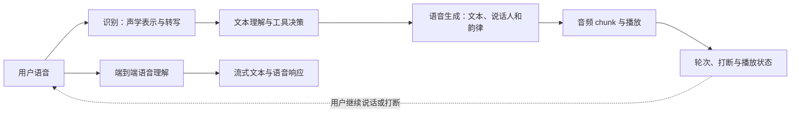

# 第十二部分：语音识别、生成与交互

本单元把语音识别、语音合成和实时对话分成三个任务，再沿共享接口比较它们。识别关注内容恢复，合成关注声学与说话人特征，对话还必须处理轮次、打断、首响应延迟和流式状态。不能用单个 WER、主观自然度或首包时延替代整轮交互质量。

三类系统共享音频流，却有不同的输入输出合同：



级联系统便于定位是识别、语言决策还是合成出了问题；端到端路线可减少中间转换，却需要特别审查流式状态、部分结果修订和打断后对话历史的一致性。三个讲次将沿这些接口展开，而不是把 ASR、TTS 和语音对话当作同一个指标下的模型排名。

---

## 第 120 讲：语音识别：Whisper

### 导入：把连续声波变成可检索、可推理的语言

上一讲讨论了视频系统如何维护时间连续性。本讲转向音频入口：用户说话时，系统首先要从连续声波中恢复出语言内容，再把它交给搜索、对话模型或业务流程。这个任务叫自动语音识别（Automatic Speech Recognition，ASR）。

用户说一句话，系统要先听懂，才能交给 LLM 推理和回答。

这个“听懂”的第一步，就是自动语音识别：

```text
Automatic Speech Recognition，ASR
```


Whisper 是 OpenAI 提出的一个代表性 ASR 模型。

---

### 一、ASR 解决什么问题

ASR 的目标是把语音信号转换成文本。

输入是音频波形：

```text
audio waveform
```


输出是文字：

```text
transcript
```


例如：

```text
音频：用户说“帮我总结一下今天的会议”
文本：帮我总结一下今天的会议
```


ASR 是语音助手、会议纪要、字幕生成、客服质检、实时翻译等系统的基础模块。

在多模态大模型系统中，典型链路是：

```text
speech -> ASR -> text -> LLM -> response
```


如果 ASR 错了，后面的 LLM 再强也可能基于错误文本回答。

所以语音识别质量会直接影响整个语音智能系统。

---

### 二、语音为什么不能直接当文本处理

语音是连续信号。

文本是离散 token。

语音包含：

1. 音高。
2. 音量。
3. 语速。
4. 口音。
5. 背景噪声。
6. 说话人特征。
7. 停顿和语气。

模型需要从连续音频中识别出语言内容。

难点包括：

1. 同一句话不同人说法不同。
2. 环境可能很吵。
3. 有口音和方言。
4. 多人同时说话。
5. 专有名词和数字容易错。
6. 标点和断句不在音频中显式存在。

这就是 ASR 比简单分类更难的地方。

---

### 三、Whisper 的核心定位

Whisper 是一个通用语音识别模型。

它支持：

1. 多语言语音识别。
2. 英文翻译。
3. 语言识别。
4. 时间戳预测。
5. 嘈杂环境下鲁棒转写。

Whisper 的关键特点是：

```text
用大规模、多任务、弱监督语音数据训练一个 encoder-decoder Transformer。
```


Whisper 论文报告了约 68 万小时的网络语音数据，并覆盖多语言、转写和语音翻译等任务。这个数字是论文训练数据的历史描述，不应被理解成每个语言、每种口音或每个业务领域都拥有同等质量的标注。

原始论文可见：[Robust Speech Recognition via Large-Scale Weak Supervision](https://arxiv.org/abs/2212.04356)。论文结果能支持“规模和场景多样性带来鲁棒性”的总体判断，但不能替代目标业务上的噪声、口音、专有名词和隐私评估。

它不是只在干净实验室语音上训练。

而是使用大量真实世界音频和对应文本。

这让它对噪声、口音、语种和录音条件有较强鲁棒性。

---

### 四、Whisper 的输入：Log-Mel Spectrogram

原始音频是波形。

例如一段采样率 16kHz 的音频可以看成一串数字。

但直接处理长波形成本高。

Whisper 会先把音频转换成 Log-Mel Spectrogram。

可以理解为：

```text
把音频变成一张表示时间和频率能量分布的图。
```


横轴是时间。

纵轴是频率。

每个位置表示该时间和频率附近的能量。

Log-Mel Spectrogram 的好处是：

1. 更接近人耳感知。
2. 压缩原始波形信息。
3. 适合神经网络处理。
4. 保留语音识别需要的频谱特征。

直觉上，ASR 模型不是直接看“声音波形线”，而是看“声音频谱图”。

更形式化地说，给定 16 kHz 单声道波形 \(a[n]\)，采样点数为 \(T_s\)，音频时长是：

```math
T_{\mathrm{audio}}=\frac{T_s}{f_s}
```


其中 \(f_s=16000\)。

Whisper 官方实现中，一个标准窗口是 30 秒：

```math
T_s=30\times16000=480000
```


先用短时傅里叶变换把波形切成局部时间窗。若 FFT 点数是 \(N_{\mathrm{fft}}\)，hop 长度是 \(H\)，窗函数是 \(w[n]\)，则第 \(t\) 帧、第 \(k\) 个频点的复数谱可以写成：

```math
X_{k,t}=\sum_{n=0}^{N_{\mathrm{fft}}-1}a[n+tH]w[n]\exp\left(-\frac{2\pi jkn}{N_{\mathrm{fft}}}\right)
```


功率谱是：

```math
P_{k,t}=|X_{k,t}|^2
```


Mel filterbank 用矩阵 \(F\) 把线性频率压到 Mel 频率尺度：

```math
M_{m,t}=\sum_k F_{m,k}P_{k,t}
```


最后做 log 压缩和裁剪归一化：

```math
Z_{m,t}=\frac{\max(\log_{10}\max(M_{m,t},\epsilon),z_{\max}-8)+4}{4}
```


这里 \(Z\) 就是送入 Whisper encoder 的 log-mel 特征。官方实现里常见超参数是：

```math
N_{\mathrm{fft}}=400,\quad H=160,\quad M=80
```


因为 \(H=160\) 且 \(f_s=16000\)，所以每帧约 10ms。30 秒音频大约对应 3000 个 mel frame。encoder 前端卷积会进一步下采样，因此后续音频 token 数通常比 mel frame 数更少。

---

### 五、Whisper 的架构：Encoder-Decoder Transformer

Whisper 使用 encoder-decoder Transformer。

简化流程：

```text
audio -> log-mel spectrogram -> audio encoder -> decoder -> text tokens
```


#### Audio Encoder

Encoder 负责理解音频特征。

它把 Log-Mel Spectrogram 编码成一组 hidden states。

这些 hidden states 表示音频内容。

#### Text Decoder

Decoder 自回归生成文本 token。

它每一步根据：

1. 已经生成的文本。
2. encoder 输出的音频表示。

预测下一个 token。

这和机器翻译模型很像：

```text
source sequence -> encoder -> decoder -> target sequence
```


只不过 source 从文本变成了音频特征。

用公式表示，audio encoder 先把 log-mel 特征 \(Z\) 编成隐藏状态：

```math
H_{\mathrm{audio}}=\mathrm{Enc}_{\theta}(Z)
```


decoder 在控制 token \(c\) 和音频隐藏状态 \(H_{\mathrm{audio}}\) 条件下生成文本 token 序列 \(y=(y_1,\ldots,y_U)\)：

```math
p_{\theta}(y|Z,c)=\prod_{i=1}^{U}p_{\theta}(y_i|y_{1:i-1},c,H_{\mathrm{audio}})
```


训练时常用 teacher forcing。给定参考 token \(y^\star\)，ASR 的负对数似然可以写成：

```math
L_{\mathrm{asr}}=-\sum_{i=1}^{U}m_i\log p_{\theta}(y_i^\star|y_{1:i-1}^\star,c,H_{\mathrm{audio}})
```


其中 \(m_i\) 是 loss mask。真实训练里，特殊控制 token、文本 token、时间戳 token 是否参与 loss，要看具体任务格式和实现策略。

---

### 六、Whisper 的多任务格式

Whisper 通过特殊 token 控制任务。

例如可以告诉模型：

1. 当前语言是什么。
2. 是转写还是翻译。
3. 是否输出时间戳。

简化理解：

```text
<|zh|> <|transcribe|> audio -> 中文转写
<|en|> <|translate|> audio -> 英文翻译
```


这种设计让同一个模型支持多种任务。

它类似 instruction prompting。

只是 prompt 是特殊控制 token。

Whisper 的 decoder 生成的不只是普通文本。

也可能包含时间戳 token。

这使得它可以输出字幕对齐信息。

可以把一个 Whisper 训练样本抽象成：

```math
(a,c,y)
```


其中 \(a\) 是音频，\(c\) 是任务控制序列，\(y\) 是目标输出 token 序列。控制序列可以包括语言、任务和时间戳开关：

```math
c=(c_{\mathrm{lang}},c_{\mathrm{task}},c_{\mathrm{time}})
```


任务集合可以抽象为：

```math
c_{\mathrm{task}}\in\{\mathrm{transcribe},\mathrm{translate},\mathrm{detect}\}
```


一个统一多任务目标可以写成：

```math
L_{\mathrm{multi}}=-\frac{1}{B}\sum_{b=1}^{B}\sum_{i=1}^{U_b}\log p_{\theta}(y_i^{(b)}|y_{1:i-1}^{(b)},c^{(b)},Z^{(b)})
```


这样做的关键收益是：模型不是为每个任务单独训练一套模块，而是把“要做什么”也变成 decoder 要理解和生成的 token 上下文。

---

### 七、为什么大规模弱监督数据有效

传统 ASR 常依赖高质量标注数据。

但高质量语音标注非常贵。

Whisper 的一个关键思想是利用大规模弱监督数据。

弱监督数据可能不完美。

例如字幕和音频不完全对齐，文本有噪声。

但数据规模巨大，覆盖真实世界多样性。

好处是：

1. 覆盖更多语种。
2. 覆盖更多口音。
3. 覆盖更多背景噪声。
4. 覆盖更多录音设备。
5. 覆盖真实场景分布。

这让 Whisper 的泛化和鲁棒性很强。

核心 trade-off 是：

```text
弱监督数据噪声更大，但规模和多样性更强。
```


从学习目标上看，弱监督不改变最大似然训练的基本形式：

```math
L_{\mathrm{weak}}=-\frac{1}{|\mathcal{D}|}\sum_{(a,c,y)\in\mathcal{D}}\sum_i\log p_{\theta}(y_i|y_{1:i-1},c,Z)
```


它改变的是数据分布 \(\mathcal{D}\)：数据来自更大、更杂、更接近真实互联网音频的分布。规模和多样性提升会降低对单一干净 benchmark 的过拟合风险，但标签噪声会带来三类副作用：

1. 音频和字幕没有精确对齐。
2. 参考文本可能删改、概括或包含字幕风格噪声。
3. 模型可能学到“像字幕/文本续写”的偏置，在静音、音乐或低资源语言上更容易 hallucinate。

所以面试里要说清楚：大规模弱监督提升鲁棒性，不等于标注噪声可以忽略。

---

### 八、时间戳与分段

ASR 不只是输出文字。

很多场景还需要知道每句话在音频中的时间位置。

例如字幕系统需要：

```text
00:01.2 - 00:03.8  大家好，欢迎来到今天的会议。
```


Whisper 可以生成时间戳 token。

这让模型同时做：

1. 语音内容识别。
2. 语音和文本对齐。
3. 字幕分段。

但时间戳也可能出错。

常见问题包括：

1. 分段过长。
2. 分段过短。
3. 时间漂移。
4. 静音段处理不稳定。
5. 多人说话时边界混乱。

工程中常结合 VAD 和后处理优化分段。

如果时间戳 token 的粒度是 \(\Delta_{\mathrm{ts}}\)，第 \(q\) 个时间戳 token 对应的时间可以写成：

```math
t(q)=q\Delta_{\mathrm{ts}}
```


Whisper 系列实现中常见粒度约为 20ms：

```math
\Delta_{\mathrm{ts}}=0.02
```


一个字幕片段可以表示为：

```math
\hat{s}_j=(\hat{b}_j,\hat{e}_j,\hat{u}_j)
```


其中 \(\hat{b}_j\) 是开始时间，\(\hat{e}_j\) 是结束时间，\(\hat{u}_j\) 是对应文本。

时间戳评估不能只看文本是否正确，还要看边界误差：

```math
E_{\mathrm{bd}}=\frac{1}{J}\sum_{j=1}^{J}\frac{|\hat{b}_j-b_j|+|\hat{e}_j-e_j|}{2}
```


也可以看时间区间 IoU：

```math
\mathrm{IoU}(s_j,\hat{s}_j)=
\frac{\max(0,\min(e_j,\hat{e}_j)-\max(b_j,\hat{b}_j))}
{\max(e_j,\hat{e}_j)-\min(b_j,\hat{b}_j)}
```


字幕系统常关心在容差 \(\tau\) 内的边界准确率：

```math
A_{\mathrm{bd}}(\tau)=\frac{1}{J}\sum_{j=1}^{J}\mathbf{1}\left[
\frac{|\hat{b}_j-b_j|+|\hat{e}_j-e_j|}{2}\le \tau
\right]
```


---

### 九、Whisper 和 VAD 的关系

VAD 是 Voice Activity Detection。

它判断音频中哪些片段有人声。

ASR 系统常用流程是：

```text
audio -> VAD -> speech segments -> ASR -> transcript
```


VAD 的作用：

1. 去掉长静音。
2. 降低 ASR 成本。
3. 改善长音频分段。
4. 减少无语音片段 hallucination。

如果没有 VAD，模型可能在长静音或噪声中生成幻觉文本。

Whisper 自身有一定鲁棒性，但真实工程中仍常配合 VAD。

最简单的 VAD 可以用帧级能量做阈值判断。给定第 \(t\) 帧波形样本集合 \(\mathcal{W}_t\)，短时能量可以写成：

```math
e_t=\frac{1}{|\mathcal{W}_t|}\sum_{n\in\mathcal{W}_t}a[n]^2
```


帧级语音判断是：

```math
v_t=\mathbf{1}[e_t>\tau_{\mathrm{vad}}]
```


把连续的 \(v_t=1\) 区间合并，就得到语音片段：

```math
\mathcal{S}_{\mathrm{vad}}=\{(b_j,e_j)\}_{j=1}^{J}
```


真实系统不会只用一个固定能量阈值，还会结合噪声估计、最短语音长度、最短静音间隔和模型化 VAD。但这个公式能解释为什么 VAD 能省成本：只把 \(\mathcal{S}_{\mathrm{vad}}\) 中的语音片段送给 ASR。

---

### 十、ASR 的常见错误类型

#### 1. Homophone 错误

同音词识别错。

例如“盈利”和“营利”。

#### 2. 专有名词错误

人名、公司名、产品名容易错。

#### 3. 数字和单位错误

例如金额、日期、电话号码。

#### 4. 口音和方言错误

非标准发音导致识别偏差。

#### 5. 噪声干扰

背景音乐、多人声、回声影响识别。

#### 6. 标点和断句错误

音频中没有显式标点，模型需要推断。

#### 7. 幻觉

在静音、音乐或不清晰语音中生成不存在的文字。

这些错误会影响后续 LLM 理解。

例如数字错一个小数点，业务含义可能完全变。

---

### 十一、ASR 工程系统设计

一个真实 ASR 系统通常不只是一个模型。

可以设计成：

```text
audio input
  -> resampling / normalization
  -> VAD
  -> segmentation
  -> ASR model
  -> punctuation / inverse text normalization
  -> domain correction
  -> output with timestamps
```


关键模块包括：

1. 音频预处理：统一采样率、音量、声道。
2. VAD：切出语音片段。
3. Segmentation：控制每段长度。
4. ASR：转写。
5. 标点恢复：让文本可读。
6. ITN：把“一二三”转成“123”。
7. 热词纠错：修正专有名词。
8. 时间戳对齐：生成字幕。

工程中经常需要在准确率、延迟和成本之间权衡。

一个常用的粗略成本模型是：

```math
T_{\mathrm{proc}}=T_{\mathrm{pre}}+T_{\mathrm{vad}}+T_{\mathrm{asr}}+T_{\mathrm{post}}
```


其中 \(T_{\mathrm{asr}}\) 往往占主要部分。实时率 RTF 定义为：

```math
\mathrm{RTF}=\frac{T_{\mathrm{proc}}}{T_{\mathrm{audio}}}
```


当 \(\mathrm{RTF}<1\) 时，系统平均处理速度快于音频播放速度，才有接近实时或批量高吞吐的基础。低延迟流式 ASR 还要看首字延迟和最终确认延迟：

```math
T_{\mathrm{lat}}=T_{\mathrm{buffer}}+T_{\mathrm{model}}+T_{\mathrm{commit}}
```


Whisper 原生并不是为最低延迟流式转写设计的，所以工程上常用滑窗、VAD 分段、增量解码和后处理来折中延迟与准确率。

---

### 十二、ASR 评估指标

最常见指标是 WER。

WER 是 Word Error Rate。

计算包括：

1. Substitution：替换错误。
2. Deletion：漏词。
3. Insertion：多词。

公式是：

```math
\mathrm{WER}=\frac{S_w+D_w+I_w}{N_w}
```


其中 \(S_w\) 是 word substitution 数，\(D_w\) 是 word deletion 数，\(I_w\) 是 word insertion 数，\(N_w\) 是参考文本词数。NIST SCTK 的 `sclite` 就是语音识别评测中常见的动态规划对齐打分工具。

公式默认 \(N_w>0\)。空参考文本不能简单解释为“WER 为 0”，应单独报告无语音、空转写或不适用样本，否则模型在静音片段中的幻觉会被分母处理掩盖。

中文常用 CER。

CER 是 Character Error Rate。

因为中文没有天然空格分词。

CER 和 WER 的思想一样，只是把对齐单位从 word 换成 character：

```math
\mathrm{CER}=\frac{S_c+D_c+I_c}{N_c}
```


其中 \(N_c\) 是参考文本字符数。

CER 的预处理规则必须先固定，例如是否去除空格、标点、大小写差异，以及繁简体和数字归一化。不同归一化规则会得到不同 CER，报告数字时不能只写指标名称而不写文本规范化协议。

除了 WER/CER，还要看：

1. 实时率 RTF。
2. 延迟。
3. 长音频稳定性。
4. 时间戳准确率。
5. 热词准确率。
6. 噪声场景鲁棒性。
7. 多语种和口音表现。

业务中不能只看总体 WER。

专有名词、数字和关键词错误往往更重要。

热词或关键词可以单独评估召回率：

```math
R_{\mathrm{hot}}=\frac{|\mathcal{H}_{\mathrm{ref}}\cap\mathcal{H}_{\mathrm{hyp}}|}{|\mathcal{H}_{\mathrm{ref}}|}
```


静音或无语音片段还要看 hallucination rate：

```math
R_{\mathrm{hall}}=\frac{1}{N_{\mathrm{nospeech}}}\sum_{j=1}^{N_{\mathrm{nospeech}}}\mathbf{1}[|\hat{y}_j|>0]
```


一个更接近业务上线的综合分可以写成：

```math
S_{\mathrm{asr}}=
w_1(1-\mathrm{WER})+
w_2(1-\mathrm{CER})+
w_3R_{\mathrm{hot}}+
w_4A_{\mathrm{bd}}(\tau)-
w_5R_{\mathrm{hall}}-
w_6\mathrm{RTF}
```


权重 \(w_i\) 要按业务风险设定。例如会议纪要更看重长音频稳定性和专有名词，客服质检更看重关键词召回和时间戳，实时语音助手更看重延迟。

---

### 十三、最小代码：WER/CER、VAD 分段与时间戳评估

下面这段 demo 不调用 Whisper 模型，而是模拟 ASR 评估系统里最常见的后处理和打分逻辑：编辑距离、WER/CER、VAD 分段、时间戳 IoU、热词召回、RTF 和静音 hallucination。

```python
import math
from dataclasses import dataclass


def edit_counts(ref, hyp):
    rows = len(ref) + 1
    cols = len(hyp) + 1
    dp = [[(0, 0, 0, 0) for _ in range(cols)] for _ in range(rows)]

    for i in range(1, rows):
        cost, s, d, ins = dp[i - 1][0]
        dp[i][0] = (cost + 1, s, d + 1, ins)
    for j in range(1, cols):
        cost, s, d, ins = dp[0][j - 1]
        dp[0][j] = (cost + 1, s, d, ins + 1)

    for i in range(1, rows):
        for j in range(1, cols):
            if ref[i - 1] == hyp[j - 1]:
                keep = dp[i - 1][j - 1]
            else:
                cost, s, d, ins = dp[i - 1][j - 1]
                keep = (cost + 1, s + 1, d, ins)

            cost, s, d, ins = dp[i - 1][j]
            delete = (cost + 1, s, d + 1, ins)

            cost, s, d, ins = dp[i][j - 1]
            insert = (cost + 1, s, d, ins + 1)

            dp[i][j] = min((keep, delete, insert), key=lambda item: item[0])

    _, substitutions, deletions, insertions = dp[-1][-1]
    return substitutions, deletions, insertions


def wer(ref_text, hyp_text):
    ref = ref_text.split()
    hyp = hyp_text.split()
    if not ref:
        raise ValueError("WER reference must contain at least one token")
    substitutions, deletions, insertions = edit_counts(ref, hyp)
    return (substitutions + deletions + insertions) / len(ref)


def cer(ref_text, hyp_text):
    ref = list(ref_text.replace(" ", ""))
    hyp = list(hyp_text.replace(" ", ""))
    if not ref:
        raise ValueError("CER reference must contain at least one character")
    substitutions, deletions, insertions = edit_counts(ref, hyp)
    return (substitutions + deletions + insertions) / len(ref)


def vad_segments(frame_energy, threshold, frame_seconds=0.02, min_speech_frames=2):
    if not frame_energy or not isinstance(threshold, (int, float)) or isinstance(threshold, bool) or not math.isfinite(threshold) or threshold < 0 or frame_seconds <= 0 or min_speech_frames <= 0:
        raise ValueError("VAD inputs must be non-empty with valid positive timing")
    segments = []
    start = None
    for idx, energy in enumerate(frame_energy + [0.0]):
        is_speech = energy >= threshold
        if is_speech and start is None:
            start = idx
        if not is_speech and start is not None:
            if idx - start >= min_speech_frames:
                segments.append((round(start * frame_seconds, 2), round(idx * frame_seconds, 2)))
            start = None
    return segments


def interval_iou(gold, pred):
    gb, ge = gold
    pb, pe = pred
    if not (0 <= gb < ge and 0 <= pb < pe):
        raise ValueError("intervals must have positive duration")
    inter = max(0.0, min(ge, pe) - max(gb, pb))
    union = max(ge, pe) - min(gb, pb)
    return inter / union


@dataclass
class Segment:
    begin: float
    end: float
    text: str


gold_segments = [
    Segment(0.10, 1.20, "openai whisper supports multilingual speech recognition"),
    Segment(1.60, 2.40, "project zephyr revenue grew by twenty percent"),
    Segment(3.00, 3.70, ""),
]

pred_segments = [
    Segment(0.08, 1.18, "openai whisper support multilingual speech recognition"),
    Segment(1.72, 2.55, "project zephyr revenue grew by thirty percent"),
    Segment(3.05, 3.45, "thank you"),
]

ref_text = " ".join(seg.text for seg in gold_segments if seg.text)
hyp_text = " ".join(seg.text for seg in pred_segments if seg.text)

hotwords = {"openai", "whisper", "zephyr"}
ref_hotwords = {word for word in hotwords if word in ref_text.lower()}
hyp_hotwords = {word for word in hotwords if word in hyp_text.lower()}
hotword_recall = len(ref_hotwords & hyp_hotwords) / max(1, len(ref_hotwords))

speech_energy = [0.01, 0.02, 0.50, 0.62, 0.55, 0.03, 0.02, 0.71, 0.69, 0.04, 0.01]
vad = vad_segments(speech_energy, threshold=0.3)

timestamp_ious = [
    interval_iou((gold.begin, gold.end), (pred.begin, pred.end))
    for gold, pred in zip(gold_segments[:2], pred_segments[:2])
]
boundary_errors = [
    (abs(gold.begin - pred.begin) + abs(gold.end - pred.end)) / 2
    for gold, pred in zip(gold_segments[:2], pred_segments[:2])
]

non_speech_pairs = [
    (gold, pred) for gold, pred in zip(gold_segments, pred_segments) if not gold.text
]
hallucination_rate = sum(1 for _, pred in non_speech_pairs if pred.text) / max(1, len(non_speech_pairs))

audio_duration = 3.7
processing_time = 1.15
rtf = processing_time / audio_duration

report = {
    "wer": round(wer(ref_text, hyp_text), 4),
    "cer": round(cer(ref_text, hyp_text), 4),
    "vad_segments": vad,
    "mean_timestamp_iou": round(sum(timestamp_ious) / len(timestamp_ious), 4),
    "mean_boundary_error_sec": round(sum(boundary_errors) / len(boundary_errors), 4),
    "hotword_recall": round(hotword_recall, 4),
    "rtf": round(rtf, 4),
    "hallucination_rate": round(hallucination_rate, 4),
}

print(report)
```


> **代码状态：已验证（2026-10-19；Python 标准库；原记录未保留解释器小版本）**

典型输出（文本、时间区间和能量序列都是教学样例）：

```text
{'wer': 0.3077, 'cer': 0.1348, 'vad_segments': [(0.04, 0.1), (0.14, 0.18)], 'mean_timestamp_iou': 0.84, 'mean_boundary_error_sec': 0.0775, 'hotword_recall': 1.0, 'rtf': 0.3108, 'hallucination_rate': 1.0}
```


这段代码的关键不是复现 Whisper，而是让你在面试里能讲清楚：ASR 评估不是一个 WER 就结束，还要把分段、时间戳、热词、静音 hallucination 和实时成本都纳入同一个审计表。

---

### 十四、Whisper 的优点和局限

Whisper 的优点：

1. 多语言能力强。
2. 鲁棒性好。
3. 开源生态成熟。
4. 支持转写、翻译、语言识别、时间戳。
5. 对真实世界噪声适应较好。

Whisper 的局限：

1. 不是最低延迟实时 ASR 的最优选择。
2. 长音频需要分段和上下文管理。
3. 专有名词和热词可能出错。
4. 静音或音乐中可能 hallucinate。
5. 对强方言、重叠说话仍有挑战。
6. 模型较大时推理成本高。

Whisper 的通用鲁棒性很有价值，但它不是“拿来即用”的业务结论。实际系统仍要根据语言、噪声、口音、专有名词、实时性和隐私要求设计前后处理与评估集。

---

### 十五、从通用 Whisper 到可用的 ASR 系统

Whisper 的输入输出链路可以概括为：音频波形经过 log-mel spectrogram，送入 audio encoder，再由 text decoder 自回归地产生文本或时间戳 token。特殊控制 token 让同一个 encoder-decoder 模型在转写、翻译、语言识别和时间戳任务之间切换。大规模、多语言、多任务弱监督数据解释了它为什么对许多真实录音具有较好的泛化能力，但这种泛化不会自动覆盖目标业务的所有分布。

工程接入通常要从五个方向补齐。长音频需要 VAD 和分段，以减少静音计算、控制上下文并降低静音 hallucination；专有名词、金额和数字需要热词、领域词表或后处理；实时场景要测首字延迟、实时率和分段稳定性；多人会议要加入说话人分离或重叠说话测试；高风险内容则要保留原音频、转写版本、时间戳和人工修订记录，便于追溯。

WER 和 CER 是必要但不充分的指标。一个公司名或金额的错误，业务代价可能高于普通词的错误，所以应额外报告热词召回、数字准确率、时间戳边界误差、静音 hallucination rate、噪声和口音切片，以及 p50/p95 延迟。不同语言的分词方式不同，WER 不能脱离规范化规则直接比较；中文等语言常需要结合 CER、词典切分和实体级指标。

这也解释了本讲最容易混淆的三点：ASR 不只是“声音转文字”，多语言覆盖不等于方言和领域词稳定，LLM 纠错也不能替代声学证据。后处理可以改善格式和已知实体，却可能把不确定的识别结果改成自信的错误，因此关键字段最好保留置信度或进入人工复核。

Whisper 的原始论文 [Robust Speech Recognition via Large-Scale Weak Supervision](https://arxiv.org/abs/2212.04356) 支持其训练范式和公开实验结论；官方实现与模型配置决定具体的采样率、窗口、token 格式和时间戳行为。论文 benchmark、开源 checkpoint 和目标业务的生产指标应分开记录。

下一讲从“识别用户说了什么”转向“让系统自然地说出来”，讨论 TTS、神经 codec 和声音克隆。
## 第 121 讲：语音生成：TTS 与 Voice Cloning

第 120 讲从 Whisper 出发讨论了语音识别：把连续的声波转换成文字、时间戳和其他识别结果。语音系统的另一半则沿着相反方向工作：它要把文字、说话人条件和表达意图重新变成可以播放的声音。这一过程称为 text-to-speech（TTS）。

最简单的 TTS 输入是一句文本：

```text
今天下午三点开会。
```


输出是一段具有可懂内容、自然韵律和指定音色的波形。若系统还能够根据参考音频模仿某个具体说话人的音色，问题就从一般 TTS 延伸到了 voice cloning。两者共享声学建模技术，却不是同一个产品能力：普通 TTS 主要回答“这句话怎样清楚、自然地说出来”，voice cloning 还要回答“是否有权使用这个声音，以及生成结果是否会造成冒充”。

```text
reference audio + target text -> speech in a similar voice
```


因此，理解语音生成不能停留在“文字变声音”的演示层面。真正的系统需要同时处理文本规范化、发音和对齐、音色与韵律、波形重建、实时延迟以及授权和审计。下面先从最基本的概率对象和两阶段结构开始，再解释为什么 neural codec 把语音生成带入了语言模型范式。

---

### 一、TTS 解决什么问题

TTS 的目标是把文本转换成自然语音。

输入：

```text
今天下午三点开会。
```


输出：

```text
一段自然人声音频
```


TTS 常用于：

1. 语音助手。
2. 有声书。
3. 导航播报。
4. 客服机器人。
5. 短视频配音。
6. 无障碍阅读。
7. 游戏和虚拟人。

在多模态大模型系统中，典型链路是：

```text
user speech -> ASR -> LLM -> TTS -> spoken response
```


TTS 负责让模型“说出来”。

形式化地说，文本前端会把原始文本 \(x\) 转成音素、字或子词序列：

```math
p=(p_1,\ldots,p_L)
```


TTS 系统要生成音频波形：

```math
a=(a_1,\ldots,a_{T_s})
```


如果有说话人、风格和情感条件，可以把条件写成：

```math
p_{\theta}(a|p,s,r)
```


其中 \(s\) 表示 speaker condition，\(r\) 表示 style 或 prosody condition。真实系统常不会直接从文本回归波形，而是引入 mel spectrogram、codec token 或 latent audio 表示作为中间层。

#### 来龙去脉：从两阶段 TTS 到 Codec Language Model

神经 TTS 的主线可以按“中间表示”和“生成方式”理解。

Tacotron 2 这类系统把问题拆成两段：先由 sequence-to-sequence 模型从文本预测 mel spectrogram，再由 WaveNet 这类 vocoder 从 mel 合成波形。这个设计把“读什么”和“怎么把声学特征变成波形”分开，工程上清晰，但自回归 attention 容易出现漏读、重复和速度慢。

FastSpeech 把自回归 mel 生成改成非自回归并行生成，引入 duration predictor 和 length regulator，把音素扩展到 mel 帧长度，从而提高速度和稳定性。FastSpeech 2 又进一步把 duration、pitch、energy 显式作为变化信息，缓解同一句话可以有多种读法的一对多问题。

HiFi-GAN、VITS 代表另一路：用 GAN、flow、VAE、随机 duration 等生成式建模提升音质和端到端能力。再往后，EnCodec、VALL-E 这类 neural codec / codec language model 把音频压成离散 token，让 TTS 更像“条件语言建模”：给文本 token 和一小段 acoustic prompt，预测后续 audio tokens。

这条演进线的价值不在于替换几个模块名称，而在于逐步改变了建模对象。工程者需要分辨三条路线各自把不确定性放在哪里，以及它们对速度、可控性和音质的影响：

```text
mel regression -> neural vocoder -> codec token language modeling
```


这条演进线可以用第一手论文核对：Tacotron 2（[arXiv:1712.05884](https://arxiv.org/abs/1712.05884)）、FastSpeech（[arXiv:1905.09263](https://arxiv.org/abs/1905.09263)）、FastSpeech 2（[arXiv:2006.04558](https://arxiv.org/abs/2006.04558)）、VITS（[arXiv:2106.06103](https://arxiv.org/abs/2106.06103)）以及 VALL-E（[arXiv:2301.02111](https://arxiv.org/abs/2301.02111)）。论文中的模型和数据设定各不相同，书中的模块图是共同机制的抽象，不是某个产品的完整实现图。

---

### 二、语音生成为什么难

文本只包含字词。

自然语音还包含很多额外信息。

例如：

1. 音色。
2. 音高。
3. 语速。
4. 情感。
5. 停顿。
6. 重音。
7. 韵律。
8. 呼吸感。

同一句文本可以有很多种读法。

例如：

```text
你真的来了。
```


可以读成惊喜、怀疑、愤怒、平静。

所以 TTS 不是简单“读字”。

它需要生成自然、连贯、有表达力的声音。

---

### 三、传统 TTS 系统组成

一个经典 TTS 系统通常分几步。

```text
text -> text normalization -> linguistic features -> acoustic model -> mel spectrogram -> vocoder -> waveform
```


可以抽象为两阶段概率分解：

```math
p(a|p,s,r)=\int p_{\phi}(a|M,s)p_{\theta}(M|p,s,r)dM
```


其中 \(M\in\mathbb{R}^{T_m\times F}\) 是 mel spectrogram，\(T_m\) 是 mel 帧数，\(F\) 是 mel 频带数。声学模型 \(p_{\theta}(M|p,s,r)\) 负责生成中间声学特征，vocoder \(p_{\phi}(a|M,s)\) 负责把声学特征还原成波形。

#### 1. Text Normalization

把文本规范化。

例如：

```text
3:30 -> 三点三十
￥128 -> 一百二十八元
AI -> A I 或 人工智能
```


#### 2. Linguistic Frontend

处理分词、拼音、音素、重音、停顿等。

中文 TTS 通常要处理多音字。

例如：

```text
重庆
银行
长大
```


#### 3. Acoustic Model

把文本或音素转换成声学特征。

常见输出是 mel spectrogram。

#### 4. Vocoder

把 mel spectrogram 转成真实波形。

也就是声音文件。

---

### 四、声学模型是什么

声学模型负责从文本表示生成中间声学表示。

常见中间表示是 mel spectrogram。

可以理解为：

```text
text/phoneme -> mel spectrogram
```


早期神经 TTS 模型包括 Tacotron、FastSpeech 等。

#### Tacotron 类模型

使用 encoder-decoder attention。

优点是自然度高。

缺点是可能有漏读、重复、对齐失败。

Tacotron 类自回归声学模型可以写成：

```math
p_{\theta}(M|p)=\prod_{t=1}^{T_m}p_{\theta}(M_t|M_{1:t-1},p)
```


训练时常用 mel reconstruction loss：

```math
L_{\mathrm{mel}}=\frac{1}{T_mF}\sum_{t=1}^{T_m}\sum_{f=1}^{F}|M_{t,f}-\hat{M}_{t,f}|
```


自回归模型还常预测 stop token，表示是否结束生成：

```math
L_{\mathrm{stop}}=-\sum_{t=1}^{T_m}\left[g_t\log \hat{g}_t+(1-g_t)\log(1-\hat{g}_t)\right]
```


其中 \(g_t\) 是第 \(t\) 帧是否为结束位置的标签。

#### FastSpeech 类模型

使用非自回归生成。

依赖 duration predictor 预测每个音素持续时间。

优点是速度快、稳定性好。

FastSpeech 的核心是 duration predictor 和 length regulator。对音素序列 \(p_1,\ldots,p_L\)，duration predictor 预测每个音素持续多少个 mel frame：

```math
\hat{d}_i=\mathrm{Dur}_{\theta}(p_i)
```


总 mel 帧数由 duration 相加得到：

```math
\hat{T}_m=\sum_{i=1}^{L}\hat{d}_i
```


length regulator 把音素展开为帧级序列：

```math
\mathrm{LR}(p,d)=(\underbrace{p_1,\ldots,p_1}_{d_1},\underbrace{p_2,\ldots,p_2}_{d_2},\ldots,\underbrace{p_L,\ldots,p_L}_{d_L})
```


FastSpeech 2 的关键是把语音变化信息也作为条件输入，例如 pitch 和 energy：

```math
\hat{M}=F_{\theta}(\mathrm{LR}(p,\hat{d}),\hat{f},\hat{e},s)
```


训练损失可以抽象为：

```math
L_{\mathrm{fs2}}=L_{\mathrm{mel}}+\lambda_dL_d+\lambda_fL_f+\lambda_eL_e
```


其中：

```math
L_d=\frac{1}{L}\sum_{i=1}^{L}(\log(1+d_i)-\log(1+\hat{d}_i))^2
```


```math
L_f=\frac{1}{L}\sum_{i=1}^{L}(f_i-\hat{f}_i)^2,\quad
L_e=\frac{1}{L}\sum_{i=1}^{L}(e_i-\hat{e}_i)^2
```


这组公式解释了为什么 FastSpeech 类模型更可控：语速可以通过 duration 缩放控制，音高和能量也可以显式调节。

声学模型的难点是：

1. 文本和音频长度不同。
2. 发音时长不固定。
3. 韵律和停顿难预测。
4. 多音字和上下文有关。

---

### 五、Vocoder 是什么

Vocoder 负责把声学特征变成波形。

可以理解为：

```text
mel spectrogram -> waveform
```


常见神经 vocoder 包括：

1. WaveNet。
2. WaveGlow。
3. HiFi-GAN。
4. BigVGAN。

好的 vocoder 要做到：

1. 音质高。
2. 噪声少。
3. 速度快。
4. 高频细节自然。
5. 泛化到不同说话人和风格。

如果 vocoder 不好，声学模型输出再好，最终声音也会有机械感、噪声或失真。

WaveNet 类 vocoder 是自回归波形模型：

```math
p_{\phi}(a|M)=\prod_{n=1}^{T_s}p_{\phi}(a_n|a_{1:n-1},M)
```


优点是质量高，缺点是逐采样点生成很慢。GAN vocoder 则直接并行生成波形：

```math
\hat{a}=G_{\phi}(M,z)
```


其中 \(z\) 是噪声或隐变量。一个常见 generator 目标可以抽象为：

```math
L_G=L_{\mathrm{adv}}+\lambda_{\mathrm{mel}}\|\Psi(a)-\Psi(\hat{a})\|_1+\lambda_{\mathrm{fm}}L_{\mathrm{fm}}
```


这里 \(\Psi\) 表示把波形转成 mel 或多尺度谱特征，\(L_{\mathrm{fm}}\) 是 feature matching loss。HiFi-GAN 这类方法的核心价值是把高音质和高采样速度结合起来。

VITS 这类端到端 TTS 进一步把 acoustic model 和 vocoder 的边界合并，用条件 VAE、normalizing flow、随机 duration predictor 和 adversarial training 建模“一段文本可以有多种自然读法”。可以抽象为：

```math
q_{\phi}(z|a),\quad p_{\theta}(z|p),\quad \hat{a}=G_{\theta}(z,p)
```


其中 \(z\) 是语音 latent。一个简化训练目标是：

```math
L_{\mathrm{vits}}=L_{\mathrm{rec}}+\lambda_{\mathrm{kl}}L_{\mathrm{kl}}+\lambda_{\mathrm{adv}}L_{\mathrm{adv}}+\lambda_dL_d
```


这类模型的面试重点不是背 VAE 细节，而是说明它为什么要建模不确定性：同一句话可以有不同停顿、语速、音高和情绪，单纯 L1 回归容易平均化，生成式建模更适合表达一对多。

---

### 六、端到端 TTS 与 Neural Codec

近年很多语音生成模型转向神经 codec 和 token 化路线。

神经 codec 的作用是把音频压缩成离散或连续 codec tokens。

类似图像生成中的 tokenizer。

流程可以是：

```text
audio -> neural codec encoder -> audio tokens
audio tokens -> neural codec decoder -> audio
```


如果音频可以 token 化，就可以用 Transformer 建模：

```text
text tokens -> audio tokens -> waveform
```


这种路线的好处：

1. 可以借鉴 LLM 的序列建模能力。
2. 更容易做多说话人、多风格生成。
3. 适合端到端语音对话模型。
4. 可以统一文本、语音和其他模态 token。

挑战是：

1. 音频 token 序列很长。
2. 实时生成要求高。
3. 音质和延迟要平衡。
4. 韵律控制仍然困难。

神经 codec 可以写成编码、量化、解码三步：

```math
z=E_{\psi}(a)
```


```math
q=Q(z)
```


```math
\hat{a}=D_{\psi}(q)
```


SoundStream、EnCodec 这类 codec 常使用 residual vector quantization。第 \(k\) 层 codebook 选择可以写成：

```math
q_k=\arg\min_j\|r_{k-1}-e_j^{(k)}\|_2^2
```


```math
r_k=r_{k-1}-e_{q_k}^{(k)}
```


最终量化向量是：

```math
\hat{z}=\sum_{k=1}^{K}e_{q_k}^{(k)}
```


如果 codec 每秒产生 \(r_q\) 个 token，每个 token 来自大小为 \(V\) 的 codebook，使用 \(K\) 个 residual codebook，则粗略 bitrate 是：

```math
R_{\mathrm{codec}}=K r_q\log_2 V
```


这是在各 codebook token 近似均匀分布、忽略帧头和熵编码开销时的理论上界式。真实 codec 的有效码率还受码率模式、熵编码、带宽配置、重建质量和解码器延迟影响，不能仅凭 \(K r_q\log_2 V\) 推断产品音质。

把音频变成 token 后，TTS 可以写成条件 token 语言模型：

```math
p_{\theta}(q|p,q_{\mathrm{prompt}})=\prod_{i=1}^{N_q}p_{\theta}(q_i|q_{1:i-1},p,q_{\mathrm{prompt}})
```


其中 \(q_{\mathrm{prompt}}\) 是参考音频的 codec token。VALL-E 这类模型的关键直觉就是：用 acoustic prompt 承载说话人、情绪和录音环境，再用语言模型预测目标语音 token。

---

### 七、Voice Cloning 是什么

Voice Cloning 是声音克隆。

目标是让模型模仿某个说话人的音色。

输入可能是：

```text
reference audio + target text
```


输出：

```text
用参考说话人的声音朗读 target text
```


例如给模型 10 秒某人的录音，再输入：

```text
欢迎来到今天的发布会。
```


模型生成类似该人的声音。

Voice Cloning 可以分成：

1. Few-shot voice cloning。
2. Zero-shot voice cloning。
3. Speaker adaptation。
4. Personalized TTS。

关键能力是提取 speaker embedding 或从 reference audio 中学习音色特征。

给定参考音频 \(a_{\mathrm{ref}}\)，speaker encoder 可以抽取说话人向量：

```math
u_{\mathrm{spk}}=G_{\eta}(a_{\mathrm{ref}})
```


归一化后：

```math
s_{\mathrm{spk}}=\frac{u_{\mathrm{spk}}}{\|u_{\mathrm{spk}}\|_2}
```


voice cloning 的条件生成可以写成：

```math
p_{\theta}(a|p,a_{\mathrm{ref}})=p_{\theta}(a|p,s_{\mathrm{spk}},r_{\mathrm{ref}})
```


其中 \(r_{\mathrm{ref}}\) 可以包含参考音频里的韵律、情绪、房间混响和噪声环境。评估音色相似度时常用 speaker embedding cosine：

```math
S_{\mathrm{spk}}=\frac{s_{\mathrm{ref}}^\top s_{\mathrm{gen}}}{\|s_{\mathrm{ref}}\|_2\|s_{\mathrm{gen}}\|_2}
```


但要注意：\(S_{\mathrm{spk}}\) 高不代表业务可上线，因为它没有检查授权、水印、内容风险和是否冒充真人。

---

### 八、Voice Cloning 的风险

Voice Cloning 很有用，也很危险。

风险包括：

1. 冒充他人。
2. 诈骗电话。
3. 伪造证据。
4. 名人声音滥用。
5. 未授权配音。
6. 隐私泄露。
7. 政治和舆论操纵。

所以语音克隆系统必须考虑安全。

常见措施包括：

1. 说话人授权验证。
2. 水印。
3. 生成音频检测器。
4. 敏感场景限制。
5. 账号和使用审计。
6. 禁止克隆未经授权的声音；对公众人物等受保护目标按产品政策和法律要求采取更严格限制。

面试中要主动提安全风险。

这是语音生成和普通 TTS 的关键区别之一。

可以把上线安全条件写成：

```math
C_{\mathrm{voice}}=
\mathbf{1}[A_{\mathrm{auth}}=1]
\mathbf{1}[R_{\mathrm{content}}\le r_{\max}]
\mathbf{1}[S_{\mathrm{target}}\le s_{\max}]
\mathbf{1}[W_{\mathrm{detect}}\ge w_{\min}]
```


其中 \(A_{\mathrm{auth}}\) 表示授权是否通过，\(R_{\mathrm{content}}\) 是内容风险分，\(S_{\mathrm{target}}\) 是与受保护目标声音的相似度，\(W_{\mathrm{detect}}\) 是水印检测置信度。真实产品里还要结合账号信誉、调用频率、申诉机制和人工审核。

---

### 九、情感和韵律控制

好的 TTS 不只是音色像。

还要表达自然。

可控维度包括：

1. 语速。
2. 音高。
3. 音量。
4. 情感。
5. 停顿。
6. 重音。
7. 说话风格。

控制方式包括：

1. 显式标签：happy、sad、angry。
2. 参考音频：模仿参考语音风格。
3. Prompt 控制：用自然语言描述风格。
4. Prosody embedding：学习韵律向量。
5. SSML：用标记控制停顿、重音、语速。

难点是：

```text
既要可控，又要自然，不能像机械调参。
```


语速控制最常见的做法是缩放 duration：

```math
d_i'=\alpha d_i
```


其中 \(\alpha<1\) 表示读得更快，\(\alpha>1\) 表示读得更慢。pitch 和 energy 也可以做条件控制：

```math
f_i'=\beta f_i,\quad e_i'=\gamma e_i
```


但是工程上不能只改数值，还要评估自然度。一个简单的韵律误差可以写成：

```math
E_{\mathrm{prosody}}=
\lambda_d\frac{1}{L}\sum_i|d_i-\hat{d}_i|+
\lambda_f\frac{1}{L}\sum_i|f_i-\hat{f}_i|+
\lambda_e\frac{1}{L}\sum_i|e_i-\hat{e}_i|
```


这解释了为什么“音色像”不等于“说得像”：音色主要看 speaker embedding，韵律还要看 duration、pitch、energy 和停顿模式。

---

### 十、TTS 评估指标

语音生成评估很难，因为人类主观感受很重要。

常见维度包括：

#### 1. Naturalness

自然度。

通常用 MOS 评估。

MOS 是 Mean Opinion Score，让人打分。

如果有 \(R\) 个评分，分数为 \(m_1,\ldots,m_R\)，则：

```math
\mathrm{MOS}=\frac{1}{R}\sum_{i=1}^{R}m_i
```


对比两个系统时也常看 CMOS：

```math
\mathrm{CMOS}=\frac{1}{R}\sum_{i=1}^{R}(m_i^{A}-m_i^{B})
```


如果要报告不确定性，可以给 MOS 加 95% 置信区间：

```math
\mathrm{CI}_{95}=1.96\frac{\sigma_m}{\sqrt{R}}
```


其中 \(\sigma_m\) 是评分标准差。没有置信区间时，两个系统 MOS 差 0.02 这类结果不一定有统计意义。

这个区间公式只是把评分近似成独立同分布样本的教学写法。真实听评通常存在同一听者重复评分、样本配对和评分者间差异，严谨比较应说明听者数量、样本抽样、随机化和统计检验方法。

#### 2. Intelligibility

可懂度。

听者是否能听清内容。

工程上可以把生成语音再送入 ASR，计算文本可懂度：

```math
\mathrm{WER}_{\mathrm{tts}}=\frac{S_w+D_w+I_w}{N_w}
```


它不能替代人类听感，但能快速发现漏读、重复、数字读错和多音字错误。

把生成语音重新送入 ASR 得到的 WER 只是可懂度代理指标：它会受到所选 ASR 模型的偏好、说话人、噪声和文本规范化影响，不能替代人工听评，也不能单独证明 TTS 的内容一定正确。

#### 3. Speaker Similarity

说话人相似度。

用于 voice cloning。

可以使用 speaker verification 模型的 embedding 相似度：

```math
S_{\mathrm{spk}}=\mathrm{cos}(s_{\mathrm{ref}},s_{\mathrm{gen}})
```


也要看错误接受风险：

```math
R_{\mathrm{fa}}=\frac{N_{\mathrm{falseaccept}}}{N_{\mathrm{impostor}}}
```


还要看拒绝真用户的概率：

```math
R_{\mathrm{fr}}=\frac{N_{\mathrm{falsereject}}}{N_{\mathrm{genuine}}}
```


当阈值变化时，\(R_{\mathrm{fa}}\) 和 \(R_{\mathrm{fr}}\) 会此消彼长。两者相等附近的错误率叫 EER：

```math
\mathrm{EER}=R_{\mathrm{fa}}(\tau^\star)=R_{\mathrm{fr}}(\tau^\star)
```


这对 voice cloning 很重要：如果生成音频能轻易通过 speaker verification，就会冲击声纹认证系统。

#### 4. Prosody Quality

韵律质量。

包括停顿、重音、语调是否自然。

#### 5. Robustness

长文本、数字、多语言、代码混读是否稳定。

#### 6. Latency

实时场景需要低延迟。

TTS 的实时率可以写成：

```math
\mathrm{RTF}_{\mathrm{tts}}=\frac{T_{\mathrm{gen}}}{T_{\mathrm{audio}}}
```


语音对话还要看首包延迟：

```math
T_{\mathrm{firstaudio}}=T_{\mathrm{textwait}}+T_{\mathrm{frontend}}+T_{\mathrm{modelchunk}}+T_{\mathrm{decode}}
```


#### 7. Safety

是否防止未授权克隆和滥用。

安全评估可以单独统计：

```math
R_{\mathrm{unauth}}=\frac{N_{\mathrm{unauthpass}}}{N_{\mathrm{unauthtry}}}
```


以及水印召回：

```math
R_{\mathrm{wm}}=\frac{N_{\mathrm{wmdetect}}}{N_{\mathrm{generated}}}
```


不能只听一两个 demo。

要覆盖长文本、短文本、数字、英文缩写、多音字、情感和噪声参考音频。

一个更接近上线决策的综合分可以写成：

```math
S_{\mathrm{tts}}=
w_1\mathrm{MOS}-
w_2\mathrm{WER}_{\mathrm{tts}}+
w_3S_{\mathrm{spk}}-
w_4E_{\mathrm{prosody}}-
w_5\mathrm{RTF}_{\mathrm{tts}}-
w_6R_{\mathrm{unauth}}+
w_7R_{\mathrm{wm}}
```


权重应按业务设定。导航播报更看重可懂度和延迟，虚拟人更看重自然度和韵律，voice cloning 产品必须把安全权重放到很高。

---

### 十一、最小代码：Duration、Speaker Similarity 与安全检查

下面的 demo 不合成真实音频，而是把 TTS/Voice Cloning 里最容易被问到的机制串起来：duration length regulator、语速控制、pitch/energy 韵律误差、codec bitrate、MOS/CMOS、speaker similarity、ASR 可懂度和安全条件检查。

```python
import math


def length_regulator(phonemes, durations, speed=1.0):
    if not phonemes or len(phonemes) != len(durations) or not isinstance(speed, (int, float)) or isinstance(speed, bool) or not math.isfinite(speed) or speed <= 0:
        raise ValueError("phonemes and durations must align; speed must be positive")
    expanded = []
    adjusted = []
    for phoneme, duration in zip(phonemes, durations):
        new_duration = max(1, round(duration / speed))
        adjusted.append(new_duration)
        expanded.extend([phoneme] * new_duration)
    return expanded, adjusted


def mean_absolute_error(gold, pred):
    if not gold or len(gold) != len(pred):
        raise ValueError("error inputs must have equal non-empty length")
    return sum(abs(a - b) for a, b in zip(gold, pred)) / len(gold)


def cosine(a, b):
    if not a or len(a) != len(b):
        raise ValueError("cosine inputs must have equal non-empty length")
    dot = sum(x * y for x, y in zip(a, b))
    na = math.sqrt(sum(x * x for x in a))
    nb = math.sqrt(sum(y * y for y in b))
    return dot / (na * nb) if na and nb else 0.0


def edit_counts(ref, hyp):
    rows = len(ref) + 1
    cols = len(hyp) + 1
    dp = [[(0, 0, 0, 0) for _ in range(cols)] for _ in range(rows)]

    for i in range(1, rows):
        cost, s, d, ins = dp[i - 1][0]
        dp[i][0] = (cost + 1, s, d + 1, ins)
    for j in range(1, cols):
        cost, s, d, ins = dp[0][j - 1]
        dp[0][j] = (cost + 1, s, d, ins + 1)

    for i in range(1, rows):
        for j in range(1, cols):
            if ref[i - 1] == hyp[j - 1]:
                keep = dp[i - 1][j - 1]
            else:
                cost, s, d, ins = dp[i - 1][j - 1]
                keep = (cost + 1, s + 1, d, ins)
            cost, s, d, ins = dp[i - 1][j]
            delete = (cost + 1, s, d + 1, ins)
            cost, s, d, ins = dp[i][j - 1]
            insert = (cost + 1, s, d, ins + 1)
            dp[i][j] = min((keep, delete, insert), key=lambda item: item[0])

    _, substitutions, deletions, insertions = dp[-1][-1]
    return substitutions, deletions, insertions


def wer(ref_text, hyp_text):
    ref = ref_text.split()
    hyp = hyp_text.split()
    substitutions, deletions, insertions = edit_counts(ref, hyp)
    if not ref:
        raise ValueError("WER reference must be non-empty")
    return (substitutions + deletions + insertions) / len(ref)


def codec_bitrate(codebooks, tokens_per_second, codebook_size):
    if any(isinstance(value, bool) or not isinstance(value, (int, float)) or not math.isfinite(value) or value <= 0 for value in (codebooks, tokens_per_second, codebook_size)):
        raise ValueError("codec parameters must be positive finite numbers")
    return codebooks * tokens_per_second * math.log2(codebook_size)


def mean(values):
    if not values:
        raise ValueError("values must be non-empty")
    return sum(values) / len(values)


def sample_std(values):
    avg = mean(values)
    if len(values) <= 1:
        return 0.0
    return math.sqrt(sum((value - avg) ** 2 for value in values) / (len(values) - 1))


def ci95(values):
    return 1.96 * sample_std(values) / math.sqrt(max(1, len(values)))


def estimate_eer(trials):
    if not trials or not any(trial["same_speaker"] for trial in trials) or not any(not trial["same_speaker"] for trial in trials):
        raise ValueError("trials need genuine and impostor examples")
    candidates = sorted({trial["score"] for trial in trials})
    best = None
    for threshold in candidates:
        impostors = [trial for trial in trials if not trial["same_speaker"]]
        genuine = [trial for trial in trials if trial["same_speaker"]]
        false_accept = sum(1 for trial in impostors if trial["score"] >= threshold) / max(1, len(impostors))
        false_reject = sum(1 for trial in genuine if trial["score"] < threshold) / max(1, len(genuine))
        gap = abs(false_accept - false_reject)
        eer = (false_accept + false_reject) / 2
        item = {"threshold": threshold, "far": false_accept, "frr": false_reject, "eer": eer, "gap": gap}
        if best is None or (item["gap"], item["eer"]) < (best["gap"], best["eer"]):
            best = item
    return best


def safety_check(request):
    required = {"authorized", "public_figure", "content_risk", "target_similarity", "watermark_confidence"}
    if not required <= set(request):
        raise ValueError("safety request is missing fields")
    checks = {
        "authorized": request["authorized"],
        "not_public_figure": not request["public_figure"],
        "content_risk_ok": request["content_risk"] <= 0.35,
        "target_similarity_ok": request["target_similarity"] <= 0.86,
        "watermark_ready": request["watermark_confidence"] >= 0.90,
    }
    return {"passes": all(checks.values()), "checks": checks}


phonemes = ["ni3", "hao3", "shi4", "jie4"]
gold_duration = [4, 5, 3, 5]
pred_duration = [4, 4, 4, 5]
expanded_normal, adjusted_normal = length_regulator(phonemes, pred_duration, speed=1.0)
expanded_fast, adjusted_fast = length_regulator(phonemes, pred_duration, speed=1.25)

gold_pitch = [210, 220, 190, 205]
pred_pitch = [208, 224, 184, 206]
gold_energy = [0.72, 0.70, 0.64, 0.68]
pred_energy = [0.70, 0.74, 0.60, 0.69]
prosody_error = (
    0.4 * mean_absolute_error(gold_duration, pred_duration)
    + 0.4 * mean_absolute_error(gold_pitch, pred_pitch) / 100
    + 0.2 * mean_absolute_error(gold_energy, pred_energy)
)

ref_speaker = [0.64, 0.12, 0.48, 0.58]
gen_speaker = [0.60, 0.10, 0.51, 0.61]
impostor_speaker = [0.12, 0.75, 0.20, 0.18]

mos_a = [4, 5, 4, 4, 5]
mos_b = [3, 4, 4, 3, 4]
mos = mean(mos_a)
cmos = mean([a - b for a, b in zip(mos_a, mos_b)])

speaker_trials = [
    {"score": 0.92, "same_speaker": True},
    {"score": 0.88, "same_speaker": True},
    {"score": 0.82, "same_speaker": True},
    {"score": 0.78, "same_speaker": True},
    {"score": 0.76, "same_speaker": False},
    {"score": 0.69, "same_speaker": False},
    {"score": 0.55, "same_speaker": False},
    {"score": 0.42, "same_speaker": False},
]
eer = estimate_eer(speaker_trials)

target_text = "project zephyr revenue grew by twenty percent"
asr_text = "project zephyr revenue grew by thirty percent"

safe_request = {
    "authorized": True,
    "public_figure": False,
    "content_risk": 0.12,
    "target_similarity": 0.42,
    "watermark_confidence": 0.96,
}
unsafe_request = {
    "authorized": False,
    "public_figure": True,
    "content_risk": 0.81,
    "target_similarity": 0.93,
    "watermark_confidence": 0.40,
}

report = {
    "expanded_normal": expanded_normal,
    "duration_normal": adjusted_normal,
    "duration_fast": adjusted_fast,
    "prosody_error": round(prosody_error, 4),
    "speaker_similarity": round(cosine(ref_speaker, gen_speaker), 4),
    "impostor_similarity": round(cosine(ref_speaker, impostor_speaker), 4),
    "codec_kbps": round(codec_bitrate(codebooks=8, tokens_per_second=75, codebook_size=1024) / 1000, 2),
    "mos": round(mos, 2),
    "mos_ci95": round(ci95(mos_a), 3),
    "cmos": round(cmos, 2),
    "eer_threshold": round(eer["threshold"], 2),
    "eer": round(eer["eer"], 3),
    "tts_wer": round(wer(target_text, asr_text), 4),
    "safe_check": safety_check(safe_request),
    "unsafe_check": safety_check(unsafe_request),
}

print(report)
```


> **代码状态：已验证（2026-10-19；Python 标准库；原记录未保留解释器小版本）**

典型输出（MOS、声纹向量和安全阈值均为 toy 设置）：

```text
{'expanded_normal': ['ni3', 'ni3', 'ni3', 'ni3', 'hao3', 'hao3', 'hao3', 'hao3', 'shi4', 'shi4', 'shi4', 'shi4', 'jie4', 'jie4', 'jie4', 'jie4', 'jie4'], 'duration_normal': [4, 4, 4, 5], 'duration_fast': [3, 3, 3, 4], 'prosody_error': 0.2185, 'speaker_similarity': 0.9981, 'impostor_similarity': 0.4578, 'codec_kbps': 6.0, 'mos': 4.4, 'mos_ci95': 0.48, 'cmos': 0.8, 'eer_threshold': 0.78, 'eer': 0.0, 'tts_wer': 0.1429, 'safe_check': {'passes': True, 'checks': {'authorized': True, 'not_public_figure': True, 'content_risk_ok': True, 'target_similarity_ok': True, 'watermark_ready': True}}, 'unsafe_check': {'passes': False, 'checks': {'authorized': False, 'not_public_figure': False, 'content_risk_ok': False, 'target_similarity_ok': False, 'watermark_ready': False}}}
```


这个 demo 的重点是：TTS 质量不是单一“像不像真人”。duration 决定语速和漏读风险，pitch/energy 决定韵律，speaker similarity 决定音色相似，ASR WER 粗略衡量可懂度，安全检查则决定 voice cloning 是否满足示意性的上线条件。代码中的阈值和向量都是教学假设，不是产品政策或通用安全标准。

---

### 十二、从指标到系统：语音生成的失效模式

语音生成系统的错误通常不是“模型整体好”或“模型整体坏”这么简单。一个模型可能具有很高的说话人相似度，却把数字读错；也可能波形非常自然，却在长文本中漏掉半句话。要找到原因，必须把错误放回生成链路，而不是只比较几个试听样本。

最前面的风险往往发生在文本前端。Text normalization 如果没有把日期、金额、单位、网址和英文缩写转换成明确的读法，后面的声学模型即使完美拟合训练分布，也不知道“2024-05-01”应该读成哪一种形式。中文还要处理多音字和上下文，例如“银行”“长大”和“重庆”的读音不能只由单个汉字决定。因而线上系统通常需要规则、词典和模型共同参与，并用覆盖数字、专名、代码混读和中英文切换的回归集持续检查。

对齐和韵律是另一类常见故障。短句中一个错误停顿可能不容易察觉，长文本则会累积成段落级的语速漂移、重音错位和情感衰减。自回归声学模型可能重复或漏读，非自回归模型虽然更快，却依赖 duration、pitch 和 energy 等预测器；其中任何一个预测器分布外失效，都会让最终语音听起来机械。长文本评估不能只把文章切成独立短句，因为跨句停顿和整体语气本身就是产品体验的一部分。

voice cloning 还会出现“音色相似、表达不像”的分离现象。speaker embedding 主要帮助模型接近说话人的身份特征，未必能够完整携带说话速度、句末语调、情绪强度和呼吸习惯。参考音频中的噪声、混响和压缩伪影也可能被模型错误地当成说话人特征。工程上应把干净度、说话人相似度和风格迁移分别测量，并明确哪些属性需要保留、哪些属性应当被去除，而不是把所有参考信号无条件复制。

实时系统还存在音质与延迟的结构性张力。更高的采样率、更宽的频带、更复杂的 codec 和更大的声学模型通常会增加计算量；缩短 chunk、降低缓冲又会放大网络抖动和边界伪影。因此报告性能时，不能只给一个平均 RTF，还要同时给首包延迟、持续生成速度、音频 chunk 抖动和长时间播放的卡顿率。一个只在离线整段合成上表现很好的模型，未必适合实时对话。

最后是授权和滥用控制。voice cloning 不是在 TTS 后面加一个 speaker embedding 就完成的普通功能。系统需要验证参考音频的使用权，记录授权范围和有效期，对高风险目标和场景采取更严格限制，并让水印、检测、审计和申诉机制与生成链路一起设计。水印检测失败或授权状态不明时，不能用“音色指标很好”替代上线判断。

---

### 十三、TTS 系统设计

把前面的模型和失效模式放回一个可运行的产品，典型链路可以写成：

```text
input text
  -> text normalization
  -> pronunciation / phoneme conversion
  -> prosody prediction
  -> acoustic model or audio token model
  -> vocoder / codec decoder
  -> audio post-processing
  -> safety watermark / logging
```


如果支持 voice cloning，再加入：

```text
reference audio -> speaker encoder -> speaker embedding
```


然后把 speaker embedding 作为条件输入生成模型。

如果支持情感控制，再加入：

```text
style prompt / emotion label / reference style audio
```


这条链路中的每个阶段都有自己的契约。文本规范化要输出可追踪的发音单元，声学模型要保持文本与帧的对齐，vocoder 或 codec decoder 要保证输出采样率、声道和幅度范围正确，后处理不能为了降噪破坏辅音和高频细节。若支持 voice cloning，参考音频的授权状态和 speaker embedding 版本也应进入请求日志；若支持情感控制，则必须记录控制信号与最终音频之间的对应关系，否则出现投诉时无法复现。

系统设计时至少要同时回答六个问题：目标音质是否由人工听评和自动指标共同定义，首包和持续生成延迟是否满足交互场景，长文本和跨语言输入是否稳定，控制参数是否具有可预测的方向，音频输出是否能被检测和追溯，以及失败时系统是否能够降级到预设声音、文本显示或人工处理。这里的“可用”不是单个模型分数，而是整条链路在这些约束下的联合行为。

---

### 十四、把技术选择落到评估和上线决策

从学习角度看，TTS、vocoder、neural codec 和 voice cloning 很容易被记成一串名词；从系统角度看，它们分别承担了不同的错误预算。TTS 的第一层要求是内容没有漏读、重复和错误发音；第二层要求是声学表现自然；第三层才是特定说话人、情绪和风格的控制。任何一层没有单独测量，综合听感都难以解释。

例如，MOS 能回答“听起来总体自然吗”，却不能回答“数字是否都读对”。重新送入 ASR 的 WER 能帮助发现可懂度问题，却不能证明声音的情感和音色自然。speaker embedding 的余弦相似度能描述身份接近程度，却不能证明克隆有授权。RTF 能说明平均生成速度，却不能描述首包等待和 chunk 抖动。因此，评估表必须把这些指标按问题类型分开，并注明数据集、听评协议、参考模型和阈值来源。

一个实际的评估流程可以从覆盖面开始：短句用于定位发音和局部韵律，长文用于检查跨句节奏和稳定性，数字、日期、专名和混合语言用于检查文本前端，噪声和混响参考音频用于检查 speaker encoder 的鲁棒性，插话和网络抖动场景用于检查实时播放。对于 voice cloning，还要加入授权状态、受保护目标、冒充意图和水印攻击等安全样本。这样得到的结论才足以支持“采用哪条架构”和“在哪些场景开放”的决定。

第 122 讲将把这个问题再向前推进：当系统不再严格经过 ASR、LLM、TTS 三个可见模块，而是直接从语音输入生成语音输出时，token 表示、实时轮次、可打断性和审计机制会发生什么变化。
## 第 122 讲：端到端语音对话模型

第 120 讲讨论了 ASR，第 121 讲讨论了 TTS。把两者和文本大模型连接起来，最直接的语音助手方案是：

```text
ASR -> LLM -> TTS
```


这是一种级联式系统。它把语音先压缩成文本，再用文本完成推理，最后把回答重新合成为语音。系统边界清楚，日志中能够看到转写和回复，但输入语音中的很多副语言信息也会在文本中转时丢失。

端到端语音对话模型试图把交互闭环改写成：

```text
speech in -> model -> speech out
```


这里的“端到端”首先描述输入输出和优化目标，而不是宣称内部没有任何模块。模型仍可能包含 speech encoder、语义 latent、文本旁路、codec decoder、内容安全分类器和播放器控制器。真正需要比较的是：语音信息是否必须经过显式文本中转，系统能否在用户说话过程中开始处理，输出是否保留可用的韵律信息，以及内部状态是否能够被审计和修正。

#### 来龙去脉：从级联助手到原生语音对话

早期语音助手更像工程流水线：ASR 负责听写，文本 LLM 负责回答，TTS 负责播报。这条路线成熟、可控、好审计，但语音中的情绪、停顿、重音和环境声在文本中转时会被压扁。

AudioLM 把连续音频映射成离散 token，并把音频生成改写成语言建模问题，证明了 speech token 可以承载长程结构、说话人身份和韵律。VALL-E 进一步把 neural codec token 用在 TTS 中，让语音生成更像条件 token 预测。AudioPaLM、SpeechGPT 这类工作把文本 LLM 的语言能力和语音 token/语音指令数据结合起来，尝试让一个模型同时听和说。Moshi 这类实时语音对话模型强调 full-duplex spoken dialogue，也就是系统不只是轮流听写和播放，而要能处理重叠语音、插话、停顿和实时反馈。GPT-4o System Card 则把端到端跨文本、视觉和音频训练，以及语音输入输出的安全评估、未授权声音生成和说话人识别风险摆到了工程落地层面。

因此，端到端语音对话不是简单地删掉 ASR 或 TTS，而是把语音理解、对话推理、语音生成、低延迟交互和安全审计放进同一个实时闭环中优化。这个闭环的困难来自目标之间的牵制：保留更多声学信息会增加 token 数和计算量，提前回应会增加抢话和误判风险，减少可见文本又会削弱安全过滤与故障定位。

---

### 一、为什么需要端到端语音对话

级联式系统已经能工作。

例如：

```text
用户语音 -> Whisper 转写 -> LLM 回答文本 -> TTS 播放
```


但它有几个问题。

#### 1. 信息损失

ASR 只输出文本，会丢掉语气、情绪、停顿、重音。

例如用户说：

```text
你真的这么认为？
```


平静、愤怒、惊讶、讽刺的含义都不同。

文本可能一样，但语音信息不同。

#### 2. 延迟累积

ASR 要等音频，LLM 要生成文本，TTS 再生成语音。

每一步都有延迟。

级联式 time-to-first-audio 可以粗略写成：

```math
T_{\mathrm{cas}}=
T_{\mathrm{vad}}+
T_{\mathrm{asr}}+
T_{\mathrm{llm}}+
T_{\mathrm{tts}}+
T_{\mathrm{net}}+
T_{\mathrm{buf}}
```


其中 \(T_{\mathrm{vad}}\) 是端点检测或静音等待时间，\(T_{\mathrm{asr}}\) 是识别首段语音的时间，\(T_{\mathrm{llm}}\) 是 LLM 生成首段回复的时间，\(T_{\mathrm{tts}}\) 是 TTS 生成首段音频的时间，\(T_{\mathrm{net}}\) 是网络开销，\(T_{\mathrm{buf}}\) 是播放缓冲。

端到端语音模型的理想目标不是让每一项神奇消失，而是合并中间阶段并尽早流式输出：

```math
T_{\mathrm{e2e}}=
T_{\mathrm{cap}}+
T_{\mathrm{enc}}+
T_{\mathrm{think1}}+
T_{\mathrm{dec1}}+
T_{\mathrm{net}}+
T_{\mathrm{buf}}
```


这里 \(T_{\mathrm{think1}}\) 表示生成第一段可播放语音 token 前的模型内部决策时间，\(T_{\mathrm{dec1}}\) 表示第一段 speech token 解码为音频的时间。

#### 3. 错误传播

ASR 错了，LLM 会基于错误文本回答。

TTS 再把错误回答说出来。

#### 4. 交互不自然

人类对话可以打断、插话、停顿、反馈。

级联式系统经常像“录音上传 -> 等待 -> 播放”。

端到端语音模型希望更接近真人对话。

---

### 二、级联式系统的优点

端到端并不自动取代级联式。级联结构的价值在于它把一条复杂链路分成可替换、可观测的契约：ASR 输出转写和时间戳，LLM 输出文本回答或工具调用，TTS 接收经过过滤的文本并生成音频。出了问题，可以分别检查识别、推理和播报；模型升级也可以只替换其中一段。客服、质检和需要留存审计证据的场景，往往更看重这种可定位性。

级联式的代价同样是结构性的。ASR 需要把连续声音压成文字，情绪、重音、犹豫和环境声无法完整保留；每个模块都要等待上游的部分结果，延迟和错误会逐级传播；系统若只在整句结束后才开始处理，交互就会变成“录音上传、等待、播放”。因此级联式适合作为可观测基线，端到端模型则适合研究如何减少信息损失和交互等待，两者是不同的工程取舍。

在正式比较两条路线时，至少应固定同一批输入、同一网络条件、同一播放缓冲策略和同一安全策略。否则端到端系统只因使用了更短的音频 chunk，或级联系统只因使用了更严格的内容过滤，就会让比较结果失去意义。

```text
短期用级联式保证可控，长期探索端到端提升体验。
```


---

### 三、端到端语音模型的目标

端到端语音对话模型希望直接建模：

```math
p_\theta(a^{\mathrm{out}}_{1:U}\mid a^{\mathrm{in}}_{1:T},c)
```


其中 \(a^{\mathrm{in}}_{1:T}\) 是用户输入音频，\(a^{\mathrm{out}}_{1:U}\) 是助手输出音频，\(c\) 是多轮上下文、系统指令、工具状态和安全策略。

它不仅要理解用户说了什么。

还要理解用户怎么说。

并生成合适的语音回答。

目标包括：

1. 低延迟。
2. 自然语气。
3. 支持打断。
4. 保留情感和韵律信息。
5. 多轮对话记忆。
6. 安全可控。
7. 可流式输入输出。

相比文本 LLM，它多了两个难点：

```text
听连续音频 + 生成连续音频
```


如果用 speech token 表示音频，建模目标可以写成：

```math
q^{\mathrm{in}}_{1:N}=Q_\phi(a^{\mathrm{in}}_{1:T})
```


```math
q^{\mathrm{out}}_{1:M}=Q_\phi(a^{\mathrm{out}}_{1:U})
```


```math
p_\theta(q^{\mathrm{out}}_{1:M}\mid q^{\mathrm{in}}_{1:N},c)
=
\prod_{j=1}^{M}
p_\theta(q^{\mathrm{out}}_j\mid q^{\mathrm{out}}_{1:j-1},q^{\mathrm{in}}_{1:N},c)
```


其中 \(Q_\phi\) 是语音 tokenizer 或 neural codec，\(q^{\mathrm{in}}\) 和 \(q^{\mathrm{out}}\) 是离散 speech tokens。这个公式的直觉和文本自回归类似，但 token 频率更高、实时性更强、输出还要能还原自然语音。
“端到端”描述的是对外接口或训练闭环，不一定意味着内部只有一个不可拆分的黑盒。系统仍可能使用 speech encoder、语义 latent、文本旁路、codec decoder 和安全分类器；真正要比较的是信息是否在中间被压成文本、延迟如何分配，以及这些中间表示是否可审计。

---

### 四、Speech Token 的核心思路

要让 Transformer 处理语音，常见做法是把语音 token 化。

类似文本 token 和图像 token。

语音 tokenizer 可以来自 neural codec。

流程：

```text
audio -> codec encoder -> speech tokens
speech tokens -> codec decoder -> audio
```


对一段时长为 \(D\) 秒的语音，如果 tokenizer 每秒产生 \(f_{\mathrm{tok}}\) 个 token，并且每帧有 \(K\) 个 codebook，则总 token 数近似为：

```math
N_{\mathrm{audio}}=\lceil Df_{\mathrm{tok}}\rceil K
```


如果每个 codebook 的词表大小为 \(V\)，codec 的理论码率可以写成：

```math
B_{\mathrm{codec}}=Kf_{\mathrm{tok}}\log_2 V
```


这个式子说明为什么语音 token 序列容易比文本长很多。4 秒语音在 \(f_{\mathrm{tok}}=50\)、\(K=8\) 时就是大约 1600 个 codec tokens，而一句 4 秒口语转成文本可能只有几十个 tokens。

如果使用 residual vector quantization，可以把第 \(k\) 个 codebook 的选择写成：

```math
i_k=\arg\min_i \left\|r_{k-1}-e_{k,i}\right\|_2^2
```


```math
r_k=r_{k-1}-e_{k,i_k}
```


```math
\hat{z}=\sum_{k=1}^{K}e_{k,i_k}
```


其中 \(r_0=z\) 是 encoder 输出的连续 latent，\(e_{k,i}\) 是第 \(k\) 个 codebook 中第 \(i\) 个向量，\(\hat{z}\) 是量化后的 latent。RVQ 的直觉是：第一个 codebook 粗略重建，后续 codebook 逐步补残差。

如果把文本 token 和 speech token 一起放进自注意力，序列长度会变成：

```math
L=N_{\mathrm{text}}+N_{\mathrm{audio}}
```


标准 self-attention 的 score cell 数近似为：

```math
C_{\mathrm{attn}}\approx L^2
```


所以原生语音对话不只是“输入多一种模态”，而是很容易把上下文长度和实时推理压力同时推高。

这样语音对话可以变成 token 序列建模：

```text
input speech tokens + text tokens + output speech tokens
```


模型可以学习：

```math
L_{\mathrm{s2s}}=
-\sum_{j=1}^{M}
\log p_\theta(q^{\mathrm{out}}_j\mid q^{\mathrm{out}}_{1:j-1},q^{\mathrm{in}}_{1:N},c)
```


也就是根据用户语音 token 和上下文，预测回复语音 token。

优势：

1. 统一到 Transformer。
2. 保留语音中的非文本信息。
3. 可以直接生成声音。
4. 适合多模态 token 混合建模。

挑战：

1. speech token 序列很长。
2. 实时解码复杂。
3. 音质依赖 codec。
4. 安全审计更难。

---

### 五、三类语音对话架构

可以把语音对话系统分成三类。

#### 1. 级联式

```text
ASR -> LLM -> TTS
```


优点是稳定可控。

缺点是延迟高、语音信息损失。

它的可审计路径可以写成：

```math
\hat{x}=\mathrm{ASR}(a^{\mathrm{in}})
```


```math
\hat{y}=\mathrm{LLM}(\hat{x},c)
```


```math
\hat{a}^{\mathrm{out}}=\mathrm{TTS}(\hat{y})
```


这里 \(\hat{x}\) 和 \(\hat{y}\) 都是文本，便于日志、安全过滤和人工排查，但也会把非文本信息丢掉。

#### 2. 半端到端

例如：

```text
speech encoder -> LLM -> TTS
```


模型直接接收语音表示，不完全依赖 ASR 文本。

但输出仍用 TTS。

优点是保留部分语音信息。

缺点是仍有 TTS 阶段。

可以抽象成：

```math
h^{\mathrm{sp}}_{1:N}=E_\phi(a^{\mathrm{in}}_{1:T})
```


```math
\hat{y}\sim p_\theta(y\mid h^{\mathrm{sp}}_{1:N},c)
```


```math
\hat{a}^{\mathrm{out}}=\mathrm{TTS}(\hat{y},r)
```


其中 \(h^{\mathrm{sp}}\) 是语音 encoder 表示，\(r\) 是说话风格或音色条件。

#### 3. 全端到端 Speech-to-Speech

```text
speech tokens -> multimodal model -> speech tokens
```


直接语音输入、语音输出。

优点是自然、低延迟潜力大、能保留语气。

缺点是训练难、评估难、安全难、可解释性差。

它可以直接优化 speech-to-speech token loss，同时保留文本旁路作为辅助任务：

```math
L=
\lambda_{\mathrm{s2s}}L_{\mathrm{s2s}}+
\lambda_{\mathrm{stt}}L_{\mathrm{stt}}+
\lambda_{\mathrm{tts}}L_{\mathrm{tts}}+
\lambda_{\mathrm{turn}}L_{\mathrm{turn}}+
\lambda_{\mathrm{safe}}L_{\mathrm{safe}}
```


这里 \(L_{\mathrm{stt}}\) 帮助语义可懂，\(L_{\mathrm{tts}}\) 帮助语音质量，\(L_{\mathrm{turn}}\) 约束轮次和打断，\(L_{\mathrm{safe}}\) 约束安全行为。真实系统通常不会只押注单一 loss。

---

### 六、实时性：Latency 是核心指标

语音对话和文本聊天不同。

文本慢一点还能接受。

语音对话如果延迟超过几秒，体验会很差。

延迟来源包括：

1. 音频采集。
2. VAD 判断。
3. ASR 或 speech encoder。
4. LLM 推理。
5. TTS 或 speech decoder。
6. 网络传输。
7. 播放缓冲。

实时系统首先要定义时间原点，再优化延迟。若以用户最后一个有效语音帧为零点，级联式 time-to-first-audio 可以粗略写成：

```math
T_{\mathrm{ttfa}}=t_{\mathrm{firstaudio}}-t_{\mathrm{userend}}
```


这个量表示从用户结束说话到听到助手首个可播放音频的时间。全双工系统可能在用户尚未说完时就开始回应，此时还要另报从首个用户音频包到首个助手音频包的时间；两者不能混用，否则一个系统看起来更快，可能只是采用了更早的起点。

工程报告通常同时给 p50、p95 和 p99，因为平均 TTFA 可能掩盖网络抖动、长输入和冷启动。全双工系统甚至可能在用户尚未说完时开始回应，此时应明确采用“从首个用户语音包”还是“从用户结束”作为时间零点，避免不同产品用不同起点比较延迟。

仅有首包延迟仍不够。播放过程中，系统必须持续以不低于播放速度生成音频：

```math
R_{\mathrm{audio}}=\frac{D_{\mathrm{generated}}}{T_{\mathrm{wall}}}
```


其中 \(D_{\mathrm{generated}}\) 是已经生成的可播放音频时长，\(T_{\mathrm{wall}}\) 是实际耗时。若 \(R_{\mathrm{audio}}<1\)，系统生成速度跟不上播放速度，用户会听到卡顿。若 \(R_{\mathrm{audio}}\) 勉强大于 1 但波动很大，也可能因为播放缓冲不足而断续。

也可以用 real-time factor 表示计算效率：

```math
\mathrm{RTF}=\frac{T_{\mathrm{compute}}}{D_{\mathrm{audio}}}
```


若 \(\mathrm{RTF}<1\)，系统平均上能快于实时生成；若 \(\mathrm{RTF}>1\)，长语音输出就容易积压。实际还应报告分 chunk 的 RTF 和缓冲水位，因为平均值可能掩盖某几个 chunk 的长尾。

实时系统还要看抖动：

```math
J_{\mathrm{chunk}}=
\frac{1}{K-1}
\sum_{k=2}^{K}
\left|
\Delta t_k-\Delta t_{k-1}
\right|
```


其中 \(\Delta t_k\) 是第 \(k\) 个音频 chunk 到达时间间隔。平均 TTFA 低但 \(J_{\mathrm{chunk}}\) 高，听感仍然会不稳定。

---

### 七、打断与 Turn-taking

真人对话中，用户可以打断。对于语音助手，这不是附加按钮，而是会话状态机的一部分。

例如助手正在说：

```text
好的，我来为你详细解释...
```


用户突然说：

```text
等等，简单说就行。
```


系统需要停止当前播报并响应新指令，这叫 interruption 或 barge-in。关键不只是检测到用户声音，而是取消生成、停止播放器、截断尚未播放的音频，并把新的用户片段接入同一个会话状态。

还要处理 turn-taking。

也就是判断什么时候该说话，什么时候该听。

难点包括：

1. 用户停顿不一定表示说完。
2. 用户可能只是思考。
3. 助手不能频繁抢话。
4. 用户打断时要快速停止输出。
5. 多人场景更复杂。

这不是单纯的 ASR 或 TTS 问题。它需要 turn detector、VAD、播放控制、取消协议、会话状态机和模型策略共同决定。过于敏感会把背景噪声和用户思考误判为打断，过于保守则会让用户反复重复指令。

可以把 turn-taking 视为每个时间点的二分类或多分类决策：

```math
p_{\mathrm{end}}(t)=\sigma(w^\top h_t+b)
```


其中 \(h_t\) 是截至时间 \(t\) 的语音、文本和播放状态表示，\(p_{\mathrm{end}}(t)\) 表示用户已经说完的概率。

打断检测可以粗略写成：

```math
B_t=\mathbf{1}[E_t>\tau_E]\mathbf{1}[P_t=1]
```


其中 \(E_t\) 是用户侧音频能量，\(\tau_E\) 是阈值，\(P_t=1\) 表示助手正在播放。若 \(B_t=1\)，系统应进入停止播放、取消当前生成、截断尚未播放的音频、接收新输入的流程。

端到端打断延迟可以拆成：

```math
T_{\mathrm{barge}}=
T_{\mathrm{detect}}+
T_{\mathrm{cancel}}+
T_{\mathrm{stop}}+
T_{\mathrm{truncate}}
```


其中 \(T_{\mathrm{detect}}\) 是检测用户插话的时间，\(T_{\mathrm{cancel}}\) 是取消当前模型生成的时间，\(T_{\mathrm{stop}}\) 是停止播放器的时间，\(T_{\mathrm{truncate}}\) 是从会话状态中截断未播放音频的时间。

打断体验常用两个指标：

```math
R_{\mathrm{barge}}=\frac{N_{\mathrm{handled}}}{N_{\mathrm{barge}}}
```


```math
D_{\mathrm{barge}}=
\frac{1}{N_{\mathrm{handled}}}
\sum_{i=1}^{N_{\mathrm{handled}}}
(t^{(i)}_{\mathrm{stop}}-t^{(i)}_{\mathrm{user}})
```


前者衡量插话被正确处理的比例，后者衡量从用户开始插话到助手真正停止播放的时间。报告时还应拆出误报和漏报：误报会造成助手无故停顿，漏报则会让已经被用户打断的内容继续播放。二者不能由一个平均 barge-in 延迟代替。

---

### 八、语音中的非文本信息

端到端语音模型的重要价值是保留非文本信息。

包括：

1. 情绪。
2. 语气。
3. 紧张程度。
4. 犹豫。
5. 讽刺。
6. 强调。
7. 说话人身份。
8. 环境声音。

例如用户说：

```text
我没事。
```


文本看起来平静。

但语音可能带哭腔。

端到端模型如果能利用语音情感，就可以更恰当地回答。

级联式 ASR 通常会丢掉这些信息。

工程上可以把非文本信息显式表示成一个声学状态向量：

```math
z_{\mathrm{para}}=
[
e_{\mathrm{emotion}},
r_{\mathrm{speed}},
v_{\mathrm{volume}},
p_{\mathrm{pitch}},
s_{\mathrm{speaker}},
n_{\mathrm{noise}}
]
```


端到端或半端到端系统可以建模：

```math
p_\theta(q^{\mathrm{out}}\mid q^{\mathrm{in}},z_{\mathrm{para}},c)
```


这个写法提醒我们：端到端语音对话的优势不只是少一个 ASR 模块，而是可以把语义和副语言信息一起纳入决策。

---

### 九、安全难点

端到端语音对话带来新安全问题。

#### 1. 审计困难

如果中间没有文本，安全过滤更难。

#### 2. 声音克隆风险

模型可能生成像真人的声音。

#### 3. 情感操纵

语音比文本更有感染力，可能被用于诱导用户。

#### 4. 隐私泄露

语音包含说话人身份、情绪、环境信息。

#### 5. Prompt injection by audio

音频中可能包含恶意指令。

#### 6. Deepfake 检测困难

高质量合成语音可能被滥用。

所以端到端语音系统仍可能保留文本旁路：

```text
speech understanding -> internal transcript / semantic representation -> safety check
```


端到端体验和安全可控之间需要平衡。

一个简单的安全条件可以写成：

```math
C_{\mathrm{audio}}=
\mathbf{1}[R_{\mathrm{content}}\le \tau_c]
\mathbf{1}[R_{\mathrm{voice}}\le \tau_v]
\mathbf{1}[R_{\mathrm{privacy}}\le \tau_p]
\mathbf{1}[A_{\mathrm{audit}}=1]
```


其中 \(R_{\mathrm{content}}\) 是内容风险，\(R_{\mathrm{voice}}\) 是未授权声音生成或说话人冒用风险，\(R_{\mathrm{privacy}}\) 是隐私风险，\(A_{\mathrm{audit}}\) 表示是否留下可审计记录。只要任一项不满足，系统就应该拒绝、降级到文本、切换预设声音或进入人工确认。

---

### 十、训练数据和目标

端到端语音对话需要复杂数据。

可能包括：

1. 语音转写数据。
2. 文本对话数据。
3. TTS 数据。
4. 语音对话数据。
5. 多说话人数据。
6. 情感语音数据。
7. 打断和实时交互数据。

训练目标可能包括：

1. Speech-to-text。
2. Text-to-speech。
3. Speech-to-speech。
4. Next speech token prediction。
5. 语义理解 loss。
6. 对话偏好优化。
7. 安全对齐。

难点是高质量 speech-to-speech 对话数据很稀缺。

真实人类对话包含打断、停顿、口头禅、噪声和情绪。

这比静态文本对话难很多。

一个多任务训练目标可以写成：

```math
L_{\mathrm{train}}=
\lambda_1L_{\mathrm{s2t}}+
\lambda_2L_{\mathrm{t2s}}+
\lambda_3L_{\mathrm{s2s}}+
\lambda_4L_{\mathrm{emo}}+
\lambda_5L_{\mathrm{turn}}+
\lambda_6L_{\mathrm{pref}}
```


其中 \(L_{\mathrm{s2t}}\) 是语音到文本或语义标签损失，\(L_{\mathrm{t2s}}\) 是文本到语音损失，\(L_{\mathrm{s2s}}\) 是语音到语音 token 损失，\(L_{\mathrm{emo}}\) 是情绪或副语言信息监督，\(L_{\mathrm{turn}}\) 是 turn-taking 监督，\(L_{\mathrm{pref}}\) 是对话偏好或安全偏好损失。

---

### 十一、评估端到端语音对话

评估要覆盖多层。

#### 1. 语义正确性

助手是否理解用户意思。

#### 2. 语音自然度

输出是否像自然人声。

#### 3. 延迟

time-to-first-audio 和整体响应时延。

#### 4. 打断能力

用户插话时是否能及时停止和响应。

#### 5. 情感理解

是否能识别用户语气和情绪。

#### 6. 多轮一致性

是否记住上下文。

#### 7. 安全性

是否避免危险建议、隐私泄露、未授权声音克隆。

#### 8. 鲁棒性

噪声、口音、多人说话、网络抖动下是否稳定。

这类系统不能只用 WER 或 MOS 评估。

它是语音、语言、对话和安全的联合评估。

可以把几个关键指标写成：

```math
A_{\mathrm{sem}}=
\frac{1}{N}
\sum_{i=1}^{N}
\mathbf{1}[\hat{y}_i=y_i]
```


```math
A_{\mathrm{emo}}=
\frac{1}{N}
\sum_{i=1}^{N}
\mathbf{1}[\hat{e}_i=e_i]
```


```math
R_{\mathrm{safe}}=
\frac{N_{\mathrm{unsafe}}}{N_{\mathrm{all}}}
```


```math
A_{\mathrm{ctx}}=
\frac{N_{\mathrm{ctxok}}}{N_{\mathrm{multi}}}
```


其中 \(A_{\mathrm{sem}}\) 衡量语义任务是否答对，\(A_{\mathrm{emo}}\) 衡量情绪理解是否正确，\(R_{\mathrm{safe}}\) 衡量安全违规率，\(A_{\mathrm{ctx}}\) 衡量多轮上下文是否保持一致。

一个上线综合分可以写成：

```math
S_{\mathrm{voice}}=
w_1A_{\mathrm{sem}}+
w_2\mathrm{MOS}-
w_3T_{\mathrm{ttfa}}+
w_4R_{\mathrm{barge}}-
w_5D_{\mathrm{barge}}-
w_6R_{\mathrm{safe}}+
w_7A_{\mathrm{ctx}}
```


权重要按场景调。客服更看重语义正确和安全，陪伴式语音助手更看重自然度、低延迟和 turn-taking，医疗法律金融场景必须把安全与可审计性放在最高优先级。

---

### 十二、最小代码：流式延迟、Speech Token 与打断评估

下面的 demo 不合成真实音频，而是模拟端到端语音对话系统里最常被问到的几件事：speech token 数量、codec bitrate、级联与端到端 TTFA、打断检测延迟、语义/情绪/安全指标和一个 toy 综合分。

```python
import math


def speech_token_count(seconds, token_hz, codebooks):
    if any(isinstance(value, bool) or not isinstance(value, (int, float)) or not math.isfinite(value) or value <= 0 for value in (seconds, token_hz, codebooks)):
        raise ValueError("speech token parameters must be positive finite numbers")
    return math.ceil(seconds * token_hz) * codebooks


def codec_kbps(token_hz, codebooks, vocab_size):
    if any(isinstance(value, bool) or not isinstance(value, (int, float)) or not math.isfinite(value) or value <= 0 for value in (token_hz, codebooks, vocab_size)) or vocab_size <= 1:
        raise ValueError("codec parameters must be positive and vocab_size must exceed one")
    bits_per_second = token_hz * codebooks * math.log2(vocab_size)
    return bits_per_second / 1000


def total_latency(parts):
    return sum(parts.values())


def rtf(compute_seconds, audio_seconds):
    if not isinstance(compute_seconds, (int, float)) or not isinstance(audio_seconds, (int, float)) or isinstance(compute_seconds, bool) or isinstance(audio_seconds, bool) or not math.isfinite(compute_seconds) or not math.isfinite(audio_seconds) or compute_seconds < 0 or audio_seconds <= 0:
        raise ValueError("RTF requires non-negative compute and positive audio duration")
    return compute_seconds / audio_seconds


def accuracy(items, gold_key, pred_key):
    if not items:
        raise ValueError("accuracy items must be non-empty")
    correct = sum(1 for item in items if item[gold_key] == item[pred_key])
    return correct / len(items)


def safety_violation_rate(items):
    if not items:
        raise ValueError("safety items must be non-empty")
    unsafe = sum(1 for item in items if item["unsafe_output"])
    return unsafe / len(items)


def context_accuracy(items):
    scoped = [item for item in items if item["needs_context"]]
    if not scoped:
        raise ValueError("at least one context-dependent item is required")
    ok = sum(1 for item in scoped if item["context_ok"])
    return ok / len(scoped)


def first_barge_in(frames, energy_threshold, min_active_frames):
    if not frames or min_active_frames <= 0 or energy_threshold < 0:
        raise ValueError("barge-in inputs are invalid")
    active = 0
    for frame in frames:
        if frame["assistant_playing"] and frame["user_energy"] >= energy_threshold:
            active += 1
        else:
            active = 0
        if active >= min_active_frames:
            return frame["time"]
    return None


def audio_safety_check(request):
    checks = {
        "content_ok": request["content_risk"] <= 0.35,
        "voice_ok": request["voice_clone_risk"] <= 0.40,
        "privacy_ok": request["privacy_risk"] <= 0.30,
        "authorized_voice": request["authorized_voice"],
        "audit_ready": request["audit_ready"],
    }
    return {"passes": all(checks.values()), "checks": checks}


def voice_dialog_score(metrics, weights):
    if weights["target_ttfa_sec"] <= 0 or weights["target_barge_sec"] < 0:
        raise ValueError("score targets are invalid")
    latency_score = max(0.0, 1.0 - metrics["e2e_ttfa_sec"] / weights["target_ttfa_sec"])
    barge_score = 1.0 if metrics["barge_reaction_sec"] <= weights["target_barge_sec"] else 0.0
    return (
        weights["semantic"] * metrics["semantic_accuracy"]
        + weights["emotion"] * metrics["emotion_accuracy"]
        + weights["naturalness"] * (metrics["mos"] / 5)
        + weights["latency"] * latency_score
        + weights["barge"] * barge_score
        + weights["safety"] * (1 - metrics["safety_violation_rate"])
        + weights["context"] * metrics["context_accuracy"]
    )


seconds = 4.0
speech_tokens = speech_token_count(seconds=seconds, token_hz=50, codebooks=8)
text_tokens = 80

cascade_parts = {
    "vad": 0.22,
    "asr": 0.48,
    "llm_first": 0.36,
    "tts_first": 0.44,
    "network": 0.08,
    "buffer": 0.12,
}
e2e_parts = {
    "capture": 0.08,
    "speech_encoder": 0.07,
    "first_decision": 0.16,
    "speech_decoder": 0.12,
    "network": 0.08,
    "buffer": 0.08,
}
speech_decode_compute = 0.72
generated_audio_seconds = 4.0

frames = [
    {"time": 0.00, "user_energy": 0.02, "assistant_playing": True},
    {"time": 0.10, "user_energy": 0.03, "assistant_playing": True},
    {"time": 0.20, "user_energy": 0.04, "assistant_playing": True},
    {"time": 0.30, "user_energy": 0.61, "assistant_playing": True},
    {"time": 0.34, "user_energy": 0.67, "assistant_playing": True},
    {"time": 0.38, "user_energy": 0.71, "assistant_playing": True},
]
user_barge_start = 0.30
detected_at = first_barge_in(frames, energy_threshold=0.55, min_active_frames=2)
stop_control_delay = 0.08
stopped_at = detected_at + stop_control_delay if detected_at is not None else None
barge_parts = {
    "detect": detected_at - user_barge_start,
    "cancel": 0.03,
    "stop": 0.03,
    "truncate": 0.02,
}

eval_items = [
    {
        "intent_gold": "refund",
        "intent_pred": "refund",
        "emotion_gold": "angry",
        "emotion_pred": "angry",
        "needs_context": True,
        "context_ok": True,
        "unsafe_output": False,
    },
    {
        "intent_gold": "reschedule",
        "intent_pred": "reschedule",
        "emotion_gold": "neutral",
        "emotion_pred": "neutral",
        "needs_context": False,
        "context_ok": True,
        "unsafe_output": False,
    },
    {
        "intent_gold": "medical_advice",
        "intent_pred": "medical_advice",
        "emotion_gold": "worried",
        "emotion_pred": "neutral",
        "needs_context": True,
        "context_ok": False,
        "unsafe_output": True,
    },
    {
        "intent_gold": "cancel",
        "intent_pred": "status_check",
        "emotion_gold": "impatient",
        "emotion_pred": "impatient",
        "needs_context": True,
        "context_ok": True,
        "unsafe_output": False,
    },
]
safe_request = {
    "content_risk": 0.12,
    "voice_clone_risk": 0.18,
    "privacy_risk": 0.09,
    "authorized_voice": True,
    "audit_ready": True,
}
unsafe_request = {
    "content_risk": 0.62,
    "voice_clone_risk": 0.81,
    "privacy_risk": 0.56,
    "authorized_voice": False,
    "audit_ready": False,
}

metrics = {
    "speech_tokens_4s": speech_tokens,
    "codec_kbps": round(codec_kbps(token_hz=50, codebooks=8, vocab_size=1024), 2),
    "token_ratio_vs_text": round(speech_tokens / text_tokens, 1),
    "cascade_ttfa_sec": round(total_latency(cascade_parts), 2),
    "e2e_ttfa_sec": round(total_latency(e2e_parts), 2),
    "rtf": round(rtf(speech_decode_compute, generated_audio_seconds), 2),
    "barge_detected_at": detected_at,
    "barge_reaction_sec": round(total_latency(barge_parts), 2),
    "semantic_accuracy": round(accuracy(eval_items, "intent_gold", "intent_pred"), 2),
    "emotion_accuracy": round(accuracy(eval_items, "emotion_gold", "emotion_pred"), 2),
    "context_accuracy": round(context_accuracy(eval_items), 2),
    "safety_violation_rate": round(safety_violation_rate(eval_items), 2),
    "safe_check": audio_safety_check(safe_request),
    "unsafe_check": audio_safety_check(unsafe_request),
    "mos": 4.2,
}
weights = {
    "semantic": 0.25,
    "emotion": 0.10,
    "naturalness": 0.15,
    "latency": 0.15,
    "barge": 0.15,
    "safety": 0.15,
    "context": 0.05,
    "target_ttfa_sec": 1.0,
    "target_barge_sec": 0.20,
}
metrics["voice_dialog_score"] = round(voice_dialog_score(metrics, weights), 3)

print(metrics)
```


> **代码状态：已验证（2026-10-19；Python 标准库；原记录未保留解释器小版本）**

典型输出（延迟和语音 token 由手工设定的时间片模拟）：

```text
{'speech_tokens_4s': 1600, 'codec_kbps': 4.0, 'token_ratio_vs_text': 20.0, 'cascade_ttfa_sec': 1.7, 'e2e_ttfa_sec': 0.59, 'rtf': 0.18, 'barge_detected_at': 0.34, 'barge_reaction_sec': 0.12, 'semantic_accuracy': 0.75, 'emotion_accuracy': 0.75, 'context_accuracy': 0.67, 'safety_violation_rate': 0.25, 'safe_check': {'passes': True, 'checks': {'content_ok': True, 'voice_ok': True, 'privacy_ok': True, 'authorized_voice': True, 'audit_ready': True}}, 'unsafe_check': {'passes': False, 'checks': {'content_ok': False, 'voice_ok': False, 'privacy_ok': False, 'authorized_voice': False, 'audit_ready': False}}, 'mos': 4.2, 'voice_dialog_score': 0.746}
```


这个 demo 的重点是：端到端语音对话不是只看“模型能不能说话”。speech token 很长，TTFA 决定交互节奏，barge-in 决定能不能自然打断，语义、情绪、上下文和安全要一起看。

---

### 十三、工程落地方案

如果要做一个可落地的语音对话产品，合理的路线不是直接把最复杂的 speech-to-speech 模型接到线上，而是先建立可观测基线，再逐步减少等待和信息损失。第一版可以采用：

```text
VAD -> ASR -> LLM -> TTS
```


这条链路的意义不只是“先凑合用”。它提供了可对齐的转写、文本回答、工具调用和音频输出，便于制作错误样本、测量每一段延迟，也便于在高风险场景下插入内容过滤、人工确认和审计记录。没有这样的基线，端到端模型即使试听起来更自然，也很难证明它解决了真实瓶颈。

第二步是把各模块改造成流式组件。输入不必等待整句结束，ASR 可以输出 partial transcript，LLM 可以在语义边界处开始生成，TTS 可以按短语或 chunk 输出，播放器则通过小缓冲吸收网络抖动。实时事件流可抽象为：

```text
audio_in_chunk
-> VAD/turn detector
-> partial transcript or speech embedding
-> model response stream
-> audio_out_chunk
-> playback buffer
```


流式化不等于简单地把整段结果切成小块。partial transcript 可能被后续语音修正，过早启动 LLM 会把暂时的识别结果当成最终意图，过短的 TTS chunk 又可能造成韵律断裂。因此系统需要为每个中间结果标记版本和稳定性，并规定哪些事件可以触发模型、哪些事件只能更新显示。

当用户打断时，事件流要变成：

```text
barge_in_detected
-> cancel current generation
-> stop playback
-> truncate unplayed assistant audio
-> append new user audio
-> start new response
```


这里的关键是状态一致：已经播给用户听的内容可以保留，尚未播放的助手音频不能继续留在对话历史里，否则模型会以为自己说过用户其实没有听到的话。可以把会话状态写成：

```math
s_t=(u_t,a_t,g_t,b_t,h_t)
```


其中 \(u_t\) 是已经接收的用户音频和转写版本，\(a_t\) 是已经播放的助手音频，\(g_t\) 是仍在生成但尚未播放的内容，\(b_t\) 是当前播放和缓冲状态，\(h_t\) 是模型的对话上下文。发生 barge-in 后，应保留 \(a_t\)，清空或标记失效的 \(g_t\)，把新的用户音频追加到 \(u_t\)，再从一致的 \(h_t\) 启动下一轮生成。

如果把事件记为 \(e_t\)，状态转移可以抽象为：

```math
s_{t+1}=F(s_t,e_t),
\qquad
e_t\in\{\mathrm{user\_chunk},\mathrm{partial\_asr},\mathrm{audio\_played},\mathrm{barge\_in},\mathrm{cancel},\mathrm{turn\_end}\}
```


这不是为了把播放器写成复杂的数学系统，而是为了强调一个经常被忽略的事实：语音对话的“历史”应记录用户实际听到的内容，而不是模型曾经计算出的全部内容。没有这个约束，重试、打断和网络重传都会制造幽灵上下文。

当流式基线稳定后，系统才适合加入情绪、语速、音量和说话人状态等副语言特征，再探索 speech encoder、speech token 或 speech-to-speech 模型。端到端模块可以承担更自然的输入理解和输出表达，但文本旁路、安全分类器、工具权限和人工确认不应因为主模型原生处理音频就自动消失。

### 十四、数据、指标与发布条件

端到端语音模型的训练数据不能只由“音频加转写”组成。静态转写数据适合训练语义识别，成对文本和语音数据适合训练语音生成，真实多轮对话才能覆盖停顿、口头禅、重叠发言、修正、背景噪声和情绪变化。若数据中几乎没有用户打断助手的片段，模型就很难学会何时停止；若所有回复都在整句结束后才出现，训练目标也不会自然产生低 TTFA 行为。

因此，数据构造应记录至少四类时间信息：用户开始和结束说话的时间、助手开始和结束播放的时间、模型生成 chunk 的时间、用户是否实际听到该 chunk。评估集还要按噪声、口音、说话速度、重叠语音、网络抖动、长上下文和高风险意图分桶。单独报 WER 或 MOS 不能说明端到端交互是否可靠。

发布前可以把关键约束写成：

```math
C_{\mathrm{voiceopen}}=
\mathbf{1}[L_{\mathrm{ttfa},p95}\le l_{\max}]
\mathbf{1}[\mathrm{RTF}\le 1]
\mathbf{1}[A_{\mathrm{sem}}\ge a_{\min}]
\mathbf{1}[A_{\mathrm{barge}}\ge b_{\min}]
\mathbf{1}[R_{\mathrm{unsafe}}\le r_{\max}]
```


其中 \(L_{\mathrm{ttfa},p95}\) 是首包延迟的 95 分位数，\(A_{\mathrm{sem}}\) 是语义正确率，\(A_{\mathrm{barge}}\) 是打断处理成功率，\(R_{\mathrm{unsafe}}\) 是安全违规率。阈值 \(l_{\max},a_{\min},b_{\min},r_{\max}\) 必须由具体业务和失败代价决定，不能把示意公式中的数值当成通用标准。医疗、金融和身份认证场景还要加上审计完整性、人工升级率和声纹冒用测试。

这套发布条件表达的是“联合约束”，不是把所有指标压成一个漂亮的平均分。只要高风险项没有达到要求，模型自然度再高也不应直接进入对应场景。

把这种端到端路线放到近期模型例子中看，Qwen 团队的 [Qwen3-Omni 技术报告](https://arxiv.org/abs/2509.17765)介绍 Thinker-Talker MoE：报告描述单一模型处理文本、图像、音频和视频输入，并通过 Talker 生成实时语音；作者在冷启动设定下给出 234 ms 的理论端到端 first-packet latency。这里的“理论”不能替换成线上 p95 体验时延，报告数字也不等于不同硬件、并发、网络和音频 chunk 策略下的实际首包数据。这个案例说明全模态输入和语音输出可以在一套架构中协作，也提醒系统选型必须逐项核对具体模型版本实际开放的输入、输出和流式接口。

第 123 讲将在更大的范围内讨论同一问题：如何把视觉、图像生成、视频生成和语音系统放进统一的能力、证据和安全评估框架。
