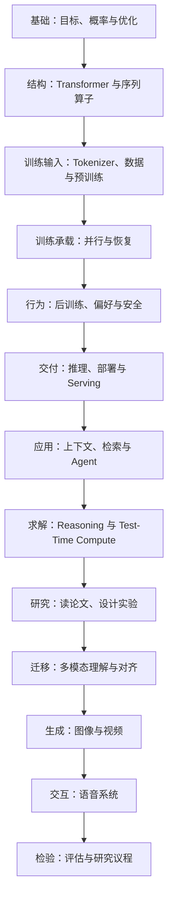

# 第二册目录：大模型算法进阶与研究判断（124 讲）

## 这本书怎样往前走

第二册不是主题卡片合集。读者先用概率与优化工具判断模型“学到什么”，再沿着“结构与数据决定可学范围—训练系统决定能否规模化—后训练改变回答行为—推理与应用系统把能力交付出去—实验与论文检验判断”的路线阅读。多模态部分是这条主线的迁移分支：它保留相同的分析方法，但分别处理理解、生成、语音交互和评估。

每个单元的起点是前一单元留下的问题，终点是下一单元需要的接口。遇到专项需求可以跳读，但应沿“前置—当前问题—交接”回补依赖，而不要只从标题抽取结论。

## 章节地图

| 顺序与章节 | 讲次 | 本单元回答的问题 | 依赖与交接 |
| --- | --- | --- | --- |
| [第一部分：深度学习与概率基础进阶](chapters/01-深度学习与概率基础进阶.md) | 1—10 | 语言建模的概率目标如何连接优化、泛化、不确定性和诊断？ | 为结构选择和训练曲线提供共同的目标与证据语言。 |
| [第二部分：Transformer 架构进阶](chapters/02-transformer架构进阶.md) | 11—25 | 模型怎样路由上下文、控制状态与计算成本，替代路线改变了什么？ | 从张量、显存与硬件形状交接到数据和预训练约束；专门架构研究转第二十一册。 |
| [第三部分：Tokenization、数据与预训练进阶](chapters/03-tokenization数据与预训练进阶.md) | 26—40 | 哪些文本变成训练信号，数据和计算预算如何改变可学能力？ | 交接到分布式训练系统，重点关注训练目标而非集群实现。 |
| [第四部分：大规模训练系统进阶](chapters/04-大规模训练系统进阶.md) | 41—50 | 同一训练目标如何被切分、通信、测量并可靠恢复？ | 从数学梯度语义交接到后训练的策略更新；系统平台细节转第二十三册。 |
| [第五部分：后训练与对齐进阶](chapters/05-后训练与对齐进阶.md) | 51—65 | 如何用监督、偏好和反馈把 Base Model 变成有行为约束的助手？ | 交接到推理与线上验收；安全机制深度转第八册。 |
| [第六部分：推理、部署与服务进阶](chapters/06-推理部署与服务进阶.md) | 66—75 | 训练好的模型怎样在时延、显存、成本和可靠性约束下交付？ | 交接到上下文和工具系统；Serving engine 实现转第二十四册。 |
| [第七部分：长上下文、RAG 与 Agent](chapters/07-长上下文rag与agent.md) | 76—86 | 模型如何选择上下文、取证、调用工具并管理跨轮状态？ | 交接到可验证推理；Agent runtime 与协议转第十七、二十、二十二册。 |
| [第八部分：Reasoning Model 与 Test-Time Compute](chapters/08-reasoning与test-time-compute.md) | 87—96 | 额外推理预算何时提高正确率，如何用验证器和评估约束它？ | 交接到论文阅读与研究设计；推理模型专题转第十六册。 |
| [第九部分：论文精读与开放研究题](chapters/09-论文精读与开放研究题.md) | 97—104 | 如何从问题、方法、实验和局限还原论文真正支持的结论？ | 作为全书方法收束，并把同一分析框架带入多模态分支。 |
| [第十部分：多模态理解与对齐](chapters/10-多模态理解与对齐.md) | 105—113 | 图像、文档和视频证据怎样进入语言模型并被定位、对齐和监督？ | 交接到生成路线；全栈多模态理解转第十五册。 |
| [第十一部分：图像与视频生成模型](chapters/11-图像与视频生成模型.md) | 114—119 | 扩散、自回归和视频时空建模如何定义生成与质量？ | 交接到实时交互和跨模态评估；生成模型专题转第十五册。 |
| [第十二部分：语音识别、生成与交互](chapters/12-语音识别生成与交互.md) | 120—122 | 识别、合成与端到端语音对话的状态、延迟和指标如何区分？ | 从单模态链路交接到统一评估；实时 serving 细节转第二十四册。 |
| [第十三部分：多模态评估与开放研究](chapters/13-多模态评估与开放研究.md) | 123—124 | 怎样区分感知、生成、交互和安全指标，并把差距变成研究问题？ | 收束本册，给第七、八、十五、十六及十七册提供评估接口。 |

## 按学习目标选读

- **训练与架构**：第 1—5 部分。沿“目标—结构—数据—训练系统—行为”完整追踪，不要把吞吐优化当成训练目标本身。
- **推理与应用**：第 6—8 部分。先算服务预算，再看证据、工具和推理时搜索怎样改变成功率与单位成本。
- **论文与算法研究**：第 1、2、3、5、8、9 部分。遇到开放题时回到第 104 讲的实验设计，把假设、竞争解释、预算和验收条件写清楚。
- **多模态**：第 10—13 部分。按理解、生成、交互、评估顺序读；不要把图像生成分数、视频一致性和语音对话成功率当作同一个能力指标。

## 编号和交叉引用

124 个讲次编号继续作为题库、练习和书系索引的稳定锚点。本次调整只拆分原多模态文件边界，不改变讲次编号；第 105—124 讲的旧内容按目录中四个主题单元迁移。新增的世界模型、VLA、自动驾驶和更完整的多模态系统范围留给书系第二轮规划，不用一个概览讲次暗示已经覆盖。
