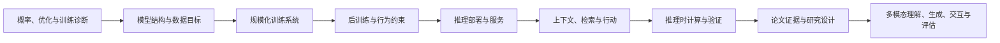

# 第二册简介：大模型算法进阶与研究判断（124 讲）

## 本册定位

第二册承接第一册的 LLM 生命周期主线，训练读者把“知道组件”推进到“能解释选择、复算代价、审查证据”。它面向已完成第一册或具备同等基础的读者，重点回答：当数据、目标、模型结构、训练资源或服务约束改变时，系统行为为什么会变，应该观察什么证据，哪些结论不能外推。

本册不是把更多术语并列摆出的词典，也不承担每个专题的完整工程教程。正文围绕一条研发链组织：先建立分析工具，再看架构和训练数据如何限定模型能力；随后连接分布式训练、行为塑造、推理服务与应用系统；最后用论文分析方法和多模态分支扩展判断范围。每个主题都要落到一个可解释的机制、可复算的小例子和明确的适用边界。

## 读者与学习结果

适合已经学过 Transformer、语言模型训练和基本推理流程，准备进一步讨论算法、模型架构、训练系统、后训练、Serving 或研究问题的读者。必要前置包括基础概率、微积分、Python，以及常见深度学习张量操作；涉及分布式训练或优化推导时，正文会补齐当前论证所需的符号和中间步骤。

读完后，读者应能：

1. 从概率目标、数据分布和优化轨迹解释语言模型训练中的收益与失效，而不把训练 loss 当成全部能力。
2. 根据张量形状、显存、通信和延迟账本比较 Transformer、稀疏专家、状态空间和混合结构。
3. 把数据、并行策略、后训练目标与推理预算放进同一条因果链，设计能区分竞争解释的实验。
4. 评估 RAG、工具使用、长上下文和推理时扩展的证据、成本及风险边界。
5. 精读代表性论文，区分论文实际证明的结论、实现条件和仍待验证的假设。
6. 解释图像、视频与语音系统中的输入表示、生成路线和评估差异，并知道何时应转入多模态专题书。

## 阅读主线

前九部分从语言模型的建模基础走到研究判断；最后四个单元把同一套“任务—表示—模型—训练/推理—评估”问题迁移到多模态。多模态文件拆开后，各自拥有清楚边界：理解与对齐、图像/视频生成、语音交互、评估与研究议程，不再把它们压成一份过长的章节清单。

这张图表达阅读依赖，不表示生产系统必须按单一路径串行执行。实际项目可以从 Serving 或数据问题进入，再回到前置机制查因；主线的作用是让读者知道每个局部决定改变了链条中的哪个接口。

## 各部分摘要与衔接

1. **深度学习与概率基础进阶**回答目标函数、概率、优化和泛化如何决定模型从数据中学到什么，为后续结构、训练和评估分析建立共同语言。
2. **Transformer 架构进阶**比较序列信息怎样在注意力、递归状态与混合结构间流动，并核算表达能力和计算成本；它把基础工具接到数据与预训练。
3. **Tokenization、数据与预训练进阶**说明文本如何被切分、筛选和转成训练信号，以及数据分布如何限制能力，随后引出规模化训练系统。
4. **大规模训练系统进阶**追踪并行、通信、算力利用率、测量和恢复怎样影响训练结果，把模型目标连接到可执行的训练流程，并交给后训练。
5. **后训练与对齐进阶**分析示范、偏好和反馈怎样改变基础模型的行为，并检查收益、奖励偏差与安全约束，随后进入推理和线上服务。
6. **推理、部署与服务进阶**从延迟、吞吐、显存和成本解释模型怎样交付及其瓶颈，接着讨论上下文选择、检索和工具行动。
7. **长上下文、RAG 与 Agent**追踪证据如何进入上下文、被检索和传递给工具，并检查跨轮状态、权限与失败边界，为可验证推理铺路。
8. **Reasoning Model 与 Test-Time Compute**比较额外计算、搜索和验证器如何影响正确率与成本，并建立过程和结果评估视角，交给论文精读。
9. **论文精读与开放研究题**沿代表性工作复原机制、实验与适用边界，再把仍未知的问题转成可证伪的实验设计，并将这套判断方法带入多模态分支。
10. **多模态理解与对齐**研究图像、文档和视频证据怎样进入表示、定位和监督流程，随后转向内容生成。
11. **图像与视频生成模型**比较扩散、自回归和时空建模路线如何生成内容及保持一致性，再连接实时语音交互。
12. **语音识别、生成与交互**区分识别、合成和端到端对话中的状态、延迟与质量指标，为多模态系统评估提供交互案例。
13. **多模态评估与开放研究**分别检验理解、生成、语音交互和安全行为，把测得的缺口转成研究问题，并指向更深入的专题书。

## 本册边界与书系衔接

第一册负责建立可跟随的核心闭环，第二册把机制、实验和规模化取舍讲深。第三册以可运行项目和代码实践为主；第四册负责概念检索。第五至第九册分别深入训练、推理、评估、安全和数据；第十五册主讲多模态生成模型，第十六册主讲推理模型，第十七、二十、二十二册深入 Agent、Runtime 与工具协议；第二十一至第二十四册进一步讲模型架构、协议、AI Infra 和推理引擎。

因此，第二册会为这些专题建立共同的机制地图和接口，但不会在一讲里代替专题书完成系统覆盖。例如，RAG/Agent 在这里作为“上下文如何转成证据与行动”的进阶案例；完整 Agent Runtime 转到第十七、二十和二十二册。图像与视频生成在这里用于比较任务、表示和模型路线；具体生成系统由第十五册主讲。具身模型、世界模型和自动驾驶需要闭环物理环境、动作控制和仿真评估，不塞进本册多模态小节；相关候选留待书系第二轮范围规划。

## 阅读方式

建议先沿目录主线读完 1—104 讲，再进入 105—124 讲的多模态分支。准备训练岗位时，重点复读第 1—5 部分；准备推理或系统岗位时，沿第 6—7 部分并与第二十四册对读；准备 Reasoning 或研究岗时，重点读第 8—9 部分；多模态岗位再读第 10—13 部分，并转入第十五册。

每讲都应先明确它要回答的问题，再跟随机制推演和数值例子，最后读边界与承接。代码是对手算路径的局部复核，不能代替逐步计算；论文和系统数字也要连同任务、数据、预算、硬件与评测口径一起理解。附录式术语清单或单独引用不算学会机制。
