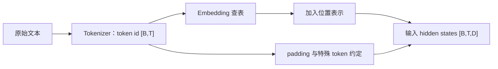

# 第 2 章（上）：Transformer 输入表示——从 token id 到带位置信息的向量

第 1 章里，我们看到一个训练样本怎样变成张量、损失和梯度。现在把视线移到语言模型的入口：程序拿到的是一串整数 token id，但整数本身既不是词义，也没有“前一个、后一个”的位置关系。Transformer 必须先把这些离散编号变成向量，并让向量带上模型需要的位置线索。

本篇按数据进入模型的顺序展开：tokenizer 产出 id，embedding 查表得到向量，位置机制补上顺序信息，最后检查 padding 和权重共享如何影响输入与输出。完成后，你应该能从一小段文本追到 `[B,T,D]` 的 hidden states，知道张量各维代表什么、哪些位置有效，以及这些表示还不能说明什么。这里的向量是模型内部用来计算的表示，不是能直接读成人类语义的标签。



图中 `[B,T,D]` 的 `B` 是 batch 大小，`T` 是 token 数，`D` 是模型宽度。下一部分会从这组向量出发，解释当前位置怎样从其他位置读取信息，以及 padding 和因果约束怎样限制这种读取。

## 2.1 Token Embedding 与位置表示：让离散序列进入连续空间

### 2.1.1 token id 是索引，不是有序特征

Tokenizer 把文本变成整数序列，例如：

```text
我 -> 125
爱 -> 876
你 -> 42
```

这些数字的大小没有语义。编号 876 不比编号 42 “更强”，相邻编号也不意味着两个 token 相似。如果把 [125, 876, 42] 当作普通浮点特征输入线性层，模型会被迫把编号的数值关系当成可学习规律的一部分。

Embedding 的职责是用一个可学习矩阵把离散 id 映射成向量。设词表大小为 $V$，模型隐藏维度为 $D$，token embedding 矩阵为：

```math
E\in\mathbb{R}^{V\times D}
```

输入 token id 为 $i$ 时，输出就是矩阵的第 $i$ 行：

```math
e_i=E_{i,:}
```

若一个 batch 的 token id 形状为 $[B,T]$，查表后得到：

```math
\mathrm{Embedding}(X)\in\mathbb{R}^{B\times T\times D}
```

其中 $B$ 是批次大小，$T$ 是序列长度，$D$ 是 hidden size。后续层接收的不是 token id，而是这组 $D$ 维向量。

例如，若 id 42 对应的 embedding 行是 $[0.3,-0.1]$，每次查到 id 42 都会先得到这个向量；它还没有包含“第几个 token”的信息，也不能直接读成某个语义标签。反向传播时，输入中出现的 id 会把梯度传回对应行；稍后会看到，这也会影响词表参数量和 padding 的处理。

### 2.1.2 查表与 one-hot 矩阵乘法是同一个数学运算

设词表只有 5 个 token，id 为 2 的 one-hot 向量是：

```math
u_2=[0,0,1,0,0]
```

用行向量表示时：

```math
u_2E=E_{2,:}
```

所以 one-hot 乘法与索引查表在数学上等价。工程实现不应真的构造 $[B,T,V]$ 的 one-hot 张量，因为 $V$ 可能达到数万乃至数十万；直接读取需要的行可以避免大量零值存储和乘法。

下面用一个小矩阵验证两种写法的结果一致：

> 代码状态：静态审阅，未运行（2026-10-29）

```python
import torch
from torch import nn
import torch.nn.functional as F

torch.manual_seed(7)
vocab_size = 5
hidden_size = 3
input_ids = torch.tensor([[0, 2, 4], [1, 2, 3]], dtype=torch.long)

embedding = nn.Embedding(vocab_size, hidden_size)
lookup = embedding(input_ids)
one_hot = F.one_hot(input_ids, num_classes=vocab_size)
one_hot = one_hot.to(dtype=embedding.weight.dtype)
matmul = one_hot @ embedding.weight

print("lookup_shape=", tuple(lookup.shape))
print("one_hot_shape=", tuple(one_hot.shape))
print("outputs_close=", torch.allclose(lookup, matmul))
```
输出的关键不变量是：

```text
lookup_shape= (2, 3, 3)
one_hot_shape= (2, 3, 5)
outputs_close= True
```

nn.Embedding 的输入应是整数索引，通常使用 torch.long；每个索引必须满足 $0\le i<V$。将索引先转成浮点数不会让 embedding 获得更丰富的信息，反而会导致接口错误。

### 2.1.3 参数量和梯度的稀疏访问

Embedding 矩阵的参数量为：

```math
N_{\mathrm{token}}=VD
```

例如 $V=100000,D=4096$ 时：

```math
N_{\mathrm{token}}=100000\times4096=409{,}600{,}000
```

如果权重以 BF16 保存，每个元素占 2 bytes，裸权重约为 819.2 MB。训练显存还要加上梯度、优化器状态、临时激活以及可能的 FP32 master copy；不能把这个数字当成训练显存总量。

下面观察哪些行收到梯度：

> 代码状态：静态审阅，未运行（2026-10-29）

```python
import torch
from torch import nn

torch.manual_seed(3)
embedding = nn.Embedding(10, 4)
input_ids = torch.tensor([[1, 1, 4], [7, 4, 4]], dtype=torch.long)
loss = embedding(input_ids).pow(2).mean()
loss.backward()

row_norms = embedding.weight.grad.norm(dim=-1)
used_rows = [i for i, value in enumerate(row_norms) if value > 0]
print("used_rows=", used_rows)
print("unused_row_0_norm=", round(row_norms[0].item(), 6))
```
在没有额外正则项、且只计算这一个 batch 损失时，used_rows 应包含 1、4、7，未出现的行没有这次损失的直接梯度。若使用权重衰减、共享输出头或其他正则项，未出现行仍可能被更新；“未被索引访问”和“最终参数绝对不变”是两个不同命题。

### 2.1.4 padding_idx、attention mask 和 loss mask

变长序列通常需要 padding：

```text
样本 A: [12, 35, 98, 77]
样本 B: [21, 43,  0,  0]
```

如果 0 是 padding token，可以写：

> 代码状态：静态审阅，未运行（2026-10-29）

```python
from torch import nn

vocab_size = 100
d_model = 32
token_embedding = nn.Embedding(
    num_embeddings=vocab_size,
    embedding_dim=d_model,
    padding_idx=0,
)
```
`padding_idx` 只规定 embedding 参数这一层的梯度行为：该行不接收常规 lookup 梯度，新建的 PyTorch embedding 通常把它初始化为零。加载 checkpoint 或手动改过权重后，这一行不一定仍为零。它也不负责修改 attention 的可见性或训练标签；这些是另外两层协议。PyTorch 2.15 的接口说明见 [Embedding 文档](https://docs.pytorch.org/docs/2.15/generated/torch.nn.Embedding.html)。

| 机制 | 解决的问题 | 作用位置 |
| --- | --- | --- |
| padding_idx | padding 行是否由常规 loss 更新 | embedding 参数 |
| attention mask | query 能否读取某个 key | attention score |
| loss mask | 某个目标位置是否计入损失 | loss reduction |

一个 batch 可能同时需要三者。只设置 `padding_idx`，padding key 仍可能被 attention 读取；只设置 attention mask，padding 位置仍可能进入 token loss。实际的 `pad_token_id` 应从 tokenizer 和数据配置读取，不能假定总是 0；有些 decoder-only tokenizer 没有独立的 padding token，而是在批处理时复用已有 token id。注意：复用 id 后仍须单独记录哪些位置是 padding。

### 2.1.5 位置表示为什么必不可少

Token embedding 只按 id 查表；同一个 token 出现在两个位置时，查到的基础向量相同。Attention 本身不会从整数编号推断先后顺序。更准确地说，不带位置线索的 self-attention 对 token 排列具有置换等变性：一起重排输入和对应的可见关系，输出也会按同样顺序重排。对于语言，顺序会改变含义：

```text
我 喜欢 你
你 喜欢 我
```

因此，模型需要在某处获得位置关系。最直观的办法是把位置向量加到 token embedding 上：

```math
H_{b,t}=E_{x_{b,t}}+P_t
```

其中 $x_{b,t}$ 是第 $b$ 个样本第 $t$ 个 token 的 id，$P_t$ 是位置 $t$ 的向量。这里的位置向量直接加到表示上，是绝对位置表示的一种形式。另一种做法是在 attention 计算相似度时改造 query 和 key；RoPE 属于后一类，放在本章下篇讲。

可学习位置表为：

```math
P\in\mathbb{R}^{T_{\max}\times D}
```

它有 $T_{\max}D$ 个位置参数，超过 $T_{\max}$ 时不能直接索引。position_offset 可以让增量推理从历史长度开始取位置，但不能突破位置表的最大长度。

### 2.1.6 Learned positional embedding 的实现

> 代码状态：静态审阅，未运行（2026-10-29）

```python
import torch
from torch import nn

class TokenAndPositionEmbedding(nn.Module):
    def __init__(self, vocab_size, d_model, max_seq_len, pad_token_id=None):
        super().__init__()
        if vocab_size <= 0 or d_model <= 0 or max_seq_len <= 0:
            raise ValueError("vocab_size, d_model and max_seq_len must be positive")
        kwargs = {}
        if pad_token_id is not None:
            kwargs["padding_idx"] = pad_token_id
        self.token = nn.Embedding(vocab_size, d_model, **kwargs)
        self.position = nn.Embedding(max_seq_len, d_model)
        self.max_seq_len = max_seq_len

    def forward(self, input_ids, position_offset=0):
        if input_ids.ndim != 2:
            raise ValueError("input_ids must have shape [batch, sequence]")
        if input_ids.dtype not in (torch.int32, torch.int64):
            raise TypeError("input_ids must use an integer dtype")
        if position_offset < 0:
            raise ValueError("position_offset must be non-negative")
        batch_size, seq_len = input_ids.shape
        end = position_offset + seq_len
        if end > self.max_seq_len:
            raise ValueError("learned position table is too short")
        positions = torch.arange(
            position_offset,
            end,
            device=input_ids.device,
            dtype=torch.long,
        )
        positions = positions.view(1, seq_len).expand(batch_size, seq_len)
        return self.token(input_ids) + self.position(positions)

torch.manual_seed(42)
input_ids = torch.tensor([[4, 8, 2, 0], [9, 3, 0, 0]], dtype=torch.long)
module = TokenAndPositionEmbedding(
    vocab_size=20,
    d_model=8,
    max_seq_len=16,
    pad_token_id=0,
)
hidden = module(input_ids)
offset_hidden = module(input_ids[:, :2], position_offset=4)

print("hidden_shape=", tuple(hidden.shape))
print("offset_hidden_shape=", tuple(offset_hidden.shape))
print("position_table_shape=", tuple(module.position.weight.shape))
```
输出形状为：

```text
hidden_shape= (2, 4, 8)
offset_hidden_shape= (2, 2, 8)
position_table_shape= (16, 8)
```

这里 offset 只改变位置索引；token embedding 的 padding 行仍由 padding_idx 管理。若采用左 padding，还要决定真实 token 的 position ids 是否跳过 padding；不同模型和 serving runtime 的约定并不一致，不能只把 torch.arange(seq_len) 当成普适答案。

### 2.1.7 Sinusoidal encoding 是固定函数

[Transformer 原论文](https://arxiv.org/abs/1706.03762)给出了一种不增加可训练位置参数的编码。对位置 $p$、维度索引 $i$ 和模型维度 $D$：

```math
PE_{p,2i}=\sin\left(\frac{p}{10000^{2i/D}}\right)
```

```math
PE_{p,2i+1}=\cos\left(\frac{p}{10000^{2i/D}}\right)
```

它可以在运行时计算更长的位置，但“可计算”不等于“模型在更长位置上保持同样质量”。频率范围、训练长度、数值精度和任务分布都会影响外推。

> 代码状态：静态审阅，未运行（2026-10-29）

```python
import math
import torch

def sinusoidal_position_encoding(seq_len, d_model, device=None, dtype=torch.float32):
    if seq_len < 0 or d_model <= 0:
        raise ValueError("seq_len must be non-negative and d_model positive")
    if d_model % 2 != 0:
        raise ValueError("this implementation expects an even d_model")
    positions = torch.arange(
        seq_len, device=device, dtype=torch.float32
    ).view(seq_len, 1)
    pair_index = torch.arange(
        0, d_model, 2, device=device, dtype=torch.float32
    )
    inv_frequency = torch.exp(
        -math.log(10000.0) * pair_index / d_model
    )
    angles = positions * inv_frequency.view(1, -1)
    encoding = torch.zeros(
        seq_len, d_model, device=device, dtype=torch.float32
    )
    encoding[:, 0::2] = torch.sin(angles)
    encoding[:, 1::2] = torch.cos(angles)
    return encoding.to(dtype=dtype)

encoding = sinusoidal_position_encoding(seq_len=4, d_model=8)
print("encoding_shape=", tuple(encoding.shape))
print("position_zero=", encoding[0].tolist())
```
位置 0 的偶数维为 0，奇数维为 1，这是由该公式直接得到的，不是训练结果。固定 encoding 与 token states 相加后，整体 shape 仍是 $[B,T,D]$。

### 2.1.8 输出头与 token embedding 权重共享

语言模型最终需要把 hidden state 映射回词表 logits。设 $H$ 的形状为 $[B,T,D]$，输出矩阵为 $W_{\mathrm{out}}\in\mathbb{R}^{D\times V}$：

```math
Z=HW_{\mathrm{out}}+b
```

权重共享（weight tying）常令：

```math
W_{\mathrm{out}}=E^\top
```

这样输入 embedding 和输出分类空间使用同一组参数，减少一份 $VD$ 参数，并施加一种表示空间约束。它不是 nn.Embedding 的默认行为；共享时必须让两个计算路径真正引用同一个 Parameter，而不是复制数值后各自注册。

> 代码状态：静态审阅，未运行（2026-10-29）

```python
import torch
from torch import nn

vocab_size = 100
d_model = 16
embedding = nn.Embedding(vocab_size, d_model)
output_bias = nn.Parameter(torch.zeros(vocab_size))
hidden = torch.randn(2, 4, d_model)
logits = hidden @ embedding.weight.transpose(0, 1) + output_bias

print("logits_shape=", tuple(logits.shape))
print("tied_parameter_count=", embedding.weight.numel() + output_bias.numel())
```
共享输入输出权重会让输入侧和输出侧梯度相加到同一个参数上；这也是它与“初始化相同的两份矩阵”在训练语义上的区别。是否共享取决于模型架构和 tokenizer 设计，不能由参数量估算反推。

### 2.1.9 左右 padding 与增量位置

右 padding 常见形式是：

```text
真实 token: [12, 35, 98, 77, 0, 0]
```

左 padding 则是：

```text
padding:    [0, 0, 12, 35, 98, 77]
```

对绝对位置 embedding，左 padding 会带来一个选择：真实 token 使用物理列位置 2、3、4、5，还是重新编号为 0、1、2、3。右 padding 通常让真实 token 从位置 0 开始；左 padding 若不跳过 pad，较短样本的真实 token 就会带上更大的位置编号。选择哪种编号必须与训练和推理实现一致，否则同一个 prompt 可能因 batch 中其他样本的长度不同而获得不同位置。

实现时，要把下面这些约定放在一起检查：

1. padding 是左侧还是右侧；
2. position ids 是否跳过 padding；
3. attention mask 如何屏蔽 padding key 和无效 query；
4. loss mask 是否保留有效目标；
5. 增量解码时新 token 的 cache position 如何计算。

position ids、因果 mask 和 KV Cache 的绝对位置必须彼此一致。没有确认目标模型训练与 runtime 的约定前，不能因为某段代码用了 `arange` 就把它推广为所有 decoder-only 模型的规则。KV Cache 的容量和增量解码会在推理优化一章继续展开。

### 2.1.10 从输入 id 到 hidden state，逐项核对

输入层最容易出现“shape 合法、含义错位”的问题。对一批 token，至少沿着下列顺序检查：

| 检查对象 | 需要确认什么 | 一个典型错误信号 |
| --- | --- | --- |
| `input_ids` | 整数类型，且每个值都在词表范围内 | embedding 越界，或 tokenizer 与 checkpoint 不匹配 |
| token embedding | 输出是 `[B,T,D]`，相同 id 查到同一行 | 误把 id 当连续浮点特征 |
| `position_ids` | 每个有效 token 的位置符合训练约定 | 左 padding 改变真实 token 的位置编号 |
| `padding_idx` | 只控制该行的 lookup 梯度 | 误以为它自动屏蔽 attention 和 loss |
| attention/loss mask | 分别控制可读取的 key 和参与监督的目标 | padding 虽不更新 embedding，却仍影响 loss |

这个表是检查顺序，不是说每个错误都会报异常。Tokenizer 与 checkpoint 不匹配时，id 可能仍在合法范围内，程序也能正常运行，但每个 id 取到的向量已不再对应预期 token。

下面的短例只检查 `padding_idx` 的梯度约定：损失只经过 embedding lookup 时，0 行不应收到梯度。它没有测试 attention 或 loss mask；若参数还经过权重衰减、输出头共享等路径，最终参数是否变化要另行判断。

> 代码状态：静态审阅，未运行（2026-11-16）

```python
import torch
from torch import nn

embedding = nn.Embedding(5, 3, padding_idx=0)
input_ids = torch.tensor([[0, 2]], dtype=torch.long)
embedding(input_ids).sum().backward()

assert torch.count_nonzero(embedding.weight.grad[0]).item() == 0
assert torch.count_nonzero(embedding.weight.grad[2]).item() == 3
```

用一个极小的数值例子把查表和位置相加接起来。假设两个 token 的 embedding 分别是 $E_{\text{云}}=[1,0]$、$E_{\text{模型}}=[0,1]$，位置向量为 $P_0=[0.1,0]$、$P_1=[0,0.2]$。序列“云、模型”进入 block 前变成 $[1.1,0]$、$[0,1.2]$；若只交换 token、位置仍按序列列号递增，输入就变成 $[0.1,1]$、$[1,0.2]$。词向量集合相同，位置配对不同，后续 attention 因而能区分顺序。这个手算例只说明表示里怎样同时携带 token 身份和位置，不代表模型已经理解“云模型”的语义；语义关系要通过训练目标和数据学出来。

同一 token 在一个 batch 出现多次时，它对应的 embedding 行会累加来自多个位置的梯度；未出现的行通常没有这次 loss 的直接梯度。不过，稀疏访问不等于优化器一定使用稀疏存储，权重衰减或共享输出头也可能更新其他行。扩词表时必须同时处理新 token 的向量初始化、输出头维度、checkpoint 和 tokenizer revision；只替换 tokenizer，id 仍可能有效，却会把原来的向量解释成另一个 token。

调试时，先选两三个手工 token，从原始文本追到 tokenizer 输出、embedding 行和 position id；再检查真实 tokenizer 的特殊 token、padding 方向和最大长度。若 tokenizer 把一个汉字拆成多个子词，`T` 会随之变化，后续 attention 的计算量和 next-token loss 的有效位置数也会变化。下篇将从同一组 hidden states 出发，说明 attention 怎样在明确的可见范围内组合信息。

## 继续阅读与资料边界

Token embedding 和位置表示的结构可以对照 [Transformer 原论文](https://arxiv.org/abs/1706.03762)；`padding_idx` 等接口行为按 [PyTorch 2.15 Embedding 文档](https://docs.pytorch.org/docs/2.15/generated/torch.nn.Embedding.html)核对。论文描述的是结构与方法，PyTorch 文档描述的是指定版本的 API；二者都不说明任意 tokenizer、checkpoint 或 serving runtime 的位置和 padding 约定。
