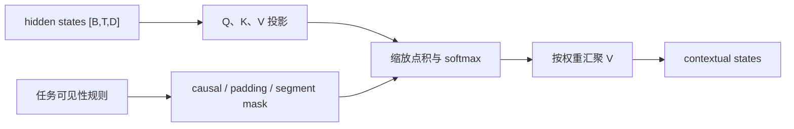

# 第 2 章（中）：Attention 与 Mask——从相似度到可见性

上一部分把文本变成了 `[B,T,D]` 的向量。向量里有 token 身份和位置线索，但每个位置还没有根据上下文更新自己的表示。注意力（attention）负责这一步：当前位置拿自己的查询向量（query，Q）与各个键向量（key，K）比较，得到一组权重，再用这些权重混合值向量（value，V）。要用于自回归语言模型，还必须规定哪些位置可以被读取；这就是掩码（mask）的职责。

注意力不是在模型里寻找“最重要词语”的独立模块，而是一组可以逐步计算的运算：由 Q 和 K 得到权重，再用权重混合 V。我们先手算，再扩展到多头注意力、交叉注意力、因果掩码、填充掩码和 PyTorch 接口。读完后，你应能从张量形状判断分数沿哪两个序列维计算、softmax 对哪个轴归一化，以及布尔掩码中的 True 究竟表示“可见”还是“屏蔽”。这些检查能证明局部计算符合约定，不能单独证明模型学会了语言。



Attention 的输出仍会送回 `[B,T,D]` 接口，但它只完成了跨位置的信息交换。下一部分会把这一子层放进 residual、归一化和逐 token 前馈计算中，组成可堆叠的 Transformer block。

## 2.2 缩放点积注意力（scaled dot-product attention）：从相似度到信息汇聚

### 2.2.1 Q、K、V 是三个不同的角色

假设当前要处理一个位置，它需要从前面的 token 中取回有用信息。模型先把各位置的表示投影成三组向量：query（查询，Q）表示当前位置用来匹配的向量，key（键，K）参与匹配，value（值，V）是匹配后要汇聚的内容：

```math
Q=XW_Q,\qquad K=XW_K,\qquad V=XW_V
```

可以把 Q/K/V 暂时理解为“用什么找、拿什么匹配、匹配后取什么”。它们只是三组由训练得到的向量，不是网络里可直接读出的自然语言问题、标签或答案。

单头自注意力常用的张量形状为：

| 张量 | shape | 含义 |
| --- | --- | --- |
| $Q$ | $[B,T_q,d_k]$ | 每个 query 位置的向量 |
| $K$ | $[B,T_k,d_k]$ | 每个 key 位置的向量 |
| $V$ | $[B,T_k,d_v]$ | 每个 key 位置的内容向量 |

自注意力中 $T_q=T_k=T$，且 Q、K、V 都来自同一段输入 $X$；交叉注意力中，Q 与 K/V 可以来自不同序列，因此 $T_q$ 与 $T_k$ 不必相同。这里的 $T_q$、$T_k$ 分别是查询序列长度和键/值序列长度。

### 2.2.2 点积、缩放和 softmax

先计算 query 与每个 key 的相似度：

```math
S_{b,a,c}=\frac{Q_{b,a,:}K_{b,c,:}^{\top}}{\sqrt{d_k}}
```

这里 $a$ 是 query 位置，$c$ 是 key 位置。将所有位置写成矩阵：

```math
S=\frac{QK^\top}{\sqrt{d_k}}
```

得到 $S\in\mathbb{R}^{B\times T_q\times T_k}$。再对 key 维度做 softmax：

```math
A_{b,a,c}=\frac{\exp(S_{b,a,c})}{\sum_{r=1}^{T_k}\exp(S_{b,a,r})}
```

最后用注意力权重汇聚 Value：

```math
O_{b,a,:}=\sum_{c=1}^{T_k}A_{b,a,c}V_{b,c,:}
```

因此 $A$ 的每个 query 行在没有 dropout 时和为 1，$O$ 的形状是 $[B,T_q,d_v]$。

用两个位置手算一次。令一个 query 为 $q=1$，两个 key 为 $k_1=\ln3$、$k_2=0$，且 $d_k=1$，所以缩放因子是 1。两项 score 为 $[\ln3,0]$；指数后是 $[3,1]$，归一化权重因此为 $[3/4,1/4]$。若 value 分别是 $v_1=[2,0]$ 和 $v_2=[0,2]$，输出就是 $[1.5,0.5]$。Attention 没有“选中”一个 value，而是按权重混合了两份内容；后面的 output projection 还会继续变换这个结果。

为什么要除以 $\sqrt{d_k}$？如果每个 $q_j,k_j$ 近似零均值、单位方差且相互独立，则点积的方差近似为 $d_k$：

```math
\mathrm{Var}(q^\top k)\approx d_k
```

缩放后：

```math
\mathrm{Var}\left(\frac{q^\top k}{\sqrt{d_k}}\right)\approx 1
```

这不是所有训练状态下的精确统计定律，而是说明 softmax logits 随维度放大的原因。归一化层、初始化和相关性会改变真实分布，但缩放仍是 [Transformer 原论文](https://arxiv.org/abs/1706.03762)采用的标准 attention 定义。

### 2.2.3 手写 attention，并把 mask 语义写进函数

下面的实现把布尔 mask 定义为 keep mask：True 表示允许 query 读取该 key，False 表示屏蔽。函数只处理 shape 可广播到 scores 的 mask；它不替调用者验证 query 是否至少有一个可见 key。

> 代码状态：静态审阅，未运行（2026-10-29）

```python
import math
import torch

def scaled_dot_product_attention(q, k, v, keep_mask=None):
    if q.shape[-1] != k.shape[-1]:
        raise ValueError("q and k must have the same key dimension")
    if k.shape[-2] != v.shape[-2]:
        raise ValueError("k and v must have the same key length")

    scores = q @ k.transpose(-2, -1)
    scores = scores / math.sqrt(q.shape[-1])

    if keep_mask is not None:
        keep_mask = keep_mask.to(dtype=torch.bool, device=scores.device)
        scores = scores.masked_fill(
            ~keep_mask,
            torch.finfo(scores.dtype).min,
        )

    weights = torch.softmax(scores, dim=-1)
    output = weights @ v
    return output, weights, scores

torch.manual_seed(7)
q = torch.randn(2, 4, 8)
k = torch.randn(2, 4, 8)
v = torch.randn(2, 4, 6)
output, weights, scores = scaled_dot_product_attention(q, k, v)

assert output.shape == (2, 4, 6)
assert weights.shape == (2, 4, 4)
assert torch.allclose(
    weights.sum(dim=-1),
    torch.ones(2, 4),
    atol=1e-6,
)
print("output_shape=", tuple(output.shape))
print("weights_shape=", tuple(weights.shape))
```
这个例子只使用 self-attention 的 $T_q=T_k=4$，但函数本身也支持 $T_q\ne T_k$。`torch.softmax` 沿最后一维，也就是 key 维归一化；若误沿 query 维归一化，得到的就不是“每个 query 如何分配给各 key”的权重。

### 2.2.4 mask 应在 softmax 前应用

设一个位置不可见。将其 score 设为很小的有限数 $m_{\mathrm{min}}$，再做 softmax：

```math
A_{b,a,c}\approx0\quad (M_{b,a,c}=0)
```

教学实现常使用 torch.finfo(scores.dtype).min；某些实现使用负无穷或 additive mask。选择哪一个要看 dtype 和 kernel 的行为，但所有方案都要面对同一个边界：如果某个 query 的所有 key 都被屏蔽，归一化没有合法的分母，结果可能是 NaN 或无意义的均匀分布。

不要在 softmax 之后简单把权重置零来代替 mask。这样会破坏可见位置的归一化，除非你随后重新归一化，而且重新归一化又要处理全零行。更稳妥的契约是：在进入 softmax 前保证每个有效 query 至少有一个可见 key。

### 2.2.5 PyTorch 缩放点积注意力接口（SDPA）的边界

PyTorch 提供 `torch.nn.functional.scaled_dot_product_attention`，通常简称 SDPA。它可能选择数学实现、节省显存的 memory-efficient 实现或 Flash 后端；具体计算内核（kernel）取决于设备、dtype、输入形状和版本。应按 [PyTorch 2.15 SDPA 文档](https://docs.pytorch.org/docs/2.15/generated/torch.nn.functional.scaled_dot_product_attention.html)核对接口和后端条件。运算目标仍是缩放点积注意力，但中间张量是否显式物化不能从 API 名字推断；融合实现的浮点顺序也可能不同，因此对照时应使用合理容差，而不是要求逐位相等。

布尔掩码的语义必须核对目标接口：SDPA 的布尔 `attn_mask` 中 True 表示参与注意力计算，False 表示屏蔽；这与 `MultiheadAttention.key_padding_mask` 的 True 表示屏蔽相反。浮点掩码则作为加性偏置（additive bias）加到注意力分数上。若传入 `is_causal=True`，不能同时传 `attn_mask`；需要同时表达因果和填充约束时，应按目标接口支持的方式合成掩码。

还有两个容易被模块封装遮住的细节。第一，SDPA 会严格按照传入的 `dropout_p` 应用 dropout（随机失活），不会读取外层模块的 `training` 状态；模型进入 eval 模式时，调用方应显式传入 0.0。第二，若要固定使用某个融合后端（fused backend），应按当前 PyTorch 文档检查输入限制；“函数调用成功”本身不证明实际走了预期内核。下面的数值对照使用 `dropout_p=0.0`，比较的是无 dropout 的注意力：

> 代码状态：静态审阅，未运行（2026-10-29）

```python
import math
import torch
import torch.nn.functional as F

def scaled_dot_product_attention(q, k, v, keep_mask=None):
    if q.shape[-1] != k.shape[-1]:
        raise ValueError("q and k must have the same key dimension")
    if k.shape[-2] != v.shape[-2]:
        raise ValueError("k and v must have the same key length")
    scores = q @ k.transpose(-2, -1)
    scores = scores / math.sqrt(q.shape[-1])
    if keep_mask is not None:
        keep_mask = keep_mask.to(
            device=scores.device,
            dtype=torch.bool,
        )
        scores = scores.masked_fill(
            ~keep_mask,
            torch.finfo(scores.dtype).min,
        )
    weights = torch.softmax(scores, dim=-1)
    return weights @ v, weights, scores

torch.manual_seed(13)
q = torch.randn(2, 3, 5, 8)
k = torch.randn(2, 3, 5, 8)
v = torch.randn(2, 3, 5, 8)
keep_mask = torch.tril(
    torch.ones(5, 5, dtype=torch.bool)
).view(1, 1, 5, 5)

manual, _, _ = scaled_dot_product_attention(q, k, v, keep_mask)
official = F.scaled_dot_product_attention(
    q, k, v, attn_mask=keep_mask, dropout_p=0.0
)
print("shape=", tuple(official.shape))
print("manual_matches_official=", torch.allclose(
    manual, official, atol=1e-6
))
```
这段代码把对照所需的手写函数一并放入围栏，因此可以单独复制运行。两种实现都使用相同的 keep-mask 语义；差异只应来自数值误差和 PyTorch 选择的 attention kernel。

缩放项不改变同一行分数的排序，却会改变 softmax 分布的尖锐程度。分数整体放大时，最大项的概率更接近 1，其他项的梯度也更容易变小。除以 $\sqrt{d_k}$ 的动机，是在常见独立初始化假设下控制点积方差；这有助于不同 head_dim 下的分数保持在可优化的尺度，但不保证训练期方差恒为 1，因为 Q、K 会逐渐相关，归一化、初始化和数据都会改变它们的分布。若分布异常，除了看输出形状，还要检查分数的均值、标准差、极值及 softmax 是否沿 key 维计算。

一个 query 行的权重和为 1，因此输出位于参与汇聚的 value 的凸组合范围内；加入 dropout 后，训练时权重可能被随机置零并缩放，行和就不再严格等于 1。多头的 output projection 还会进一步混合通道，所以不能把最终 hidden state 当成某个 token value 的简单平均。解释 attention 图时，应把它当成特定输入、层、head 和 mask 下的权重观测，而非自动得到的因果解释。

在实际 decoder 中，当前位置通常只能访问自己及以前的 key。于是上面的两个 key 例子若第二个是未来位置，mask 会在 softmax 前移除它，剩下权重为 $[1,0]$，输出变成 $[2,0]$。训练中可以一次并行计算所有 query，但必须用同一条可见性约束；生成时则通常逐步追加新的 key/value。二者共享 attention 数学定义，差别在数据可见范围和缓存执行方式。

Attention 权重只描述：在当前输入、层、head 和 mask 下，这个 query 如何分配给可见 key。它不是来源引用，也不能单独解释模型为什么作出某个决定。两个位置即使权重相近，value 内容仍可能完全不同；要诊断输出异常，应同时看 score 范围、权重分布、value 和聚合输出，而不只看一张热图。

排查异常时，把计算拆成三处观察：QK 分数是否过大或过于接近，掩码后不可见位置是否确实退出归一化，以及加权汇聚后的输出是否异常。训练时 dropout 会改变归一化后的权重行和，所以检查掩码协议时应关闭 dropout；不能把 dropout 后权重和不再为 1 直接判为实现错误。

## 2.3 多头注意力（multi-head attention, MHA）：把一个相似度空间拆成多个子空间

### 2.3.1 从单头到多头

单头注意力只有一个 $d_k$ 维的相似度空间。多头注意力把模型维度 $D$ 分成 $H$ 个注意力头（head），每个头使用 $d_h=D/H$ 个通道独立计算，再把结果拼回去：

```math
D=H d_h
```

第 $h$ 个 head 可以写成：

```math
\mathrm{head}_h=
\mathrm{Attention}(QW_h^Q,KW_h^K,VW_h^V)
```

所有 head 拼接后再投影：

```math
\mathrm{MHA}(X)=
\mathrm{Concat}(\mathrm{head}_1,\ldots,\mathrm{head}_H)W^O
```

不同 head 可以在不同参数子空间中学习局部关系、长距离关系或其他统计模式。这是结构上的可能性，不代表每个 head 都能被人类稳定地赋予一个语义标签；是否出现可解释的 head，需要通过激活、消融和下游任务实验验证。

标准实现通常用三个 $D\to D$ 的线性层一次性产生 Q、K、V，再重新组织最后一维，而不是为每个 head 单独创建 Python 模块；这与 [Transformer 原论文](https://arxiv.org/abs/1706.03762)中的多头结构一致。只要 $D$ 固定，改变 $H$ 会改变每个 head 的维度和计算组织，但不会自动把四个投影矩阵的参数量乘以 $H$。

### 2.3.2 shape 账本

以 self-attention 为例：

| 张量 | shape | 含义 |
| --- | --- | --- |
| $X$ | $[B,T,D]$ | 输入 hidden states |
| $Q,K,V$ | $[B,T,D]$ | 三组线性投影 |
| 拆头后的 $Q,K,V$ | $[B,H,T,d_h]$ | 每个 head 的序列表示 |
| scores | $[B,H,T,T]$ | query-key 分数 |
| head output | $[B,H,T,d_h]$ | 每个 head 汇聚后的值 |
| 合并后的 output | $[B,T,D]$ | 拼接并输出投影前 |

拆头是：

```math
[B,T,D]\to[B,T,H,d_h]\to[B,H,T,d_h]
```

合并是：

```math
[B,H,T,d_h]\to[B,T,H,d_h]\to[B,T,D]
```

transpose 通常只改变 stride，不保证新视图在物理内存中连续。合并前调用 contiguous 再 view，或者直接使用 reshape，是为了明确处理这一点。

### 2.3.3 一个可读的 MultiHeadAttention 实现

> 代码状态：静态审阅，未运行（2026-10-29）

```python
import math
import torch
import torch.nn.functional as F
from torch import nn

def scaled_dot_product_attention(
    q,
    k,
    v,
    keep_mask=None,
    dropout_p=0.0,
    training=True,
):
    scores = q @ k.transpose(-2, -1)
    scores = scores / math.sqrt(q.shape[-1])
    if keep_mask is not None:
        keep_mask = keep_mask.to(dtype=torch.bool, device=scores.device)
        scores = scores.masked_fill(
            ~keep_mask,
            torch.finfo(scores.dtype).min,
        )
    weights = torch.softmax(scores, dim=-1)
    weights = F.dropout(
        weights,
        p=dropout_p,
        training=training,
    )
    return weights @ v, weights

class MultiHeadAttention(nn.Module):
    def __init__(self, d_model, num_heads, dropout=0.0):
        super().__init__()
        if d_model <= 0 or num_heads <= 0 or d_model % num_heads != 0:
            raise ValueError("d_model must be divisible by num_heads")
        self.d_model = d_model
        self.num_heads = num_heads
        self.head_dim = d_model // num_heads
        self.q_proj = nn.Linear(d_model, d_model)
        self.k_proj = nn.Linear(d_model, d_model)
        self.v_proj = nn.Linear(d_model, d_model)
        self.out_proj = nn.Linear(d_model, d_model)
        self.dropout = nn.Dropout(dropout)

    def split_heads(self, x):
        batch_size, seq_len, _ = x.shape
        x = x.view(
            batch_size,
            seq_len,
            self.num_heads,
            self.head_dim,
        )
        return x.transpose(1, 2)

    def merge_heads(self, x):
        batch_size, _, seq_len, _ = x.shape
        x = x.transpose(1, 2).contiguous()
        return x.view(batch_size, seq_len, self.d_model)

    def forward(self, x, keep_mask=None):
        batch_size, seq_len, _ = x.shape
        q = self.split_heads(self.q_proj(x))
        k = self.split_heads(self.k_proj(x))
        v = self.split_heads(self.v_proj(x))
        output, weights = scaled_dot_product_attention(
            q,
            k,
            v,
            keep_mask=keep_mask,
            dropout_p=self.dropout.p,
            training=self.training,
        )
        output = self.merge_heads(output)
        output = self.out_proj(output)
        return output, weights

torch.manual_seed(42)
x = torch.randn(2, 5, 12)
mask = torch.tril(
    torch.ones(5, 5, dtype=torch.bool)
).view(1, 1, 5, 5)
mha = MultiHeadAttention(d_model=12, num_heads=3)
output, weights = mha(x, keep_mask=mask)

print("output_shape=", tuple(output.shape))
print("weights_shape=", tuple(weights.shape))
print("row_sum_shape=", tuple(weights.sum(dim=-1).shape))
```
输出形状为：

```text
output_shape= (2, 5, 12)
weights_shape= (2, 3, 5, 5)
row_sum_shape= (2, 3, 5)
```

在 dropout 为 0 且每个 query 至少有一个可见 key 时，weights 沿最后一维应接近全 1。若在训练模式下对 weights 使用 dropout，dropout 后的权重行不一定仍然和为 1；检查 mask 时应关闭 dropout，避免把正则化行为误判成 mask 错误。

### 2.3.4 自注意力（self-attention）与交叉注意力（cross-attention）

本节代码的 Q、K、V 都来自同一个输入 $X$，因此是自注意力。交叉注意力则允许查询序列与键/值序列长度不同：

```math
Q\in\mathbb{R}^{B\times T_q\times d_k},\qquad
K\in\mathbb{R}^{B\times T_k\times d_k},\qquad
V\in\mathbb{R}^{B\times T_k\times d_v}
```

其分数形状为 $[B,H,T_q,T_k]$，而不是强行写成 $[B,H,T,T]$。decoder 生成时，query 可以来自 decoder 当前 hidden，key/value 可以来自 encoder 输出；多模态模型中，key/value 也可能来自视觉或音频编码器。

如果实现把同一个 `seq_len` 同时当作 query 和 key/value 长度，交叉注意力在 $T_q\ne T_k$ 时就会出现 reshape 或掩码对齐错误。工程接口应分别记录 query length 和 key length。

### 2.3.5 参数量与复杂度

标准 MHA 有四个主要投影矩阵：

```math
W_Q,W_K,W_V,W_O\in\mathbb{R}^{D\times D}
```

忽略 bias 时：

```math
N_{\mathrm{MHA}}\approx4D^2
```

如果 $D=512,H=8$，改成 $H=16$ 后，四个矩阵的形状仍然是 $[512,512]$，参数量不会自动翻倍；head_dim 从 64 变成 32，可能改变 kernel 效率和每个子空间的表达容量。

attention 分数矩阵的计算复杂度近似为：

```math
O(BHT^2d_h)=O(BT^2D)
```

Q、K、V 和输出投影的线性层还带来：

```math
O(BTD^2)
```

朴素实现通常显式保存 $[B,H,T,T]$ 的权重或中间分数；FlashAttention 一类 kernel 可以减少中间显存和读写，但不应被描述为自动消除了标准 attention 的二次计算项。

把维度带入一次，可以同时检查 shape 和参数量。设 batch 为 2、序列长度 $T=3$、模型维度 $D=12$、head 数 $H=3$，则每个 head 的维度 $d_h=4$。输入 $[2,3,12]$ 经过 Q/K/V 投影仍各是 $[2,3,12]$，拆头后成为 $[2,3,3,4]$，scores 是 $[2,3,3,3]$，每个 query 对同一 head 的三个 key 打分。拼接三个 4 维 head 后回到 $[2,3,12]$，再通过输出投影。四个 $12\times12$ 矩阵共有 $4\cdot144=576$ 个权重，不含 bias；若把 head 数改成 6、每头降为 2 维，投影矩阵形状和这个参数数仍然不变。改变的是子空间切分、每头可表达的维度和 kernel 工作方式，不能把“head 翻倍”简单说成“参数翻倍”。

cross-attention 更能检验是否把形状想清楚。若两个 decoder query 读取五个 encoder token，则 scores 的末两维是 $[2,5]$，整体可为 $[B,H,2,5]$；每个 query 得到五个权重，再汇聚对应的五个 value。mask 的 key 维必须是 5，而不是 query 长度 2。任何强行把所有张量 reshape 成 $[B,H,T,T]$ 的实现，都只适用于 self-attention 的特例，遇到图像 patch、音频帧或 encoder-decoder 输入时会失败。

多头结构提供多个可学习的投影空间，但没有硬性规定第 1 个 head 必须看语法、第 2 个必须看长距离依赖。若要判断某个 head 对模型是否有作用，可以固定输入做 head 消融（head ablation），观察任务指标和输出变化，并控制随机性；只可视化某一层的注意力热图不能证明这个 head 是模型决策的唯一原因。

分组查询注意力（grouped-query attention，GQA）让多个 query head 共享较少的 key/value head；多查询注意力（multi-query attention，MQA）可看作 KV head 数更少的一类配置。若 $H_q=8,H_{kv}=2$，每组四个 query head 共享一组 key/value 表示，但 query score 仍按 query head 分开计算。它改变了 Q 与 KV 的 head 数契约，不能直接套用本节假设 Q/K/V head 数相同的实现；实现需明确 query head 到 KV head 的映射。第 6 章会用 cache shape 和容量例子说明它们对推理的影响，见[KV Cache 篇](06-推理优化实战-1-kv-cache.md)。

### 2.3.6 针对实现的局部测试

下面是针对 2.3.3 中 `MultiHeadAttention` 实现的局部测试片段；它复用前面的类定义，省略 dropout 以便结果确定。测试关注 shape、保留掩码和输出契约，不再重复实现注意力层。

> 代码片段状态：静态审阅，未运行（2026-11-16）；需先运行 2.3.3 的类定义。

```python
import torch

torch.manual_seed(5)
mha = MultiHeadAttention(d_model=16, num_heads=4)
x = torch.randn(2, 6, 16)
mask = torch.tril(
    torch.ones(6, 6, dtype=torch.bool)
).view(1, 1, 6, 6)
output, weights = mha(x, keep_mask=mask)

future = torch.triu(
    torch.ones(6, 6, dtype=torch.bool),
    diagonal=1,
).view(1, 1, 6, 6).expand_as(weights)

assert output.shape == x.shape
assert weights.shape == (2, 4, 6, 6)
assert torch.allclose(
    weights.sum(dim=-1),
    torch.ones_like(weights.sum(dim=-1)),
)
assert weights.masked_select(future).abs().max().item() < 1e-6
print("mha_contract_ok=True")
```
这个测试没有证明模型训练有效，但能把 shape、归一化、因果方向和输出接口四个问题从端到端 loss 中隔离出来。若某一项失败，先修复局部契约，再讨论模型质量。

序列长度对中间 score 张量的影响是平方级的。一个 head、单条长度 1024 的序列有 $1024^2$ 个分数；若有 8 个 head，便是 8,388,608 个元素，按 FP16/BF16 的 2 bytes 计算约 16 MiB。长度增至 4096 后，同一张量约有 134,217,728 个元素、256 MiB。这个账只计算一层的一份 score，不含 batch、softmax 中间量、反向保存和其他激活，因此不能当作完整显存估算。它说明 head 数线性增加这部分存储，而序列长度翻倍会让分数元素数约增至四倍，也解释了为何长上下文实现要关注 kernel 是否物化整张矩阵。

比较 head 配置时应把参数、算子和质量分别记录。改变 $H$ 而保持 $D$ 会改变 $d_h$ 与并行分组，但投影参数量不变；改变 $D$ 才会明显改变线性层参数和计算量。不同 head 数还可能改变支持的 fused kernel、张量并行切分和对齐要求。一个局部 MHA 单测通过只证明指定 shape、mask 和 dtype 下接口成立，不保证不同 head 配置有相同速度或任务效果。

在实现中，拆头和合头的轴顺序是常见的静默错误来源。输入 $[B,T,D]$ 先按 $[B,T,H,d_h]$ 解释，再转成 $[B,H,T,d_h]$；若把 head 与 token 两轴交换，矩阵乘法仍可能成功，却会让一个 head 混合不同 token 的内容。transpose 通常只改变 stride，直接 view 可能报错；reshape 必要时会复制，但两者都不能修复错误的轴顺序。用 $B=1,T=2,H=2,d_h=2$ 跟踪一个 $[a,b,c,d]$ 向量如何拆分，并以每个位置和通道都不同的递增数值检查转置和合并，错误会比随机输入更容易定位。

多头权重还受输出投影影响。即使两个 head 的权重矩阵相同，只要它们的 V 投影不同，输出仍可能不同；反过来，权重分布不同也不保证最终 hidden state 一定不同。解释某个 head 的作用时，最好同时查看其投影输入、权重、聚合后的 head output，并对该 head 做固定样本消融。可视化只是观测，不是解释的终点。

## 2.4 注意力掩码（attention mask）：把可见性写成明确的协议

### 2.4.1 因果掩码（causal mask）与填充掩码（padding mask）解决不同问题

因果掩码解决时间方向的信息泄漏。令 $i$ 是 query 位置，$j$ 是 key 位置，保留掩码（keep mask）为：

```math
M^{\mathrm{causal}}_{i,j}=
\begin{cases}
1,&j\le i\\
0,&j>i
\end{cases}
```

它是下三角矩阵。位置 $i$ 可以读取自己和历史 key，不能读取未来 key。

填充掩码解决 batch 对齐产生的无效 key。设 $p_{b,j}=1$ 表示第 $b$ 个样本的 key 位置 $j$ 是有效 token：

```math
M^{\mathrm{pad}}_{b,j}=p_{b,j}
```

为了广播到 scores，通常把它变成 $[B,1,1,T_k]$。两个 keep mask 组合时使用逻辑与：

```math
M^{\mathrm{combined}}_{b,h,i,j}
=
M^{\mathrm{causal}}_{i,j}\land M^{\mathrm{pad}}_{b,j}
```

这只约束 key 维度。padding query 仍然可能对有效 key 产生输出；通常由 loss mask 忽略这些 query 的训练目标，或者在下游把无效位置清理掉。不要把“不能读取 padding key”和“padding query 不运行”混成一个机制。

### 2.4.2 从 mask 形状推导广播

当 scores 形状为 $[B,H,T_q,T_k]$：

| mask | 形状 | 作用 |
| --- | --- | --- |
| causal keep mask | $[1,1,T_q,T_k]$ | 所有样本、所有 head 共用 |
| padding key mask | $[B,1,1,T_k]$ | 每个样本屏蔽自己的 padding key |
| 局部 query-key mask | $[B,1,T_q,T_k]$ | 每个样本独立约束 |
| per-head mask | $[B,H,T_q,T_k]$ | 每个 head 单独约束 |

只要广播规则成立，mask 不必物理复制到每个 batch 和 head。过早 expand 可能制造很大的逻辑视图或中间张量；优先保留最小广播形状，交给 kernel 处理。

> 代码状态：静态审阅，未运行（2026-10-29）

```python
import torch

batch_size = 2
num_heads = 4
query_len = 5
key_len = 5

causal = torch.tril(
    torch.ones(query_len, key_len, dtype=torch.bool)
).view(1, 1, query_len, key_len)

tokens = torch.tensor([
    [12, 35, 98, 0, 0],
    [21, 43, 77, 64, 0],
])
padding = (tokens != 0).view(batch_size, 1, 1, key_len)
combined = causal & padding

scores = torch.randn(batch_size, num_heads, query_len, key_len)
masked_scores = scores.masked_fill(
    ~combined,
    torch.finfo(scores.dtype).min,
)

print("scores_shape=", tuple(scores.shape))
print("causal_shape=", tuple(causal.shape))
print("padding_shape=", tuple(padding.shape))
print("combined_shape=", tuple(combined.shape))
print("masked_shape=", tuple(masked_scores.shape))
```
输出的 shape 依次是 $[2,4,5,5]$、$[1,1,5,5]$、$[2,1,1,5]$、$[2,1,5,5]$、$[2,4,5,5]$。

### 2.4.3 keep mask、block mask 和 additive mask

同一个“不可见位置”可以用三种常见协议表达：

| 形式 | 可见位置 | 屏蔽位置 | softmax 前的处理 |
| --- | --- | --- | --- |
| keep bool | True | False | 对 False 填最小值 |
| block bool | False | True | 对 True 填最小值 |
| additive float | 0 | 很小负数 | 直接加到 score |

最危险的不是选择哪一种，而是把一种语义传给期待另一种语义的接口。例如手写函数若使用反向 keep mask 填值，而调用者传入的是 block mask，结果会把可见位置全部屏蔽。

建议在函数名或变量名中带上语义，例如 keep_mask、block_mask、additive_bias，不要只写 mask。在跨模块传递时，把 shape 和 True 的含义写进注释或数据结构。

### 2.4.4 PyTorch 不同接口的布尔语义

PyTorch 的不同 attention 接口并不自动共享布尔 mask 约定；以下对照对应 [PyTorch 2.15 SDPA](https://docs.pytorch.org/docs/2.15/generated/torch.nn.functional.scaled_dot_product_attention.html) 与 [MultiheadAttention](https://docs.pytorch.org/docs/2.15/generated/torch.nn.MultiheadAttention.html) 文档：

| 接口 | 参数 | bool True 的含义 |
| --- | --- | --- |
| functional SDPA | attn_mask | 允许参与 attention |
| nn.MultiheadAttention | attn_mask | 禁止该 query-key 位置 |
| nn.MultiheadAttention | key_padding_mask | 该 key 是 padding，忽略 |

因此，一个 keep causal mask：

> 代码状态：静态审阅，未运行（2026-10-29）

```python
import torch

keep_causal = torch.tril(
    torch.ones(4, 4, dtype=torch.bool)
)
block_causal = ~keep_causal
print("keep_true_count=", int(keep_causal.sum()))
print("block_true_count=", int(block_causal.sum()))
```
传给官方模块前还要核对 dtype、device 和 batch/head 广播规则。尤其不要因为两个接口都叫 attn_mask，就默认 True 的语义一致。

### 2.4.5 全 mask 行是一个独立异常状态

如果某个 query 的所有 key 都被屏蔽，softmax 没有合法的概率分布。可能的结果包括 NaN、全零或由特定计算内核（kernel）产生的其他边界值。常见原因是填充掩码与因果掩码组合错误、首个有效 query 被屏蔽、key length 为零，或外部过滤器把所有候选都删掉。

> 代码状态：静态审阅，未运行（2026-10-29）

```python
import torch

keep_mask = torch.tensor([
    [[
        [True, False, False],
        [True, True, False],
        [False, False, False],
    ]]
])
visible_count = keep_mask.sum(dim=-1)
bad_rows = visible_count == 0
print("bad_rows=", bad_rows.tolist())
```
系统应先决定空候选的语义：跳过该 query、返回显式错误、使用安全哨兵（sentinel）key，还是让上层重新规划。把全屏蔽行默默交给 softmax，会把数据错误变成 NaN，增加归因难度。

### 2.4.6 在 softmax 前应用 mask 的完整函数

> 代码状态：静态审阅，未运行（2026-10-29）

```python
import torch

def apply_keep_mask(scores, keep_mask):
    keep_mask = keep_mask.to(
        device=scores.device,
        dtype=torch.bool,
    )
    try:
        keep_mask = torch.broadcast_to(keep_mask, scores.shape)
    except RuntimeError as exc:
        raise ValueError("query/key mask shape is not broadcastable") from exc
    if (keep_mask.sum(dim=-1) == 0).any():
        raise ValueError("every query must keep at least one key")
    return scores.masked_fill(
        ~keep_mask,
        torch.finfo(scores.dtype).min,
    )

scores = torch.randn(1, 2, 3, 3)
mask = torch.tensor(
    [[
        [True, False, False],
        [True, True, False],
        [True, True, True],
    ]]
).view(1, 1, 3, 3)
masked = apply_keep_mask(scores, mask)
weights = torch.softmax(masked, dim=-1)
print("masked_shape=", tuple(masked.shape))
print("row_sums=", weights.sum(dim=-1).tolist())
```
这里显式广播后再检查每个 query 是否有可见 key，因此既支持
`[1,1,T_q,T_k]` 的 causal mask，也支持 `[B,1,1,T_k]` 的 padding-key mask。
这个检查只确认每个 query 有一个 key；它不确认该 key 是语义上正确的 key。mask 的正确性仍需用确定性样例验证。

带 KV Cache 的非方形 attention 还要特别小心。PyTorch 2.15 的 SDPA 在 $T_q\ne T_k$ 时，`is_causal=True` 使用左上对齐的因果 bias。若 cache 已有 4 个 key、当前只输入 1 个新 query，正确的绝对位置可见集合通常是 5 个 key 全部可见；把这个局部形状 `[1,5]` 直接交给左上对齐规则，却只会开放第一个格子。此时不能假定接口会从 cache 长度推断新 query 的绝对位置。应按目标接口构造与绝对 query/key position 一致的 mask，或使用已核对的 right-aligned causal bias；SDPA 的 `is_causal=True` 与显式 `attn_mask` 不能在同一次调用中同时使用。接口细节见 [SDPA 文档](https://docs.pytorch.org/docs/2.15/generated/torch.nn.functional.scaled_dot_product_attention.html)，这里的因果可见集合是由生成位置定义推出来的。

### 2.4.7 mask 的测试矩阵

一个可复用的单元测试至少覆盖：

1. 未加 mask 时，权重每行归一化；
2. causal mask 后，所有未来位置权重为零；
3. padding mask 后，所有 padding key 列权重为零；
4. 两种 mask 组合后，既不看未来也不看 padding；
5. keep mask 转 additive bias 后，输出在允许的数值误差内一致；
6. 全 mask 行抛出明确错误，而不是产生静默 NaN；
7. CPU 与目标 GPU 上的 dtype、device 和广播行为一致；
8. 接入官方模块时，True 的语义通过短序列测试确认。

测试应关注权重和状态，而不只比较一个最终 logits。最终 logits 可能因为初始化、dropout 或低精度差异而不同，但未来位置出现非零权重是明确的协议失败。

手算一个三 token 的例子，可以看清因果与填充掩码怎样组合。令所有未屏蔽分数都为 0，只有因果约束时，三行 softmax 权重依次为 $[1,0,0]$、$[1/2,1/2,0]$、$[1/3,1/3,1/3]$：越靠后的 query 能看到的历史 key 越多。若第三列是 padding，填充 keep mask 为 $[1,1,0]$，与因果掩码取逻辑与后，第三行变成 $[1/2,1/2,0]$。第三个 query 仍产生输出；它是否参与语言模型损失，要由 loss mask 决定。仅把 padding embedding 设为零或设置 `padding_idx`，都不会自动屏蔽第三列。

全 mask 行并非只有奇怪输入才会出现。假如左 padding 的两个位置均标为无效，而实现又要求第一个 query 只能看当前位置及以前，那么第一个有效 query 之前可能没有任何允许 key；若同时把 padding key 全部排除，softmax 行就没有合法元素。数据契约必须说明是跳过无效 query、在输入端裁去左 padding、使用模型约定的 sentinel，还是直接报错。不同选择会影响位置编号和 KV Cache，不能在 attention 函数里默默把全屏蔽行改成均匀分布。

接口适配时，先写一条长度为 3 的确定性序列，手算应该允许的格子，再调用目标函数。若把保留掩码直接交给期待屏蔽掩码的 API，程序通常不会报错，只会把允许项变成禁止项；最终 logits 可能依然有限，却已泄漏未来信息或丢弃历史证据。最小回归用例应检查实际权重为零的位置和行和，并把“布尔 True 的意义”与掩码形状一起写入接口说明。

文档问答与长文档训练还会遇到打包序列（packed sequence）：为了减少 padding，把多段互不相关的文本拼入同一条 token 序列。单纯的下三角因果掩码会允许后一个片段读取前一个片段；若训练契约要求片段彼此隔离，就必须加分段/块掩码（segment/block mask）。以两段长度分别为 2 和 1 的序列为例，第三个 token 因果上可以看到前两个；但若它属于第二段，隔离协议应让它只访问自身及第二段允许的前缀。掩码不只是张量 shape，也是数据边界和监督假设的一部分。

增量推理时，掩码的 key 轴包含缓存历史；query 长度、缓存长度、key 总长度和掩码形状必须一起核对。非方形因果对齐的具体例子已在 2.4.6 说明；这里要记住的是，形状能广播不代表可见位置符合生成协议。

padding 的 key mask 与 query 是否有效要分别表达。右 padding 序列 $[a,b,\text{pad}]$ 中，真实 query 可以屏蔽第三列；padding query 自己仍会对前两列计算输出，除非另有机制跳过它。训练时通常由 loss mask 排除 padding 目标，推理或下游 pooling 则还要避免把 padding hidden state 纳入汇总。把 key mask 扩成对称矩阵，或错误屏蔽整个 padding 行，都可能改变有效 token 的输出。

掩码形状不只由序列长度决定，也取决于任务。Encoder 输入通常允许双向读取；自回归训练不能读取未来目标；前缀语言模型（prefix-LM）可以让 prompt 按约定互看，而让生成部分保持因果可见。先画出允许读取的格子，再映射到张量 shape，可以避免把一种模型的下三角掩码当成所有 Transformer 的固定模板。

若 batch 内每条序列长度相同且没有无效位置，通常只需广播一份 causal mask；不要为每个样本复制完整矩阵。反之，若使用不同长度、prefix 目标或 packed segments，广播本身不会自动表达这些差异，需要把每条样本的边界纳入 mask。检查 mask 时同时观察其 dtype、device、广播形状和 True/False 语义，避免数据搬运或隐式转换掩盖问题。

现在，注意力计算的输入、权重、可见范围和输出已经连成一条路径：Q/K 决定怎样匹配，掩码规定允许读取哪些位置，权重再把 V 汇聚成新的上下文表示。多头输出合并后仍回到 `[B,T,D]`；下一篇会解释它怎样经残差、归一化和前馈层成为可堆叠的 Transformer block。

## 继续阅读与资料边界

Scaled dot-product attention 与 multi-head attention 的原始定义见 [Transformer 论文](https://arxiv.org/abs/1706.03762)。布尔 mask、dropout 参数和后端选择边界按 [PyTorch 2.15 SDPA 文档](https://docs.pytorch.org/docs/2.15/generated/torch.nn.functional.scaled_dot_product_attention.html)核对；`nn.MultiheadAttention` 的输入输出与 mask 语义见 [PyTorch 2.15 文档](https://docs.pytorch.org/docs/2.15/generated/torch.nn.MultiheadAttention.html)。这些来源描述接口和公式，不证明目标硬件实际使用了哪种 kernel，也不提供任务质量或速度结论。
