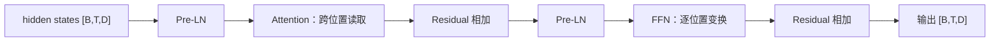

# 第 2 章（下）：Transformer Block 的骨架——残差、归一化与前馈层

前两篇分别说明了输入怎样变成向量，以及一个位置怎样在可见性约束下读取其他位置。现在要把这些运算组成可重复堆叠的一层：注意力先让 token 之间交换信息，前馈网络再逐个位置变换通道；残差连接和归一化则规定这些变换怎样接回主干。

本篇先说明两个子层各自做什么，再比较 Pre-LN 与 Post-LN 的数据路径，并用数值例子算一遍残差梯度和参数量。读完后，你应能沿 `[B,T,D]` 检查一个基础 Transformer block 的输入、子层和输出，也知道逐层检查张量形状和数值能证明什么、不能证明什么。下一篇会把 RoPE、RMSNorm 和 SwiGLU 等现代 decoder 常见组件放回这副骨架中。



## 2.5 Transformer 模块（block）：残差、归一化与逐 token 的非线性

### 2.5.1 Attention 与 FFN 的分工

注意力负责 token mixing（位置间的信息混合）：当前位置从其他位置读取信息。FFN 负责 channel mixing（单个位置内部的通道混合）：对每个位置的隐藏维度独立进行非线性变换。一个 block 的输入输出通常保持相同：

```math
X\in\mathbb{R}^{B\times T\times D}
\longrightarrow
Y\in\mathbb{R}^{B\times T\times D}
```

输入输出 shape 相同，才可以堆叠多个 block。若 attention 输出、FFN 输出或残差分支的维度不一致，应在模块边界立即报错，不要等到几十层之后才从 loss 异常倒推。

### 2.5.2 FFN 的数学形态

普通两层 FFN 可以写成：

```math
\mathrm{FFN}(X)=
\phi(XW_1+b_1)W_2+b_2
```

若中间维度为 $D_{\mathrm{ff}}$，则：

```math
W_1\in\mathbb{R}^{D\times D_{\mathrm{ff}}},
\qquad
W_2\in\mathbb{R}^{D_{\mathrm{ff}}\times D}
```

每个 token 使用同一组 $W_1,W_2$，但 token 之间不在 FFN 内直接交互。GELU、SiLU 或 SwiGLU 是不同的非线性和门控选择，不改变 FFN 作为逐位置变换的基本角色。

### 2.5.3 Pre-LN 与 Post-LN：归一化放在残差分支的哪里

Post-LN 的一种写法是：

```math
Y=\mathrm{LN}\left(X+\mathrm{Attn}(X)\right)
```

```math
Z=\mathrm{LN}\left(Y+\mathrm{FFN}(Y)\right)
```

Pre-LN 则是：

```math
Y=X+\mathrm{Attn}(\mathrm{LN}(X))
```

```math
Z=Y+\mathrm{FFN}(\mathrm{LN}(Y))
```

两者都保留残差，但归一化所在位置不同。Pre-LN 的残差主干显式保留输入 $X$，不必先经过归一化和子层变换；Xiong 等人的 mean-field 分析在其研究的架构中发现，Post-LN 初始化时靠近输出层的预期梯度较大，而 Pre-LN 梯度较平稳，并报告了特定训练设置下的实验结果，见[原论文](https://arxiv.org/abs/2002.04745v2)。这解释了 Pre-LN 为何成为常见选择，但不构成对所有深度、初始化和训练方案的无条件保证。比较两者时，应固定参数量、学习率和训练预算，并观察梯度范数、激活范围和验证损失。

### 2.5.4 LayerNorm、Dropout 与训练模式

本章使用层归一化（LayerNorm）的 `LayerNorm(D)` 配置，因此统计量沿每个 token 的最后一个隐藏维计算；PyTorch 2.15 文档将方差定义为有偏估计（`correction=0`），并说明训练和评估时都使用当前输入的统计量，见 [LayerNorm 文档](https://docs.pytorch.org/docs/2.15/generated/torch.nn.LayerNorm.html)。对一个 token 向量 $x\in\mathbb{R}^{D}$：

```math
\mu=\frac{1}{D}\sum_{j=1}^{D}x_j,\qquad
\sigma^2=\frac{1}{D}\sum_{j=1}^{D}(x_j-\mu)^2
```

```math
\mathrm{LN}(x)_j=
\gamma_j\frac{x_j-\mu}{\sqrt{\sigma^2+\epsilon}}+\beta_j
```

它不跨 batch 估计统计量，因此输入可以是 $[B,T,D]$，每个 token 的最后一维独立处理。Dropout（随机失活）在训练模式下随机置零并做尺度补偿，在评估模式下表现为恒等映射；这是 [PyTorch 2.15 Dropout 文档](https://docs.pytorch.org/docs/2.15/generated/torch.nn.Dropout.html)描述的模块行为。检查 attention mask 或残差等价性时要调用 eval 或将 dropout 设为 0，否则随机性会污染对照。

### 2.5.5 一个 Pre-LN decoder block

> 代码状态：静态审阅，未运行（2026-10-29）

```python
import math
import torch
from torch import nn

class FeedForward(nn.Module):
    def __init__(self, d_model, hidden_dim, dropout=0.0):
        super().__init__()
        self.net = nn.Sequential(
            nn.Linear(d_model, hidden_dim),
            nn.GELU(),
            nn.Dropout(dropout),
            nn.Linear(hidden_dim, d_model),
            nn.Dropout(dropout),
        )

    def forward(self, x):
        return self.net(x)

class BlockAttention(nn.Module):
    def __init__(self, d_model, num_heads, dropout=0.0):
        super().__init__()
        if d_model <= 0 or num_heads <= 0 or d_model % num_heads != 0:
            raise ValueError("d_model must be divisible by num_heads")
        self.d_model = d_model
        self.num_heads = num_heads
        self.head_dim = d_model // num_heads
        self.q_proj = nn.Linear(d_model, d_model)
        self.k_proj = nn.Linear(d_model, d_model)
        self.v_proj = nn.Linear(d_model, d_model)
        self.out_proj = nn.Linear(d_model, d_model)
        self.dropout = nn.Dropout(dropout)

    def forward(self, x, keep_mask=None):
        batch_size, seq_len, _ = x.shape
        q = self.q_proj(x).view(
            batch_size, seq_len, self.num_heads, self.head_dim
        ).transpose(1, 2)
        k = self.k_proj(x).view(
            batch_size, seq_len, self.num_heads, self.head_dim
        ).transpose(1, 2)
        v = self.v_proj(x).view(
            batch_size, seq_len, self.num_heads, self.head_dim
        ).transpose(1, 2)
        scores = q @ k.transpose(-2, -1)
        scores = scores / math.sqrt(self.head_dim)
        if keep_mask is not None:
            scores = scores.masked_fill(
                ~keep_mask.to(dtype=torch.bool, device=x.device),
                torch.finfo(scores.dtype).min,
            )
        weights = torch.softmax(scores, dim=-1)
        weights = self.dropout(weights)
        out = weights @ v
        out = out.transpose(1, 2).contiguous()
        out = out.view(batch_size, seq_len, self.d_model)
        return self.out_proj(out), weights

class PreLNBlock(nn.Module):
    def __init__(self, d_model, num_heads, mlp_ratio=4, dropout=0.0):
        super().__init__()
        if d_model <= 0 or mlp_ratio <= 0:
            raise ValueError("d_model and mlp_ratio must be positive")
        self.ln1 = nn.LayerNorm(d_model)
        self.attn = BlockAttention(d_model, num_heads, dropout)
        self.ln2 = nn.LayerNorm(d_model)
        self.ffn = FeedForward(d_model, d_model * mlp_ratio, dropout)

    def forward(self, x, keep_mask=None, return_weights=False):
        if keep_mask is None:
            raise ValueError("decoder block requires keep_mask; callers must include causal visibility")
        attn_out, weights = self.attn(self.ln1(x), keep_mask)
        x = x + attn_out
        ffn_out = self.ffn(self.ln2(x))
        x = x + ffn_out
        if return_weights:
            return x, weights
        return x

torch.manual_seed(42)
x = torch.randn(2, 5, 16)
mask = torch.tril(
    torch.ones(5, 5, dtype=torch.bool)
).view(1, 1, 5, 5)
block = PreLNBlock(16, 4, mlp_ratio=4, dropout=0.0)
block.eval()
y, weights = block(x, keep_mask=mask, return_weights=True)

assert y.shape == x.shape
assert weights.shape == (2, 4, 5, 5)
print("block_output_shape=", tuple(y.shape))
print("block_weights_shape=", tuple(weights.shape))
```
这个 block 尚未包含 RoPE、KV Cache 或 RMSNorm；组合新组件时要逐层替换，并保留这些 shape 断言。由于它用于 decoder，调用时必须传入因果 keep mask（并按需与 padding mask 组合）；省略 mask 会让未来位置可见，因此实现会明确报错。

### 2.5.6 残差连接的梯度路径

残差更新 $Y=X+F(X)$ 对输入的雅可比矩阵（Jacobian）为：

```math
\frac{\partial Y}{\partial X}
=I+\frac{\partial F(X)}{\partial X}
```

其中 $I$ 是恒等映射。即使子层的局部 Jacobian 在某些方向上很小，恒等项也提供了一条直接路径；这解释了残差为什么有助于深层优化，但不意味着任何残差网络都不会梯度消失或爆炸。初始化、归一化、学习率和激活仍然会影响第二项。

残差还让每个子层更像在当前表示上学习增量。若要研究某个子层是否真正贡献信息，可以比较完整 block 与只保留残差路径的消融，而不是只看某一层的激活均值。

### 2.5.7 参数量与计算量

标准 self-attention 的四个投影忽略 bias 约为：

```math
N_{\mathrm{attn}}\approx4D^2
```

普通 FFN 的主要参数量约为：

```math
N_{\mathrm{ffn}}\approx2D D_{\mathrm{ff}}
```

当 $D_{\mathrm{ff}}=4D$：

```math
N_{\mathrm{ffn}}\approx8D^2
```

因此一个标准 block 的主参数量约为：

```math
N_{\mathrm{block}}\approx12D^2
```

这只是估算，不包括 bias、norm、嵌入、输出头和门控变体。计算复杂度还要区分序列长度 $T$ 与 hidden size $D$：

```math
C_{\mathrm{attn}}\approx O(BT^2D)+O(BTD^2)
```

```math
C_{\mathrm{ffn}}\approx O(BTDD_{\mathrm{ff}})
```

长序列主要放大 $T^2$ 项；较大 hidden size 和 FFN 扩展比例则放大线性投影。显存瓶颈还受到是否物化 attention matrix、激活保存、KV Cache 和并行策略影响。

### 2.5.8 Block 的诊断顺序

当一个 block 的 loss、梯度或输出异常时，可以按数据路径检查：

1. 输入是否真的是 $[B,T,D]$；
2. q/k/v 拆头后是否为 $[B,H,T,d_h]$；
3. mask 是否能广播到 $[B,H,T,T]$；
4. 每个有效 query 是否至少有一个可见 key；
5. norm 是否沿最后一维工作；
6. residual 相加前两项 shape 是否相同；
7. 训练和评估模式是否符合当前测试；
8. 参数量是否与配置中的 $D,H,D_{\mathrm{ff}}$ 相符。

这套顺序先检查各层的输入输出约定，再看数值范围，最后才比较训练曲线。这样可以把“Transformer 不收敛”拆成几个能逐一排查的问题。

两个 token 的小例子能分清 block 内两类计算的职责。令 $x_1=[1,0]$、$x_2=[0,1]$。逐位置 FFN 分别计算 $F(x_1)$ 和 $F(x_2)$：两行共用同一组参数，但第二行不会在 FFN 内直接读取第一行；交换两行输入，输出也只会交换顺序。Attention 则先按 Q/K 权重汇聚其他位置的 V，再把上下文表示送入 FFN。因此前者做 token 间的信息交换，后者做单个 token 内部的非线性变换。

残差的局部效果可用一维数值跟算。令某子层 $F(x)=0.2x$，输入 $x=2$，普通分支输出 0.4，残差结果为 $y=x+F(x)=2.4$；导数为 $dy/dx=1+0.2=1.2$，其中 1 来自恒等路径。若子层导数为 $-0.9$，残差后的导数是 0.1。恒等项提供直接的信号和梯度通路，却不保证梯度恒接近 1 或训练一定稳定；深层表现仍受归一化位置、初始化、学习率和分支尺度影响。

实际排错时，可以把症状映射到子层职责：

| 观察到的现象 | 优先检查 | 一个隔离检查 |
| --- | --- | --- |
| 改变可见上下文 token 后，目标位置表示不变 | attention 权重、mask、V 是否进入汇聚 | 固定权重和 V，只改变一个允许读取的位置 |
| 单独运行 FFN 时，一个位置的输出受其他位置影响 | 线性层或归一化是否误沿时间轴计算 | 交换两行输入，确认输出只随行交换 |
| block 输出 shape 正确但数值异常 | mask 是否有全屏蔽行、norm 轴、残差是否被覆盖 | 打印各子层输出范数并检查最后一维归一化 |
| 深层训练不稳定 | Pre-LN/Post-LN 路径、梯度和激活尺度 | 固定数据、参数量与更新预算，再比较验证曲线 |

注意力的主要交互发生在 $T$ 轴，FFN 的扩展与压缩发生在 $D$ 轴，残差相加要求两条分支回到同一 $[B,T,D]$。若归一化误沿时间维或 batch 维计算，shape 仍可能合法，但某个 token 的表示会受 padding 长度影响；因此还要用同一 token 配上不同 padding 情况，确认这种无关变化不会改写它的归一化结果。

到这里，基础 block 的输入输出和内部数据路径已经连起来。现代 decoder 会替换其中的位置编码、归一化和前馈层实现，但仍要遵守同一组张量形状和残差连接约定；下一篇会逐一检查这些替换怎样改变计算。
