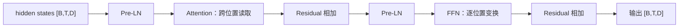
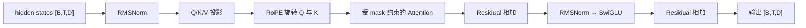

# 第 2 章（下）：Transformer Block 与现代 Decoder 组件

前两篇分别说明了输入怎样变成向量，以及一个位置怎样在可见性约束下读取其他位置。现在要把这些运算组成可重复堆叠的一层：注意力先让 token 之间交换信息，前馈网络再逐个位置变换通道；残差连接和归一化则规定这些变换怎样接回主干。

本节先说明两个子层各自做什么，再比较 Pre-LN 与 Post-LN 的数据路径，并用数值例子算一遍残差梯度和参数量。读完后，你应能沿 `[B,T,D]` 检查一个基础 Transformer block 的输入、子层和输出，也知道逐层检查张量形状和数值能证明什么、不能证明什么。接下来把 RoPE、RMSNorm 和 SwiGLU 等现代 decoder 常见组件放回这副骨架中。



## 2.5 Transformer 模块（block）：残差、归一化与逐 token 的非线性

### 2.5.1 Attention 与 FFN 的分工

注意力负责 token mixing（位置间的信息混合）：当前位置从其他位置读取信息。FFN 负责 channel mixing（单个位置内部的通道混合）：对每个位置的隐藏维度独立进行非线性变换。一个 block 的输入输出通常保持相同：

```math
X\in\mathbb{R}^{B\times T\times D}
\longrightarrow
Y\in\mathbb{R}^{B\times T\times D}
```

输入输出 shape 相同，才可以堆叠多个 block。若 attention 输出、FFN 输出或残差分支的维度不一致，应在模块边界立即报错，不要等到几十层之后才从 loss 异常倒推。

### 2.5.2 FFN 的数学形态

普通两层 FFN 可以写成：

```math
\mathrm{FFN}(X)=
\phi(XW_{1}+b_{1})W_{2}+b_{2}
```

若中间维度为 $D_{\mathrm{ff}}$，则：

```math
W_{1}\in\mathbb{R}^{D\times D_{\mathrm{ff}}},
\qquad
W_{2}\in\mathbb{R}^{D_{\mathrm{ff}}\times D}
```

每个 token 使用同一组 $W_{1},W_{2}$，但 token 之间不在 FFN 内直接交互。GELU、SiLU 或 SwiGLU 是不同的非线性和门控选择，不改变 FFN 作为逐位置变换的基本角色。

### 2.5.3 Pre-LN 与 Post-LN：归一化放在残差分支的哪里

Post-LN 的一种写法是：

```math
Y=\mathrm{LN}\left(X+\mathrm{Attn}(X)\right)
```

```math
Z=\mathrm{LN}\left(Y+\mathrm{FFN}(Y)\right)
```

Pre-LN 则是：

```math
Y=X+\mathrm{Attn}(\mathrm{LN}(X))
```

```math
Z=Y+\mathrm{FFN}(\mathrm{LN}(Y))
```

两者都保留残差，但归一化所在位置不同。Pre-LN 的残差主干显式保留输入 $X$，不必先经过归一化和子层变换；Xiong 等人的 mean-field 分析在其研究的架构中发现，Post-LN 初始化时靠近输出层的预期梯度较大，而 Pre-LN 梯度较平稳，并报告了特定训练设置下的实验结果，见[原论文](https://arxiv.org/abs/2002.04745v2)。这解释了 Pre-LN 为何成为常见选择，但不构成对所有深度、初始化和训练方案的无条件保证。比较两者时，应固定参数量、学习率和训练预算，并观察梯度范数、激活范围和验证损失。

### 2.5.4 LayerNorm、Dropout 与训练模式

本章使用层归一化（LayerNorm）的 `LayerNorm(D)` 配置，因此统计量沿每个 token 的最后一个隐藏维计算；PyTorch 2.15 文档将方差定义为有偏估计（`correction=0`），并说明训练和评估时都使用当前输入的统计量，见 [LayerNorm 文档](https://docs.pytorch.org/docs/2.15/generated/torch.nn.LayerNorm.html)。对一个 token 向量 $x\in\mathbb{R}^{D}$：

```math
\mu=\frac{1}{D}\sum_{j=1}^{D}x_{j},\qquad
\sigma^2=\frac{1}{D}\sum_{j=1}^{D}(x_{j}-\mu)^2
```

```math
\mathrm{LN}(x)_{j}=
\gamma_{j}\frac{x_{j}-\mu}{\sqrt{\sigma^2+\epsilon}}+\beta_{j}
```

它不跨 batch 估计统计量，因此输入可以是 $[B,T,D]$，每个 token 的最后一维独立处理。Dropout（随机失活）在训练模式下随机置零并做尺度补偿，在评估模式下表现为恒等映射；这是 [PyTorch 2.15 Dropout 文档](https://docs.pytorch.org/docs/2.15/generated/torch.nn.Dropout.html)描述的模块行为。检查 attention mask 或残差等价性时要调用 eval 或将 dropout 设为 0，否则随机性会污染对照。

### 2.5.5 一个 Pre-LN decoder block

> 代码状态：静态审阅，未运行（2026-10-29）

```python
import math
import torch
from torch import nn

class FeedForward(nn.Module):
    def __init__(self, d_model, hidden_dim, dropout=0.0):
        super().__init__()
        self.net = nn.Sequential(
            nn.Linear(d_model, hidden_dim),
            nn.GELU(),
            nn.Dropout(dropout),
            nn.Linear(hidden_dim, d_model),
            nn.Dropout(dropout),
        )

    def forward(self, x):
        return self.net(x)

class BlockAttention(nn.Module):
    def __init__(self, d_model, num_heads, dropout=0.0):
        super().__init__()
        if d_model <= 0 or num_heads <= 0 or d_model % num_heads != 0:
            raise ValueError("d_model must be divisible by num_heads")
        self.d_model = d_model
        self.num_heads = num_heads
        self.head_dim = d_model // num_heads
        self.q_proj = nn.Linear(d_model, d_model)
        self.k_proj = nn.Linear(d_model, d_model)
        self.v_proj = nn.Linear(d_model, d_model)
        self.out_proj = nn.Linear(d_model, d_model)
        self.dropout = nn.Dropout(dropout)

    def forward(self, x, keep_mask=None):
        batch_size, seq_len, _ = x.shape
        q = self.q_proj(x).view(
            batch_size, seq_len, self.num_heads, self.head_dim
        ).transpose(1, 2)
        k = self.k_proj(x).view(
            batch_size, seq_len, self.num_heads, self.head_dim
        ).transpose(1, 2)
        v = self.v_proj(x).view(
            batch_size, seq_len, self.num_heads, self.head_dim
        ).transpose(1, 2)
        scores = q @ k.transpose(-2, -1)
        scores = scores / math.sqrt(self.head_dim)
        if keep_mask is not None:
            scores = scores.masked_fill(
                ~keep_mask.to(dtype=torch.bool, device=x.device),
                torch.finfo(scores.dtype).min,
            )
        weights = torch.softmax(scores, dim=-1)
        weights = self.dropout(weights)
        out = weights @ v
        out = out.transpose(1, 2).contiguous()
        out = out.view(batch_size, seq_len, self.d_model)
        return self.out_proj(out), weights

class PreLNBlock(nn.Module):
    def __init__(self, d_model, num_heads, mlp_ratio=4, dropout=0.0):
        super().__init__()
        if d_model <= 0 or mlp_ratio <= 0:
            raise ValueError("d_model and mlp_ratio must be positive")
        self.ln1 = nn.LayerNorm(d_model)
        self.attn = BlockAttention(d_model, num_heads, dropout)
        self.ln2 = nn.LayerNorm(d_model)
        self.ffn = FeedForward(d_model, d_model * mlp_ratio, dropout)

    def forward(self, x, keep_mask=None, return_weights=False):
        if keep_mask is None:
            raise ValueError("decoder block requires keep_mask; callers must include causal visibility")
        attn_out, weights = self.attn(self.ln1(x), keep_mask)
        x = x + attn_out
        ffn_out = self.ffn(self.ln2(x))
        x = x + ffn_out
        if return_weights:
            return x, weights
        return x

torch.manual_seed(42)
x = torch.randn(2, 5, 16)
mask = torch.tril(
    torch.ones(5, 5, dtype=torch.bool)
).view(1, 1, 5, 5)
block = PreLNBlock(16, 4, mlp_ratio=4, dropout=0.0)
block.eval()
y, weights = block(x, keep_mask=mask, return_weights=True)

assert y.shape == x.shape
assert weights.shape == (2, 4, 5, 5)
print("block_output_shape=", tuple(y.shape))
print("block_weights_shape=", tuple(weights.shape))
```
这个 block 尚未包含 RoPE、KV Cache 或 RMSNorm；组合新组件时要逐层替换，并保留这些 shape 断言。由于它用于 decoder，调用时必须传入因果 keep mask（并按需与 padding mask 组合）；省略 mask 会让未来位置可见，因此实现会明确报错。

### 2.5.6 残差连接的梯度路径

残差更新 $Y=X+F(X)$ 对输入的雅可比矩阵（Jacobian）为：

```math
\frac{\partial Y}{\partial X}
=I+\frac{\partial F(X)}{\partial X}
```

其中 $I$ 是恒等映射。即使子层的局部 Jacobian 在某些方向上很小，恒等项也提供了一条直接路径；这解释了残差为什么有助于深层优化，但不意味着任何残差网络都不会梯度消失或爆炸。初始化、归一化、学习率和激活仍然会影响第二项。

残差还让每个子层更像在当前表示上学习增量。若要研究某个子层是否真正贡献信息，可以比较完整 block 与只保留残差路径的消融，而不是只看某一层的激活均值。

### 2.5.7 参数量与计算量

标准 self-attention 的四个投影忽略 bias 约为：

```math
N_{\mathrm{attn}}\approx4D^2
```

普通 FFN 的主要参数量约为：

```math
N_{\mathrm{ffn}}\approx2D D_{\mathrm{ff}}
```

当 $D_{\mathrm{ff}}=4D$：

```math
N_{\mathrm{ffn}}\approx8D^2
```

因此一个标准 block 的主参数量约为：

```math
N_{\mathrm{block}}\approx12D^2
```

这只是估算，不包括 bias、norm、嵌入、输出头和门控变体。计算复杂度还要区分序列长度 $T$ 与 hidden size $D$：

```math
C_{\mathrm{attn}}\approx O(BT^2D)+O(BTD^2)
```

```math
C_{\mathrm{ffn}}\approx O(BTDD_{\mathrm{ff}})
```

长序列主要放大 $T^2$ 项；较大 hidden size 和 FFN 扩展比例则放大线性投影。显存瓶颈还受到是否物化 attention matrix、激活保存、KV Cache 和并行策略影响。

### 2.5.8 Block 的诊断顺序

当一个 block 的 loss、梯度或输出异常时，可以按数据路径检查：

1. 输入是否真的是 $[B,T,D]$；
2. q/k/v 拆头后是否为 $[B,H,T,d_{h}]$；
3. mask 是否能广播到 $[B,H,T,T]$；
4. 每个有效 query 是否至少有一个可见 key；
5. norm 是否沿最后一维工作；
6. residual 相加前两项 shape 是否相同；
7. 训练和评估模式是否符合当前测试；
8. 参数量是否与配置中的 $D,H,D_{\mathrm{ff}}$ 相符。

这套顺序先检查各层的输入输出约定，再看数值范围，最后才比较训练曲线。这样可以把“Transformer 不收敛”拆成几个能逐一排查的问题。

两个 token 的小例子能分清 block 内两类计算的职责。令 $x_{1}=[1,0]$、 $x_{2}=[0,1]$。逐位置 FFN 分别计算 $F(x_{1})$ 和 $F(x_{2})$：两行共用同一组参数，但第二行不会在 FFN 内直接读取第一行；交换两行输入，输出也只会交换顺序。Attention 则先按 Q/K 权重汇聚其他位置的 V，再把上下文表示送入 FFN。因此前者做 token 间的信息交换，后者做单个 token 内部的非线性变换。

残差的局部效果可用一维数值跟算。令某子层 $F(x)=0.2x$，输入 $x=2$，普通分支输出 0.4，残差结果为 $y=x+F(x)=2.4$；导数为 $dy/dx=1+0.2=1.2$，其中 1 来自恒等路径。若子层导数为 $-0.9$，残差后的导数是 0.1。恒等项提供直接的信号和梯度通路，却不保证梯度恒接近 1 或训练一定稳定；深层表现仍受归一化位置、初始化、学习率和分支尺度影响。

实际排错时，可以把症状映射到子层职责：

| 观察到的现象 | 优先检查 | 一个隔离检查 |
| --- | --- | --- |
| 改变可见上下文 token 后，目标位置表示不变 | attention 权重、mask、V 是否进入汇聚 | 固定权重和 V，只改变一个允许读取的位置 |
| 单独运行 FFN 时，一个位置的输出受其他位置影响 | 线性层或归一化是否误沿时间轴计算 | 交换两行输入，确认输出只随行交换 |
| block 输出 shape 正确但数值异常 | mask 是否有全屏蔽行、norm 轴、残差是否被覆盖 | 打印各子层输出范数并检查最后一维归一化 |
| 深层训练不稳定 | Pre-LN/Post-LN 路径、梯度和激活尺度 | 固定数据、参数量与更新预算，再比较验证曲线 |

注意力的主要交互发生在 $T$ 轴，FFN 的扩展与压缩发生在 $D$ 轴，残差相加要求两条分支回到同一 $[B,T,D]$。若归一化误沿时间维或 batch 维计算，shape 仍可能合法，但某个 token 的表示会受 padding 长度影响；因此还要用同一 token 配上不同 padding 情况，确认这种无关变化不会改写它的归一化结果。

到这里，基础 block 的输入输出和内部数据路径已经连起来。现代 decoder 会替换其中的位置编码、归一化和前馈层实现，但仍要遵守同一组张量形状和残差连接约定；接下来逐一检查这些替换怎样改变计算。

上一部分搭好了 block 骨架。这一部分看三个会改变具体计算、但不改变 `[B,T,D]` 外部接口的组件：旋转位置编码（RoPE）把位置信息写进 query-key 匹配，均方根归一化（RMSNorm）改变归一化方式，SwiGLU（一种以 SiLU 为门控激活的 GLU 前馈结构）改变前馈网络的计算路径。理解它们时，重点不是记住模型名称，而是看清每个组件替换了什么、引入了什么假设、怎样检查实现。

读完后，你应能手算一次 RoPE 旋转和 RMSNorm/SwiGLU 的小例子，检查增量解码时位置偏移量（position offset）是否与键值缓存（KV cache）长度一致，并把这些组件组合成一层可以逐步检查的 decoder block。局部数值和 shape 检查不能代替模型能力或长上下文效果评估。



## 2.6 旋转位置编码（RoPE）：把位置关系写进 Q、K 的几何变换

### 2.6.1 为什么 self-attention 需要位置机制

如果不加位置机制，自注意力只按 token 内容计算，不会知道它们的先后顺序。位置机制可以把位置向量加到隐藏状态，也可以改变 Q、K 的相似度计算。RoPE 属于后一种：它不把位置表加到隐藏状态上，而是按位置旋转每个注意力头的 Q、K。

### 2.6.2 二维旋转和偶奇维配对

对二维向量 $(x_{0},x_{1})$，角度为 $\theta$ 的旋转是：

```math
\begin{bmatrix}
x'_{0}\\
x'_{1}
\end{bmatrix}
=
\begin{bmatrix}
\cos\theta&-\sin\theta\\
\sin\theta&\cos\theta
\end{bmatrix}
\begin{bmatrix}
x_{0}\\
x_{1}
\end{bmatrix}
```

即：

```math
x'_{0}=x_{0}\cos\theta-x_{1}\sin\theta,\qquad
x'_{1}=x_{0}\sin\theta+x_{1}\cos\theta
```

RoPE 把 head_dim 的维度按 $(0,1),(2,3),\ldots$ 两两分组。对位置 $p$ 和第 $i$ 个二维组，常见频率为：

```math
\omega_{i}=\mathrm{base}^{-\frac{2i}{d_{h}}},\qquad
\theta_{p,i}=p\omega_{i}
```

因此 cos/sin 缓存的形状是 $[T,d_{h}/2]$，应用到 q、k 后 shape 不变。

### 2.6.3 位置旋转如何产生相对距离

设 $R_{p}$ 是位置 $p$ 对每个二维平面施加的旋转，并用 $\mathbf{q}$、 $\mathbf{k}$ 表示 query 和 key 向量。旋转矩阵满足正交性和复合关系：

```math
R_{p}^\top R_{r}=R_{r-p}
```

于是：

```math
(R_{p} \mathbf{q})^\top(R_{r} \mathbf{k})
=\mathbf{q}^\top R_{p}^\top R_{r} \mathbf{k}
=\mathbf{q}^\top R_{r-p}\mathbf{k}
```

内积中出现了 $r-p$，也就是两个位置的相对距离；这一构造见 [RoFormer 原论文](https://arxiv.org/abs/2104.09864)。这个推导说明 RoPE 具有相对位置结构；它不等于证明模型在任意长度、任意任务上都会保持性能，训练长度和频率外推仍然需要实验。

这个推导还说明一个有用的局部不变量：若把参与比较的两个位置同时平移 $c$，旋转差仍然是 $r-p$：

```math
(R_{p+c}\mathbf{q})^{\top}(R_{r+c}\mathbf{k})=\mathbf{q}^{\top}R_{r-p}\mathbf{k}
```

例如比较位置 $(0,1)$ 与 $(4,5)$，两组位置差都为 1；对固定的 $\mathbf{q}$、 $\mathbf{k}$ 和同一组频率，它们产生相同的相对旋转项。这个关系可用于检查 RoPE offset：只给当前 query 加偏移、却没有让 cache key 保留原来的逻辑位置，会改变实际距离。它只说明固定向量的 RoPE 内积性质，不保证整个模型在改变 padding、mask、窗口边界或其他位置机制后保持输出不变。

### 2.6.4 cos/sin cache 与 offset

> 代码状态：静态审阅，未运行（2026-10-29）

```python
import torch
from torch import nn

class RotaryEmbedding(nn.Module):
    def __init__(self, head_dim, max_seq_len=2048, base=10000.0):
        super().__init__()
        if head_dim <= 0 or head_dim % 2 != 0:
            raise ValueError("head_dim must be a positive even integer")
        if max_seq_len <= 0 or base <= 0:
            raise ValueError("max_seq_len and base must be positive")
        self.max_seq_len = max_seq_len
        pair_index = torch.arange(0, head_dim, 2, dtype=torch.float32)
        inv_freq = base ** (-pair_index / head_dim)
        positions = torch.arange(
            max_seq_len, dtype=torch.float32
        ).view(-1, 1)
        frequencies = positions * inv_freq.view(1, -1)
        self.register_buffer(
            "cos_cached",
            frequencies.cos(),
            persistent=False,
        )
        self.register_buffer(
            "sin_cached",
            frequencies.sin(),
            persistent=False,
        )

    def forward(self, seq_len, offset=0, device=None, dtype=None):
        if seq_len < 0 or offset < 0:
            raise ValueError("seq_len and offset must be non-negative")
        end = offset + seq_len
        if end > self.max_seq_len:
            raise ValueError("RoPE cache is too short")
        cos = self.cos_cached[offset:end]
        sin = self.sin_cached[offset:end]
        if device is not None:
            cos = cos.to(device=device)
            sin = sin.to(device=device)
        if dtype is not None:
            cos = cos.to(dtype=dtype)
            sin = sin.to(dtype=dtype)
        return cos, sin

rope = RotaryEmbedding(head_dim=8, max_seq_len=32)
cos, sin = rope(seq_len=6, offset=4, dtype=torch.float32)
print("cos_shape=", tuple(cos.shape))
print("sin_shape=", tuple(sin.shape))
```
register_buffer 让缓存随模块迁移到设备，但不把它们当作可训练 Parameter。persistent=False 表示它们不进入 state_dict；恢复模型时需要用同样配置重新构造。是否采用 persistent=False 是 checkpoint 设计选择，不能据此断言所有实现都一样。

### 2.6.5 应用到 q 和 k，不应用到 v

假设 q、k 形状为 $[B,H,T,d_{h}]$，cos、sin 为 $[T,d_{h}/2]$。先把缓存扩成 $[1,1,T,d_{h}/2]$，再对偶奇维旋转：

> 代码状态：静态审阅，未运行（2026-10-29）

```python
import torch

def apply_rope(x, cos, sin):
    if x.ndim != 4 or x.shape[-1] % 2 != 0:
        raise ValueError("x must have shape [B,H,T,D] with even D")
    if cos.shape != sin.shape or cos.ndim != 2:
        raise ValueError("cos and sin must share shape [T,D/2]")
    if (x.shape[-2], x.shape[-1] // 2) != tuple(cos.shape):
        raise ValueError("RoPE cache shape does not match x")
    even = x[..., 0::2]
    odd = x[..., 1::2]
    cos = cos.to(device=x.device, dtype=x.dtype).view(
        1, 1, cos.shape[0], cos.shape[1]
    )
    sin = sin.to(device=x.device, dtype=x.dtype).view(
        1, 1, sin.shape[0], sin.shape[1]
    )
    rotated_even = even * cos - odd * sin
    rotated_odd = even * sin + odd * cos
    output = torch.empty_like(x)
    output[..., 0::2] = rotated_even
    output[..., 1::2] = rotated_odd
    return output

q = torch.randn(2, 4, 6, 8)
cos = torch.ones(6, 4)
sin = torch.zeros(6, 4)
rotated = apply_rope(q, cos, sin)
assert torch.equal(rotated, q)
print("rotated_shape=", tuple(rotated.shape))
```
在 sin 为 0、cos 为 1 的特例下，输出应与输入完全相同；这是一个简单但有价值的实现测试。RoPE 作用在 q、k，是因为位置要改变 query-key 匹配；v 表示被汇聚的内容，通常不做同样的旋转。具体架构若旋转 v，必须以该架构的定义为准，不能把常见实现写成数学必然性。

### 2.6.6 把 RoPE 接入 attention

下面的示例把 `RotaryEmbedding` 和 `apply_rope` 的最小定义一并放入围栏，可以单独运行。生产实现还应根据目标模型的旋转布局、缓存策略和 dtype 约定补充更严格的接口检查。

> 代码状态：静态审阅，未运行（2026-10-29）

```python
import math
import torch
from torch import nn

class RotaryEmbedding(nn.Module):
    def __init__(self, head_dim, max_seq_len=2048, base=10000.0):
        super().__init__()
        if head_dim <= 0 or head_dim % 2 != 0:
            raise ValueError("head_dim must be a positive even integer")
        if max_seq_len <= 0 or base <= 0:
            raise ValueError("max_seq_len and base must be positive")
        self.max_seq_len = max_seq_len
        pair_index = torch.arange(0, head_dim, 2, dtype=torch.float32)
        inv_freq = base ** (-pair_index / head_dim)
        positions = torch.arange(
            max_seq_len,
            dtype=torch.float32,
        ).view(-1, 1)
        frequencies = positions * inv_freq.view(1, -1)
        self.register_buffer(
            "cos_cached",
            frequencies.cos(),
            persistent=False,
        )
        self.register_buffer(
            "sin_cached",
            frequencies.sin(),
            persistent=False,
        )

    def forward(self, seq_len, offset=0, device=None, dtype=None):
        if seq_len < 0 or offset < 0:
            raise ValueError("seq_len and offset must be non-negative")
        end = offset + seq_len
        if end > self.max_seq_len:
            raise ValueError("RoPE cache is too short")
        cos = self.cos_cached[offset:end]
        sin = self.sin_cached[offset:end]
        if device is not None:
            cos = cos.to(device=device)
            sin = sin.to(device=device)
        if dtype is not None:
            cos = cos.to(dtype=dtype)
            sin = sin.to(dtype=dtype)
        return cos, sin

def apply_rope(x, cos, sin):
    if x.ndim != 4 or x.shape[-1] % 2 != 0:
        raise ValueError("x must have shape [B,H,T,D] with even D")
    if cos.shape != sin.shape or cos.ndim != 2:
        raise ValueError("cos and sin must share shape [T,D/2]")
    if (x.shape[-2], x.shape[-1] // 2) != tuple(cos.shape):
        raise ValueError("RoPE cache shape does not match x")
    even = x[..., 0::2]
    odd = x[..., 1::2]
    cos = cos.to(device=x.device, dtype=x.dtype).view(
        1, 1, cos.shape[0], cos.shape[1]
    )
    sin = sin.to(device=x.device, dtype=x.dtype).view(
        1, 1, sin.shape[0], sin.shape[1]
    )
    output = torch.empty_like(x)
    output[..., 0::2] = even * cos - odd * sin
    output[..., 1::2] = even * sin + odd * cos
    return output

class RoPEAttention(nn.Module):
    def __init__(self, d_model, num_heads, max_seq_len=2048):
        super().__init__()
        if d_model <= 0 or num_heads <= 0 or d_model % num_heads != 0:
            raise ValueError("d_model must be divisible by num_heads")
        self.d_model = d_model
        self.num_heads = num_heads
        self.head_dim = d_model // num_heads
        self.q_proj = nn.Linear(d_model, d_model)
        self.k_proj = nn.Linear(d_model, d_model)
        self.v_proj = nn.Linear(d_model, d_model)
        self.out_proj = nn.Linear(d_model, d_model)
        self.rope = RotaryEmbedding(self.head_dim, max_seq_len)

    def forward(self, x, keep_mask=None, position_offset=0):
        batch_size, seq_len, _ = x.shape
        q = self.q_proj(x).view(
            batch_size, seq_len, self.num_heads, self.head_dim
        ).transpose(1, 2)
        k = self.k_proj(x).view(
            batch_size, seq_len, self.num_heads, self.head_dim
        ).transpose(1, 2)
        v = self.v_proj(x).view(
            batch_size, seq_len, self.num_heads, self.head_dim
        ).transpose(1, 2)

        cos, sin = self.rope(
            seq_len,
            offset=position_offset,
            device=x.device,
            dtype=q.dtype,
        )
        q = apply_rope(q, cos, sin)
        k = apply_rope(k, cos, sin)

        scores = q @ k.transpose(-2, -1)
        scores = scores / math.sqrt(self.head_dim)
        if keep_mask is not None:
            scores = scores.masked_fill(
                ~keep_mask.to(device=x.device, dtype=torch.bool),
                torch.finfo(scores.dtype).min,
            )
        weights = torch.softmax(scores, dim=-1)
        output = weights @ v
        output = output.transpose(1, 2).contiguous()
        output = output.view(batch_size, seq_len, self.d_model)
        return self.out_proj(output), weights

torch.manual_seed(42)
x = torch.randn(2, 6, 32)
mask = torch.tril(
    torch.ones(6, 6, dtype=torch.bool)
).view(1, 1, 6, 6)
attention = RoPEAttention(32, 4, max_seq_len=64)
output, weights = attention(x, keep_mask=mask)

assert output.shape == x.shape
assert weights.shape == (2, 4, 6, 6)
print("output_shape=", tuple(output.shape))
print("weights_shape=", tuple(weights.shape))
```
增量推理时，若 KV Cache 已包含 past_len 个位置，新 q/k 的 position_offset 应从 past_len 开始。offset 只改变 cos/sin 的切片，不改变 q/k 的局部 shape；同时 attention mask 的 key length 也要与“历史缓存加新 token”的长度一致。只给 RoPE 传 offset、却仍用长度为 1 的局部 mask，是另一个独立的 shape 错误。

### 2.6.7 位置布局和工程边界

实现前先确认维度怎样配对。有的代码把偶数维和奇数维组成一对，有的先取前半维和后半维；两种都能表示二维旋转，但索引顺序、cos/sin 缓存和旋转函数必须使用同一种布局。布局不匹配时，shape 仍可能完全正确，算出的相位却对应错了通道。

前面的相对位置结论可以用一个二维小例子复核。令 $q=k=[1,0]$，toy 频率取 1，位置 0 的角度为 0，位置 1 的角度取 $\pi/3$。位置 1 的 key 旋转为 $[1/2,\sqrt3/2]$，与位置 0 的 query 点积是 $1/2$；若两者处在同一位置，点积为 1。角度只是方便手算的假设，不是任何模型的真实频率。实际 head 会组合多个频率，score 还要经过投影并除以 $\sqrt{d_{h}}$。

增量解码要同时更新位置、缓存和 mask。假设已有 3 个 cache token，现在追加 2 个 token，它们通常使用 position id 3、4；query 长度为 2，key 长度为 5，所以 score 的末两维是 $[2,5]$。若新 token 的 RoPE 位置仍从 0、1 开始，shape 不会报错，但它们会被当成历史开头；若 mask 仍只有 2 列，也没有覆盖缓存中的 3 个 key。调试时同时记录 query 绝对位置、cache 长度、key 总长和 mask shape。

RoPE 具有相对位置的代数性质，不等于模型具备任意长度的上下文能力。增加 cos/sin 缓存长度只能避免位置索引越界；RoPE scaling 会改变频率或位置映射，不同方法和版本不能只凭名称互换。是否能从训练长度外推，还取决于训练分布、相位变化、精度和具体检索任务。评估应固定模型 revision 与配置，按距离区间设置长距离目标和干扰项，而不是只检查更长位置 id 能通过代码。

不同频率覆盖不同距离尺度：高频维度随位置变化更快，低频维度变化更慢。短序列可能暴露不出偏移错误；可以用位置差 1、8、64 的合成向量检查相位和 q·k 的变化，但这只验证实现公式，不能替代长文档检索质量评估。RoPE cache 若不写入 checkpoint，恢复时也必须用相同的 `head_dim`、`base`、频率缩放配置和最大位置重建；保存模型 revision 与这些配置，比单独保存一张 cos/sin 表更能说明模型身份。

批量解码还要分清物理 cache slot 与逻辑位置。若长度分别为 3 和 5 的 prompt 左侧补齐到 5 列，短样本的两个 pad slot 是否占用 cache 位置、有效 token 从哪个 position id 开始，取决于模型和 runtime 的协议。测试应覆盖不同长度、左右 padding 和追加 token，并同时打印物理 slot 与逻辑位置；传错位置通常不会报 shape 错，只会让 Q/K 以错误相位相乘。

## 2.7 均方根归一化（RMSNorm）与 SwiGLU：现代 decoder block 的两个改造

### 2.7.1 LayerNorm 和 RMSNorm 的数学差异

上一部分已经定义了层归一化（LayerNorm）：它先减去均值，再按标准差缩放。均方根归一化（RMSNorm）不做中心化，只计算 root mean square（均方根）；这一设计及其动机见 [RMSNorm 原论文](https://arxiv.org/abs/1910.07467)：

```math
r(x)=\sqrt{\frac{1}{D}\sum_{j=1}^{D}x_{j}^2+\epsilon}
```

```math
\mathrm{RMSNorm}(x)_{j}=
w_{j}\frac{x_{j}}{r(x)}
```

因此 LayerNorm 有 scale 和 bias 两组参数，RMSNorm 的常见实现只有一个 scale $w$。RMSNorm 的“更简单”不等价于“所有任务都更好”；它改变了归一化的对称性和数值路径，架构选择应通过训练稳定性、质量和吞吐实验判断。

取一个可复算的向量 $x=[1,3]$，令 LayerNorm 的 scale 为 1、bias 为 0，并暂时忽略很小的 epsilon。它先减去均值 2，再除以标准差 1，得到 $[-1,1]$。RMSNorm 的均方根是 $\sqrt{(1^2+3^2)/2}=\sqrt5\approx2.236$，输出约为 $[0.447,1.342]$。两者都控制尺度，但只有 LayerNorm 在这一步把均值移到 0；看到 RMSNorm 输出均值不为 0，不足以判定实现有错。

### 2.7.2 低精度下的实现

归一化的平方、求均值和开方容易受到低精度舍入影响。常见工程实现先用 FP32 计算平方均值，再把结果转换回输入 dtype：

> 代码状态：静态审阅，未运行（2026-10-29）

```python
import torch
from torch import nn

class RMSNorm(nn.Module):
    def __init__(self, d_model, eps=1e-6):
        super().__init__()
        if d_model <= 0 or eps <= 0:
            raise ValueError("d_model and eps must be positive")
        self.eps = eps
        self.weight = nn.Parameter(torch.ones(d_model))

    def forward(self, x):
        input_dtype = x.dtype
        x_float = x.float()
        mean_square = x_float.pow(2).mean(dim=-1, keepdim=True)
        normalized = x_float * torch.rsqrt(mean_square + self.eps)
        normalized = normalized.to(dtype=input_dtype)
        return normalized * self.weight.to(dtype=input_dtype)

torch.manual_seed(42)
x = torch.randn(2, 3, 8)
norm = RMSNorm(8)
y = norm(x)
rms = torch.sqrt(y[0, 0].pow(2).mean())
print("output_shape=", tuple(y.shape))
print("first_token_rms=", round(rms.item(), 5))
```
如果 weight 初始为 1 且 eps 很小，输出 token 的 RMS 会接近 1；它不保证 token 的均值接近 0，这正是它与 LayerNorm 的一个可观察差别。

epsilon 让接近零的向量也有有限分母。以 $x=[0,0]$、 $\epsilon=10^{-6}$ 为例，分母是 $10^{-3}$，输出仍为有限的零向量。低精度实现常把平方、均值和开方提升到 FP32，再把激活转回原 dtype；这能改善归约数值，但具体误差和速度仍取决于实现与硬件。比较两个实现时，应固定输入、检查有限值和误差，也记录输出 dtype。

### 2.7.3 SwiGLU 的门控结构

普通 FFN 是一条激活路径：

```math
Y=W_{2}\phi(XW_{1}+b_{1})+b_{2}
```

SwiGLU 使用两条上投影分支；门控线性单元（gated linear unit，GLU）变体在 Transformer 前馈层中的形式与实验背景见 [Shazeer 的原论文](https://arxiv.org/abs/2002.05202)：

```math
G=\mathrm{SiLU}(XW_{g}),\qquad
U=XW_{u}
```

再逐元素门控并下投影：

```math
Y=(G\odot U)W_{d}
```

其中 SiLU（也称 Swish）是 sigmoid-weighted linear unit，按元素定义为：

```math
\mathrm{SiLU}(z)=z\sigma(z)
```

$G$ 可以理解为门控信号， $U$ 是候选特征；这个解释帮助理解计算图，但不应把每个通道的数值直接解释成离散“开关”。门控是连续乘法，梯度也会同时经过两条路径。

一个标量例子可以看出它为何不是开关。令 $x=1$，gate、up、down 三个投影的权重依次为 1、2、1，则 $\mathrm{SiLU}(1)\approx0.731$，up 分支为 2，输出约为 $0.731\times2=1.462$。当 $x=-1$ 时， $\mathrm{SiLU}(-1)\approx-0.269$，up 分支为 $-2$，乘积约为 0.538。负输入没有被直接清零；这是连续门控带来的非线性。

### 2.7.4 参数量为什么常用约 $8D/3$

普通 $4D$ FFN 的两层线性参数量忽略 bias 为：

```math
N_{\mathrm{FFN}}\approx D(4D)+(4D)D=8D^2
```

SwiGLU 有 gate、up、down 三个矩阵，若中间维度为 $H_{\mathrm{ff}}$：

```math
N_{\mathrm{SwiGLU}}\approx DH_{\mathrm{ff}}+DH_{\mathrm{ff}}+H_{\mathrm{ff}}D
=3DH_{\mathrm{ff}}
```

令两者近似相等：

```math
3DH_{\mathrm{ff}}\approx8D^2
\quad\Longrightarrow\quad
H_{\mathrm{ff}}\approx\frac{8D}{3}
```

真实配置还会把 $H_{\mathrm{ff}}$ 向硬件友好的倍数取整，也可能加入 bias、张量并行切分或不同的扩展比例。这个公式用于估算参数量，不是规定所有 LLM 必须使用同一个 hidden dimension。

取 $D=12$ 作一次数值核对：普通 FFN 的中间维为 $4D=48$，两矩阵共有 $12\cdot48+48\cdot12=1152$ 个权重；SwiGLU 若取 $H_{\mathrm{ff}}=8D/3=32$，三个矩阵也共有 $3\cdot12\cdot32=1152$ 个权重。实际实现若把 32 向上取整到硬件要求的倍数，应按取整后的维度重算。参数相近不代表中间激活、计算量或速度相同。

### 2.7.5 SwiGLU 实现

> 代码状态：静态审阅，未运行（2026-11-16）

```python
import torch
import torch.nn.functional as F
from torch import nn

class SwiGLU(nn.Module):
    def __init__(self, d_model, hidden_dim, dropout=0.0):
        super().__init__()
        if d_model <= 0 or hidden_dim <= 0:
            raise ValueError("d_model and hidden_dim must be positive")
        self.gate_proj = nn.Linear(d_model, hidden_dim, bias=False)
        self.up_proj = nn.Linear(d_model, hidden_dim, bias=False)
        self.down_proj = nn.Linear(hidden_dim, d_model, bias=False)
        self.dropout = nn.Dropout(dropout)

    def forward(self, x):
        gate = F.silu(self.gate_proj(x))
        value = self.up_proj(x)
        return self.dropout(self.down_proj(gate * value))

def swiglu_hidden_dim(d_model, multiple_of=256):
    if d_model <= 0 or multiple_of <= 0:
        raise ValueError("d_model and multiple_of must be positive")
    raw = (8 * d_model + 2) // 3
    return multiple_of * ((raw + multiple_of - 1) // multiple_of)

torch.manual_seed(42)
x = torch.randn(2, 5, 12)
hidden_dim = swiglu_hidden_dim(12, multiple_of=8)
mlp = SwiGLU(12, hidden_dim)
y = mlp(x)

print("hidden_dim=", hidden_dim)
print("output_shape=", tuple(y.shape))
print("parameter_count=", sum(p.numel() for p in mlp.parameters()))
```
输入输出都保持 $[B,T,D]$。当 $D=12$、multiple_of=8 时，向上取整后的 hidden_dim 是 32；不带 bias 的参数量是 $3\times12\times32=1152$。

这里只算了参数，还没有算 gate/up 中间激活和临时 buffer。训练时这些值可能需要为反向传播保留；推理时较宽的 FFN 也可能成为矩阵计算热点。应在相同 batch、dtype 和序列长度下查看实际 profile，再判断该优化 FFN、attention kernel 还是激活存储，不能只凭参数量猜瓶颈。

### 2.7.6 现代 decoder block 的组合

Pre-RMSNorm、RoPE attention、SwiGLU 和 residual 可以写成：

```math
Y=X+\mathrm{Attn}(\mathrm{RMSNorm}(X))
```

```math
Z=Y+\mathrm{SwiGLU}(\mathrm{RMSNorm}(Y))
```

下面组合前面三个组件，结构可在 [LLaMA 论文](https://arxiv.org/abs/2302.13971)中找到公开实例。为便于读者复制核对，围栏中包含这四个组件的最小实现；它们沿用前文已经解释过的公式，但示例不依赖前文代码块的执行状态。本例将 dropout 仅用于 SwiGLU 输出，不包含 attention dropout，也不是完整的训练配置：

> 代码状态：静态审阅，未运行（2026-11-16）

```python
import math
import torch
import torch.nn.functional as F
from torch import nn

class RMSNorm(nn.Module):
    def __init__(self, d_model, eps=1e-6):
        super().__init__()
        if d_model <= 0 or eps <= 0:
            raise ValueError("d_model and eps must be positive")
        self.eps = eps
        self.weight = nn.Parameter(torch.ones(d_model))

    def forward(self, x):
        x_float = x.float()
        mean_square = x_float.pow(2).mean(dim=-1, keepdim=True)
        normalized = x_float * torch.rsqrt(mean_square + self.eps)
        return normalized.to(dtype=x.dtype) * self.weight.to(dtype=x.dtype)

class RotaryEmbedding(nn.Module):
    def __init__(self, head_dim, max_seq_len=2048, base=10000.0):
        super().__init__()
        if head_dim <= 0 or head_dim % 2 != 0:
            raise ValueError("head_dim must be a positive even integer")
        if max_seq_len <= 0 or base <= 0:
            raise ValueError("max_seq_len and base must be positive")
        self.max_seq_len = max_seq_len
        pair_index = torch.arange(0, head_dim, 2, dtype=torch.float32)
        inv_freq = base ** (-pair_index / head_dim)
        positions = torch.arange(max_seq_len, dtype=torch.float32).view(-1, 1)
        frequencies = positions * inv_freq.view(1, -1)
        self.register_buffer("cos_cached", frequencies.cos(), persistent=False)
        self.register_buffer("sin_cached", frequencies.sin(), persistent=False)

    def forward(self, seq_len, offset=0, device=None, dtype=None):
        end = offset + seq_len
        if seq_len < 0 or offset < 0 or end > self.max_seq_len:
            raise ValueError("RoPE position range is invalid")
        cos = self.cos_cached[offset:end]
        sin = self.sin_cached[offset:end]
        if device is not None:
            cos, sin = cos.to(device=device), sin.to(device=device)
        if dtype is not None:
            cos, sin = cos.to(dtype=dtype), sin.to(dtype=dtype)
        return cos, sin

def apply_rope(x, cos, sin):
    if x.ndim != 4 or x.shape[-1] % 2 != 0:
        raise ValueError("x must have shape [B,H,T,D] with even D")
    if tuple(cos.shape) != (x.shape[-2], x.shape[-1] // 2):
        raise ValueError("RoPE cache shape does not match x")
    even, odd = x[..., 0::2], x[..., 1::2]
    cos = cos.to(device=x.device, dtype=x.dtype).view(1, 1, *cos.shape)
    sin = sin.to(device=x.device, dtype=x.dtype).view(1, 1, *sin.shape)
    output = torch.empty_like(x)
    output[..., 0::2] = even * cos - odd * sin
    output[..., 1::2] = even * sin + odd * cos
    return output

class RoPEAttention(nn.Module):
    def __init__(self, d_model, num_heads, max_seq_len=2048):
        super().__init__()
        if d_model <= 0 or num_heads <= 0 or d_model % num_heads != 0:
            raise ValueError("d_model must be divisible by num_heads")
        self.d_model = d_model
        self.num_heads = num_heads
        self.head_dim = d_model // num_heads
        self.q_proj = nn.Linear(d_model, d_model)
        self.k_proj = nn.Linear(d_model, d_model)
        self.v_proj = nn.Linear(d_model, d_model)
        self.out_proj = nn.Linear(d_model, d_model)
        self.rope = RotaryEmbedding(self.head_dim, max_seq_len)

    def forward(self, x, keep_mask=None, position_offset=0):
        batch_size, seq_len, _ = x.shape
        def split_heads(values):
            return values.view(
                batch_size, seq_len, self.num_heads, self.head_dim
            ).transpose(1, 2)

        q = split_heads(self.q_proj(x))
        k = split_heads(self.k_proj(x))
        v = split_heads(self.v_proj(x))
        cos, sin = self.rope(
            seq_len,
            offset=position_offset,
            device=x.device,
            dtype=q.dtype,
        )
        q, k = apply_rope(q, cos, sin), apply_rope(k, cos, sin)
        scores = (q @ k.transpose(-2, -1)) / math.sqrt(self.head_dim)
        if keep_mask is not None:
            scores = scores.masked_fill(
                ~keep_mask.to(device=x.device, dtype=torch.bool),
                torch.finfo(scores.dtype).min,
            )
        weights = torch.softmax(scores, dim=-1)
        output = (weights @ v).transpose(1, 2).contiguous()
        output = output.view(batch_size, seq_len, self.d_model)
        return self.out_proj(output), weights

class SwiGLU(nn.Module):
    def __init__(self, d_model, hidden_dim, dropout=0.0):
        super().__init__()
        if d_model <= 0 or hidden_dim <= 0:
            raise ValueError("d_model and hidden_dim must be positive")
        self.gate_proj = nn.Linear(d_model, hidden_dim, bias=False)
        self.up_proj = nn.Linear(d_model, hidden_dim, bias=False)
        self.down_proj = nn.Linear(hidden_dim, d_model, bias=False)
        self.dropout = nn.Dropout(dropout)

    def forward(self, x):
        gate = F.silu(self.gate_proj(x))
        value = self.up_proj(x)
        return self.dropout(self.down_proj(gate * value))

def swiglu_hidden_dim(d_model, multiple_of=256):
    if d_model <= 0 or multiple_of <= 0:
        raise ValueError("d_model and multiple_of must be positive")
    raw = (8 * d_model + 2) // 3
    return multiple_of * ((raw + multiple_of - 1) // multiple_of)

class ModernDecoderBlock(nn.Module):
    def __init__(self, d_model, num_heads, max_seq_len=2048, dropout=0.0):
        super().__init__()
        hidden_dim = swiglu_hidden_dim(d_model, multiple_of=8)
        self.attn_norm = RMSNorm(d_model)
        self.attn = RoPEAttention(
            d_model=d_model,
            num_heads=num_heads,
            max_seq_len=max_seq_len,
        )
        self.ffn_norm = RMSNorm(d_model)
        self.ffn = SwiGLU(d_model, hidden_dim, dropout=dropout)
        self.hidden_dim = hidden_dim

    def forward(self, x, keep_mask=None, position_offset=0):
        if keep_mask is None:
            raise ValueError("decoder block requires keep_mask; callers must include causal visibility")
        attn_out, weights = self.attn(
            self.attn_norm(x),
            keep_mask=keep_mask,
            position_offset=position_offset,
        )
        x = x + attn_out
        x = x + self.ffn(self.ffn_norm(x))
        return x, weights

torch.manual_seed(7)
x = torch.randn(2, 8, 48)
mask = torch.tril(
    torch.ones(8, 8, dtype=torch.bool)
).view(1, 1, 8, 8)
block = ModernDecoderBlock(48, 6, max_seq_len=64)
block.eval()
y, weights = block(x, keep_mask=mask)

assert y.shape == x.shape
assert weights.shape == (2, 6, 8, 8)
print("block_shape=", tuple(y.shape))
print("weights_shape=", tuple(weights.shape))
print("ffn_hidden_dim=", block.hidden_dim)
```
这个 block 仍然缺少完整模型的 token embedding、输出头、KV Cache 和训练 loss；它是结构实验，不应被称为一个可直接部署的语言模型。

### 2.7.7 组件级证据和整机级结论

到这里可以区分三种结论：

- 形状结论：输入 $[B,T,D]$ 是否能经过各模块并返回同形状输出；
- 数值结论：mask 后未来权重是否为零、RMSNorm 的尺度是否有限、两种实现是否在误差内一致；
- 能力结论：模型是否在真实语言任务上提升，需要训练集、验证集、长上下文和生成质量实验。

前两种可以用本章的小测试验证，第三种不能由某个 toy forward 得出。把 shape 断言通过写成“Transformer 已经理解语言”，是把证据等级偷换了。

### 2.7.8 一条完整的 shape 路径

对现代 decoder block，可以沿下面的路径追踪：

```text
input_ids                 [B,T]
token embedding           [B,T,D]
q/k/v projection          [B,T,D]
split heads               [B,H,T,d_h]
RoPE on q/k               [B,H,T,d_h]
attention scores          [B,H,T,T]
attention output          [B,H,T,d_h]
merge heads               [B,T,D]
RMSNorm + residual        [B,T,D]
SwiGLU hidden             [B,T,H_ff]
SwiGLU output             [B,T,D]
```

这份形状记录应与代码中的每次 view、transpose、矩阵乘法和残差相加对应。遇到 shape error 时，沿这条路径逐步定位，通常比直接修改 reshape 参数更可靠。

### 2.7.9 组件回归实验的最小集合

一个小型 Transformer 组件库至少应保留以下回归测试：

1. embedding 输入为 long，输出为浮点且形状为 $[B,T,D]$；
2. padding_idx 行在无额外正则的测试中梯度为零；
3. sinusoidal 位置 0 的偶数维为 0、奇数维为 1；
4. attention 权重沿 key 维归一化；
5. causal mask 的未来权重为零；
6. MHA 拆头后再合并能恢复形状；
7. RoPE 的单位旋转与输入相同；
8. RoPE offset 取到 cache 的对应切片；
9. RMSNorm 输出尺度有限，且不被误判为零均值；
10. SwiGLU 输出形状与输入相同；
11. block 的 residual 输出仍为 $[B,T,D]$；
12. CPU、目标 GPU 和目标 dtype 的数值差异在预设容差内。

这些测试不能替代训练和评估，但能为后续实现 KV Cache、GQA、FlashAttention 和量化提供稳定的局部基线。

上面的手算分别检查归一化定义、零值边界、门控关系和参数预算。它们能帮助定位组件实现中的错误，但只提供局部数值证据；整层是否有效，还要在下一章的小 GPT 训练中结合 loss、固定生成样例和验证集判断。

## 继续阅读与资料边界

- Transformer 原论文：[Attention Is All You Need](https://arxiv.org/abs/1706.03762)，用于原始 block、residual、LayerNorm、逐位置 FFN 和 sinusoidal encoding 的结构定义。
- [RoFormer](https://arxiv.org/abs/2104.09864)，用于 RoPE 的旋转构造和相对位置推导。
- [Root Mean Square Layer Normalization](https://arxiv.org/abs/1910.07467)，用于 RMSNorm 的定义。
- [GLU Variants Improve Transformer](https://arxiv.org/abs/2002.05202)，用于 GLU/SwiGLU 前馈结构及论文实验背景。
- [LLaMA 论文](https://arxiv.org/abs/2302.13971)，用于公开模型中 RMSNorm、RoPE 与 SwiGLU 组合的例子。
- PyTorch 2.15 的 [LayerNorm](https://docs.pytorch.org/docs/2.15/generated/torch.nn.LayerNorm.html) 与 [Dropout](https://docs.pytorch.org/docs/2.15/generated/torch.nn.Dropout.html) 文档，用于核对归一化轴、方差口径和训练/评估模式行为。

论文结果受其数据、模型和训练条件约束；本篇的手算和代码用于解释局部机制，不能替代真实模型上的训练、长上下文评估或硬件 profile。
