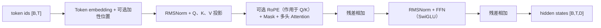

# 第 2 章 Transformer 组件实战：从张量形状到现代 LLM Block

Transformer 的实现并不是把几个类名拼在一起。一个输入 token 经过 embedding、位置处理、注意力、归一化和前馈网络，期间会反复改变张量的维度组织；任何一个维度的误读，都可能让程序继续运行，却让模型学习到另一种函数。

本章把这些组件放在同一条数据路径中讲解。先从离散 token id 进入连续表示开始，再逐步建立 scaled dot-product attention、multi-head attention、mask、Transformer block、RoPE、RMSNorm 和 SwiGLU。各组件按主题说明数学对象、PyTorch 中的 shape 和适用边界；适合用代码核对的主题附可独立运行的最小实现。代码采用教学构造，示例输出只说明形状或不变量，不代表任何真实模型的能力指标。

资料分成三类。Transformer 和 RoPE 的公式来自论文；张量操作和模块行为以 PyTorch 官方文档为准；模块组合、断言和诊断实验是教学实现。论文中的结构描述、框架的接口语义和某个目标系统的实测性能不能互相替代。

整章先用一条代表性的 Pre-RMSNorm decoder block 形状路径作地图。token id 经 embedding 变成 [B,T,D]；若使用加性位置表示，在这里加入；若使用 RoPE，则在 Q/K 投影后旋转。注意力在序列维交换信息，前馈层逐 token 变换通道，两个残差相加都回到同一个 [B,T,D] 接口。图中选择 RMSNorm、RoPE、SwiGLU 组合，不代表所有模型共享相同的位置机制或组件顺序。



沿图追 shape 时，序列长度 (T) 在普通 decoder block 中保持不变，attention 内部才临时形成 ([B,H,T,T]) 的分数关系；输出投影和残差相加前，head 维必须合并回 (D)。

## 2.1 Token Embedding 与位置表示：让离散序列进入连续空间

### 2.1.1 token id 是索引，不是有序特征

Tokenizer 把文本变成整数序列，例如：

```text
我 -> 125
爱 -> 876
你 -> 42
```

这些数字的大小没有语义。编号 876 不比编号 42 “更强”，相邻编号也不意味着两个 token 相似。如果把 [125, 876, 42] 当作普通浮点特征输入线性层，模型会被迫把编号的数值关系当成可学习规律的一部分。

Embedding 的职责是建立一个从离散索引到连续向量的映射。设词表大小为 \(V\)，模型隐藏维度为 \(D\)，token embedding 矩阵为：

```math
E\in\mathbb{R}^{V\times D}
```

输入 token id 为 \(i\) 时，输出就是矩阵的第 \(i\) 行：

```math
e_i=E_{i,:}
```

若一个 batch 的 token id 形状为 \([B,T]\)，查表后得到：

```math
\mathrm{Embedding}(X)\in\mathbb{R}^{B\times T\times D}
```

其中 \(B\) 是批次大小，\(T\) 是序列长度，\(D\) 是 hidden size。这个形状会成为后续 Transformer block 的接口契约。

初学者可以把 embedding 想成一本有 \(V\) 行的词典，每一行是一张 \(D\) 维的“特征卡片”；专家则应进一步注意，embedding 查表是稀疏访问：一个 batch 只会让出现过的行获得来自当前损失的直接梯度。

### 2.1.2 查表与 one-hot 矩阵乘法是同一个数学运算

设词表只有 5 个 token，id 为 2 的 one-hot 向量是：

```math
u_2=[0,0,1,0,0]
```

用行向量表示时：

```math
u_2E=E_{2,:}
```

所以 one-hot 乘法与索引查表在数学上等价。工程实现不应真的构造 \([B,T,V]\) 的 one-hot 张量，因为 \(V\) 可能达到数万乃至数十万；直接读取需要的行可以避免大量零值存储和乘法。

下面用一个小矩阵验证两种写法的结果一致：

> 代码状态：静态审阅，未运行（2026-10-29）

```python
import torch
from torch import nn
import torch.nn.functional as F

torch.manual_seed(7)
vocab_size = 5
hidden_size = 3
input_ids = torch.tensor([[0, 2, 4], [1, 2, 3]], dtype=torch.long)

embedding = nn.Embedding(vocab_size, hidden_size)
lookup = embedding(input_ids)
one_hot = F.one_hot(input_ids, num_classes=vocab_size)
one_hot = one_hot.to(dtype=embedding.weight.dtype)
matmul = one_hot @ embedding.weight

print("lookup_shape=", tuple(lookup.shape))
print("one_hot_shape=", tuple(one_hot.shape))
print("outputs_close=", torch.allclose(lookup, matmul))
```
输出的关键不变量是：

```text
lookup_shape= (2, 3, 3)
one_hot_shape= (2, 3, 5)
outputs_close= True
```

nn.Embedding 的输入应是整数索引，通常使用 torch.long；每个索引必须满足 \(0\le i<V\)。将索引先转成浮点数不会让 embedding 获得更丰富的信息，反而会导致接口错误。

### 2.1.3 参数量和梯度的稀疏访问

Embedding 矩阵的参数量为：

```math
N_{\mathrm{token}}=VD
```

例如 \(V=100000,D=4096\) 时：

```math
N_{\mathrm{token}}=100000\times4096=409{,}600{,}000
```

如果权重以 BF16 保存，每个元素占 2 bytes，裸权重约为 819.2 MB。训练显存还要加上梯度、优化器状态、临时激活以及可能的 FP32 master copy；不能把这个数字当成训练显存总量。

下面观察哪些行收到梯度：

> 代码状态：静态审阅，未运行（2026-10-29）

```python
import torch
from torch import nn

torch.manual_seed(3)
embedding = nn.Embedding(10, 4)
input_ids = torch.tensor([[1, 1, 4], [7, 4, 4]], dtype=torch.long)
loss = embedding(input_ids).pow(2).mean()
loss.backward()

row_norms = embedding.weight.grad.norm(dim=-1)
used_rows = [i for i, value in enumerate(row_norms) if value > 0]
print("used_rows=", used_rows)
print("unused_row_0_norm=", round(row_norms[0].item(), 6))
```
在没有额外正则项、且只计算这一个 batch 损失时，used_rows 应包含 1、4、7，未出现的行没有这次损失的直接梯度。若使用权重衰减、共享输出头或其他正则项，未出现行仍可能被更新；“未被索引访问”和“最终参数绝对不变”是两个不同命题。

### 2.1.4 padding_idx、attention mask 和 loss mask

变长序列通常需要 padding：

```text
样本 A: [12, 35, 98, 77]
样本 B: [21, 43,  0,  0]
```

如果 0 是 padding token，可以写：

> 代码状态：静态审阅，未运行（2026-10-29）

```python
from torch import nn

vocab_size = 100
d_model = 32
token_embedding = nn.Embedding(
    num_embeddings=vocab_size,
    embedding_dim=d_model,
    padding_idx=0,
)
```
padding_idx 作用在 embedding 参数这一层：该行在常规反向传播中不累积梯度；新建的 PyTorch embedding 通常将该行初始化为零。它不负责修改 attention 的可见性，也不负责改变 labels；具体接口行为见 [PyTorch 2.12 Embedding 文档](https://docs.pytorch.org/docs/2.12/generated/torch.nn.Embedding.html)。三个机制的职责如下：

| 机制 | 解决的问题 | 作用位置 |
| --- | --- | --- |
| padding_idx | padding 行是否由常规 loss 更新 | embedding 参数 |
| attention mask | query 能否读取某个 key | attention score |
| loss mask | 某个目标位置是否计入损失 | loss reduction |

一个完整的 batch 往往需要同时使用它们。只设置 padding_idx，padding key 仍可能被 attention 读取；只使用 attention mask，padding 位置仍可能进入 token loss。实际的 pad_token_id 必须从 tokenizer 和数据配置读取，不能把 0 写死为普遍规则；decoder-only tokenizer 甚至可能没有独立的 padding token。

### 2.1.5 位置表示为什么必不可少

Token embedding 只编码“是什么”，不编码“在哪里”。如果把同一组 token 重新排序，单纯的 token 表示集合并不会自动告诉 attention 这些 token 的顺序：

```text
我 喜欢 你
你 喜欢 我
```

自注意力如果没有任何位置机制，对输入 token 的排列缺少足够的顺序信息。因此常见做法是把 token 表示与位置表示组合：

```math
H_{b,t}=E_{x_{b,t}}+P_t
```

其中 \(x_{b,t}\) 是第 \(b\) 个样本第 \(t\) 个 token 的 id，\(P_t\) 是位置 \(t\) 的向量。这个公式描述的是 absolute position embedding；RoPE 会在 attention 的 q、k 上注入位置信息，接入位置不同，不能把两者简单叠加。

可学习位置表为：

```math
P\in\mathbb{R}^{T_{\max}\times D}
```

它有 \(T_{\max}D\) 个位置参数，超过 \(T_{\max}\) 时不能直接索引。position_offset 可以让增量推理从历史长度开始取位置，但不能突破位置表的最大长度。

### 2.1.6 Learned positional embedding 的实现

> 代码状态：静态审阅，未运行（2026-10-29）

```python
import torch
from torch import nn

class TokenAndPositionEmbedding(nn.Module):
    def __init__(self, vocab_size, d_model, max_seq_len, pad_token_id=None):
        super().__init__()
        if vocab_size <= 0 or d_model <= 0 or max_seq_len <= 0:
            raise ValueError("vocab_size, d_model and max_seq_len must be positive")
        kwargs = {}
        if pad_token_id is not None:
            kwargs["padding_idx"] = pad_token_id
        self.token = nn.Embedding(vocab_size, d_model, **kwargs)
        self.position = nn.Embedding(max_seq_len, d_model)
        self.max_seq_len = max_seq_len

    def forward(self, input_ids, position_offset=0):
        if input_ids.ndim != 2:
            raise ValueError("input_ids must have shape [batch, sequence]")
        if input_ids.dtype not in (torch.int32, torch.int64):
            raise TypeError("input_ids must use an integer dtype")
        if position_offset < 0:
            raise ValueError("position_offset must be non-negative")
        batch_size, seq_len = input_ids.shape
        end = position_offset + seq_len
        if end > self.max_seq_len:
            raise ValueError("learned position table is too short")
        positions = torch.arange(
            position_offset,
            end,
            device=input_ids.device,
            dtype=torch.long,
        )
        positions = positions.view(1, seq_len).expand(batch_size, seq_len)
        return self.token(input_ids) + self.position(positions)

torch.manual_seed(42)
input_ids = torch.tensor([[4, 8, 2, 0], [9, 3, 0, 0]], dtype=torch.long)
module = TokenAndPositionEmbedding(
    vocab_size=20,
    d_model=8,
    max_seq_len=16,
    pad_token_id=0,
)
hidden = module(input_ids)
offset_hidden = module(input_ids[:, :2], position_offset=4)

print("hidden_shape=", tuple(hidden.shape))
print("offset_hidden_shape=", tuple(offset_hidden.shape))
print("position_table_shape=", tuple(module.position.weight.shape))
```
输出形状为：

```text
hidden_shape= (2, 4, 8)
offset_hidden_shape= (2, 2, 8)
position_table_shape= (16, 8)
```

这里 offset 只改变位置索引；token embedding 的 padding 行仍由 padding_idx 管理。若采用左 padding，还要决定真实 token 的 position ids 是否跳过 padding；不同模型和 serving runtime 的约定并不一致，不能只把 torch.arange(seq_len) 当成普适答案。

### 2.1.7 Sinusoidal encoding 是固定函数

[Transformer 原论文](https://arxiv.org/abs/1706.03762)给出了一种不增加可训练位置参数的编码。对位置 \(p\)、维度索引 \(i\) 和模型维度 \(D\)：

```math
PE_{p,2i}=\sin\left(\frac{p}{10000^{2i/D}}\right)
```

```math
PE_{p,2i+1}=\cos\left(\frac{p}{10000^{2i/D}}\right)
```

它可以在运行时计算更长的位置，但“可计算”不等于“模型在更长位置上保持同样质量”。频率范围、训练长度、数值精度和任务分布都会影响外推。

> 代码状态：静态审阅，未运行（2026-10-29）

```python
import math
import torch

def sinusoidal_position_encoding(seq_len, d_model, device=None, dtype=torch.float32):
    if seq_len < 0 or d_model <= 0:
        raise ValueError("seq_len must be non-negative and d_model positive")
    if d_model % 2 != 0:
        raise ValueError("this implementation expects an even d_model")
    positions = torch.arange(
        seq_len, device=device, dtype=torch.float32
    ).view(seq_len, 1)
    pair_index = torch.arange(
        0, d_model, 2, device=device, dtype=torch.float32
    )
    inv_frequency = torch.exp(
        -math.log(10000.0) * pair_index / d_model
    )
    angles = positions * inv_frequency.view(1, -1)
    encoding = torch.zeros(
        seq_len, d_model, device=device, dtype=torch.float32
    )
    encoding[:, 0::2] = torch.sin(angles)
    encoding[:, 1::2] = torch.cos(angles)
    return encoding.to(dtype=dtype)

encoding = sinusoidal_position_encoding(seq_len=4, d_model=8)
print("encoding_shape=", tuple(encoding.shape))
print("position_zero=", encoding[0].tolist())
```
位置 0 的偶数维为 0，奇数维为 1，这是由该公式直接得到的，不是训练结果。固定 encoding 与 token states 相加后，整体 shape 仍是 \([B,T,D]\)。

### 2.1.8 输出头与 token embedding 权重共享

语言模型最终需要把 hidden state 映射回词表 logits。设 \(H\) 的形状为 \([B,T,D]\)，输出矩阵为 \(W_{\mathrm{out}}\in\mathbb{R}^{D\times V}\)：

```math
Z=HW_{\mathrm{out}}+b
```

权重共享（weight tying）常令：

```math
W_{\mathrm{out}}=E^\top
```

这样输入 embedding 和输出分类空间使用同一组参数，减少一份 \(VD\) 参数，并施加一种表示空间约束。它不是 nn.Embedding 的默认行为；共享时必须让两个计算路径真正引用同一个 Parameter，而不是复制数值后各自注册。

> 代码状态：静态审阅，未运行（2026-10-29）

```python
import torch
from torch import nn

vocab_size = 100
d_model = 16
embedding = nn.Embedding(vocab_size, d_model)
output_bias = nn.Parameter(torch.zeros(vocab_size))
hidden = torch.randn(2, 4, d_model)
logits = hidden @ embedding.weight.transpose(0, 1) + output_bias

print("logits_shape=", tuple(logits.shape))
print("tied_parameter_count=", embedding.weight.numel() + output_bias.numel())
```
共享输入输出权重会让输入侧和输出侧梯度相加到同一个参数上；这也是它与“初始化相同的两份矩阵”在训练语义上的区别。是否共享取决于模型架构和 tokenizer 设计，不能由参数量估算反推。

### 2.1.9 左右 padding 与增量位置

右 padding 常见形式是：

```text
真实 token: [12, 35, 98, 77, 0, 0]
```

左 padding 则是：

```text
padding:    [0, 0, 12, 35, 98, 77]
```

对 absolute position embedding，左 padding 会带来一个选择：真实 token 使用物理列位置 2、3、4、5，还是重新编号为 0、1、2、3。对 causal mask、position ids 和 KV Cache 来说，这个选择必须一致；否则模型看到的“第一个真实 token”在不同 batch 中可能获得不同位置。

至少要把五件事写成同一个数据契约：

1. padding 是左侧还是右侧；
2. position ids 是否跳过 padding；
3. attention mask 如何屏蔽 padding key 和无效 query；
4. loss mask 是否保留有效目标；
5. 增量解码时新 token 的 cache position 如何计算。

在没有确认目标模型训练和 runtime 约定前，不能因为某个实现使用 arange 就把它推广为所有 decoder-only 模型的规则。

### 2.1.10 Embedding 输入的最小审计

对输入模块，最有价值的检查不是只看程序是否返回一个 Tensor，而是检查以下不变量：

> 代码状态：静态审阅，未运行（2026-10-29）

```python
import torch
from torch import nn

class InputEmbedding(nn.Module):
    def __init__(self, vocab_size, d_model, max_seq_len, pad_token_id=0):
        super().__init__()
        if vocab_size <= 0 or d_model <= 0 or max_seq_len <= 0:
            raise ValueError("vocab_size, d_model and max_seq_len must be positive")
        self.token = nn.Embedding(
            vocab_size, d_model, padding_idx=pad_token_id
        )
        self.position = nn.Embedding(max_seq_len, d_model)
        self.max_seq_len = max_seq_len

    def forward(self, input_ids, position_offset=0):
        if input_ids.ndim != 2:
            raise ValueError("input_ids must have shape [batch, sequence]")
        if input_ids.dtype not in (torch.int32, torch.int64):
            raise TypeError("input_ids must use an integer dtype")
        if position_offset < 0:
            raise ValueError("position_offset must be non-negative")
        batch_size, seq_len = input_ids.shape
        if position_offset + seq_len > self.max_seq_len:
            raise ValueError("position range is outside the table")
        position_ids = torch.arange(
            position_offset,
            position_offset + seq_len,
            device=input_ids.device,
            dtype=torch.long,
        )
        position_ids = position_ids.unsqueeze(0).expand(batch_size, seq_len)
        return self.token(input_ids) + self.position(position_ids)

torch.manual_seed(11)
input_ids = torch.tensor([[5, 8, 0, 0], [3, 7, 4, 2]])
module = InputEmbedding(32, 12, 32, pad_token_id=0)
hidden = module(input_ids)
hidden.square().mean().backward()

assert hidden.shape == (2, 4, 12)
assert module.token.weight.grad[0].abs().sum().item() == 0.0
assert module.position.weight.grad is not None
print("embedding_contract_ok=True")
```
```text
embedding_contract_ok=True
```

这个断言只证明 embedding 层的两个局部契约；它没有证明 attention mask 或 token loss mask 正确。系统验证必须把三个 mask 的测试分别写出来。

用一个极小的数值例子把查表和位置相加接起来。假设两个 token 的 embedding 分别是 \(E_{\text{云}}=[1,0]\)、\(E_{\text{模型}}=[0,1]\)，位置向量为 \(P_0=[0.1,0]\)、\(P_1=[0,0.2]\)。序列“云、模型”进入 block 前变成 \([1.1,0]\)、\([0,1.2]\)；若只交换 token、位置仍按序列列号递增，输入就变成 \([0.1,1]\)、\([1,0.2]\)。词向量集合相同，位置配对不同，后续 attention 因而能区分顺序。这个手算例只说明表示里怎样同时携带 token 身份和位置，不代表模型已经理解“云模型”的语义；语义关系要通过训练目标和数据学出来。

Embedding 梯度也有一个容易忽略的细节：同一 token 在一个 batch 出现三次，它对应行会从三个位置收到梯度贡献；未出现的行通常没有当前 loss 的直接梯度。稀疏访问不意味着优化器一定用稀疏存储，也不意味着其他正则或权重共享不会更新那一行。词表扩容时还要处理旧 token 行如何保留、新 token 行如何初始化、输出头是否同步扩容，以及 checkpoint 与 tokenizer revision 是否匹配。只改 tokenizer 而继续加载旧 embedding，索引虽可能落在合法范围内，token 的语义映射却已经错位。

词表和位置一起构成 Transformer 输入协议。调试时先用两三个手工 token 核对 token id、embedding 行和 position id，再查看真实 tokenizer 的特殊 token、左右 padding 与最大长度；如果 tokenizer 把一个汉字拆成多个子词，序列长度和 loss 分母也随之变化。错误的 tokenization 不会总触发异常，它更可能让模型在一套错位的输入语义上正常运行，因此输入例子应从原始文本一直追踪到 id 和向量。

## 2.2 Scaled Dot-Product Attention：从相似度到信息汇聚

### 2.2.1 Q、K、V 是三个不同的角色

对输入表示做三组线性投影：

```math
Q=XW_Q,\qquad K=XW_K,\qquad V=XW_V
```

Query 可以理解为当前位置要寻找的模式，Key 是每个位置可被匹配的索引，Value 是被选中后真正汇聚的内容。这些是理解用的角色描述，不是说网络内部存有可直接解释的“问题”和“答案”。

单头 self-attention 常用 shape 为：

| 张量 | shape | 含义 |
| --- | --- | --- |
| \(Q\) | \([B,T_q,d_k]\) | 每个 query 位置的向量 |
| \(K\) | \([B,T_k,d_k]\) | 每个 key 位置的向量 |
| \(V\) | \([B,T_k,d_v]\) | 每个 key 位置的内容向量 |

Self-attention 中 \(T_q=T_k=T\) 且三者都来自同一段 \(X\)；cross-attention 中 query 端和 key/value 端可以来自不同序列，因此 \(T_q\) 与 \(T_k\) 不必相同。

### 2.2.2 点积、缩放和 softmax

先计算 query 与每个 key 的相似度：

```math
S_{b,a,c}=\frac{Q_{b,a,:}K_{b,c,:}^{\top}}{\sqrt{d_k}}
```

这里 \(a\) 是 query 位置，\(c\) 是 key 位置。将所有位置写成矩阵：

```math
S=\frac{QK^\top}{\sqrt{d_k}}
```

得到 \(S\in\mathbb{R}^{B\times T_q\times T_k}\)。再对 key 维度做 softmax：

```math
A_{b,a,c}=\frac{\exp(S_{b,a,c})}{\sum_{r=1}^{T_k}\exp(S_{b,a,r})}
```

最后用注意力权重汇聚 Value：

```math
O_{b,a,:}=\sum_{c=1}^{T_k}A_{b,a,c}V_{b,c,:}
```

因此 \(A\) 的每个 query 行在没有 dropout 时和为 1，\(O\) 的形状是 \([B,T_q,d_v]\)。

为什么要除以 \(\sqrt{d_k}\)？如果每个 \(q_j,k_j\) 近似零均值、单位方差且相互独立，则点积的方差近似为 \(d_k\)：

```math
\mathrm{Var}(q^\top k)\approx d_k
```

缩放后：

```math
\mathrm{Var}\left(\frac{q^\top k}{\sqrt{d_k}}\right)\approx 1
```

这不是所有训练状态下的精确统计定律，而是说明 softmax logits 随维度放大的原因。归一化层、初始化和相关性会改变真实分布，但缩放仍是 [Transformer 原论文](https://arxiv.org/abs/1706.03762)采用的标准 attention 定义。

### 2.2.3 手写 attention，并把 mask 语义写进函数

下面的实现把布尔 mask 定义为 keep mask：True 表示允许 query 读取该 key，False 表示屏蔽。函数只处理 shape 可广播到 scores 的 mask；它不替调用者验证 query 是否至少有一个可见 key。

> 代码状态：静态审阅，未运行（2026-10-29）

```python
import math
import torch

def scaled_dot_product_attention(q, k, v, keep_mask=None):
    if q.shape[-1] != k.shape[-1]:
        raise ValueError("q and k must have the same key dimension")
    if k.shape[-2] != v.shape[-2]:
        raise ValueError("k and v must have the same key length")

    scores = q @ k.transpose(-2, -1)
    scores = scores / math.sqrt(q.shape[-1])

    if keep_mask is not None:
        keep_mask = keep_mask.to(dtype=torch.bool, device=scores.device)
        scores = scores.masked_fill(
            ~keep_mask,
            torch.finfo(scores.dtype).min,
        )

    weights = torch.softmax(scores, dim=-1)
    output = weights @ v
    return output, weights, scores

torch.manual_seed(7)
q = torch.randn(2, 4, 8)
k = torch.randn(2, 4, 8)
v = torch.randn(2, 4, 6)
output, weights, scores = scaled_dot_product_attention(q, k, v)

assert output.shape == (2, 4, 6)
assert weights.shape == (2, 4, 4)
assert torch.allclose(
    weights.sum(dim=-1),
    torch.ones(2, 4),
    atol=1e-6,
)
print("output_shape=", tuple(output.shape))
print("weights_shape=", tuple(weights.shape))
```
这个例子只使用 self-attention 的 \(T_q=T_k=4\)，但函数本身也支持 \(T_q\ne T_k\)。注意 torch.softmax 的最后一维是 key 维；如果在 query 维归一化，权重就不再表示“一个 query 如何分配对各 key 的注意力”。

### 2.2.4 mask 应在 softmax 前应用

设一个位置不可见。将其 score 设为很小的有限数 \(m_{\mathrm{min}}\)，再做 softmax：

```math
A_{b,a,c}\approx0\quad (M_{b,a,c}=0)
```

教学实现常使用 torch.finfo(scores.dtype).min；某些实现使用负无穷或 additive mask。选择哪一个要看 dtype 和 kernel 的行为，但所有方案都要面对同一个边界：如果某个 query 的所有 key 都被屏蔽，归一化没有合法的分母，结果可能是 NaN 或无意义的均匀分布。

不要在 softmax 之后简单把权重置零来代替 mask。这样会破坏可见位置的归一化，除非你随后重新归一化，而且重新归一化又要处理全零行。更稳妥的契约是：在进入 softmax 前保证每个有效 query 至少有一个可见 key。

### 2.2.5 与 PyTorch SDPA 的边界

PyTorch 提供 `torch.nn.functional.scaled_dot_product_attention`。它可能选择数学实现、memory-efficient、Flash 或其他支持的后端，具体 kernel 取决于设备、dtype、输入形状和版本；可用 [PyTorch 2.12 SDPA 文档](https://docs.pytorch.org/docs/2.12/generated/torch.nn.functional.scaled_dot_product_attention.html)核对该版本的接口与后端说明。数学目标仍是缩放点积注意力，但中间张量是否显式物化不能从 API 名字推断。不同融合实现的浮点运算顺序可能不同，因此对照时应使用合理容差，不能要求每个元素逐位相等。

布尔 mask 的语义必须核对目标接口：SDPA 的布尔 `attn_mask` 中 True 表示参与 attention，False 表示屏蔽；这与 `MultiheadAttention.key_padding_mask` 的 True 表示屏蔽相反。float mask 则作为 additive bias 加到 attention score 上。若传入 `is_causal=True`，不能同时传 `attn_mask`；需要同时表达 causal 和 padding 约束时，应按目标接口支持的方式合成 mask。

还有两个容易被模块封装遮住的细节。第一，SDPA 会严格按照传入的 `dropout_p` 应用 dropout，不会读取外层模块的 `training` 状态；模型进入 eval 时，调用方应显式传入 0.0。第二，想固定使用某个 fused backend 时要按当前 PyTorch 文档检查其输入限制；“函数调用成功”本身不证明实际走了预期 kernel。下面的数值对照使用 `dropout_p=0.0`，因此比较的是无 dropout 的 attention：

> 代码状态：静态审阅，未运行（2026-10-29）

```python
import math
import torch
import torch.nn.functional as F

def scaled_dot_product_attention(q, k, v, keep_mask=None):
    if q.shape[-1] != k.shape[-1]:
        raise ValueError("q and k must have the same key dimension")
    if k.shape[-2] != v.shape[-2]:
        raise ValueError("k and v must have the same key length")
    scores = q @ k.transpose(-2, -1)
    scores = scores / math.sqrt(q.shape[-1])
    if keep_mask is not None:
        keep_mask = keep_mask.to(
            device=scores.device,
            dtype=torch.bool,
        )
        scores = scores.masked_fill(
            ~keep_mask,
            torch.finfo(scores.dtype).min,
        )
    weights = torch.softmax(scores, dim=-1)
    return weights @ v, weights, scores

torch.manual_seed(13)
q = torch.randn(2, 3, 5, 8)
k = torch.randn(2, 3, 5, 8)
v = torch.randn(2, 3, 5, 8)
keep_mask = torch.tril(
    torch.ones(5, 5, dtype=torch.bool)
).view(1, 1, 5, 5)

manual, _, _ = scaled_dot_product_attention(q, k, v, keep_mask)
official = F.scaled_dot_product_attention(
    q, k, v, attn_mask=keep_mask, dropout_p=0.0
)
print("shape=", tuple(official.shape))
print("manual_matches_official=", torch.allclose(
    manual, official, atol=1e-6
))
```
这段代码把对照所需的手写函数一并放入围栏，因此可以单独复制运行。两种实现都使用相同的 keep-mask 语义；差异只应来自数值误差和 PyTorch 选择的 attention kernel。

现在不用框架，手算一次最小的信息汇聚。设一个 query 为 \(q=1\)，两个 key 为 \(k_1=\ln3,k_2=0\)，所以 \(d_k=1\)，缩放因子 \(\sqrt{d_k}=1\)。两个 score 是 \([\ln3,0]\)，softmax 后权重为 \([3/4,1/4]\)。若 value 分别为 \(v_1=[2,0]\)、\(v_2=[0,2]\)，输出就是 \((3/4)[2,0]+(1/4)[0,2]=[1.5,0.5]\)。这一步不是把 value 按“最相关位置”硬选出来，而是按归一化权重做加权和。若两个 score 相同，权重变为 \([1/2,1/2]\)，输出为 \([1,1]\)；差异只来自 query-key 匹配，而 value 决定被混合的内容。

缩放项改变的不是排序而是 softmax 的温度。若所有 score 同乘一个较大常数，最大项会更接近概率 1，其余项的梯度更容易进入饱和区；缩小 score 会让分布更平。除以 \(\sqrt{d_k}\) 的动机，是在常见独立初始化假设下控制点积方差，帮助不同 head_dim 下的 logits 处于更可优化的尺度。它不能保证训练期的 score 方差恒为 1，因为 q、k 会逐渐相关，归一化、初始化和训练数据都改变其分布。调试时可记录 score 的均值、标准差和极值，并确认 softmax 沿 key 维计算；只看输出 shape 正确，还不能发现 score 已经饱和。

一个 query 行的权重和为 1，因此输出位于参与汇聚的 value 的凸组合范围内；加入 dropout 后，训练时权重可能被随机置零并缩放，行和就不再严格等于 1。多头的 output projection 还会进一步混合通道，所以不能把最终 hidden state 当成某个 token value 的简单平均。解释 attention 图时，应把它当成特定输入、层、head 和 mask 下的权重观测，而非自动得到的因果解释。

在实际 decoder 中，当前位置通常只能访问自己及以前的 key。于是上面的两个 key 例子若第二个是未来位置，mask 会在 softmax 前移除它，剩下权重为 \([1,0]\)，输出变成 \([2,0]\)。训练中可以一次并行计算所有 query，但必须用同一条可见性约束；生成时则通常逐步追加新的 key/value。二者共享 attention 数学定义，差别在数据可见范围和缓存执行方式。

attention 权重描述的是当前 query 在给定 key 集合上的归一化分配，不等同于“模型已经找到事实来源”。两个 key 即使得分相同，若它们的 value 相同，混合结果也不会因权重如何分配而改变；反过来，较低权重的 value 若在某个维度特别大，也可能对输出有明显影响。读注意力图时要同时看 score、softmax 权重和 value 内容，并固定输入、层、head 和 mask。它能解释这次前向如何组合信息，却不足以单独说明模型为什么在任务上作出某个决定。

实现顺序同样决定数学含义：先算点积并缩放，再在 softmax 前应用 mask，然后沿 key 维归一化，最后乘 V。若把 mask 放在 softmax 后又不重新归一化，输出权重和会小于 1；若在训练期 dropout 后直接检查行和，也可能把正常的正则行为误报为实现错误。高精度手算例要关闭 dropout，生产训练则记录其概率和模块模式，避免把两种运行条件下的差别混成一个结论。

score 和输出还受向量尺度影响。若所有 value 同乘 10，attention 权重完全不变，输出也同乘 10；若所有 query 同乘 10，softmax 通常会更尖锐，权重随之改变。因而看到输出范数异常时，要区分是 value/projection 尺度改变，还是 q/k 让权重分布变得极端。记录最大/最小 score、权重熵和输出范数，能把“注意力坏了”拆成可观测的变量。

所以可以把 attention 拆成三个可独立核对的对象：归一化权重 \(A\) 决定如何分配，value \(V\) 决定可取用的内容，输出投影决定多头通道怎样组合。手算时分别写出这三步，比把注意力简化成“找最相关 token”更准确。

## 2.3 Multi-Head Attention：把一个相似度空间拆成多个子空间

### 2.3.1 从单头到多头

单头 attention 只有一个 \(d_k\) 维的相似度空间。多头 attention 将模型维度 \(D\) 分成 \(H\) 个 head，每个 head 使用 \(d_h=D/H\) 个通道独立计算，再把结果拼回去：

```math
D=H d_h
```

第 \(h\) 个 head 可以写成：

```math
\mathrm{head}_h=
\mathrm{Attention}(QW_h^Q,KW_h^K,VW_h^V)
```

所有 head 拼接后再投影：

```math
\mathrm{MHA}(X)=
\mathrm{Concat}(\mathrm{head}_1,\ldots,\mathrm{head}_H)W^O
```

不同 head 可以在不同参数子空间中学习局部关系、长距离关系或其他统计模式。这是结构上的可能性，不代表每个 head 都能被人类稳定地赋予一个语义标签；是否出现可解释的 head，需要通过激活、消融和下游任务实验验证。

标准实现通常用三个 \(D\to D\) 的线性层一次性产生 Q、K、V，再重新组织最后一维，而不是为每个 head 单独创建 Python 模块；这与 [Transformer 原论文](https://arxiv.org/abs/1706.03762)中的多头结构一致。只要 \(D\) 固定，改变 \(H\) 会改变每个 head 的维度和计算组织，但不会自动把四个投影矩阵的参数量乘以 \(H\)。

### 2.3.2 shape 账本

以 self-attention 为例：

| 张量 | shape | 含义 |
| --- | --- | --- |
| \(X\) | \([B,T,D]\) | 输入 hidden states |
| \(Q,K,V\) | \([B,T,D]\) | 三组线性投影 |
| 拆头后的 \(Q,K,V\) | \([B,H,T,d_h]\) | 每个 head 的序列表示 |
| scores | \([B,H,T,T]\) | query-key 分数 |
| head output | \([B,H,T,d_h]\) | 每个 head 汇聚后的值 |
| 合并后的 output | \([B,T,D]\) | 拼接并输出投影前 |

拆头是：

```math
[B,T,D]\to[B,T,H,d_h]\to[B,H,T,d_h]
```

合并是：

```math
[B,H,T,d_h]\to[B,T,H,d_h]\to[B,T,D]
```

transpose 通常只改变 stride，不保证新视图在物理内存中连续。合并前调用 contiguous 再 view，或者直接使用 reshape，是为了明确处理这一点。

### 2.3.3 一个可读的 MultiHeadAttention 实现

> 代码状态：静态审阅，未运行（2026-10-29）

```python
import math
import torch
import torch.nn.functional as F
from torch import nn

def scaled_dot_product_attention(
    q,
    k,
    v,
    keep_mask=None,
    dropout_p=0.0,
    training=True,
):
    scores = q @ k.transpose(-2, -1)
    scores = scores / math.sqrt(q.shape[-1])
    if keep_mask is not None:
        keep_mask = keep_mask.to(dtype=torch.bool, device=scores.device)
        scores = scores.masked_fill(
            ~keep_mask,
            torch.finfo(scores.dtype).min,
        )
    weights = torch.softmax(scores, dim=-1)
    weights = F.dropout(
        weights,
        p=dropout_p,
        training=training,
    )
    return weights @ v, weights

class MultiHeadAttention(nn.Module):
    def __init__(self, d_model, num_heads, dropout=0.0):
        super().__init__()
        if d_model <= 0 or num_heads <= 0 or d_model % num_heads != 0:
            raise ValueError("d_model must be divisible by num_heads")
        self.d_model = d_model
        self.num_heads = num_heads
        self.head_dim = d_model // num_heads
        self.q_proj = nn.Linear(d_model, d_model)
        self.k_proj = nn.Linear(d_model, d_model)
        self.v_proj = nn.Linear(d_model, d_model)
        self.out_proj = nn.Linear(d_model, d_model)
        self.dropout = nn.Dropout(dropout)

    def split_heads(self, x):
        batch_size, seq_len, _ = x.shape
        x = x.view(
            batch_size,
            seq_len,
            self.num_heads,
            self.head_dim,
        )
        return x.transpose(1, 2)

    def merge_heads(self, x):
        batch_size, _, seq_len, _ = x.shape
        x = x.transpose(1, 2).contiguous()
        return x.view(batch_size, seq_len, self.d_model)

    def forward(self, x, keep_mask=None):
        batch_size, seq_len, _ = x.shape
        q = self.split_heads(self.q_proj(x))
        k = self.split_heads(self.k_proj(x))
        v = self.split_heads(self.v_proj(x))
        output, weights = scaled_dot_product_attention(
            q,
            k,
            v,
            keep_mask=keep_mask,
            dropout_p=self.dropout.p,
            training=self.training,
        )
        output = self.merge_heads(output)
        output = self.out_proj(output)
        return output, weights

torch.manual_seed(42)
x = torch.randn(2, 5, 12)
mask = torch.tril(
    torch.ones(5, 5, dtype=torch.bool)
).view(1, 1, 5, 5)
mha = MultiHeadAttention(d_model=12, num_heads=3)
output, weights = mha(x, keep_mask=mask)

print("output_shape=", tuple(output.shape))
print("weights_shape=", tuple(weights.shape))
print("row_sum_shape=", tuple(weights.sum(dim=-1).shape))
```
输出形状为：

```text
output_shape= (2, 5, 12)
weights_shape= (2, 3, 5, 5)
row_sum_shape= (2, 3, 5)
```

在 dropout 为 0 且每个 query 至少有一个可见 key 时，weights 沿最后一维应接近全 1。若在训练模式下对 weights 使用 dropout，dropout 后的权重行不一定仍然和为 1；检查 mask 时应关闭 dropout，避免把正则化行为误判成 mask 错误。

### 2.3.4 self-attention 与 cross-attention

本节代码的 q、k、v 都来自同一个 x，因此是 self-attention。cross-attention 的接口应允许 query 序列与 key/value 序列长度不同：

```math
Q\in\mathbb{R}^{B\times T_q\times d_k},\qquad
K\in\mathbb{R}^{B\times T_k\times d_k},\qquad
V\in\mathbb{R}^{B\times T_k\times d_v}
```

其分数形状为 \([B,H,T_q,T_k]\)，而不是强行写成 \([B,H,T,T]\)。decoder 生成时，query 可以来自 decoder 当前 hidden，key/value 可以来自 encoder 输出；多模态模型中，key/value 也可能来自视觉或音频编码器。

如果只把 self-attention 类的 seq_len 同时传给 q 和 kv，cross-attention 在 \(T_q\ne T_k\) 时就会出现 reshape 或 mask 对齐错误。工程接口应把 query length 和 key length 分开记录。

### 2.3.5 参数量与复杂度

标准 MHA 有四个主要投影矩阵：

```math
W_Q,W_K,W_V,W_O\in\mathbb{R}^{D\times D}
```

忽略 bias 时：

```math
N_{\mathrm{MHA}}\approx4D^2
```

如果 \(D=512,H=8\)，改成 \(H=16\) 后，四个矩阵的形状仍然是 \([512,512]\)，参数量不会自动翻倍；head_dim 从 64 变成 32，可能改变 kernel 效率和每个子空间的表达容量。

attention 分数矩阵的计算复杂度近似为：

```math
O(BHT^2d_h)=O(BT^2D)
```

Q、K、V 和输出投影的线性层还带来：

```math
O(BTD^2)
```

朴素实现通常显式保存 \([B,H,T,T]\) 的权重或中间分数；FlashAttention 一类 kernel 可以减少中间显存和读写，但不应被描述为自动消除了标准 attention 的二次计算项。

把维度带入一次，可以同时检查 shape 和参数量。设 batch 为 2、序列长度 \(T=3\)、模型维度 \(D=12\)、head 数 \(H=3\)，则每个 head 的维度 \(d_h=4\)。输入 \([2,3,12]\) 经过 Q/K/V 投影仍各是 \([2,3,12]\)，拆头后成为 \([2,3,3,4]\)，scores 是 \([2,3,3,3]\)，每个 query 对同一 head 的三个 key 打分。拼接三个 4 维 head 后回到 \([2,3,12]\)，再通过输出投影。四个 \(12\times12\) 矩阵共有 \(4\cdot144=576\) 个权重，不含 bias；若把 head 数改成 6、每头降为 2 维，投影矩阵形状和这个参数数仍然不变。改变的是子空间切分、每头可表达的维度和 kernel 工作方式，不能把“head 翻倍”简单说成“参数翻倍”。

cross-attention 更能检验是否把形状想清楚。若两个 decoder query 读取五个 encoder token，则 scores 的末两维是 \([2,5]\)，整体可为 \([B,H,2,5]\)；每个 query 得到五个权重，再汇聚对应的五个 value。mask 的 key 维必须是 5，而不是 query 长度 2。任何强行把所有张量 reshape 成 \([B,H,T,T]\) 的实现，都只适用于 self-attention 的特例，遇到图像 patch、音频帧或 encoder-decoder 输入时会失败。

多头结构提供多个可学习的投影空间，但没有硬性规定第 1 个 head 必须看语法、第 2 个必须看长距离依赖。若要判断某个 head 对模型是否有作用，可以固定输入做 head ablation、观察任务指标和输出变化，并控制随机性；只可视化某一层的注意力热图不能证明这个 head 是模型决策的唯一原因。分组查询注意力（GQA）会让多个 query head 共享较少的 key/value head，是参数和 KV cache 组织上的另一种架构；它改变 Q 与 KV 的 head 数契约，不能直接套用这里假设 Q/K/V head 数相同的实现。本书第 6 章进一步用 cache shape 和容量例子说明 GQA/MQA 的影响，见[推理优化实战](06-推理优化实战.md)。

### 2.3.6 针对实现的局部测试

下面的测试包含一个紧凑的 `MultiHeadAttention` 实现，因此可以独立运行。它保留 2.3.3 的 shape、keep-mask 和输出契约，省略 dropout 以便测试结果确定。

> 代码状态：静态审阅，未运行（2026-10-29）

```python
import math
import torch
from torch import nn

class MultiHeadAttention(nn.Module):
    def __init__(self, d_model, num_heads):
        super().__init__()
        if d_model % num_heads != 0:
            raise ValueError("d_model must be divisible by num_heads")
        self.d_model = d_model
        self.num_heads = num_heads
        self.head_dim = d_model // num_heads
        self.q_proj = nn.Linear(d_model, d_model)
        self.k_proj = nn.Linear(d_model, d_model)
        self.v_proj = nn.Linear(d_model, d_model)
        self.out_proj = nn.Linear(d_model, d_model)

    def forward(self, x, keep_mask):
        batch_size, seq_len, _ = x.shape
        def split_heads(values):
            values = values.view(
                batch_size,
                seq_len,
                self.num_heads,
                self.head_dim,
            )
            return values.transpose(1, 2)

        q = split_heads(self.q_proj(x))
        k = split_heads(self.k_proj(x))
        v = split_heads(self.v_proj(x))
        scores = q @ k.transpose(-2, -1)
        scores = scores / math.sqrt(self.head_dim)
        scores = scores.masked_fill(
            ~keep_mask.to(device=x.device, dtype=torch.bool),
            torch.finfo(scores.dtype).min,
        )
        weights = torch.softmax(scores, dim=-1)
        output = weights @ v
        output = output.transpose(1, 2).contiguous()
        output = output.view(batch_size, seq_len, self.d_model)
        return self.out_proj(output), weights

torch.manual_seed(5)
mha = MultiHeadAttention(d_model=16, num_heads=4)
x = torch.randn(2, 6, 16)
mask = torch.tril(
    torch.ones(6, 6, dtype=torch.bool)
).view(1, 1, 6, 6)
output, weights = mha(x, keep_mask=mask)

future = torch.triu(
    torch.ones(6, 6, dtype=torch.bool),
    diagonal=1,
).view(1, 1, 6, 6).expand_as(weights)

assert output.shape == x.shape
assert weights.shape == (2, 4, 6, 6)
assert torch.allclose(
    weights.sum(dim=-1),
    torch.ones_like(weights.sum(dim=-1)),
)
assert weights.masked_select(future).abs().max().item() < 1e-6
print("mha_contract_ok=True")
```
这个测试没有证明模型训练有效，但能把 shape、归一化、因果方向和输出接口四个问题从端到端 loss 中隔离出来。若某一项失败，先修复局部契约，再讨论模型质量。

序列长度对中间 score 张量的影响是平方级的。一个 head、单条长度 1024 的序列有 \(1024^2\) 个分数；若有 8 个 head，便是 8,388,608 个元素，按 FP16/BF16 的 2 bytes 计算约 16 MiB。长度增至 4096 后，同一张量约有 134,217,728 个元素、256 MiB。这个账只计算一层的一份 score，不含 batch、softmax 中间量、反向保存和其他激活，因此不能当作完整显存估算。它说明 head 数线性增加这部分存储，而序列长度翻倍会让分数元素数约增至四倍，也解释了为何长上下文实现要关注 kernel 是否物化整张矩阵。

比较 head 配置时应把参数、算子和质量分别记录。改变 \(H\) 而保持 \(D\) 会改变 \(d_h\) 与并行分组，但投影参数量不变；改变 \(D\) 才会明显改变线性层参数和计算量。不同 head 数还可能改变支持的 fused kernel、张量并行切分和对齐要求。一个局部 MHA 单测通过只证明指定 shape、mask 和 dtype 下接口成立，不保证不同 head 配置有相同速度或任务效果。

在实现中，拆头和合头的维度顺序是最常见的静默错误之一。输入 \([B,T,D]\) 先按 \([B,T,H,d_h]\) 解释，再把 \(T\) 与 \(H\) 转成 \([B,H,T,d_h]\)；若不小心把 head 与 token 两轴交换，矩阵乘法仍可能成功，却会让一个 head 混合不同 token 的内容。transpose 后的张量通常不连续，直接 view 可能报错或需要复制；reshape 会在必要时复制，但它也不能修复错误的轴顺序。最好在每一步打印 shape，并用 \(B=1,T=2,H=2,d_h=2\) 的手工序列追踪第一个元素来自哪个 token 和 head。

参数共享同样有边界。MHA 的 Q/K/V 各有独立投影；GQA 则让多个 query head 对应共享的 KV head，减少 KV cache 中的存储和读取量。若 \(H_q=8,H_{kv}=2\)，每组四个 query head 共享一组 key/value 表示，但 query score 仍按 query head 分开计算。实现需要显式映射 query head 到 KV head，不能靠把 K/V 张量随意 repeat 来假定语义正确；重复视图、物理复制和 kernel 内广播在显存与性能上也不同。

手算拆头可再用 \(D=4,H=2\) 核对一次：一个 token 的投影向量 \([a,b,c,d]\) 拆成 head 0 的 \([a,b]\) 和 head 1 的 \([c,d]\)，每个 head 对所有位置独立计算自己的 score，合并时按原顺序拼回四维。若先转置再错误地把内存顺序当作逻辑顺序，可能变成从不同 token 抽取通道。测试最好使用每个位置和通道都不同的递增数值，而不是全零或随机数；这样一旦轴交换，预期输出能直接指出是哪一维错位。

多头权重还受输出投影影响。即使两个 head 的权重矩阵相同，只要它们的 V 投影不同，输出仍可能不同；反过来，权重分布不同也不保证最终 hidden state 一定不同。解释某个 head 的作用时，最好同时查看其投影输入、权重、聚合后的 head output，并对该 head 做固定样本消融。可视化只是观测，不是解释的终点。

## 2.4 Attention Mask：把可见性写成明确的协议

### 2.4.1 causal mask 与 padding mask 是两种约束

Causal mask 解决时间方向的信息泄漏。令 \(i\) 是 query 位置，\(j\) 是 key 位置，keep mask 为：

```math
M^{\mathrm{causal}}_{i,j}=
\begin{cases}
1,&j\le i\\
0,&j>i
\end{cases}
```

它是下三角矩阵。位置 \(i\) 可以读取自己和历史 key，不能读取未来 key。

Padding mask 解决 batch 对齐产生的无效 key。设 \(p_{b,j}=1\) 表示第 \(b\) 个样本的 key 位置 \(j\) 是有效 token：

```math
M^{\mathrm{pad}}_{b,j}=p_{b,j}
```

为了广播到 scores，通常把它变成 \([B,1,1,T_k]\)。两个 keep mask 组合时使用逻辑与：

```math
M^{\mathrm{combined}}_{b,h,i,j}
=
M^{\mathrm{causal}}_{i,j}\land M^{\mathrm{pad}}_{b,j}
```

这只约束 key 维度。padding query 仍然可能对有效 key 产生输出；通常由 loss mask 忽略这些 query 的训练目标，或者在下游把无效位置清理掉。不要把“不能读取 padding key”和“padding query 不运行”混成一个机制。

### 2.4.2 从 mask 形状推导广播

当 scores 形状为 \([B,H,T_q,T_k]\)：

| mask | 形状 | 作用 |
| --- | --- | --- |
| causal keep mask | \([1,1,T_q,T_k]\) | 所有样本、所有 head 共用 |
| padding key mask | \([B,1,1,T_k]\) | 每个样本屏蔽自己的 padding key |
| 局部 query-key mask | \([B,1,T_q,T_k]\) | 每个样本独立约束 |
| per-head mask | \([B,H,T_q,T_k]\) | 每个 head 单独约束 |

只要广播规则成立，mask 不必物理复制到每个 batch 和 head。过早 expand 可能制造很大的逻辑视图或中间张量；优先保留最小广播形状，交给 kernel 处理。

> 代码状态：静态审阅，未运行（2026-10-29）

```python
import torch

batch_size = 2
num_heads = 4
query_len = 5
key_len = 5

causal = torch.tril(
    torch.ones(query_len, key_len, dtype=torch.bool)
).view(1, 1, query_len, key_len)

tokens = torch.tensor([
    [12, 35, 98, 0, 0],
    [21, 43, 77, 64, 0],
])
padding = (tokens != 0).view(batch_size, 1, 1, key_len)
combined = causal & padding

scores = torch.randn(batch_size, num_heads, query_len, key_len)
masked_scores = scores.masked_fill(
    ~combined,
    torch.finfo(scores.dtype).min,
)

print("scores_shape=", tuple(scores.shape))
print("causal_shape=", tuple(causal.shape))
print("padding_shape=", tuple(padding.shape))
print("combined_shape=", tuple(combined.shape))
print("masked_shape=", tuple(masked_scores.shape))
```
输出的 shape 依次是 \([2,4,5,5]\)、\([1,1,5,5]\)、\([2,1,1,5]\)、\([2,1,5,5]\)、\([2,4,5,5]\)。

### 2.4.3 keep mask、block mask 和 additive mask

同一个“不可见位置”可以用三种常见协议表达：

| 形式 | 可见位置 | 屏蔽位置 | softmax 前的处理 |
| --- | --- | --- | --- |
| keep bool | True | False | 对 False 填最小值 |
| block bool | False | True | 对 True 填最小值 |
| additive float | 0 | 很小负数 | 直接加到 score |

最危险的不是选择哪一种，而是把一种语义传给期待另一种语义的接口。例如手写函数若使用反向 keep mask 填值，而调用者传入的是 block mask，结果会把可见位置全部屏蔽。

建议在函数名或变量名中带上语义，例如 keep_mask、block_mask、additive_bias，不要只写 mask。在跨模块传递时，把 shape 和 True 的含义写进注释或数据结构。

### 2.4.4 PyTorch 不同接口的布尔语义

PyTorch 的不同 attention 接口并不自动共享布尔 mask 约定；以下对照对应 [PyTorch 2.12 SDPA](https://docs.pytorch.org/docs/2.12/generated/torch.nn.functional.scaled_dot_product_attention.html) 与 [MultiheadAttention](https://docs.pytorch.org/docs/2.12/generated/torch.nn.MultiheadAttention.html) 文档：

| 接口 | 参数 | bool True 的含义 |
| --- | --- | --- |
| functional SDPA | attn_mask | 允许参与 attention |
| nn.MultiheadAttention | attn_mask | 禁止该 query-key 位置 |
| nn.MultiheadAttention | key_padding_mask | 该 key 是 padding，忽略 |

因此，一个 keep causal mask：

> 代码状态：静态审阅，未运行（2026-10-29）

```python
import torch

keep_causal = torch.tril(
    torch.ones(4, 4, dtype=torch.bool)
)
block_causal = ~keep_causal
print("keep_true_count=", int(keep_causal.sum()))
print("block_true_count=", int(block_causal.sum()))
```
传给官方模块前还要核对 dtype、device 和 batch/head 广播规则。尤其不要因为两个接口都叫 attn_mask，就默认 True 的语义一致。

### 2.4.5 全 mask 行是一个独立异常状态

如果某个 query 的所有 key 都被屏蔽，softmax 没有合法的概率分布。可能的结果包括 NaN、全零或由特定 kernel 产生的其他边界值。常见原因是 padding 与 causal mask 组合错误、首个有效 query 被屏蔽、key length 为零，或外部过滤器把所有候选都删掉。

> 代码状态：静态审阅，未运行（2026-10-29）

```python
import torch

keep_mask = torch.tensor([
    [[
        [True, False, False],
        [True, True, False],
        [False, False, False],
    ]]
])
visible_count = keep_mask.sum(dim=-1)
bad_rows = visible_count == 0
print("bad_rows=", bad_rows.tolist())
```
系统应先决定空候选的语义：跳过该 query、返回显式错误、使用安全 sentinel key，还是让上层重新规划。把全 mask 行默默交给 softmax，会把数据错误变成 NaN，增加归因难度。

### 2.4.6 在 softmax 前应用 mask 的完整函数

> 代码状态：静态审阅，未运行（2026-10-29）

```python
import torch

def apply_keep_mask(scores, keep_mask):
    keep_mask = keep_mask.to(
        device=scores.device,
        dtype=torch.bool,
    )
    try:
        keep_mask = torch.broadcast_to(keep_mask, scores.shape)
    except RuntimeError as exc:
        raise ValueError("query/key mask shape is not broadcastable") from exc
    if (keep_mask.sum(dim=-1) == 0).any():
        raise ValueError("every query must keep at least one key")
    return scores.masked_fill(
        ~keep_mask,
        torch.finfo(scores.dtype).min,
    )

scores = torch.randn(1, 2, 3, 3)
mask = torch.tensor(
    [[
        [True, False, False],
        [True, True, False],
        [True, True, True],
    ]]
).view(1, 1, 3, 3)
masked = apply_keep_mask(scores, mask)
weights = torch.softmax(masked, dim=-1)
print("masked_shape=", tuple(masked.shape))
print("row_sums=", weights.sum(dim=-1).tolist())
```
这里显式广播后再检查每个 query 是否有可见 key，因此既支持
`[1,1,T_q,T_k]` 的 causal mask，也支持 `[B,1,1,T_k]` 的 padding-key mask。
这个检查只确认每个 query 有一个 key；它不确认该 key 是语义上正确的 key。mask 的正确性仍需用确定性样例验证。

### 2.4.7 mask 的测试矩阵

一个可复用的单元测试至少覆盖：

1. 未加 mask 时，权重每行归一化；
2. causal mask 后，所有未来位置权重为零；
3. padding mask 后，所有 padding key 列权重为零；
4. 两种 mask 组合后，既不看未来也不看 padding；
5. keep mask 转 additive bias 后，输出在允许的数值误差内一致；
6. 全 mask 行抛出明确错误，而不是产生静默 NaN；
7. CPU 与目标 GPU 上的 dtype、device 和广播行为一致；
8. 接入官方模块时，True 的语义通过短序列测试确认。

测试应关注权重和状态，而不只比较一个最终 logits。最终 logits 可能因为初始化、dropout 或低精度差异而不同，但未来位置出现非零权重是明确的协议失败。

手算一个三 token 的例子，可以看清 causal 与 padding 的组合。令所有未屏蔽 score 都是 0，只有因果约束时，三行 softmax 权重依次为 \([1,0,0]\)、\([1/2,1/2,0]\)、\([1/3,1/3,1/3]\)：越靠后的 query 能看到的历史 key 越多。若某条样本第三列是 padding，padding keep mask 为 \([1,1,0]\)，与 causal mask 取逻辑与后，第三行变成 \([1/2,1/2,0]\)。注意第三个 query 本身仍然产生了一个输出；它是否参与语言模型 loss，要由 loss mask 决定。仅把 padding embedding 设为零或设置 padding_idx，都不会自动屏蔽第三列。

全 mask 行并非只有奇怪输入才会出现。假如左 padding 的两个位置均标为无效，而实现又要求第一个 query 只能看当前位置及以前，那么第一个有效 query 之前可能没有任何允许 key；若同时把 padding key 全部排除，softmax 行就没有合法元素。数据契约必须说明是跳过无效 query、在输入端裁去左 padding、使用模型约定的 sentinel，还是直接报错。不同选择会影响位置编号和 KV Cache，不能在 attention 函数里默默把全屏蔽行改成均匀分布。

接口适配时，先写一条长度为 3 的确定性序列，手算应该允许的格子，再分别调用目标函数。若将 keep mask 直接交给期待 block mask 的 API，程序通常不会报错，只会把允许项变成禁止项；最终 logits 可能依然有限，却已泄漏未来信息或丢弃历史证据。因而最小回归用例应检查实际权重为零的位置和行和，并将“布尔 True 的意义”与 mask shape 一起作为接口文档保存。

文档问答与长文档训练还会遇到 packed sequence：为了减少 padding，把多段互不相关的文本拼入同一条 token 序列。单纯的下三角 causal mask 会允许后一个片段读取前一个片段，若训练契约要求片段彼此隔离，就必须加 segment/block mask。以两段长度分别为 2 和 1 的序列为例，第三个 token 因果上可以看到前两个；但若它属于第二段，隔离协议应让它只访问自身及第二段允许的前缀。mask 不只是为了张量 shape，也是数据边界和监督假设的一部分。

推理时 mask 的 key 轴会包含缓存历史。已有 4 个 key、当前追加 1 个 query 时，score 的末两维是 \([1,5]\)，该 query 可访问历史 4 个 key 和自己；如果误用局部的 \([1,1]\) mask，某些广播会失败，另一些实现则可能错误地只看最后一个 token。调试要同时打印 query 长度、cache 长度、key 总长度和 mask shape，确认允许集合与生成协议一致。

若任务允许双向读取，例如 encoder 输入，causal mask 不适用；若任务是 decoder 前缀补全，prompt token 可以双向或按指定模式互看，而生成部分必须因果可见。因而“Transformer 都用下三角 mask”是错误概括。正确 mask 由训练目标决定：自回归预测禁止看到未来目标，双向编码任务通常允许互相读取，prefix-LM 则要分段规定可见集合。实现前先把任务的可见性写成小矩阵，能避免照搬另一种模型的 mask。
padding 的 key mask 与 query 是否有效要分别表达。右 padding 序列 \([a,b,\text{pad}]\) 中，真实 query 可以屏蔽第三列；padding query 自己仍会对前两列计算输出，除非另有机制跳过它。训练时通常由 loss mask 排除 padding 目标，推理或下游 pooling 则还要避免把 padding hidden state 纳入汇总。把 key mask 扩成对称矩阵，或错误屏蔽整个 padding 行，都可能改变有效 token 的输出。

若任务允许双向读取，例如 encoder 输入，causal mask 不适用；若任务是 decoder 前缀补全，prompt token 可以双向或按指定模式互看，而生成部分必须因果可见。因而“Transformer 都用下三角 mask”是错误概括。正确 mask 由训练目标决定：自回归预测禁止看到未来目标，双向编码任务通常允许互相读取，prefix-LM 则要分段规定可见集合。实现前先把任务的可见性写成小矩阵，能避免照搬另一种模型的 mask。

若 batch 内每条序列长度相同且没有无效位置，通常只需广播一份 causal mask；不要为每个样本复制完整矩阵。反之，若使用不同长度、prefix 目标或 packed segments，广播本身不会自动表达这些差异，需要把每条样本的边界纳入 mask。检查 mask 时同时观察其 dtype、device、广播形状和 True/False 语义，避免数据搬运或隐式转换掩盖问题。

## 2.5 Transformer Block：残差、归一化与逐 token 的非线性

### 2.5.1 Attention 与 FFN 的分工

Attention 做 token mixing：当前位置从其他位置读取信息。FFN 做 channel mixing：对每个位置的 hidden 维度独立进行非线性变换。一个 block 的输入输出通常保持相同：

```math
X\in\mathbb{R}^{B\times T\times D}
\longrightarrow
Y\in\mathbb{R}^{B\times T\times D}
```

输入输出 shape 相同，才可以堆叠多个 block。若 attention 输出、FFN 输出或残差分支的维度不一致，应在模块边界立即报错，不要等到几十层之后才从 loss 异常倒推。

### 2.5.2 FFN 的数学形态

普通两层 FFN 可以写成：

```math
\mathrm{FFN}(X)=
\phi(XW_1+b_1)W_2+b_2
```

若中间维度为 \(D_{\mathrm{ff}}\)，则：

```math
W_1\in\mathbb{R}^{D\times D_{\mathrm{ff}}},
\qquad
W_2\in\mathbb{R}^{D_{\mathrm{ff}}\times D}
```

每个 token 使用同一组 \(W_1,W_2\)，但 token 之间不在 FFN 内直接交互。GELU、SiLU 或 SwiGLU 是不同的非线性和门控选择，不改变 FFN 作为逐位置变换的基本角色。

### 2.5.3 Pre-LN 与 Post-LN

Post-LN 的一种写法是：

```math
Y=\mathrm{LN}\left(X+\mathrm{Attn}(X)\right)
```

```math
Z=\mathrm{LN}\left(Y+\mathrm{FFN}(Y)\right)
```

Pre-LN 则是：

```math
Y=X+\mathrm{Attn}(\mathrm{LN}(X))
```

```math
Z=Y+\mathrm{FFN}(\mathrm{LN}(Y))
```

两者都保留残差，但归一化所在位置不同。深层 decoder-only 模型经常采用 Pre-LN 或其变体，因为残差主干上存在更直接的梯度路径；这是一种常见架构选择，不是对所有深度、初始化和训练方案的无条件保证。比较两者时，应固定参数量、学习率和训练预算，并观察梯度范数、激活范围和验证损失。

### 2.5.4 LayerNorm、Dropout 与训练模式

本章使用 `LayerNorm(D)`，因此统计量沿每个 token 的最后一个 hidden 维计算；PyTorch 2.12 将方差定义为有偏估计（`correction=0`），并在训练和评估时都使用当前输入的统计量，见 [LayerNorm 文档](https://docs.pytorch.org/docs/2.12/generated/torch.nn.LayerNorm.html)。对一个 token 向量 \(x\in\mathbb{R}^{D}\)：

```math
\mu=\frac{1}{D}\sum_{j=1}^{D}x_j,\qquad
\sigma^2=\frac{1}{D}\sum_{j=1}^{D}(x_j-\mu)^2
```

```math
\mathrm{LN}(x)_j=
\gamma_j\frac{x_j-\mu}{\sqrt{\sigma^2+\epsilon}}+\beta_j
```

它不跨 batch 估计统计量，因此输入可以是 \([B,T,D]\)，每个 token 的最后一维独立处理。Dropout 在训练模式下随机置零并做尺度补偿，在评估模式下表现为恒等映射；这是 [PyTorch 2.12 Dropout 文档](https://docs.pytorch.org/docs/2.12/generated/torch.nn.Dropout.html)描述的模块行为。检查 attention mask 或残差等价性时要调用 eval 或将 dropout 设为 0，否则随机性会污染对照。

### 2.5.5 一个 Pre-LN decoder block

> 代码状态：静态审阅，未运行（2026-10-29）

```python
import math
import torch
from torch import nn

class FeedForward(nn.Module):
    def __init__(self, d_model, hidden_dim, dropout=0.0):
        super().__init__()
        self.net = nn.Sequential(
            nn.Linear(d_model, hidden_dim),
            nn.GELU(),
            nn.Dropout(dropout),
            nn.Linear(hidden_dim, d_model),
            nn.Dropout(dropout),
        )

    def forward(self, x):
        return self.net(x)

class BlockAttention(nn.Module):
    def __init__(self, d_model, num_heads, dropout=0.0):
        super().__init__()
        if d_model <= 0 or num_heads <= 0 or d_model % num_heads != 0:
            raise ValueError("d_model must be divisible by num_heads")
        self.d_model = d_model
        self.num_heads = num_heads
        self.head_dim = d_model // num_heads
        self.q_proj = nn.Linear(d_model, d_model)
        self.k_proj = nn.Linear(d_model, d_model)
        self.v_proj = nn.Linear(d_model, d_model)
        self.out_proj = nn.Linear(d_model, d_model)
        self.dropout = nn.Dropout(dropout)

    def forward(self, x, keep_mask=None):
        batch_size, seq_len, _ = x.shape
        q = self.q_proj(x).view(
            batch_size, seq_len, self.num_heads, self.head_dim
        ).transpose(1, 2)
        k = self.k_proj(x).view(
            batch_size, seq_len, self.num_heads, self.head_dim
        ).transpose(1, 2)
        v = self.v_proj(x).view(
            batch_size, seq_len, self.num_heads, self.head_dim
        ).transpose(1, 2)
        scores = q @ k.transpose(-2, -1)
        scores = scores / math.sqrt(self.head_dim)
        if keep_mask is not None:
            scores = scores.masked_fill(
                ~keep_mask.to(dtype=torch.bool, device=x.device),
                torch.finfo(scores.dtype).min,
            )
        weights = torch.softmax(scores, dim=-1)
        weights = self.dropout(weights)
        out = weights @ v
        out = out.transpose(1, 2).contiguous()
        out = out.view(batch_size, seq_len, self.d_model)
        return self.out_proj(out), weights

class PreLNBlock(nn.Module):
    def __init__(self, d_model, num_heads, mlp_ratio=4, dropout=0.0):
        super().__init__()
        if d_model <= 0 or mlp_ratio <= 0:
            raise ValueError("d_model and mlp_ratio must be positive")
        self.ln1 = nn.LayerNorm(d_model)
        self.attn = BlockAttention(d_model, num_heads, dropout)
        self.ln2 = nn.LayerNorm(d_model)
        self.ffn = FeedForward(d_model, d_model * mlp_ratio, dropout)

    def forward(self, x, keep_mask=None, return_weights=False):
        if keep_mask is None:
            raise ValueError("decoder block requires keep_mask; callers must include causal visibility")
        attn_out, weights = self.attn(self.ln1(x), keep_mask)
        x = x + attn_out
        ffn_out = self.ffn(self.ln2(x))
        x = x + ffn_out
        if return_weights:
            return x, weights
        return x

torch.manual_seed(42)
x = torch.randn(2, 5, 16)
mask = torch.tril(
    torch.ones(5, 5, dtype=torch.bool)
).view(1, 1, 5, 5)
block = PreLNBlock(16, 4, mlp_ratio=4, dropout=0.0)
block.eval()
y, weights = block(x, keep_mask=mask, return_weights=True)

assert y.shape == x.shape
assert weights.shape == (2, 4, 5, 5)
print("block_output_shape=", tuple(y.shape))
print("block_weights_shape=", tuple(weights.shape))
```
这个 block 尚未包含 RoPE、KV Cache 或 RMSNorm；组合新组件时要逐层替换，并保留这些 shape 断言。由于它用于 decoder，调用时必须传入因果 keep mask（并按需与 padding mask 组合）；省略 mask 会让未来位置可见，因此实现会明确报错。

### 2.5.6 残差连接的梯度路径

残差更新 \(Y=X+F(X)\) 对输入的 Jacobian 为：

```math
\frac{\partial Y}{\partial X}
=I+\frac{\partial F(X)}{\partial X}
```

其中 \(I\) 是恒等映射。即使子层的局部 Jacobian 在某些方向上很小，恒等项也提供了一条直接路径；这解释了残差为什么有助于深层优化，但不意味着任何残差网络都不会梯度消失或爆炸。初始化、归一化、学习率和激活仍然会影响第二项。

残差还让每个子层更像在当前表示上学习增量。若要研究某个子层是否真正贡献信息，可以比较完整 block 与只保留残差路径的消融，而不是只看某一层的激活均值。

### 2.5.7 参数量与计算量

标准 self-attention 的四个投影忽略 bias 约为：

```math
N_{\mathrm{attn}}\approx4D^2
```

普通 FFN 的主要参数量约为：

```math
N_{\mathrm{ffn}}\approx2D D_{\mathrm{ff}}
```

当 \(D_{\mathrm{ff}}=4D\)：

```math
N_{\mathrm{ffn}}\approx8D^2
```

因此一个标准 block 的主参数量约为：

```math
N_{\mathrm{block}}\approx12D^2
```

这只是估算，不包括 bias、norm、嵌入、输出头和门控变体。计算复杂度还要区分序列长度 \(T\) 与 hidden size \(D\)：

```math
C_{\mathrm{attn}}\approx O(BT^2D)+O(BTD^2)
```

```math
C_{\mathrm{ffn}}\approx O(BTDD_{\mathrm{ff}})
```

长序列主要放大 \(T^2\) 项；较大 hidden size 和 FFN 扩展比例则放大线性投影。显存瓶颈还受到是否物化 attention matrix、激活保存、KV Cache 和并行策略影响。

### 2.5.8 Block 的诊断顺序

当一个 block 的 loss、梯度或输出异常时，可以按数据路径检查：

1. 输入是否真的是 \([B,T,D]\)；
2. q/k/v 拆头后是否为 \([B,H,T,d_h]\)；
3. mask 是否能广播到 \([B,H,T,T]\)；
4. 每个有效 query 是否至少有一个可见 key；
5. norm 是否沿最后一维工作；
6. residual 相加前两项 shape 是否相同；
7. 训练和评估模式是否符合当前测试；
8. 参数量是否与配置中的 \(D,H,D_{\mathrm{ff}}\) 相符。

这套顺序先检查局部契约，再检查数值范围，最后才比较训练曲线。它能把“Transformer 不收敛”拆成可定位的问题。

可以用一个二 token 输入区别 attention 和 FFN 的职责。令两个 hidden state 为 \(x_1=[1,0]\)、\(x_2=[0,1]\)。对逐 token 的 FFN 而言，输出分别是 \(F(x_1)\) 与 \(F(x_2)\)，同一组权重会作用在两行，但第二行不会在 FFN 内直接读取第一行。若交换输入顺序，FFN 输出也按同样顺序交换；它本身不建立 token 间的信息通路。Attention 则先依据 q/k 权重汇聚其他位置的 value，再把混合后的表示送进 FFN。因此可把 block 看成“先跨位置通信，再在每个位置做非线性变换”，而不是把两类矩阵层当成可互换的重复计算。

残差的局部效果也能用一维例子跟算。令某子层 \(F(x)=0.2x\)，输入 \(x=2\)，则普通分支输出 0.4，残差结果 \(y=x+F(x)=2.4\)；导数为 \(dy/dx=1+0.2=1.2\)，其中的 1 来自恒等路径。若子层导数为 \(-0.9\)，残差导数则是 0.1：恒等项改变了梯度合成方式，却没有保证梯度永远接近 1 或训练一定稳定。残差只能提供一条直接信息与梯度通路，深层行为仍受归一化位置、初始化、学习率和分支尺度共同影响。

这也是 Pre-LN 和 Post-LN 不能只凭“都有 LayerNorm”视作同一 block 的原因。Pre-LN 的输入先归一化再进入子层，残差主干保留未经该子层变换的表示；Post-LN 则在相加后归一化，改变了主干信号的尺度路径。若训练很深的模型，需要观察每层激活均值/方差、梯度范数与训练稳定性，而不只比较最后一个 loss。代码中的 norm 轴也必须是 hidden 维 \(D\)，若错误地跨 token 或 batch 归一化，shape 仍可能正确，统计含义却完全变了。

当 block 的输入是 \([B,T,D]\) 时，attention 的主要交互发生在 \(T\) 轴，FFN 的扩展与压缩发生在 \(D\) 轴，residual 要求两条分支回到同一 \([B,T,D]\)。把这三个轴写在纸上，能解释为什么 FFN 中间维可以大于 \(D\)，而 block 的外部接口仍保持不变。它也是堆叠 decoder block 时的重要约定：每层内部可以换 attention 或门控实现，但跨层 hidden shape 必须能衔接。

Pre-LN 与 Post-LN 的选择也影响 block 外部如何比较激活。Pre-LN 的 residual stream 可以直接携带前层输入，norm 输出只进入子层；Post-LN 在相加后重新缩放两条路径的和。二者都可能训练成功，但若要比较，应在相同数据、参数量和更新预算下测量梯度范数、每层激活尺度、验证 loss 与吞吐。只因为某个架构在公开模型中常见，不能推出它在小数据教学实验中一定更稳定；也不能只凭一个初始化下的 loss 曲线归因于 norm 放置位置。

把“token mixing 后接 channel mixing”作为代码阅读路线还有一个诊断价值：若模型能逐 token 运行却完全忽略上下文，先查 attention 权重是否受 mask 限制、value 是否真正参与输出；若上下文交互正常但每层表示几乎不变，再检查 FFN 是否被错误地沿 token 维处理、激活是否饱和、残差是否被覆盖而非相加。定位顺序从职责接口出发，比盲目增加层数更有效。

归一化层不会替代 residual。LayerNorm 的参数对每个 hidden 通道可学习，且通常对单个 token 的 \(D\) 维统计；Residual 则把子层输入与输出相加，要求形状相同。把 LayerNorm 放到错误的轴上，例如让它跨时间维计算，模型仍可能返回合法张量，但一个 token 的表示会依赖 batch 中其他位置的 padding 长度。最小检查要使用同一 token、不同 batch padding 情况，确认其归一化结果不被无关的填充位置改变。

因此，单测可以固定两种输入：只改变另一位置的 token，观察当前 token 在 attention 后是否允许变化；随后单独调用 FFN，确认其不会直接读取另一个位置。两个小测试分别验证跨位置和逐位置职责，避免把整层数值变化误当成某个子模块行为。

## 2.6 RoPE：把位置关系写进 q、k 的几何变换

### 2.6.1 为什么 self-attention 需要位置机制

纯 self-attention 对输入集合的排列缺少天然的顺序偏好。位置机制可以直接把位置向量加到 hidden states，也可以改变 q、k 的相似度几何。RoPE 属于后者：它不把一张位置表简单相加，而是对每个 head 的 q、k 进行按位置的二维旋转。

### 2.6.2 二维旋转和偶奇维配对

对二维向量 \((x_0,x_1)\)，角度为 \(\theta\) 的旋转是：

```math
\begin{bmatrix}
x'_0\\
x'_1
\end{bmatrix}
=
\begin{bmatrix}
\cos\theta&-\sin\theta\\
\sin\theta&\cos\theta
\end{bmatrix}
\begin{bmatrix}
x_0\\
x_1
\end{bmatrix}
```

即：

```math
x'_0=x_0\cos\theta-x_1\sin\theta,\qquad
x'_1=x_0\sin\theta+x_1\cos\theta
```

RoPE 把 head_dim 的维度按 \((0,1),(2,3),\ldots\) 两两分组。对位置 \(p\) 和第 \(i\) 个二维组，常见频率为：

```math
\omega_i=\mathrm{base}^{-\frac{2i}{d_h}},\qquad
\theta_{p,i}=p\omega_i
```

因此 cos/sin 缓存的形状是 \([T,d_h/2]\)，应用到 q、k 后 shape 不变。

### 2.6.3 位置旋转如何产生相对距离

设 \(R_p\) 是位置 \(p\) 对每个二维平面施加的旋转，并用 \(\mathbf{q}\)、\(\mathbf{k}\) 表示 query 和 key 向量。旋转矩阵满足正交性和复合关系：

```math
R_p^\top R_r=R_{r-p}
```

于是：

```math
(R_p \mathbf{q})^\top(R_r \mathbf{k})
=\mathbf{q}^\top R_p^\top R_r \mathbf{k}
=\mathbf{q}^\top R_{r-p}\mathbf{k}
```

内积中出现了 \(r-p\)，也就是两个位置的相对距离；这一构造见 [RoFormer 原论文](https://arxiv.org/abs/2104.09864)。这个推导说明 RoPE 具有相对位置结构；它不等于证明模型在任意长度、任意任务上都会保持性能，训练长度和频率外推仍然需要实验。

这个推导还说明一个有用的局部不变量：若把参与比较的两个位置同时平移 \(c\)，旋转差仍然是 \(r-p\)：

```math
(R_{p+c}\mathbf{q})^{\top}(R_{r+c}\mathbf{k})=\mathbf{q}^{\top}R_{r-p}\mathbf{k}
```

例如比较位置 \((0,1)\) 与 \((4,5)\)，两组位置差都为 1；对固定的 \(\mathbf{q}\)、\(\mathbf{k}\) 和同一组频率，它们产生相同的相对旋转项。这个关系可用于检查 RoPE offset：只给当前 query 加偏移、却没有让 cache key 保留原来的逻辑位置，会改变实际距离。它只说明固定向量的 RoPE 内积性质，不保证整个模型在改变 padding、mask、窗口边界或其他位置机制后保持输出不变。

### 2.6.4 cos/sin cache 与 offset

> 代码状态：静态审阅，未运行（2026-10-29）

```python
import torch
from torch import nn

class RotaryEmbedding(nn.Module):
    def __init__(self, head_dim, max_seq_len=2048, base=10000.0):
        super().__init__()
        if head_dim <= 0 or head_dim % 2 != 0:
            raise ValueError("head_dim must be a positive even integer")
        if max_seq_len <= 0 or base <= 0:
            raise ValueError("max_seq_len and base must be positive")
        self.max_seq_len = max_seq_len
        pair_index = torch.arange(0, head_dim, 2, dtype=torch.float32)
        inv_freq = base ** (-pair_index / head_dim)
        positions = torch.arange(
            max_seq_len, dtype=torch.float32
        ).view(-1, 1)
        frequencies = positions * inv_freq.view(1, -1)
        self.register_buffer(
            "cos_cached",
            frequencies.cos(),
            persistent=False,
        )
        self.register_buffer(
            "sin_cached",
            frequencies.sin(),
            persistent=False,
        )

    def forward(self, seq_len, offset=0, device=None, dtype=None):
        if seq_len < 0 or offset < 0:
            raise ValueError("seq_len and offset must be non-negative")
        end = offset + seq_len
        if end > self.max_seq_len:
            raise ValueError("RoPE cache is too short")
        cos = self.cos_cached[offset:end]
        sin = self.sin_cached[offset:end]
        if device is not None:
            cos = cos.to(device=device)
            sin = sin.to(device=device)
        if dtype is not None:
            cos = cos.to(dtype=dtype)
            sin = sin.to(dtype=dtype)
        return cos, sin

rope = RotaryEmbedding(head_dim=8, max_seq_len=32)
cos, sin = rope(seq_len=6, offset=4, dtype=torch.float32)
print("cos_shape=", tuple(cos.shape))
print("sin_shape=", tuple(sin.shape))
```
register_buffer 让缓存随模块迁移到设备，但不把它们当作可训练 Parameter。persistent=False 表示它们不进入 state_dict；恢复模型时需要用同样配置重新构造。是否采用 persistent=False 是 checkpoint 设计选择，不能据此断言所有实现都一样。

### 2.6.5 应用到 q 和 k，不应用到 v

假设 q、k 形状为 \([B,H,T,d_h]\)，cos、sin 为 \([T,d_h/2]\)。先把缓存扩成 \([1,1,T,d_h/2]\)，再对偶奇维旋转：

> 代码状态：静态审阅，未运行（2026-10-29）

```python
import torch

def apply_rope(x, cos, sin):
    if x.ndim != 4 or x.shape[-1] % 2 != 0:
        raise ValueError("x must have shape [B,H,T,D] with even D")
    if cos.shape != sin.shape or cos.ndim != 2:
        raise ValueError("cos and sin must share shape [T,D/2]")
    if (x.shape[-2], x.shape[-1] // 2) != tuple(cos.shape):
        raise ValueError("RoPE cache shape does not match x")
    even = x[..., 0::2]
    odd = x[..., 1::2]
    cos = cos.to(device=x.device, dtype=x.dtype).view(
        1, 1, cos.shape[0], cos.shape[1]
    )
    sin = sin.to(device=x.device, dtype=x.dtype).view(
        1, 1, sin.shape[0], sin.shape[1]
    )
    rotated_even = even * cos - odd * sin
    rotated_odd = even * sin + odd * cos
    output = torch.empty_like(x)
    output[..., 0::2] = rotated_even
    output[..., 1::2] = rotated_odd
    return output

q = torch.randn(2, 4, 6, 8)
cos = torch.ones(6, 4)
sin = torch.zeros(6, 4)
rotated = apply_rope(q, cos, sin)
assert torch.equal(rotated, q)
print("rotated_shape=", tuple(rotated.shape))
```
在 sin 为 0、cos 为 1 的特例下，输出应与输入完全相同；这是一个简单但有价值的实现测试。RoPE 作用在 q、k，是因为位置要改变 query-key 匹配；v 表示被汇聚的内容，通常不做同样的旋转。具体架构若旋转 v，必须以该架构的定义为准，不能把常见实现写成数学必然性。

### 2.6.6 把 RoPE 接入 attention

下面的示例把 `RotaryEmbedding` 和 `apply_rope` 的最小定义一并放入围栏，可以单独运行。生产实现还应根据目标模型的旋转布局、缓存策略和 dtype 约定补充更严格的接口检查。

> 代码状态：静态审阅，未运行（2026-10-29）

```python
import math
import torch
from torch import nn

class RotaryEmbedding(nn.Module):
    def __init__(self, head_dim, max_seq_len=2048, base=10000.0):
        super().__init__()
        if head_dim <= 0 or head_dim % 2 != 0:
            raise ValueError("head_dim must be a positive even integer")
        if max_seq_len <= 0 or base <= 0:
            raise ValueError("max_seq_len and base must be positive")
        self.max_seq_len = max_seq_len
        pair_index = torch.arange(0, head_dim, 2, dtype=torch.float32)
        inv_freq = base ** (-pair_index / head_dim)
        positions = torch.arange(
            max_seq_len,
            dtype=torch.float32,
        ).view(-1, 1)
        frequencies = positions * inv_freq.view(1, -1)
        self.register_buffer(
            "cos_cached",
            frequencies.cos(),
            persistent=False,
        )
        self.register_buffer(
            "sin_cached",
            frequencies.sin(),
            persistent=False,
        )

    def forward(self, seq_len, offset=0, device=None, dtype=None):
        if seq_len < 0 or offset < 0:
            raise ValueError("seq_len and offset must be non-negative")
        end = offset + seq_len
        if end > self.max_seq_len:
            raise ValueError("RoPE cache is too short")
        cos = self.cos_cached[offset:end]
        sin = self.sin_cached[offset:end]
        if device is not None:
            cos = cos.to(device=device)
            sin = sin.to(device=device)
        if dtype is not None:
            cos = cos.to(dtype=dtype)
            sin = sin.to(dtype=dtype)
        return cos, sin

def apply_rope(x, cos, sin):
    if x.ndim != 4 or x.shape[-1] % 2 != 0:
        raise ValueError("x must have shape [B,H,T,D] with even D")
    if cos.shape != sin.shape or cos.ndim != 2:
        raise ValueError("cos and sin must share shape [T,D/2]")
    if (x.shape[-2], x.shape[-1] // 2) != tuple(cos.shape):
        raise ValueError("RoPE cache shape does not match x")
    even = x[..., 0::2]
    odd = x[..., 1::2]
    cos = cos.to(device=x.device, dtype=x.dtype).view(
        1, 1, cos.shape[0], cos.shape[1]
    )
    sin = sin.to(device=x.device, dtype=x.dtype).view(
        1, 1, sin.shape[0], sin.shape[1]
    )
    output = torch.empty_like(x)
    output[..., 0::2] = even * cos - odd * sin
    output[..., 1::2] = even * sin + odd * cos
    return output

class RoPEAttention(nn.Module):
    def __init__(self, d_model, num_heads, max_seq_len=2048):
        super().__init__()
        if d_model <= 0 or num_heads <= 0 or d_model % num_heads != 0:
            raise ValueError("d_model must be divisible by num_heads")
        self.d_model = d_model
        self.num_heads = num_heads
        self.head_dim = d_model // num_heads
        self.q_proj = nn.Linear(d_model, d_model)
        self.k_proj = nn.Linear(d_model, d_model)
        self.v_proj = nn.Linear(d_model, d_model)
        self.out_proj = nn.Linear(d_model, d_model)
        self.rope = RotaryEmbedding(self.head_dim, max_seq_len)

    def forward(self, x, keep_mask=None, position_offset=0):
        batch_size, seq_len, _ = x.shape
        q = self.q_proj(x).view(
            batch_size, seq_len, self.num_heads, self.head_dim
        ).transpose(1, 2)
        k = self.k_proj(x).view(
            batch_size, seq_len, self.num_heads, self.head_dim
        ).transpose(1, 2)
        v = self.v_proj(x).view(
            batch_size, seq_len, self.num_heads, self.head_dim
        ).transpose(1, 2)

        cos, sin = self.rope(
            seq_len,
            offset=position_offset,
            device=x.device,
            dtype=q.dtype,
        )
        q = apply_rope(q, cos, sin)
        k = apply_rope(k, cos, sin)

        scores = q @ k.transpose(-2, -1)
        scores = scores / math.sqrt(self.head_dim)
        if keep_mask is not None:
            scores = scores.masked_fill(
                ~keep_mask.to(device=x.device, dtype=torch.bool),
                torch.finfo(scores.dtype).min,
            )
        weights = torch.softmax(scores, dim=-1)
        output = weights @ v
        output = output.transpose(1, 2).contiguous()
        output = output.view(batch_size, seq_len, self.d_model)
        return self.out_proj(output), weights

torch.manual_seed(42)
x = torch.randn(2, 6, 32)
mask = torch.tril(
    torch.ones(6, 6, dtype=torch.bool)
).view(1, 1, 6, 6)
attention = RoPEAttention(32, 4, max_seq_len=64)
output, weights = attention(x, keep_mask=mask)

assert output.shape == x.shape
assert weights.shape == (2, 4, 6, 6)
print("output_shape=", tuple(output.shape))
print("weights_shape=", tuple(weights.shape))
```
增量推理时，若 KV Cache 已包含 past_len 个位置，新 q/k 的 position_offset 应从 past_len 开始。offset 只改变 cos/sin 的切片，不改变 q/k 的局部 shape；同时 attention mask 的 key length 也要与“历史缓存加新 token”的长度一致。只给 RoPE 传 offset、却仍用长度为 1 的局部 mask，是另一个独立的 shape 错误。

### 2.6.7 位置布局和工程边界

不同代码库可能采用偶奇交错布局，也可能先把前半维和后半维配对。两种实现都可以正确，但 cos/sin 的排列和 rotate_half 必须匹配。将一个布局的缓存直接喂给另一个布局，会产生看似有限却语义错误的输出。

RoPE cache 需要覆盖实际位置。把训练长度从 4K 直接推到 32K，不等价于获得了 32K 的有效理解能力。RoPE scaling、频率变换、重新训练或长上下文微调可能改善某些任务，但应区分论文提出的方法、框架提供的参数和目标模型实测结果。不要把“可以生成 cos/sin 到更长位置”当成质量保证。

把相对位置性质压缩到一个二维平面来算。取 \(q=k=[1,0]\)，令 toy 频率为 1，位置 0 的旋转角为 0，位置 1 的角度在这个演示中设为 \(\pi/3\)。旋转后的 key 是 \([1/2,\sqrt3/2]\)，与位置 0 的 query 点积为 \(1/2\)；如果 query 与 key 在同一位置，点积为 1。得分随两者的相对旋转变化，而不是只依赖 key 的绝对编号。这个角度仅为方便手算而选择，并不是某个模型的真实频率配置；多维 RoPE 会同时使用不同频率，实际 score 还会经过投影和 \(1/\sqrt{d_h}\) 缩放。

增量生成时位置偏移要与缓存长度同步。假设已有 3 个 cache 位置，新输入包含 2 个 token，那么它们的 position ids 通常从 3、4 开始；新 query 数为 2，而可读取的 key 数已是 5，attention scores 的末两维应是 \([2,5]\)。若位置仍从 0、1 开始，shape 可能完全正确，但新 token 会被赋予与历史开头相同的旋转角；若 mask 仍按局部长度 2 构造，则它又无法覆盖 5 个 key。位置偏移、缓存长度和因果 mask 必须共同递增。

所以 RoPE 的“相对位置结构”与“长上下文能力”是两层结论。前者由旋转内积的代数关系说明；后者还取决于训练中见过的距离、不同频率的组合、数值精度和任务所需的信息检索能力。把位置表延长只解决索引越界，改频率只改变几何编码；要声称模型能用更长上下文，仍需固定长距离任务、位置分桶和干扰信息做评估。

不同位置频率承担不同尺度的相位变化：高频通道随位置增加转得更快，低频通道变化更慢。训练长度之外，快速旋转维度可能累积明显相位偏移，慢速维度则决定模型能否保留粗粒度远距关系。RoPE scaling 方法尝试重新安排这些频率或位置映射，但方法名称相同也可能有不同公式和实现版本；应记录模型配置里的 scaling 类型与参数，并在目标任务上分距离区间评测，而不是只证明更长 position id 可以通过代码检查。

批量解码时还要区分物理 cache slot 与逻辑位置。两条 prompt 长度分别为 3 和 5，若为了 batching 左侧补齐到 5 列，短 prompt 的两个 pad slot 是否占用 cache 位置、有效 token 从哪个 position id 开始，取决于模型和 runtime 的协议。对 RoPE 来说，传错位置通常不会引起 shape error，只会让 q/k 以错误相位相乘。最小测试要覆盖不同长度样本、左/右 padding 和追加 token，并把位置编号与 cache slot 一起打印。

RoPE 实现还要固定维度配对布局：本章代码采用偶奇维交错配对，另一些实现把前半维与后半维配对。两种布局都可表达二维旋转，但索引和 cos/sin 缓存必须一致；shape 相同不能证明旋转语义相同。

高低频通道还解释了为什么只测短序列不够。短距离内，很多频率变化都很小，位置错误可能不易被发现；距离增大后，高频相位快速变化，偏移一位就会改变方向；低频通道变化慢，提供更长距离的相对变化尺度。可以选取多个位置差 \(1,8,64\)，记录 RoPE 后 q·k 的变化趋势，检查代码确实使用了 position id；但这种合成向量检查只验证旋转公式，不能替代长文档检索任务上的质量评估。

保存 RoPE cache 时还要明确它是否持久化在 checkpoint。若 cache 不保存，恢复时需由相同的 head_dim、base、频率缩放配置和最大位置重新构造；若配置变化却复用旧 cache，值虽然 shape 一致也已不对应当前模型。记录模型 revision 和 RoPE 参数比单独保存一张 cos/sin 表更能解释复现实验。

## 2.7 RMSNorm 与 SwiGLU：现代 decoder block 的两个改造

### 2.7.1 LayerNorm 和 RMSNorm 的数学差异

对单个 token 的 hidden 向量 \(x\in\mathbb{R}^{D}\)，LayerNorm 先求均值和方差：

```math
\mu=\frac{1}{D}\sum_{j=1}^{D}x_j,\qquad
\sigma^2=\frac{1}{D}\sum_{j=1}^{D}(x_j-\mu)^2
```

```math
\mathrm{LN}(x)_j=
\gamma_j\frac{x_j-\mu}{\sqrt{\sigma^2+\epsilon}}+\beta_j
```

RMSNorm 不做中心化，只计算 root mean square；这一设计及其动机见 [RMSNorm 原论文](https://arxiv.org/abs/1910.07467)：

```math
r(x)=\sqrt{\frac{1}{D}\sum_{j=1}^{D}x_j^2+\epsilon}
```

```math
\mathrm{RMSNorm}(x)_j=
w_j\frac{x_j}{r(x)}
```

因此 LayerNorm 有 scale 和 bias 两组参数，RMSNorm 的常见实现只有一个 scale \(w\)。RMSNorm 的“更简单”不等价于“所有任务都更好”；它改变了归一化的对称性和数值路径，架构选择应通过训练稳定性、质量和吞吐实验判断。

### 2.7.2 低精度下的实现

归一化的平方、求均值和开方容易受到低精度舍入影响。常见工程实现先用 FP32 计算平方均值，再把结果转换回输入 dtype：

> 代码状态：静态审阅，未运行（2026-10-29）

```python
import torch
from torch import nn

class RMSNorm(nn.Module):
    def __init__(self, d_model, eps=1e-6):
        super().__init__()
        if d_model <= 0 or eps <= 0:
            raise ValueError("d_model and eps must be positive")
        self.eps = eps
        self.weight = nn.Parameter(torch.ones(d_model))

    def forward(self, x):
        input_dtype = x.dtype
        x_float = x.float()
        mean_square = x_float.pow(2).mean(dim=-1, keepdim=True)
        normalized = x_float * torch.rsqrt(mean_square + self.eps)
        normalized = normalized.to(dtype=input_dtype)
        return normalized * self.weight.to(dtype=input_dtype)

torch.manual_seed(42)
x = torch.randn(2, 3, 8)
norm = RMSNorm(8)
y = norm(x)
rms = torch.sqrt(y[0, 0].pow(2).mean())
print("output_shape=", tuple(y.shape))
print("first_token_rms=", round(rms.item(), 5))
```
如果 weight 初始为 1 且 eps 很小，输出 token 的 RMS 会接近 1；它不保证 token 的均值接近 0，这正是它与 LayerNorm 的一个可观察差别。

### 2.7.3 SwiGLU 的门控结构

普通 FFN 是一条激活路径：

```math
Y=W_2\phi(XW_1+b_1)+b_2
```

SwiGLU 使用两条上投影分支；GLU 变体在 Transformer 前馈层中的形式与实验背景见 [Shazeer 的原论文](https://arxiv.org/abs/2002.05202)：

```math
G=\mathrm{SiLU}(XW_g),\qquad
U=XW_u
```

再逐元素门控并下投影：

```math
Y=(G\odot U)W_d
```

其中：

```math
\mathrm{SiLU}(z)=z\sigma(z)
```

\(G\) 可以理解为门控信号，\(U\) 是候选特征；这个解释帮助理解计算图，但不应把每个通道的数值直接解释成离散“开关”。门控是连续乘法，梯度也会同时经过两条路径。

### 2.7.4 参数量为什么常用约 \(8D/3\)

普通 \(4D\) FFN 的两层线性参数量忽略 bias 为：

```math
N_{\mathrm{FFN}}\approx D(4D)+(4D)D=8D^2
```

SwiGLU 有 gate、up、down 三个矩阵，若中间维度为 \(H_{\mathrm{ff}}\)：

```math
N_{\mathrm{SwiGLU}}\approx DH_{\mathrm{ff}}+DH_{\mathrm{ff}}+H_{\mathrm{ff}}D
=3DH_{\mathrm{ff}}
```

令两者近似相等：

```math
3DH_{\mathrm{ff}}\approx8D^2
\quad\Longrightarrow\quad
H_{\mathrm{ff}}\approx\frac{8D}{3}
```

真实配置还会把 \(H_{\mathrm{ff}}\) 向硬件友好的倍数取整，也可能加入 bias、张量并行切分或不同的扩展比例。这个公式用于参数账本，不是规定所有 LLM 必须使用同一个 hidden dimension。

### 2.7.5 SwiGLU 实现

> 代码状态：静态审阅，未运行（2026-10-29）

```python
import torch
import torch.nn.functional as F
from torch import nn

class SwiGLU(nn.Module):
    def __init__(self, d_model, hidden_dim, dropout=0.0):
        super().__init__()
        if d_model <= 0 or hidden_dim <= 0:
            raise ValueError("d_model and hidden_dim must be positive")
        self.gate_proj = nn.Linear(d_model, hidden_dim, bias=False)
        self.up_proj = nn.Linear(d_model, hidden_dim, bias=False)
        self.down_proj = nn.Linear(hidden_dim, d_model, bias=False)
        self.dropout = nn.Dropout(dropout)

    def forward(self, x):
        gate = F.silu(self.gate_proj(x))
        value = self.up_proj(x)
        return self.dropout(self.down_proj(gate * value))

def swiglu_hidden_dim(d_model, multiple_of=256):
    if d_model <= 0 or multiple_of <= 0:
        raise ValueError("d_model and multiple_of must be positive")
    raw = int(8 * d_model / 3)
    return multiple_of * ((raw + multiple_of - 1) // multiple_of)

torch.manual_seed(42)
x = torch.randn(2, 5, 12)
hidden_dim = swiglu_hidden_dim(12, multiple_of=8)
mlp = SwiGLU(12, hidden_dim)
y = mlp(x)

print("hidden_dim=", hidden_dim)
print("output_shape=", tuple(y.shape))
print("parameter_count=", sum(p.numel() for p in mlp.parameters()))
```
输入输出都保持 \([B,T,D]\)。当 \(D=12\)、multiple_of=8 时，向上取整后的 hidden_dim 是 32；不带 bias 的参数量是 \(3\times12\times32=1152\)。

### 2.7.6 现代 decoder block 的组合

Pre-RMSNorm、RoPE attention、SwiGLU 和 residual 可以写成：

```math
Y=X+\mathrm{Attn}(\mathrm{RMSNorm}(X))
```

```math
Z=Y+\mathrm{SwiGLU}(\mathrm{RMSNorm}(Y))
```

下面组合前面三个组件，结构可在 [LLaMA 论文](https://arxiv.org/abs/2302.13971)中找到公开实例。为便于读者复制核对，围栏中包含这四个组件的最小实现；它们沿用前文已经解释过的公式，但示例不依赖前文代码块的执行状态。本例将 dropout 仅用于 SwiGLU 输出，不包含 attention dropout，也不是完整的训练配置：

> 代码状态：静态审阅，未运行（2026-10-29）

```python
import math
import torch
import torch.nn.functional as F
from torch import nn

class RMSNorm(nn.Module):
    def __init__(self, d_model, eps=1e-6):
        super().__init__()
        if d_model <= 0 or eps <= 0:
            raise ValueError("d_model and eps must be positive")
        self.eps = eps
        self.weight = nn.Parameter(torch.ones(d_model))

    def forward(self, x):
        x_float = x.float()
        mean_square = x_float.pow(2).mean(dim=-1, keepdim=True)
        normalized = x_float * torch.rsqrt(mean_square + self.eps)
        return normalized.to(dtype=x.dtype) * self.weight.to(dtype=x.dtype)

class RotaryEmbedding(nn.Module):
    def __init__(self, head_dim, max_seq_len=2048, base=10000.0):
        super().__init__()
        if head_dim <= 0 or head_dim % 2 != 0:
            raise ValueError("head_dim must be a positive even integer")
        self.max_seq_len = max_seq_len
        pair_index = torch.arange(0, head_dim, 2, dtype=torch.float32)
        inv_freq = base ** (-pair_index / head_dim)
        positions = torch.arange(max_seq_len, dtype=torch.float32).view(-1, 1)
        frequencies = positions * inv_freq.view(1, -1)
        self.register_buffer("cos_cached", frequencies.cos(), persistent=False)
        self.register_buffer("sin_cached", frequencies.sin(), persistent=False)

    def forward(self, seq_len, offset=0, device=None, dtype=None):
        end = offset + seq_len
        if seq_len < 0 or offset < 0 or end > self.max_seq_len:
            raise ValueError("RoPE position range is invalid")
        cos = self.cos_cached[offset:end]
        sin = self.sin_cached[offset:end]
        if device is not None:
            cos, sin = cos.to(device=device), sin.to(device=device)
        if dtype is not None:
            cos, sin = cos.to(dtype=dtype), sin.to(dtype=dtype)
        return cos, sin

def apply_rope(x, cos, sin):
    if x.ndim != 4 or x.shape[-1] % 2 != 0:
        raise ValueError("x must have shape [B,H,T,D] with even D")
    if tuple(cos.shape) != (x.shape[-2], x.shape[-1] // 2):
        raise ValueError("RoPE cache shape does not match x")
    even, odd = x[..., 0::2], x[..., 1::2]
    cos = cos.to(device=x.device, dtype=x.dtype).view(1, 1, *cos.shape)
    sin = sin.to(device=x.device, dtype=x.dtype).view(1, 1, *sin.shape)
    output = torch.empty_like(x)
    output[..., 0::2] = even * cos - odd * sin
    output[..., 1::2] = even * sin + odd * cos
    return output

class RoPEAttention(nn.Module):
    def __init__(self, d_model, num_heads, max_seq_len=2048):
        super().__init__()
        if d_model <= 0 or d_model % num_heads != 0:
            raise ValueError("d_model must be divisible by num_heads")
        self.d_model = d_model
        self.num_heads = num_heads
        self.head_dim = d_model // num_heads
        self.q_proj = nn.Linear(d_model, d_model)
        self.k_proj = nn.Linear(d_model, d_model)
        self.v_proj = nn.Linear(d_model, d_model)
        self.out_proj = nn.Linear(d_model, d_model)
        self.rope = RotaryEmbedding(self.head_dim, max_seq_len)

    def forward(self, x, keep_mask=None, position_offset=0):
        batch_size, seq_len, _ = x.shape
        def split_heads(values):
            return values.view(
                batch_size, seq_len, self.num_heads, self.head_dim
            ).transpose(1, 2)

        q = split_heads(self.q_proj(x))
        k = split_heads(self.k_proj(x))
        v = split_heads(self.v_proj(x))
        cos, sin = self.rope(
            seq_len,
            offset=position_offset,
            device=x.device,
            dtype=q.dtype,
        )
        q, k = apply_rope(q, cos, sin), apply_rope(k, cos, sin)
        scores = (q @ k.transpose(-2, -1)) / math.sqrt(self.head_dim)
        if keep_mask is not None:
            scores = scores.masked_fill(
                ~keep_mask.to(device=x.device, dtype=torch.bool),
                torch.finfo(scores.dtype).min,
            )
        weights = torch.softmax(scores, dim=-1)
        output = (weights @ v).transpose(1, 2).contiguous()
        output = output.view(batch_size, seq_len, self.d_model)
        return self.out_proj(output), weights

class SwiGLU(nn.Module):
    def __init__(self, d_model, hidden_dim, dropout=0.0):
        super().__init__()
        if d_model <= 0 or hidden_dim <= 0:
            raise ValueError("d_model and hidden_dim must be positive")
        self.gate_proj = nn.Linear(d_model, hidden_dim, bias=False)
        self.up_proj = nn.Linear(d_model, hidden_dim, bias=False)
        self.down_proj = nn.Linear(hidden_dim, d_model, bias=False)
        self.dropout = nn.Dropout(dropout)

    def forward(self, x):
        gate = F.silu(self.gate_proj(x))
        value = self.up_proj(x)
        return self.dropout(self.down_proj(gate * value))

def swiglu_hidden_dim(d_model, multiple_of=256):
    if d_model <= 0 or multiple_of <= 0:
        raise ValueError("d_model and multiple_of must be positive")
    raw = int(8 * d_model / 3)
    return multiple_of * ((raw + multiple_of - 1) // multiple_of)

class ModernDecoderBlock(nn.Module):
    def __init__(self, d_model, num_heads, max_seq_len=2048, dropout=0.0):
        super().__init__()
        hidden_dim = swiglu_hidden_dim(d_model, multiple_of=8)
        self.attn_norm = RMSNorm(d_model)
        self.attn = RoPEAttention(
            d_model=d_model,
            num_heads=num_heads,
            max_seq_len=max_seq_len,
        )
        self.ffn_norm = RMSNorm(d_model)
        self.ffn = SwiGLU(d_model, hidden_dim, dropout=dropout)
        self.hidden_dim = hidden_dim

    def forward(self, x, keep_mask=None, position_offset=0):
        if keep_mask is None:
            raise ValueError("decoder block requires keep_mask; callers must include causal visibility")
        attn_out, weights = self.attn(
            self.attn_norm(x),
            keep_mask=keep_mask,
            position_offset=position_offset,
        )
        x = x + attn_out
        x = x + self.ffn(self.ffn_norm(x))
        return x, weights

torch.manual_seed(7)
x = torch.randn(2, 8, 48)
mask = torch.tril(
    torch.ones(8, 8, dtype=torch.bool)
).view(1, 1, 8, 8)
block = ModernDecoderBlock(48, 6, max_seq_len=64)
block.eval()
y, weights = block(x, keep_mask=mask)

assert y.shape == x.shape
assert weights.shape == (2, 6, 8, 8)
print("block_shape=", tuple(y.shape))
print("weights_shape=", tuple(weights.shape))
print("ffn_hidden_dim=", block.hidden_dim)
```
这个 block 仍然缺少完整模型的 token embedding、输出头、KV Cache 和训练 loss；它是结构实验，不应被称为一个可直接部署的语言模型。

### 2.7.7 组件级证据和整机级结论

到这里可以区分三种结论：

- 形状结论：输入 \([B,T,D]\) 是否能经过各模块并返回同形状输出；
- 数值结论：mask 后未来权重是否为零、RMSNorm 的尺度是否有限、两种实现是否在误差内一致；
- 能力结论：模型是否在真实语言任务上提升，需要训练集、验证集、长上下文和生成质量实验。

前两种可以用本章的小测试验证，第三种不能由某个 toy forward 得出。把 shape 断言通过写成“Transformer 已经理解语言”，是把证据等级偷换了。

### 2.7.8 一条完整的 shape 路径

对现代 decoder block，可以沿下面的路径追踪：

```text
input_ids                 [B,T]
token embedding           [B,T,D]
q/k/v projection          [B,T,D]
split heads               [B,H,T,d_h]
RoPE on q/k               [B,H,T,d_h]
attention scores          [B,H,T,T]
attention output          [B,H,T,d_h]
merge heads               [B,T,D]
RMSNorm + residual        [B,T,D]
SwiGLU hidden             [B,T,H_ff]
SwiGLU output             [B,T,D]
```

这个账本应该与代码中的每次 view、transpose、矩阵乘法和残差相加对应。遇到 shape error 时，从这条路径反向定位，通常比直接修改 reshape 参数更可靠。

### 2.7.9 组件回归实验的最小集合

一个小型 Transformer 组件库至少应保留以下回归测试：

1. embedding 输入为 long，输出为浮点且形状为 \([B,T,D]\)；
2. padding_idx 行在无额外正则的测试中梯度为零；
3. sinusoidal 位置 0 的偶数维为 0、奇数维为 1；
4. attention 权重沿 key 维归一化；
5. causal mask 的未来权重为零；
6. MHA 拆头后再合并能恢复形状；
7. RoPE 的单位旋转与输入相同；
8. RoPE offset 取到 cache 的对应切片；
9. RMSNorm 输出尺度有限，且不被误判为零均值；
10. SwiGLU 输出形状与输入相同；
11. block 的 residual 输出仍为 \([B,T,D]\)；
12. CPU、目标 GPU 和目标 dtype 的数值差异在预设容差内。

这些测试不能替代训练和评估，但能为后续实现 KV Cache、GQA、FlashAttention 和量化提供稳定的局部基线。

手算一次归一化，可以避免把 RMSNorm 误读成“另一种零均值化”。令 \(x=[1,3]\)，忽略很小的 \(\epsilon\)，均值为 2、方差为 1，所以 LayerNorm 在 scale=1、bias=0 时输出约为 \([-1,1]\)。RMSNorm 的平方均值是 \((1^2+3^2)/2=5\)，分母为 \(\sqrt5\approx2.236\)，输出约为 \([0.447,1.342]\)：尺度被归一化，但均值仍约为 0.894。若实现后发现 RMSNorm 输出均值不为零，这不一定是 bug；真正要核对的是归一化轴、分母、epsilon、权重广播和输出 dtype。

SwiGLU 的门控也不是离散开关。对单个数 \(x=1\)，设 gate 投影和 up 投影的权重分别为 1、2，down 权重为 1，则 \(\mathrm{SiLU}(1)\approx0.731\)，up 分支为 2，逐元素相乘后的输出约为 1.462。输入若为 \(-1\)，\(\mathrm{SiLU}(-1)\approx-0.269\)，up 分支为 \(-2\)，乘积约为 0.538；负输入没有被简单“关掉”。实际向量模型还要考虑 bias、多个 hidden 通道和 down projection，这个标量只用于检查函数关系。

参数账本也能把常见的 FFN 宽度选择算出来。取 \(D=12\)，普通 FFN 的扩展维 \(4D=48\)，两个矩阵的权重数是 \(12\cdot48+48\cdot12=1152\)。SwiGLU 有 gate、up、down 三个矩阵，若 hidden dim 取 \(8D/3=32\)，权重数是 \(3\cdot12\cdot32=1152\)。两者主要权重数相当，但算子路径、非线性、激活显存和 kernel 行为不同；同参数量不等于同计算成本或同质量。实现时还应把中间维向硬件友好的倍数取整，重新计算实际参数量，而不是在报告中仍写理想近似值。

当输入向量接近全零时，epsilon 是避免除零的必要稳定项。若 \(x=[0,0]\)、\(\epsilon=10^{-6}\)，RMS 分母为 \(10^{-3}\)，输出仍为有限的零向量；若实现误删 epsilon，分母成为 0，可能出现 NaN。epsilon 的大小还会影响低幅度激活的有效缩放，不能把某个库的默认值当成所有模型都一样。低精度下常把平方与归约提升到 FP32，再转回激活 dtype；对照不同实现时要分别检查有限值、误差和输出 dtype。

RMSNorm 与 LayerNorm 的差别也会沿残差流传递。LayerNorm 能减去每个 token 的均值并学习 scale/bias；常见 RMSNorm 只按均方根缩放并学习 scale。若某个任务依赖通道偏置或均值方向，架构替换会改变函数空间，而不是纯粹省掉一次均值计算。小实验可以固定输入，逐通道比较两者输出、均值和 RMS，再在同一训练预算下比较任务结果；一个静态数值例解释机制，不能代替训练质量证据。

RMSNorm 的归约精度也应与输入 dtype 分开看。对低精度的长向量，先在 BF16 中平方再求和可能损失小量或产生误差；实现常把输入临时转为 FP32，完成平方均值和开方后再转换回原 dtype。这个策略增加少量转换开销，却能提高统计量稳定性。比较两个 kernel 时，既要对照相同输入下的最大绝对误差，也要看目标硬件上的吞吐，不能只凭算子名字断定哪个更快。

参数计数不包含 SwiGLU 的 gate、up 中间激活和临时 buffer。训练时这些值可能需要为反向传播保留；推理时宽 FFN 也可能成为矩阵计算热点。是否优化 FFN、attention kernel 或中间激活，应根据同一 batch、dtype 和序列长度下的实测 profile 判断，不能只从参数量推断瓶颈。


由此可把本节数值例用于代码 review：先用非零向量对照 LayerNorm 与 RMSNorm，再用零向量检查 epsilon，然后用正负输入检查 SwiGLU 的门控连续性，最后核对参数数和 block shape。四个例子分别覆盖统计定义、数值边界、激活关系和张量接口；只测随机正态输入一次，可能碰不到这些错误。

## 延伸阅读与资料边界

本章的 API 行为以目标版本的 PyTorch 官方文档为准，架构公式和历史背景以原始论文为准。复现实验应记录 PyTorch 版本、设备、dtype、是否启用 dropout、attention 后端以及 tokenizer 的 padding 配置。

1. Vaswani 等，Attention Is All You Need：<https://arxiv.org/abs/1706.03762>。Transformer、scaled dot-product attention、multi-head attention 和 sinusoidal encoding。
2. PyTorch 2.12 nn.Embedding：<https://docs.pytorch.org/docs/2.12/generated/torch.nn.Embedding.html>。查表、padding_idx 和索引输入。
3. PyTorch 2.12 scaled_dot_product_attention：<https://docs.pytorch.org/docs/2.12/generated/torch.nn.functional.scaled_dot_product_attention.html>。SDPA、布尔/浮点 mask 和 causal 参数。
4. PyTorch 2.12 MultiheadAttention：<https://docs.pytorch.org/docs/2.12/generated/torch.nn.MultiheadAttention.html>。官方 MHA 的输入、输出和 mask 语义。
5. PyTorch 2.12 LayerNorm 与 Dropout：<https://docs.pytorch.org/docs/2.12/generated/torch.nn.LayerNorm.html>、<https://docs.pytorch.org/docs/2.12/generated/torch.nn.Dropout.html>。核对归一化维度和训练/评估模式行为。
6. Su 等，RoFormer: Enhanced Transformer with Rotary Position Embedding：<https://arxiv.org/abs/2104.09864>。RoPE 的旋转构造和相对位置性质。
7. Zhang 与 Sennrich，Root Mean Square Layer Normalization：<https://arxiv.org/abs/1910.07467>。RMSNorm。
8. Shazeer，GLU Variants Improve Transformer：<https://arxiv.org/abs/2002.05202>。GLU 变体与 SwiGLU。
9. Touvron 等，LLaMA: Open and Efficient Foundation Language Models：<https://arxiv.org/abs/2302.13971>。RMSNorm、RoPE、SwiGLU 组合的公开架构背景。
