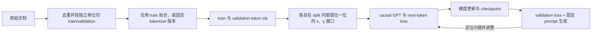

# 第 3 章（上）：从文本到 next-token 样本

从零训练一个小 GPT，真正有价值的地方不在于用几行代码得到一段看似像文本的输出，而在于把一条因果链完整地跑通：原始文本如何变成 token，token 如何组成监督样本，模型如何在因果约束下计算 logits，loss 如何产生梯度，参数如何更新，生成阶段又如何把概率分布变成序列。

这条链上的任何一环都可能让程序“正常运行”却学习到错误目标。例如，y 没有向右移动时，交叉熵仍然可以计算；causal mask 方向写反时，张量形状仍然可以对齐；验证集与训练集共享文档时，验证 loss 仍然会下降。只有把数据契约、张量形状、数值目标和实验记录放在一起，才知道一次训练到底证明了什么。

本章把一次小 GPT 实验拆成五个连续阶段：先把文本变成可靠的训练窗口，再搭建模型并完成参数更新，接着控制生成、保存和评估结果，最后比较 tokenizer 与训练预算。每一阶段都把输入交给下一阶段，读者可以沿着同一个 next-token 目标检查数据、模型和证据。代码是教学实现，公式是模型定义或数量估算；局部检查通过，只说明对应契约成立，不说明模型已经具备通用语言能力。

| 部分 | 要回答的问题 | 交接结果 |
| --- | --- | --- |
| [上篇：Token 数据契约](03-从零训练小gpt-1-token数据.md) | 原始文本怎样变成正确的输入和标签？ | 无泄漏的 token 窗口 |
| [第二篇：最小 GPT 与训练](03-从零训练小gpt-2-model-training.md) | 模型如何把窗口变成 loss 和一次参数更新？ | 可检查的训练轨迹 |
| [第三篇：解码控制](03-从零训练小gpt-3-decoding.md) | logits 如何变成一条生成序列？ | 固定配置的采样结果 |
| [第四篇：Checkpoint 与评估](03-从零训练小gpt-4-checkpoint-evaluation.md) | 如何恢复训练，并判断模型是否真的改善？ | 可复核的状态和评估证据 |
| [第五篇：Tokenizer 与公平比较](03-从零训练小gpt-5-tokenizer-comparison.md) | 如何比较字符级和子词方案？ | 对齐预算后的实验结论 |

本章使用三类证据。概率分解、attention 和交叉熵来自模型定义或原始论文；Embedding、CrossEntropyLoss、AdamW、保存加载和 tokenizer 接口以 PyTorch、Hugging Face 官方文档为准；小语料上的 loss、生成文本和参数量是教学实验，必须记录随机种子、数据、版本、dtype 和设备后才有复现意义。

先看整条实验路径，再进入每个实现细节。先按文档或其他独立单位划分 train/validation，再拟合 tokenizer 和构造窗口，避免把验证信息带进词表或让相邻窗口跨过 split 边界。若使用已发布的 tokenizer，则固定它的版本与文件，不在验证集上重新拟合。模型训练只看训练段，validation 用来观察泛化和选择 checkpoint；固定 prompt 的生成样例则检查 loss 数字看不到的行为。



图中回环表示一次实验可以根据 validation 和生成样例继续改进，但不能把 validation 结果反复用于训练后仍称为独立验证集。若根据它选择超参数或 checkpoint，它承担的是模型选择角色；最终结论还应使用未参与选择的测试集或明确收窄范围。

## 3.1 Token 数据契约：从文本到 next-token 样本

### 3.1.1 先确定模型究竟预测什么

模型不能直接把一段文字当作数值输入。分词器（tokenizer）先把文本切成离散单元 token，再用整数 id 表示每个 token。token 不一定是一个汉字或一个完整单词：字符级示例把单个字符当作 token，BPE 则可能把常见片段合成一个 token。设编码后的序列为：

```math
d_0,d_1,\ldots,d_{N-1},\qquad d_i\in\{0,1,\ldots,V-1\}
```

其中 $N$ 是 token 数，$V$ 是词表大小，$d_i$ 是第 $i$ 个位置的 token id。自回归语言模型（autoregressive language model）要做的是：给定已有前缀，估计下一个 token 的条件概率。于是整段序列的概率可以按位置分解为：

```math
p_\theta(d_0,\ldots,d_{N-1})
=\prod_{i=0}^{N-1}p_\theta(d_i\mid d_0,\ldots,d_{i-1})
```

这里 $i=0$ 时前缀为空；每向右一步，前缀就多包含一个 token。训练时把连续 token 切成输入 $x$ 和目标 $y$，让第 $j$ 个输入位置预测紧跟其后的 token：

```math
x_j=d_{s+j},\qquad y_j=d_{s+j+1},\qquad j=0,\ldots,T-1
```

这里 $s$ 是窗口起点，$T$ 是上下文长度。模型一次前向就能同时处理 $T$ 个预测位置，但因果掩码必须确保第 $j$ 个位置看不到右侧输入。窗口末尾也必须留有真实的下一个 token；否则最后一个位置没有监督目标。

把 $x$ 看成题目、把 $y$ 看成逐位置答案有助于入门，但要记住每个位置都有自己的答案：第 $j$ 个位置只能使用 $x_0$ 到 $x_j$，不能读取未来输入。数据管线、因果掩码和损失汇总必须沿用同一套位置编号，否则模型可能学到错误目标，loss 仍然照样算得出来。

### 3.1.2 字符级 tokenizer：简单，但要明确代价

字符级 tokenizer 把 Unicode 字符当作离散单位。例如：

```text
输入：我爱机器学习
序列：我、爱、机、器、学、习
```

这个方案容易实现和检查，陌生单词也不会因为缺少整词条目而无法编码，因此适合第一次追踪完整训练流程。代价是序列通常更长：英文词和代码标识符会被拆成多个位置，模型要经过多步才能利用整个词的信息。这里选字符级只是为了让输入可见，不代表它适合所有任务或生产场景。

词表必须是确定的。若从头拟合字符词表，只用训练文本建立映射；验证集或推理 prompt 遇到未见字符时，按事先约定的未知 token 策略处理，不把验证文本并入词表。一个最小实现如下：

> 代码状态：静态审阅，未运行（2026-10-29）

```python
from dataclasses import dataclass


@dataclass(frozen=True)
class CharCodec:
    stoi: dict[str, int]
    itos: dict[int, str]

    @classmethod
    def from_text(cls, text: str) -> "CharCodec":
        if not isinstance(text, str) or not text:
            raise ValueError("text must be a non-empty string")
        chars = sorted(set(text))
        stoi = {ch: index for index, ch in enumerate(chars)}
        itos = {index: ch for index, ch in enumerate(chars)}
        return cls(stoi=stoi, itos=itos)

    def encode(self, text: str) -> list[int]:
        if not isinstance(text, str):
            raise TypeError("text must be a string")
        unknown = sorted(set(text) - self.stoi.keys())
        if unknown:
            raise ValueError(f"unknown characters: {unknown}")
        return [self.stoi[ch] for ch in text]

    def decode(self, ids: list[int]) -> str:
        if not isinstance(ids, list):
            raise TypeError("ids must be a list")
        try:
            return "".join(self.itos[index] for index in ids)
        except KeyError as exc:
            raise ValueError(f"unknown token id: {exc.args[0]}") from exc


train_text = "hello\nhello transformer\n"
codec = CharCodec.from_text(train_text)
ids = codec.encode("hello")
recovered = codec.decode(ids)

assert recovered == "hello"
assert codec.decode(codec.encode(train_text)) == train_text
print("vocab_size=", len(codec.stoi))
print("ids=", ids)
print("roundtrip_ok=", recovered == "hello")
```
`stoi` 把字符串映射为整数，`itos` 执行反向映射。先排序字符不是语言学规则，而是为了让相同训练文本稳定地产生相同 id。只用训练集拟合词表时，验证文本或 prompt 可能出现未见字符；编码器必须明确选择报错、映射到未知 token，或扩充词表并重新训练。把未知字符静默映射到任意已有 id，会让程序继续运行，却把错误变成难以定位的训练噪声。

### 3.1.3 先切分独立文档，再编码和拟合词表

先决定哪些文本彼此独立，再切 train/validation；不要先把全文拼成一条 token 流后按字符位置切开。常见的独立单位是文档、用户或时间窗口，具体选哪一种取决于你希望模型面对什么样的“新数据”。如果目标是泛化到新文档，就应让同一文档及其近重复版本只出现在一个 split。切分完成后，只用训练部分拟合自建 tokenizer，再分别编码 train 和 validation；若使用预训练 tokenizer，则固定它的版本和文件，不用 validation 重新拟合。

下面的例子展示字符映射与整数张量的接口。实际多文档语料应先按上面的规则拆分，再把 `train_text` 替换为训练文档内容。

> 代码状态：静态审阅，未运行（2026-10-29）

```python
import torch


train_text = "hello\nhello transformer\n"
chars = sorted(set(train_text))
stoi = {ch: index for index, ch in enumerate(chars)}
ids = [stoi[ch] for ch in train_text]
data = torch.tensor(ids, dtype=torch.long)

assert data.dtype == torch.long
assert int(data.min()) >= 0
assert int(data.max()) < len(chars)
print("data_shape=", tuple(data.shape))
print("data_dtype=", data.dtype)
```
编码结果是整数索引。PyTorch embedding 接收这类索引；本章统一使用 `torch.long`，避免标签 dtype 与交叉熵接口不一致：[PyTorch 2.12 Embedding 文档](https://docs.pytorch.org/docs/2.12/generated/torch.nn.Embedding.html)。

按连续位置切分只适用于确实代表时间顺序的一条长流；它不适用于把许多独立文档简单拼在一起的语料。同一篇文档或其近重复版本跨 split 时，验证 loss 可能高估对新文档的泛化能力。去重研究在特定语料和模型设置中观察到文本重叠及记忆风险；这说明要检查重叠，并不意味着任何 overlap 都必然让分数虚高：[Lee 等，ACL 2022](https://aclanthology.org/2022.acl-long.577/)。

切分前应统一必要的文本规范化，并识别重复或近重复文档；按独立单位分配 split 后，再拟合训练 tokenizer、编码并在各自 split 内取窗口。这样可以同时控制文档重叠、词表泄漏和跨边界窗口。对于小实验，至少记录：

| 记录项 | 为什么需要它 |
| --- | --- |
| 原始语料版本和 hash | 判断两次实验是否使用同一数据 |
| tokenizer 版本、词表大小和特殊 token | 解释 token 数和输出类别变化 |
| train/val 切分规则 | 判断是否存在文档或时间泄漏 |
| 每个 split 的 token 数 | 解释 loss 的统计稳定性 |
| 是否去重及去重范围 | 判断重复样本是否夸大验证结果 |

### 3.1.4 向右移动一位的标签

设一段序列为：

```text
token：h e l l o
```

当 block_size=4 时，输入与标签是：

```text
x：h e l l
y：e l l o
```

第 0 个位置的 logits 负责预测 e，第 1 个位置负责预测第 2 个字符 l，依此类推。错误地使用 y=x 仍然会得到合法的交叉熵，但训练目标变成“复制当前 token”，而不是 next-token prediction。

切片实现是：

> 代码状态：静态审阅，未运行（2026-10-29）

```python
def make_example(source, start, block_size):
    if not isinstance(start, int) or isinstance(start, bool):
        raise TypeError("start must be an integer")
    if (
        not isinstance(block_size, int)
        or isinstance(block_size, bool)
        or block_size <= 0
    ):
        raise ValueError("block_size must be a positive integer")
    end = start + block_size
    if start < 0 or end >= len(source):
        raise ValueError("source is too short for this start and block_size")
    x = source[start:end]
    y = source[start + 1:end + 1]
    return x, y


source = list("hello transformer")
x, y = make_example(source, start=0, block_size=8)
assert x[1:] == y[:-1]
assert x[0] == "h"
assert y[-1] == source[8]
print("x=", "".join(x))
print("y=", "".join(y))
print("shift_ok=", x[1:] == y[:-1])
```
若源序列长度为 $L$，有效起点必须满足 $s+T<L$，合法起点是 $0$ 到 $L-T-1$，共 $L-T$ 个。因此随机采样应使用 `torch.randint(0, L - T, ...)`：`high` 不包含在候选范围内，且必须有 $L>T$。

例如 $L=5,T=3$ 时，起点只能是 0 或 1。起点 1 的标签最后一个位置是 $d_4$；若误把右开区间上界写成 $L-T+1=3$，就可能抽到起点 2，并访问不存在的 $d_5$。把这个小例子与切片代码对照，比只记一个边界公式更容易发现 off-by-one 错误。

### 3.1.5 从随机起点构造 batch

固定长度连续 block 不需要 padding，因此 batch 的两个核心张量形状为：

```math
X\in\mathbb{Z}^{B\times T},\qquad
Y\in\mathbb{Z}^{B\times T}
```

其中 $B$ 是 batch size，$T$ 是 block size。每个样本可以从不同起点开始，但同一条样本内部仍然保持连续顺序。下方代码用 `torch.long` 表示 token id；这也是本章模型前向和交叉熵标签的统一 dtype。

> 代码状态：静态审阅，未运行（2026-10-29）

```python
import torch


def get_batch_from_source(source, batch_size, block_size, device="cpu", generator=None):
    if source.ndim != 1 or source.dtype != torch.long:
        raise ValueError("source must be a one-dimensional torch.long tensor")
    if (
        not isinstance(batch_size, int)
        or isinstance(batch_size, bool)
        or batch_size <= 0
    ):
        raise ValueError("batch_size must be a positive integer")
    if (
        not isinstance(block_size, int)
        or isinstance(block_size, bool)
        or block_size <= 0
    ):
        raise ValueError("block_size must be a positive integer")
    valid_starts = source.numel() - block_size
    if valid_starts <= 0:
        raise ValueError("source must contain at least block_size + 1 tokens")

    starts = torch.randint(
        low=0,
        high=valid_starts,
        size=(batch_size,),
        generator=generator,
    )
    x = torch.stack([
        source[int(start):int(start) + block_size]
        for start in starts
    ])
    y = torch.stack([
        source[int(start) + 1:int(start) + block_size + 1]
        for start in starts
    ])
    return x.to(device), y.to(device)


torch.manual_seed(7)
source = torch.arange(20, dtype=torch.long)
xb, yb = get_batch_from_source(source, batch_size=3, block_size=5)

assert xb.shape == (3, 5)
assert yb.shape == (3, 5)
assert torch.equal(xb[:, 1:], yb[:, :-1])
print("x_shape=", tuple(xb.shape))
print("y_shape=", tuple(yb.shape))
print("shift_ok=", torch.equal(xb[:, 1:], yb[:, :-1]))
```
这里的 generator 可以用来把采样随机性从全局随机状态中分离出来。为了复现实验，还要记录 Python、NumPy、PyTorch、CUDA 和 DataLoader worker 的随机状态；只调用一次 torch.manual_seed 并不能保证所有硬件和 kernel 都逐位一致。

### 3.1.6 Dataset 接口与连续流接口

`get_batch_from_source` 直接从一维 token 流抽样，适合教学和能放入内存的小语料。若希望接入标准 DataLoader，可以把合法起点作为样本索引：

> 代码状态：静态审阅，未运行（2026-10-29）

```python
import torch
from torch.utils.data import Dataset


class TokenWindowDataset(Dataset):
    def __init__(self, token_ids, block_size):
        if token_ids.ndim != 1 or token_ids.dtype != torch.long:
            raise ValueError("token_ids must be a one-dimensional long tensor")
        if (
            not isinstance(block_size, int)
            or isinstance(block_size, bool)
            or block_size <= 0
        ):
            raise ValueError("block_size must be a positive integer")
        if token_ids.numel() <= block_size:
            raise ValueError("token_ids must contain block_size + 1 tokens")
        self.token_ids = token_ids
        self.block_size = block_size

    def __len__(self):
        return self.token_ids.numel() - self.block_size

    def __getitem__(self, index):
        if not isinstance(index, int) or isinstance(index, bool):
            raise TypeError("index must be an integer")
        if not 0 <= index < len(self):
            raise IndexError("dataset index out of range")
        end = index + self.block_size
        x = self.token_ids[index:end]
        y = self.token_ids[index + 1:end + 1]
        return x, y


tokens = torch.arange(12, dtype=torch.long)
dataset = TokenWindowDataset(tokens, block_size=4)
x0, y0 = dataset[0]
x_last, y_last = dataset[len(dataset) - 1]
assert len(dataset) == 8
assert torch.equal(x0[1:], y0[:-1])
assert x_last[-1].item() == 10
assert y_last[-1].item() == 11
print("dataset_size=", len(dataset))
print("first_item=", x0.tolist(), y0.tolist())
print("last_item=", x_last.tolist(), y_last.tolist())
```

Dataset.__len__ 返回的是可采样窗口数量，不是原始 token 数。这个差一个 block_size 的关系会影响每个 epoch 的步数和 token 预算。这里的 `TokenWindowDataset` 符合 PyTorch map-style `Dataset` 的 `__len__`/`__getitem__` 契约；流式数据应使用 iterable-style 接口并另行处理 worker 分片：[PyTorch 2.12 数据加载文档](https://docs.pytorch.org/docs/2.12/data.html)。对于超大语料，实际系统可能使用 mmap、流式读取、预先打包的 shard 或按 token 数调度，而不是把全部文本读入一个 Python 列表。
### 3.1.7 数据管线的局部验证

训练前应先验证局部不变量，而不是等 loss 不下降后再猜原因。最小检查包括：

1. decode(encode(text)) 是否恢复原文，或在约定的 normalization 下恢复等价文本；
2. data.dtype 是否为整数索引类型；
3. 所有 id 是否满足 $0\le d_i<V$；
4. 每个 x 和 y 是否长度相等；
5. x[:,1:] 是否等于 y[:,:-1]；
6. 起点最大值是否仍能取出完整的 y；
7. train/val 是否按独立单位切分；
8. 验证采样是否没有从训练区间借用 token。

下面的零依赖审计把第 4、5、6 项写成可执行契约。它不依赖 PyTorch，因此适合在环境尚未装好深度学习依赖时先运行：

> 代码状态：静态审阅，未运行（2026-10-29）

```python
def window_ids(ids, block_size, starts):
    if (
        not isinstance(block_size, int)
        or isinstance(block_size, bool)
        or block_size <= 0
    ):
        raise ValueError("block_size must be a positive integer")
    if len(ids) <= block_size:
        raise ValueError("ids must be longer than block_size")
    limit = len(ids) - block_size
    windows = []
    for start in starts:
        if not isinstance(start, int) or isinstance(start, bool):
            raise TypeError("start must be an integer")
        if not 0 <= start < limit:
            raise ValueError(f"invalid start: {start}")
        x = ids[start:start + block_size]
        y = ids[start + 1:start + block_size + 1]
        if len(x) != block_size or len(y) != block_size:
            raise AssertionError("incomplete window")
        if x[1:] != y[:-1]:
            raise AssertionError("labels are not shifted by one position")
        windows.append((x, y))
    return windows


ids = list(range(11))
windows = window_ids(ids, block_size=4, starts=[0, 3, 6])
assert windows[-1] == ([6, 7, 8, 9], [7, 8, 9, 10])
try:
    window_ids(ids, block_size=4, starts=[7])
except ValueError:
    invalid_start_rejected = True
else:
    invalid_start_rejected = False

print("window_count=", len(windows))
print("shift_contract_ok=", all(x[1:] == y[:-1] for x, y in windows))
print("invalid_start_rejected=", invalid_start_rejected)
```
这段检查通过，只能说明窗口的长度、错位关系和边界正确；它没有说明语料代表目标任务，也没有说明 tokenizer 的切分质量。数据契约与数据质量要分别判断。

切分边界也决定窗口能看到什么。假设 12 个 token 先拼成一条流，再把前 8 个位置当作训练部分；如果训练窗口仍从整条流采样，起点 7 的标签会读到 validation 的 token。正确做法是先按约定的独立单位切分，再只在各自 split 内构造窗口。对文档语料，拼接后的窗口可能跨过文档边界，使后一篇文档以上一篇结尾为上下文；只有目标确实允许这种连续建模时才应这样做。EOS 是边界标记，本身不会重置 causal attention；也可以按文档采样，或用明确的 attention mask 隔离文档。某项预训练研究在特定设置中观察到文档内 mask 的收益和隔离开销，这不代表所有 packing 都有害：[ACL 2024 研究](https://aclanthology.org/2024.acl-long.427.pdf)。

如果数据按原始字节读取，还要避免从多字节 UTF-8 字符中间截断；按 Python Unicode 字符切分与按字节切分并不相同。原始文件 hash、解码错误处理和换行规范化也应进入数据版本记录。


文本窗口已经定义清楚后，下一步是让模型对每个输入位置给出词表分数，再用右移标签形成 loss。第二篇从这组输入和目标开始，追踪一次完整的参数更新。
