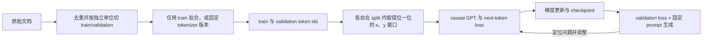

# 第 3 章（上）：从 token 数据到一次参数更新

从零训练一个小 GPT，重点不在于用几行代码生成一段看起来像文本的内容，而在于完整跑一遍从数据到生成的过程：原始文本怎样变成 token，token 怎样组成训练样本，模型怎样在因果约束下计算 logits，loss 怎样产生梯度，参数怎样更新，生成时又怎样从概率分布中选出下一个 token。

这个过程中的任何一步出错，都可能让程序“正常运行”却学错目标。例如，y 没有向右移动时，交叉熵仍然可以计算；causal mask 方向写反时，张量形状仍然可以对齐；验证集和训练集共享文档时，验证 loss 仍然会下降。只有把数据约定、张量形状、训练目标和实验记录放在一起看，才知道一次训练结果能说明什么。

本章保留五个连续的实验阶段，并将正文收成两个部分：第一部分从 token 数据和训练样本走到一次参数更新；第二部分检查生成、checkpoint、评估和 tokenizer 公平比较。每一阶段的结果会成为下一阶段的输入，读者可以沿着同一个 next-token 目标检查数据、模型和结果。代码用于教学，公式用于定义模型或估算数量；局部检查通过，只说明相应的约定成立，不代表模型已经具备通用语言能力。

| 部分 | 要回答的问题 | 留下的结果 |
| --- | --- | --- |
| 数据与训练 | 原始文本怎样变成训练窗口，模型又如何完成一次参数更新？ | 无泄漏的数据约定、训练轨迹和模型状态 |
| [生成与评估](03-从零训练小gpt-2-生成与评估.md) | 模型怎样生成文本，如何检查 checkpoint、评估结果和 tokenizer 对照？ | 固定配置的样例、可复核的评估证据和公平比较结论 |

本章使用三类证据。概率分解、attention 和交叉熵来自模型定义或原始论文；Embedding、CrossEntropyLoss、AdamW、保存加载和 tokenizer 接口以 PyTorch、Hugging Face 官方文档为准；小语料上的 loss、生成文本和参数量是教学实验，必须记录随机种子、数据、版本、dtype 和设备后才有复现意义。

先看整条实验路径，再进入每个实现细节。先按文档或其他独立单位划分 train/validation，再拟合 tokenizer 和构造窗口，避免把验证信息带进词表或让相邻窗口跨过 split 边界。若使用已发布的 tokenizer，则固定它的版本与文件，不在验证集上重新拟合。模型训练只看训练段，validation 用来观察泛化和选择 checkpoint；固定 prompt 的生成样例则检查 loss 数字看不到的行为。



图中回环表示一次实验可以根据 validation 和生成样例继续改进，但不能把 validation 结果反复用于训练后仍称为独立验证集。若根据它选择超参数或 checkpoint，它承担的是模型选择角色；最终结论还应使用未参与选择的测试集或明确收窄范围。

## 3.1 Token 数据约定：从文本到 next-token 样本

### 3.1.1 先确定模型究竟预测什么

模型不能直接把一段文字当作数值输入。分词器（tokenizer）先把文本切成离散单元 token，再用整数 id 表示每个 token。token 不一定是一个汉字或一个完整单词：字符级示例把单个字符当作 token，BPE 则可能把常见片段合成一个 token。设编码后的序列为：

```math
d_{0},d_{1},\ldots,d_{N-1},\qquad d_{i}\in\{0,1,\ldots,V-1\}
```

其中 $N$ 是 token 数， $V$ 是词表大小， $d_{i}$ 是第 $i$ 个位置的 token id。自回归语言模型（autoregressive language model）要做的是：给定已有前缀，估计下一个 token 的条件概率。于是整段序列的概率可以按位置分解为：

```math
p_\theta(d_{0},\ldots,d_{N-1})
=\prod_{i=0}^{N-1}p_\theta(d_{i}\mid d_{0},\ldots,d_{i-1})
```

这里 $i=0$ 时前缀为空；每向右一步，前缀就多包含一个 token。训练时把连续 token 切成输入 $x$ 和目标 $y$，让第 $j$ 个输入位置预测紧跟其后的 token：

```math
x_{j}=d_{s+j},\qquad y_{j}=d_{s+j+1},\qquad j=0,\ldots,T-1
```

这里 $s$ 是窗口起点， $T$ 是上下文长度。模型一次前向就能同时处理 $T$ 个预测位置，但因果掩码必须确保第 $j$ 个位置看不到右侧输入。窗口末尾也必须留有真实的下一个 token；否则最后一个位置没有监督目标。

把 $x$ 看成题目、把 $y$ 看成逐位置答案有助于入门，但要记住每个位置都有自己的答案：第 $j$ 个位置只能使用 $x_{0}$ 到 $x_{j}$，不能读取未来输入。数据管线、因果掩码和损失汇总必须沿用同一套位置编号，否则模型可能学到错误目标，loss 仍然照样算得出来。

### 3.1.2 字符级 tokenizer：简单，但要明确代价

字符级 tokenizer 把 Unicode 字符当作离散单位。例如：

```text
输入：我爱机器学习
序列：我、爱、机、器、学、习
```

这个方案容易实现和检查，陌生单词也不会因为缺少整词条目而无法编码，因此适合第一次追踪完整训练流程。代价是序列通常更长：英文词和代码标识符会被拆成多个位置，模型要经过多步才能利用整个词的信息。这里选字符级只是为了让输入可见，不代表它适合所有任务或生产场景。

词表必须是确定的。若从头拟合字符词表，只用训练文本建立映射；验证集或推理 prompt 遇到未见字符时，按事先约定的未知 token 策略处理，不把验证文本并入词表。一个最小实现如下：

> 代码状态：静态审阅，未运行（2026-10-29）

```python
from dataclasses import dataclass


@dataclass(frozen=True)
class CharCodec:
    stoi: dict[str, int]
    itos: dict[int, str]

    @classmethod
    def from_text(cls, text: str) -> "CharCodec":
        if not isinstance(text, str) or not text:
            raise ValueError("text must be a non-empty string")
        chars = sorted(set(text))
        stoi = {ch: index for index, ch in enumerate(chars)}
        itos = {index: ch for index, ch in enumerate(chars)}
        return cls(stoi=stoi, itos=itos)

    def encode(self, text: str) -> list[int]:
        if not isinstance(text, str):
            raise TypeError("text must be a string")
        unknown = sorted(set(text) - self.stoi.keys())
        if unknown:
            raise ValueError(f"unknown characters: {unknown}")
        return [self.stoi[ch] for ch in text]

    def decode(self, ids: list[int]) -> str:
        if not isinstance(ids, list):
            raise TypeError("ids must be a list")
        try:
            return "".join(self.itos[index] for index in ids)
        except KeyError as exc:
            raise ValueError(f"unknown token id: {exc.args[0]}") from exc


train_text = "hello\nhello transformer\n"
codec = CharCodec.from_text(train_text)
ids = codec.encode("hello")
recovered = codec.decode(ids)

assert recovered == "hello"
assert codec.decode(codec.encode(train_text)) == train_text
print("vocab_size=", len(codec.stoi))
print("ids=", ids)
print("roundtrip_ok=", recovered == "hello")
```
`stoi` 把字符串映射为整数，`itos` 执行反向映射。先排序字符不是语言学规则，而是为了让相同训练文本稳定地产生相同 id。只用训练集拟合词表时，验证文本或 prompt 可能出现未见字符；编码器必须明确选择报错、映射到未知 token，或扩充词表并重新训练。把未知字符静默映射到任意已有 id，会让程序继续运行，却把错误变成难以定位的训练噪声。

### 3.1.3 先切分独立文档，再编码和拟合词表

先决定哪些文本彼此独立，再切 train/validation；不要先把全文拼成一条 token 流后按字符位置切开。常见的独立单位是文档、用户或时间窗口，具体选哪一种取决于你希望模型面对什么样的“新数据”。如果目标是泛化到新文档，就应让同一文档及其近重复版本只出现在一个 split。切分完成后，只用训练部分拟合自建 tokenizer，再分别编码 train 和 validation；若使用预训练 tokenizer，则固定它的版本和文件，不用 validation 重新拟合。

下面的例子展示字符映射与整数张量的接口。实际多文档语料应先按上面的规则拆分，再把 `train_text` 替换为训练文档内容。

> 代码状态：静态审阅，未运行（2026-10-29）

```python
import torch


train_text = "hello\nhello transformer\n"
chars = sorted(set(train_text))
stoi = {ch: index for index, ch in enumerate(chars)}
ids = [stoi[ch] for ch in train_text]
data = torch.tensor(ids, dtype=torch.long)

assert data.dtype == torch.long
assert int(data.min()) >= 0
assert int(data.max()) < len(chars)
print("data_shape=", tuple(data.shape))
print("data_dtype=", data.dtype)
```
编码结果是整数索引。PyTorch embedding 接收这类索引；本章统一使用 `torch.long`，避免标签 dtype 与交叉熵接口不一致：[PyTorch 2.12 Embedding 文档](https://docs.pytorch.org/docs/2.12/generated/torch.nn.Embedding.html)。

按连续位置切分只适用于确实代表时间顺序的一条长流；它不适用于把许多独立文档简单拼在一起的语料。同一篇文档或其近重复版本跨 split 时，验证 loss 可能高估对新文档的泛化能力。去重研究在特定语料和模型设置中观察到文本重叠及记忆风险；这说明要检查重叠，并不意味着任何 overlap 都必然让分数虚高：[Lee 等，ACL 2022](https://aclanthology.org/2022.acl-long.577/)。

切分前应统一必要的文本规范化，并识别重复或近重复文档；按独立单位分配 split 后，再拟合训练 tokenizer、编码并在各自 split 内取窗口。这样可以同时控制文档重叠、词表泄漏和跨边界窗口。对于小实验，至少记录：

| 记录项 | 为什么需要它 |
| --- | --- |
| 原始语料版本和 hash | 判断两次实验是否使用同一数据 |
| tokenizer 版本、词表大小和特殊 token | 解释 token 数和输出类别变化 |
| train/val 切分规则 | 判断是否存在文档或时间泄漏 |
| 每个 split 的 token 数 | 解释 loss 的统计稳定性 |
| 是否去重及去重范围 | 判断重复样本是否夸大验证结果 |

### 3.1.4 向右移动一位的标签

设一段序列为：

```text
token：h e l l o
```

当 block_size=4 时，输入与标签是：

```text
x：h e l l
y：e l l o
```

第 0 个位置的 logits 负责预测 e，第 1 个位置负责预测第 2 个字符 l，依此类推。错误地使用 y=x 仍然会得到合法的交叉熵，但训练目标变成“复制当前 token”，而不是 next-token prediction。

切片实现是：

> 代码状态：静态审阅，未运行（2026-10-29）

```python
def make_example(source, start, block_size):
    if not isinstance(start, int) or isinstance(start, bool):
        raise TypeError("start must be an integer")
    if (
        not isinstance(block_size, int)
        or isinstance(block_size, bool)
        or block_size <= 0
    ):
        raise ValueError("block_size must be a positive integer")
    end = start + block_size
    if start < 0 or end >= len(source):
        raise ValueError("source is too short for this start and block_size")
    x = source[start:end]
    y = source[start + 1:end + 1]
    return x, y


source = list("hello transformer")
x, y = make_example(source, start=0, block_size=8)
assert x[1:] == y[:-1]
assert x[0] == "h"
assert y[-1] == source[8]
print("x=", "".join(x))
print("y=", "".join(y))
print("shift_ok=", x[1:] == y[:-1])
```
若源序列长度为 $L$，有效起点必须满足 $s+T\lt L$，合法起点是 $0$ 到 $L-T-1$，共 $L-T$ 个。因此随机采样应使用 `torch.randint(0, L - T, ...)`：`high` 不包含在候选范围内，且必须有 $L>T$。

例如 $L=5,T=3$ 时，起点只能是 0 或 1。起点 1 的标签最后一个位置是 $d_{4}$；若误把右开区间上界写成 $L-T+1=3$，就可能抽到起点 2，并访问不存在的 $d_{5}$。把这个小例子与切片代码对照，比只记一个边界公式更容易发现 off-by-one 错误。

### 3.1.5 从随机起点构造 batch

固定长度连续 block 不需要 padding，因此 batch 的两个核心张量形状为：

```math
X\in\mathbb{Z}^{B\times T},\qquad
Y\in\mathbb{Z}^{B\times T}
```

其中 $B$ 是 batch size， $T$ 是 block size。每个样本可以从不同起点开始，但同一条样本内部仍然保持连续顺序。下方代码用 `torch.long` 表示 token id；这也是本章模型前向和交叉熵标签的统一 dtype。

> 代码状态：静态审阅，未运行（2026-10-29）

```python
import torch


def get_batch_from_source(source, batch_size, block_size, device="cpu", generator=None):
    if source.ndim != 1 or source.dtype != torch.long:
        raise ValueError("source must be a one-dimensional torch.long tensor")
    if (
        not isinstance(batch_size, int)
        or isinstance(batch_size, bool)
        or batch_size <= 0
    ):
        raise ValueError("batch_size must be a positive integer")
    if (
        not isinstance(block_size, int)
        or isinstance(block_size, bool)
        or block_size <= 0
    ):
        raise ValueError("block_size must be a positive integer")
    valid_starts = source.numel() - block_size
    if valid_starts <= 0:
        raise ValueError("source must contain at least block_size + 1 tokens")

    starts = torch.randint(
        low=0,
        high=valid_starts,
        size=(batch_size,),
        generator=generator,
    )
    x = torch.stack([
        source[int(start):int(start) + block_size]
        for start in starts
    ])
    y = torch.stack([
        source[int(start) + 1:int(start) + block_size + 1]
        for start in starts
    ])
    return x.to(device), y.to(device)


torch.manual_seed(7)
source = torch.arange(20, dtype=torch.long)
xb, yb = get_batch_from_source(source, batch_size=3, block_size=5)

assert xb.shape == (3, 5)
assert yb.shape == (3, 5)
assert torch.equal(xb[:, 1:], yb[:, :-1])
print("x_shape=", tuple(xb.shape))
print("y_shape=", tuple(yb.shape))
print("shift_ok=", torch.equal(xb[:, 1:], yb[:, :-1]))
```
这里的 generator 可以用来把采样随机性从全局随机状态中分离出来。为了复现实验，还要记录 Python、NumPy、PyTorch、CUDA 和 DataLoader worker 的随机状态；只调用一次 torch.manual_seed 并不能保证所有硬件和 kernel 都逐位一致。

### 3.1.6 Dataset 接口与连续流接口

`get_batch_from_source` 直接从一维 token 流抽样，适合教学和能放入内存的小语料。若希望接入标准 DataLoader，可以把合法起点作为样本索引：

> 代码状态：静态审阅，未运行（2026-10-29）

```python
import torch
from torch.utils.data import Dataset


class TokenWindowDataset(Dataset):
    def __init__(self, token_ids, block_size):
        if token_ids.ndim != 1 or token_ids.dtype != torch.long:
            raise ValueError("token_ids must be a one-dimensional long tensor")
        if (
            not isinstance(block_size, int)
            or isinstance(block_size, bool)
            or block_size <= 0
        ):
            raise ValueError("block_size must be a positive integer")
        if token_ids.numel() <= block_size:
            raise ValueError("token_ids must contain block_size + 1 tokens")
        self.token_ids = token_ids
        self.block_size = block_size

    def __len__(self):
        return self.token_ids.numel() - self.block_size

    def __getitem__(self, index):
        if not isinstance(index, int) or isinstance(index, bool):
            raise TypeError("index must be an integer")
        if not 0 <= index < len(self):
            raise IndexError("dataset index out of range")
        end = index + self.block_size
        x = self.token_ids[index:end]
        y = self.token_ids[index + 1:end + 1]
        return x, y


tokens = torch.arange(12, dtype=torch.long)
dataset = TokenWindowDataset(tokens, block_size=4)
x0, y0 = dataset[0]
x_last, y_last = dataset[len(dataset) - 1]
assert len(dataset) == 8
assert torch.equal(x0[1:], y0[:-1])
assert x_last[-1].item() == 10
assert y_last[-1].item() == 11
print("dataset_size=", len(dataset))
print("first_item=", x0.tolist(), y0.tolist())
print("last_item=", x_last.tolist(), y_last.tolist())
```

`Dataset.__len__` 返回可采样窗口的数量，不是原始 token 数。窗口数量比 token 数少一个 `block_size`，会影响每个 epoch 的步数和 token 预算。这里的 `TokenWindowDataset` 按 PyTorch map-style `Dataset` 的要求实现了 `__len__` 和 `__getitem__`；流式数据应使用 iterable-style 接口，并另外处理 worker 分片：[PyTorch 2.12 数据加载文档](https://docs.pytorch.org/docs/2.12/data.html)。对于超大语料，实际系统可能使用 mmap、流式读取、预先打包的 shard 或按 token 数调度，而不是把全部文本读进一个 Python 列表。
### 3.1.7 数据管线的局部验证

训练前应先验证局部不变量，而不是等 loss 不下降后再猜原因。最小检查包括：

1. decode(encode(text)) 是否恢复原文，或在约定的 normalization 下恢复等价文本；
2. data.dtype 是否为整数索引类型；
3. 所有 id 是否满足 $0\le d_{i}\lt V$；
4. 每个 x 和 y 是否长度相等；
5. x[:,1:] 是否等于 y[:,:-1]；
6. 起点最大值是否仍能取出完整的 y；
7. train/val 是否按独立单位切分；
8. 验证采样是否没有从训练区间借用 token。

下面的零依赖检查把第 4、5、6 项写成了可运行的检查规则。它不依赖 PyTorch，因此可以在尚未安装深度学习依赖时先运行：

> 代码状态：静态审阅，未运行（2026-10-29）

```python
def window_ids(ids, block_size, starts):
    if (
        not isinstance(block_size, int)
        or isinstance(block_size, bool)
        or block_size <= 0
    ):
        raise ValueError("block_size must be a positive integer")
    if len(ids) <= block_size:
        raise ValueError("ids must be longer than block_size")
    limit = len(ids) - block_size
    windows = []
    for start in starts:
        if not isinstance(start, int) or isinstance(start, bool):
            raise TypeError("start must be an integer")
        if not 0 <= start < limit:
            raise ValueError(f"invalid start: {start}")
        x = ids[start:start + block_size]
        y = ids[start + 1:start + block_size + 1]
        if len(x) != block_size or len(y) != block_size:
            raise AssertionError("incomplete window")
        if x[1:] != y[:-1]:
            raise AssertionError("labels are not shifted by one position")
        windows.append((x, y))
    return windows


ids = list(range(11))
windows = window_ids(ids, block_size=4, starts=[0, 3, 6])
assert windows[-1] == ([6, 7, 8, 9], [7, 8, 9, 10])
try:
    window_ids(ids, block_size=4, starts=[7])
except ValueError:
    invalid_start_rejected = True
else:
    invalid_start_rejected = False

print("window_count=", len(windows))
print("shift_contract_ok=", all(x[1:] == y[:-1] for x, y in windows))
print("invalid_start_rejected=", invalid_start_rejected)
```
这段检查通过，只能说明窗口长度、错位关系和边界正确；它没有说明语料是否代表目标任务，也没有说明 tokenizer 的切分质量。数据格式约定和数据质量要分别判断。

切分边界也决定窗口能看到什么。假设 12 个 token 先拼成一条流，再把前 8 个位置当作训练部分；如果训练窗口仍从整条流采样，起点 7 的标签会读到 validation 的 token。正确做法是先按约定的独立单位切分，再只在各自 split 内构造窗口。对文档语料，拼接后的窗口可能跨过文档边界，使后一篇文档以上一篇结尾为上下文；只有目标确实允许这种连续建模时才应这样做。EOS 是边界标记，本身不会重置 causal attention；也可以按文档采样，或用明确的 attention mask 隔离文档。某项预训练研究在特定设置中观察到文档内 mask 的收益和隔离开销，这不代表所有 packing 都有害：[ACL 2024 研究](https://aclanthology.org/2024.acl-long.427.pdf)。

如果数据按原始字节读取，还要避免从多字节 UTF-8 字符中间截断；按 Python Unicode 字符切分与按字节切分并不相同。原始文件 hash、解码错误处理和换行规范化也应进入数据版本记录。


文本窗口定义清楚后，下一步是让模型对每个输入位置给出词表分数，再用右移后的标签计算 loss。接下来的训练部分从这组输入和目标开始，带你跟完一次完整的参数更新。

字符级文本已变成成对的输入与下一个 token 标签。本节把这对张量送进 GPT，跟踪 embedding、因果注意力、前馈层和语言模型头，最后看交叉熵怎样驱动一次优化器更新。读完后，你应能沿 `[B,T] → [B,T,D] → [B,T,V]` 检查形状，并解释 loss、梯度和 token 预算各自表示什么。

## 3.2 最小 GPT：从 token id 到训练 loss

### 3.2.1 一次前向传播经过哪些形状

字符级 GPT 的数据流可以写成：

```text
input_ids             [B, T]
token embedding       [B, T, D]
position embedding    [T, D]
Transformer blocks    [B, T, D]
final normalization   [B, T, D]
lm head               [B, T, V]
targets               [B, T]
cross entropy         scalar
```

$B$ 是 batch size， $T$ 是上下文长度， $D$ 是 hidden size， $V$ 是词表大小。Transformer block 的输入输出都保持 $[B,T,D]$，只有最后的语言模型头把 hidden 维度映射成词表类别。

沿着这条路径读代码时，可以逐层问：当前张量表示什么，下一层需要什么形状？例如 embedding 把 token id 映射成向量，attention 在序列位置之间交换信息，lm head 再把每个位置的向量映射为 $V$ 个候选分数。代码断言只检查这些接口是否对齐，不会替你判断模型是否学到了有用规律。

token embedding 矩阵 $E\in\mathbb{R}^{V\times D}$ 通过索引取得 $E_{x_{b,t},:}$。如果使用 learned position embedding，位置表 $P\in\mathbb{R}^{T_{\max}\times D}$ 提供位置向量，初始 hidden 为：

```math
H^{(0)}_{b,t,:}=E_{x_{b,t},:}+P_{t,:}
```

当 $T>T_{\max}$ 时，位置表不能直接索引；字符级教学模型通常把 block_size 同时作为最大位置长度。生产模型可能使用 RoPE 或其他位置机制，但“允许更长位置索引”和“长上下文质量不下降”仍是两个不同命题。

### 3.2.2 因果 attention 的数学对象

对一个 head，输入 $X\in\mathbb{R}^{B\times T\times D}$ 先投影为 $Q,K,V$：

```math
Q=XW_{Q},\qquad K=XW_{K},\qquad V=XW_{V}
```

若 head dimension 为 $d_{h}$，注意力分数是：

```math
S_{b,i,j}=\frac{Q_{b,i,:}K_{b,j,:}^{\mathsf T}}{\sqrt{d_{h}}}
```

causal mask 令第 $i$ 个 query 只能读取 $j\le i$ 的 key：

```math
M_{i,j}=\begin{cases}
1,&j\le i\\
0,&j>i
\end{cases}
```

softmax 前对 $M_{i,j}=0$ 的位置填入当前 dtype 的最小有限值，得到权重：

```math
A_{b,i,:}=\mathrm{softmax}\left(S_{b,i,:}+\mathrm{mask}_{i,:}\right)
```

然后：

```math
O_{b,i,:}=\sum_{j=0}^{T-1}A_{b,i,j}V_{b,j,:}
```

在教学实现中，mask 采用下三角布尔矩阵。对于每一行，至少保留当前位置，因此不会因为 causal mask 单独造成全 mask 行。加入 padding、局部检索或外部过滤后，仍需要单独检查空候选情况。

### 3.2.3 Pre-LN block 与参数量估算

一个常见的 Pre-LN decoder block 可以写成：

```math
H'=H+\mathrm{Attn}(\mathrm{LN}_{1}(H))
```

```math
H_{\mathrm{out}}=H'+\mathrm{FFN}(\mathrm{LN}_{2}(H'))
```

残差让输入保留一条不经过子层变换的路径，LayerNorm 则控制子层接收的数值范围。普通 FFN 的中间维度为 $D_{\mathrm{ff}}$ 时，忽略 bias 的主要参数量约为 $2DD_{\mathrm{ff}}$；四个 $D\times D$ 的 attention 投影约为 $4D^2$。教学代码采用普通 GELU FFN，便于单独观察注意力和训练目标；换成 SwiGLU 会改变参数量，但不会改变 x 和 y 错位一位的约定。

### 3.2.4 一个完整的最小模型实现

下面的代码把 attention、FFN、block、loss 和生成组合在一起。它使用独立的 max_seq_len，而不是把全局变量藏在类内部；读者可以先运行 shape 检查，再接入 3.1 的 get_batch。

> 代码状态：静态审阅，未运行（2026-10-29）

```python
import math

import torch
from torch import nn
import torch.nn.functional as F


class CausalSelfAttention(nn.Module):
    def __init__(self, d_model, num_heads, max_seq_len, dropout=0.0):
        super().__init__()
        if d_model <= 0 or num_heads <= 0 or max_seq_len <= 0:
            raise ValueError("dimensions and max_seq_len must be positive")
        if d_model % num_heads != 0:
            raise ValueError("d_model must be divisible by num_heads")
        if not 0.0 <= dropout < 1.0:
            raise ValueError("dropout must be in [0, 1)")
        self.d_model = d_model
        self.num_heads = num_heads
        self.head_dim = d_model // num_heads
        self.qkv = nn.Linear(d_model, 3 * d_model)
        self.out_proj = nn.Linear(d_model, d_model)
        self.dropout = nn.Dropout(dropout)
        mask = torch.tril(
            torch.ones(max_seq_len, max_seq_len, dtype=torch.bool)
        )
        self.register_buffer("causal_mask", mask, persistent=False)

    def forward(self, x):
        if x.ndim != 3:
            raise ValueError("x must have shape [batch, sequence, hidden]")
        if not x.is_floating_point():
            raise TypeError("attention input must use a floating-point dtype")
        batch_size, seq_len, hidden_size = x.shape
        if seq_len <= 0:
            raise ValueError("sequence length must be positive")
        if hidden_size != self.d_model:
            raise ValueError("hidden size does not match the module")
        if seq_len > self.causal_mask.size(0):
            raise ValueError("sequence length exceeds max_seq_len")

        q, k, v = self.qkv(x).chunk(3, dim=-1)
        q = q.view(batch_size, seq_len, self.num_heads, self.head_dim)
        k = k.view(batch_size, seq_len, self.num_heads, self.head_dim)
        v = v.view(batch_size, seq_len, self.num_heads, self.head_dim)
        q = q.transpose(1, 2)
        k = k.transpose(1, 2)
        v = v.transpose(1, 2)

        scores = q @ k.transpose(-2, -1)
        scores = scores / math.sqrt(self.head_dim)
        mask = self.causal_mask[:seq_len, :seq_len]
        scores = scores.masked_fill(
            ~mask,
            torch.finfo(scores.dtype).min,
        )
        weights = F.softmax(scores, dim=-1)
        weights = self.dropout(weights)
        output = weights @ v
        output = output.transpose(1, 2).contiguous()
        output = output.view(batch_size, seq_len, self.d_model)
        return self.out_proj(output)


class FeedForward(nn.Module):
    def __init__(self, d_model, expansion=4, dropout=0.0):
        super().__init__()
        if d_model <= 0 or expansion <= 0:
            raise ValueError("d_model and expansion must be positive")
        if not 0.0 <= dropout < 1.0:
            raise ValueError("dropout must be in [0, 1)")
        hidden_dim = expansion * d_model
        self.net = nn.Sequential(
            nn.Linear(d_model, hidden_dim),
            nn.GELU(),
            nn.Linear(hidden_dim, d_model),
            nn.Dropout(dropout),
        )

    def forward(self, x):
        return self.net(x)


class DecoderBlock(nn.Module):
    def __init__(self, d_model, num_heads, max_seq_len, dropout=0.0):
        super().__init__()
        self.ln1 = nn.LayerNorm(d_model)
        self.attn = CausalSelfAttention(
            d_model,
            num_heads,
            max_seq_len,
            dropout,
        )
        self.ln2 = nn.LayerNorm(d_model)
        self.ffn = FeedForward(d_model, dropout=dropout)

    def forward(self, x):
        x = x + self.attn(self.ln1(x))
        x = x + self.ffn(self.ln2(x))
        return x


class TinyGPT(nn.Module):
    def __init__(
        self,
        vocab_size,
        d_model,
        num_heads,
        num_layers,
        max_seq_len,
        dropout=0.0,
    ):
        super().__init__()
        if vocab_size <= 0 or d_model <= 0 or num_heads <= 0:
            raise ValueError("vocab_size, d_model and num_heads must be positive")
        if num_layers <= 0 or max_seq_len <= 0:
            raise ValueError("num_layers and max_seq_len must be positive")
        if not 0.0 <= dropout < 1.0:
            raise ValueError("dropout must be in [0, 1)")
        self.vocab_size = vocab_size
        self.max_seq_len = max_seq_len
        self.token_embedding = nn.Embedding(vocab_size, d_model)
        self.position_embedding = nn.Embedding(max_seq_len, d_model)
        self.blocks = nn.ModuleList([
            DecoderBlock(d_model, num_heads, max_seq_len, dropout)
            for _ in range(num_layers)
        ])
        self.final_norm = nn.LayerNorm(d_model)
        self.lm_head = nn.Linear(d_model, vocab_size)

    def forward(self, input_ids, targets=None, ignore_index=-100):
        if input_ids.ndim != 2 or input_ids.dtype != torch.long:
            raise ValueError(
                "input_ids must be a torch.long tensor with shape [batch, sequence]"
            )
        if not isinstance(ignore_index, int) or isinstance(ignore_index, bool):
            raise TypeError("ignore_index must be an integer")
        batch_size, seq_len = input_ids.shape
        if seq_len <= 0:
            raise ValueError("sequence length must be positive")
        if seq_len > self.max_seq_len:
            raise ValueError("sequence length exceeds max_seq_len")
        if input_ids.numel() and (
            int(input_ids.min()) < 0 or int(input_ids.max()) >= self.vocab_size
        ):
            raise ValueError("input_ids contain an id outside the vocabulary")

        positions = torch.arange(
            seq_len,
            device=input_ids.device,
        )
        hidden = self.token_embedding(input_ids)
        hidden = hidden + self.position_embedding(positions)
        for block in self.blocks:
            hidden = block(hidden)
        logits = self.lm_head(self.final_norm(hidden))

        loss = None
        if targets is not None:
            if (
                targets.shape != input_ids.shape
                or targets.dtype != torch.long
            ):
                raise ValueError("targets must have the same shape as input_ids")
            invalid_targets = (targets != ignore_index) & (
                (targets < 0) | (targets >= self.vocab_size)
            )
            if invalid_targets.any():
                raise ValueError("targets contain an id outside the vocabulary")
            if not (targets != ignore_index).any():
                raise ValueError("targets contain no valid prediction positions")
            loss = F.cross_entropy(
                logits.reshape(-1, self.vocab_size),
                targets.reshape(-1),
                ignore_index=ignore_index,
            )
        return logits, loss

    @torch.no_grad()
    def generate(self, input_ids, max_new_tokens, temperature=1.0):
        if input_ids.ndim != 2 or input_ids.dtype != torch.long:
            raise ValueError(
                "input_ids must be a torch.long tensor with shape [batch, sequence]"
            )
        if (
            not isinstance(max_new_tokens, int)
            or isinstance(max_new_tokens, bool)
            or max_new_tokens < 0
        ):
            raise ValueError("max_new_tokens must be a non-negative integer")
        if (
            not isinstance(temperature, (int, float))
            or isinstance(temperature, bool)
            or not math.isfinite(float(temperature))
            or temperature <= 0
        ):
            raise ValueError("temperature must be a finite positive number")
        if input_ids.shape[1] == 0:
            raise ValueError("input_ids must contain at least one token")
        if input_ids.numel() and (
            int(input_ids.min()) < 0 or int(input_ids.max()) >= self.vocab_size
        ):
            raise ValueError("input_ids contain an id outside the vocabulary")
        was_training = self.training
        self.eval()
        try:
            for _ in range(max_new_tokens):
                context = input_ids[:, -self.max_seq_len:]
                logits, _ = self(context)
                next_logits = logits[:, -1, :] / temperature
                probabilities = F.softmax(next_logits, dim=-1)
                next_token = torch.multinomial(probabilities, 1)
                input_ids = torch.cat([input_ids, next_token], dim=1)
            return input_ids
        finally:
            if was_training:
                self.train()


torch.manual_seed(42)
model = TinyGPT(
    vocab_size=32,
    d_model=32,
    num_heads=4,
    num_layers=2,
    max_seq_len=16,
)
input_ids = torch.randint(0, 32, (2, 16), dtype=torch.long)
targets = torch.randint(0, 32, (2, 16), dtype=torch.long)
logits, loss = model(input_ids, targets)

assert logits.shape == (2, 16, 32)
assert loss.ndim == 0
print("logits_shape=", tuple(logits.shape))
print("loss_is_finite=", bool(torch.isfinite(loss)))
```
这段代码只实现了一个教学模型：没有 KV Cache、混合精度、分布式并行、权重共享或高效 attention kernel。它的价值是把每个 shape 和每个残差路径暴露出来；在后续换成 fused kernel 后，应保留同样的局部 shape 和数值回归测试。

### 3.2.5 交叉熵与 token 数量

若 logits 为 $Z\in\mathbb{R}^{B\times T\times V}$，标签为 $Y\in\{0,\ldots,V-1\}^{B\times T}$，且 $B>0,T>0$，平均 token loss 为：

```math
L(\theta)=-\frac{1}{BT}\sum_{b=1}^{B}\sum_{t=1}^{T}\log p_\theta(Y_{b,t}\mid X_{b,\le t})
```

等价地，用未归一化 logits 表示：

```math
L(\theta)=\frac{1}{BT}\sum_{b,t}\left(\log\sum_{c=0}^{V-1}\exp Z_{b,t,c}-Z_{b,t,Y_{b,t}}\right)
```

PyTorch 2.12 的 `F.cross_entropy` 接收未归一化 logits，类别索引标签使用 `torch.long`，默认 reduction 为对有效损失取均值；不需要先手动 softmax：[官方接口文档](https://docs.pytorch.org/docs/2.12/generated/torch.nn.functional.cross_entropy.html)。展平只是把每个位置变成一个分类样本：

```text
[B, T, V] -> [B*T, V]
[B, T]   -> [B*T]
```

对于没有 padding 的固定长度 block，分母是 $BT$。如果以后将多个长度不同的序列 padding 到同一长度，padding 位置必须从目标 `targets` 中排除，例如把对应位置设为 `ignore_index=-100` 并传给 `F.cross_entropy`；输入 `input_ids` 仍然必须全部是合法词表 id。本章模型前向会跳过目标中的 `ignore_index` 范围检查，但会拒绝所有目标都被忽略的 batch，因为这时平均 loss 没有定义，不能把它当作有效训练信号。

初始 logits 如果近似均匀，单 token loss 约为：

```math
L_{0}\approx\log V
```

这是一个数量级检查，不是所有初始化都必然满足的定律。若 $V=32$， $\log 32\approx3.466$。初始 loss 是几十、NaN 或立刻发散时，应先查 labels 范围、logits shape、学习率、mask 和数据 dtype。

### 3.2.6 训练循环：每一步究竟更新了什么

最小训练循环的顺序是：

```text
取 batch -> forward -> 计算 loss -> 清理旧梯度
-> backward -> 可选梯度裁剪 -> optimizer.step
```

下面的示例把数据适配器、评估函数和训练循环放在一起。它会用到 3.1.5 的 `get_batch_from_source`，以及 3.2.4 中定义并初始化的 `TinyGPT`；请在运行过前面相应代码段后接着执行。这里的 `get_batch(split)` 负责选择数据，返回 `(input_ids, targets)`；两个张量必须在同一设备上，或能转到同一设备上。`split` 只能是 `train` 或 `val`。示例用两条合成整数序列演示如何选择数据，不能用于判断泛化能力；真实项目应换成按文档或其他独立对象切分的数据。

> 代码状态：静态审阅，未运行（2026-10-29）

```python
train_tokens = torch.arange(64, dtype=torch.long) % 32
val_tokens = torch.arange(32, dtype=torch.long).flip(0)
split_sources = {"train": train_tokens, "val": val_tokens}


def get_batch(split):
    if split not in split_sources:
        raise ValueError("split must be train or val")
    return get_batch_from_source(
        split_sources[split],
        batch_size=2,
        block_size=16,
        device="cpu",
    )


def estimate_loss(model, get_batch, eval_iters, device):
    if not isinstance(eval_iters, int) or eval_iters <= 0:
        raise ValueError("eval_iters must be a positive integer")
    result = {}
    was_training = model.training
    model.eval()
    try:
        with torch.no_grad():
            for split in ("train", "val"):
                values = []
                for _ in range(eval_iters):
                    input_ids, targets = get_batch(split)
                    input_ids = input_ids.to(device)
                    targets = targets.to(device)
                    _, loss = model(input_ids, targets)
                    values.append(loss.item())
                result[split] = sum(values) / len(values)
    finally:
        if was_training:
            model.train()
    return result


device = torch.device("cuda" if torch.cuda.is_available() else "cpu")
model = model.to(device)
optimizer = torch.optim.AdamW(model.parameters(), lr=3e-4)
max_steps = 200
eval_interval = 50

for step in range(max_steps):
    if step % eval_interval == 0:
        metrics = estimate_loss(model, get_batch, eval_iters=10, device=device)
        print(
            f"step={step} "
            f"train_loss={metrics['train']:.4f} "
            f"val_loss={metrics['val']:.4f}"
        )

    input_ids, targets = get_batch("train")
    input_ids = input_ids.to(device)
    targets = targets.to(device)
    _, loss = model(input_ids, targets)

    optimizer.zero_grad(set_to_none=True)
    loss.backward()
    torch.nn.utils.clip_grad_norm_(model.parameters(), max_norm=1.0)
    optimizer.step()
```
`zero_grad` 必须发生在下一次反向传播前，否则梯度会默认累加。梯度裁剪应放在 backward 之后、step 之前；若使用 AMP，则先 `scaler.unscale_(optimizer)` 再裁剪。`model.eval()` 只改变 Dropout、BatchNorm 等特定模块的训练/评估行为，不会关闭自动求导；验证循环仍需 `torch.no_grad()`：[PyTorch 2.12 Module](https://docs.pytorch.org/docs/2.12/generated/torch.nn.Module.html) 与 [no_grad](https://docs.pytorch.org/docs/2.12/generated/torch.no_grad.html)。

训练步数、看到的 token 数和更新次数不是同一个量。若每一步使用 $B$ 条长度为 $T$ 的样本，忽略丢弃和重复采样，单步 token 数约为：

```math
N_{\mathrm{token/step}}=B T
```

实际报告中应同时记录 optimizer steps 和 `tokens_seen`。这里它表示累计处理过的 token 位置数；随机窗口可重复抽到同一语料位置，因此不等于唯一 token 数。两个实验都训练 1000 步，但一个使用 $B=8,T=32$，另一个使用 $B=64,T=128$，名义处理量分别是 25.6 万和 819.2 万 token；步数相同并不代表预算相同。

### 3.2.7 生成是另一个计算协议

训练时一次前向会为所有位置计算 logits；生成时只需要最后一个位置的 logits。对当前序列 $x_{0:t}$，生成下一个 token 的步骤是：

```math
p_{t+1}=\mathrm{softmax}\left(\frac{z_{t}}{\tau}\right),\qquad
x_{t+1}\sim p_{t+1}
```

其中 $\tau>0$ 是 temperature。生成后把新 token 拼回序列，重复直到达到预算或遇到停止条件。教学模型使用 learned position embedding 时，超过最大位置只能截取最近上下文；这会丢失更早信息，但可以避免位置索引越界。

生成函数应保存并恢复模型的训练状态。若调用前模型在训练模式，生成结束后应回到训练模式；如果中途抛出异常，也不能把模型永久留在 eval 模式。前面 TinyGPT.generate 已经展示了这种 try/finally 写法。

另一个容易混淆的事实是：生成文本的随机性来自采样器和随机状态，不是来自训练 loss 本身。要比较两个 checkpoint 的生成质量，应固定 prompt、生成长度、temperature、top-k/top-p、随机种子和 decode 规则；否则看到的差异可能只是随机采样差异。


用极小 shape 核对一次前向：令 $B=2,T=4,V=8,D=4$，输入是 $[2,4]$，embedding 和 attention 的输出都是 $[2,4,4]$，lm head 输出 $[2,4,8]$。这包含 64 个 logits 标量，却只有 8 个分类位置；每个位置的一组 8 个分数对应一个右移标签，标签必须落在 $0$ 到 $7$。例如，两个位置给正确 token 的概率分别是 0.5 和 0.25，它们的平均交叉熵为 $(-\ln0.5-\ln0.25)/2\approx1.040$ nat。打印输入、对应标签和输出形状，通常比只看最后一个 loss 更容易发现错位。

固定一小批样本重复训练，是检查前向、loss、梯度和优化器能否连通的办法。训练 loss 若不下降，先查标签错位、梯度是否为空、优化器是否拿到了模型参数，以及学习率是否合理。即使这 8 个目标位置被完全记住，也只证明模型能拟合这批样本；泛化要在独立窗口上评估。

因果 mask 则决定训练和生成时模型看到的上下文是否一致。长度为 3 时，三个 query 位置允许读取的 key 分别是 $[0]$、 $[0,1]$、 $[0,1,2]$。局部检查后还可做反事实测试：固定前缀，只修改未来 token，比较较早位置的 logits；若它们变化，说明未来信息仍进入了计算图。这个检查比“loss 看起来正常”更直接地验证了因果约束。


到这里，模型已经能把上下文变成下一个 token 的概率分布。接下来暂时固定模型参数，专门看 temperature、top-k 和 top-p 如何决定从这个分布中生成什么。
