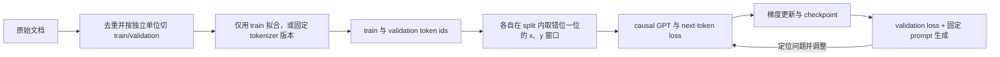

# 第 3 章 从零训练小 GPT：数据、训练、解码与实验闭环

从零训练一个小 GPT，真正有价值的地方不在于用几行代码得到一段看似像文本的输出，而在于把一条因果链完整地跑通：原始文本如何变成 token，token 如何组成监督样本，模型如何在因果约束下计算 logits，loss 如何产生梯度，参数如何更新，生成阶段又如何把概率分布变成序列。

这条链上的任何一环都可能让程序“正常运行”却学习到错误目标。例如，y 没有向右移动时，交叉熵仍然可以计算；causal mask 方向写反时，张量形状仍然可以对齐；验证集与训练集共享文档时，验证 loss 仍然会下降。只有把数据契约、张量形状、数值目标和实验记录放在一起，才知道一次训练到底证明了什么。

本章沿着同一条数据路径展开七个主题：字符级数据管线、最小 GPT、采样策略、checkpoint 与评估、loss 与生成行为分析、从字符级迁移到 BPE，以及不同 tokenizer 版本之间的公平比较。代码是教学实现，公式是模型定义或数量估算；代码通过只说明局部实现满足契约，不说明模型已经具备通用语言能力。

本章使用三类证据。概率分解、attention 和交叉熵来自模型定义或原始论文；Embedding、CrossEntropyLoss、AdamW、保存加载和 tokenizer 接口以 PyTorch、Hugging Face 官方文档为准；小语料上的 loss、生成文本和参数量是教学实验，必须记录随机种子、数据、版本、dtype 和设备后才有复现意义。

先看整条实验路径，再进入每个实现细节。先按文档或其他独立单位划分 train/validation，再拟合 tokenizer 和构造窗口，避免把验证信息带进词表或让相邻窗口跨过 split 边界。若使用已发布的 tokenizer，则固定它的版本与文件，不在验证集上重新拟合。模型训练只看训练段，validation 用来观察泛化和选择 checkpoint；固定 prompt 的生成样例则检查 loss 数字看不到的行为。



图中回环表示一次实验可以根据 validation 和生成样例继续改进，但不能把 validation 结果反复用于训练后仍称为独立验证集。若根据它选择超参数或 checkpoint，它承担的是模型选择角色；最终结论还应使用未参与选择的测试集或明确收窄范围。

## 3.1 Token 数据契约：从文本到 next-token 样本

### 3.1.1 先确定模型究竟预测什么

语言模型不是直接预测“下一句话”，而是在一个离散 token 集合上，对下一个 token 建立条件概率。设 tokenizer 把文本转成序列：

```math
d_0,d_1,\ldots,d_{N-1},\qquad d_i\in\{0,1,\ldots,V-1\}
```

其中 \(N\) 是 token 数量，\(V\) 是词表大小，\(d_i\) 是第 \(i\) 个位置的 token id。自回归语言模型把整段序列的概率分解为：

```math
p_\theta(d_0,\ldots,d_{N-1})
=\prod_{i=0}^{N-1}p_\theta(d_i\mid d_0,\ldots,d_{i-1})
```

在第 \(i\) 个位置，模型只能使用当前位置及其左侧的上下文来预测 \(d_{i+1}\)；当 \(i=N-1\) 时没有下一个真实 token，因此训练窗口必须满足目标位置仍在序列内。训练时通常把一段连续 token 截成输入 x 和标签 y，令：

```math
x_j=d_{s+j},\qquad y_j=d_{s+j+1},\qquad j=0,\ldots,T-1
```

这里 \(s\) 是片段起点，\(T\) 是上下文长度。于是模型在同一个长度为 \(T\) 的前向过程中，同时学习 \(T\) 个“下一个 token”任务。

可以把 \(x\) 想成题目、把 \(y\) 想成逐位置答案；但这个类比有一个限制：每个位置的答案不同，而且第 \(j\) 个位置只能看到 \(x_0\) 到 \(x_j\)，不能偷看后面的输入。数据管线的核心是保证监督信号、causal mask 和 loss reduction 三者使用同一个位置约定。

### 3.1.2 字符级 tokenizer：简单，但要明确代价

字符级 tokenizer 直接把 Unicode 字符当作离散单位。例如：

```text
输入：我爱机器学习
序列：我、爱、机、器、学、习
```

它的优点是实现短、词表容易检查、不会因为陌生单词而无法编码，适合观察一个小 GPT 的完整训练闭环。它的代价是序列通常更长，英文单词和代码标识符会被拆得很细，模型需要经过多个位置才能建立一个词或短语的统计关系。字符级模型的“能生成文本”不能外推为字符级 tokenizer 适合所有生产场景。

词表必须是确定的。若从头拟合字符词表，只用训练文本建立映射；验证集或推理 prompt 遇到未见字符时，按事先约定的未知 token 策略处理，不把验证文本并入词表。一个最小实现如下：

> 代码状态：静态审阅，未运行（2026-10-29）

```python
from dataclasses import dataclass


@dataclass(frozen=True)
class CharCodec:
    stoi: dict[str, int]
    itos: dict[int, str]

    @classmethod
    def from_text(cls, text: str) -> "CharCodec":
        if not isinstance(text, str) or not text:
            raise ValueError("text must be a non-empty string")
        chars = sorted(set(text))
        stoi = {ch: index for index, ch in enumerate(chars)}
        itos = {index: ch for index, ch in enumerate(chars)}
        return cls(stoi=stoi, itos=itos)

    def encode(self, text: str) -> list[int]:
        if not isinstance(text, str):
            raise TypeError("text must be a string")
        unknown = sorted(set(text) - self.stoi.keys())
        if unknown:
            raise ValueError(f"unknown characters: {unknown}")
        return [self.stoi[ch] for ch in text]

    def decode(self, ids: list[int]) -> str:
        if not isinstance(ids, list):
            raise TypeError("ids must be a list")
        try:
            return "".join(self.itos[index] for index in ids)
        except KeyError as exc:
            raise ValueError(f"unknown token id: {exc.args[0]}") from exc


train_text = "hello\nhello transformer\n"
codec = CharCodec.from_text(train_text)
ids = codec.encode("hello")
recovered = codec.decode(ids)

assert recovered == "hello"
assert codec.decode(codec.encode(train_text)) == train_text
print("vocab_size=", len(codec.stoi))
print("ids=", ids)
print("roundtrip_ok=", recovered == "hello")
```
stoi 是 string-to-integer 映射，itos 是 integer-to-string 映射。排序不是语言学要求，而是为了让同一份文本在不同运行中得到相同的 id。若词表来自训练集，验证集或推理 prompt 中出现训练集没有的字符，encode 必须有明确策略：报错、映射到未知 token，或者先扩展并重新训练词表。把未知字符静默映射到任意已有 id，会让问题变成难以解释的模型噪声。

### 3.1.3 编码、切分与泄漏

得到 id 序列后，PyTorch embedding 接收整数索引；本章统一使用 torch.long，减少后续 loss 标签 dtype 不一致的机会：[PyTorch 2.12 Embedding 文档](https://docs.pytorch.org/docs/2.12/generated/torch.nn.Embedding.html)。

> 代码状态：静态审阅，未运行（2026-10-29）

```python
import torch


train_text = "hello\nhello transformer\n"
chars = sorted(set(train_text))
stoi = {ch: index for index, ch in enumerate(chars)}
ids = [stoi[ch] for ch in train_text]
data = torch.tensor(ids, dtype=torch.long)

assert data.dtype == torch.long
assert int(data.min()) >= 0
assert int(data.max()) < len(chars)
print("data_shape=", tuple(data.shape))
print("data_dtype=", data.dtype)
```
最简单的切分方式是按连续位置切开：前 90% 做训练、后 10% 做验证。它适用于一条按时间顺序采集、相邻片段确实代表不同时间阶段的长流文本，但不适用于许多独立文档被简单拼接的语料。若同一篇文档同时出现在两个 split，或者文档的高度相似副本跨 split 分布，验证 loss 可能高估泛化能力；去重研究在其语料和模型设置中观察到训练/验证文本重叠及记忆风险，但不能把任意 overlap 等同为分数必然虚高：[Lee 等，ACL 2022](https://aclanthology.org/2022.acl-long.577/)。

更稳妥的切分单位是文档、用户、时间窗口或其他具有独立性的实体。先做一致的文本规范化并识别重复文档，把近重复簇放进同一个 split 或只保留一份；再分配独立单位，之后拟合训练 tokenizer、编码并采样窗口。这样既避免同一文档的相邻片段跨 split，也避免重复副本泄漏验证信息。对于小实验，至少应记录：

| 记录项 | 为什么需要它 |
| --- | --- |
| 原始语料版本和 hash | 判断两次实验是否使用同一数据 |
| tokenizer 版本、词表大小和特殊 token | 解释 token 数和输出类别变化 |
| train/val 切分规则 | 判断是否存在文档或时间泄漏 |
| 每个 split 的 token 数 | 解释 loss 的统计稳定性 |
| 是否去重及去重范围 | 判断重复样本是否夸大验证结果 |

### 3.1.4 向右移动一位的标签

设一段序列为：

```text
token：h e l l o
```

当 block_size=4 时，输入与标签是：

```text
x：h e l l
y：e l l o
```

第 0 个位置的 logits 负责预测 e，第 1 个位置负责预测第 2 个字符 l，依此类推。错误地使用 y=x 仍然会得到合法的交叉熵，但训练目标变成“复制当前 token”，而不是 next-token prediction。

切片实现是：

> 代码状态：静态审阅，未运行（2026-10-29）

```python
def make_example(source, start, block_size):
    if not isinstance(start, int) or isinstance(start, bool):
        raise TypeError("start must be an integer")
    if (
        not isinstance(block_size, int)
        or isinstance(block_size, bool)
        or block_size <= 0
    ):
        raise ValueError("block_size must be a positive integer")
    end = start + block_size
    if start < 0 or end >= len(source):
        raise ValueError("source is too short for this start and block_size")
    x = source[start:end]
    y = source[start + 1:end + 1]
    return x, y


source = list("hello transformer")
x, y = make_example(source, start=0, block_size=8)
assert x[1:] == y[:-1]
assert x[0] == "h"
assert y[-1] == source[8]
print("x=", "".join(x))
print("y=", "".join(y))
print("shift_ok=", x[1:] == y[:-1])
```
若源序列长度为 \(L\)，有效起点必须满足 \(s+T<L\)，所以合法起点数量是 \(L-T\)，随机采样时使用 `torch.randint(0, L - T, ...)`。`high` 是右开区间；把它写成 (L-T+1) 会允许起点 (s=L-T)，此时标签要访问位置 (L)，已经越界；真正正确的上界就是 (L-T)，并且要求 (L>T)。这个边界在小验证集上尤其容易暴露。

### 3.1.5 从随机起点构造 batch

固定长度连续 block 不需要 padding，因此 batch 的两个核心张量形状为：

```math
X\in\mathbb{Z}^{B\times T},\qquad
Y\in\mathbb{Z}^{B\times T}
```

其中 \(B\) 是 batch size，\(T\) 是 block size。每个样本可以从不同起点开始，但同一条样本内部仍然保持连续顺序。下方代码用 `torch.long` 表示 token id；这也是本章模型前向和交叉熵标签的统一 dtype。

> 代码状态：静态审阅，未运行（2026-10-29）

```python
import torch


def get_batch_from_source(source, batch_size, block_size, device="cpu", generator=None):
    if source.ndim != 1 or source.dtype != torch.long:
        raise ValueError("source must be a one-dimensional torch.long tensor")
    if (
        not isinstance(batch_size, int)
        or isinstance(batch_size, bool)
        or batch_size <= 0
    ):
        raise ValueError("batch_size must be a positive integer")
    if (
        not isinstance(block_size, int)
        or isinstance(block_size, bool)
        or block_size <= 0
    ):
        raise ValueError("block_size must be a positive integer")
    valid_starts = source.numel() - block_size
    if valid_starts <= 0:
        raise ValueError("source must contain at least block_size + 1 tokens")

    starts = torch.randint(
        low=0,
        high=valid_starts,
        size=(batch_size,),
        generator=generator,
    )
    x = torch.stack([
        source[int(start):int(start) + block_size]
        for start in starts
    ])
    y = torch.stack([
        source[int(start) + 1:int(start) + block_size + 1]
        for start in starts
    ])
    return x.to(device), y.to(device)


torch.manual_seed(7)
source = torch.arange(20, dtype=torch.long)
xb, yb = get_batch_from_source(source, batch_size=3, block_size=5)

assert xb.shape == (3, 5)
assert yb.shape == (3, 5)
assert torch.equal(xb[:, 1:], yb[:, :-1])
print("x_shape=", tuple(xb.shape))
print("y_shape=", tuple(yb.shape))
print("shift_ok=", torch.equal(xb[:, 1:], yb[:, :-1]))
```
这里的 generator 可以用来把采样随机性从全局随机状态中分离出来。为了复现实验，还要记录 Python、NumPy、PyTorch、CUDA 和 DataLoader worker 的随机状态；只调用一次 torch.manual_seed 并不能保证所有硬件和 kernel 都逐位一致。

### 3.1.6 Dataset 接口与连续流接口

`get_batch_from_source` 直接从一维 token 流抽样，适合教学和能放入内存的小语料。若希望接入标准 DataLoader，可以把合法起点作为样本索引：

> 代码状态：静态审阅，未运行（2026-10-29）

```python
import torch
from torch.utils.data import Dataset


class TokenWindowDataset(Dataset):
    def __init__(self, token_ids, block_size):
        if token_ids.ndim != 1 or token_ids.dtype != torch.long:
            raise ValueError("token_ids must be a one-dimensional long tensor")
        if (
            not isinstance(block_size, int)
            or isinstance(block_size, bool)
            or block_size <= 0
        ):
            raise ValueError("block_size must be a positive integer")
        if token_ids.numel() <= block_size:
            raise ValueError("token_ids must contain block_size + 1 tokens")
        self.token_ids = token_ids
        self.block_size = block_size

    def __len__(self):
        return self.token_ids.numel() - self.block_size

    def __getitem__(self, index):
        if not isinstance(index, int) or isinstance(index, bool):
            raise TypeError("index must be an integer")
        if not 0 <= index < len(self):
            raise IndexError("dataset index out of range")
        end = index + self.block_size
        x = self.token_ids[index:end]
        y = self.token_ids[index + 1:end + 1]
        return x, y


tokens = torch.arange(12, dtype=torch.long)
dataset = TokenWindowDataset(tokens, block_size=4)
x0, y0 = dataset[0]
x_last, y_last = dataset[len(dataset) - 1]
assert len(dataset) == 8
assert torch.equal(x0[1:], y0[:-1])
assert x_last[-1].item() == 10
assert y_last[-1].item() == 11
print("dataset_size=", len(dataset))
print("first_item=", x0.tolist(), y0.tolist())
print("last_item=", x_last.tolist(), y_last.tolist())
```

Dataset.__len__ 返回的是可采样窗口数量，不是原始 token 数。这个差一个 block_size 的关系会影响每个 epoch 的步数和 token 预算。这里的 `TokenWindowDataset` 符合 PyTorch map-style `Dataset` 的 `__len__`/`__getitem__` 契约；流式数据应使用 iterable-style 接口并另行处理 worker 分片：[PyTorch 2.12 数据加载文档](https://docs.pytorch.org/docs/2.12/data.html)。对于超大语料，实际系统可能使用 mmap、流式读取、预先打包的 shard 或按 token 数调度，而不是把全部文本读入一个 Python 列表。
### 3.1.7 数据管线的局部验证

训练前应先验证局部不变量，而不是等 loss 不下降后再猜原因。最小检查包括：

1. decode(encode(text)) 是否恢复原文，或在约定的 normalization 下恢复等价文本；
2. data.dtype 是否为整数索引类型；
3. 所有 id 是否满足 \(0\le d_i<V\)；
4. 每个 x 和 y 是否长度相等；
5. x[:,1:] 是否等于 y[:,:-1]；
6. 起点最大值是否仍能取出完整的 y；
7. train/val 是否按独立单位切分；
8. 验证采样是否没有从训练区间借用 token。

下面的零依赖审计把第 4、5、6 项写成可执行契约。它不依赖 PyTorch，因此适合在环境尚未装好深度学习依赖时先运行：

> 代码状态：静态审阅，未运行（2026-10-29）

```python
def window_ids(ids, block_size, starts):
    if (
        not isinstance(block_size, int)
        or isinstance(block_size, bool)
        or block_size <= 0
    ):
        raise ValueError("block_size must be a positive integer")
    if len(ids) <= block_size:
        raise ValueError("ids must be longer than block_size")
    limit = len(ids) - block_size
    windows = []
    for start in starts:
        if not isinstance(start, int) or isinstance(start, bool):
            raise TypeError("start must be an integer")
        if not 0 <= start < limit:
            raise ValueError(f"invalid start: {start}")
        x = ids[start:start + block_size]
        y = ids[start + 1:start + block_size + 1]
        if len(x) != block_size or len(y) != block_size:
            raise AssertionError("incomplete window")
        if x[1:] != y[:-1]:
            raise AssertionError("labels are not shifted by one position")
        windows.append((x, y))
    return windows


ids = list(range(11))
windows = window_ids(ids, block_size=4, starts=[0, 3, 6])
assert windows[-1] == ([6, 7, 8, 9], [7, 8, 9, 10])
try:
    window_ids(ids, block_size=4, starts=[7])
except ValueError:
    invalid_start_rejected = True
else:
    invalid_start_rejected = False

print("window_count=", len(windows))
print("shift_contract_ok=", all(x[1:] == y[:-1] for x, y in windows))
print("invalid_start_rejected=", invalid_start_rejected)
```
这段检查通过，只能说明窗口构造正确；它没有说明语料代表目标任务，也没有说明 tokenizer 的切分质量。数据契约和数据质量是两个需要分别测量的问题。


用 \(L=5,T=3\) 再核对窗口边界：起点只能取 0 或 1。起点 0 的输入是 \([d_0,d_1,d_2]\)，标签是 \([d_1,d_2,d_3]\)；起点 1 的标签最后到 \(d_4\)。若把随机采样上界写成 3，起点 2 会要求标签访问 \(d_5\)，但合法下标只有 0 到 4。半开区间的上界是“第一个非法值”，因此可写成 \(L-T\)，而不是凭直觉填 \(L-T+1\)。当 \(L=T\) 时不存在一个完整的输入加右移标签窗口，采样函数必须显式拒绝，而不能让空区间错误在训练中间才暴露。

对文档语料，切分边界同样会改变可采窗口。若将两篇文档直接拼成一条流，跨边界窗口会让第二篇开头的 token 以第一篇结尾为上下文；这只有在训练目标允许跨文档连续建模时才合理。EOS 只是边界 token，本身不会重置 causal attention；独立文档可按文档分别采样，或用明确的 attention mask 隔离跨文档上下文。相关预训练研究比较了普通 causal mask 与文档内 mask，并在其特定语料和模型设置中观察到跨文档上下文干扰及隔离开销，不能据此断言所有 packing 都有害：[ACL 2024 研究](https://aclanthology.org/2024.acl-long.427.pdf)。仅按字符比例切语料并不能自动满足独立性。数据切分表应能指出某个 token 窗口属于哪篇文档、是否跨越边界，以及它是否进入了验证分母。

假设语料有 12 个 token，block 长度为 4，连续流采样允许起点 \(s=0,\ldots,7\)，一共 8 个窗口；若简单把前 8 个 token 作为训练、后 4 个作为验证，训练窗口的标签可能已经触及验证区间。按 token 边界切分后再独立采窗口，至少要确认任何训练标签都没有落到验证片段。文档级语料更适合先按文档划分，再分别编码和打包，因为相同来源的段落、标题和重复副本很容易跨越一个粗略的字符边界。

若文本先按字节读取，还要避免在多字节 UTF-8 字符中途截断并把不完整片段送给字符级 tokenizer；按 Python Unicode 字符切分与按原始字节切分不是一回事。原始文件 hash、解码错误处理和换行规范化都应进入数据版本记录。

## 3.2 最小 GPT：从 token id 到训练 loss

### 3.2.1 一次前向传播经过哪些形状

字符级 GPT 的数据流可以写成：

```text
input_ids             [B, T]
token embedding       [B, T, D]
position embedding    [T, D]
Transformer blocks    [B, T, D]
final normalization   [B, T, D]
lm head               [B, T, V]
targets               [B, T]
cross entropy         scalar
```

\(B\) 是 batch size，\(T\) 是上下文长度，\(D\) 是 hidden size，\(V\) 是词表大小。Transformer block 的输入输出都保持 \([B,T,D]\)，只有最后的语言模型头把 hidden 维度映射成词表类别。

初学者可以把这条路径看成“编号查表—混合上下文—对词表打分—和正确答案比较”；专家则应把它看成一组接口约束：输入整数域、hidden 的最后一维、attention 的 query/key 维和输出类别维必须在每层保持一致。后面的代码断言只验证这些局部契约。

token embedding 矩阵 \(E\in\mathbb{R}^{V\times D}\) 通过索引取得 \(E_{x_{b,t},:}\)。如果使用 learned position embedding，位置表 \(P\in\mathbb{R}^{T_{\max}\times D}\) 提供位置向量，初始 hidden 为：

```math
H^{(0)}_{b,t,:}=E_{x_{b,t},:}+P_{t,:}
```

当 \(T>T_{\max}\) 时，位置表不能直接索引；字符级教学模型通常把 block_size 同时作为最大位置长度。生产模型可能使用 RoPE 或其他位置机制，但“允许更长位置索引”和“长上下文质量不下降”仍是两个不同命题。

### 3.2.2 因果 attention 的数学对象

对一个 head，输入 \(X\in\mathbb{R}^{B\times T\times D}\) 先投影为 \(Q,K,V\)：

```math
Q=XW_Q,\qquad K=XW_K,\qquad V=XW_V
```

若 head dimension 为 \(d_h\)，注意力分数是：

```math
S_{b,i,j}=\frac{Q_{b,i,:}K_{b,j,:}^{\mathsf T}}{\sqrt{d_h}}
```

causal mask 令第 \(i\) 个 query 只能读取 \(j\le i\) 的 key：

```math
M_{i,j}=\begin{cases}
1,&j\le i\\
0,&j>i
\end{cases}
```

softmax 前对 \(M_{i,j}=0\) 的位置填入当前 dtype 的最小有限值，得到权重：

```math
A_{b,i,:}=\mathrm{softmax}\left(S_{b,i,:}+\mathrm{mask}_{i,:}\right)
```

然后：

```math
O_{b,i,:}=\sum_{j=0}^{T-1}A_{b,i,j}V_{b,j,:}
```

在教学实现中，mask 采用下三角布尔矩阵。对于每一行，至少保留当前位置，因此不会因为 causal mask 单独造成全 mask 行。加入 padding、局部检索或外部过滤后，仍需要单独检查空候选情况。

### 3.2.3 Pre-LN block 与参数账本

一个常见的 Pre-LN decoder block 可以写成：

```math
H'=H+\mathrm{Attn}(\mathrm{LN}_1(H))
```

```math
H_{\mathrm{out}}=H'+\mathrm{FFN}(\mathrm{LN}_2(H'))
```

残差让输入存在一条恒等路径，LayerNorm 控制子层看到的数值范围。普通 FFN 的中间维度为 \(D_{\mathrm{ff}}\) 时，忽略 bias 的主要参数量约为 \(2DD_{\mathrm{ff}}\)；四个 \(D\times D\) 的 attention 投影约为 \(4D^2\)。教学代码采用普通 GELU FFN，便于把注意力和训练目标分开观察；换成 SwiGLU 会改变参数账本，但不会改变 x/y 的数据契约。

### 3.2.4 一个完整的最小模型实现

下面的代码把 attention、FFN、block、loss 和生成组合在一起。它使用独立的 max_seq_len，而不是把全局变量藏在类内部；读者可以先运行 shape 检查，再接入 3.1 的 get_batch。

> 代码状态：静态审阅，未运行（2026-10-29）

```python
import math

import torch
from torch import nn
import torch.nn.functional as F


class CausalSelfAttention(nn.Module):
    def __init__(self, d_model, num_heads, max_seq_len, dropout=0.0):
        super().__init__()
        if d_model <= 0 or num_heads <= 0 or max_seq_len <= 0:
            raise ValueError("dimensions and max_seq_len must be positive")
        if d_model % num_heads != 0:
            raise ValueError("d_model must be divisible by num_heads")
        if not 0.0 <= dropout < 1.0:
            raise ValueError("dropout must be in [0, 1)")
        self.d_model = d_model
        self.num_heads = num_heads
        self.head_dim = d_model // num_heads
        self.qkv = nn.Linear(d_model, 3 * d_model)
        self.out_proj = nn.Linear(d_model, d_model)
        self.dropout = nn.Dropout(dropout)
        mask = torch.tril(
            torch.ones(max_seq_len, max_seq_len, dtype=torch.bool)
        )
        self.register_buffer("causal_mask", mask, persistent=False)

    def forward(self, x):
        if x.ndim != 3:
            raise ValueError("x must have shape [batch, sequence, hidden]")
        if not x.is_floating_point():
            raise TypeError("attention input must use a floating-point dtype")
        batch_size, seq_len, hidden_size = x.shape
        if seq_len <= 0:
            raise ValueError("sequence length must be positive")
        if hidden_size != self.d_model:
            raise ValueError("hidden size does not match the module")
        if seq_len > self.causal_mask.size(0):
            raise ValueError("sequence length exceeds max_seq_len")

        q, k, v = self.qkv(x).chunk(3, dim=-1)
        q = q.view(batch_size, seq_len, self.num_heads, self.head_dim)
        k = k.view(batch_size, seq_len, self.num_heads, self.head_dim)
        v = v.view(batch_size, seq_len, self.num_heads, self.head_dim)
        q = q.transpose(1, 2)
        k = k.transpose(1, 2)
        v = v.transpose(1, 2)

        scores = q @ k.transpose(-2, -1)
        scores = scores / math.sqrt(self.head_dim)
        mask = self.causal_mask[:seq_len, :seq_len]
        scores = scores.masked_fill(
            ~mask,
            torch.finfo(scores.dtype).min,
        )
        weights = F.softmax(scores, dim=-1)
        weights = self.dropout(weights)
        output = weights @ v
        output = output.transpose(1, 2).contiguous()
        output = output.view(batch_size, seq_len, self.d_model)
        return self.out_proj(output)


class FeedForward(nn.Module):
    def __init__(self, d_model, expansion=4, dropout=0.0):
        super().__init__()
        if d_model <= 0 or expansion <= 0:
            raise ValueError("d_model and expansion must be positive")
        if not 0.0 <= dropout < 1.0:
            raise ValueError("dropout must be in [0, 1)")
        hidden_dim = expansion * d_model
        self.net = nn.Sequential(
            nn.Linear(d_model, hidden_dim),
            nn.GELU(),
            nn.Linear(hidden_dim, d_model),
            nn.Dropout(dropout),
        )

    def forward(self, x):
        return self.net(x)


class DecoderBlock(nn.Module):
    def __init__(self, d_model, num_heads, max_seq_len, dropout=0.0):
        super().__init__()
        self.ln1 = nn.LayerNorm(d_model)
        self.attn = CausalSelfAttention(
            d_model,
            num_heads,
            max_seq_len,
            dropout,
        )
        self.ln2 = nn.LayerNorm(d_model)
        self.ffn = FeedForward(d_model, dropout=dropout)

    def forward(self, x):
        x = x + self.attn(self.ln1(x))
        x = x + self.ffn(self.ln2(x))
        return x


class TinyGPT(nn.Module):
    def __init__(
        self,
        vocab_size,
        d_model,
        num_heads,
        num_layers,
        max_seq_len,
        dropout=0.0,
    ):
        super().__init__()
        if vocab_size <= 0 or d_model <= 0 or num_heads <= 0:
            raise ValueError("vocab_size, d_model and num_heads must be positive")
        if num_layers <= 0 or max_seq_len <= 0:
            raise ValueError("num_layers and max_seq_len must be positive")
        if not 0.0 <= dropout < 1.0:
            raise ValueError("dropout must be in [0, 1)")
        self.vocab_size = vocab_size
        self.max_seq_len = max_seq_len
        self.token_embedding = nn.Embedding(vocab_size, d_model)
        self.position_embedding = nn.Embedding(max_seq_len, d_model)
        self.blocks = nn.ModuleList([
            DecoderBlock(d_model, num_heads, max_seq_len, dropout)
            for _ in range(num_layers)
        ])
        self.final_norm = nn.LayerNorm(d_model)
        self.lm_head = nn.Linear(d_model, vocab_size)

    def forward(self, input_ids, targets=None, ignore_index=-100):
        if input_ids.ndim != 2 or input_ids.dtype != torch.long:
            raise ValueError(
                "input_ids must be a torch.long tensor with shape [batch, sequence]"
            )
        if not isinstance(ignore_index, int) or isinstance(ignore_index, bool):
            raise TypeError("ignore_index must be an integer")
        batch_size, seq_len = input_ids.shape
        if seq_len <= 0:
            raise ValueError("sequence length must be positive")
        if seq_len > self.max_seq_len:
            raise ValueError("sequence length exceeds max_seq_len")
        if input_ids.numel() and (
            int(input_ids.min()) < 0 or int(input_ids.max()) >= self.vocab_size
        ):
            raise ValueError("input_ids contain an id outside the vocabulary")

        positions = torch.arange(
            seq_len,
            device=input_ids.device,
        )
        hidden = self.token_embedding(input_ids)
        hidden = hidden + self.position_embedding(positions)
        for block in self.blocks:
            hidden = block(hidden)
        logits = self.lm_head(self.final_norm(hidden))

        loss = None
        if targets is not None:
            if (
                targets.shape != input_ids.shape
                or targets.dtype != torch.long
            ):
                raise ValueError("targets must have the same shape as input_ids")
            invalid_targets = (targets != ignore_index) & (
                (targets < 0) | (targets >= self.vocab_size)
            )
            if invalid_targets.any():
                raise ValueError("targets contain an id outside the vocabulary")
            if not (targets != ignore_index).any():
                raise ValueError("targets contain no valid prediction positions")
            loss = F.cross_entropy(
                logits.reshape(-1, self.vocab_size),
                targets.reshape(-1),
                ignore_index=ignore_index,
            )
        return logits, loss

    @torch.no_grad()
    def generate(self, input_ids, max_new_tokens, temperature=1.0):
        if input_ids.ndim != 2 or input_ids.dtype != torch.long:
            raise ValueError(
                "input_ids must be a torch.long tensor with shape [batch, sequence]"
            )
        if (
            not isinstance(max_new_tokens, int)
            or isinstance(max_new_tokens, bool)
            or max_new_tokens < 0
        ):
            raise ValueError("max_new_tokens must be a non-negative integer")
        if (
            not isinstance(temperature, (int, float))
            or isinstance(temperature, bool)
            or not math.isfinite(float(temperature))
            or temperature <= 0
        ):
            raise ValueError("temperature must be a finite positive number")
        if input_ids.shape[1] == 0:
            raise ValueError("input_ids must contain at least one token")
        if input_ids.numel() and (
            int(input_ids.min()) < 0 or int(input_ids.max()) >= self.vocab_size
        ):
            raise ValueError("input_ids contain an id outside the vocabulary")
        was_training = self.training
        self.eval()
        try:
            for _ in range(max_new_tokens):
                context = input_ids[:, -self.max_seq_len:]
                logits, _ = self(context)
                next_logits = logits[:, -1, :] / temperature
                probabilities = F.softmax(next_logits, dim=-1)
                next_token = torch.multinomial(probabilities, 1)
                input_ids = torch.cat([input_ids, next_token], dim=1)
            return input_ids
        finally:
            if was_training:
                self.train()


torch.manual_seed(42)
model = TinyGPT(
    vocab_size=32,
    d_model=32,
    num_heads=4,
    num_layers=2,
    max_seq_len=16,
)
input_ids = torch.randint(0, 32, (2, 16), dtype=torch.long)
targets = torch.randint(0, 32, (2, 16), dtype=torch.long)
logits, loss = model(input_ids, targets)

assert logits.shape == (2, 16, 32)
assert loss.ndim == 0
print("logits_shape=", tuple(logits.shape))
print("loss_is_finite=", bool(torch.isfinite(loss)))
```
这段代码只实现了一个教学模型：没有 KV Cache、混合精度、分布式并行、权重共享或高效 attention kernel。它的价值是把每个 shape 和每个残差路径暴露出来；在后续换成 fused kernel 后，应保留同样的局部 shape 和数值回归测试。

### 3.2.5 交叉熵与 token 数量

若 logits 为 \(Z\in\mathbb{R}^{B\times T\times V}\)，标签为 \(Y\in\{0,\ldots,V-1\}^{B\times T}\)，且 \(B>0,T>0\)，平均 token loss 为：

```math
L(\theta)=-\frac{1}{BT}\sum_{b=1}^{B}\sum_{t=1}^{T}\log p_\theta(Y_{b,t}\mid X_{b,\le t})
```

等价地，用未归一化 logits 表示：

```math
L(\theta)=\frac{1}{BT}\sum_{b,t}\left(\log\sum_{c=0}^{V-1}\exp Z_{b,t,c}-Z_{b,t,Y_{b,t}}\right)
```

PyTorch 2.12 的 `F.cross_entropy` 接收未归一化 logits，类别索引标签使用 `torch.long`，默认 reduction 为对有效损失取均值；不需要先手动 softmax：[官方接口文档](https://docs.pytorch.org/docs/2.12/generated/torch.nn.functional.cross_entropy.html)。展平只是把每个位置变成一个分类样本：

```text
[B, T, V] -> [B*T, V]
[B, T]   -> [B*T]
```

对于没有 padding 的固定长度 block，分母是 \(BT\)。如果以后将多个长度不同的序列 padding 到同一长度，padding 位置必须从目标 `targets` 中排除，例如把对应位置设为 `ignore_index=-100` 并传给 `F.cross_entropy`；输入 `input_ids` 仍然必须全部是合法词表 id。本章模型前向会跳过目标中的 `ignore_index` 范围检查，但会拒绝所有目标都被忽略的 batch，因为这时平均 loss 没有定义，不能把它当作有效训练信号。

初始 logits 如果近似均匀，单 token loss 约为：

```math
L_0\approx\log V
```

这是一个数量级检查，不是所有初始化都必然满足的定律。若 \(V=32\)，\(\log 32\approx3.466\)。初始 loss 是几十、NaN 或立刻发散时，应先查 labels 范围、logits shape、学习率、mask 和数据 dtype。

### 3.2.6 训练循环：每一步究竟更新了什么

最小训练循环的顺序是：

```text
取 batch -> forward -> 计算 loss -> 清理旧梯度
-> backward -> 可选梯度裁剪 -> optimizer.step
```

下面把数据适配器、评估函数和训练循环放在同一个示例中。它依赖 3.1.5 的 `get_batch_from_source`，以及 3.2.4 的模型定义和 `model = TinyGPT(...)` 初始化；从相应代码段的变量继续执行即可。这里的 `get_batch(split)` 是应用层适配器，必须返回同一设备或可迁移到该设备的 `(input_ids, targets)`，并且 `split` 只能是 `train` 或 `val`。示例用两条合成整数流说明接口分流，不是有效的泛化评估语料；真实项目应替换为按文档或其他独立实体切分的数据。

> 代码状态：静态审阅，未运行（2026-10-29）

```python
train_tokens = torch.arange(64, dtype=torch.long) % 32
val_tokens = torch.arange(32, dtype=torch.long).flip(0)
split_sources = {"train": train_tokens, "val": val_tokens}


def get_batch(split):
    if split not in split_sources:
        raise ValueError("split must be train or val")
    return get_batch_from_source(
        split_sources[split],
        batch_size=2,
        block_size=16,
        device="cpu",
    )


def estimate_loss(model, get_batch, eval_iters, device):
    if not isinstance(eval_iters, int) or eval_iters <= 0:
        raise ValueError("eval_iters must be a positive integer")
    result = {}
    was_training = model.training
    model.eval()
    try:
        with torch.no_grad():
            for split in ("train", "val"):
                values = []
                for _ in range(eval_iters):
                    input_ids, targets = get_batch(split)
                    input_ids = input_ids.to(device)
                    targets = targets.to(device)
                    _, loss = model(input_ids, targets)
                    values.append(loss.item())
                result[split] = sum(values) / len(values)
    finally:
        if was_training:
            model.train()
    return result


device = torch.device("cuda" if torch.cuda.is_available() else "cpu")
model = model.to(device)
optimizer = torch.optim.AdamW(model.parameters(), lr=3e-4)
max_steps = 200
eval_interval = 50

for step in range(max_steps):
    if step % eval_interval == 0:
        metrics = estimate_loss(model, get_batch, eval_iters=10, device=device)
        print(
            f"step={step} "
            f"train_loss={metrics['train']:.4f} "
            f"val_loss={metrics['val']:.4f}"
        )

    input_ids, targets = get_batch("train")
    input_ids = input_ids.to(device)
    targets = targets.to(device)
    _, loss = model(input_ids, targets)

    optimizer.zero_grad(set_to_none=True)
    loss.backward()
    torch.nn.utils.clip_grad_norm_(model.parameters(), max_norm=1.0)
    optimizer.step()
```
`zero_grad` 必须发生在下一次反向传播前，否则梯度会默认累加。梯度裁剪应放在 backward 之后、step 之前；若使用 AMP，则先 `scaler.unscale_(optimizer)` 再裁剪。`model.eval()` 只改变 Dropout、BatchNorm 等特定模块的训练/评估行为，不会关闭自动求导；验证循环仍需 `torch.no_grad()`：[PyTorch 2.12 Module](https://docs.pytorch.org/docs/2.12/generated/torch.nn.Module.html) 与 [no_grad](https://docs.pytorch.org/docs/2.12/generated/torch.no_grad.html)。

训练步数、看到的 token 数和更新次数不是同一个量。若每一步使用 \(B\) 条长度为 \(T\) 的样本，忽略丢弃和重复采样，单步 token 数约为：

```math
N_{\mathrm{token/step}}=B T
```

实际报告中应同时记录 optimizer steps 和 `tokens_seen`。这里它表示累计处理过的 token 位置数；随机窗口可重复抽到同一语料位置，因此不等于唯一 token 数。两个实验都训练 1000 步，但一个使用 \(B=8,T=32\)，另一个使用 \(B=64,T=128\)，名义处理量分别是 25.6 万和 819.2 万 token；步数相同并不代表预算相同。

### 3.2.7 生成是另一个计算协议

训练时一次前向会为所有位置计算 logits；生成时只需要最后一个位置的 logits。对当前序列 \(x_{0:t}\)，生成下一个 token 的步骤是：

```math
p_{t+1}=\mathrm{softmax}\left(\frac{z_t}{\tau}\right),\qquad
x_{t+1}\sim p_{t+1}
```

其中 \(\tau>0\) 是 temperature。生成后把新 token 拼回序列，重复直到达到预算或遇到停止条件。教学模型使用 learned position embedding 时，超过最大位置只能截取最近上下文；这会丢失更早信息，但可以避免位置索引越界。

生成函数应保存并恢复模型的训练状态。若调用前模型在训练模式，生成结束后应回到训练模式；如果中途抛出异常，也不能把模型永久留在 eval 模式。前面 TinyGPT.generate 已经展示了这种 try/finally 写法。

另一个容易混淆的事实是：生成文本的随机性来自采样器和随机状态，不是来自训练 loss 本身。要比较两个 checkpoint 的生成质量，应固定 prompt、生成长度、temperature、top-k/top-p、随机种子和 decode 规则；否则看到的差异可能只是随机采样差异。


用一组极小 shape 走完整个前向：令 \(B=2,T=4,V=8,D=4\)，input ids 是 \([2,4]\)，embedding 后得到 \([2,4,4]\)，causal attention 仍输出 \([2,4,4]\)，最后 lm head 产生 \([2,4,8]\)，也就是每条样本的四个位置各有 8 个候选 token 分数。交叉熵按右移后的 8 个标签位置计算，不能把一个样本的最后位置错配到 batch 中另一个样本。这个例子把 token 维和词表维分开：T 决定每条样本预测几次，V 决定每个位置分类多少种 token。

最小模型还适合做过拟合小批次检查。固定 2 条长度为 4 的序列，重复更新同一批数据，训练 loss 应能明显降低；若始终不变，先查标签是否右移、优化器参数是否属于模型、梯度是否为零或学习率是否极小。过拟合这 8 个目标位置只说明前向、loss 和更新通路能共同拟合一小组样本，不是泛化成功。随后要换成未训练窗口评估，才能看到模型是否只记住了这次输入。

这里的 causal mask 是训练目标的一部分，而不是提高推理速度的可选优化。若第 1 个位置可以看到未来标签，模型就能通过复制右侧信息获得很低的训练 loss；一旦生成时未来 token 不存在，训练与推理条件就不一致。可以在长度为 3 的序列上把 attention 权重画成矩阵：第 0 行只保留列 0，第 1 行保留 0、1，第 2 行保留 0、1、2。局部测试通过后，再用改变未来 token 的反事实输入确认较早位置 logits 不变，才能支持“未来信息没有进入”的结论。

在一个训练 batch 上，可以把张量数目算清：若有 2 条、每条长度 4 的输入，模型输出 64 个 logits，但监督目标只有 8 个 token id；每个目标索引都必须落在 0 到 7。模型不会为输入最后一个位置凭空得到新标签，采样窗口已通过右移方式确保其 logits 对应的是序列中的下一个真实 token。把这些对应关系打印出来，通常比只查看最终 loss 更容易发现 off-by-one。

再把目标概率代入 loss：若两个位置给正确 token 的概率分别是 0.5 和 0.25，它们的平均交叉熵为 \((-\ln0.5-\ln0.25)/2\approx(0.693+1.386)/2=1.040\) nat。这个平均值会把 8 个监督位置压成一个标量；因此还要保留样本、位置和长度切片。若 \(V=32\) 且初始化 logits 完全相等，单位置 loss 为 \(\ln32\approx3.466\)，只表示近似均匀的输出分布；低 loss 也可能来自重复数据或标签泄漏，不能单独证明模型学会语言。

## 3.3 解码控制：Temperature、Top-k 与 Top-p

### 3.3.1 logits、概率和选择规则

语言模型最后输出的是 \(V\) 个 logits。softmax 把它们变成概率：

```math
p_i=\frac{\exp(z_i)}{\sum_{j=0}^{V-1}\exp(z_j)}
```

贪心解码选择 \(\arg\max_i z_i\)，完全采样则按照整个 \(p\) 分布抽样。两者都可能不合适：贪心容易重复，完整分布可能把低概率长尾 token 纳入候选。temperature、top-k 和 top-p 都是在“如何修改候选分布”这个层面工作，不能修复模型没有学到的事实或结构。

### 3.3.2 Temperature 改变分布尖锐程度

给定温度 \(\tau>0\)：

```math
p_i(\tau)=\frac{\exp(z_i/\tau)}{\sum_{j=0}^{V-1}\exp(z_j/\tau)}
```

\(\tau<1\) 放大 logits 差异，分布更尖；\(\tau>1\) 压低 logits 差异，分布更平；\(\tau\to0^+\) 在数值上接近贪心，但不应真的把代码写成除以 0。需要确定性输出时，直接使用 argmax 更清楚。

分布熵可以帮助量化这种变化：

```math
H(p)=-\sum_{i=0}^{V-1}p_i\log p_i
```

熵降低表示概率集中，不等于事实性提高；熵升高表示选择更多，不等于创造性或质量提高。不同任务需要用任务指标、格式通过率、重复率或人工评价验证。

对初学者来说，temperature 可以理解为“把骰子的差异放大或压平”；对专家来说，它改变的是 logits 的尺度和采样分布的熵，不改变模型参数或条件概率的训练目标。因而它适合做推理时消融，不应被当成训练质量修复手段。

### 3.3.3 Top-k 保留固定数量的候选

令 \(S_k\) 为 logits 最大的 \(k\) 个 token 的集合。过滤后的 logits 是：

```math
\tilde z_i=\begin{cases}
z_i,&i\in S_k\\
m_{\min},&i\notin S_k
\end{cases}
```

其中 \(m_{\min}\) 是当前 dtype 的最小有限值。过滤后必须重新 softmax；不能把已经归一化的概率简单截断后忘记重新归一化。

### 3.3.4 Top-p 保留概率质量

先按概率从大到小排序：

```math
p_{(1)}\ge p_{(2)}\ge\cdots\ge p_{(V)}
```

再定义最小的候选数量：

```math
m=\min\left\{r:\sum_{i=1}^{r}p_{(i)}\ge p\right\}
```

top-p 保留排序后的前 \(m\) 个 token。分布很尖时，候选集合可能只有一个或几个；分布平坦时，候选集合会扩大。因此它不是固定的多样性保证，而是依据当前分布的概率质量动态改变候选数量。Nucleus sampling 的原始研究也把候选集合定义为随上下文分布变化的概率质量“核”；论文报告的是其 GPT-2/WebText 开放式生成设置，不代表所有任务的质量排序：[Holtzman 等，The Curious Case of Neural Text Degeneration](https://arxiv.org/abs/1904.09751v2)。

实现时要保留第一个使累计概率达到阈值的 token。过滤函数支持 `[..., vocab_size]`；抽样前把所有前导维展平成行，调用只接收向量或矩阵的 `torch.multinomial`，再恢复原 batch 维：

> 代码状态：静态审阅，未运行（2026-10-29）

```python
import math

import torch
import torch.nn.functional as F


def filter_top_k(logits, top_k=None):
    if logits.ndim < 1 or logits.size(-1) <= 0:
        raise ValueError("logits must have a non-empty vocabulary dimension")
    if not logits.is_floating_point():
        raise TypeError("logits must use a floating-point dtype")
    if top_k is None:
        return logits
    if (
        not isinstance(top_k, int)
        or isinstance(top_k, bool)
        or top_k <= 0
    ):
        raise ValueError("top_k must be a positive integer")
    top_k = min(top_k, logits.size(-1))
    values, indices = torch.topk(logits, top_k, dim=-1)
    mask_value = torch.finfo(logits.dtype).min
    filtered = torch.full_like(logits, mask_value)
    filtered.scatter_(-1, indices, values)
    return filtered


def filter_top_p(logits, top_p=None):
    if logits.ndim < 1 or logits.size(-1) <= 0:
        raise ValueError("logits must have a non-empty vocabulary dimension")
    if not logits.is_floating_point():
        raise TypeError("logits must use a floating-point dtype")
    if top_p is None:
        return logits
    if (
        not isinstance(top_p, (int, float))
        or isinstance(top_p, bool)
        or not math.isfinite(float(top_p))
        or not 0.0 < top_p <= 1.0
    ):
        raise ValueError("top_p must be in (0, 1]")

    sorted_logits, sorted_indices = torch.sort(
        logits,
        descending=True,
        dim=-1,
    )
    sorted_probs = F.softmax(sorted_logits, dim=-1)
    cumulative = torch.cumsum(sorted_probs, dim=-1)
    sorted_mask = cumulative >= top_p

    shifted_mask = sorted_mask.clone()
    shifted_mask[..., 1:] = sorted_mask[..., :-1]
    shifted_mask[..., 0] = False
    mask_value = torch.finfo(logits.dtype).min
    sorted_logits = sorted_logits.masked_fill(shifted_mask, mask_value)

    filtered = torch.full_like(logits, mask_value)
    filtered.scatter_(-1, sorted_indices, sorted_logits)
    return filtered


def sample_next_token(
    logits,
    temperature=1.0,
    top_k=None,
    top_p=None,
    generator=None,
):
    if (
        not isinstance(temperature, (int, float))
        or isinstance(temperature, bool)
        or not math.isfinite(float(temperature))
        or temperature <= 0
    ):
        raise ValueError("temperature must be a finite positive number")
    if not logits.is_floating_point():
        raise TypeError("logits must use a floating-point dtype")
    logits = logits / temperature
    logits = filter_top_k(logits, top_k)
    logits = filter_top_p(logits, top_p)
    probabilities = F.softmax(logits, dim=-1)
    if not torch.isfinite(probabilities).all():
        raise ValueError("probabilities contain NaN or infinity")
    if (probabilities.sum(dim=-1) <= 0).any():
        raise ValueError("probability mass is empty")
    flat_probabilities = probabilities.reshape(-1, probabilities.size(-1))
    sampled = torch.multinomial(
        flat_probabilities,
        num_samples=1,
        generator=generator,
    )
    return sampled.reshape(*probabilities.shape[:-1], 1)


def greedy_next_token(logits):
    return logits.argmax(dim=-1, keepdim=True)
```
这里先做 temperature，再做 top-k/top-p，是一种常见的教学顺序。top-p 的候选集合依赖 softmax 后的相对概率，因此如果先 top-k 再 top-p，top-p 看到的是截断后的分布，结果会和先 top-p 再 top-k 不同。解码器必须固定顺序并在实验记录中写清楚。`sample_next_token` 可接收与 logits 所在设备匹配的随机数生成器，便于把采样随机性与其他随机操作分开；PyTorch 的 `torch.multinomial` 按非负权重抽样：[2.12 接口文档](https://docs.pytorch.org/docs/2.12/generated/torch.multinomial.html)。第 3.3.5 的代码依赖本节已经定义的 helper；若要单独复制运行，应把本节完整代码一并复制。

### 3.3.5 一个可验证的采样实验

下面的实验使用固定 logits，观察熵和保留集合。它依赖上一节的 helper；将两段代码放在同一脚本中运行。

> 代码状态：静态审阅，未运行（2026-10-29）

```python
import torch
import torch.nn.functional as F


generator = torch.Generator().manual_seed(7)
tokens = ["A", "B", "C", "D", "E", "F"]
logits = torch.tensor([[3.0, 2.0, 1.0, 0.5, -0.5, -1.0]])


def entropy(probabilities):
    probabilities = probabilities.clamp_min(1e-12)
    return float(
        -(probabilities * probabilities.log()).sum(dim=-1).item()
    )


def kept_tokens(filtered_logits):
    minimum = torch.finfo(filtered_logits.dtype).min
    return [
        tokens[index]
        for index, value in enumerate(filtered_logits[0])
        if value.item() != minimum
    ]


base = F.softmax(logits, dim=-1)
cold = F.softmax(logits / 0.5, dim=-1)
hot = F.softmax(logits / 2.0, dim=-1)
top_k_logits = filter_top_k(logits, top_k=3)
top_p_logits = filter_top_p(logits, top_p=0.8)
threshold_top_p_logits = filter_top_p(
    torch.log(torch.tensor([[0.5, 0.3, 0.2]])),
    top_p=0.79,
)
batched_logits = logits.unsqueeze(0).expand(2, -1, -1)
sampled = sample_next_token(
    batched_logits,
    temperature=0.8,
    top_k=4,
    top_p=0.9,
    generator=generator,
)

print("base_probs=", [round(x, 4) for x in base[0].tolist()])
print("cold_entropy=", round(entropy(cold), 4))
print("hot_entropy=", round(entropy(hot), 4))
print("top_k_kept=", kept_tokens(top_k_logits))
print("top_p_kept=", kept_tokens(top_p_logits))
assert torch.isfinite(threshold_top_p_logits[0, :2]).all()
assert threshold_top_p_logits[0, 2].item() == torch.finfo(threshold_top_p_logits.dtype).min
assert sampled.shape == (2, 1, 1)
print("sample_shape=", tuple(sampled.shape))
```
固定 logits 的实验只能证明过滤函数的局部行为。真实生成还需要观察任务成功率、格式通过率、重复率、长度分布和事实性；“看起来更像训练语料”不是单独可靠的质量指标。

### 3.3.6 解码失败的归因

| 现象 | 首先检查的量 | 不能直接推出的结论 |
| --- | --- | --- |
| 输出高度重复 | temperature、top-k、top-p、训练数据重复度 | 模型一定过拟合 |
| 输出乱码 | prompt 是否在词表、decode 是否一致、checkpoint/tokenizer 是否匹配 | 训练一定失败 |
| 输出过于随机 | 温度、候选过滤、logits 是否有限 | 模型一定缺乏知识 |
| 采样报 NaN | logits、mask、dtype、过滤后候选数量 | 只调 temperature 就能修复 |
| greedy 和 sampling 差异很大 | 固定 seed、分布熵、候选集合 | 某种策略普遍更好 |

如果要比较 decoding 配置，应对同一组 prompt 使用相同 checkpoint，并固定生成长度、随机种子和停止条件。否则解码参数与模型参数的影响会混在一起。

手算一次过滤顺序：logits \([2,1,0]\) 的原始概率约为 \([0.665,0.245,0.090]\)。temperature 取 2 后，先把 logits 除以 2，概率约为 \([0.506,0.307,0.186]\)，分布变平。若在该分布上使用 top-k=2，保留前两项后必须重新归一化，变成约 \([0.622,0.378,0]\)；若使用 top-p=0.8，前两项累计为 0.813，因此也保留两项，截断后归一化得到约 \([0.622,0.378,0]\)。若先用 top-p 再用 top-k，遇到其他 logits 分布时集合可能不同，所以报告采样配置时要写过滤顺序。

温度改变所有候选相对优势的程度，top-k 设定候选数量，top-p 设定保留的概率质量；三者的作用不能互相替代。比如只把 temperature 从 1 调成 2，低概率 token 仍可能进入候选；top-k 则会硬性删除 k 之外的 token。过滤后若只剩一个候选，采样已经退化成确定选择；若候选分数全是负无穷或 NaN，softmax 无法给出有效分布，helper 应报错或回退到明确策略，而不是返回静默异常文本。

比较生成输出时还要固定 random generator。相同 seed 只能在相同调用顺序、设备、采样实现和模型输入下提供可复现起点；如果先增加一次随机采样，后续 token 的随机数序列就会整体改变。要比较解码策略，最好为每种策略固定同一组 prompt，并重复多个 seed 报告输出差异；不能挑选一条最满意的样例代表整个分布。

再比较温度和 top-p 的联合作用。logits 为 \([2,1,0]\)，温度 1 时概率约 \([0.665,0.245,0.090]\)；top-p=0.7 会保留前两个，因为第一个累计还不到 0.7，加入第二个后累计约 0.91。截断后再归一化为 \([0.731,0.269,0]\)。温度 0.5 时 logits 差异放大，概率约 \([0.867,0.117,0.016]\)，top-p=0.7 只需保留最高项；温度 2 时则需要更多候选才能达到同一概率质量。于是 top-p 的候选数由温度和当前上下文分布共同决定，不是一个固定的“保留比例”。

采样配置还应定义停止条件。EOS 可以结束生成，但如果 batch 用 EOS 兼作 padding，解码逻辑必须区分真实结束 token 与填充位置；最大新 token 数是硬预算，停止词则依赖 tokenizer 的 encode/decode 规则。若模型输出空字符串或只输出 EOS，平均长度、重复率和格式分数要有明确处理，不能把未生成内容当作质量为零或直接丢弃。温度、候选过滤、停止和截断组成完整 decoding protocol，换其中一项就改变实验对象。

采样时的 logits 必须产生有限概率，而且至少要留一个合法候选。当前 helper 拒绝零温度和非有限概率；它的 top-k/top-p 过滤规则会至少保留一个 token。如果再加入 EOS 屏蔽、词表白名单等外部约束，应在 softmax 前检查至少有一个合法且分数有限的候选。确定性贪心单独走 `argmax`；随机采样传入独立 generator，可以避免评估中的随机调用改变训练采样器状态。将这些前置条件写进解码函数，比生成错误后再从输出文本猜原因更可靠。

top-k 遇到相同分数的边界 token 时，究竟保留哪些 token 可能依赖排序的稳定性；若可复现性重要，应固定 tie-breaking 规则或至少记录所用实现。另一个边界是特殊 token：过滤 EOS、BOS 或工具调用 token 会改变生成协议，不应把“低概率 token 全部都可采样”当成普遍默认。词表 mask 需在 softmax 前明确应用，并保证至少留一个合法 token。

再看温度接近零的边界。对 logits \([2,2,0]\)，两个最大项并列；数学上的概率极限把质量分给并列项，但贪心实现通常只返回一个索引，具体选哪一个受 tie-breaking 影响。若需要重复文本完全一致，应选用固定的 argmax 规则；若希望保留并列候选，则应以温度和采样方式表达，而不是假设“temperature=0”具有通用定义。配置文件中应使用正温度，确定性解码走单独分支。

如果 top-p 使用 0.9，而分布中 EOS 排名第一、概率为 0.95，候选集可能只剩 EOS，生成就会立即结束；若业务要求至少输出一个 token，需要显式设置最小生成长度或过滤规则。这类控制改变了采样分布，应记录为解码参数，不要在结果分析时把它归因于模型权重。

## 3.4 Checkpoint、日志与可恢复评估

### 3.4.1 checkpoint 不是只有模型权重

一个训练状态快照可以写成：

```math
C_t=(\theta_t,s_t,t,L^*_{\mathrm{val}},h,\rho_t,\tau)
```

其中 \(\theta_t\) 是模型参数，\(s_t\) 是优化器状态，\(t\) 是更新计数，\(L^*_{\mathrm{val}}\) 是截至当前最优验证 loss，\(h\) 是配置，\(\rho_t\) 是随机数或数据迭代状态，\(\tau\) 是 tokenizer 与特殊 token 元数据。

如果只保存 \(\theta_t\)，可以做某种形式的推理，却不能严格恢复训练轨迹。AdamW 至少维护一阶和二阶统计量：

```math
m_t=\beta_1m_{t-1}+(1-\beta_1)g_t
```

```math
v_t=\beta_2v_{t-1}+(1-\beta_2)g_t^2
```

不恢复 \(m_t,v_t\)，下一次更新的方向和尺度都会变化。若使用学习率 scheduler、AMP scaler、梯度累积、分布式 sampler 或随机数据增强，还要把对应状态加入恢复协议。

教学级字符模型至少保存：

```text
model_state_dict
optimizer_state_dict
step
best_val_loss
config
tokenizer 或 stoi/itos
```

生产训练还应考虑：scheduler state、scaler state、随机数状态、数据 shard 与 offset、分布式 rank 信息、代码版本、数据版本、设备和 dtype。

### 3.4.2 best 与 last 是两个不同对象

last.pt 表示最近一次保存的训练状态，适合中断恢复；best.pt 表示验证集指标最好的状态，适合最终评估。若评估 step 集合为 \(\mathcal{T}\)：

```math
t^*=\arg\min_{t\in\mathcal{T}}L_{\mathrm{val}}(t)
```

```math
L^*_{\mathrm{val}}=\min_{t\in\mathcal{T}}L_{\mathrm{val}}(t)
```

把最近模型误称为最佳模型，会把“可恢复性”和“泛化选择”混成一个概念。对于多指标任务，best 还需要固定选择规则，例如验证 loss、格式通过率和安全违规率的组合，而不能训练结束后挑一个看起来最好的样例。

### 3.4.3 保存与加载的实现

下面的实现使用临时文件再替换目标文件，减少进程在写入中途退出时留下半个 checkpoint 的概率。它假设 `model`、`optimizer`、`config` 和 tokenizer 元数据只包含张量、基本类型及普通容器，并以 PyTorch 2.12 的加载接口为目标版本。

> 代码状态：静态审阅，未运行（2026-10-29）

```python
from pathlib import Path

import torch


def save_checkpoint(
    path,
    model,
    optimizer,
    step,
    best_val_loss,
    config,
    tokenizer_meta,
):
    path = Path(path)
    path.parent.mkdir(parents=True, exist_ok=True)
    checkpoint = {
        "model_state_dict": model.state_dict(),
        "optimizer_state_dict": optimizer.state_dict(),
        "step": int(step),
        "best_val_loss": float(best_val_loss),
        "config": config,
        "tokenizer_meta": tokenizer_meta,
    }
    temporary = path.with_name(path.name + ".tmp")
    torch.save(checkpoint, temporary)
    temporary.replace(path)


def load_checkpoint(path, model, optimizer=None, map_location="cpu"):
    checkpoint = torch.load(
        path,
        map_location=map_location,
        weights_only=True,
    )
    model.load_state_dict(checkpoint["model_state_dict"])
    if optimizer is not None:
        optimizer.load_state_dict(checkpoint["optimizer_state_dict"])
    return checkpoint
```

本例显式指定 `weights_only=True`，与 [PyTorch 2.12 `torch.load` 文档](https://docs.pytorch.org/docs/2.12/generated/torch.load.html)一致；该模式限制可反序列化对象范围，但不构成“任何来源都安全”的证明。PyTorch 文档仍提醒不要加载不可信来源。旧版本若不支持该参数，不应靠捕获任意 `TypeError` 自动退回普通 pickle 加载；应按目标版本单独审查兼容路径，并只加载可信文件。
### 3.4.4 step 的定义必须写进代码

本章把 step 定义为“已经完成的 optimizer update 数量”。因此初始模型是 step 0，先评估，再完成一次更新；完成后状态变成 step 1。恢复时从记录的 step 继续，下一轮会重新评估当前状态，然后执行下一次更新。另一种系统可以把 step 定义为“下一次待执行的更新编号”，但保存端和加载端必须使用同一种定义。

下面的循环依赖前文 3.2.4/3.2.6 定义的 `model`、`estimate_loss`、`get_batch`、`optimizer` 和 `device`，以及 3.4.3 定义的 `save_checkpoint`；把它接在这些代码之后即可运行。它显式记录评估/保存 step 和已完成的 optimizer update 数，checkpoint 写入当前工作目录下的 `runs/mini-gpt/step-semantics/`：

> 代码状态：静态审阅，未运行（2026-10-29）

```python
from pathlib import Path

run_dir = Path("runs/mini-gpt/step-semantics")
run_dir.mkdir(parents=True, exist_ok=True)
best_path = run_dir / "best.pt"
last_path = run_dir / "last.pt"
config = {"batch_size": 2, "block_size": 16}
tokenizer_meta = {"type": "character"}
eval_iters = 5
eval_interval = 1
max_steps = 2
best_val_loss = float("inf")
start_step = 0
saved_steps = []
optimizer_updates = 0
log_rows = []

for step in range(start_step, max_steps + 1):
    if step % eval_interval == 0 or step == max_steps:
        metrics = estimate_loss(model, get_batch, eval_iters, device)
        train_loss = metrics["train"]
        val_loss = metrics["val"]
        if val_loss < best_val_loss:
            best_val_loss = val_loss
            save_checkpoint(
                best_path,
                model,
                optimizer,
                step,
                best_val_loss,
                config,
                tokenizer_meta,
            )
        save_checkpoint(
            last_path,
            model,
            optimizer,
            step,
            best_val_loss,
            config,
            tokenizer_meta,
        )
        tokens_seen = step * config["batch_size"] * config["block_size"]
        saved_steps.append(step)
        log_rows.append((step, train_loss, val_loss, best_val_loss, tokens_seen))

    if step == max_steps:
        break

    input_ids, targets = get_batch("train")
    _, loss = model(input_ids.to(device), targets.to(device))
    optimizer.zero_grad(set_to_none=True)
    loss.backward()
    optimizer.step()
    optimizer_updates += 1

print("saved_steps=", saved_steps)
print("optimizer_updates=", optimizer_updates)
```
这个循环会在 step 0 和最后一个 step 做评估。恢复训练时，如果 last.pt 中 step 已经是 max_steps，应直接结束，而不是再做一次更新。重复恢复时还要处理日志去重，否则同一个 step 会在 CSV 中出现两次。

### 3.4.5 日志和生成样例

最小 CSV 行可以是：

```text
step,train_loss,val_loss,best_val_loss,tokens_seen,elapsed_seconds
0,3.46,3.47,3.47,0,0.8
100,2.41,2.58,2.58,51200,18.2
```

日志至少要能回答三个问题：训练进行了多少更新、模型在训练和验证上的变化是什么、某一行指标对应哪一个 checkpoint。生成样例还应记录 prompt、采样配置、随机种子和 checkpoint step；只保存一段没有元数据的文本，无法进行可靠对比。

下面是标准库版本的日志函数：

> 代码状态：静态审阅，未运行（2026-10-29）

```python
import csv
from pathlib import Path


def init_log(path):
    path = Path(path)
    path.parent.mkdir(parents=True, exist_ok=True)
    with path.open("w", newline="", encoding="utf-8") as handle:
        csv.writer(handle).writerow([
            "step",
            "train_loss",
            "val_loss",
            "best_val_loss",
            "tokens_seen",
            "elapsed_seconds",
        ])


def append_log(
    path,
    step,
    train_loss,
    val_loss,
    best_val_loss,
    tokens_seen,
    elapsed_seconds,
):
    with Path(path).open("a", newline="", encoding="utf-8") as handle:
        csv.writer(handle).writerow([
            step,
            f"{train_loss:.6f}",
            f"{val_loss:.6f}",
            f"{best_val_loss:.6f}",
            tokens_seen,
            f"{elapsed_seconds:.3f}",
        ])


log_path = Path("runs/mini-gpt/mini_char_gpt_log.csv")
init_log(log_path)
append_log(log_path, 0, 3.46, 3.47, 3.47, 0, 0.8)
print(log_path.read_text(encoding="utf-8").strip())
```
示例把日志写到当前工作目录的 `runs/mini-gpt/`；真实实验应为不同 run 使用独立目录和明确的保留策略，日志和 checkpoint 不能靠文件名猜测相互对应。


Checkpoint 要保存的是“下一步如何继续”，而不仅是最终模型文件。设两个运行的模型参数此刻完全相同，但一个 Adam 一阶矩为 0.8、另一个已重置为 0；下一批梯度即使都是 0.1，Adam 的偏差修正和更新方向仍会因历史状态不同而不同。若 scheduler 也只在某个 step 更新，它的计数器重置还会把学习率曲线移回 warmup。因而断点恢复与从权重继续微调是两个不同操作：前者恢复模型、优化器、调度器、随机状态和采样位置；后者可以主动重置其中一部分，但必须说明实验目标变了。

保存频率是可靠性与开销的取舍。每步都保存会增加 I/O、占用空间，太久保存一次则可能丢失更多已完成更新。若每步耗时 2 秒、每 100 步保存一次，一次中断平均可能损失约 100 秒的计算，最大损失接近 200 秒；这是均匀中断时刻的估算，不包含保存本身时间。应按训练成本、存储吞吐和可接受的重算量选间隔，并保留 latest、best 和最终 checkpoint 的明确角色。

恢复后的第一条日志要核对模型 step、optimizer state step、scheduler step、已见 token 数和数据采样位置是否相容。它们不必数值相等，例如调度器可按 token 而不是更新步推进，但对应关系要被记录。若只看训练 loss 继续下降，可能漏掉模型从错误数据位置重复训练或验证集被采样的问题。

断点恢复可以用三种状态的对照来验收：训练到第 10 步保存；继续训练 1 步得到结果 A；重新加载第 10 步 checkpoint 再训练相同的一批数据，得到结果 B。若目标是同一环境下的精确续训，应固定随机数、采样器、优化器和调度器状态，并比较 A/B 的参数差异；若硬件算子不确定，则说明允许的数值容差和趋势。只重新加载模型权重而不恢复 optimizer state 的结果 C，可能与 A 不同，这恰好说明它是“从权重继续训练”，不应冒充断点续训。

保存失败的另一类风险是文件虽存在但内容不完整。写入临时路径再在同一文件系统内替换目标，可以降低读者看到半写文件的概率，但还要考虑磁盘空间、权限、进程终止和校验。checkpoint metadata 可记录格式版本、tensor 数量、配置和数据 hash；加载时先核对 metadata，再加载张量并检查关键 shape。对不可信来源，不能把一个可被 pickle 执行的文件视作普通数据文件；要遵守目标 PyTorch 版本的安全加载接口并核实文件来源。

日志最好有唯一 run_id，并把 checkpoint 文件名和评估记录关联到该 id。若每次都覆盖同名 CSV，恢复后重复写同一 step 会让曲线出现伪重复；可通过 step 去重或记录 resume event 保留历史。best checkpoint 应由预先指定的验证指标决定，latest 则服务于恢复；两者不总是同一个文件，最终 checkpoint 也可能只代表预算结束而不是最佳模型。

checkpoint retention 也要和 best/latest 分工：latest 保证意外中断后能继续，best 由验证指标选择，周期性归档可用于比较训练阶段。若磁盘空间只允许保存一个文件，应在覆盖前确认新文件可读并记录旧 best 的位置；训练日志里也要记下被覆盖或清理的 step，避免曲线引用不存在的权重。

恢复后不要把首次评估指标与中断前最后一行直接拼接，除非评估样本、随机状态、model mode 和 generation 配置都相同。可以先在加载后的第 10 步重复同一固定验证 batch；若 loss 不一致，优先查模型参数、数据位置、优化器状态和评估模式，再继续训练。

## 3.5 训练曲线与生成行为：从 loss 到证据

### 3.5.1 loss 的定义、估计与 perplexity

设训练评估集合中有 \(N_{\mathrm{train}}>0\) 个有效预测位置，验证集合中有 \(N_{\mathrm{val}}>0\) 个有效预测位置，则：

```math
L_{\mathrm{train}}(t)=\frac{1}{N_{\mathrm{train}}}\sum_{i=1}^{N_{\mathrm{train}}}\ell_i(\theta_t)
```

```math
L_{\mathrm{val}}(t)=\frac{1}{N_{\mathrm{val}}}\sum_{i=1}^{N_{\mathrm{val}}}\ell_i(\theta_t)
```

token-level perplexity 是：

```math
\mathrm{PPL}=\exp(L)
```

只有在 tokenizer、loss mask、平均方式和评估分布一致时，两个 perplexity 才适合直接比较。字符级和 BPE 级的 token 单位不同，不能只看 PPL 数字大小就判断哪一个模型更好。

初学者可以把 PPL 看成“模型平均要面对多少个等可能候选”；专家必须注意它是 token-level 的指数化交叉熵，强烈依赖 tokenizer、mask 和平均口径。跨 tokenizer 比较时，PPL 需要配合 token 数、字符覆盖量或任务指标。

前文的 `estimate_loss` 通常只抽取若干个 batch，因此得到的是集合平均的抽样估计；当 `eval_iters=0` 时没有定义，代码会拒绝这个输入。抽样数量少时，验证 loss 可能因为起点不同而波动。比较很小的改进时，应固定评估窗口、报告有效 token 数，或完整遍历验证集。

当前实现每个 batch 都有相同的 \(B\times T\) 个有效目标，所以平均 batch loss 等于按 token 汇总后的均值。若变长 batch 含 padding，不能直接等权平均各批的标量 loss。例如一批只有 1 个有效 token、loss 为 3，另一批有 9 个有效 token、平均 loss 为 1；等权平均是 2，按 token 汇总则是 \((1\times3+9\times1)/10=1.2\)。这时应累计 loss 总和与有效 token 数，再做一次除法。

训练—验证差距可以写为：

```math
G(t)=L_{\mathrm{val}}(t)-L_{\mathrm{train}}(t)
```

差距变大常见于过拟合，但也可能来自 train/val 分布不同、验证集过小或两个 split 的 tokenization 方式不同，不能只凭 gap 一个数字下结论。

### 3.5.2 四种曲线形态与不同原因

| train loss | val loss | 可能解释 | 下一步证据 |
| --- | --- | --- | --- |
| 下降 | 下降 | 模型正在学习且验证分布同步改善 | 固定 prompt 的生成和更多评估窗口 |
| 下降 | 先降后升 | 过拟合、重复数据或训练过久 | best checkpoint、数据去重、按文档切分 |
| 高且下降慢 | 高且下降慢 | 容量不足、步数不足、学习率太低或数据难度高 | 小规模学习率/模型消融 |
| 剧烈振荡或 NaN | 剧烈振荡或 NaN | 学习率、梯度、mask、label 或 dtype 异常 | 第一处非有限值、梯度范数、label 范围 |

初始 loss 接近 \(\log V\) 只是均匀 logits 下的 sanity check。loss 高于这个量不一定是 bug，可能是随机初始化产生了偏置；loss 低于它也不自动说明模型学会了语言，尤其在数据泄漏或重复样本场景下。

### 3.5.3 生成样例和 loss 观察不同对象

loss 是平均的局部概率指标；生成样例是一次采样路径。一个模型可能降低常见 token 的 loss，却在较长生成中反复、提前结束或破坏格式。反过来，一次看起来漂亮的样例也可能只是随机得到的高概率路径。

生成评估至少应固定：

1. prompt 集合及其来源；
2. checkpoint step；
3. 最大新 token 数和停止规则；
4. temperature、top-k、top-p；
5. 随机种子或明确使用 greedy；
6. tokenizer 与 decode 版本。

可以记录以下行为指标：

```math
\mathrm{repeat\_rate}=
\frac{\#\{i:w_i=w_{i-1}\}}{n-1},\qquad n\ge2
```

其中 \(w_i\) 是按空格切出的词或按 token 切出的单位，且要求 \(n\ge2\)。当样本少于两个单位时，这个指标没有定义，代码返回 `None`，不能把“没有足够观测”伪装成零重复；还可以加入 distinct-n、训练集 n-gram 重叠、格式通过率、停止条件命中率和任务特定指标。

### 3.5.4 一个零依赖的曲线诊断实验

下面的 toy 数据有意包含“训练 loss 继续下降、验证 loss 反弹、生成重复率上升”的阶段。它用于演示如何把多个证据放在一起，不是对真实模型质量的评估器。

> 代码状态：静态审阅，未运行（2026-10-29）

```python
import csv
import math
from io import StringIO


LOG = """
step,train_loss,val_loss
0,3.47,3.46
100,2.80,2.90
300,1.95,2.35
600,1.10,2.60
1000,0.55,3.10
"""

SAMPLES = {
    0: "qzae lmx trrpp oo",
    300: "hello model the text",
    1000: "hello hello hello hello language model",
}


def read_log(text):
    return [
        {
            "step": int(row["step"]),
            "train_loss": float(row["train_loss"]),
            "val_loss": float(row["val_loss"]),
        }
        for row in csv.DictReader(StringIO(text.strip()))
    ]


def adjacent_repeat_rate(text):
    words = text.split()
    if len(words) < 2:
        return None
    repeated = sum(left == right for left, right in zip(words, words[1:]))
    return repeated / (len(words) - 1)


rows = read_log(LOG)
best = min(rows, key=lambda row: row["val_loss"])
last = rows[-1]
best_seen = rows[0]["val_loss"]
overfit_step = None
for previous, row in zip(rows, rows[1:]):
    if row["val_loss"] < best_seen:
        best_seen = row["val_loss"]
    elif (
        row["train_loss"] < previous["train_loss"]
        and row["val_loss"] > best_seen
    ):
        overfit_step = row["step"]
        break

print("uniform_loss_for_vocab_32=", round(math.log(32), 4))
print("best_step=", best["step"])
print("last_gap=", round(last["val_loss"] - last["train_loss"], 2))
print("first_overfit_signal=", overfit_step)
for step, sample in SAMPLES.items():
    rate = adjacent_repeat_rate(sample)
    print(
        f"sample_{step}_repeat_rate=",
        None if rate is None else round(rate, 2),
    )
```
这个实验应得到 best step 300、第一处过拟合信号 600，以及末期样例较高的相邻重复率。它没有证明 600 一定是生产意义上的过拟合起点，因为阈值、样本和评估量都由教学代码构造；它展示的是证据组合方式。

在这组记录里，step 300 的 validation loss 为 2.35，低于 step 600 的 2.60，因此按预先选定的 loss 规则保存 step 300。因为同一 validation 集被反复用于挑 checkpoint，2.35 不能再被解释成独立测试估计；最终比较应在未参与调参和选择的测试集上进行，或把结论限定为“在这套 validation 协议中的最优点”。

### 3.5.5 从异常现象回到第一分歧点

当 loss 不下降时，可以沿数据路径回退，而不是立即扩大模型：

1. 打印一个 x/y 样本，确认右移关系；
2. 检查 input_ids 为 long，label 范围为 \([0,V)\)；
3. 对一个 batch 检查 logits 为 \([B,T,V]\)，loss 是有限标量；
4. 检查 causal mask 的未来权重是否为零；
5. 检查梯度是否存在、是否在第一步就溢出；
6. 把学习率降低一个数量级做对照；
7. 在极小数据上尝试过拟合几个 batch，验证模型是否有学习能力；
8. 再检查 train/val 切分、tokenizer 和生成 decode。

如果极小数据也无法过拟合，问题更可能在实现或数据契约；如果极小数据可以过拟合而真实数据不行，才进一步研究数据规模、容量、优化预算和分布差异。这个顺序能把“模型能力不足”和“代码目标错误”分开。

### 3.5.6 报告一次训练而不是只报告一个数字

一份可复现实验记录至少应包含：

```text
数据：原始文本版本、hash、切分规则、训练/验证 token 数
tokenizer：类型、词表大小、版本、特殊 token
模型：D、层数、head 数、最大长度、参数量
优化：batch、token budget、学习率、优化器、梯度裁剪
环境：PyTorch、CUDA、设备、dtype、随机种子
结果：train/val loss、PPL、best step、生成配置和样例
归因：最强证据、剩余不确定性、下一项消融
```

“loss 降了”是结果的一部分，不是完整结论。读者需要知道它在哪个 token 单位、哪套数据、哪种评估协议下下降。

平均 loss 还隐藏样本分布。假设一个验证集有 900 个常见短句，loss 为 1；100 个罕见长句，loss 为 5，总体 token 平均值取决于每条样本的 token 数，未必等于按样本先算均值。若部署任务主要来自长指令，总平均值可能给出错误的使用判断。按长度、文档来源和任务类型切片，报告每片有效 token 数和 loss，可以看见改进是否只发生在常见短文本上。

生成样例应与曲线形成可证伪关系。若 loss 下降而固定 prompt 的重复率升高，可能是过拟合、采样配置变化或重复文本泄漏；若 loss 暂时升高但格式通过率提高，也可能是平均 token 目标与任务指标不一致。不要让生成样例去“证明”loss，也不要让loss取代任务指标。每条样例都应附 checkpoint、prompt、解码参数和人工判定规则，失败样例同样保留。

从损失到 PPL 的手算再说明其非线性：平均 loss 从 2 降至 1.8，PPL 从 \(e^2\approx7.39\) 降至 \(e^{1.8}\approx6.05\)，相对下降约 18.1%，而 loss 只下降 10%。若两个 tokenizer 的平均 loss 是 2.0 和 1.8，不知道 token 的切分粒度、有效 token 数与任务质量时，不能据此宣称后者更好。每次比较都应检查单位和平均分母，必要时报告 byte/character 归一化指标与下游成功率。

同一模型的一次验证结果也有抽样波动。假设 100 条短问题 loss 为 1.2，20 条长问题 loss 为 3.0，整体 token 平均值会受长问题 token 数影响；若采样评估只抽 5 个 batch，某个长文档恰好出现几次就可能显著改变曲线。固定验证窗口、完整遍历或多次分层抽样，能让小幅改进更可解释。图表最好同时画训练/验证曲线和关键切片，并标出 checkpoint step、评估 token 数及数据版本。

异常定位应先找“第一个分歧点”。若 loss 首次成为 NaN，记录该 batch 的 token 范围、logit 极值、loss、梯度范数和当前学习率；若训练 loss 降而验证 loss 升，先检查切分、重复文本、过多更新和样本长度变化；若两者都降但生成重复，再固定解码配置检查模型是否重复高频模式。每个诊断假设都应能被一个最小对照推翻，而不是在曲线上看到一个形状就下结论。

PPL 的差异应和采样误差一起报告。若两个 checkpoint 的 loss 只差 0.01，而每次抽样验证窗口会让结果波动 0.03，就不能把这点差异描述成稳定改进。固定完整验证集可以减少抽样噪声，却仍不能消除数据分布偏差和标签泄漏。曲线中的阴影区间若使用 bootstrap 或重复抽样，也要说明抽样单位是 token、文档还是样本，因为单位不同会给出不同不确定性。

## 3.6 从字符级迁移到 BPE：tokenizer 与 checkpoint 的兼容性

### 3.6.1 BPE 改变的是 token 化，不是自回归目标

字符级 tokenizer 把 transformer 拆成许多字符；子词 tokenizer 可能把它表示为一个或多个片段。BPE 的核心操作是从初始符号开始，反复把高频相邻 pair 合并成新符号；这是 Sennrich 等人在机器翻译子词方案中采用的基本过程，具体 tokenizer 还会增加预切分和规范化等步骤：[原论文](https://arxiv.org/abs/1508.07909v5)。设当前 pair 集合为 \(P\)，pair 频次为 \(c(a,b)\)，一个简化的合并规则是：

```math
(a^*,b^*)=\arg\max_{(a,b)\in P}c(a,b)
```

把所有相邻的 \(a^*,b^*\) 替换成 \(a^*b^*\)，直到达到词表目标或没有继续合并的收益。真实 byte-level BPE 还涉及字节映射、pre-tokenization、normalization、merge rank 和特殊 token；SentencePiece 是 tokenizer 工具，可以承载 BPE 或 Unigram，因此“使用 SentencePiece”本身并不唯一确定内部模型：[原论文](https://arxiv.org/abs/1808.06226)。

换 tokenizer 后，next-token 目标仍是：

```math
x_j=d_{s+j},\qquad y_j=d_{s+j+1}
```

变化的是 \(d_j\) 的单位、序列长度、词表大小和 decode 规则。

### 3.6.2 序列节省与词表开销需要同时计算

若同一段文本在字符级和 BPE 级的长度分别为 \(T_c\) 和 \(T_b\)，标准 full attention 的 score 矩阵规模比约为：

```math
R_{\mathrm{score}}=\frac{T_b^2}{T_c^2}
```

当 \(T_b<T_c\) 时，序列相关的 attention 计算和中间显存会下降。但词表从 \(V_c\) 变成 \(V_b\) 后，embedding 参数量从 \(V_cD\) 变成 \(V_bD\)，未绑权重的 lm head 还大约增加 \(DV_b+V_b\)。因此应分开记录序列计算量和词表参数量，而不是把单位不同的 FLOPs 与参数个数直接相加：

```math
(\Delta\mathrm{FLOPs}_{\mathrm{attention}},
\Delta N_{\mathrm{embedding+head}})
```

这里两个 `\Delta` 都表示 BPE 相对字符级的差值。attention FLOPs 还要结合序列长度、kernel、dtype 和硬件才能换算成运行成本；embedding/head 的参数量则影响权重与优化器状态内存。小语料、小模型和超大词表组合在一起时，embedding 与 lm head 可能吞掉相当比例的参数预算。

### 3.6.3 使用现成 tokenizer 的接口

下面是 Hugging Face Transformers v5.17.0 tokenizer API 的接口示例。它需要安装 `transformers`、网络或本地缓存，不能在没有依赖和模型文件的环境中当作零依赖 demo 执行；代码只展示 tokenizer 接口，不加载模型：

> 代码状态：静态审阅，未运行（2026-10-29）

```python
import torch
from transformers import AutoTokenizer


tokenizer = AutoTokenizer.from_pretrained("gpt2")
text = "hello transformer, hello language model"
ids = tokenizer.encode(text, add_special_tokens=False)
recovered = tokenizer.decode(ids)

vocab_size = len(tokenizer)
input_ids = torch.tensor([ids], dtype=torch.long)

print("token_count=", len(ids))
print("vocab_size=", vocab_size)
print("roundtrip=", recovered)
print("input_shape=", tuple(input_ids.shape))
```
整数 id 的具体值由 tokenizer artifact 决定，不应把某一次运行的 id 列表写成跨版本固定答案。`len(tokenizer)` 通常比 `tokenizer.vocab_size` 更适合表示当前可用的完整词表，尤其是在添加 special token 之后；Transformers 文档也要求扩容模型时传入完整 tokenizer 长度：[v5.17.0 Tokenizer API](https://huggingface.co/docs/transformers/v5.17.0/main_classes/tokenizer)。本段只演示接口，未固定 Hub 仓库的 `revision`；要复现实验，应锁定 commit hash 并保存 tokenizer artifact。

### 3.6.4 special token、padding 与 loss mask

连续 token 流切成固定长度 block 时不需要 padding。不同长度序列组成 batch 时才需要 pad token。下面的两段代码属于同一个 tokenizer 上下文，必须先完成 3.6.3 的加载。若把 EOS 复用为 PAD：

> 代码状态：静态审阅，未运行（2026-10-29）

```python
if tokenizer.pad_token is None:
    tokenizer.pad_token = tokenizer.eos_token
```
这只解决了“使用哪个 id 填充”的接口问题，不会自动告诉 attention 和 loss 哪些位置有效。带 padding 的 batch 还需要：

```math
\mathrm{attention\_mask}_{b,t}=0
\quad (t\in\mathcal{P}_b)
```

为了避免在数学围栏里依赖文本命令，也可以把它写成集合约束：

```math
t\in\mathcal{P}_b\Longrightarrow
\mathrm{attention\_mask}_{b,t}=0,
\qquad
\mathrm{label}_{b,t}=-100
```

其中 \(\mathcal{P}_b\) 是第 \(b\) 条样本的 padding 位置集合，-100 是常见的 `ignore_index`；此处采用“1 表示可见、0 表示 padding”的 attention mask 约定，其他 API 的布尔语义要按目标版本核对。若 PAD id 与 EOS id 相同，不能只按 token id 把所有同 id 的 label 设为 -100，否则真实 EOS 目标也可能被屏蔽。应从样本长度或 tokenizer 生成的有效位置 mask 标出真正的 padding；Transformers v5.17.0 的 `DataCollatorForLanguageModeling(mlm=False)` 会按 `pad_token_id` 屏蔽标签，因此复用 EOS 时应检查它与所用数据整理器的组合行为：[固定版本源码](https://github.com/huggingface/transformers/blob/v5.17.0/src/transformers/data/data_collator.py#L3414-L3422)。EOS 兼作 PAD 时还要确认生成终止逻辑不会把批处理填充误当成真实结束信号。

### 3.6.5 模型和 checkpoint 的迁移点

从字符级模型迁移到 BPE，Transformer block 的 hidden shape 可以保持不变，但下面几项必须一起变化：

| 对象 | 字符级版本 | BPE 版本 |
| --- | --- | --- |
| 编码 | stoi 或字符 codec | tokenizer artifact |
| 词表大小 | len(chars) | len(tokenizer) |
| 输入 id | 字符 id | 子词/字节片段 id |
| 输出头 | Linear(D, V_char) | Linear(D, V_bpe) |
| 解码 | itos 拼接 | tokenizer.decode |
| checkpoint 元数据 | stoi/itos | tokenizer 文件、版本、配置、special ids |

如果加载一个已有模型后添加 special token，需要同步调整 embedding 和输出头；在 Hugging Face 模型中通常使用 `model.resize_token_embeddings(len(tokenizer))`，其接口要求给出完整词表长度：[Transformers v5.17.0 文档](https://huggingface.co/docs/transformers/v5.17.0/main_classes/tokenizer)。从零训练时直接以新词表大小初始化，不能把旧字符级权重的行号当作新 BPE 权重的语义。

checkpoint 应至少保存以下 tokenizer 信息：

```text
tokenizer.json 或等价完整 artifact
词表和 merge 规则
normalization / pre-tokenization 配置
special token 到 id 的映射
tokenizer 库和版本
词表大小
训练数据切分与编码配置
```

只保存一个本地路径不够，因为路径可能在另一台机器不存在，文件内容也可能被替换。tokenizer 是模型输入输出协议的一部分，不是训练脚本的可选装饰。

### 3.6.6 一个零依赖的 BPE 合并演示

下面手动给出 merge 规则，不是完整 BPE trainer；它只用来观察 token 数、右移标签和词表相关参数量。真实 BPE 的 merge 规则应由训练语料统计得到。

> 代码状态：静态审阅，未运行（2026-10-29）

```python
TEXT = "low lower lowest low lower transformer transformer low"
MERGES = [
    ("l", "o"),
    ("lo", "w"),
    ("low", "e"),
    ("lowe", "r"),
    ("lowe", "s"),
    ("lowes", "t"),
    ("t", "r"),
    ("tr", "a"),
    ("tra", "n"),
    ("tran", "s"),
    ("trans", "f"),
    ("transf", "o"),
    ("transfo", "r"),
    ("transfor", "m"),
    ("transform", "e"),
    ("transforme", "r"),
]
SPECIAL = ["<pad>", "<bos>", "<eos>", "<unk>"]


def initial_symbols(text):
    return [character for character in text]


def apply_merges(tokens, merges):
    tokens = list(tokens)
    for left, right in merges:
        merged_tokens = []
        index = 0
        while index < len(tokens):
            pair = tokens[index:index + 2]
            if pair == [left, right]:
                merged_tokens.append(left + right)
                index += 2
            else:
                merged_tokens.append(tokens[index])
                index += 1
        tokens = merged_tokens
    return tokens


def make_vocab(tokens):
    vocab = {token: index for index, token in enumerate(SPECIAL)}
    for token in tokens:
        if token not in vocab:
            vocab[token] = len(vocab)
    return vocab


def encode(tokens, vocab):
    unknown = vocab["<unk>"]
    return [vocab.get(token, unknown) for token in tokens]


def decode(ids, inverse_vocab):
    return "".join(
        inverse_vocab[index]
        for index in ids
        if inverse_vocab[index] not in {"<pad>", "<bos>", "<eos>"}
    )


def vocab_dependent_params(vocab_size, d_model, tied=False, bias=True):
    embedding = vocab_size * d_model
    head = 0 if tied else vocab_size * d_model
    if bias:
        head += vocab_size
    return embedding + head


characters = initial_symbols(TEXT)
tokens = ["<bos>"] + apply_merges(characters, MERGES) + ["<eos>"]
vocab = make_vocab(tokens)
inverse_vocab = {index: token for token, index in vocab.items()}
ids = encode(tokens, vocab)
decoded = decode(ids, inverse_vocab)

block_size = 8
starts = [0, len(ids) - block_size - 1]
x = [ids[start:start + block_size] for start in starts]
y = [ids[start + 1:start + block_size + 1] for start in starts]

char_vocab_size = len(set(characters)) + len(SPECIAL)
bpe_vocab_size = len(vocab)
d_model = 32

assert decoded == TEXT
assert all(row_x[1:] == row_y[:-1] for row_x, row_y in zip(x, y))
print("char_token_count=", len(characters))
print("bpe_token_count=", len(tokens))
print("compression_ratio=", round(len(tokens) / len(characters), 3))
print("roundtrip_ok=", decoded == TEXT)
print("x_shape=", (len(x), block_size))
print("shift_ok=", all(row_x[1:] == row_y[:-1] for row_x, row_y in zip(x, y)))
print("char_vocab_params=", vocab_dependent_params(char_vocab_size, d_model))
print("toy_bpe_vocab_params=", vocab_dependent_params(bpe_vocab_size, d_model))
```
这个 toy 实验没有证明手动 merge 规则优于字符级 tokenizer。它只把三个数量关系显式化：合并可以缩短序列，词表大小会改变 embedding/head 参数，next-token 的右移关系并不会因为 tokenizer 类型改变。

### 3.6.7 BPE 迁移时的验证顺序

迁移不应只替换 encode 函数然后立即训练。更稳妥的顺序是：

1. 对一小段固定文本执行 encode/decode，记录 normalization 之后的结果；
2. 检查所有 id 小于 len(tokenizer)；
3. 检查 x/y 的 shift 和最后一个窗口边界；
4. 检查 vocab_size、embedding 行数和 lm head 输出类别一致；
5. 检查 special token、padding side、attention mask 和 loss mask；
6. 用相同 token 预算，而不是相同字符数，比较训练曲线；
7. 从 checkpoint 恢复并验证 tokenizer 复原；
8. 用固定 prompt 和固定解码配置比较输出。

如果第 3 步失败，问题在数据窗口；如果第 4 步失败，问题在模型接口；如果第 8 步出现差异，才有资格讨论 tokenizer 对生成质量的影响。

用一个简化文本展示序列账本：字符级把“abababab”编码成 8 个 token，手工定义的 BPE 规则若合并成 3 个 token，full attention 的 score 元素数从 \(8^2=64\) 降为 \(3^2=9\)，约少 86%。但假设词表同时从 4 个字符扩大到 20 个子词、\(D=16\)，embedding 参数从 \(4\cdot16=64\) 增至 \(20\cdot16=320\)，增加 256 个权重；若输出头不共享权重，还会再增加一份投影参数。这个 toy 数字说明 token 变少与模型参数变少不是同一结论，真实 tokenizer 的切分收益需在代表性语料统计。

旧 checkpoint 的 embedding 行按旧 token id 学到旧语义。新 BPE 的 id 0 未必对应旧字符级 id 0，因此不能只更换 tokenizer 文件并沿用 embedding 行；正确迁移通常需要重新初始化输入表与输出头，或有经过定义和评估的映射过程。即使某些 token 字面上相同，也要确保 normalization、特殊 token、merge rank 和 decode 行为兼容。加载成功只代表张量 shape 能对上，不代表编号语义相同。

Tokenizer 的序列长度收益应按语言、代码、空白、标点和稀有字符串分桶。平均 token/字符比可能掩盖某类输入被切得更碎；长上下文成本又按平方项增长，所以少数长输入也可能显著影响 serving。一个高质量 tokenizer 实验要同时报告压缩比的分布、未知/特殊 token 行为、最大长度截断率、embedding/head 参数账本和下游质量，而不是只报告平均每句 token 数。

前面的 toy 账本还可以把成本差异写得更具体。若字符方案每条样本 8 token、BPE 方案 3 token，固定 \(B=1\) 时 attention score 数从 64 降为 9；但 embedding 行数若由 4 增到 20，权重数在 \(D=16\) 时从 64 变为 320。对于长上下文，平方级 attention 可能让 token 缩短收益突出；对于很短文本和小模型，扩大词表与输出投影的成本可能占比更大。实际决策应测训练吞吐、推理延迟和内存，而不是从单个复杂度项推导总体快慢。

编码还要测试可逆性与规范化边界。对 “A”、 “a”、带空格文本、换行和 Unicode 组合字符，检查 encode/decode 是否按 tokenizer 契约保留原始字节或规范化后的文本；若 normalization 会合并两种形式，数据去重和评估也应采用同一规则。特殊 token 的可读拼写可能与普通字符串冲突，应使用 tokenizer 提供的专用接口构造，而不是在文本里手工拼接其字符串形式。

Tokenizer artifact 应固定 revision、文件 hash、special token map、padding side、normalization 和 pre-tokenizer 配置。仅记录“使用某模型的 tokenizer”不够，因为仓库文件后来可能更新；同名 tokenizer 的 merge 排名或 added tokens 变化会改变每个样本的 token 数和输出解码。模型权重与 tokenizer 必须作为一个版本化输入对保存，迁移时做 roundtrip 和 vocab/head shape 检查。

即使总 token 数相同，字符与子词模型看到的原文覆盖也可能不同。一个样本若被 tokenizer 切成很多小片段，训练中的位置预算可能更快耗尽并截断文档；应同时报告 token 数、原文字符数、最大长度截断率和每个样本覆盖比例。只有确认两种方案实际接触到可比的原文范围，才能把差异归因给 tokenizer 的效率。

## 3.7 公平比较与可复现实验：把“小 GPT”变成证据链

### 3.7.1 训练步数不是完整预算

若每个 optimizer update 使用 \(B\) 个样本、每个样本包含 \(T\) 个 token，训练 \(S\) 步，名义 token 预算为：

```math
N_{\mathrm{seen}}=BTS
```

梯度累积 \(G\) 个 micro-batch、数据并行设备数为 \(R\) 时，可近似写为：

```math
N_{\mathrm{seen}}=B_{\mathrm{micro}}TGRS
```

比较字符级和 BPE 级时，如果都训练 1000 个 step，但每 step 的 token 数不同，loss 差异同时包含 tokenizer 和预算差异。至少要准备两种比较：

| 比较方式 | 固定什么 | 能回答什么 | 局限 |
| --- | --- | --- | --- |
| 固定 optimizer steps | 更新次数 | 相同更新次数下的优化轨迹 | token 预算可能不同 |
| 固定 token budget | 看到的 token 数 | 相同数据暴露量下的效率 | step 数、评估频率不同 |
| 固定 wall-clock | 时间和硬件 | 实际吞吐与成本 | 受系统噪声影响 |
| 固定参数量 | 模型容量 | tokenizer 对预算的取舍 | 词表和 hidden size 需联动 |

报告中应说明使用哪一种公平性定义，而不是把“同样训练 40 步”直接称为公平比较。

### 3.7.2 一个最小消融矩阵

一个小规模实验可以固定数据和 seed，只改变一项：

```text
A：字符级，D=32，T=64
B：BPE，D=32，T=64
C：字符级，D=32，token budget 与 B 相同
D：BPE，减小 D，使 embedding + head 参数与 A 接近
```

每个条件至少记录：参数量、词表大小、平均 token 长度、每秒 token 数、训练/验证 loss、PPL、固定 prompt 输出、重复率和 checkpoint 恢复结果。这样才能区分“序列更短带来的 attention 收益”“词表参数增加带来的代价”和“训练预算不同造成的差异”。

### 3.7.3 证据等级

本章实验的结论可以分成三层：

1. **接口事实**：embedding 接收整数 id，交叉熵接收 logits 与类别标签，checkpoint 可以保存 state dict；这些应以目标版本官方文档为准。
2. **局部实现事实**：本章代码的 shift、shape、mask、top-p 候选和 checkpoint roundtrip 断言通过；这只说明教学实现满足局部契约。
3. **模型能力事实**：loss、PPL、生成质量和 tokenizer 选择在目标数据上的效果；这需要固定实验、重复运行、分桶评估和适当基线。

把第一层或第二层证据写成第三层结论，是小模型教学中最常见的逻辑跳跃。一个 assert logits.shape == ... 不能证明模型理解语言；一段生成文本像训练语料，也不能证明它具有可迁移的知识。

### 3.7.4 读者可以复现的交付物

一个完整的 mini-GPT 实验目录可以包含：

```text
data_manifest.json       原始数据、hash、切分和 token 统计
tokenizer/               tokenizer artifact 与版本
config.json              模型、优化器、预算和设备配置
train.py                 训练入口
evaluate.py              固定评估集和生成配置
checkpoints/last.pt      最近训练状态
checkpoints/best.pt      验证指标最优状态
logs/train.csv           loss、token budget、耗时
samples/                 带 step 和解码配置的生成样例
report.md                结果、消融、失败归因和剩余不确定性
```

目录本身不是工程质量的证明；它的价值在于让一次训练可以被别人重新定位。尤其是 tokenizer、数据切分和 checkpoint 元数据缺失时，单独保留模型权重往往无法解释输出。

### 3.7.5 一次完整的复盘问题

完成一次训练后，可以围绕以下因果问题复盘：

- 如果 y=x，loss 是否仍然下降？下降说明了什么，不能说明什么？
- 如果关闭 causal mask，训练 loss 会如何变化？这是否构成信息泄漏？
- 如果只加载模型权重而不加载 AdamW 状态，恢复后的曲线是否相同？
- 如果把 tokenizer 换掉但保留旧 checkpoint，哪一个接口首先失配？
- 如果验证 loss 最低的 checkpoint 生成更差，是否可能是 token loss 与任务指标不一致？
- 如果 top-p 输出更丰富，是否同时检查了格式、事实性和重复率？

这些问题把代码操作连接到可证伪的假设。小 GPT 的价值不是提供一个缩小版的生产模型，而是让读者能在可控规模上观察数据、目标、优化和解码之间的关系。

用两个预算算例可防止“同样步数”误导结论。运行 A 取 \(B=8,T=32,S=100\)，名义上看到 \(25{,}600\) 个 token；运行 B 取 \(B=16,T=64,S=100\)，则看到 \(102{,}400\) 个 token，是 A 的 4 倍。若 B 的验证 loss 更低，不能据此说模型结构更好，因为数据暴露量也更多。按固定 token budget 比较时，B 每步使用更多 token，达到同预算所需的 update 数就更少；因此还应记录 wall-clock 和 optimizer steps，说明此实验回答的是“相同数据暴露”还是“相同更新次数”。

复现清单也要把“记录了 seed”与“结果逐位相同”分开。一个 run 至少固定代码 revision、数据/切分 hash、tokenizer artifact、模型配置、有效 token budget、batch 与梯度累积、优化器和 scheduler、评估窗口、采样参数、软件版本和硬件。随机性、非确定算子、并行归约顺序仍可能造成差异，因此维护原始日志、配置和失败样例比只保存最终表格更重要。语言模型评估研究也记录了 prompt、实现细节和报告方式对结果复现的影响：[Biderman 等](https://arxiv.org/abs/2405.14782v3)。第三方复跑结果接近可称为独立复核；仅在同一进程里重复调用，不能替代独立环境复核。

当两种方案各有取舍时，结论应明确适用条件。例如 BPE 方案在同 token 预算下减少 attention 计算，却增大词表投影；字符方案词表小、实现透明，却把相同文本展开成更长序列。读者应根据目标语言、平均上下文、权重内存与硬件算子选择，而不是给出无条件的“BPE 一定更优”。这种条件化表达，正是把小实验提升为工程证据而不是宣传数字的关键。

对很小的差异要报告重复运行和不确定性。若方案 A 三个 seed 的验证 loss 为 1.02、0.98、1.00，方案 B 为 0.97、1.03、0.99，均值相近且波动重叠，不能只挑 B 的最低值说它胜出；应查看逐 seed 配对差异、更多数据或更稳定指标。三次运行不是普遍充分的样本量，只是比单次结果更能暴露随机波动。模型选择还要纳入质量切片、吞吐、内存和失败样例，避免把单个平均数变成决策。

一个可审查结论可以按“条件—观察—解释—边界”写：在固定 tokenizer revision、相同 100 万训练 token 和同一小模型下，BPE 方案的每步耗时更低；在验证集上 loss 差异处于三个 seed 的波动范围内，因此只能报告效率观察，不能断言任务质量提高。若后续目标是固定 wall-clock，则需要让两种方案在同一硬件跑相同时间，并比较实际见到的 token 数和任务效果。不同公平性定义回答不同工程问题，不能把它们混成一张排行榜。

交付的复现命令本身也要能定位条件。保存精确依赖版本、下载模型与数据的 revision/hash、启动参数、工作目录和预期产物；若语料不能公开，提供数据获取条件、切分脚本和脱敏统计。失败运行和超预算的记录同样有价值，因为它们说明结论在哪个边界失效。一个严谨的 mini-GPT 项目不需要宣称大模型能力，只需让其他人能复核这项教学规模实验实际支持什么。

若某项对比没有足够重复次数或样本量，维护记录应把它写成“探索性观察”，并保留下一步需要增加的运行数或验证样本；不需要为每个小 demo 计算复杂显著性，但必须诚实写出证据的分辨率。读者可以先复算 token 预算和有效分母，再检查主指标切片，最后阅读失败样例，沿着这三层证据判断结果能否支持项目主张。

若 token 预算相同但硬件吞吐不同，实际 wall-clock 结果也要独立报告。例如 A 每秒处理 1,000 token、B 每秒处理 700 token，二者在 100 万 token 预算下的纯处理时间分别约 16.7 分钟和 23.8 分钟，尚未计入评估和 checkpoint I/O。若目标是固定成本，应比较在相同时间或费用内得到的任务效果；若目标是固定数据暴露，应比较同 token 预算后的质量。先写明优化目标，才能决定哪种方案更合适。

若论文式对比只跑一个 seed，最好同时提供完整配置和失败边界，不要把结论写成普遍排序。即使 toy 实验只用于课程理解，保留随机 seed、token budget 和原始样例，也能让后续修改在相同条件下复查。

## 延伸阅读：原始论文与官方接口

本章的实现与结论应结合目标版本文档复核。论文描述的是方法或实验条件，官方文档描述的是接口语义，本文的 toy 数字和生成样例只属于教学构造。

1. Vaswani 等，Attention Is All You Need：<https://arxiv.org/abs/1706.03762>。Transformer、scaled dot-product attention、multi-head attention 和位置表示。
2. PyTorch 2.12 `nn.Embedding`：<https://docs.pytorch.org/docs/2.12/generated/torch.nn.Embedding.html>。整数索引、padding 行和 embedding 查表。
3. PyTorch 2.12 `F.cross_entropy`：<https://docs.pytorch.org/docs/2.12/generated/torch.nn.functional.cross_entropy.html>。未归一化 logits、类别索引、形状和 ignore_index。
4. PyTorch 2.12 AdamW：<https://docs.pytorch.org/docs/2.12/generated/torch.optim.AdamW.html>。优化器状态与解耦 weight decay。
5. PyTorch 2.12 `Module.train`/`Module.eval` 与 `torch.no_grad`：<https://docs.pytorch.org/docs/2.12/generated/torch.nn.Module.html>、<https://docs.pytorch.org/docs/2.12/generated/torch.no_grad.html>。训练/评估模式与自动求导是两个独立控制。
6. PyTorch 2.12 `torch.save` 与 `torch.load`：<https://docs.pytorch.org/docs/2.12/generated/torch.save.html>、<https://docs.pytorch.org/docs/2.12/generated/torch.load.html>。状态保存、加载及 `weights_only` 接口。
7. PyTorch 2.12 数据加载：<https://docs.pytorch.org/docs/2.12/data.html>。Dataset、DataLoader 和批处理接口。
8. PyTorch 2.12 `multinomial`：<https://docs.pytorch.org/docs/2.12/generated/torch.multinomial.html>。按权重抽样。
9. Hugging Face Transformers v5.17.0 tokenizer API：<https://huggingface.co/docs/transformers/v5.17.0/main_classes/tokenizer>。预训练 tokenizer 的编码、解码、词表长度和 special token。
10. Hugging Face Transformers v5.17.0 tokenization algorithms：<https://huggingface.co/docs/transformers/v5.17.0/tokenizer_summary>。BPE、Unigram 和 WordPiece 的区别与机制概述。
11. Sennrich 等，Neural Machine Translation of Rare Words with Subword Units：<https://arxiv.org/abs/1508.07909v5>。特定机器翻译设置中的 BPE 子词切分方法。
12. Holtzman 等，The Curious Case of Neural Text Degeneration：<https://arxiv.org/abs/1904.09751v2>。nucleus sampling 与开放式生成退化。
13. Kudo 与 Richardson，SentencePiece: A simple and language independent subword tokenizer and detokenizer for Neural Text Processing：<https://arxiv.org/abs/1808.06226>。SentencePiece 工具支持的子词建模方式及原始文本处理。
