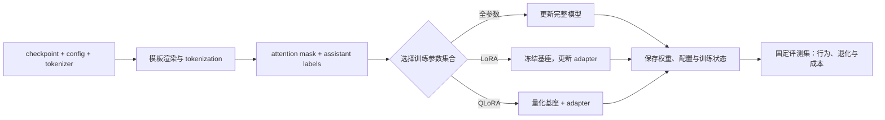

# 第 4 章（上）：基线、监督数据与全参数 SFT

开始微调之前，先把基座模型（base model，也就是这次训练前的模型）的输入、输出和生成方式摸清楚。否则训练后答案变了，我们无法判断变化来自监督数据、模板、解码参数，还是模型权重。本部分先建立这条基线：模型、配置和 tokenizer 如何配套，文本怎样变成 token，生成时怎样读出新回答。

本章沿一条训练与验证路径分为三个部分：

| 部分 | 主要工作 | 留下的结果 |
| --- | --- | --- |
| 基线、监督数据与全参数 SFT | 固定基座行为，构造并审计监督目标，再完成全参数训练 | 可比较的基线和可复原训练状态 |
| LoRA 与 QLoRA | 在相同监督目标下比较低秩适配与量化基座 | adapter、配置和资源对照 |
| 评估与报告 | 固定比较条件，保存逐样本输出和评分 | 有证据边界的行为变化报告 |

三部分共享同一份监督目标；全参数、LoRA 和 QLoRA 改变的是可训练参数与基座权重存储方式。数据目标相同，方法才有可比较性。



图中的分支共享同一份数据目标；变化的是参数更新和权重存储。若模板或 labels mask 不同，即使使用相同 LoRA 配置，也不是同一个监督实验。

## 4.1 从模型快照到第一次生成

### 4.1.1 权重、配置与 tokenizer 是一个整体

Checkpoint 是一份模型快照，通常包含权重以及恢复模型结构所需的配置；tokenizer 则决定文本如何切成 token、每个整数 id 对应什么内容。把模型 A 的 tokenizer 换成模型 B 的 tokenizer，即使层结构相同，整数 123 也可能代表完全不同的片段。

两者都必须满足的最低要求是：

```math
0\leq x_{b,t}<V,
\qquad
V=\mathrm{vocab\_size}
```

其中 $x_{b,t}$ 是 token id，$V$ 是 embedding 可接受的词表大小。如果 tokenizer 添加了新 token，必须同步扩展模型 embedding 和输出头；只改 tokenizer 文件不能凭空产生新的向量。

可复现记录还应包含仓库 revision、Transformers/PyTorch 版本、dtype、设备，以及是否执行了远程自定义代码。一个随时间变化的默认分支名称，不足以标识一个固定模型。

本章的 Hugging Face 接口示例按 Transformers v5.17.0、PEFT v0.18.0 和 TRL v1.14.1 的文档核对；这组文档版本不等于一份已经联调验证的依赖锁。代码中的 `sshleifer/tiny-gpt2` 固定到 commit `5f91d94bd9cd7190a9f3216ff93cd1dd95f2c7be`，QLoRA 示例的 `Qwen/Qwen2.5-0.5B` 固定到 commit `b937cc073b55e980e6f21d5f8b7a77818efcf0eb`；加载 tokenizer 和模型时使用同一个 revision。两份固定快照分别见 [tiny-gpt2 文件树](https://huggingface.co/sshleifer/tiny-gpt2/tree/5f91d94bd9cd7190a9f3216ff93cd1dd95f2c7be) 和 [Qwen2.5-0.5B 文件树](https://huggingface.co/Qwen/Qwen2.5-0.5B/tree/b937cc073b55e980e6f21d5f8b7a77818efcf0eb)。

### 4.1.2 Causal LM 的 forward 形状

给定序列 $x_0,\ldots,x_{T-1}$，自回归语言模型分解联合概率：

```math
p_\theta(x_0,\ldots,x_{T-1})
=
\prod_{t=0}^{T-1}
p_\theta(x_t\mid x_0,\ldots,x_{t-1})
```

模型输入和输出的形状通常是：

```math
X\in\mathbb{Z}^{B\times T},
\qquad
Z=f_\theta(X)\in\mathbb{R}^{B\times T\times V}
```

位置 $t$ 的 logits 是 softmax 前的词表分数，用来预测位置 $t+1$ 的 token。下面的 next-token loss 假设 $T\geq 2$：只有这样才存在至少一个相邻 token 对；长度为 0 或 1 的序列不能单独产生 next-token 监督，不能用一个人为的 0 loss 掩盖这个事实。

```math
\mathcal{L}
=
-\frac{1}{T-1}
\sum_{t=0}^{T-2}
\log p_\theta(x_{t+1}\mid x_0,\ldots,x_t)
```

许多 Hugging Face CausalLM 类在接收等长 labels 后会在内部完成 shift。自己写 loss 时要确认这一点；手动错位后再交给会再次错位的模型，会让目标错一位。

> 代码状态：静态审阅，未运行（2026-10-29）

```python
import torch
from transformers import AutoModelForCausalLM, AutoTokenizer


model_name = "sshleifer/tiny-gpt2"
model_revision = "5f91d94bd9cd7190a9f3216ff93cd1dd95f2c7be"
tokenizer = AutoTokenizer.from_pretrained(
    model_name,
    revision=model_revision,
)
model = AutoModelForCausalLM.from_pretrained(
    model_name,
    revision=model_revision,
)

if tokenizer.pad_token is None:
    tokenizer.pad_token = tokenizer.eos_token
if tokenizer.pad_token_id is None:
    raise ValueError("tokenizer needs pad_token_id or eos_token_id")
model.config.pad_token_id = tokenizer.pad_token_id
model.eval()

inputs = tokenizer("Hello, my name is", return_tensors="pt")
with torch.inference_mode():
    outputs = model(**inputs)

print("input_shape=", tuple(inputs["input_ids"].shape))
print("logits_shape=", tuple(outputs.logits.shape))
```
若 $B=1$，输出应为 $(1,T,V)$。这里的 $T$ 是 token 数而不是字符数；不同 tokenizer 会对中文、英文、空格和标点产生不同切分。

### 4.1.3 编码、解码与生成

tokenizer 的编码结果通常包含 input_ids 和 attention_mask：

> 代码状态：静态审阅，未运行（2026-10-29）

```python
encoded = tokenizer("A small language model.", return_tensors="pt")
print(encoded["input_ids"])
print(encoded["attention_mask"])
```
attention mask 满足：

```math
A\in\{0,1\}^{B\times T}
```

有效 token 为 1，padding 为 0。单条不补齐的输入看不出它的重要性；批量输入不同长度的 prompt 时，它是模型区分真实内容和占位符的依据。

generate 是一个重复过程：读取最后一个有效位置的 logits，选择一个 token，把它拼回上下文，再预测下一步，直到 EOS 或长度上限：

```text
prompt → logits → 选择 token → 追加 token → logits → … → 停止
```

贪心选择可以写为：

```math
x_{t+1}
=
\arg\max_v p_\theta(v\mid x_{\leq t})
```

温度采样使用：

```math
p_\tau(v)
=
\frac{\exp(z_v/\tau)}
{\sum_u\exp(z_u/\tau)}
```

这里 $\tau$ 是 temperature，避免和序列长度 $T$ 混淆。温度只改变已有分布的尖锐程度，不会增加模型知识。top-k 保留最高分的固定数量候选，top-p 保留累计概率达到阈值的最小候选集合；第3章已展开这两种过滤方式。

> 代码状态：静态审阅，未运行（2026-10-29）

```python
prompt = "The capital of France is"
inputs = tokenizer(prompt, return_tensors="pt")

with torch.inference_mode():
    output_ids = model.generate(
        **inputs,
        max_new_tokens=24,
        do_sample=False,
        pad_token_id=tokenizer.eos_token_id,
    )

prompt_length = inputs["input_ids"].shape[-1]
new_ids = output_ids[0, prompt_length:]
print(tokenizer.decode(new_ids, skip_special_tokens=True))
```
max_new_tokens 是新增 token 数。若 prompt 长度为 $T_p$，上限为 $M$，则：

```math
T_{\mathrm{final}}\leq T_p+M
```

评估时应切掉 prompt 再解码，否则问题中的关键词会被误算为模型输出。

### 4.1.4 设备、dtype 与 batch padding

eval() 和 inference_mode() 解决不同问题：

```text
eval()：关闭 dropout 等训练态行为。
inference_mode()：不构建反向图，减少推理开销。
```

小模型可以手动放到设备：

> 代码状态：静态审阅，未运行（2026-10-29）

```python
device = "cuda" if torch.cuda.is_available() else "cpu"
model.to(device)
model.eval()
inputs = tokenizer("A short prompt.", return_tensors="pt").to(device)

with torch.inference_mode():
    output_ids = model.generate(
        **inputs,
        max_new_tokens=32,
        do_sample=False,
        pad_token_id=tokenizer.eos_token_id,
    )
```
大模型常使用 Accelerate 的自动放置：

> 代码状态：静态审阅，未运行（2026-10-29）

```python
model = AutoModelForCausalLM.from_pretrained(
    model_name,
    revision=model_revision,
    dtype="auto",
    device_map="auto",
)
```
使用 `device_map="auto"` 后不要无条件再调用 `model.to("cuda")`，因为模型可能被分布到多张 GPU、CPU 或 offload 目录。这里按 Transformers v5.17.0 的 `dtype` 参数书写；在其他版本中应查对应版本签名，不要把不同版本的参数名混在同一份复现实验里。

批量生成时通常使用左侧 padding：

> 代码状态：静态审阅，未运行（2026-10-29）

```python
tokenizer.padding_side = "left"
if tokenizer.pad_token is None:
    tokenizer.pad_token = tokenizer.eos_token

batch = tokenizer(
    ["The capital of France is", "The largest planet is"],
    padding=True,
    return_tensors="pt",
)

with torch.inference_mode():
    output_ids = model.generate(
        **batch,
        max_new_tokens=24,
        do_sample=False,
        pad_token_id=tokenizer.pad_token_id,
    )
```
decoder-only 生成通常从批次最后一个位置继续。左补齐能让每条样本的最后位置仍是有效 prompt token；具体仍应遵循目标模型 tokenizer 的设置和运行时提示。

### 4.1.5 只验证接口的纯 Python 实验

没有 torch 或无法下载模型时，可以先检查 shape、padding 和生成长度。下面只模拟输入输出接口，不模拟语言能力：

> 代码状态：静态审阅，未运行（2026-10-29）

```python
class Shape:
    def __init__(self, value):
        self.shape = value


class ToyTokenizer:
    def __init__(self):
        self.tokens = ["<pad>", "<eos>", "<unk>", "Hello", "my", "name", "is", "I", "am", "toy"]
        self.ids = {token: i for i, token in enumerate(self.tokens)}
        self.pad_token_id = 0
        self.eos_token_id = 1
        self.unk_token_id = 2
        self.padding_side = "left"

    def __len__(self):
        return len(self.tokens)

    def __call__(self, texts, padding=False):
        if isinstance(texts, str):
            texts = [texts]
        rows = [
            [self.ids.get(piece, self.unk_token_id) for piece in text.split()]
            for text in texts
        ]
        if padding:
            width = max(len(row) for row in rows)
            rows = [
                [self.pad_token_id] * (width - len(row)) + row
                for row in rows
            ]
        masks = [
            [0 if token_id == self.pad_token_id else 1 for token_id in row]
            for row in rows
        ]
        return {"input_ids": rows, "attention_mask": masks}

    def decode(self, ids):
        return " ".join(self.tokens[i] for i in ids if i not in {0, 1})


class ToyModel:
    def __init__(self, vocab_size):
        self.vocab_size = vocab_size
        self.next_token = {5: 6, 6: 7, 7: 8, 8: 1}

    def eval(self):
        return self

    def __call__(self, input_ids, attention_mask=None):
        return type("Output", (), {
            "logits": Shape((len(input_ids), len(input_ids[0]), self.vocab_size))
        })()

    def generate(self, input_ids, max_new_tokens):
        rows = [list(row) for row in input_ids]
        for row in rows:
            for _ in range(max_new_tokens):
                token_id = self.next_token.get(row[-1], 1)
                row.append(token_id)
                if token_id == 1:
                    break
        return rows


tokenizer = ToyTokenizer()
model = ToyModel(len(tokenizer)).eval()
single = tokenizer("Hello my name is")
batch = tokenizer(["Hello my name is", "Hello"], padding=True)
output = model(**single)
generated = model.generate(single["input_ids"], max_new_tokens=4)

print("vocab_match=", model.vocab_size == len(tokenizer))
print("single_logits_shape=", output.logits.shape)
print("batch_attention_mask=", batch["attention_mask"])
print("new_tokens=", len(generated[0]) - len(single["input_ids"][0]))
print("decoded=", tokenizer.decode(generated[0]))
```
vocab_match 为 True、logits 最后一维等于词表大小、左侧 padding 为 0，说明最基本的数据流闭合；这不能证明模型具有任何任务能力。

### 4.1.6 第一次运行的实验记录

第一次成功生成应留下可复现记录：

```text
模型名称与 revision。
tokenizer 词表大小和 special token id。
Transformers、PyTorch、Accelerate 版本。
设备、dtype、device_map。
prompt 的原文和 token 数。
生成参数、随机种子、完整输出和新生成部分。
```

这些字段让后续的 SFT、LoRA 和评估有共同基线。只保存一张输出截图，无法判断变化来自模型参数、模板、采样参数还是依赖版本。

先做一个能手算的边界检查：若 prompt 编码后有 12 个 token，`max_new_tokens=8` 表示最多追加 8 个，总长度最多为 20；它不会把 prompt 截到 8 个。批量输入时，长度不同的两条 prompt 要靠 padding 对齐。左 padding 后长度为 3 和 5 的输入可写成 $[0,0,a,b,c]$ 与 $[u,v,w,x,y]$，末列都是有效 token；但 position ids 和 mask 必须与目标模型、运行时的约定一致，不能仅凭“decoder-only 通常左 padding”推断所有模型都如此。

第一次生成时，固定一个短 prompt，检查渲染后的文本、input ids、attention mask、position ids、新增 token ids 和停止原因，再单独解码新增部分。这样可以看出 BOS/EOS 是否重复、模板是否在末尾提供了正确的 assistant 起始标记，以及返回序列是否把 prompt 误算成回答。Chat template 是模型输入协议的一部分；训练和推理若使用不同模板，模型看到的角色边界就可能不同。下一节把这条协议落实到训练 labels。

模型、配置和 tokenizer 要作为一个整体记录。检查 tokenizer 长度、配置中的 vocab size 和实际 embedding 行数；新增 2 个 special tokens 而 embedding 没扩容会越界，token id 被映射到另一个合法行则可能静默改变含义。manifest 应固定模型与 tokenizer 的 commit revision、文件 hash、模板版本、依赖、dtype、设备和许可。模型名相同或一次加载成功，都不能替代版本记录。

上下文窗口还要同时容纳 prompt 和生成预算。若上限为 4096，设置 `max_new_tokens=1024` 后，prompt 最多占 3072 个位置；已有 3500 个 token 时，两者冲突，必须按模型/API 的截断规则调整并记录。预算应在 tokenization 后计算，不能用字符数猜测。解码时还要区分 EOS、服务端 stop string 和长度上限这三种停止原因，因为它们会产生不同的输出长度与格式结果。

自动设备映射时，模型可能分布在多张 GPU、CPU 或 offload 目录，不能据单个参数的 `device` 推断整模型位置，也不要再无条件调用 `model.to("cuda")`。先用短输入检查目标 checkpoint 能否加载和生成，再测试变长 batch、padding 与峰值显存；纯 Python toy 成功只能说明数据处理规则正确，不能证明目标权重或 GPU kernel 可用。保存原始响应和 token ids 后，后续才能把 SFT 引起的内容变化与模板、停止规则或设备差异区分开。

要让训练结果可解释，下一节先把对话模板展开，逐个标出哪些 token 作为条件、哪些 token 进入 loss。

基座模型已经能按固定模板生成回答。现在要决定训练时究竟教它什么：用户消息通常是条件，assistant 的回答通常是预测目标，但一条对话会被模板展开成一整串 token。读完本节，你应能检查模板边界、回答 mask、截断和 padding，知道每个有效 label 对应哪一个回答 token。

## 4.2 把对话变成监督信号

### 4.2.1 SFT 学习的是条件分布

先看一条最简单的样本：用户问“天气如何？”，assistant 回答“晴天”。模型必须同时看到问题和回答，才能学到“在这个问题下怎样接着说”；但如果训练目标是 assistant-only，问题 token 只是上下文，真正进入 loss 的是回答 token 和约定的结束符。监督微调（supervised fine-tuning, SFT）因此学习的是给定对话条件时的回答分布。

这类样本至少包含条件和目标：

```text
条件：system、user 以及此前的对话历史。
目标：assistant 希望生成的回答。
```

单轮样本可以写成：

```math
(\mathrm{prompt}_i,\mathrm{response}_i)
```

完整训练序列是：

```math
x_i
=
\mathrm{Tokenize}
(\mathrm{prompt}_i\oplus\mathrm{response}_i\oplus\mathrm{EOS})
```

只把 response 喂给模型会丢掉任务条件，只把 prompt 喂给模型又没有目标。SFT 的目标是提高：

```math
p_\theta(\mathrm{response}\mid\mathrm{prompt})
```

传统 instruction/input/output 数据可以写成：

> 代码状态：静态审阅，未运行（2026-10-29）

```python
example = {
    "instruction": "把下面的句子翻译成英文。",
    "input": "我喜欢机器学习。",
    "output": "I like machine learning.",
}
```
现代聊天数据常写成 messages：

> 代码状态：静态审阅，未运行（2026-10-29）

```python
messages = [
    {"role": "system", "content": "你是一个严谨的助手。"},
    {"role": "user", "content": "什么是梯度下降？"},
    {
        "role": "assistant",
        "content": "梯度下降沿负梯度方向更新参数以降低损失。",
    },
]
```
两种表示最终都要变成 token id。决定模型行为的不是字段名称，而是模板渲染后的序列、特殊 token 和参与 loss 的位置。

### 4.2.2 模板属于训练分布

一个简单模板可以这样渲染：

> 代码状态：静态审阅，未运行（2026-10-29）

```python
def format_instruction(example):
    instruction = example["instruction"].strip()
    extra_input = example.get("input", "").strip()
    if extra_input:
        prompt = (
            "### Instruction:\n"
            + instruction
            + "\n\n### Input:\n"
            + extra_input
            + "\n\n### Response:\n"
        )
    else:
        prompt = (
            "### Instruction:\n"
            + instruction
            + "\n\n### Response:\n"
        )
    return prompt, example["output"].strip()
```
推理时必须复用同一套边界：

> 代码状态：静态审阅，未运行（2026-10-29）

```python
def build_prompt(instruction, extra_input=""):
    if extra_input.strip():
        return (
            "### Instruction:\n"
            + instruction.strip()
            + "\n\n### Input:\n"
            + extra_input.strip()
            + "\n\n### Response:\n"
        )
    return (
        "### Instruction:\n"
        + instruction.strip()
        + "\n\n### Response:\n"
    )
```
聊天模型应优先使用自己的 tokenizer 提供的 chat template：

> 代码状态：静态审阅，未运行（2026-10-29）

```python
prompt_messages = [
    {"role": "system", "content": "你是一个严谨的助手。"},
    {"role": "user", "content": "解释过拟合。"},
]

prompt = tokenizer.apply_chat_template(
    prompt_messages,
    tokenize=False,
    add_generation_prompt=True,
)
```

add_generation_prompt=True 适合推理，把序列渲染到 assistant 即将开始的位置；训练样本已经含有 assistant 回答时，通常使用 False。一个模型的 role 标记、换行和结束 token 不能移植到另一个模型。模板的微小差异也会改变 token 边界和监督位置。
### 4.2.3 labels mask 的数学定义

设完整序列为 $x_0,\ldots,x_{T-1}$，回答区域由 $m_t$ 标记：

```math
m_t=
\begin{cases}
0,& t\in\mathrm{prompt\ or\ padding}\\
1,& t\in\mathrm{assistant\ response}
\end{cases}
```

labels 写成：

```math
y_t=
\begin{cases}
-100,&m_t=0\\
x_t,&m_t=1
\end{cases}
```

PyTorch 的交叉熵默认把 -100 当作 `ignore_index`。prompt token 仍然保留在 `input_ids` 中，作为回答的上下文；它们只是不会成为监督目标。参见 [PyTorch 2.14.0 CrossEntropyLoss 文档](https://docs.pytorch.org/docs/2.14/generated/torch.nn.CrossEntropyLoss.html)。

若模型内部负责 causal shift，labels 与 input_ids 等长，位置 $t-1$ 的 logits 预测 labels 位置 $t$。令 $S=\sum_{t=1}^{T-1}m_t$ 为这个序列中真正参与监督的回答 token 数。下面的 assistant-only 目标只在 $S>0$ 时有定义；一个被截断到只剩 prompt 的样本不应进入 loss 的平均：

```math
\mathcal{L}_{\mathrm{assistant}}
=
-
\frac{
\sum_{t=1}^{T-1}
m_t\log p_\theta(x_t\mid x_{0:t-1})
}{
\sum_{t=1}^{T-1}m_t
}
```

回答结尾的 EOS 是否参与监督必须明确。把 EOS 纳入回答区域，模型更容易学到停止位置；如果模板把 EOS 放在 assistant 区域之外，mask 可能把它漏掉。应把有效 labels 解码出来检查。

### 4.2.4 用 offset mapping 构造回答 mask

对简单文本模板，可以用 fast tokenizer 的字符偏移定位 prompt 结束位置：

> 代码状态：静态审阅，未运行（2026-10-29）

```python
def tokenize_sft_example(example, tokenizer, max_length=512):
    if not isinstance(max_length, int) or max_length <= 0:
        raise ValueError("max_length must be a positive integer")
    if not getattr(tokenizer, "is_fast", False):
        raise ValueError("offset mapping requires a fast tokenizer")
    prompt, response = format_instruction(example)
    if not response:
        raise ValueError("response must contain at least one character")
    if tokenizer.eos_token is None:
        raise ValueError("tokenizer.eos_token is required for this example")
    full_text = prompt + response + tokenizer.eos_token
    encoded = tokenizer(
        full_text,
        add_special_tokens=False,
        truncation=True,
        max_length=max_length,
        return_offsets_mapping=True,
    )

    labels = []
    prompt_end = len(prompt)
    for token_id, (start, end) in zip(
        encoded["input_ids"],
        encoded["offset_mapping"],
    ):
        # Token boundaries cannot be split; mask any token that overlaps the prompt.
        labels.append(
            -100 if start < prompt_end else token_id
        )
    if not labels or not any(label != -100 for label in labels):
        raise ValueError(
            "truncation removed every supervised token; reserve space for response"
        )
    return {
        "input_ids": encoded["input_ids"],
        "attention_mask": encoded["attention_mask"],
        "labels": labels,
    }
```
不能默认把 tokenize(prompt) 得到的 token 数当作完整序列的切分点。BPE 或 byte-level tokenizer 可能在边界处合并片段，两个独立 tokenize 的边界不一定相同。offset mapping 描述 token 覆盖的字符区间，通常更可靠；但它要求 fast tokenizer，特殊 token 的 offset 仍需实际检查。若 token 横跨 prompt 与 response 的分界，tokenizer 无法把它拆成半个 token；这里保守地把整个边界 token mask 掉，避免把 prompt 字符纳入目标，代价是可能少监督回答开头的一小段。截断后仍须检查至少有一个回答 token 留在监督区。

聊天模板可以尝试使用 assistant mask：

> 代码状态：静态审阅，未运行（2026-10-29）

```python
encoded = tokenizer.apply_chat_template(
    messages,
    tokenize=True,
    return_dict=True,
    add_generation_prompt=False,
    return_assistant_tokens_mask=True,
)

if "assistant_masks" not in encoded:
    raise RuntimeError(
        "this tokenizer/template did not return assistant_masks; "
        "inspect the template before constructing labels"
    )
input_ids = encoded["input_ids"]
assistant_mask = encoded["assistant_masks"]
if len(input_ids) != len(assistant_mask) or not any(assistant_mask):
    raise ValueError("assistant mask must align with input_ids and mark a response")
labels = [
    token_id if flag else -100
    for token_id, flag in zip(input_ids, assistant_mask)
]
```
这个接口依赖 Transformers 版本和模板中的 `` 标记。Transformers v5.17.0 文档规定，只有支持该标记的 chat template 才能返回 assistant mask；运行时应打印 `encoded.keys()`，确认返回的 mask 真的覆盖回答。不支持 mask 时，应经过验证后使用 offset mapping 或框架提供的 completion-only 方案，不能无声地把整条序列都当成回答。参见 [Transformers v5.17.0 tokenizer 文档](https://huggingface.co/docs/transformers/v5.17.0/main_classes/tokenizer)。

使用 TRL `SFTTrainer` 时，参数名还会随数据格式选择不同监督范围。TRL v1.14.1 把 `completion_only_loss` 用于 prompt-completion 数据，把 `assistant_only_loss` 用于 conversational 数据；后者依赖 chat template 暴露 assistant generation 区间。二者不是“开哪个都一样”：prompt-completion 的 completion 边界与多轮对话中的 assistant 消息边界并不相同。若数据已预先构造 `labels=-100`，该版本会直接采用这些 labels；仍要核对 mask 是否与预期监督范围一致。参见 [TRL v1.14.1 SFTTrainer 文档](https://huggingface.co/docs/trl/v1.14.1/sft_trainer)。

### 4.2.5 截断与有效监督 token

回答通常位于序列尾部，普通 truncation 又常从尾部截断，因此可能出现：

```text
prompt 被保留。
response 被完全截掉。
labels 全是 -100。
训练循环仍运行，但没有有效监督。
```

有效监督 token 数为：

```math
n_{\mathrm{sup}}
=
\sum_{t=0}^{T-1}\mathbf{1}[y_t\neq-100]
```

样本至少要满足 $n_{\mathrm{sup}}>0$。如果任务要求完整 JSON、代码或回答，还要检查 EOS 是否存在、结构是否被截断。

> 代码状态：静态审阅，未运行（2026-10-29）

```python
def has_supervision(feature):
    return any(label != -100 for label in feature["labels"])


def supervision_count(feature):
    return sum(label != -100 for label in feature["labels"])
```
更稳妥的做法是先限制过长对话历史，再为回答保留空间；不能只把 max_length 调大而不检查显存和模型上下文上限。

### 4.2.6 三个字段必须同步 padding

batch 中应有：

```math
X,A,Y\in\mathbb{Z}^{B\times T_{\max}}
```

```text
X：input_ids，padding 使用 pad_token_id。
A：attention_mask，padding 使用 0。
Y：labels，padding 使用 -100。
```

最小 collator：

本实现固定使用右侧 padding，符合下面 `pad_sequence` 的输出方式。上一节生成示例中的左侧 padding 用于 decoder-only 批量生成；两种场景的 padding 位置约定不能混用。

> 代码状态：静态审阅，未运行（2026-10-29）

```python
import torch


class SFTDataCollator:
    def __init__(self, tokenizer, label_pad_token_id=-100):
        self.tokenizer = tokenizer
        self.label_pad_token_id = label_pad_token_id
        if tokenizer.pad_token_id is None:
            raise ValueError("SFT padding requires tokenizer.pad_token_id")
        if tokenizer.padding_side != "right":
            raise ValueError("this collator requires right-side padding")
        if label_pad_token_id != -100:
            raise ValueError("this chapter uses -100 as the loss ignore index")

    def __call__(self, features):
        if not features:
            raise ValueError("cannot collate an empty feature list")
        required = {"input_ids", "attention_mask", "labels"}
        for index, item in enumerate(features):
            missing = required.difference(item)
            if missing:
                raise ValueError(
                    f"feature {index} is missing fields: {sorted(missing)}"
                )
            lengths = {len(item[key]) for key in required}
            if len(lengths) != 1 or not lengths or min(lengths) == 0:
                raise ValueError(
                    f"feature {index} has empty or misaligned sequence fields"
                )
            vocab_size = len(self.tokenizer)
            if any(
                value < 0 or value >= vocab_size
                for value in item["input_ids"]
            ):
                raise ValueError(
                    f"feature {index} contains an input id outside the tokenizer vocabulary"
                )
            if any(value not in {0, 1} for value in item["attention_mask"]):
                raise ValueError(f"feature {index} has a non-binary attention mask")
            if any(
                value < 0 and value != self.label_pad_token_id
                for value in item["labels"]
            ):
                raise ValueError(f"feature {index} has an invalid label value")
            if any(
                value >= vocab_size
                for value in item["labels"]
                if value != self.label_pad_token_id
            ):
                raise ValueError(
                    f"feature {index} contains a target id outside the tokenizer vocabulary"
                )
            if not any(value != self.label_pad_token_id for value in item["labels"]):
                raise ValueError(
                    f"feature {index} has no supervised token after truncation"
                )
            if any(
                mask_value == 0 and label_value != self.label_pad_token_id
                for mask_value, label_value in zip(
                    item["attention_mask"], item["labels"]
                )
            ):
                raise ValueError(
                    f"feature {index} supervises a padding position"
                )
        input_ids = [
            torch.tensor(item["input_ids"], dtype=torch.long)
            for item in features
        ]
        attention_mask = [
            torch.tensor(item["attention_mask"], dtype=torch.long)
            for item in features
        ]
        labels = [
            torch.tensor(item["labels"], dtype=torch.long)
            for item in features
        ]
        return {
            "input_ids": torch.nn.utils.rnn.pad_sequence(
                input_ids,
                batch_first=True,
                padding_value=self.tokenizer.pad_token_id,
            ),
            "attention_mask": torch.nn.utils.rnn.pad_sequence(
                attention_mask,
                batch_first=True,
                padding_value=0,
            ),
            "labels": torch.nn.utils.rnn.pad_sequence(
                labels,
                batch_first=True,
                padding_value=self.label_pad_token_id,
            ),
        }
```
训练前做断言：

> 代码状态：静态审阅，未运行（2026-10-29）

```python
assert batch["input_ids"].shape == batch["attention_mask"].shape
assert batch["input_ids"].shape == batch["labels"].shape
for mask_row, label_row in zip(
    batch["attention_mask"],
    batch["labels"],
):
    for mask_value, label_value in zip(
        mask_row.tolist(),
        label_row.tolist(),
    ):
        if mask_value == 0:
            assert label_value == -100
```
这种检查能在梯度计算前发现字段错位，比训练数小时后猜测 loss 异常原因更可靠。还要把三个 mask 概念分开：`attention_mask` 标记哪些输入位置是有效上下文；causal mask 限制每个位置能看见哪些未来 token；`labels=-100` 表示该目标位置不计 loss。padding 的 `attention_mask` 和 label 都应屏蔽，prompt 通常保留为上下文、只在 labels 中屏蔽。过滤或截断后若一个 batch 的 labels 全为 `-100`，平均 loss 没有有效分母，collator 应在更新前拒绝它。实际训练还要确认模型 embedding 行数覆盖 tokenizer 的全部 id；collator 不能替代模型侧检查。

监督边界已经画清楚，但样本是否独立、是否被截断、来自哪一版模板，还决定评估能否解释训练结果。接下来先做数据审计，再进入全参数 SFT。

前面的部分把对话写成 input、attention mask 和 labels；开始训练前，还要确认数据切分没有泄漏、过滤和截断没有留下空目标，并且能查回当时使用的模板与 tokenizer 版本。本节先逐项检查这些问题，再把同一组 labels 交给全参数 SFT。这样，结果变化更可能来自训练方法，而不是数据处理时不易察觉的改动。

## 4.2（续）：数据质量与版本

### 4.2.7 数据质量、去重与分组划分

SFT 清洗至少应覆盖：

```text
任务是否清楚，输入和输出是否错位。
回答是否真正回应问题，而不是复制提示。
空答案、乱码、模板残片、HTML 噪声。
重复样本和近似重复样本。
代码、JSON、表格和公式是否能解析。
来源、许可证、隐私和安全限制。
```

把同一文档切成相邻片段后随机拆分，会让验证集与训练集高度相似。更可靠的方式是按文档、来源、用户或任务族分组。每条记录应保存元数据：

> 代码状态：静态审阅，未运行（2026-10-29）

```python
record = {
    "id": "example-0001",
    "source": "human_written",
    "task": "translation",
    "language": "zh-en",
    "license": "recorded_in_dataset_card",
    "messages": messages,
}
```
这样坏例能够追溯到数据来源和任务桶，而不是只知道某个 token 预测错误。

### 4.2.8 纯 Python 预处理实验

下面的程序模拟模板、mask、截断、去重和 padding：

> 代码状态：静态审阅，未运行（2026-10-29）

```python
import re


class ToyTokenizer:
    def __init__(self):
        self.pad_token = "<pad>"
        self.eos_token = "<eos>"
        self.pad_token_id = 0
        self.vocab = {self.pad_token: 0, self.eos_token: 1}
        self.inverse = {0: self.pad_token, 1: self.eos_token}

    def encode(self, text):
        pieces = re.findall(r"\n|[^\s]+", text)
        ids = []
        for piece in pieces:
            if piece not in self.vocab:
                index = len(self.vocab)
                self.vocab[piece] = index
                self.inverse[index] = piece
            ids.append(self.vocab[piece])
        return ids

    def decode(self, ids):
        return " ".join(
            self.inverse[index]
            for index in ids
            if index not in {self.pad_token_id, 1}
        )


def format_example(example):
    prompt = (
        "Instruction: "
        + example["instruction"]
        + "\nResponse: "
    )
    return prompt, example["output"].strip()


def preprocess(example, tokenizer, max_length=32):
    if not isinstance(max_length, int) or max_length <= 0:
        raise ValueError("max_length must be a positive integer")
    prompt, response = format_example(example)
    if not response:
        raise ValueError("response must not be empty")
    prompt_ids = tokenizer.encode(prompt)
    full_ids = tokenizer.encode(
        prompt + response + " " + tokenizer.eos_token
    )
    input_ids = full_ids[:max_length]
    labels = input_ids[:]
    labels[:min(len(prompt_ids), len(labels))] = [
        -100
    ] * min(len(prompt_ids), len(labels))
    return {
        "input_ids": input_ids,
        "attention_mask": [1] * len(input_ids),
        "labels": labels,
    }


def valid(feature):
    required = {"input_ids", "attention_mask", "labels"}
    if not required.issubset(feature):
        return False
    lengths = {len(feature[key]) for key in required}
    if len(lengths) != 1 or not lengths or min(lengths) == 0:
        return False
    return any(label != -100 for label in feature["labels"])


def collate(features, pad_token_id):
    if not features:
        raise ValueError("cannot collate an empty feature list")
    if pad_token_id is None:
        raise ValueError("pad_token_id is required")
    width = max(len(item["input_ids"]) for item in features)
    output = {"input_ids": [], "attention_mask": [], "labels": []}
    for item in features:
        pad_count = width - len(item["input_ids"])
        output["input_ids"].append(
            item["input_ids"] + [pad_token_id] * pad_count
        )
        output["attention_mask"].append(
            item["attention_mask"] + [0] * pad_count
        )
        output["labels"].append(
            item["labels"] + [-100] * pad_count
        )
    return output


raw = [
    {"instruction": "解释过拟合。", "output": "训练集好但泛化差。"},
    {"instruction": "解释过拟合。", "output": "训练集好但泛化差。"},
    {"instruction": "翻译。", "output": "I like machine learning."},
]

tokenizer = ToyTokenizer()
seen = set()
features = []
for example in raw:
    key = (example["instruction"], example["output"])
    if key in seen:
        continue
    seen.add(key)
    item = preprocess(example, tokenizer)
    if valid(item):
        features.append(item)

if not features:
    raise ValueError("all examples lost their supervised response during truncation")
batch = collate(features, tokenizer.pad_token_id)
response_ids = [
    token_id
    for token_id, label in zip(
        features[0]["input_ids"],
        features[0]["labels"],
    )
    if label != -100
]

print("unique_valid_examples=", len(features))
print("batch_width=", len(batch["input_ids"][0]))
print("supervised_tokens=", sum(
    label != -100 for label in features[0]["labels"]
))
print("response=", tokenizer.decode(response_ids))
print("padding_labels_ok=", all(
    label == -100
    for mask_row, label_row in zip(
        batch["attention_mask"],
        batch["labels"],
    )
    for mask, label in zip(mask_row, label_row)
    if mask == 0
))
```
真实 tokenizer 还要处理 BPE 边界和特殊 token，这个 toy 实验只负责让监督范围可见。

### 4.2.9 数据处理结果也要版本化

划分数据集时，随机种子只是必要条件。还应固定去重规则、分组键、tokenizer、chat template、max_length、截断策略和无监督样本过滤规则。原始文本不变，tokenizer 版本变化也可能改变 token 数、截断位置和有效监督 token 数。因此应保存可抽查的中间样本：

```text
渲染后的完整文本。
input_ids。
attention_mask。
labels。
有效监督 token 数。
来源与任务元数据。
```

考虑序列“用户问：天气？助手答：晴天 EOS”。若模板渲染成 8 个 token，前 4 个是问题，后 4 个是回答和 EOS，assistant-only labels 为 $[-100,-100,-100,-100,r_1,r_2,r_3,\mathrm{EOS}]$。input_ids 仍保留全部 8 个 token；若模型内部做 causal shift，位置 3 的 logits 预测 $r_1$。回答四个目标的 token loss 若为 1、2、1、2，平均值是 $6/4=1.5$；误把 prompt 的四个位置也纳入后，整体平均可能降到 $7/8=0.875$，看似更好，回答监督却没有改善。检查有效 labels 解码出的文本，并和 logits 的预测位置对照，才能确认监督边界。

多轮对话中，assistant 可能先发起工具调用，再收到工具结果，最后给用户答复。是否训练工具调用格式、拒答标记或所有 assistant 消息，取决于目标；工具返回通常是外部程序生成的内容，不应无意中变成模型要复述的目标。用角色时间线标出 input token、目标 token 和 mask，能看清模型到底被要求生成什么。completion-only 的显式 prompt/completion 边界与 assistant-only 的多轮消息边界也不能混用。

截断会直接改变目标。若 prompt 长 900 token、回答长 200 token，`max_length=1024` 的右侧截断只留下 124 个回答 token；对完整 JSON 任务，这可能留下没有闭合括号和 EOS 的样本。可以把历史压到 800，为回答预留 224 个位置，并统计截断率；超过预算的样本按任务策略裁剪、拆分或丢弃。不同策略会改变数据分布，必须写进数据版本。

经过切分、版本和有效目标审计，数据才适合进入训练。下面先用全参数更新建立基线，再讨论怎样减少可训练状态。

## 4.3 全参数 SFT：监督目标、显存与可恢复训练

### 4.3.1 全参数训练的含义

全参数 SFT 使用上一节的 masked causal loss，只把可更新参数集合设为整个模型：

```math
\Theta_{\mathrm{train}}
=
\Theta_{\mathrm{model}}
```

参数更新可抽象为：

```math
\theta_{k+1}
=
\theta_k-\eta\widehat{g}_k
```

全参数的适配自由度大，但基座模型原来的能力也更容易被新数据覆盖。小数据、大学习率或过多训练轮次会放大遗忘和过拟合。

### 4.3.2 显存估算

设可训练参数量为 $P$，权重、梯度和一个优化器状态元素分别占 $b_w,b_g,b_o$ 字节，一个粗略训练内存表达为：

```math
M_{\mathrm{train}}
\approx
P(b_w+b_g+2b_o)
+
M_{\mathrm{activation}}
+
M_{\mathrm{temporary}}
```

AdamW 通常保存一阶和二阶状态，所以出现 $2b_o$。实现还可能保留 fp32 master weights、梯度 scaler、通信 buffer 和 allocator 缓存。激活内存又随 batch、序列长度、层数、隐藏维度和 checkpointing 改变。

fp16 权重约占 $2P$ 字节只是推理权重的量级；模型能生成不代表同一设备能全参数训练。

### 4.3.3 Trainer 与有效 batch

Trainer 封装的仍是：

```text
collator → forward → masked loss → backward
→ optimizer.step → scheduler → logging/eval/save
```

下面的 `TrainingArguments` 和 `Trainer` 片段假设 `model`、`train_dataset`、`eval_dataset` 和 `data_collator` 已分别按 4.1、4.2 节准备好；它们不是可以脱离上下文直接运行的完整训练脚本。

小模型配置：

> 代码状态：静态审阅，未运行（2026-10-29）

```python
import torch
from transformers import TrainingArguments


training_args = TrainingArguments(
    output_dir="outputs/full_sft_tiny",
    num_train_epochs=3,
    per_device_train_batch_size=2,
    per_device_eval_batch_size=2,
    gradient_accumulation_steps=4,
    learning_rate=5e-5,
    weight_decay=0.01,
    logging_steps=10,
    eval_strategy="steps",
    eval_steps=20,
    save_steps=20,
    save_total_limit=2,
    fp16=torch.cuda.is_available(),
    report_to="none",
)
```
旧版 Transformers 可能使用 evaluation_strategy，新版 Trainer 也可能用 processing_class 保存 tokenizer，而旧版使用 tokenizer 参数。版本差异应通过本地签名确认。

> 代码状态：静态审阅，未运行（2026-10-29）

```python
from transformers import Trainer


trainer = Trainer(
    model=model,
    args=training_args,
    train_dataset=train_dataset,
    eval_dataset=eval_dataset,
    data_collator=data_collator,
    processing_class=tokenizer,
)
trainer.train()
trainer.save_model("outputs/full_sft_tiny/final")
tokenizer.save_pretrained("outputs/full_sft_tiny/final")
```
在数据并行、各设备 micro-batch 大小相同的条件下，梯度累积后的有效 batch size 近似为：

```math
B_{\mathrm{eff}}
=
B_{\mathrm{device}}
\times
N_{\mathrm{gpu}}
\times
G
```

但语言模型更应记录有效监督 token：

```math
N_{\mathrm{token,step}}
=
\sum_i\sum_t\mathbf{1}[y_{i,t}\neq-100]
```

当样本长度不同，逐 micro-batch 平均后再累积不一定等价于所有有效 token 的全局平均。严谨比较时要记录每步 token 数，必要时显式做 token-level normalization。

### 4.3.4 checkpointing 与恢复

gradient checkpointing 用重新计算换激活显存：

> 代码状态：静态审阅，未运行（2026-10-29）

```python
model.config.use_cache = False
model.gradient_checkpointing_enable()
```
KV cache 为逐 token 推理优化，通常不应与训练 checkpointing 同时开启。

可恢复 checkpoint 可能包含：

```text
模型参数、optimizer state、学习率调度器 state。
随机数状态、训练步数和 Trainer state。
```

只加载权重可以继续推理，却不一定能恢复原优化轨迹：

> 代码状态：静态审阅，未运行（2026-10-29）

```python
trainer.train(
    resume_from_checkpoint="outputs/full_sft_tiny/checkpoint-100"
)
```
恢复前应确认数据顺序、batch、梯度累积、随机种子和版本没有改变。改变有效 batch 后，旧 optimizer state 对新 token 语义未必合适。

### 4.3.5 手写训练循环

这个循环同样依赖已经构造好的 `model`、`train_dataset` 和 `data_collator`。它展示训练状态如何流动；真实任务还要先确认数据集非空，并为保存、恢复和评估定义明确的目录与策略。

> 代码状态：静态审阅，未运行（2026-10-29）

```python
import torch
from torch.optim import AdamW
from torch.utils.data import DataLoader


device = "cuda" if torch.cuda.is_available() else "cpu"
model.to(device)
model.train()
loader = DataLoader(
    train_dataset,
    batch_size=2,
    shuffle=True,
    collate_fn=data_collator,
)
optimizer = AdamW(model.parameters(), lr=5e-5)

for epoch in range(3):
    for step, batch in enumerate(loader):
        batch = {
            key: value.to(device)
            for key, value in batch.items()
        }
        loss = model(**batch).loss
        if not torch.isfinite(loss):
            raise FloatingPointError("non-finite loss")
        loss.backward()
        torch.nn.utils.clip_grad_norm_(model.parameters(), max_norm=1.0)
        optimizer.step()
        optimizer.zero_grad(set_to_none=True)
        if step % 10 == 0:
            print("epoch=", epoch, "step=", step, "loss=", loss.item())
```
这段示例已经做梯度裁剪和非有限 loss 检查。更完整的训练流程还需按实验目标配置混合精度、学习率 scheduler、周期性评估、checkpoint 保存与恢复，并确认梯度累积时 loss 和有效 token 分母的约定。理解底层状态流，可以在 Trainer 的默认行为不符合预期时逐层定位。

### 4.3.6 纯 Python 的 masked loss 更新实验

下面用 bigram logits 代替 Transformer，只验证目标 token 的梯度和全参数更新：

> 代码状态：静态审阅，未运行（2026-10-29）

```python
import math
import random


random.seed(7)
vocab_size = 10
if vocab_size <= 1:
    raise ValueError("vocab_size must be greater than one")
logits = [
    [random.uniform(-0.02, 0.02) for _ in range(vocab_size)]
    for _ in range(vocab_size)
]
data = [
    {"ids": [2, 3, 4, 5, 6, 1], "labels": [-100, -100, -100, 5, 6, 1]},
    {"ids": [2, 7, 4, 8, 9, 1], "labels": [-100, -100, -100, 8, 9, 1]},
]
if not data:
    raise ValueError("masked-loss toy experiment requires non-empty data")
for item in data:
    if len(item["ids"]) != len(item["labels"]):
        raise ValueError("ids and labels must have equal lengths")
    if not item["ids"]:
        raise ValueError("each sequence must contain at least one token")
    if any(token_id < 0 or token_id >= vocab_size for token_id in item["ids"]):
        raise ValueError("input token id is outside the toy vocabulary")
    if any(
        label != -100 and (label < 0 or label >= vocab_size)
        for label in item["labels"]
    ):
        raise ValueError("supervised label is outside the toy vocabulary")


def softmax(row):
    maximum = max(row)
    values = [math.exp(value - maximum) for value in row]
    total = sum(values)
    return [value / total for value in values]


def zeros():
    return [[0.0] * vocab_size for _ in range(vocab_size)]


def loss_grad(batch):
    grad = zeros()
    loss = 0.0
    count = 0
    for item in batch:
        for pos in range(1, len(item["ids"])):
            target = item["labels"][pos]
            if target == -100:
                continue
            row = item["ids"][pos - 1]
            probabilities = softmax(logits[row])
            loss -= math.log(max(probabilities[target], 1e-12))
            count += 1
            for token_id, probability in enumerate(probabilities):
                grad[row][token_id] += probability
            grad[row][target] -= 1.0
    if count == 0:
        raise ValueError("masked loss is undefined when no label is supervised")
    for row in grad:
        for column in range(vocab_size):
            row[column] /= count
    return loss / count, grad, count


def add(left, right):
    for row in range(vocab_size):
        for column in range(vocab_size):
            left[row][column] += right[row][column]


def update(grad, learning_rate):
    for row in range(vocab_size):
        for column in range(vocab_size):
            logits[row][column] -= learning_rate * grad[row][column]


initial, _, valid_tokens = loss_grad(data)
for _ in range(30):
    total_grad = zeros()
    for item in data:
        _, grad, _ = loss_grad([item])
        add(total_grad, grad)
    for row in total_grad:
        for column in range(vocab_size):
            row[column] /= len(data)
    update(total_grad, 1.2)

final, _, _ = loss_grad(data)
print("valid_tokens=", valid_tokens)
print("initial_loss=", round(initial, 4))
print("final_loss=", round(final, 4))
print("loss_decreased=", final < initial)
print("trainable_params=", vocab_size * vocab_size)
```
loss 下降只证明这组目标被优化了，不证明模型学会了自然语言或获得了泛化能力。后者必须用独立数据和行为评估确认。

### 4.3.7 全参数 SFT 的边界

应同时观察：

```text
训练和验证的 masked loss。
有效监督 token 数和实际训练 token 数。
固定 prompt 的输出。
独立任务、格式和安全样本。
```

学习率过大、数据量小而 epoch 过多、领域风格覆盖通用风格、训练集与验证集重复，都可能让 loss 看起来很好而行为变差。

把公式代入 7B 参数作一次量级估算：BF16 权重和梯度各约需 $7\times10^9\times2=14$ GB；Adam 的两个 FP32 moment 合计约需 $7\times10^9\times8=56$ GB。仅这四项就约 84 GB 十进制，若另有 FP32 master weights 再加约 28 GB。它们还没有计入激活、临时 workspace、通信 buffer 和碎片；框架、分片与 offload 会改变单卡分布，但不会让总状态凭空消失。84 GB 约为 78.2 GiB，报告时要说明单位以及测量口径。

参数状态之外，激活随 batch、序列长度和层数增长。attention 的朴素 score 矩阵在序列长度从 2048 增至 4096 时约扩大 4 倍。Activation checkpointing 少保存中间激活、反向时再计算，通常以额外计算换显存；梯度累积降低每个 micro-batch 的激活峰值，却不减少权重、梯度和 Adam 状态。比如每卡 micro-batch=1、序列长 2048、累积 8 次、4 卡数据并行，有效 batch 约 32 条序列，但每次前向仍只持有每卡当前 micro-batch 的激活。

动态 padding 或分布式训练下，还要看 loss 的分母。若 3 条回答分别有 5、10、20 个有效 token，先算每条均值再平均会让三条回答权重相同；把 35 个 token loss 求和后除以 35，则长回答权重更高。训练器的 reduction 与实验目标必须一致。warm-up 时应使用计划中的 batch 和序列长度，记录 peak allocated、peak reserved，并为 optimizer step、evaluation 和 checkpoint 留显存余量。

“全参数”也要通过参数名和数量核对，而不是只看 Trainer 开始运行。记录 `requires_grad` 参数总数、各模块计数及 optimizer 参数组；若 embedding、输出头或 norm 意外被冻结，实际就不是预期的更新范围。ZeRO/FSDP 可以分片参数、梯度和优化器状态，但会引入通信及 checkpoint 管理成本；本章的小模型示例用于讲清流程，不能直接当作 7B 生产训练配置。

学习率、训练轮数与数据覆盖共同影响遗忘风险。若数据集中在某种格式，重复训练过久可能改善格式指标却损害通用问答或安全行为；比较 epoch 时应固定验证数据，分开看目标格式、通用能力和安全类样本的结果，并保存按预定规则选出的 checkpoint。可复核报告至少写有效监督 token、全局 batch、optimizer updates、wall-clock、峰值显存、保存策略及恢复时加载了哪些状态。权重能加载、loss 能下降和完整续训是三个不同结论。

全参数训练提供了更新完整模型的基线。若训练状态或显存负担过大，可以在不改监督目标的前提下转向 LoRA。
