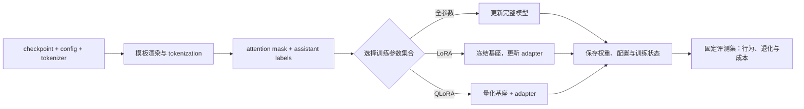

# 第 4 章（上）：先让基座模型按原样回答

开始微调之前，先把基座模型（base model，也就是这次训练前的模型）的输入、输出和生成方式摸清楚。否则训练后答案变了，我们无法判断变化来自监督数据、模板、解码参数，还是模型权重。第一篇先建立这条基线：模型、配置和 tokenizer 如何配套，文本怎样变成 token，生成时怎样读出新回答。

本章沿一条训练与验证路径分成七篇：

| 部分 | 这一篇回答什么 | 交给下一步什么 |
| --- | --- | --- |
| [上篇：模型与生成](04-huggingface微调实战-1-模型与生成.md) | 基座模型怎样读取输入并生成回答？ | 固定的模型身份与生成基线 |
| [第二篇：SFT 数据](04-huggingface微调实战-2-sft数据.md) | 对话中的哪些 token 是训练目标？ | 可审计的 input、mask 和 labels |
| [第三篇：数据审计与全参数 SFT](04-huggingface微调实战-3-data-audit-full-sft.md) | 样本是否适合训练？更新全部权重需要什么资源？ | 可复原的数据集与全参数训练基线 |
| [第四篇：LoRA](04-huggingface微调实战-4-lora.md) | 怎样只训练低秩增量？ | adapter 与资源账本 |
| [第五篇：QLoRA](04-huggingface微调实战-5-qlora.md) | 怎样把低比特基座纳入低秩微调？ | 量化配置与 adapter 产物 |
| [第六篇：评估协议与任务指标](04-huggingface微调实战-6-evaluation-metrics.md) | base 与 SFT 怎样在同一条件下比较？ | 固定的数据切片与指标口径 |
| [第七篇：自动评估与报告](04-huggingface微调实战-7-evaluation-report.md) | 怎样保存逐样本证据并写出有边界的结论？ | 可复核的行为对照报告 |

六篇共享同一份监督目标；全参数、LoRA 和 QLoRA 改变的是可训练参数与基座权重存储方式。数据目标相同，方法才有可比较性。



图中的分支共享同一份数据目标；变化的是参数更新和权重存储。若模板或 labels mask 不同，即使使用相同 LoRA 配置，也不是同一个监督实验。

## 4.1 从模型快照到第一次生成

### 4.1.1 权重、配置与 tokenizer 是一个整体

Checkpoint 是一份模型快照，通常包含权重以及恢复模型结构所需的配置；tokenizer 则决定文本如何切成 token、每个整数 id 对应什么内容。把模型 A 的 tokenizer 换成模型 B 的 tokenizer，即使层结构相同，整数 123 也可能代表完全不同的片段。

两者的最低契约是：

```math
0\leq x_{b,t}<V,
\qquad
V=\mathrm{vocab\_size}
```

其中 $x_{b,t}$ 是 token id，$V$ 是 embedding 可接受的词表大小。如果 tokenizer 添加了新 token，必须同步扩展模型 embedding 和输出头；只改 tokenizer 文件不能凭空产生新的向量。

可复现记录还应包含仓库 revision、Transformers/PyTorch 版本、dtype、设备，以及是否执行了远程自定义代码。一个随时间变化的默认分支名称，不足以标识一个固定模型。

本章的 Hugging Face 接口示例按 Transformers v5.17.0、PEFT v0.18.0 和 TRL v1.14.1 的文档核对；这组文档版本不等于一份已经联调验证的依赖锁。代码中的 `sshleifer/tiny-gpt2` 固定到 commit `5f91d94bd9cd7190a9f3216ff93cd1dd95f2c7be`，QLoRA 示例的 `Qwen/Qwen2.5-0.5B` 固定到 commit `b937cc073b55e980e6f21d5f8b7a77818efcf0eb`；加载 tokenizer 和模型时使用同一个 revision。两份固定快照分别见 [tiny-gpt2 文件树](https://huggingface.co/sshleifer/tiny-gpt2/tree/5f91d94bd9cd7190a9f3216ff93cd1dd95f2c7be) 和 [Qwen2.5-0.5B 文件树](https://huggingface.co/Qwen/Qwen2.5-0.5B/tree/b937cc073b55e980e6f21d5f8b7a77818efcf0eb)。

### 4.1.2 Causal LM 的 forward 形状

给定序列 $x_0,\ldots,x_{T-1}$，自回归语言模型分解联合概率：

```math
p_\theta(x_0,\ldots,x_{T-1})
=
\prod_{t=0}^{T-1}
p_\theta(x_t\mid x_0,\ldots,x_{t-1})
```

模型输入和输出的形状通常是：

```math
X\in\mathbb{Z}^{B\times T},
\qquad
Z=f_\theta(X)\in\mathbb{R}^{B\times T\times V}
```

位置 $t$ 的 logits 是 softmax 前的词表分数，用来预测位置 $t+1$ 的 token。下面的 next-token loss 假设 $T\geq 2$：只有这样才存在至少一个相邻 token 对；长度为 0 或 1 的序列不能单独产生 next-token 监督，不能用一个人为的 0 loss 掩盖这个事实。

```math
\mathcal{L}
=
-\frac{1}{T-1}
\sum_{t=0}^{T-2}
\log p_\theta(x_{t+1}\mid x_0,\ldots,x_t)
```

许多 Hugging Face CausalLM 类在接收等长 labels 后会在内部完成 shift。自己写 loss 时要确认这一点；手动错位后再交给会再次错位的模型，会让目标错一位。

> 代码状态：静态审阅，未运行（2026-10-29）

```python
import torch
from transformers import AutoModelForCausalLM, AutoTokenizer


model_name = "sshleifer/tiny-gpt2"
model_revision = "5f91d94bd9cd7190a9f3216ff93cd1dd95f2c7be"
tokenizer = AutoTokenizer.from_pretrained(
    model_name,
    revision=model_revision,
)
model = AutoModelForCausalLM.from_pretrained(
    model_name,
    revision=model_revision,
)

if tokenizer.pad_token is None:
    tokenizer.pad_token = tokenizer.eos_token
if tokenizer.pad_token_id is None:
    raise ValueError("tokenizer needs pad_token_id or eos_token_id")
model.config.pad_token_id = tokenizer.pad_token_id
model.eval()

inputs = tokenizer("Hello, my name is", return_tensors="pt")
with torch.inference_mode():
    outputs = model(**inputs)

print("input_shape=", tuple(inputs["input_ids"].shape))
print("logits_shape=", tuple(outputs.logits.shape))
```
若 $B=1$，输出应为 $(1,T,V)$。这里的 $T$ 是 token 数而不是字符数；不同 tokenizer 会对中文、英文、空格和标点产生不同切分。

### 4.1.3 编码、解码与生成

tokenizer 的编码结果通常包含 input_ids 和 attention_mask：

> 代码状态：静态审阅，未运行（2026-10-29）

```python
encoded = tokenizer("A small language model.", return_tensors="pt")
print(encoded["input_ids"])
print(encoded["attention_mask"])
```
attention mask 满足：

```math
A\in\{0,1\}^{B\times T}
```

有效 token 为 1，padding 为 0。单条不补齐的输入看不出它的重要性；批量输入不同长度的 prompt 时，它是模型区分真实内容和占位符的依据。

generate 是一个重复过程：读取最后一个有效位置的 logits，选择一个 token，把它拼回上下文，再预测下一步，直到 EOS 或长度上限：

```text
prompt → logits → 选择 token → 追加 token → logits → … → 停止
```

贪心选择可以写为：

```math
x_{t+1}
=
\arg\max_v p_\theta(v\mid x_{\leq t})
```

温度采样使用：

```math
p_\tau(v)
=
\frac{\exp(z_v/\tau)}
{\sum_u\exp(z_u/\tau)}
```

这里 $\tau$ 是 temperature，避免和序列长度 $T$ 混淆。温度只改变已有分布的尖锐程度，不会增加模型知识。top-k 保留最高分的固定数量候选，top-p 保留累计概率达到阈值的最小候选集合；第3章已展开这两种过滤方式。

> 代码状态：静态审阅，未运行（2026-10-29）

```python
prompt = "The capital of France is"
inputs = tokenizer(prompt, return_tensors="pt")

with torch.inference_mode():
    output_ids = model.generate(
        **inputs,
        max_new_tokens=24,
        do_sample=False,
        pad_token_id=tokenizer.eos_token_id,
    )

prompt_length = inputs["input_ids"].shape[-1]
new_ids = output_ids[0, prompt_length:]
print(tokenizer.decode(new_ids, skip_special_tokens=True))
```
max_new_tokens 是新增 token 数。若 prompt 长度为 $T_p$，上限为 $M$，则：

```math
T_{\mathrm{final}}\leq T_p+M
```

评估时应切掉 prompt 再解码，否则问题中的关键词会被误算为模型输出。

### 4.1.4 设备、dtype 与 batch padding

eval() 和 inference_mode() 解决不同问题：

```text
eval()：关闭 dropout 等训练态行为。
inference_mode()：不构建反向图，减少推理开销。
```

小模型可以手动放到设备：

> 代码状态：静态审阅，未运行（2026-10-29）

```python
device = "cuda" if torch.cuda.is_available() else "cpu"
model.to(device)
model.eval()
inputs = tokenizer("A short prompt.", return_tensors="pt").to(device)

with torch.inference_mode():
    output_ids = model.generate(
        **inputs,
        max_new_tokens=32,
        do_sample=False,
        pad_token_id=tokenizer.eos_token_id,
    )
```
大模型常使用 Accelerate 的自动放置：

> 代码状态：静态审阅，未运行（2026-10-29）

```python
model = AutoModelForCausalLM.from_pretrained(
    model_name,
    revision=model_revision,
    dtype="auto",
    device_map="auto",
)
```
使用 `device_map="auto"` 后不要无条件再调用 `model.to("cuda")`，因为模型可能被分布到多张 GPU、CPU 或 offload 目录。这里按 Transformers v5.17.0 的 `dtype` 参数书写；在其他版本中应查对应版本签名，不要把不同版本的参数名混在同一份复现实验里。

批量生成时通常使用左侧 padding：

> 代码状态：静态审阅，未运行（2026-10-29）

```python
tokenizer.padding_side = "left"
if tokenizer.pad_token is None:
    tokenizer.pad_token = tokenizer.eos_token

batch = tokenizer(
    ["The capital of France is", "The largest planet is"],
    padding=True,
    return_tensors="pt",
)

with torch.inference_mode():
    output_ids = model.generate(
        **batch,
        max_new_tokens=24,
        do_sample=False,
        pad_token_id=tokenizer.pad_token_id,
    )
```
decoder-only 生成通常从批次最后一个位置继续。左补齐能让每条样本的最后位置仍是有效 prompt token；具体仍应遵循目标模型 tokenizer 的设置和运行时提示。

### 4.1.5 只验证接口的纯 Python 实验

没有 torch 或无法下载模型时，可以先验证 shape、padding 和生成长度。下面不模拟语言能力，只模拟接口契约：

> 代码状态：静态审阅，未运行（2026-10-29）

```python
class Shape:
    def __init__(self, value):
        self.shape = value


class ToyTokenizer:
    def __init__(self):
        self.tokens = ["<pad>", "<eos>", "<unk>", "Hello", "my", "name", "is", "I", "am", "toy"]
        self.ids = {token: i for i, token in enumerate(self.tokens)}
        self.pad_token_id = 0
        self.eos_token_id = 1
        self.unk_token_id = 2
        self.padding_side = "left"

    def __len__(self):
        return len(self.tokens)

    def __call__(self, texts, padding=False):
        if isinstance(texts, str):
            texts = [texts]
        rows = [
            [self.ids.get(piece, self.unk_token_id) for piece in text.split()]
            for text in texts
        ]
        if padding:
            width = max(len(row) for row in rows)
            rows = [
                [self.pad_token_id] * (width - len(row)) + row
                for row in rows
            ]
        masks = [
            [0 if token_id == self.pad_token_id else 1 for token_id in row]
            for row in rows
        ]
        return {"input_ids": rows, "attention_mask": masks}

    def decode(self, ids):
        return " ".join(self.tokens[i] for i in ids if i not in {0, 1})


class ToyModel:
    def __init__(self, vocab_size):
        self.vocab_size = vocab_size
        self.next_token = {5: 6, 6: 7, 7: 8, 8: 1}

    def eval(self):
        return self

    def __call__(self, input_ids, attention_mask=None):
        return type("Output", (), {
            "logits": Shape((len(input_ids), len(input_ids[0]), self.vocab_size))
        })()

    def generate(self, input_ids, max_new_tokens):
        rows = [list(row) for row in input_ids]
        for row in rows:
            for _ in range(max_new_tokens):
                token_id = self.next_token.get(row[-1], 1)
                row.append(token_id)
                if token_id == 1:
                    break
        return rows


tokenizer = ToyTokenizer()
model = ToyModel(len(tokenizer)).eval()
single = tokenizer("Hello my name is")
batch = tokenizer(["Hello my name is", "Hello"], padding=True)
output = model(**single)
generated = model.generate(single["input_ids"], max_new_tokens=4)

print("vocab_match=", model.vocab_size == len(tokenizer))
print("single_logits_shape=", output.logits.shape)
print("batch_attention_mask=", batch["attention_mask"])
print("new_tokens=", len(generated[0]) - len(single["input_ids"][0]))
print("decoded=", tokenizer.decode(generated[0]))
```
vocab_match 为 True、logits 最后一维等于词表大小、左侧 padding 为 0，说明最基本的数据流闭合；这不能证明模型具有任何任务能力。

### 4.1.6 第一次运行的实验记录

第一次成功生成应留下可复现记录：

```text
模型名称与 revision。
tokenizer 词表大小和 special token id。
Transformers、PyTorch、Accelerate 版本。
设备、dtype、device_map。
prompt 的原文和 token 数。
生成参数、随机种子、完整输出和新生成部分。
```

这些字段让后续的 SFT、LoRA 和评估有共同基线。只保存一张输出截图，无法判断变化来自模型参数、模板、采样参数还是依赖版本。

先做一个能手算的边界检查：若 prompt 编码后有 12 个 token，`max_new_tokens=8` 表示最多追加 8 个，总长度最多为 20；它不会把 prompt 截到 8 个。批量输入时，长度不同的两条 prompt 要靠 padding 对齐。左 padding 后长度为 3 和 5 的输入可写成 $[0,0,a,b,c]$ 与 $[u,v,w,x,y]$，末列都是有效 token；但 position ids 和 mask 必须与目标模型、运行时的约定一致，不能仅凭“decoder-only 通常左 padding”推断所有模型都如此。

第一次生成时，固定一个短 prompt，检查渲染后的文本、input ids、attention mask、position ids、新增 token ids 和停止原因，再单独解码新增部分。这样可以看出 BOS/EOS 是否重复、模板是否在末尾提供了正确的 assistant 起始标记，以及返回序列是否把 prompt 误算成回答。Chat template 是模型输入协议的一部分；训练和推理若使用不同模板，模型看到的角色边界就可能不同。下一篇会把这条协议落实到训练 labels。

模型、配置和 tokenizer 要作为一个整体记录。检查 tokenizer 长度、配置中的 vocab size 和实际 embedding 行数；新增 2 个 special tokens 而 embedding 没扩容会越界，token id 被映射到另一个合法行则可能静默改变含义。manifest 应固定模型与 tokenizer 的 commit revision、文件 hash、模板版本、依赖、dtype、设备和许可。模型名相同或一次加载成功，都不能替代版本记录。

上下文窗口还要同时容纳 prompt 和生成预算。若上限为 4096，设置 `max_new_tokens=1024` 后，prompt 最多占 3072 个位置；已有 3500 个 token 时，两者冲突，必须按模型/API 的截断规则调整并记录。预算应在 tokenization 后计算，不能用字符数猜测。解码时还要区分 EOS、服务端 stop string 和长度上限这三种停止原因，因为它们会产生不同的输出长度与格式结果。

自动设备映射时，模型可能分布在多张 GPU、CPU 或 offload 目录，不能据单个参数的 `device` 推断整模型位置，也不要再无条件调用 `model.to("cuda")`。先用短输入检查目标 checkpoint 的加载和生成，再测试变长 batch、padding 与峰值显存；纯 Python toy 成功只能说明数据处理契约，不能证明目标权重或 GPU kernel 可用。保存原始响应和 token ids 后，后续才能把 SFT 引起的内容变化与模板、停止规则或设备差异区分开。

要让训练结果可解释，下一篇先把对话模板展开，逐个标出哪些 token 作为条件、哪些 token 进入 loss。
