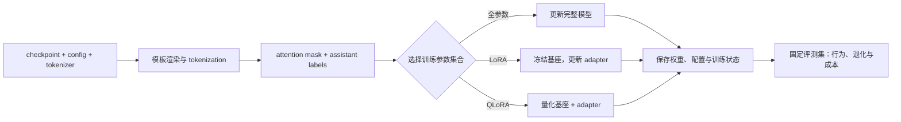

# 第 4 章 Hugging Face 微调实战：从监督目标到行为回归

真实的开源模型不是一个孤立的权重文件。它至少包含模型权重、结构配置、tokenizer、特殊 token 定义，以及与生成相关的配置。微调也不是只调用一个训练接口：输入文本如何渲染、哪些 token 参与 loss、显存中保存什么状态、如何恢复训练、如何证明行为真的变好，都会决定结果。

本章沿着一条完整链路展开：先确认 checkpoint 和 tokenizer 的身份，再把文本渲染为输入与监督 labels，之后比较全参数、LoRA 和 QLoRA 的训练状态，最后在固定任务上检查行为变化。



图里的三个训练分支共享同一份数据目标；它们主要改变可训练参数与权重存储方式。若模板或 labels mask 不同，即使 LoRA 配置完全相同，也不是同一个监督实验。

初学者可以把它看成从字符串到模型行为的实践路径；有经验的读者应关注每个边界的契约：token id 范围、序列长度、labels shift、可训练参数集合、量化权重的计算 dtype，以及比较实验中必须保持不变的变量。

## 4.1 从 checkpoint 到第一次生成

### 4.1.1 权重、配置与 tokenizer 是一个整体

模型权重告诉程序张量里有哪些数值，配置告诉程序如何组装网络，tokenizer 决定整数 token 的含义。把模型 A 的 tokenizer 换成模型 B 的 tokenizer，即使层结构相同，整数 123 也可能代表完全不同的片段。

两者的最低契约是：

```math
0\leq x_{b,t}<V,
\qquad
V=\mathrm{vocab\_size}
```

其中 \(x_{b,t}\) 是 token id，\(V\) 是 embedding 可接受的词表大小。如果 tokenizer 添加了新 token，必须同步扩展模型 embedding 和输出头；只改 tokenizer 文件不能凭空产生新的向量。

可复现记录还应包含仓库 revision、Transformers/PyTorch 版本、dtype、设备，以及是否执行了远程自定义代码。一个随时间变化的默认分支名称，不足以标识一个固定模型。

本章的 Hugging Face 接口示例按 Transformers v5.17.0、PEFT v0.18.0 和 TRL v1.14.1 的文档核对；这组文档版本不等于一份已经联调验证的依赖锁。代码中的 `sshleifer/tiny-gpt2` 固定到 commit `5f91d94bd9cd7190a9f3216ff93cd1dd95f2c7be`，QLoRA 示例的 `Qwen/Qwen2.5-0.5B` 固定到 commit `b937cc073b55e980e6f21d5f8b7a77818efcf0eb`；加载 tokenizer 和模型时使用同一个 revision。两份固定快照分别见 [tiny-gpt2 文件树](https://huggingface.co/sshleifer/tiny-gpt2/tree/5f91d94bd9cd7190a9f3216ff93cd1dd95f2c7be) 和 [Qwen2.5-0.5B 文件树](https://huggingface.co/Qwen/Qwen2.5-0.5B/tree/b937cc073b55e980e6f21d5f8b7a77818efcf0eb)。

### 4.1.2 Causal LM 的 forward 形状

给定序列 \(x_0,\ldots,x_{T-1}\)，自回归语言模型分解联合概率：

```math
p_\theta(x_0,\ldots,x_{T-1})
=
\prod_{t=0}^{T-1}
p_\theta(x_t\mid x_0,\ldots,x_{t-1})
```

模型输入和输出的形状通常是：

```math
X\in\mathbb{Z}^{B\times T},
\qquad
Z=f_\theta(X)\in\mathbb{R}^{B\times T\times V}
```

位置 \(t\) 的 logits 预测位置 \(t+1\) 的 token。下面的 next-token loss 假设 \(T\geq 2\)：只有这样才存在至少一个相邻 token 对；长度为 0 或 1 的序列不能单独产生 next-token 监督，不能用一个人为的 0 loss 掩盖这个事实。

```math
\mathcal{L}
=
-\frac{1}{T-1}
\sum_{t=0}^{T-2}
\log p_\theta(x_{t+1}\mid x_0,\ldots,x_t)
```

许多 Hugging Face CausalLM 类在接收等长 labels 后会在内部完成 shift。自己写 loss 时要确认这一点；手动错位后再交给会再次错位的模型，会让目标错一位。

> 代码状态：静态审阅，未运行（2026-10-29）

```python
import torch
from transformers import AutoModelForCausalLM, AutoTokenizer


model_name = "sshleifer/tiny-gpt2"
model_revision = "5f91d94bd9cd7190a9f3216ff93cd1dd95f2c7be"
tokenizer = AutoTokenizer.from_pretrained(
    model_name,
    revision=model_revision,
)
model = AutoModelForCausalLM.from_pretrained(
    model_name,
    revision=model_revision,
)

if tokenizer.pad_token is None:
    tokenizer.pad_token = tokenizer.eos_token
if tokenizer.pad_token_id is None:
    raise ValueError("tokenizer needs pad_token_id or eos_token_id")
model.config.pad_token_id = tokenizer.pad_token_id
model.eval()

inputs = tokenizer("Hello, my name is", return_tensors="pt")
with torch.inference_mode():
    outputs = model(**inputs)

print("input_shape=", tuple(inputs["input_ids"].shape))
print("logits_shape=", tuple(outputs.logits.shape))
```
若 \(B=1\)，输出应为 \((1,T,V)\)。这里的 \(T\) 是 token 数而不是字符数；不同 tokenizer 会对中文、英文、空格和标点产生不同切分。

### 4.1.3 编码、解码与生成

tokenizer 的编码结果通常包含 input_ids 和 attention_mask：

> 代码状态：静态审阅，未运行（2026-10-29）

```python
encoded = tokenizer("A small language model.", return_tensors="pt")
print(encoded["input_ids"])
print(encoded["attention_mask"])
```
attention mask 满足：

```math
A\in\{0,1\}^{B\times T}
```

有效 token 为 1，padding 为 0。单条不补齐的输入看不出它的重要性；批量输入不同长度的 prompt 时，它是模型区分真实内容和占位符的依据。

generate 是一个重复过程：读取最后一个有效位置的 logits，选择一个 token，把它拼回上下文，再预测下一步，直到 EOS 或长度上限：

```text
prompt → logits → 选择 token → 追加 token → logits → … → 停止
```

贪心选择可以写为：

```math
x_{t+1}
=
\arg\max_v p_\theta(v\mid x_{\leq t})
```

温度采样使用：

```math
p_T(v)
=
\frac{\exp(z_v/T)}
{\sum_u\exp(z_u/T)}
```

温度只改变已有分布的尖锐程度，不会增加模型知识。top-k 保留最高的 k 个候选，top-p 保留累计概率达到 p 的最小候选集合。

> 代码状态：静态审阅，未运行（2026-10-29）

```python
prompt = "The capital of France is"
inputs = tokenizer(prompt, return_tensors="pt")

with torch.inference_mode():
    output_ids = model.generate(
        **inputs,
        max_new_tokens=24,
        do_sample=False,
        pad_token_id=tokenizer.eos_token_id,
    )

prompt_length = inputs["input_ids"].shape[-1]
new_ids = output_ids[0, prompt_length:]
print(tokenizer.decode(new_ids, skip_special_tokens=True))
```
max_new_tokens 是新增 token 数。若 prompt 长度为 \(T_p\)，上限为 \(M\)，则：

```math
T_{\mathrm{final}}\leq T_p+M
```

评估时应切掉 prompt 再解码，否则问题中的关键词会被误算为模型输出。

### 4.1.4 设备、dtype 与 batch padding

eval() 和 inference_mode() 解决不同问题：

```text
eval()：关闭 dropout 等训练态行为。
inference_mode()：不构建反向图，减少推理开销。
```

小模型可以手动放到设备：

> 代码状态：静态审阅，未运行（2026-10-29）

```python
device = "cuda" if torch.cuda.is_available() else "cpu"
model.to(device)
model.eval()
inputs = tokenizer("A short prompt.", return_tensors="pt").to(device)

with torch.inference_mode():
    output_ids = model.generate(
        **inputs,
        max_new_tokens=32,
        do_sample=False,
        pad_token_id=tokenizer.eos_token_id,
    )
```
大模型常使用 Accelerate 的自动放置：

> 代码状态：静态审阅，未运行（2026-10-29）

```python
model = AutoModelForCausalLM.from_pretrained(
    model_name,
    revision=model_revision,
    dtype="auto",
    device_map="auto",
)
```
使用 `device_map="auto"` 后不要无条件再调用 `model.to("cuda")`，因为模型可能被分布到多张 GPU、CPU 或 offload 目录。这里按 Transformers v5.17.0 的 `dtype` 参数书写；在其他版本中应查对应版本签名，不要把不同版本的参数名混在同一份复现实验里。

批量生成时通常使用左侧 padding：

> 代码状态：静态审阅，未运行（2026-10-29）

```python
tokenizer.padding_side = "left"
if tokenizer.pad_token is None:
    tokenizer.pad_token = tokenizer.eos_token

batch = tokenizer(
    ["The capital of France is", "The largest planet is"],
    padding=True,
    return_tensors="pt",
)

with torch.inference_mode():
    output_ids = model.generate(
        **batch,
        max_new_tokens=24,
        do_sample=False,
        pad_token_id=tokenizer.pad_token_id,
    )
```
decoder-only 生成通常从批次最后一个位置继续。左补齐能让每条样本的最后位置仍是有效 prompt token；具体仍应遵循目标模型 tokenizer 的设置和运行时提示。

### 4.1.5 只验证接口的纯 Python 实验

没有 torch 或无法下载模型时，可以先验证 shape、padding 和生成长度。下面不模拟语言能力，只模拟接口契约：

> 代码状态：静态审阅，未运行（2026-10-29）

```python
class Shape:
    def __init__(self, value):
        self.shape = value


class ToyTokenizer:
    def __init__(self):
        self.tokens = ["<pad>", "<eos>", "<unk>", "Hello", "my", "name", "is", "I", "am", "toy"]
        self.ids = {token: i for i, token in enumerate(self.tokens)}
        self.pad_token_id = 0
        self.eos_token_id = 1
        self.unk_token_id = 2
        self.padding_side = "left"

    def __len__(self):
        return len(self.tokens)

    def __call__(self, texts, padding=False):
        if isinstance(texts, str):
            texts = [texts]
        rows = [
            [self.ids.get(piece, self.unk_token_id) for piece in text.split()]
            for text in texts
        ]
        if padding:
            width = max(len(row) for row in rows)
            rows = [
                [self.pad_token_id] * (width - len(row)) + row
                for row in rows
            ]
        masks = [
            [0 if token_id == self.pad_token_id else 1 for token_id in row]
            for row in rows
        ]
        return {"input_ids": rows, "attention_mask": masks}

    def decode(self, ids):
        return " ".join(self.tokens[i] for i in ids if i not in {0, 1})


class ToyModel:
    def __init__(self, vocab_size):
        self.vocab_size = vocab_size
        self.next_token = {5: 6, 6: 7, 7: 8, 8: 1}

    def eval(self):
        return self

    def __call__(self, input_ids, attention_mask=None):
        return type("Output", (), {
            "logits": Shape((len(input_ids), len(input_ids[0]), self.vocab_size))
        })()

    def generate(self, input_ids, max_new_tokens):
        rows = [list(row) for row in input_ids]
        for row in rows:
            for _ in range(max_new_tokens):
                token_id = self.next_token.get(row[-1], 1)
                row.append(token_id)
                if token_id == 1:
                    break
        return rows


tokenizer = ToyTokenizer()
model = ToyModel(len(tokenizer)).eval()
single = tokenizer("Hello my name is")
batch = tokenizer(["Hello my name is", "Hello"], padding=True)
output = model(**single)
generated = model.generate(single["input_ids"], max_new_tokens=4)

print("vocab_match=", model.vocab_size == len(tokenizer))
print("single_logits_shape=", output.logits.shape)
print("batch_attention_mask=", batch["attention_mask"])
print("new_tokens=", len(generated[0]) - len(single["input_ids"][0]))
print("decoded=", tokenizer.decode(generated[0]))
```
vocab_match 为 True、logits 最后一维等于词表大小、左侧 padding 为 0，说明最基本的数据流闭合；这不能证明模型具有任何任务能力。

### 4.1.6 第一次运行的实验记录

第一次成功生成应留下可复现记录：

```text
模型名称与 revision。
tokenizer 词表大小和 special token id。
Transformers、PyTorch、Accelerate 版本。
设备、dtype、device_map。
prompt 的原文和 token 数。
生成参数、随机种子、完整输出和新生成部分。
```

这些字段让后续的 SFT、LoRA 和评估有共同基线。只保存一张输出截图，无法判断变化来自模型参数、模板、采样参数还是依赖版本。

手算一次生成边界：若 prompt 编码后有 12 个 token，max_new_tokens=8，则最多返回 8 个新 token，总上下文最多到 20 个位置；它不是把 prompt 截成 8 个 token。批量生成时，两条 prompt 长度为 3 和 5，左 padding 到 5 后分别是 \([0,0,a,b,c]\) 和 \([u,v,w,x,y]\)，最后一列都是真实 prompt token，模型才能从同一个张量位置读取下一步 logits。若目标模型使用特殊 position ids 或不采用左 padding，应按其模板与 runtime 约定验证，不能只依据“常见写法”。

首次生成还要检查输入和输出的边界：编码文本是否带 BOS、结束符是否被误当作 prompt、返回序列是否包含输入 token，以及 decode 是否跳过 special tokens。固定一个很短 prompt，打印原始 token ids、mask、position ids 和新增 token ids，再打印解码文本，能够明确每个字符来自输入还是生成。若只看最终字符串，prompt 拼接、padding 和输出截取错误很容易被误认为模型质量差。

若输入有左右 padding，input_ids、attention_mask 和 position_ids 必须指向同一批有效 token。比如真实 prompt 有 3 token，右侧补到长度 5 后有效 mask 是 \([1,1,1,0,0]\)；若把 mask 误写成 \([0,0,1,1,1]\)，模型仍能完成 forward，但它会把 padding 当作内容、屏蔽真实问题。单条输入没有 padding，无法覆盖这类 bug，所以应至少准备长度不同的两条 prompt 做批量测试，并在生成后只对新增 token 解码。

模型加载也要保持三件套一致。固定模型仓库 revision 后，检查 config 中的 vocab size、实际 embedding 行数和 tokenizer 长度；若 tokenizer 新增了 2 个 special tokens，而输入 embedding 仍只有原来的 V 行，越界会直接暴露；若 token id 被静默映射为已有合法值，则语义错位不会报错。第一次生成应先用公开小样本确认接口，再将真实模型的模型卡、许可、revision 和 template 固定在实验 manifest，避免把可加载误当成可复现。

chat template 是模型输入协议的一部分。相同的用户句子若一个模板追加 assistant generation marker，另一个没有，模型面对的最后位置和待生成 role 就可能不同。第一次加载时把消息对象渲染成文本，再编码并查看末尾 token，确认模板不会重复插入 BOS/EOS；推理请求和训练样本使用的模板要一致。若使用自定义模板，还要固定模板文本版本，而不是只记“chat format”。

在多卡或自动设备映射场景，输入需要放到模型的起始设备，模型输出可能落在另一设备或被框架包装。不要从单个参数的 device 推断整张模型都在同一 GPU，也不要把切分后的模型无条件移到 cuda:0。接口测试阶段可以先用单样本、短上下文验证加载与生成，再测批量 padding 和显存峰值；CPU toy 成功只能说明数据处理，不代表目标权重或 CUDA kernel 可运行。

还要固定解码停止规则。假设 prompt 已有 12 token，EOS 在第 3 个新 token 出现，那么输出只含这 3 个 token；若 stop string 在 decode 后判断，可能需要生成超过结束片段再回切文本。评估时应区分模型生成的终止 token、服务端 stop sequence 和 max_new_tokens 截断，并记录各自命中比例。否则同一模型在两套 stopping rules 下会得到不同长度和格式分数。

模型第一次生成的基线要存原始响应和 token ids。若 SFT 后文本变长，可能是模板变化、EOS 学习变化或 max_new_tokens 改动；仅看解码字符串无法判断。对同一 prompt 保存 input ids、生成 ids、停止原因和耗时，后续才能把行为变化和服务变化区分开。

prompt 长度还会占用模型上下文预算。若模型上下文上限为 4096、请求设置 max_new_tokens=1024，输入最多只能占 3072 个位置；当 prompt 已有 3500 token，生成预算与上下文约束冲突，应按模型 API 的截断策略处理并记录，而非期待它生成满 1024 token。预算要在 tokenization 后计算，不能按字符长度估算。

如果首次加载使用 revision 字符串而非固定 commit，模型文件可能在之后更新；复现时要保存实际解析到的 revision 和 tokenizer 文件 hash。模型名相同不保证词表、特殊 token 和配置相同。

## 4.2 把对话变成监督信号

### 4.2.1 SFT 学习的是条件分布

监督微调样本至少包含条件和目标：

```text
条件：system、user 以及此前的对话历史。
目标：assistant 希望生成的回答。
```

单轮样本可以写成：

```math
(\mathrm{prompt}_i,\mathrm{response}_i)
```

完整训练序列是：

```math
x_i
=
\mathrm{Tokenize}
(\mathrm{prompt}_i\oplus\mathrm{response}_i\oplus\mathrm{EOS})
```

只把 response 喂给模型会丢掉任务条件，只把 prompt 喂给模型又没有目标。SFT 的目标是提高：

```math
p_\theta(\mathrm{response}\mid\mathrm{prompt})
```

传统 instruction/input/output 数据可以写成：

> 代码状态：静态审阅，未运行（2026-10-29）

```python
example = {
    "instruction": "把下面的句子翻译成英文。",
    "input": "我喜欢机器学习。",
    "output": "I like machine learning.",
}
```
现代聊天数据常写成 messages：

> 代码状态：静态审阅，未运行（2026-10-29）

```python
messages = [
    {"role": "system", "content": "你是一个严谨的助手。"},
    {"role": "user", "content": "什么是梯度下降？"},
    {
        "role": "assistant",
        "content": "梯度下降沿负梯度方向更新参数以降低损失。",
    },
]
```
两种表示最终都要变成 token id。决定模型行为的不是字段名称，而是模板渲染后的序列、特殊 token 和参与 loss 的位置。

### 4.2.2 模板属于训练分布

一个简单模板可以这样渲染：

> 代码状态：静态审阅，未运行（2026-10-29）

```python
def format_instruction(example):
    instruction = example["instruction"].strip()
    extra_input = example.get("input", "").strip()
    if extra_input:
        prompt = (
            "### Instruction:\n"
            + instruction
            + "\n\n### Input:\n"
            + extra_input
            + "\n\n### Response:\n"
        )
    else:
        prompt = (
            "### Instruction:\n"
            + instruction
            + "\n\n### Response:\n"
        )
    return prompt, example["output"].strip()
```
推理时必须复用同一套边界：

> 代码状态：静态审阅，未运行（2026-10-29）

```python
def build_prompt(instruction, extra_input=""):
    if extra_input.strip():
        return (
            "### Instruction:\n"
            + instruction.strip()
            + "\n\n### Input:\n"
            + extra_input.strip()
            + "\n\n### Response:\n"
        )
    return (
        "### Instruction:\n"
        + instruction.strip()
        + "\n\n### Response:\n"
    )
```
聊天模型应优先使用自己的 tokenizer 提供的 chat template：

> 代码状态：静态审阅，未运行（2026-10-29）

```python
prompt_messages = [
    {"role": "system", "content": "你是一个严谨的助手。"},
    {"role": "user", "content": "解释过拟合。"},
]

prompt = tokenizer.apply_chat_template(
    prompt_messages,
    tokenize=False,
    add_generation_prompt=True,
)
```

add_generation_prompt=True 适合推理，把序列渲染到 assistant 即将开始的位置；训练样本已经含有 assistant 回答时，通常使用 False。一个模型的 role 标记、换行和结束 token 不能移植到另一个模型。模板的微小差异也会改变 token 边界和监督位置。
### 4.2.3 labels mask 的数学定义

设完整序列为 \(x_0,\ldots,x_{T-1}\)，回答区域由 \(m_t\) 标记：

```math
m_t=
\begin{cases}
0,& t\in\mathrm{prompt\ or\ padding}\\
1,& t\in\mathrm{assistant\ response}
\end{cases}
```

labels 写成：

```math
y_t=
\begin{cases}
-100,&m_t=0\\
x_t,&m_t=1
\end{cases}
```

PyTorch 的交叉熵默认把 -100 当作 `ignore_index`。prompt token 仍然保留在 `input_ids` 中，作为回答的上下文；它们只是不会成为监督目标。参见 [PyTorch 2.14.0 CrossEntropyLoss 文档](https://docs.pytorch.org/docs/2.14/generated/torch.nn.CrossEntropyLoss.html)。

若模型内部负责 causal shift，labels 与 input_ids 等长，位置 \(t-1\) 的 logits 预测 labels 位置 \(t\)。令 \(S=\sum_{t=1}^{T-1}m_t\) 为这个序列中真正参与监督的回答 token 数。下面的 assistant-only 目标只在 \(S>0\) 时有定义；一个被截断到只剩 prompt 的样本不应进入 loss 的平均：

```math
\mathcal{L}_{\mathrm{assistant}}
=
-
\frac{
\sum_{t=1}^{T-1}
m_t\log p_\theta(x_t\mid x_{<t})
}{
\sum_{t=1}^{T-1}m_t
}
```

回答结尾的 EOS 是否参与监督必须明确。把 EOS 纳入回答区域，模型更容易学到停止位置；如果模板把 EOS 放在 assistant 区域之外，mask 可能把它漏掉。应把有效 labels 解码出来检查。

### 4.2.4 用 offset mapping 构造回答 mask

对简单文本模板，可以用 fast tokenizer 的字符偏移定位 prompt 结束位置：

> 代码状态：静态审阅，未运行（2026-10-29）

```python
def tokenize_sft_example(example, tokenizer, max_length=512):
    if not isinstance(max_length, int) or max_length <= 0:
        raise ValueError("max_length must be a positive integer")
    if not getattr(tokenizer, "is_fast", False):
        raise ValueError("offset mapping requires a fast tokenizer")
    prompt, response = format_instruction(example)
    if not response:
        raise ValueError("response must contain at least one character")
    if tokenizer.eos_token is None:
        raise ValueError("tokenizer.eos_token is required for this example")
    full_text = prompt + response + tokenizer.eos_token
    encoded = tokenizer(
        full_text,
        add_special_tokens=False,
        truncation=True,
        max_length=max_length,
        return_offsets_mapping=True,
    )

    labels = []
    prompt_end = len(prompt)
    for token_id, (start, end) in zip(
        encoded["input_ids"],
        encoded["offset_mapping"],
    ):
        # Token boundaries cannot be split; mask any token that overlaps the prompt.
        labels.append(
            -100 if start < prompt_end else token_id
        )
    if not labels or not any(label != -100 for label in labels):
        raise ValueError(
            "truncation removed every supervised token; reserve space for response"
        )
    return {
        "input_ids": encoded["input_ids"],
        "attention_mask": encoded["attention_mask"],
        "labels": labels,
    }
```
不能默认把 tokenize(prompt) 得到的 token 数当作完整序列的切分点。BPE 或 byte-level tokenizer 可能在边界处合并片段，两个独立 tokenize 的边界不一定相同。offset mapping 描述 token 覆盖的字符区间，通常更可靠；但它要求 fast tokenizer，特殊 token 的 offset 仍需实际检查。若 token 横跨 prompt 与 response 的分界，tokenizer 无法把它拆成半个 token；这里保守地把整个边界 token mask 掉，避免把 prompt 字符纳入目标，代价是可能少监督回答开头的一小段。截断后仍须检查至少有一个回答 token 留在监督区。

聊天模板可以尝试使用 assistant mask：

> 代码状态：静态审阅，未运行（2026-10-29）

```python
encoded = tokenizer.apply_chat_template(
    messages,
    tokenize=True,
    return_dict=True,
    add_generation_prompt=False,
    return_assistant_tokens_mask=True,
)

if "assistant_masks" not in encoded:
    raise RuntimeError(
        "this tokenizer/template did not return assistant_masks; "
        "inspect the template before constructing labels"
    )
input_ids = encoded["input_ids"]
assistant_mask = encoded["assistant_masks"]
if len(input_ids) != len(assistant_mask) or not any(assistant_mask):
    raise ValueError("assistant mask must align with input_ids and mark a response")
labels = [
    token_id if flag else -100
    for token_id, flag in zip(input_ids, assistant_mask)
]
```
这个接口依赖 Transformers 版本和模板中的 `` 标记。Transformers v5.17.0 文档规定，只有支持该标记的 chat template 才能返回 assistant mask；运行时应打印 `encoded.keys()`，确认返回的 mask 真的覆盖回答。不支持 mask 时，应经过验证后使用 offset mapping 或框架提供的 completion-only 方案，不能无声地把整条序列都当成回答。参见 [Transformers v5.17.0 tokenizer 文档](https://huggingface.co/docs/transformers/v5.17.0/main_classes/tokenizer)。

使用 TRL `SFTTrainer` 时，参数名还会随数据格式选择不同监督范围。TRL v1.14.1 把 `completion_only_loss` 用于 prompt-completion 数据，把 `assistant_only_loss` 用于 conversational 数据；后者依赖 chat template 暴露 assistant generation 区间。二者不是“开哪个都一样”：prompt-completion 的 completion 边界与多轮对话中的 assistant 消息边界并不相同。若数据已预先构造 `labels=-100`，该版本会直接采用这些 labels；仍要核对 mask 是否与预期监督范围一致。参见 [TRL v1.14.1 SFTTrainer 文档](https://huggingface.co/docs/trl/v1.14.1/sft_trainer)。

### 4.2.5 截断与有效监督 token

回答通常位于序列尾部，普通 truncation 又常从尾部截断，因此可能出现：

```text
prompt 被保留。
response 被完全截掉。
labels 全是 -100。
训练循环仍运行，但没有有效监督。
```

有效监督 token 数为：

```math
n_{\mathrm{sup}}
=
\sum_{t=0}^{T-1}\mathbf{1}[y_t\neq-100]
```

样本至少要满足 \(n_{\mathrm{sup}}>0\)。如果任务要求完整 JSON、代码或回答，还要检查 EOS 是否存在、结构是否被截断。

> 代码状态：静态审阅，未运行（2026-10-29）

```python
def has_supervision(feature):
    return any(label != -100 for label in feature["labels"])


def supervision_count(feature):
    return sum(label != -100 for label in feature["labels"])
```
更稳妥的做法是先限制过长对话历史，再为回答保留空间；不能只把 max_length 调大而不检查显存和模型上下文上限。

### 4.2.6 三个字段必须同步 padding

batch 中应有：

```math
X,A,Y\in\mathbb{Z}^{B\times T_{\max}}
```

```text
X：input_ids，padding 使用 pad_token_id。
A：attention_mask，padding 使用 0。
Y：labels，padding 使用 -100。
```

最小 collator：

本实现固定使用右侧 padding，符合下面 `pad_sequence` 的输出方式。上一节生成示例中的左侧 padding 服务于 decoder-only 批量生成，两种场景的 padding 契约不能混用。

> 代码状态：静态审阅，未运行（2026-10-29）

```python
import torch


class SFTDataCollator:
    def __init__(self, tokenizer, label_pad_token_id=-100):
        self.tokenizer = tokenizer
        self.label_pad_token_id = label_pad_token_id
        if tokenizer.pad_token_id is None:
            raise ValueError("SFT padding requires tokenizer.pad_token_id")
        if tokenizer.padding_side != "right":
            raise ValueError("this collator requires right-side padding")
        if label_pad_token_id != -100:
            raise ValueError("this chapter uses -100 as the loss ignore index")

    def __call__(self, features):
        if not features:
            raise ValueError("cannot collate an empty feature list")
        required = {"input_ids", "attention_mask", "labels"}
        for index, item in enumerate(features):
            missing = required.difference(item)
            if missing:
                raise ValueError(
                    f"feature {index} is missing fields: {sorted(missing)}"
                )
            lengths = {len(item[key]) for key in required}
            if len(lengths) != 1 or not lengths or min(lengths) == 0:
                raise ValueError(
                    f"feature {index} has empty or misaligned sequence fields"
                )
            vocab_size = len(self.tokenizer)
            if any(
                value < 0 or value >= vocab_size
                for value in item["input_ids"]
            ):
                raise ValueError(
                    f"feature {index} contains an input id outside the tokenizer vocabulary"
                )
            if any(value not in {0, 1} for value in item["attention_mask"]):
                raise ValueError(f"feature {index} has a non-binary attention mask")
            if any(
                value < 0 and value != self.label_pad_token_id
                for value in item["labels"]
            ):
                raise ValueError(f"feature {index} has an invalid label value")
            if any(
                value >= vocab_size
                for value in item["labels"]
                if value != self.label_pad_token_id
            ):
                raise ValueError(
                    f"feature {index} contains a target id outside the tokenizer vocabulary"
                )
            if not any(value != self.label_pad_token_id for value in item["labels"]):
                raise ValueError(
                    f"feature {index} has no supervised token after truncation"
                )
            if any(
                mask_value == 0 and label_value != self.label_pad_token_id
                for mask_value, label_value in zip(
                    item["attention_mask"], item["labels"]
                )
            ):
                raise ValueError(
                    f"feature {index} supervises a padding position"
                )
        input_ids = [
            torch.tensor(item["input_ids"], dtype=torch.long)
            for item in features
        ]
        attention_mask = [
            torch.tensor(item["attention_mask"], dtype=torch.long)
            for item in features
        ]
        labels = [
            torch.tensor(item["labels"], dtype=torch.long)
            for item in features
        ]
        return {
            "input_ids": torch.nn.utils.rnn.pad_sequence(
                input_ids,
                batch_first=True,
                padding_value=self.tokenizer.pad_token_id,
            ),
            "attention_mask": torch.nn.utils.rnn.pad_sequence(
                attention_mask,
                batch_first=True,
                padding_value=0,
            ),
            "labels": torch.nn.utils.rnn.pad_sequence(
                labels,
                batch_first=True,
                padding_value=self.label_pad_token_id,
            ),
        }
```
训练前做断言：

> 代码状态：静态审阅，未运行（2026-10-29）

```python
assert batch["input_ids"].shape == batch["attention_mask"].shape
assert batch["input_ids"].shape == batch["labels"].shape
for mask_row, label_row in zip(
    batch["attention_mask"],
    batch["labels"],
):
    for mask_value, label_value in zip(
        mask_row.tolist(),
        label_row.tolist(),
    ):
        if mask_value == 0:
            assert label_value == -100
```
这种检查能在梯度计算前发现字段错位，比训练数小时后猜测 loss 异常原因更可靠。实际训练还要确认模型输入 embedding 行数覆盖 tokenizer 的全部 token id；collator 只知道 tokenizer 词表，不能替代模型侧检查。

### 4.2.7 数据质量、去重与分组划分

SFT 清洗至少应覆盖：

```text
任务是否清楚，输入和输出是否错位。
回答是否真正回应问题，而不是复制提示。
空答案、乱码、模板残片、HTML 噪声。
重复样本和近似重复样本。
代码、JSON、表格和公式是否能解析。
来源、许可证、隐私和安全限制。
```

把同一文档切成相邻片段后随机拆分，会让验证集与训练集高度相似。更可靠的方式是按文档、来源、用户或任务族分组。每条记录应保存元数据：

> 代码状态：静态审阅，未运行（2026-10-29）

```python
record = {
    "id": "example-0001",
    "source": "human_written",
    "task": "translation",
    "language": "zh-en",
    "license": "recorded_in_dataset_card",
    "messages": messages,
}
```
这样坏例能够追溯到数据来源和任务桶，而不是只知道某个 token 预测错误。

### 4.2.8 纯 Python 预处理实验

下面的程序模拟模板、mask、截断、去重和 padding：

> 代码状态：静态审阅，未运行（2026-10-29）

```python
import re


class ToyTokenizer:
    def __init__(self):
        self.pad_token = "<pad>"
        self.eos_token = "<eos>"
        self.pad_token_id = 0
        self.vocab = {self.pad_token: 0, self.eos_token: 1}
        self.inverse = {0: self.pad_token, 1: self.eos_token}

    def encode(self, text):
        pieces = re.findall(r"\n|[^\s]+", text)
        ids = []
        for piece in pieces:
            if piece not in self.vocab:
                index = len(self.vocab)
                self.vocab[piece] = index
                self.inverse[index] = piece
            ids.append(self.vocab[piece])
        return ids

    def decode(self, ids):
        return " ".join(
            self.inverse[index]
            for index in ids
            if index not in {self.pad_token_id, 1}
        )


def format_example(example):
    prompt = (
        "Instruction: "
        + example["instruction"]
        + "\nResponse: "
    )
    return prompt, example["output"].strip()


def preprocess(example, tokenizer, max_length=32):
    if not isinstance(max_length, int) or max_length <= 0:
        raise ValueError("max_length must be a positive integer")
    prompt, response = format_example(example)
    if not response:
        raise ValueError("response must not be empty")
    prompt_ids = tokenizer.encode(prompt)
    full_ids = tokenizer.encode(
        prompt + response + " " + tokenizer.eos_token
    )
    input_ids = full_ids[:max_length]
    labels = input_ids[:]
    labels[:min(len(prompt_ids), len(labels))] = [
        -100
    ] * min(len(prompt_ids), len(labels))
    return {
        "input_ids": input_ids,
        "attention_mask": [1] * len(input_ids),
        "labels": labels,
    }


def valid(feature):
    required = {"input_ids", "attention_mask", "labels"}
    if not required.issubset(feature):
        return False
    lengths = {len(feature[key]) for key in required}
    if len(lengths) != 1 or not lengths or min(lengths) == 0:
        return False
    return any(label != -100 for label in feature["labels"])


def collate(features, pad_token_id):
    if not features:
        raise ValueError("cannot collate an empty feature list")
    if pad_token_id is None:
        raise ValueError("pad_token_id is required")
    width = max(len(item["input_ids"]) for item in features)
    output = {"input_ids": [], "attention_mask": [], "labels": []}
    for item in features:
        pad_count = width - len(item["input_ids"])
        output["input_ids"].append(
            item["input_ids"] + [pad_token_id] * pad_count
        )
        output["attention_mask"].append(
            item["attention_mask"] + [0] * pad_count
        )
        output["labels"].append(
            item["labels"] + [-100] * pad_count
        )
    return output


raw = [
    {"instruction": "解释过拟合。", "output": "训练集好但泛化差。"},
    {"instruction": "解释过拟合。", "output": "训练集好但泛化差。"},
    {"instruction": "翻译。", "output": "I like machine learning."},
]

tokenizer = ToyTokenizer()
seen = set()
features = []
for example in raw:
    key = (example["instruction"], example["output"])
    if key in seen:
        continue
    seen.add(key)
    item = preprocess(example, tokenizer)
    if valid(item):
        features.append(item)

if not features:
    raise ValueError("all examples lost their supervised response during truncation")
batch = collate(features, tokenizer.pad_token_id)
response_ids = [
    token_id
    for token_id, label in zip(
        features[0]["input_ids"],
        features[0]["labels"],
    )
    if label != -100
]

print("unique_valid_examples=", len(features))
print("batch_width=", len(batch["input_ids"][0]))
print("supervised_tokens=", sum(
    label != -100 for label in features[0]["labels"]
))
print("response=", tokenizer.decode(response_ids))
print("padding_labels_ok=", all(
    label == -100
    for mask_row, label_row in zip(
        batch["attention_mask"],
        batch["labels"],
    )
    for mask, label in zip(mask_row, label_row)
    if mask == 0
))
```
真实 tokenizer 还要处理 BPE 边界和特殊 token，这个 toy 实验只负责让监督范围可见。

### 4.2.9 数据处理结果也要版本化

划分数据集时，随机种子只是必要条件。还应固定去重规则、分组键、tokenizer、chat template、max_length、截断策略和无监督样本过滤规则。原始文本不变，tokenizer 版本变化也可能改变 token 数、截断位置和有效监督 token 数。因此应保存可抽查的中间样本：

```text
渲染后的完整文本。
input_ids。
attention_mask。
labels。
有效监督 token 数。
来源与任务元数据。
```

考虑完整序列“用户问：天气？助手答：晴天 EOS”。若模板渲染成 8 个 token，前 4 个是用户条件，后 4 个是 assistant 回答和结束符，则 assistant-only labels 可写为 \([-100,-100,-100,-100,r_1,r_2,r_3,\mathrm{EOS}]\)。input_ids 仍保留全部 8 个 token，causal model 在内部 shift 后用位置 3 的 logits 预测 \(r_1\)。若误把 labels 全部保留，模型还会被要求复现用户输入；若把回答首 token 也 mask，模型就从 \(r_2\) 才开始学习。打印有效 labels 解码出来的文本，是检查监督边界最直接的数值化手段。

若这 4 个回答目标的 token loss 分别为 1、2、1、2，assistant-only 平均 loss 是 \(6/4=1.5\)。若 prompt 的 4 个 token loss 分别是 0.2、0.3、0.2、0.3，却被错误纳入，整体均值变为 \(7/8=0.875\)，数字看起来更低，但回答 token 的监督没有变好。不同 mask 会改变 loss 分母，因此训练曲线必须和有效监督 token 数一起报告。多轮对话还需定义是否监督所有 assistant 消息、拒答标记、工具调用和工具结果；role 名称本身不能决定这些位置是否进入目标。

多轮聊天还要决定哪些 assistant 消息接受监督。一个用户消息后有 assistant 思考、工具调用、工具结果和最终答复时，可能只训练最终答复，也可能训练 assistant 的工具调用格式；工具返回通常来自外部程序，不应无意中作为模型要复述的目标。把角色边界、结束标记和 loss mask 画成时间线，再从 labels 中反解出有效文本，可以检查模型到底在被要求生成什么。

截断会改变监督对象。若 prompt 长 900 token、回答长 200 token，而 max_length=1024，右侧截断会只保留前 124 个回答 token；若回答必须完整 JSON，样本虽然有监督 token，却没有闭合括号和 EOS。可以先把历史压到 800 token、为回答预留 224 token，并统计截断率；超过预算的样本按任务策略裁剪、拆分或丢弃。不同策略需记录，因为它们会改变训练数据分布。

assistant-only loss 与 completion-only loss 的数据契约不同。prompt-completion 记录通常显式给出 prompt 和 completion 边界；多轮 conversational 样本则依赖模板识别每一条 assistant span。若把工具调用也纳入 assistant mask，模型会学习发出 tool call；若只想学习自然语言最终答复，需屏蔽调用内容并确保后续上下文仍正确。边界应按任务设计，不应盲目套用一个默认 trainer 参数。

还要检查空监督 batch。动态截断、过滤和 padding 后，某个 batch 可能全部 labels 都为 ignore_index；mean loss 的分母为零，结果可能无定义或出现 NaN。collator 应计算有效监督 token 数并在训练前拒绝空 batch，训练日志也要报告该计数。否则数据筛选改变后，程序仍能前向，却没有有效目标。

如果一段对话有 prompt 5 token、assistant answer 3 token、EOS 1 token，labels 有效位数应为 4；内部 shift 后，只有 3 个回答 token 的 logits 与 EOS 目标组成 4 个预测项。不同库对模型内部 shift 和 labels 对齐的规定要先核实，不能把“assistant span 的起点”直接当作 logits 索引。最安全的检查是列出每个位置的输入 token、目标 token、loss mask 和预测它的 logits 位置。

labels 中的 ignore_index 只影响 loss，不会从 input_ids 中删除 prompt；attention mask 负责区分有效输入与 padding。这三者应作为不同字段保存，不能把 prompt mask、padding mask 和 loss mask 复用成一个布尔张量。混用时可能让模型看不到用户问题，或把无效 padding 当作回答目标。

## 4.3 全参数 SFT：监督目标、显存与可恢复训练

### 4.3.1 全参数训练的含义

全参数 SFT 使用上一节的 masked causal loss，只把可更新参数集合设为整个模型：

```math
\Theta_{\mathrm{train}}
=
\Theta_{\mathrm{model}}
```

参数更新可抽象为：

```math
\theta_{k+1}
=
\theta_k-\eta\widehat{g}_k
```

全参数的适配自由度大，但基座模型原来的能力也更容易被新数据覆盖。小数据、大学习率或过多训练轮次会放大遗忘和过拟合。

### 4.3.2 显存估算

设可训练参数量为 \(P\)，权重、梯度和一个优化器状态元素分别占 \(b_w,b_g,b_o\) 字节，一个粗略训练内存表达为：

```math
M_{\mathrm{train}}
\approx
P(b_w+b_g+2b_o)
+
M_{\mathrm{activation}}
+
M_{\mathrm{temporary}}
```

AdamW 通常保存一阶和二阶状态，所以出现 \(2b_o\)。实现还可能保留 fp32 master weights、梯度 scaler、通信 buffer 和 allocator 缓存。激活内存又随 batch、序列长度、层数、隐藏维度和 checkpointing 改变。

fp16 权重约占 \(2P\) 字节只是推理权重的量级；模型能生成不代表同一设备能全参数训练。

### 4.3.3 Trainer 与有效 batch

Trainer 封装的仍是：

```text
collator → forward → masked loss → backward
→ optimizer.step → scheduler → logging/eval/save
```

下面的 `TrainingArguments` 和 `Trainer` 片段假设 `model`、`train_dataset`、`eval_dataset` 和 `data_collator` 已分别按 4.1、4.2 节准备好；它们不是可以脱离上下文直接运行的完整训练脚本。

小模型配置：

> 代码状态：静态审阅，未运行（2026-10-29）

```python
import torch
from transformers import TrainingArguments


training_args = TrainingArguments(
    output_dir="outputs/full_sft_tiny",
    num_train_epochs=3,
    per_device_train_batch_size=2,
    per_device_eval_batch_size=2,
    gradient_accumulation_steps=4,
    learning_rate=5e-5,
    weight_decay=0.01,
    logging_steps=10,
    eval_strategy="steps",
    eval_steps=20,
    save_steps=20,
    save_total_limit=2,
    fp16=torch.cuda.is_available(),
    report_to="none",
)
```
旧版 Transformers 可能使用 evaluation_strategy，新版 Trainer 也可能用 processing_class 保存 tokenizer，而旧版使用 tokenizer 参数。版本差异应通过本地签名确认。

> 代码状态：静态审阅，未运行（2026-10-29）

```python
from transformers import Trainer


trainer = Trainer(
    model=model,
    args=training_args,
    train_dataset=train_dataset,
    eval_dataset=eval_dataset,
    data_collator=data_collator,
    processing_class=tokenizer,
)
trainer.train()
trainer.save_model("outputs/full_sft_tiny/final")
tokenizer.save_pretrained("outputs/full_sft_tiny/final")
```
梯度累积下，有效 batch size 近似为：

```math
B_{\mathrm{eff}}
=
B_{\mathrm{device}}
\times
N_{\mathrm{gpu}}
\times
G
```

但语言模型更应记录有效监督 token：

```math
N_{\mathrm{token,step}}
=
\sum_i\sum_t\mathbf{1}[y_{i,t}\neq-100]
```

当样本长度不同，逐 micro-batch 平均后再累积不一定等价于所有有效 token 的全局平均。严谨比较时要记录每步 token 数，必要时显式做 token-level normalization。

### 4.3.4 checkpointing 与恢复

gradient checkpointing 用重新计算换激活显存：

> 代码状态：静态审阅，未运行（2026-10-29）

```python
model.config.use_cache = False
model.gradient_checkpointing_enable()
```
KV cache 为逐 token 推理优化，通常不应与训练 checkpointing 同时开启。

可恢复 checkpoint 可能包含：

```text
模型参数、optimizer state、学习率调度器 state。
随机数状态、训练步数和 Trainer state。
```

只加载权重可以继续推理，却不一定能恢复原优化轨迹：

> 代码状态：静态审阅，未运行（2026-10-29）

```python
trainer.train(
    resume_from_checkpoint="outputs/full_sft_tiny/checkpoint-100"
)
```
恢复前应确认数据顺序、batch、梯度累积、随机种子和版本没有改变。改变有效 batch 后，旧 optimizer state 对新 token 语义未必合适。

### 4.3.5 手写训练循环

这个循环同样依赖已经构造好的 `model`、`train_dataset` 和 `data_collator`。它展示训练状态如何流动；真实任务还要先确认数据集非空，并为保存、恢复和评估定义明确的目录与策略。

> 代码状态：静态审阅，未运行（2026-10-29）

```python
import torch
from torch.optim import AdamW
from torch.utils.data import DataLoader


device = "cuda" if torch.cuda.is_available() else "cpu"
model.to(device)
model.train()
loader = DataLoader(
    train_dataset,
    batch_size=2,
    shuffle=True,
    collate_fn=data_collator,
)
optimizer = AdamW(model.parameters(), lr=5e-5)

for epoch in range(3):
    for step, batch in enumerate(loader):
        batch = {
            key: value.to(device)
            for key, value in batch.items()
        }
        loss = model(**batch).loss
        if not torch.isfinite(loss):
            raise FloatingPointError("non-finite loss")
        loss.backward()
        torch.nn.utils.clip_grad_norm_(model.parameters(), max_norm=1.0)
        optimizer.step()
        optimizer.zero_grad(set_to_none=True)
        if step % 10 == 0:
            print("epoch=", epoch, "step=", step, "loss=", loss.item())
```
这段示例已经做梯度裁剪和非有限 loss 检查。更完整的训练流程还需按实验目标配置混合精度、学习率 scheduler、周期性评估、checkpoint 保存与恢复，并确认梯度累积时 loss 和有效 token 分母的约定。理解底层状态流，可以在 Trainer 的默认行为不符合预期时逐层定位。

### 4.3.6 纯 Python 的 masked loss 更新实验

下面用 bigram logits 代替 Transformer，只验证目标 token 的梯度和全参数更新：

> 代码状态：静态审阅，未运行（2026-10-29）

```python
import math
import random


random.seed(7)
vocab_size = 10
if vocab_size <= 1:
    raise ValueError("vocab_size must be greater than one")
logits = [
    [random.uniform(-0.02, 0.02) for _ in range(vocab_size)]
    for _ in range(vocab_size)
]
data = [
    {"ids": [2, 3, 4, 5, 6, 1], "labels": [-100, -100, -100, 5, 6, 1]},
    {"ids": [2, 7, 4, 8, 9, 1], "labels": [-100, -100, -100, 8, 9, 1]},
]
if not data:
    raise ValueError("masked-loss toy experiment requires non-empty data")
for item in data:
    if len(item["ids"]) != len(item["labels"]):
        raise ValueError("ids and labels must have equal lengths")
    if not item["ids"]:
        raise ValueError("each sequence must contain at least one token")
    if any(token_id < 0 or token_id >= vocab_size for token_id in item["ids"]):
        raise ValueError("input token id is outside the toy vocabulary")
    if any(
        label != -100 and (label < 0 or label >= vocab_size)
        for label in item["labels"]
    ):
        raise ValueError("supervised label is outside the toy vocabulary")


def softmax(row):
    maximum = max(row)
    values = [math.exp(value - maximum) for value in row]
    total = sum(values)
    return [value / total for value in values]


def zeros():
    return [[0.0] * vocab_size for _ in range(vocab_size)]


def loss_grad(batch):
    grad = zeros()
    loss = 0.0
    count = 0
    for item in batch:
        for pos in range(1, len(item["ids"])):
            target = item["labels"][pos]
            if target == -100:
                continue
            row = item["ids"][pos - 1]
            probabilities = softmax(logits[row])
            loss -= math.log(max(probabilities[target], 1e-12))
            count += 1
            for token_id, probability in enumerate(probabilities):
                grad[row][token_id] += probability
            grad[row][target] -= 1.0
    if count == 0:
        raise ValueError("masked loss is undefined when no label is supervised")
    for row in grad:
        for column in range(vocab_size):
            row[column] /= count
    return loss / count, grad, count


def add(left, right):
    for row in range(vocab_size):
        for column in range(vocab_size):
            left[row][column] += right[row][column]


def update(grad, learning_rate):
    for row in range(vocab_size):
        for column in range(vocab_size):
            logits[row][column] -= learning_rate * grad[row][column]


initial, _, valid_tokens = loss_grad(data)
for _ in range(30):
    total_grad = zeros()
    for item in data:
        _, grad, _ = loss_grad([item])
        add(total_grad, grad)
    for row in total_grad:
        for column in range(vocab_size):
            row[column] /= len(data)
    update(total_grad, 1.2)

final, _, _ = loss_grad(data)
print("valid_tokens=", valid_tokens)
print("initial_loss=", round(initial, 4))
print("final_loss=", round(final, 4))
print("loss_decreased=", final < initial)
print("trainable_params=", vocab_size * vocab_size)
```
loss 下降只证明这组目标被优化了，不证明模型学会了自然语言或获得了泛化能力。后者必须用独立数据和行为评估确认。

### 4.3.7 全参数 SFT 的边界

应同时观察：

```text
训练和验证的 masked loss。
有效监督 token 数和实际训练 token 数。
固定 prompt 的输出。
独立任务、格式和安全样本。
```

学习率过大、数据量小而 epoch 过多、领域风格覆盖通用风格、训练集与验证集重复，都可能让 loss 看起来很好而行为变差。

把显存估算带入一个明确模型规模。若有 7B 个参数，以 BF16 保存权重和梯度各约 2 bytes/parameter，分别需要约 14 GB；Adam 的一阶和二阶状态通常各用 4 bytes，约需 56 GB。仅这四项就约 84 GB，尚未加入 activation、可能的 FP32 master weights、通信 buffer、临时 workspace 和显存碎片。实际框架会因 optimizer、分片、offload 和 fused kernel 改变分布，但这个量级足以说明：权重能放入一张卡，不等于全参数训练能放入同一张卡。

Activation checkpointing 可以少保存中间激活、在反向时重算，降低显存但增加计算；缩小 batch、缩短序列和梯度累积也各有不同影响。梯度累积降低每个 micro-batch 的 activation 峰值，却不会减少模型权重、梯度和 optimizer state。全参数微调还应先跑一个很小 batch，确认 labels、梯度有限、可训练参数数等于预期，再扩展长度和 batch；否则资源不足与目标错位会同时出现，排查困难。

显存账本还可与梯度累积对照。假设每卡 micro-batch=1、序列长 2048、累积 8 次、4 卡数据并行，有效 batch 近似 32 条序列；这不意味着激活同时存下 32 条序列，单次显存峰值仍主要由每卡当前 micro-batch 的前向激活决定。全局有效监督 token 还要按 padding mask 汇总，若各卡有效 token 数不同，简单把每卡 mean loss 再平均会改变样本权重。

全参数更新会为每个可训练参数保存梯度，并通常由 Adam 保存两份状态；而 gradient checkpointing 主要改变 activation 保存/重算，不改变这些参数状态的量级。ZeRO 或 FSDP 可以分片参数、梯度和优化器状态，但会增加通信、初始化和 checkpoint 管理复杂度。第三册的小模型配置适合说明训练流程，不能据此断言同样参数设置能直接用于 7B 生产训练；迁移时先做显存预算、通信 profile 和一小段端到端验证。

显存账本按十进制 GB 估算，实际工具可能按 GiB 显示；7B 的理想 84 GB 约为 78.2 GiB，但这仍未包含 activation 和临时开销。若使用 FP32 master weights，还会额外增加约 28 GB 十进制；若 optimizer 状态分片，单卡占用会下降，但总设备内存和通信量不会凭空消失。报告显存时写明 GB/GiB、峰值还是稳定值、是否含缓存，以及测量的 batch 和序列长度。

训练预算也不应只写 epoch。相同数据集、不同 batch 和 gradient accumulation 会产生不同 update 数；scheduler 可能按 optimizer step、token 或 epoch 推进。一个可复核配置至少报告有效监督 token、全局 batch、update 数、训练 wall-clock、峰值显存和保存策略。若中断后从 checkpoint 恢复，还要恢复 optimizer、scheduler、scaler 和随机状态，区分续训与重新开始微调。

Adam 状态可以快速放大权重之外的内存。7B 参数的两个 FP32 moment 约 \(7\times10^9\cdot8=56\) GB；若权重、梯度分别为 BF16，合计再加约 28 GB，得到约 84 GB 十进制量级。若另存 FP32 master copy，再加约 28 GB。梯度累积不会减少这些逐参数状态，只改变激活峰值；量化优化器状态、分片或 offload 可以改变单卡账本，但会引入量化误差、通信或主机内存开销。

全参数 SFT 的更新范围也应通过参数名和数量审计，而不只看 Trainer 是否开始跑。冻结的词嵌入、输出头或 norm 可能来自模型默认配置；如果 trainable parameters 数明显小于预期，模型可能不是全参数训练。反之，误解冻 embedding 和 lm head 会额外增加显存并改变词表行为。记录可训练参数总数、各模块数量和 optimizer 参数组，能让“全参数”变成可以核查的声明。

学习率与数据规模共同决定遗忘风险。相同学习率下，训练 1 epoch 和重复 10 epoch 的总更新量不同；若 SFT 数据高度集中在某种格式，通用能力可能被覆盖。比较不同 epoch 时固定验证集，追踪目标格式、通用问答和安全切片，并保存 best checkpoint；训练 loss 最低的点未必是最终交付模型。

这个账本还没有计算 activation。序列长度从 2048 增到 4096，会让 self-attention 的朴素 score 元素数增至约 4 倍；激活 checkpointing 可减少保留张量，但会重算前向。实际训练前应以同样的 batch 和序列长度跑 warm-up 迭代，记录 peak allocated 与 peak reserved 两种值，并为 optimizer step、evaluation 和保存留出显存余量。

如果一批有 3 个样本，回答有效 token 数分别是 5、10、20，逐样本先算平均 loss 再平均会使三条回答权重相等；对 35 个有效 token 的 loss 总和除以 35，则长回答占比更高。训练器的默认 reduction 需要和研究目标一致，尤其在动态 padding、梯度累积和分布式训练时，应核实全局分母是样本数还是有效 token 数。

## 4.4 LoRA：用低秩增量适配基座模型

### 4.4.1 为什么冻结基座

全参数 SFT 的成本来自三部分：所有权重都需要梯度，所有可训练权重都可能需要优化器状态，反向传播还要保存激活。LoRA 的基本策略是冻结基座模型，只增加少量可训练参数。

对一个线性层：

```math
y=W_0x
```

LoRA 改写为：

```math
y
=
W_0x
+
\frac{\alpha}{r}BAx
```

LoRA 的参数化来自原始论文；论文报告的效果与效率结论绑定其中的模型、任务和实验配置，不能直接推广成任意任务的保证。参见 [LoRA 原论文](https://arxiv.org/abs/2106.09685)。

其中 \(d_{\mathrm{in}}>0\)、\(d_{\mathrm{out}}>0\)、\(r\) 是正整数；当 \(r\ll\min(d_{\mathrm{in}},d_{\mathrm{out}})\) 时，才把它称为低秩增量。缩放因子 \(\alpha\) 可以为零，但这会让 adapter 在该层没有有效增量，通常不是有意义的训练配置。这里的矩阵维度为：

```math
A\in\mathbb{R}^{r\times d_{\mathrm{in}}},
\qquad
B\in\mathbb{R}^{d_{\mathrm{out}}\times r},
\qquad
\Delta W=\frac{\alpha}{r}BA
```

原始权重 \(W_0\) 不更新，只有 \(A\) 和 \(B\) 参与优化。若 \(r\) 远小于输入输出维度，新增参数量为：

```math
N_{\mathrm{LoRA}}
=
r(d_{\mathrm{in}}+d_{\mathrm{out}})
```

全参数层的参数量是 \(d_{\mathrm{out}}d_{\mathrm{in}}\)。例如 \(4096\times4096\) 的线性层有约 16.8M 个参数；rank 为 8 时，LoRA 分支只有 \(8(4096+4096)=65536\) 个参数。

LoRA 的低秩假设不是“所有任务变化都天然低秩”，而是一个容量与成本之间的工程近似。rank 太小可能表达不足，rank 太大则增加显存、训练时间和过拟合风险。最终选择应由独立验证结果决定。

### 4.4.2 初始化与超参数

PEFT v0.18.0 的默认初始化将 B 置零，因此尚未训练的 LoRA 分支是 no-op；其他初始化方式可能改变这一性质。常规 LoRA 缩放为 \(\alpha/r\)，启用 Rank-Stabilized LoRA 后改为 \(\alpha/\sqrt{r}\)。这些行为由配置和库版本决定，不能只凭“LoRA”名称推定。参见 [PEFT v0.18.0 LoRA 配置文档](https://huggingface.co/docs/peft/v0.18.0/package_reference/lora)。

常见初始化让增量分支在训练开始时接近零，使新模型行为接近基座模型：

```text
A 随机初始化或按库默认初始化。
B 初始化为零或使初始增量很小。
```

缩放因子 \(\alpha/r\) 决定增量分支对输出的影响。常见实验会把 alpha 设为 rank 的 2 倍或 4 倍，但这不是普适定律。dropout 作用在 LoRA 分支上，可以作为小数据场景的正则化。

重要配置包括：

```text
r：低秩维度。
lora_alpha：增量缩放。
lora_dropout：适配器分支 dropout。
target_modules：注入 LoRA 的真实模块名。
bias：是否训练偏置。
```

target_modules 不能靠模型名称猜。先打印模块名：

> 代码状态：静态审阅，未运行（2026-10-29）

```python
for name, module in model.named_modules():
    if any(key in name for key in [
        "q_proj", "k_proj", "v_proj",
        "o_proj", "c_attn", "c_proj",
    ]):
        print(name, type(module).__name__)
```
Llama、Qwen、Mistral 类模型通常有 q_proj、k_proj、v_proj、o_proj，MLP 中还可能有 gate_proj、up_proj、down_proj。GPT-2 常见 `c_attn` 和 `c_proj`，其中 Conv1D 的权重布局为 `(fan_in, fan_out)`，PEFT 的 `fan_in_fan_out=True` 用于适配此布局；普通 `Linear` 通常不需要该选项。参见 [PEFT v0.18.0 LoRA 配置文档](https://huggingface.co/docs/peft/v0.18.0/package_reference/lora)。

### 4.4.3 用 PEFT 注入 adapter

GPT-2 类结构的示例：

> 代码状态：静态审阅，未运行（2026-10-29）

```python
from peft import LoraConfig, TaskType, get_peft_model


lora_config = LoraConfig(
    task_type=TaskType.CAUSAL_LM,
    r=8,
    lora_alpha=16,
    lora_dropout=0.05,
    target_modules=["c_attn", "c_proj"],
    bias="none",
    fan_in_fan_out=True,
)

model = get_peft_model(model, lora_config)
model.print_trainable_parameters()
```
Llama、Qwen 或 Mistral 类结构可以从更保守的 attention 配置开始：

> 代码状态：静态审阅，未运行（2026-10-29）

```python
lora_config = LoraConfig(
    task_type=TaskType.CAUSAL_LM,
    r=16,
    lora_alpha=32,
    lora_dropout=0.05,
    target_modules=["q_proj", "v_proj"],
    bias="none",
)
```
如果需要更高适配容量，再比较 q/k/v/o 或加入 MLP 投影。不要把“目标层越多”直接等同于“效果越好”；可训练参数、优化器状态和过拟合风险都会增加。

注入后必须检查参数集合：

> 代码状态：静态审阅，未运行（2026-10-29）

```python
total_params = 0
trainable_params = 0
unexpected_trainable = []
for name, parameter in model.named_parameters():
    total_params += parameter.numel()
    if parameter.requires_grad:
        trainable_params += parameter.numel()
    if parameter.requires_grad and "lora" not in name.lower():
        unexpected_trainable.append(name)

if total_params == 0:
    raise ValueError("model has no parameters")
if trainable_params == 0:
    raise ValueError("no trainable LoRA parameters were found")
if unexpected_trainable:
    raise ValueError(
        "base parameters remain trainable: "
        + ", ".join(unexpected_trainable[:3])
    )
print("total=", total_params)
print("trainable=", trainable_params)
print("ratio=", trainable_params / total_params)
```
如果 trainable 为 0，通常是 target_modules 没匹配到真实结构；如果大量基座参数仍可训练，则没有实现预期的冻结。

### 4.4.4 LoRA 不改变 SFT 的数据目标

LoRA 只改变 \(\Theta_{\mathrm{train}}\)，不改变 input_ids、attention_mask 和 labels。prompt 位置仍应使用 -100，padding 位置仍应使用 -100，回答位置仍然使用真实 token id。

可以复用 4.2 的 collator 和预处理，只替换模型包装和训练参数：

> 代码状态：静态审阅，未运行（2026-10-29）

```python
from transformers import Trainer, TrainingArguments


training_args = TrainingArguments(
    output_dir="outputs/lora_tiny",
    num_train_epochs=3,
    per_device_train_batch_size=2,
    gradient_accumulation_steps=4,
    learning_rate=2e-4,
    logging_steps=10,
    eval_strategy="steps",
    eval_steps=20,
    save_steps=20,
    report_to="none",
)

trainer = Trainer(
    model=model,
    args=training_args,
    train_dataset=train_dataset,
    eval_dataset=eval_dataset,
    data_collator=data_collator,
    processing_class=tokenizer,
)
trainer.train()
```
LoRA 常使用比全参数 SFT 更大的学习率作为起点，但这只是搜索范围，不是固定答案。应在相同评估集上比较 rank、alpha、学习率和训练步数。

### 4.4.5 Adapter 的保存、加载与合并

adapter 文件通常只保存低秩参数和配置，不包含完整基座：

> 代码状态：静态审阅，未运行（2026-10-29）

```python
adapter_dir = "outputs/lora_tiny/adapter"
model.save_pretrained(adapter_dir)
tokenizer.save_pretrained(adapter_dir)
```
推理时先加载训练时相同的 base model，再加载 adapter：

> 代码状态：静态审阅，未运行（2026-10-29）

```python
import torch
from peft import PeftModel
from transformers import AutoModelForCausalLM, AutoTokenizer


base_name = "sshleifer/tiny-gpt2"
base_revision = "5f91d94bd9cd7190a9f3216ff93cd1dd95f2c7be"
adapter_dir = "outputs/lora_tiny/adapter"

tokenizer = AutoTokenizer.from_pretrained(adapter_dir)
base_model = AutoModelForCausalLM.from_pretrained(
    base_name,
    revision=base_revision,
)
model = PeftModel.from_pretrained(base_model, adapter_dir)
model.eval()

inputs = tokenizer("### Instruction:\n解释过拟合。\n\n### Response:\n",
                   return_tensors="pt")
with torch.inference_mode():
    output_ids = model.generate(
        **inputs,
        max_new_tokens=64,
        do_sample=False,
        pad_token_id=tokenizer.eos_token_id,
    )
print(tokenizer.decode(output_ids[0], skip_special_tokens=True))
```
如果部署链路不需要动态切换 adapter，可以合并权重：

> 代码状态：静态审阅，未运行（2026-10-29）

```python
merged_model = model.merge_and_unload()
merged_model.save_pretrained("outputs/lora_tiny/merged")
tokenizer.save_pretrained("outputs/lora_tiny/merged")
```
合并后可以按普通 CausalLM 加载，但失去了多个任务 adapter 快速切换的灵活性。合并前后应使用同一批 prompt 做回归比较；不同版本的 PEFT、量化模型和特殊层可能对 merge 的支持不同。

### 4.4.6 LoRA 的容量与资源对比

假设同一个线性层的维度为 \(4096\times4096\)：

```math
N_{\mathrm{full}}
=
4096^2
\approx
16.8\mathrm{M}
```

rank 为 8 时：

```math
N_{\mathrm{LoRA}}
=
8\times4096+4096\times8
=
65536
```

但 LoRA 并不是零成本。基座模型仍要参与前向，激活仍与序列长度有关，adapter 还要保存梯度和优化器状态。它主要减少可训练状态和 checkpoint 大小，不会把所有计算都变成低秩计算。

### 4.4.7 纯 Python 的低秩更新实验

下面冻结 W，只更新 A、B，用均方误差验证低秩分支能够降低目标误差：

> 代码状态：静态审阅，未运行（2026-10-29）

```python
import random


random.seed(3)
d_in = 12
d_out = 12
rank = 2
scale = 2.0
if d_in <= 0 or d_out <= 0:
    raise ValueError("linear dimensions must be positive")
if rank <= 0 or rank > min(d_in, d_out):
    raise ValueError("rank must be in [1, min(d_in, d_out)]")
if scale <= 0:
    raise ValueError("scale must be positive")
W = [
    [random.uniform(-0.05, 0.05) for _ in range(d_in)]
    for _ in range(d_out)
]
W_before = [row[:] for row in W]
A = [
    [random.uniform(-0.02, 0.02) for _ in range(d_in)]
    for _ in range(rank)
]
B = [[0.0 for _ in range(rank)] for _ in range(d_out)]
data = []
for input_index, target_index in [(0, 3), (1, 4), (2, 5), (3, 6)]:
    vector = [0.0] * d_in
    target = [0.0] * d_out
    vector[input_index] = 1.0
    target[target_index] = 0.8
    data.append((vector, target))
if not data:
    raise ValueError("LoRA toy experiment requires non-empty data")


def matvec(matrix, vector):
    return [
        sum(weight * value for weight, value in zip(row, vector))
        for row in matrix
    ]


def forward(vector):
    base = matvec(W, vector)
    low_rank = matvec(B, matvec(A, vector))
    return [
        base_value + scale * delta
        for base_value, delta in zip(base, low_rank)
    ]


def loss():
    if not data:
        raise ValueError("loss is undefined for an empty dataset")
    total = 0.0
    for vector, target in data:
        prediction = forward(vector)
        total += sum(
            (value - expected) ** 2
            for value, expected in zip(prediction, target)
        ) / d_out
    return total / len(data)


def train_step(learning_rate):
    grad_a = [[0.0] * d_in for _ in range(rank)]
    grad_b = [[0.0] * rank for _ in range(d_out)]
    for vector, target in data:
        prediction = forward(vector)
        error = [value - expected for value, expected in zip(prediction, target)]
        ax = matvec(A, vector)
        for out_index in range(d_out):
            for rank_index in range(rank):
                grad_b[out_index][rank_index] += (
                    scale * error[out_index] * ax[rank_index] / d_out
                )
        for rank_index in range(rank):
            upstream = sum(
                error[out_index] * B[out_index][rank_index]
                for out_index in range(d_out)
            )
            for in_index in range(d_in):
                grad_a[rank_index][in_index] += (
                    scale * upstream * vector[in_index] / d_out
                )
    for rank_index in range(rank):
        for in_index in range(d_in):
            A[rank_index][in_index] -= (
                learning_rate * grad_a[rank_index][in_index] / len(data)
            )
    for out_index in range(d_out):
        for rank_index in range(rank):
            B[out_index][rank_index] -= (
                learning_rate * grad_b[out_index][rank_index] / len(data)
            )


initial = loss()
for _ in range(500):
    train_step(8.0)
final = loss()
print("initial_loss=", round(initial, 4))
print("final_loss=", round(final, 4))
print("loss_decreased=", final < initial)
print("full_params=", d_in * d_out)
print("lora_params=", rank * (d_in + d_out))
print("base_changed=", W != W_before)
```
base_changed 应为 False。这个结果只说明冻结矩阵和低秩分支的优化逻辑成立，不说明 rank=2 对任何真实任务都足够。

### 4.4.8 LoRA 的适用边界

LoRA 适合基座模型保留、任务变化相对局部、需要保存多个任务适配器的场景。需要警惕：

```text
target_modules 不匹配导致没有参数被训练。
adapter 与 base model、词表或模板不一致。
小数据上仍然会过拟合。
rank 太小造成能力不足，rank 太大增加成本。
merge 后未做输出回归。
```

因此训练报告应同时保存 base revision、adapter 配置、可训练参数量、有效训练 token 数和评估结果。

低秩适配的后续研究也探索限制优化器状态。ICLR 2026 的 LoFT 摘要描述了将 Adam 一阶、二阶矩投影到低秩子空间，并报告其配置下缩小了低秩适配器与全参数微调的效果差距；这些结果绑定论文的模型、任务和训练预算，不能据此推断常规 LoRA 在一般任务上都会落后。参见 [LoFT 官方论文摘要](https://proceedings.iclr.cc/paper_files/paper/2026/hash/7428310c0f97f1c6bb2ef1be99c1ec2a-Abstract-Conference.html)。

用 \(d_{\mathrm{in}}=d_{\mathrm{out}}=4096\)、rank \(r=8\) 手算一次：原线性矩阵有 \(4096^2=16{,}777{,}216\) 个权重；LoRA 的 A、B 两个矩阵合计 \(4096\cdot8+8\cdot4096=65{,}536\)，约少 256 倍可训练权重。若 \(\alpha=16\)，常见缩放 \(\alpha/r=2\)，低秩分支会按配置缩放后加到冻结基座输出。这个参数量比例适用于单个 4096×4096 矩阵，不代表整模型训练显存缩小 256 倍：前向仍需基座矩阵，激活仍沿完整网络传播，而且目标模块可能远多于一个。

低秩假设是工程上的适配方式，不是“所有任务更新矩阵天然低秩”的定理。rank 增加会扩大增量空间，也增加 adapter 参数、梯度和优化器状态；alpha 与 rank 共同影响更新幅度。比较 rank=4 与 rank=16 时，要固定目标模块、数据、训练 token 数和学习率搜索范围，并看关键切片是否改善。若 rank 增大只提升训练样本而验证行为不变，可能是过拟合或目标数据不足，而不是继续加大 rank 就能解决。

target_modules 也决定 LoRA 实际更新什么。只注入 q_proj 与 v_proj，和注入 q/k/v/o、MLP 上下投影不是同一实验；不同模型命名可能不同，模块选择要通过 named_modules 与可训练参数列表核对。训练前统计 trainable parameters、冻结参数和注入模块名称；训练后保存 base revision、adapter config、tokenizer 与模板。只有这些一起固定，adapter 才能被另一环境正确加载和解释。

按前面定义，若 \(d_{\mathrm{in}}=d_{\mathrm{out}}=2\) 且 rank 为 1，则 \(A\in\mathbb{R}^{1\times2}\)、\(B\in\mathbb{R}^{2\times1}\)，所以 \(BA\in\mathbb{R}^{2\times2}\)，且 \(\operatorname{rank}(BA)\leq1\)。它无法表示满秩的 2×2 更新。rank=2 时，A 和 B 都是 2×2，乘积可以表示任意 2×2 矩阵；但因子共需 8 个参数，而直接学习该矩阵只需 4 个，因此这个小例子没有参数节省。真实层宽通常是几千，rank=8 才体现低秩约束带来的参数节省；代价是任务需要的更新方向可能无法表示。

在使用默认初始化时，初始增量为零或接近零，因此可比较同一输入下 base 与刚注入 adapter 的 logits，确认初始差异符合所选配置的预期；如果一开始就大幅偏离，检查目标层、初始化、dropout 和权重加载。训练后再比较每个模块的 adapter 范数及样本输出，避免只看全局可训练参数占比。

LoRA dropout 是训练时施加在适配分支输入上的正则项，不是推理时的采样温度；eval 模式下应按模块实现关闭随机丢弃。若 adapter 注入时基座输出改变，先检查初始化和 scaling；若训练后 adapter 权重非零但输出没有变化，检查目标层是否在 forward 路径、是否加载了正确 adapter，以及合并时是否把增量重复加了两次。

合并 LoRA 时，数学上将低秩增量加回原权重，能减少推理时额外分支，但会失去动态切换 adapter 的能力。若基座是量化权重，merge 可能需要反量化再写回，造成额外误差或不被当前库支持。保存独立 adapter 能保留可组合性，合并 checkpoint 则更方便普通 serving；应对两种产物使用同一固定 prompt 回归并记录格式。

## 4.5 QLoRA：量化基座上的低秩训练

### 4.5.1 QLoRA 在 LoRA 上增加了什么

普通 LoRA 通常以 fp16、bf16 或 fp32 加载冻结基座；QLoRA 将冻结基座以低比特形式存储，仍然只训练 LoRA 分支：

```math
y
\approx
\mathrm{dequant}(Q_4(W_0))x
+
\frac{\alpha}{r}BAx
```

Q_4 表示 4bit 量化存储，dequant 表示计算时恢复到某种计算 dtype。量化的是冻结基座权重，不意味着所有矩阵乘法、中间激活和 adapter 都以 4bit 计算。

QLoRA 的显存收益来自：

```text
冻结基座的权重存储更小。
基座不保存训练梯度和 optimizer state。
只有 LoRA adapter 需要反向更新。
```

### 4.5.2 NF4、double quant 与 compute dtype

QLoRA 论文提出的 NF4 适合近似正态分布的权重。它是权重表示方式，不是“模型理解能力的量化单位”。double quantization 则进一步压缩量化所需的 scale 等元数据。QLoRA 还讨论了 paged optimizer，用来缓解训练过程中显存峰值。参见 [QLoRA 原论文](https://arxiv.org/abs/2305.14314) 和 [Transformers v5.17.0 bitsandbytes 文档](https://huggingface.co/docs/transformers/v5.17.0/quantization/bitsandbytes)。

常见配置：

> 代码状态：静态审阅，未运行（2026-10-29）

```python
import torch
from transformers import BitsAndBytesConfig


if not torch.cuda.is_available():
    raise RuntimeError("4bit training needs a supported CUDA environment")

supports_bf16 = torch.cuda.is_bf16_supported()
compute_dtype = torch.bfloat16 if supports_bf16 else torch.float16

bnb_config = BitsAndBytesConfig(
    load_in_4bit=True,
    bnb_4bit_quant_type="nf4",
    bnb_4bit_compute_dtype=compute_dtype,
    bnb_4bit_use_double_quant=True,
)
```
compute dtype 决定许多计算阶段使用 fp16 或 bf16，不是量化存储位数。GPU 不支持 bf16 时，应选择硬件支持的 fp16；CPU 环境不能因为配置写对了就获得 bitsandbytes 的 CUDA kernel。

### 4.5.3 加载量化基座并准备训练

> 代码状态：静态审阅，未运行（2026-10-29）

```python
from transformers import AutoModelForCausalLM, AutoTokenizer


model_name = "Qwen/Qwen2.5-0.5B"
model_revision = "b937cc073b55e980e6f21d5f8b7a77818efcf0eb"
tokenizer = AutoTokenizer.from_pretrained(
    model_name,
    revision=model_revision,
)
if tokenizer.pad_token is None:
    tokenizer.pad_token = tokenizer.eos_token

model = AutoModelForCausalLM.from_pretrained(
    model_name,
    revision=model_revision,
    quantization_config=bnb_config,
)
model.config.pad_token_id = tokenizer.pad_token_id
```
该示例固定到 Qwen2.5-0.5B 的公开快照；对应模型卡使用 Transformers `AutoTokenizer` 和 `AutoModelForCausalLM` 加载，没有打开 `trust_remote_code`。这是单 GPU 训练示例，因此省略 `device_map`，让训练框架管理设备放置。Transformers v5.17.0 的 bitsandbytes 指南明确指出 `device_map="auto"` 只应用于推理；多卡训练应改用所选训练框架支持的并行配置。参见 [Qwen2.5-0.5B 模型卡](https://huggingface.co/Qwen/Qwen2.5-0.5B/tree/b937cc073b55e980e6f21d5f8b7a77818efcf0eb) 和 [bitsandbytes 微调说明](https://huggingface.co/docs/transformers/v5.17.0/quantization/bitsandbytes#finetuning)。

PEFT 提供量化训练准备函数：

> 代码状态：静态审阅，未运行（2026-10-29）

```python
from peft import prepare_model_for_kbit_training


model = prepare_model_for_kbit_training(model)
model.config.use_cache = False
```
它会处理适合 k-bit 训练的若干精度和梯度设置。随后注入 LoRA：

> 代码状态：静态审阅，未运行（2026-10-29）

```python
from peft import LoraConfig, TaskType, get_peft_model


lora_config = LoraConfig(
    task_type=TaskType.CAUSAL_LM,
    r=16,
    lora_alpha=32,
    lora_dropout=0.05,
    target_modules=[
        "q_proj", "k_proj", "v_proj", "o_proj",
        "gate_proj", "up_proj", "down_proj",
    ],
    bias="none",
)
model = get_peft_model(model, lora_config)
model.print_trainable_parameters()
```
target_modules 仍需根据 model.named_modules() 验证。QLoRA 不会修复 LoRA 的模块选择错误。

### 4.5.4 QLoRA 训练配置

数据处理与普通 SFT、LoRA 相同：

```text
input_ids：完整模板序列。
attention_mask：有效 token。
labels：prompt/padding 为 -100，assistant 为真实 token id。
```

训练参数示例：

> 代码状态：静态审阅，未运行（2026-10-29）

```python
from transformers import TrainingArguments


training_args = TrainingArguments(
    output_dir="outputs/qlora_model",
    num_train_epochs=3,
    per_device_train_batch_size=1,
    per_device_eval_batch_size=1,
    gradient_accumulation_steps=8,
    learning_rate=2e-4,
    logging_steps=10,
    eval_strategy="steps",
    eval_steps=50,
    save_steps=50,
    save_total_limit=2,
    bf16=supports_bf16,
    fp16=torch.cuda.is_available() and not supports_bf16,
    gradient_checkpointing=True,
    report_to="none",
)
```
然后复用 Trainer：

> 代码状态：静态审阅，未运行（2026-10-29）

```python
from transformers import Trainer


trainer = Trainer(
    model=model,
    args=training_args,
    train_dataset=train_dataset,
    eval_dataset=eval_dataset,
    data_collator=data_collator,
    processing_class=tokenizer,
)
trainer.train()
model.save_pretrained("outputs/qlora_model/adapter")
tokenizer.save_pretrained("outputs/qlora_model/adapter")
```

上面的 QLoRA 训练示例不设置 `device_map`，由单 GPU 训练进程负责设备放置。若模型需要多卡训练，应使用训练框架明确支持的并行策略；`device_map="auto"` 留给推理加载，不能当作 DDP 或 ZeRO 的训练分片配置。
### 4.5.5 显存的量级理解

只看冻结基座权重时，理想化估算为：

```math
M_{\mathrm{fp16}}
\approx
2P
```

```math
M_{\mathrm{4bit}}
\approx
0.5P+M_{\mathrm{quant\ metadata}}
```

其中 \(P\) 是参数量，单位是字节量级。真实显存还要加量化元数据、LoRA 参数、梯度、optimizer state、激活、KV 或临时 buffer，因此不能把 \(0.5P\) 当成程序运行时的精确显存。

QLoRA 降低的是冻结基座的存储和训练状态，不会消除长序列激活，也不会保证吞吐一定高于普通 LoRA。量化 kernel 的速度取决于硬件、库版本和模型结构。

### 4.5.6 量化 adapter 的加载与部署

推理时可以继续以 4bit 加载 base，再挂载 adapter：

> 代码状态：静态审阅，未运行（2026-10-29）

```python
from peft import PeftModel


base_model = AutoModelForCausalLM.from_pretrained(
    model_name,
    revision=model_revision,
    quantization_config=bnb_config,
    device_map="auto",
)
model = PeftModel.from_pretrained(
    base_model,
    "outputs/qlora_model/adapter",
)
model.eval()
```
如果需要合并，应根据部署目标加载合适精度的 base，并验证当前 PEFT/bitsandbytes 版本对该模型和量化布局的支持。不能假设任意 4bit 模型都能安全地原地 merge 后再保存。

### 4.5.7 纯 Python 的量化加低秩实验

下面用均匀量化模拟冻结基座和 LoRA。它不是 NF4 实现，只用于展示量化误差与可训练分支的关系：

> 代码状态：静态审阅，未运行（2026-10-29）

```python
import random


random.seed(5)
dimension = 12
rank = 2
scale = 2.0
weight = [
    [random.uniform(-0.3, 0.3) for _ in range(dimension)]
    for _ in range(dimension)
]


def quantize_row(row, levels=16):
    if not row:
        raise ValueError("cannot quantize an empty row")
    if not isinstance(levels, int) or levels < 2:
        raise ValueError("levels must be an integer greater than one")
    low = min(row)
    high = max(row)
    step = (high - low) / (levels - 1) if high != low else 1.0
    quantized = [round((value - low) / step) for value in row]
    return quantized, low, step


quantized_rows = []
metadata = []
for row in weight:
    quantized, low, step = quantize_row(row)
    quantized_rows.append(quantized)
    metadata.append((low, step))

quantized_weight = [
    [low + value * step for value in row]
    for row, (low, step) in zip(quantized_rows, metadata)
]
if not weight:
    raise ValueError("toy QLoRA experiment requires non-empty weight")
if rank <= 0 or rank > dimension:
    raise ValueError("rank must be in the interval [1, dimension]")
if scale <= 0:
    raise ValueError("scale must be positive")
frozen_before = [row[:] for row in quantized_weight]
quantization_error = sum(
    (left - right) ** 2
    for left_row, right_row in zip(weight, quantized_weight)
    for left, right in zip(left_row, right_row)
) / (dimension * dimension)

A = [
    [random.uniform(-0.02, 0.02) for _ in range(dimension)]
    for _ in range(rank)
]
B = [[0.0 for _ in range(rank)] for _ in range(dimension)]
data = []
for input_index, target_index in [(0, 4), (1, 5), (2, 6), (3, 7)]:
    vector = [0.0] * dimension
    target = [0.0] * dimension
    vector[input_index] = 1.0
    target[target_index] = 0.8
    data.append((vector, target))
if not data:
    raise ValueError("toy QLoRA experiment requires non-empty data")


def matvec(matrix, vector):
    return [
        sum(weight * value for weight, value in zip(row, vector))
        for row in matrix
    ]


def forward(vector):
    base = matvec(quantized_weight, vector)
    adapter = matvec(B, matvec(A, vector))
    return [left + scale * right for left, right in zip(base, adapter)]


def loss():
    if not data:
        raise ValueError("loss is undefined for an empty dataset")
    values = []
    for vector, target in data:
        prediction = forward(vector)
        values.append(
            sum((left - right) ** 2 for left, right in zip(prediction, target))
            / dimension
        )
    return sum(values) / len(values)


def train_step(learning_rate):
    grad_a = [[0.0] * dimension for _ in range(rank)]
    grad_b = [[0.0] * rank for _ in range(dimension)]
    for vector, target in data:
        prediction = forward(vector)
        error = [left - right for left, right in zip(prediction, target)]
        ax = matvec(A, vector)
        for out_index in range(dimension):
            for rank_index in range(rank):
                grad_b[out_index][rank_index] += (
                    scale * error[out_index] * ax[rank_index] / dimension
                )
        for rank_index in range(rank):
            upstream = sum(
                error[out_index] * B[out_index][rank_index]
                for out_index in range(dimension)
            )
            for in_index in range(dimension):
                grad_a[rank_index][in_index] += (
                    scale * upstream * vector[in_index] / dimension
                )
    for rank_index in range(rank):
        for in_index in range(dimension):
            A[rank_index][in_index] -= (
                learning_rate * grad_a[rank_index][in_index] / len(data)
            )
    for out_index in range(dimension):
        for rank_index in range(rank):
            B[out_index][rank_index] -= (
                learning_rate * grad_b[out_index][rank_index] / len(data)
            )


initial = loss()
for _ in range(500):
    train_step(8.0)
final = loss()
print("quantization_error=", round(quantization_error, 6))
print("initial_loss=", round(initial, 4))
print("final_loss=", round(final, 4))
print("loss_decreased=", final < initial)
print("frozen_base_changed=", quantized_weight != frozen_before)
print("adapter_params=", rank * (dimension + dimension))
```
这里的量化方式比 NF4 简单得多，不能用来复现 QLoRA 论文数值；它只说明量化基座可以保持不变，而低秩分支仍能学习一部分任务增量。

### 4.5.8 QLoRA 的工程边界

应明确记录：

```text
bitsandbytes、CUDA、PyTorch 和 Transformers 版本。
GPU 是否支持所选 compute dtype。
量化类型、double quant 和 device_map。
base revision、adapter 配置和训练 token 数。
训练与部署阶段是否使用相同量化布局。
```

4bit 训练失败可能来自 kernel、驱动、模型结构、dtype 或设备放置，而不一定是 labels 问题；诊断时应先单独验证量化加载，再注入 adapter，再运行一个很小 batch。

理想化地比较 7B 参数权重，FP16/BF16 存储约为 \(7\times10^9\cdot2=14\) GB；4 bit 裸权重约为 \(7\times10^9\cdot0.5=3.5\) GB，理论节省 10.5 GB。真实 QLoRA 还要存量化 scale 等元数据，LoRA adapter、激活和优化器状态也会占显存，因此进程使用量不会只有 3.5 GB。并且 4 bit 是基座权重存储格式，不意味着反向、所有激活和每个 GEMM 都在 4 bit 上执行。

量化误差与 adapter 更新也不是简单互相抵消。冻结的量化矩阵 \(\hat W\) 先近似原权重 \(W\)，训练分支学习额外的低秩 \(\Delta W\)，前向近似为 \(x(\hat W+\Delta W)\)。\(\Delta W\) 的任务目标是适配数据，不是专门拟合 \(W-\hat W\) 的误差；因此即使训练 loss 下降，也不能说量化误差被完全修复。报告中应分开写量化配置、基座质量变化、adapter 变化和目标任务指标。

兼容性故障通常按环境逐层定位：先确认 CUDA/驱动与 bitsandbytes kernel 可加载，再加载冻结量化 base，核对实际量化模块，随后注入 adapter 并检查其可训练参数，最后才进入一个小 batch。若一开始就运行完整 Trainer，OOM、dtype 错误和模块名不匹配会混在一起。设备映射也要与训练策略一致；单进程 device_map 自动放置并不等于可直接用于 DDP/ZeRO 的多卡训练。

量化表示由若干局部块共享 scale 或其他元数据，实际占用会高于每权重恰好 0.5 byte。若每 64 个权重共享一个 scale，光一个 FP16 scale 就额外约 \(2/64=0.03125\) byte/weight，尚未计算零点、块头或对齐；因此“4 bit=0.5 byte/parameter”只是裸权重量级。不同量化格式对分布的表示也不同，NF4、FP4 与整数 int4 不能仅凭位数视为相同精度。

低比特加载还要看哪些层被跳过量化、输入输出头是否保留较高精度、计算累加 dtype 和 kernel 支持。两种实现即便最终都显示“4bit”，数值误差与显存占用也可能不同。可以固定一组 hidden states，比对量化前后线性层输出的最大误差和均方误差，再进行任务级回归；单层差异较小不能单独证明多层模型行为不变，量化误差会沿网络传播。

NF4 的设计利用近似正态的权重分布，将常见取值区域映射得更细；它不是简单把线性整数范围切成 16 个等宽区间。double quantization 再压缩量化常数的存储，降低元数据开销。具体分组大小、量化类型、compute dtype 和跳过的模块共同决定实现，论文中的理论设置与当前库的参数不能只按名称对应。

量化误差可用小矩阵逐项复算：原权重 \([0.1,0.4,0.9,-0.2]\)，若简化为 4-bit 对称均匀量化、范围 \([-1,1]\)，量化步长若为 \(2/15\approx0.1333\)，每个权重会舍入到最近网格点，误差再经输入向量乘法传到输出。NF4 的网格并非这组均匀点，因此本章纯 Python 例只能讲误差传播，不能冒称复现 NF4。真实量化误差应由指定库、模型和硬件测量。

如果 quantization block 有 \(g=64\) 个权重共享一个 scale，7B 参数就约有 \(7\mathrm{B}/64\approx109.4\mathrm{M}\) 个分组；即使每组 scale 只用 FP16，也约占 219 MB 十进制。现实实现会有不同 block size、scale dtype、零点和打包对齐，因此必须测量实际 checkpoint 文件和加载后显存。这个估算只展示元数据为何不可忽略，不是 bitsandbytes 文件大小的精确预测。

QLoRA 还会同时存在多个 dtype：4-bit packed base、较高精度的 adapter 参数、计算激活以及可能更高精度的累加。排查数值问题时逐层打印 dtype 比笼统说“模型是 4bit”更有用。比较同一 base 的 LoRA 与 QLoRA，需要固定 adapter 配置和数据预算，报告质量差、峰值显存及吞吐；低显存本身不是质量改善。

compute dtype 影响的是运算精度和硬件支持，并不自动改变权重的 4-bit 存储形式。加载后确认各模块权重、输入激活和 LoRA 参数的实际 dtype；若用 CPU 运行只通过了配置解析，不能声称 bitsandbytes 量化 kernel 已被验证。

量化配置也应保存完整参数：量化类型、block size、double-quant 开关、compute dtype、跳过的模块、量化库版本和设备。只记录“4-bit QLoRA”无法重建实际数值路径；不同配置的显存与误差都可能变化。

在固定 block size 下，量化比例还会随模型层布局改变：embedding、输出头或少量敏感层可能保持较高精度，量化权重数不再是参数总数乘 0.5 byte。实际的量化模块列表与 checkpoint 文件大小应一起记录。

## 4.6 评估 SFT 前后的行为变化

### 4.6.1 训练完成不等于任务完成

SFT 训练最容易得到的结果是一个下降的训练 loss，但真正想知道的是模型行为是否改善：

```text
是否更愿意遵循指令。
是否能稳定输出指定格式。
答案是否更正确、更完整。
是否增加了幻觉、重复或不必要的拒答。
原有通用能力和安全边界是否回归。
```

因此评估至少包含两条线：

```text
token-level：masked validation loss、有效 token 数、困惑度。
task-level：生成结果、格式解析、事实检查、人工评分和坏例分析。
```

训练 loss 是必要的诊断信号，但不是任务成功的同义词。

### 4.6.2 固定比较对象

对每条评估样本 \(i\)，记录 prompt、类别、参考答案或检查点：

```math
\mathcal{D}_{\mathrm{eval}}
=
\{(p_i,c_i,r_i)\}_{i=1}^{N}
```

base 和 SFT 模型在同一 prompt、同一模板和同一生成参数下产生：

```math
y_i^{\mathrm{base}}
=
G(\theta_{\mathrm{base}},p_i,g)
```

```math
y_i^{\mathrm{sft}}
=
G(\theta_{\mathrm{sft}},p_i,g)
```

其中 \(g\) 包括 max_new_tokens、do_sample、temperature、top-p、停止 token 和随机种子。比较时只应改变模型参数；如果同时改变 prompt 或采样策略，就不能把结果差异归因于 SFT。

base 与 SFT 应尽量使用相同 tokenizer 和模板。LoRA/QLoRA 的 SFT 模型通常是同一个 base 加 adapter；全参数 SFT 则应从保存目录加载对应 tokenizer。若更换了 base、词表或模板，报告中必须把它作为独立变量。

### 4.6.3 评估集应覆盖不同风险

一个只由训练集复制样本组成的评估集会产生过于乐观的结果。至少应分桶：

```text
训练分布内：确认模型是否学会目标格式和任务。
相似但未见：观察近邻泛化。
分布外：观察是否过度依赖模板。
格式任务：JSON、列表、表格、代码。
事实与来源任务：检查无依据断言。
安全和边界任务：检查拒答、隐私和风险内容。
旧能力回归：确认不相关能力没有明显损失。
```

样本元数据可以这样记录：

> 代码状态：静态审阅，未运行（2026-10-29）

```python
eval_item = {
    "id": "format-json-001",
    "category": "format",
    "instruction": "用 JSON 输出三个机器学习术语。",
    "input": "",
    "expected_points": ["术语"],
    "format": "json",
    "source_requirement": False,
}
```
类别数量也应报告：

```math
N=\sum_{c\in\mathcal{C}}N_c
```

总分掩盖类别回归时，分桶结果能告诉我们是格式变好了、事实性变差了，还是某个小类别样本太少。

### 4.6.4 统一生成函数

评估时必须只比较新生成的 token：

> 代码状态：静态审阅，未运行（2026-10-29）

```python
import torch


@torch.no_grad()
def generate_new_text(model, tokenizer, prompt, max_new_tokens=128):
    model.eval()
    inputs = tokenizer(prompt, return_tensors="pt")
    input_device = next(model.parameters()).device
    inputs = inputs.to(input_device)
    prompt_length = inputs["input_ids"].shape[-1]
    pad_token_id = tokenizer.pad_token_id
    if pad_token_id is None:
        pad_token_id = tokenizer.eos_token_id

    output_ids = model.generate(
        **inputs,
        max_new_tokens=max_new_tokens,
        do_sample=False,
        pad_token_id=pad_token_id,
    )
    new_ids = output_ids[0, prompt_length:]
    return tokenizer.decode(new_ids, skip_special_tokens=True)
```
如果模型通过 device_map 分片，next(model.parameters()).device 只用于把输入放到起始设备，不能再把整个模型移动到单卡。对采样评估，应固定随机种子并对同一 prompt 重复多次，报告均值和方差，而不是只挑一条好看的输出。

### 4.6.5 任务级指标

对于明确格式，可以使用解析器：

> 代码状态：静态审阅，未运行（2026-10-29）

```python
import json


def format_pass(output, format_name):
    if format_name is None:
        return None
    if format_name == "json":
        try:
            value = json.loads(output)
        except json.JSONDecodeError:
            return False
        return isinstance(value, (dict, list))
    raise ValueError(f"unsupported format: {format_name}")
```
格式通过率：

令 \(N_{\mathrm{fmt}}=|\mathcal{I}_{\mathrm{fmt}}|\)。只有评估集中确实存在格式任务，即 \(N_{\mathrm{fmt}}>0\)，这个比例才有定义；没有格式样本时应记录为 `None`，而不是把空集合当作 100% 通过。

```math
A_{\mathrm{fmt}}
=
\frac{1}{N_{\mathrm{fmt}}}
\sum_{i\in\mathcal{I}_{\mathrm{fmt}}}
\mathbf{1}[\mathrm{valid}(y_i)]
```

关键词或检查点命中率只能作为粗粒度辅助：

> 代码状态：静态审阅，未运行（2026-10-29）

```python
def keyword_score(output, expected_points):
    if not expected_points:
        return None
    if any(
        not isinstance(point, str) or not point.strip()
        for point in expected_points
    ):
        raise ValueError("expected_points must contain non-empty strings")
    output_lower = output.lower()
    hits = sum(
        point.lower() in output_lower
        for point in expected_points
    )
    return hits / len(expected_points)
```
其数学形式为：

对每个样本，令 \(M_i\) 为非空检查点的数量。只有 \(M_i>0\) 时，下面的关键词得分才有定义；它是便于定位坏例的字符串指标，不是语义正确率。

```math
K_i
=
\frac{1}{M_i}
\sum_{j=1}^{M_i}
\mathbf{1}[q_{i,j}\subset y_i]
```

关键词命中不等于语义正确：模型可能使用同义词而没有命中，也可能在错误语境中重复关键词。事实性、推理质量和安全性需要人工 rubric、程序验证或经过审查的评审模型共同判断。

### 4.6.6 胜率与回归率

如果每条输出都有综合评分 \(s_i\)，可以记录 SFT 胜率：

下面假设有 \(N>0\) 条同时得到有效 base/SFT 评分的样本；平局不计入胜出或回归。

```math
W_{\mathrm{sft}}
=
\frac{1}{N}
\sum_{i=1}^{N}
\mathbf{1}
[s(y_i^{\mathrm{sft}})>s(y_i^{\mathrm{base}})]
```

更重要的是回归率：

```math
R_{\mathrm{reg}}
=
\frac{1}{N}
\sum_{i=1}^{N}
\mathbf{1}
[s(y_i^{\mathrm{sft}})<s(y_i^{\mathrm{base}})]
```

平均分上升仍可能伴随某个类别严重变差，因此报告应保存每个样本的 base 输出、SFT 输出、评分、类别和评语。

一个简单的人工 rubric 可以把每一维打成 0 到 3 分：

```text
指令遵循：是否完成了用户要求。
内容正确：事实和推理是否成立。
格式遵循：是否满足 JSON、字段、数量等约束。
表达质量：是否清晰、完整、无不必要重复。
边界行为：是否对无依据问题保持谨慎。
```

0 到 3 只是记录工具，不是普适的科学量表。评审前应固定评分说明，并尽量让评审者看到相同的 prompt 和输出。

### 4.6.7 validation loss 与行为评估的关系

使用 assistant-only labels 时，验证 loss 为：

令 \(S_{\mathrm{val}}=\sum_{i,t}m_{i,t}\)。只有 \(S_{\mathrm{val}}>0\) 时，验证 loss 和由它得到的困惑度才有定义。

```math
\mathcal{L}_{\mathrm{val}}
=
-
\frac{
\sum_{i,t}m_{i,t}
\log p_\theta(x_{i,t}\mid x_{i,<t})
}{
\sum_{i,t}m_{i,t}
}
```

它衡量模型对目标 token 的概率预测，不能直接衡量：

```text
回答是否真的完成任务。
JSON 是否能解析。
事实是否有来源。
是否出现危险或隐私泄露。
多轮交互是否保持角色边界。
```

困惑度可以由平均负对数似然得到：

```math
\mathrm{PPL}
=
\exp(\mathcal{L}_{\mathrm{val}})
```

只有当 tokenization、mask、评估文本和归一化方式一致时，PPL 才适合做相对比较。不同 tokenizer、不同回答长度和不同 mask 不能直接横向比较。

### 4.6.8 自动化 base/SFT 对比脚本

下面的骨架使用 Alpaca 风格模板，实际聊天模型应把 `build_prompt` 换成目标 tokenizer 的 chat template：

它假设 `sft_dir` 是已经保存好的全参数 SFT 目录；如果实际产物是 LoRA/QLoRA adapter，应先用训练时相同的 base model 挂载 adapter，不能把 adapter 目录当成完整 CausalLM 加载。

示例中的 `sshleifer/tiny-gpt2` 固定到 `5f91d94bd9cd7190a9f3216ff93cd1dd95f2c7be`，只适合验证加载、生成和结果落盘的接口流程；它不能支持任何任务质量或微调收益结论。真实评估应替换成固定 revision 的目标 base/SFT 模型，并使用独立、分桶且经过审查的评估集。`sft_dir` 是本地训练产物，其训练 base revision、tokenizer 和文件 hash 应随评估报告保存。

> 代码状态：静态审阅，未运行（2026-10-29）

```python
import json
from pathlib import Path

import torch
from transformers import AutoModelForCausalLM, AutoTokenizer


def build_prompt(item):
    if item.get("input", "").strip():
        return (
            "### Instruction:\n"
            + item["instruction"].strip()
            + "\n\n### Input:\n"
            + item["input"].strip()
            + "\n\n### Response:\n"
        )
    return (
        "### Instruction:\n"
        + item["instruction"].strip()
        + "\n\n### Response:\n"
    )


@torch.no_grad()
def generate(model, tokenizer, prompt, device):
    model.eval()
    inputs = tokenizer(prompt, return_tensors="pt").to(device)
    prompt_length = inputs["input_ids"].shape[-1]
    pad_id = tokenizer.pad_token_id
    if pad_id is None:
        pad_id = tokenizer.eos_token_id
    output_ids = model.generate(
        **inputs,
        max_new_tokens=128,
        do_sample=False,
        pad_token_id=pad_id,
    )
    return tokenizer.decode(
        output_ids[0, prompt_length:],
        skip_special_tokens=True,
    )


def keyword_score(output, points):
    if not points:
        return None
    if any(not isinstance(point, str) or not point.strip() for point in points):
        raise ValueError("points must contain non-empty strings")
    lower = output.lower()
    return sum(point.lower() in lower for point in points) / len(points)


def main():
    device = "cuda" if torch.cuda.is_available() else "cpu"
    base_name = "sshleifer/tiny-gpt2"
    base_revision = "5f91d94bd9cd7190a9f3216ff93cd1dd95f2c7be"
    sft_dir = "outputs/full_sft_tiny/final"

    base_tokenizer = AutoTokenizer.from_pretrained(
        base_name,
        revision=base_revision,
    )
    base_model = AutoModelForCausalLM.from_pretrained(
        base_name,
        revision=base_revision,
    ).to(device)
    sft_tokenizer = AutoTokenizer.from_pretrained(sft_dir)
    sft_model = AutoModelForCausalLM.from_pretrained(sft_dir).to(device)

    eval_items = [
        {
            "id": "overfit",
            "instruction": "解释什么是过拟合。",
            "input": "",
            "expected_points": ["训练集", "泛化"],
            "format": None,
        },
        {
            "id": "translation",
            "instruction": "翻译成英文。",
            "input": "我喜欢机器学习。",
            "expected_points": ["machine learning"],
            "format": None,
        },
    ]

    rows = []
    if not eval_items:
        raise ValueError("evaluation set must not be empty")
    for eval_tokenizer in (base_tokenizer, sft_tokenizer):
        if eval_tokenizer.pad_token_id is None:
            if eval_tokenizer.eos_token_id is None:
                raise ValueError("tokenizer needs pad_token_id or eos_token_id")
            eval_tokenizer.pad_token = eval_tokenizer.eos_token
    if base_tokenizer.get_vocab() != sft_tokenizer.get_vocab():
        raise ValueError(
            "base and SFT tokenizers differ; compare with an explicit protocol"
        )
    for item in eval_items:
        prompt = build_prompt(item)
        base_output = generate(base_model, base_tokenizer, prompt, device)
        sft_output = generate(sft_model, sft_tokenizer, prompt, device)
        rows.append({
            "id": item["id"],
            "category": item.get("category", "general"),
            "prompt": prompt,
            "base_output": base_output,
            "sft_output": sft_output,
            "base_tokenizer": base_tokenizer.name_or_path,
            "sft_tokenizer": sft_tokenizer.name_or_path,
            "base_keyword": keyword_score(
                base_output,
                item["expected_points"],
            ),
            "sft_keyword": keyword_score(
                sft_output,
                item["expected_points"],
            ),
        })

    output_path = Path("outputs/eval_sft.jsonl")
    output_path.parent.mkdir(parents=True, exist_ok=True)
    with output_path.open("w", encoding="utf-8") as handle:
        for row in rows:
            handle.write(json.dumps(row, ensure_ascii=False) + "\n")


if __name__ == "__main__":
    main()
```
脚本保存原始输出而不是只保存分数，是因为任何自动指标都需要事后抽查。尤其是关键词得分高但语义错误的样本，只有保留原文才能归因。

### 4.6.9 不依赖模型的评估指标实验

下面的程序模拟已经生成的 base/SFT 输出，展示格式通过率、检查点、胜出样本和回归样本：

> 代码状态：静态审阅，未运行（2026-10-29）

```python
import json


items = [
    {
        "id": "definition",
        "points": ["训练集", "泛化"],
        "format": None,
    },
    {
        "id": "json",
        "points": ["正则化", "dropout"],
        "format": "json",
    },
    {
        "id": "unknown",
        "points": ["无法确认"],
        "format": None,
    },
]

base_outputs = {
    "definition": "模型记住了训练集。",
    "json": "可以多训练。",
    "unknown": "这篇论文证明了一个新算法。",
}
sft_outputs = {
    "definition": "训练集表现好但未见数据泛化差。",
    "json": '{"methods": ["正则化", "dropout"]}',
    "unknown": "无法确认，需要提供论文来源。",
}

if not items:
    raise ValueError("metric toy experiment requires a non-empty evaluation set")
item_ids = {item["id"] for item in items}
if set(base_outputs) != set(sft_outputs) or set(base_outputs) != item_ids:
    raise ValueError("items and base/SFT outputs must have identical ids")


def point_score(output, points):
    if not points:
        return None
    if any(not isinstance(point, str) or not point.strip() for point in points):
        raise ValueError("points must contain non-empty strings")
    lower = output.lower()
    return sum(point.lower() in lower for point in points) / len(points)


def format_ok(output, format_name):
    if format_name is None:
        return None
    if format_name != "json":
        raise ValueError(f"unsupported format: {format_name}")
    try:
        value = json.loads(output)
    except json.JSONDecodeError:
        return False
    return isinstance(value, dict)


def score(output, item):
    point = point_score(output, item["points"])
    format_result = format_ok(output, item["format"])
    if point is None:
        raise ValueError(f"item {item['id']} has no scoring points")
    return point + (0.1 * int(format_result) if format_result is not None else 0.0)


rows = []
for item in items:
    base = base_outputs[item["id"]]
    sft = sft_outputs[item["id"]]
    base_score = score(base, item)
    sft_score = score(sft, item)
    rows.append({
        "id": item["id"],
        "base": base_score,
        "sft": sft_score,
        "win": sft_score > base_score,
        "regression": sft_score < base_score,
        "format_base": format_ok(base, item["format"]),
        "format_sft": format_ok(sft, item["format"]),
    })

format_rows = [row for row in rows if row["format_sft"] is not None]
format_rate = (
    sum(row["format_sft"] for row in format_rows) / len(format_rows)
    if format_rows
    else None
)
wins = sum(row["win"] for row in rows)
regressions = sum(row["regression"] for row in rows)

print(
    "sft_format_rate=",
    None if format_rate is None else round(format_rate, 3),
)
print("sft_wins=", wins)
print("sft_regressions=", regressions)
print("rows=", rows)
```
该实验不证明 SFT 一定优于基座，只说明评估脚本应该输出可解释的逐样本信息，而不是只输出一个总分。

### 4.6.10 失败样本要归因

微调后变差时，按现象分类比盲目增加数据更有效：

```text
输出为空或极短：检查 EOS、pad_token、生成长度和模板末尾。
回答只复述 prompt：检查 labels mask 是否把 prompt 当成目标。
格式通过率下降：检查训练样本格式和模板一致性。
训练 loss 降而独立任务不变：检查数据覆盖、评估分布和过拟合。
通用能力下降：检查学习率、训练步数、数据混合比例和回归集。
无依据断言增加：加入来源要求、拒答样本和事实性检查。
```

每个坏例应保留 prompt、base 输出、SFT 输出、评分、数据类别和可能原因。这样下一轮数据或配置变化才能验证是否真正修复了问题。

### 4.6.11 评估报告的最小结构

一份可复查的报告应包含：

```text
模型与 base revision。
tokenizer、模板和微调方法。
数据规模、有效监督 token 数和划分规则。
训练配置、dtype、设备和 checkpoint。
评估集类别、每类样本数和生成参数。
base/SFT 原始输出与指标。
胜出样本、回归样本和失败归因。
已知限制与下一步实验。
```

结论应避免把单一 loss 说成能力证明。例如：

```text
在同一模板和固定生成参数下，SFT 模型在格式任务上的解析通过率提高，
但在未覆盖的推理类别上没有稳定提升；同时保留了三条回归样本，
因此当前结果只能支持“目标格式适配改善”，不能支持“通用能力全面提升”。
```

这类结论把证据范围和未知范围分开，是书写实验记录时比“微调成功”更可靠的表达。

设 100 条固定评估样本中，SFT 在 70 条上优于 base、在 20 条上更差、10 条平局，则“胜率”若分母包含平局是 70%，若只比较非平局则为 \(70/(70+20)\approx77.8\%\)。两种口径都可以用，但必须注明分母；把平局直接删掉而不披露，会夸大结果。再假设 20 条安全类样本有 2 条从 base 合规变成 SFT 不合规，整体平均分即使上升，也要单独报告这 2 个回归和其严重度。

评估集的分桶需要在看到 SFT 输出之前定义，例如格式、事实性、拒答边界、长输入、少数语言和安全风险。样本少的桶要同时写计数：2/5 与 40/100 的比例相同，证据强度却不同。人工评分应盲化模型身份、使用固定 rubric，并保留评审分歧；LLM judge 可以作为筛查候选，不能代替人工校准和原始输出审查。

成对比较应保留每个 prompt 的 base/SFT 结果，而不仅是两个独立平均值。若一条样本两边都成功，它不应被计为 SFT 的“胜出”；若同一用户任务有多个相关 prompt，统计时还要考虑样本相关，不能把它们全部当成独立用户。报告中至少展示胜出、回归、平局计数和关键类别分母，并让评审者能回到原始输出。

一次 SFT 实验可以用固定 40 条样本做探索性回归：若 overall 由 25/40 提到 29/40，但代码格式桶从 8/10 降到 6/10，且安全桶出现 1 条新违规，结论不能只写“整体提升 10 个百分点”。还要查看变化是否来自样本难度、评分规则或采样方差，并按预先定义的安全护栏处理风险。这个样例的计数只演示报告结构，不代表统计显著性或真实模型效果。

### 4.6.12 本章资料与证据

本章关于接口行为的依据优先采用官方文档，关于 LoRA 和 QLoRA 机制的依据采用原始论文。文档参数会随版本变化，复现实验时仍需记录本地版本和模型 revision。

- Transformers v5.17.0 模型加载与保存：<https://huggingface.co/docs/transformers/v5.17.0/main_classes/model>
- Transformers v5.17.0 文本生成：<https://huggingface.co/docs/transformers/v5.17.0/main_classes/text_generation>
- Transformers v5.17.0 tokenizer 与 chat template：<https://huggingface.co/docs/transformers/v5.17.0/main_classes/tokenizer>
- Transformers v5.17.0 Trainer：<https://huggingface.co/docs/transformers/v5.17.0/main_classes/trainer>
- PEFT v0.18.0 LoRA API：<https://huggingface.co/docs/peft/v0.18.0/package_reference/lora>
- PEFT v0.18.0 量化训练准备：<https://huggingface.co/docs/peft/v0.18.0/developer_guides/quantization>
- Transformers v5.17.0 bitsandbytes 量化：<https://huggingface.co/docs/transformers/v5.17.0/quantization/bitsandbytes>
- TRL v1.14.1 SFTTrainer：<https://huggingface.co/docs/trl/v1.14.1/sft_trainer>
- PyTorch v2.14.0 CrossEntropyLoss：<https://docs.pytorch.org/docs/2.14/generated/torch.nn.CrossEntropyLoss.html>
- tiny-gpt2 固定 revision 文件树：<https://huggingface.co/sshleifer/tiny-gpt2/tree/5f91d94bd9cd7190a9f3216ff93cd1dd95f2c7be>
- Qwen2.5-0.5B 固定 revision 文件树：<https://huggingface.co/Qwen/Qwen2.5-0.5B/tree/b937cc073b55e980e6f21d5f8b7a77818efcf0eb>
- LoRA 原论文：<https://arxiv.org/abs/2106.09685>
- QLoRA 原论文：<https://arxiv.org/abs/2305.14314>
- LoFT 官方论文摘要：<https://proceedings.iclr.cc/paper_files/paper/2026/hash/7428310c0f97f1c6bb2ef1be99c1ec2a-Abstract-Conference.html>

官方文档适合确认 API、参数和版本说明；论文适合确认低秩适配、NF4、double quantization 和量化基座训练的原始定义；博客、二手教程和模型卡可以补充实践经验，但不应在没有核对原始来源时被当作普遍规律。
