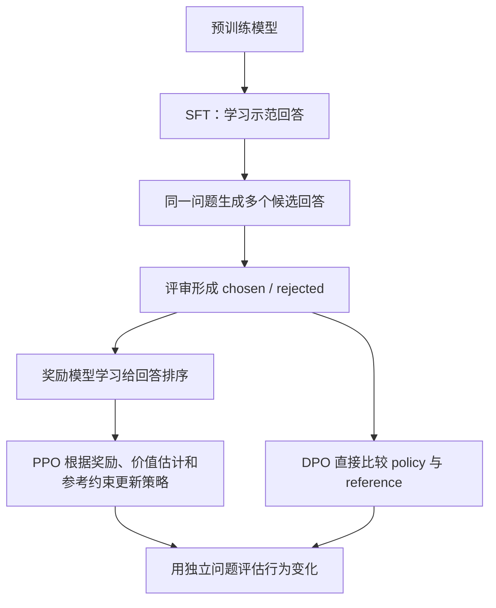

# 第 5 章 偏好优化实战：从比较到可验证的行为变化

上一章用监督微调（Supervised Fine-Tuning，SFT）教模型模仿示范回答。示范很有用，但有些问题并没有唯一标准答案：有人更喜欢详细步骤，有人更在意简洁；两条回答也可能一条更完整、另一条更谨慎。遇到这种情况，给每条回答各打一个绝对分数往往不容易，直接比较同一个问题下的两个回答却更自然。

偏好优化把这种比较变成训练信号。它不告诉模型“这句话是唯一正确答案”，而是记录“在这次任务和评审标准下，哪条回答更值得选择”。本章要完成的事情很具体：从一条偏好记录出发，理解奖励模型和 DPO 各自怎样使用它，跟着一组小数字算出 DPO loss，再看这些计算怎样落到 token 和训练器里，最后设计实验判断模型是否真的按预期改变了回答。

我们会反复使用同一个问题：“我每天只有 20 分钟，怎么开始学 Python？”假设本次评审关注的是“回答是否能直接照着做”，那么一份分配清楚的 20 分钟计划可能胜过一句“每天安排时间、多做练习”。换成“回答是否简短”这个标准，比较结果就可能不同。下面所有示例都是教学用的假设数据；它们说明计算过程，不代表真实模型实验结果。



图里有两条路线。传统的 RLHF 流程会先训练奖励模型，再让策略模型根据奖励继续优化；DPO 直接从偏好对训练策略模型，省去单独拟合奖励模型和训练时反复采样的环节。DPO 仍需要一个参考模型，也仍然依赖偏好数据的质量。原始 DPO 论文说明了它与 KL 约束奖励优化之间的关系；InstructGPT 则展示了先 SFT、收集回答排序、再用强化学习优化的典型流程。[DPO 原论文](https://arxiv.org/abs/2305.18290v3)，[InstructGPT 论文](https://arxiv.org/abs/2203.02155)

下文说的 policy（策略）就是当前负责生成回答的模型及其条件概率分布；reference（参考策略）是用来比较它变化幅度的起始模型分布。它们是训练中的角色名称，不是两种不同的语言模型架构。

## 5.1 把“更喜欢哪一个”写成数据

先看两种训练记录有什么不同。SFT 通常拿一个问题和一条示范回答训练模型；偏好优化需要同一个问题和两条候选回答，并标出评审者更喜欢哪一条。

```text
问题：我每天只有 20 分钟，怎么开始学 Python？
chosen：先用 5 分钟复习昨天的内容，再用 10 分钟完成一个小练习，最后用 5 分钟记下卡住的地方。
rejected：每天安排 20 分钟学习，尽量多做练习，并定期回顾薄弱内容。
评审标准：回答是否能直接照着做。
```

这份记录里的 chosen 指当前标准下被选中的回答，rejected 指这次比较中没有被选中的回答。它们不是“正确答案”和“错误答案”的同义词。第二条建议并非完全错误，只是没有把 20 分钟具体分配出来。

一条样本可以写成三元组：

```math
(x,\ y^+,\ y^-)
```

其中 $x$ 是问题及其必要上下文， $y^+$ 是 chosen， $y^-$ 是 rejected。上标“+”和“-”只是标记本次比较的胜负方向。整个数据集可以写成：

```math
\mathcal{D}_{\mathrm{pref}}
=
\{(x_{i},y_{i}^+,y_{i}^-)\}_{i=1}^{N}
```

三部分必须对应同一个问题。若一个回答是在回答“每天怎么学习”，另一个回答却针对“学 Python 要装什么软件”，它们的优劣差异无法告诉模型怎样比较同一道题的回答。

### SFT 和偏好优化分别教什么

SFT 让模型提高示范回答的生成概率。对一个问题 $x$，它希望模型更容易生成训练答案 $y$。偏好训练看的是两条回答的相对关系：在同一个问题下，模型是否比参考状态更愿意生成 chosen，而不是 rejected。

```text
SFT：给定问题 x，示范回答 y 应该更容易出现。
偏好优化：给定问题 x，y+ 应该比 y- 更受当前目标偏好。
```

因此，偏好对不能代替 SFT 的基础作用。若模型连基本对话格式都不会，少量“哪个回答更好”的比较通常也无法教会它所有必要格式和技能。实际项目往往从一个已经过 SFT 的模型开始，再用偏好数据调整回答倾向。

### 一条偏好记录应该让人看得懂

数据字段不只是为了让训练器接受输入，也要让后来的人能复核“为什么这条回答赢了”。最简单的存储形式是：

```json
{
  "prompt": "我每天只有 20 分钟，怎么开始学 Python？",
  "chosen": "先用 5 分钟复习昨天的内容，再用 10 分钟完成一个小练习，最后用 5 分钟记下卡住的地方。",
  "rejected": "每天安排 20 分钟学习，尽量多做练习，并定期回顾薄弱内容。",
  "criterion": "回答是否能直接照着做",
  "reason": "chosen 把总时长拆成了三个可执行步骤。"
}
```

criterion 和 reason 不一定直接送进训练器，但在数据审查和后续分析中很有用。若许多 chosen 都比 rejected 更长、语气更客气或带有固定开头，模型可能学到这些表面特征，而不是评审真正想要的质量。保存比较标准、候选来源和必要的评审说明，能帮助定位这种偏差。

聊天模型的 prompt 往往不只是用户的一句话，也可能包括 system 指令和此前对话。训练时，chosen 与 rejected 应共享完全相同的上下文，并经过相同的聊天模板。若 prompt 已经包含在答案字段中，训练器又自动拼接一次，就可能把问题重复输入；若两条候选的角色标记不同，模型也可能把格式差异误当成偏好。

TRL v1.14.1 接受显式的 prompt、chosen、rejected 字段，也支持对话消息列表；对话格式会使用模型的聊天模板。[TRL v1.14.1 数据格式](https://huggingface.co/docs/trl/v1.14.1/dataset_formats)，[TRL v1.14.1 DPOTrainer](https://huggingface.co/docs/trl/v1.14.1/dpo_trainer)

### 评审者比较的标准也属于数据

标注时应把问题说清楚：本次主要比较事实准确性、完整性、格式遵循、简洁度，还是安全边界？如果评审者只看到“选一个更好的”，他们可能一会儿选更短的，一会儿选更详细的，模型得到的信号就互相冲突。

一份 rejected 最好有具体而可信的不足，例如：

- 结论基本相关，却遗漏了问题中的关键限制；
- 解释有条理，但把公式或概念关系说错；
- 回答内容正确，却没有按要求输出 JSON；
- 语气流畅，但给出了没有依据的细节；
- 在可以正常回答的问题上拒绝作答。

乱码、空字符串或完全答非所问的回答也能用于某些格式排错，但它们通常太容易识别，无法教模型区分两条都看起来合理的回答。偏好数据质量不只由 pair 数量决定，也取决于候选是否可比、标签是否可靠，以及被比较的差异是否对应目标行为。

### 偏好对从哪里来，比较过程要留下什么

偏好对通常来自几种流程：评审者直接比较模型对同一 prompt 的候选；评审者先给多条回答排序，再从排序中构造胜负对；或者用已有规则筛出一条优于另一条的样本。无论数据来自哪种流程，都应保留候选的来源、生成模型及其版本、采样设置、评审规则和必要的标注记录。后续若发现模型只偏向某一种回答来源，才有材料定位原因。

例如同一个问题生成了 5 条回答，按全排序可以构造最多 $\binom{5}{2}=10$ 个两两比较。但这 10 对并不是 10 个独立问题：它们共享同一 prompt 和候选回答。如果把候选拆到训练集和验证集两边，几乎会造成直接泄漏。记录中可以保存 `prompt_id`、`candidate_id` 和 `annotator_id`；切分时按 prompt 或更高层级的数据来源分组，而不是按 pair 随机打散。

生成候选的模型也会影响偏好数据。若候选都来自同一个模型、相似的采样参数，训练数据主要覆盖的是这个模型容易产生的回答差异；它不能代表所有真实用户输入或所有可能的错误。多个来源能增加多样性，但要保留来源标签，以便检查某一来源是否支配训练集。

### 分歧、平局和偏好强度要单独记录

两位评审者不一致，并不总是因为其中一位标错了。有时目标标准写得不够清楚，有时两条回答分别在完整性和简洁性上占优，评审者实际采用了不同权衡。可以对一部分样本做双人标注，计算一致率，并把分歧样本交给复核者或明确标记为平局。

基础 Bradley–Terry / DPO 讲解把标签写成二元方向：chosen 胜过 rejected。平局不是随便选一边即可；可以暂不用于这个二元目标，也可以采用专门支持平局或软标签的目标，但应明确说明目标已改变。若评审者给出置信度或 1—5 的偏好强度，也先作为审计字段保存。只有训练目标明确定义了如何使用这些值，才能把它们加权进 loss；不能把主观置信度不经说明地乘进标准 DPO 公式。

实务中至少要区分三种统计：原始比较数、独立 prompt 数、经过复核或剔除后的可用比较数。若只报告“有 10 万条 pair”，读者不知道其中多少来自重复问题、多少评审有分歧，也不知道真正覆盖了多少不同场景。

### 长度和截断会改变训练器真正看到的回答

人类看到的是完整文本，模型训练时处理的是 tokenizer 生成的 token 序列。字符数不能准确预测 token 数；中英文、代码、特殊符号和聊天模板都会改变 token 化结果。审计偏好数据时，至少应比较 chosen/rejected 的 token 长度分布、两者长度差、模板后的总长度，以及截断后保留下来的回答 token 数。

假设某条记录的 prompt 经模板处理后占 180 个 token，chosen 占 55 个 token，rejected 占 220 个 token，而训练最大长度设为 256。若策略是保留完整 prompt，再从回答末尾截断，那么 chosen 可以完整保留，rejected 只剩最多 76 个回答 token。若关键区别在 rejected 的后半段，训练器看到的就不是评审者比较过的那条回答。不同 trainer 的截断方向和 prompt 处理方式可能不同，必须抽样检查实际 token 序列，不能只看字符数或配置里的 `max_length`。

偏好数据还可能有长度相关的评审偏差：评审者或奖励模型偏爱更详细的回答，或者把短回答当成不够努力；反过来，若评审标准强调简洁，chosen 也可能系统性更短。这不表示需要把回答强制改成同一长度，而是要判断长度究竟是目标属性、内容质量的伴随信号，还是数据收集带来的假线索。报告长短分桶的排序准确率和截断率，通常比只报总体平均长度更有用。

对 DPO 尤其要留意后续的 token 汇总口径：标准序列 log probability 是 token log probability 的总和；改成按回答长度取平均，会改变长短回答之间的相对差值。因此，数据长度审计和 loss reduction 审计应放在一起看。

### 用小脚本先挡住明显的数据错误

下面的检查只找空字段、两边相同和完全重复的记录。它不会判断哪条回答更好，也不能代替人工抽样。

> 代码状态：静态审阅，未运行（2026-11-13）

```python
rows = [
    {
        "prompt": "我每天只有 20 分钟，怎么开始学 Python？",
        "chosen": "用 5 分钟复习、10 分钟练习、5 分钟记录问题。",
        "rejected": "每天安排时间学习，多做练习。",
    },
    {
        "prompt": "我每天只有 20 分钟，怎么开始学 Python？",
        "chosen": "用 5 分钟复习、10 分钟练习、5 分钟记录问题。",
        "rejected": "每天安排时间学习，多做练习。",
    },
    {
        "prompt": "怎样开始学 Python？",
        "chosen": "先写一个小程序。",
        "rejected": "先写一个小程序。",
    },
]


def audit(rows):
    issues = []
    seen = set()

    for row_id, row in enumerate(rows):
        values = {}
        for field in ("prompt", "chosen", "rejected"):
            value = row.get(field)
            if not isinstance(value, str) or not value.strip():
                issues.append(f"row {row_id}: empty or invalid {field}")
            else:
                values[field] = value.strip()

        if len(values) == 3:
            if values["chosen"] == values["rejected"]:
                issues.append(f"row {row_id}: chosen equals rejected")

            key = (values["prompt"], values["chosen"], values["rejected"])
            if key in seen:
                issues.append(f"row {row_id}: duplicate pair")
            seen.add(key)

    return issues


print(audit(rows))
```

按代码中的三条记录，审计会报告一条重复 pair 和一条 chosen/rejected 完全相同。它没有检查 token 截断、事实正确性、评审标准是否稳定，也没有识别语义相同但措辞不同的重复样本。把检查结果当作排查入口，比把它当作“数据质量分”更合适。

另一个常见错误出现在数据切分。同一个问题若生成了多个回答组合，所有这些 pair 应放在同一个训练或验证分区里。否则模型训练时见过这个问题，验证时再遇到它的近似版本，验证成绩会显得过于乐观。最好按 prompt ID 或更高层级的数据来源分组，再报告 pair 数和独立 prompt 数。

模型读入的不是字符，而是 tokenizer 切出的 token。两条回答的 token 长度、截断位置和保留下来的回答 token 数都值得检查。字符数只能做粗略筛查，不能代替目标 tokenizer 的计数。若 chosen 被截得只剩开头，训练器实际比较的就不是评审者当初看过的那条回答了。

至此，我们知道偏好数据里记录了什么，以及它有哪些可能的偏差。接下来要问：这些只有胜负方向的标签，怎样变成模型可用的数值目标？

## 5.2 先看奖励模型：从偏好标签到回答分数

奖励模型（Reward Model，RM）不负责生成回答。它接收一个问题和一条回答，输出一个实数分数：

```math
r_\phi(x,y)\in\mathbb{R}
```

这个分数不是正确率，也没有天然的 0 到 100 刻度。对每个偏好对，奖励模型分别给 chosen 和 rejected 打分：

```math
r_{i}^+=r_\phi(x_{i},y_{i}^+),
\qquad
r_{i}^-=r_\phi(x_{i},y_{i}^-)
```

训练希望 chosen 的分数高于 rejected。只写成 $r_{i}^+>r_{i}^-$ 还不够，因为训练需要一个可以连续优化的损失。Bradley–Terry 模型用分数差表示 chosen 胜出的概率：

```math
P(y_{i}^+\succ y_{i}^-\mid x_{i})
=
\sigma(r_{i}^+-r_{i}^-),
\qquad
\sigma(z)=\frac{1}{1+\exp(-z)}
```

当分数差为 0，模型给这次比较的胜出概率是 0.5；差值越大，概率越接近 1。这里的概率描述的是一个排序模型对比较结果的估计，不是回答事实正确的概率。

训练时要让模型把较大的胜出概率分给数据中的 chosen，因此最小化负对数似然：

```math
\mathcal{L}_{\mathrm{RM}}
=
-\frac{1}{B}\sum_{i=1}^{B}
\log\sigma(r_{i}^+-r_{i}^-)
```

计算时通常把单条损失改写为

```math
\ell_{\mathrm{RM}}
=
-\log\sigma(r^+-r^-)
=
\log\left(1+\exp(r^- - r^+)\right)
=
\mathrm{softplus}(r^- - r^+)
```

这个等价形式能直接使用数值稳定的 `logsigmoid` 或 `softplus` 实现，避免先算一个接近 0 的概率、再取它的对数。普通语言模型的交叉熵也常用同一思路：把稳定计算交给 logit 形式的 loss 函数。

$B$ 是一批偏好对的数量。现在代入贯穿例子的假设分数：具体计划得 1.2 分，笼统建议得 -0.3 分。分差为 $1.2-(-0.3)=1.5$，胜出概率约为 $\sigma(1.5)=0.818$，单条样本的损失约为 $-\ln(0.818)=0.201$。若把两条回答的分数反过来，胜出概率约为 0.182，损失约为 1.701。模型因此会从被排错的样本得到更强的纠正信号。

Bradley–Terry 在这里是一个关于评审偏好的建模假设：给定两条回答，分数差决定 chosen 胜出的概率。DPO 的原始推导也采用这个两两比较模型。[DPO 原论文 §3](https://arxiv.org/html/2305.18290v3)

分数只通过差值进入这个损失。给两条回答都加上 10，概率和损失都不改变，所以 RM 的分数没有固定原点。我们可以用它给候选排序，却不能说“2 分回答是 1 分回答的两倍好”。

对损失关于两个分数求导，能看到模型要往哪个方向改：

```math
\frac{\partial \ell}{\partial r^+}
=
\sigma(r^+-r^-)-1,
\qquad
\frac{\partial \ell}{\partial r^-}
=
1-\sigma(r^+-r^-)
```

在刚才的例子里，chosen 的梯度约为 -0.182，rejected 的梯度约为 0.182。梯度下降会提高 chosen 的分数、降低 rejected 的分数。真实模型更新时，梯度还会沿着打分头和网络层传回参数；这两个数只展示最后的分数头所接收到的方向。

有些训练目标会要求 chosen 不只是略高一点，而是至少高出指定 margin $m$：

```math
\ell_{\mathrm{margin}}
=
\mathrm{softplus}\left(m-(r^+-r^-)\right)
```

例如 $m=0.5$ 表示希望分差接近或超过 0.5。它会改变“分数差到多少才算足够”的要求，并不是给 Bradley–Terry 目标随手加一个常数就仍然等价于原目标。只有偏好强度或训练设计需要这个间隔时才使用；margin 越大也会推动分数差越大，不能把它当成普遍更好的配置。

### RM 和 PPO 怎样接在一起

RLHF（Reinforcement Learning from Human Feedback，基于人类反馈的强化学习）的一条经典 PPO 路线通常会涉及以下模型角色：

| 角色 | 输入和输出 | 训练中的工作 |
| --- | --- | --- |
| 策略模型（policy） | 输入问题，生成回答 | 需要被偏好优化的语言模型 |
| 奖励模型（RM） | 输入问题和回答，输出分数 | 用偏好对学习评审者倾向 |
| 价值模型（value model） | 输入生成到当前位置的上下文，估计后续可获得的回报 | 为 PPO 估计基线，帮助判断当前生成比预期好还是差 |
| 参考模型（reference） | 输入问题，生成概率分布 | 作为策略的起点参照，限制策略漂移 |

常见的奖励模型会让语言模型读入问题和回答，再用一个打分头把回答表示压成单个实数。这样，输入是一整条回答，输出却是一个可比较的分数；具体取哪个 token 的隐藏状态、怎样处理结束标记，则依实现而异。

成批计算时，chosen 和 rejected 必须按 pair 对齐。以 batch 大小 $B$、补齐后序列宽度 $L$、隐藏维度 $H$ 为例：

| 张量 | 形状 | 含义 |
| --- | --- | --- |
| `input_ids` | $[2B,L]$ | 前 $B$ 行是 chosen，后 $B$ 行是对应的 rejected |
| `attention_mask` | $[2B,L]$ | 标出真实 token 与 padding |
| `last_hidden_state` | $[2B,L,H]$ | 每个 token 位置的上下文表示 |
| `scores` | $[2B]$ | 每条完整回答对应一个标量 |

把两侧放进同一个 batch 能减少重复的框架调用，但最终必须按相同顺序拆回 $B$ 个 chosen/rejected pair。若错误地把两个回答按长度排序后各自重排，`scores[i]` 与 `scores[B+i]` 就可能不再对应同一个问题。

padding 也会影响取回答表示的位置。假设某条序列实际只有 3 个 token，另一条有 5 个，右侧补齐后两行宽度都是 5。短序列最后一个真实 token 的索引是 2；索引 4 是 padding，不能用它的隐藏状态代表回答。若采用右 padding，可用 `attention_mask.sum(dim=1) - 1` 找到每行最后一个真实 token；换成左 padding、额外特殊 token 或不同池化规则时，索引计算也要跟着改。终止 token 是否放进回答并参与打分，应在数据、训练和推理时一致。

训练 RM 后，PPO（Proximal Policy Optimization，近端策略优化）路线会让 policy 生成回答，由 RM 给回答打分，再用强化学习更新 policy。这里还常有一个价值模型：RM 对完整回答表达“评审标准下的分数”，价值模型则估计“从当前生成前缀继续走下去，预计能得到多少回报”。二者都输出数字，但作用不同。一次采样的实际回报与价值模型预测之差形成优势信号；例如实际回报为 2.5、价值估计为 1.8，优势约为 0.7，表示这段生成比当前基线预期更好。

PPO 会比较更新前后的 token 概率比，并裁剪超出小区间的部分，降低一次更新把策略推得过远的风险。按论文的常见记法，裁剪目标可以写为：

下面这条公式是 PPO 路线的补充。若当前只想跟上离线偏好训练的主线，可以先记住 PPO 会重新采样回答，并限制每轮策略更新的幅度，再继续读 DPO。

```math
\rho_{t}(\theta)
=
\frac{\pi_\theta(a_{t}\mid s_{t})}{\pi_{\mathrm{old}}(a_{t}\mid s_{t})},
\qquad
L_{\mathrm{clip}}
=
\mathbb{E}_{t}\left[
\min\left(
\rho_{t}(\theta)A_{t},
\mathrm{clip}(\rho_{t}(\theta),1-\epsilon,1+\epsilon)A_{t}
\right)
\right]
```

$s_{t}$ 是已经生成到位置 $t$ 的上下文， $a_{t}$ 是接下来生成的 token， $A_{t}$ 是价值基线校正后的优势。这个裁剪限制的是 PPO 一轮更新的概率比激励；RLHF 训练里 reference/KL 项还会额外约束策略不要离初始模型过远。PPO 路线因此包括采样、奖励/价值估计和多轮更新，工程部件比固定数据上的 DPO 更多。[InstructGPT 论文 §3](https://arxiv.org/abs/2203.02155)，[PPO 原论文](https://arxiv.org/abs/1707.06347v2)

例如，某 token 在旧策略下概率为 0.20，在新策略下升到 0.26，则 $\rho_{t}=0.26/0.20=1.30$。若 $\epsilon=0.20$、优势 $A_{t}=0.5$，未裁剪项是 $1.30\times0.5=0.65$；裁剪后的比率为 1.20，对应 $1.20\times0.5=0.60$。目标取两者较小值 0.60，因而不会继续按 1.30 的比例奖励这次过大的提升。这个小算例只演示正优势下的裁剪，不代表完整 PPO 更新只包含这一项。

RM 的弱点在于，它只是对已有偏好标签的近似。如果训练数据偏爱某种表面写法，或者评审标准含糊，RM 可能会把这些偏差学进去；后续策略也可能学会提高 RM 分数，却没有提高真实任务质量。这种现象常被称为 reward hacking（奖励投机）。所以 RM 的排序准确率需要在留出的偏好对上测量，策略输出仍要另行评估。

留出集上的 pairwise accuracy 可以按下面方式计算：

```math
\mathrm{Acc}_{\mathrm{pair}}
=
\frac{1}{N}\sum_{i=1}^{N}
\mathbb{I}\left[r_{i}^+>r_{i}^-\right]
```

若 100 个留出 pair 中，RM 把 83 个 chosen 排在 rejected 前面，accuracy 是 83%。这表示它在这批留出比较上有 83 次排序正确，不表示回答有 83% 的事实正确率。验证集应按 prompt 分组，并按任务、来源或回答长度再分组；否则重复 prompt 泄漏或某个大类占多数可能掩盖错误。还要观察 chosen/rejected 分数差的分布，而不是只看一个汇总准确率。

策略模型上线前后，RM 的平均分也不能单独当成质量指标。若优化后回答的 RM 分数持续升高，但盲评胜率和任务指标没有改善，说明 policy 可能学会迎合 RM 的可预测特征。此时要回到失败样例检查 RM 的训练覆盖、评审标准和分数来源，而不是继续追着 RM 分数训练。

### 进阶实作：把偏好对变成奖励模型的一步更新

看完 RM 的输入、目标和分数方向后，可以把一次训练更新写成几步：把两条回答都与同一 prompt、同一聊天模板拼接；对两边做一致的 token 化和补齐；分别得到一个标量分数；用 $\mathrm{softplus}(r_{\mathrm{rejected}}-r_{\mathrm{chosen}})$ 计算 pairwise loss；最后反向传播更新打分头和参与训练的 backbone。

下面只展示一个 batch 的关键计算。调用前提是 chosen/rejected 已按相同模板编码，均为右侧 padding，chosen 样本先排列、rejected 样本后排列；回答结尾包含统一约定的结束 token。真实模型的 backbone 输出字段、隐藏维度和适配方式需按具体架构核对。

> 代码状态：静态审阅，未运行（2026-11-16）

```python
import torch
import torch.nn.functional as F


def score_last_token(backbone, reward_head, input_ids, attention_mask):
    outputs = backbone(input_ids=input_ids, attention_mask=attention_mask)
    hidden = outputs.last_hidden_state  # [2 * batch, length, hidden_size]

    lengths = attention_mask.long().sum(dim=1)
    if torch.any(lengths == 0):
        raise ValueError("every sequence must contain a real token")

    last_indices = lengths - 1  # 只适用于这里约定的右侧 padding
    row_indices = torch.arange(input_ids.shape[0], device=input_ids.device)
    response_repr = hidden[row_indices, last_indices]
    return reward_head(response_repr).squeeze(-1)


def reward_model_step(
    backbone,
    reward_head,
    optimizer,
    chosen_ids,
    chosen_mask,
    rejected_ids,
    rejected_mask,
):
    if chosen_ids.shape != rejected_ids.shape:
        raise ValueError("chosen/rejected must be padded to the same shape")
    if chosen_mask.shape != chosen_ids.shape or rejected_mask.shape != rejected_ids.shape:
        raise ValueError("each attention mask must match its input_ids")

    input_ids = torch.cat([chosen_ids, rejected_ids], dim=0)
    attention_mask = torch.cat([chosen_mask, rejected_mask], dim=0)
    scores = score_last_token(backbone, reward_head, input_ids, attention_mask)

    batch_size = chosen_ids.shape[0]
    reward_chosen = scores[:batch_size]
    reward_rejected = scores[batch_size:]
    loss = F.softplus(reward_rejected - reward_chosen).mean()

    optimizer.zero_grad(set_to_none=True)
    loss.backward()
    optimizer.step()

    pair_accuracy = (reward_chosen > reward_rejected).float().mean()
    return loss.detach(), pair_accuracy.detach()
```

`reward_head` 通常是把隐藏维度映射到 1 的线性层，优化器需包含打分头和要训练的 backbone 参数。代码假设 collator 已将两边补齐为相同宽度，也假设最后一个有效 token 就是本条回答用于打分的位置；若模型用专门的 score token、不同池化方式或左右 padding，不能直接照抄索引。

这段更新还没有包含 tokenizer、dataset/collator、epoch 循环、验证集选 checkpoint、混合精度、梯度累积和保存恢复。完整训练要在每轮后用独立 prompt 计算 pairwise accuracy，保存表现合适的 checkpoint，并查看分数差和不同类别数据上的结果。用训练集 accuracy 选模型会高估泛化；只保存最后权重也不利于比较训练过程中是否已经过拟合。

把这个 batch 更新放进训练过程时，可以按下面的顺序组织：

1. 先按 prompt 或更高层级来源划分训练集和验证集，再用同一个 tokenizer、聊天模板和截断规则编码两侧回答。
2. 每个 batch 保持 chosen 与 rejected 成对，计算两侧分数和 pairwise loss，再反向传播更新打分头及选定的 backbone 参数。
3. 每轮结束后在未参与更新的 prompt 上计算 pairwise accuracy 和分差分布；再按任务来源、回答长度等条件分组，查看整体指标是否掩盖某类失败。
4. 保存验证表现合适的 checkpoint 和配置。若训练集指标继续上升、验证集指标停滞或下降，应优先检查过拟合和标签噪声，而不是只延长训练。

RM 的分数用于排序，不需要把它解释成校准过的概率。进入 PPO 路线后，策略可能逐渐生成与训练数据不同的回答；应抽查新生成回答的 RM 分数、长度和人工判断。如果分数持续升高而人工评审没有同步改善，这更像是模型在利用 RM 的盲点，而不是目标质量变好了。

DPO 会保留偏好对和参考策略，但不单独训练 RM。理解这个选择之前，先补上一块语言模型基础：模型怎样给一整条回答计算概率。

## 5.3 DPO：从回答概率推到偏好目标

### 一条回答的概率怎样由 token 组成

语言模型逐个 token 生成回答，而不是一次给整句话分配一个概率。给定问题 $x$ 和回答 $y=(y_{1},\ldots,y_{T})$，整条回答的条件概率等于每一步 token 条件概率的乘积：

```math
\pi(y\mid x)
=
\prod_{t=1}^{T}
\pi(y_{t}\mid x,y_{1:t-1})
```

这里 $y_{1:t-1}$ 表示第 $t$ 个 token 之前已经生成的前缀；当 $t=1$ 时，前缀为空。直接相乘会让很小的数字继续变小，所以通常取对数，把乘法改成加法：

```math
\log\pi(y\mid x)
=
\sum_{t=1}^{T}
\log\pi(y_{t}\mid x,y_{1:t-1})
```

例如，三个 token 的条件概率分别是 0.5、0.2、0.4，那么回答概率为 $0.5\times0.2\times0.4=0.04$，log 概率约为 $\ln0.5+\ln0.2+\ln0.4=-3.219$。log 概率通常是负数，数值越大（越接近 0），模型给这条回答的概率越高。它只衡量模型自身的概率分布，不是回答正确的概率。

### 参考模型解决什么问题

如果只要求模型不断提高 chosen 的概率、降低 rejected 的概率，模型可能离开原来的能力分布，甚至把偏好数据中的偶然特征学得过头。RLHF 常用 KL 散度约束新策略相对 reference 的变化。把这个想法写成目标：

```math
\max_{\pi}
\quad
\mathbb{E}_{x\sim\mathcal{D},\,y\sim\pi(\cdot\mid x)}
\left[
r(x,y)
\right]
-
\beta\,
\mathbb{E}_{x\sim\mathcal{D}}
\left[
D_{\mathrm{KL}}\!\left(
\pi(\cdot\mid x)\,\|\,\pi_{\mathrm{ref}}(\cdot\mid x)
\right)
\right]
```

第一项希望策略生成高奖励回答；第二项惩罚新策略偏离参考策略。 $\beta>0$ 控制二者的权衡。在这套目标下，奖励越重要，策略越愿意偏离 reference；约束越强，策略越靠近 reference。

对固定问题 $x$，这个 KL 正则化目标有一个闭式最优策略。求解这一步要求奖励函数有定义、reference 对候选回答给出非零概率，且训练时 reference 固定。稍后把隐式奖励改写成偏好对 loss 时，还会用到 Bradley–Terry 两两比较假设；这两层假设不要混在一起。条件改变时，下面的等价关系未必原样成立：

先暂时把回答空间看成有限集合，方便逐项求解；真实语言模型的回答空间大得多，但推导形式相同。固定一个问题 $x$ 后，要选择每条回答的概率 $\pi(y\mid x)$，使期望奖励尽量高，同时又不要离 reference 太远，并且所有回答概率之和必须为 1。把这个约束放进拉格朗日函数：

```math
\mathcal{J}(\pi)
=
\sum_{y} \pi(y\mid x)r(x,y)
-\beta\sum_{y} \pi(y\mid x)
\log\frac{\pi(y\mid x)}{\pi_{\mathrm{ref}}(y\mid x)}
+\lambda\left(\sum_{y}\pi(y\mid x)-1\right)
```

在最优点，对每个回答的概率求导并令结果为 0：

```math
\frac{\partial\mathcal{J}}{\partial\pi(y\mid x)}
=
r(x,y)
-\beta\left(\log\frac{\pi(y\mid x)}{\pi_{\mathrm{ref}}(y\mid x)}+1\right)
+\lambda
=0
```

整理后， $\log\frac{\pi(y\mid x)}{\pi_{\mathrm{ref}}(y\mid x)}=\frac{r(x,y)}{\beta}+\frac{\lambda}{\beta}-1$。固定 $x$ 后， $\lambda$ 和常数 1 对所有回答都相同；两边取指数，它们只影响归一化，不影响回答之间的相对比例：

```math
\pi(y\mid x)
\propto
\pi_{\mathrm{ref}}(y\mid x)
\exp\left(\frac{r(x,y)}{\beta}\right)
```

奖励项对 $\pi$ 是线性的，负 KL 项在 $\beta>0$ 时是凹的，因此这个驻点对应目标的最大值。归一化后得到闭式策略； $Z(x)$ 负责让所有回答概率加起来等于 1：

```math
\pi^*(y\mid x)
=
\frac{1}{Z(x)}
\pi_{\mathrm{ref}}(y\mid x)
\exp\!\left(\frac{r(x,y)}{\beta}\right)
```

$Z(x)$ 是归一化常数，确保所有回答概率加起来为 1。这个结果也说明了 $\beta$ 的作用。假设只有回答 A 和 B，reference 分别给它们 0.6 和 0.4 的概率，奖励分别为 1 和 0。取 $\beta=1$，最优策略给 A 的概率约为 $0.6e/(0.6e+0.4)=0.803$；若把 $\beta$ 增大到 4，A 的概率约为 $0.658$，更接近 reference 原来的 0.6。这个二选一例子只展示 KL 正则化目标的方向：奖励会把策略往高奖励回答推，较大的 KL 权重会压住偏离幅度。它不是从偏好数据直接估出的概率，也不是一次真实模型训练结果。

把闭式策略取对数并移项，可将隐式奖励写成：

```math
r(x,y)
=
\beta\log\frac{\pi^*(y\mid x)}{\pi_{\mathrm{ref}}(y\mid x)}
+
\beta\log Z(x)
```

这一步的直觉是：相对 reference，最优策略越愿意生成某条回答，它隐含的奖励就越高。归一化项 $Z(x)$ 只随问题变化，对同一问题下的两条回答相减时会抵消。

### DPO 把比较直接写成策略的 loss

Bradley–Terry 偏好模型只关心同一道题两条回答的奖励差：

```math
P(y^+\succ y^-\mid x)
=
\sigma\!\left(r(x,y^+)-r(x,y^-)\right)
```

把刚才由策略概率表示的奖励代入， $Z(x)$ 在差分中消去，得到 DPO 的偏好 logit：

```math
z_\theta
=
\beta
\left[
\log\frac{\pi_\theta(y^+\mid x)}
{\pi_{\mathrm{ref}}(y^+\mid x)}
-
\log\frac{\pi_\theta(y^-\mid x)}
{\pi_{\mathrm{ref}}(y^-\mid x)}
\right]
```

训练时要让数据里的 chosen 更可能胜过 rejected，因此最小化负对数似然：

```math
\mathcal{L}_{\mathrm{DPO}}
=
-\mathbb{E}_{(x,y^+,y^-)\sim\mathcal{D}_{\mathrm{pref}}}
\left[
\log\sigma(z_\theta)
\right]
```

这个目标中， $\pi_\theta$ 是要更新的策略模型， $\pi_{\mathrm{ref}}$ 是固定的参考模型。括号里的每一项都是一条完整回答在给定问题后的 log 概率；分子、分母取对数后，等价于相减。DPO 不是直接问“chosen 的概率绝对有多高”，而是问“相对 reference，当前策略对 chosen 的支持是否比对 rejected 增长得更多”。[DPO 原论文 §3–4](https://arxiv.org/html/2305.18290v3)

### 用一组数字手算 DPO

假设在同一个问题下，我们算得：

| 回答 | 当前 policy 的 log 概率 | reference 的 log 概率 | policy 相对 reference 的变化 |
| --- | ---: | ---: | ---: |
| chosen | -3.0 | -3.2 | $-3.0-(-3.2)=0.2$ |
| rejected | -4.2 | -3.7 | $-4.2-(-3.7)=-0.5$ |

假设 $\beta=0.5$。chosen 相对 reference 增加了 0.2，rejected 相对 reference 减少了 0.5，所以两者的相对差为 $0.2-(-0.5)=0.7$。乘上 $\beta$ 后，DPO logit 是 $z=0.35$。于是 chosen 胜出的模型概率为 $\sigma(0.35)\approx0.587$，单样本 loss 为 $-\ln(0.587)\approx0.533$。

这些 log 概率和 beta 是为了手算而设的数值，不代表一次真实训练。若把两条回答相对 reference 的变化调换，logit 就变成负数，loss 会更大，表示当前策略把这条偏好排反了。随着训练，损失会推动 policy 改变这种相对排序；它不保证每一步都单独提高 chosen 的绝对概率，实际变化可能主要来自压低 rejected。

### loss 怎样决定策略更新方向

把单条 DPO loss 写成 $\ell=-\log\sigma(z)$，对偏好 logit 求导得到：

```math
\frac{\partial\ell}{\partial z}
=
\sigma(z)-1
```

这个导数总是不大于 0。若 $z$ 很负，当前策略明显把 rejected 排在前面，导数绝对值较大，纠正信号更强；若 $z$ 已经很正，偏好排序已经符合标签，导数接近 0，单条样本继续推动的力量变小。比如 $z=0$ 时 loss 是 $\ln2\approx0.693$，导数是 $-0.5$； $z=2$ 时 loss 约为 $0.127$，导数约为 $-0.119$。

进一步看 reference-adjusted log 概率，先把 reference 视为固定量：

```math
\frac{\partial\ell}{\partial\log\pi_\theta(y^+\mid x)}
=\beta\left(\sigma(z)-1\right),
\qquad
\frac{\partial\ell}{\partial\log\pi_\theta(y^-\mid x)}
=-\beta\left(\sigma(z)-1\right)
```

梯度下降会倾向于提高 chosen 的 log 概率、降低 rejected 的 log 概率；真正更新的是共享的语言模型参数，因此两个回答之间也会相互影响。 $\beta$ 会缩放这条偏好信号。更大的 $\beta$ 并非无代价地“学得更快”，它会同时改变更新幅度及相对 reference 的惩罚权衡。

一个简单的实现自检是从相同 checkpoint 复制 policy 和 reference。初始化时，对任何回答都有相同的 policy/reference log 概率，所以每条 pair 的相对变化为 0， $z=0$，loss 为 $\ln2$。如果代码一开始就出现极大的正负 logit，优先检查模型是否真从同一起点加载、两边模板和 tokenizer 是否一致、reference 是否在训练中被误更新。

### 三个模型角色要分清

DPO 去掉了独立奖励模型，但仍有两个语言模型角色：

| 名称 | 是否更新 | 在标准 DPO 中做什么 |
| --- | --- | --- |
| policy / 策略模型 $\pi_\theta$ | 是 | 对 chosen 和 rejected 计算概率，并通过 loss 更新 |
| reference / 参考模型 $\pi_{\mathrm{ref}}$ | 否 | 提供初始概率基线，衡量 policy 相对它的变化 |
| Reward Model | 标准 DPO 中不需要 | 在另一条 RLHF + PPO 路线中给回答打分 |

实践中，两份模型通常都从同一个 SFT checkpoint 开始：一份作为可训练 policy，另一份作为冻结的 reference。reference 不是每个 prompt 的标准答案，也不会给回答打分；它回答的是“起始模型原本会多大程度支持这条回答”。

现在可以把 DPO 的训练步骤连起来：

1. 取一条同 prompt 的偏好对。
2. 用相同的模板和 tokenizer 分别处理 prompt + chosen、prompt + rejected。
3. 用 policy 和 reference 计算回答部分的 log 概率。
4. 计算两条回答相对 reference 的 log 概率变化，再形成 $z_\theta$。
5. 用 $-\log\sigma(z_\theta)$ 得到 loss，只更新 policy 参数。
6. 对一批样本重复上述计算；标准离线 DPO 训练时直接使用固定偏好数据，不需要在每次更新前重新采样回答。

这就是 DPO 的核心：模型表示为回答概率分布，学习目标是提高 chosen 相对 rejected 的 reference-adjusted 概率差，算法则把回答 token 的概率汇总成序列分数，再用二分类损失更新策略。

## 5.4 从序列公式到 token 级计算

公式里的 $\pi(y\mid x)$ 是整条回答的概率，但模型输出的是每个位置上对下一个 token 的 logits（归一化前的分数）。先对 logits 做 log-softmax，得到每个可能 token 的 log 概率，再取出实际回答 token 对应的项，最后沿回答位置求和。

要特别留心因果语言模型的“错一格”问题：位置 $t$ 的 logits 预测的是下一个 token $y_{t+1}$。因此，训练时要把 logits 和目标 token 各向左、右错开一位，再只汇总回答 token。问题 token 用来提供上下文，不应混进回答分数。

看一条最小序列就能把 shift 和 mask 对上。设完整输入是两个 prompt token、两个回答 token 和结束 token：

| 预测位置的 logits | 目标位置的 token | 目标 token | 是否计入回答 log 概率 |
| ---: | ---: | --- | --- |
| 0 | 1 | prompt 的第 2 个 token | 否 |
| 1 | 2 | 回答 token $a_{1}$ | 是 |
| 2 | 3 | 回答 token $a_{2}$ | 是 |
| 3 | 4 | `EOS` | 按数据约定，是或否 |

也就是说，若输入 token 是 `[p1, p2, a1, a2, EOS]`，供 log-probability 计算的 target 是 `[p2, a1, a2, EOS]`；与 target 同步的 mask 是 `[0, 1, 1, 1]`，若不计 EOS 则最后一位再设为 0。mask 先和原始 input token 对齐，再随 target 一起右移；若先 shift 了 token、却没 shift mask，最常见的错误就是漏掉第一个回答 token 或把最后一个 prompt token 算进去。

用因果语言模型的 `labels` 训练时，常把不参与 loss 的位置设为 `-100`，例如先复制 `input_ids`，再将 prompt 和 padding 对应位置改成 `-100`。常见 causal LM 会在内部对 logits/labels 做 shift；手写序列 log-probability 函数则必须显式 shift。两种写法的张量表面上看起来不同，必须按具体接口确认是否已经移位，避免重复 shift。

下面函数展示这一步的序列求和。输入的 input_ids 是 prompt 与回答拼接后的 token ID；response_mask 在要计入回答分数的位置为 1，在 prompt 和 padding 位置为 0。实际项目还需按所用模型的 EOS、聊天模板和截断规则检查 mask 的定义。

> 代码状态：静态审阅，未运行（2026-11-13）

```python
import torch
import torch.nn.functional as F


def sequence_log_probs(logits, input_ids, response_mask):
    """
    logits:        [batch, length, vocabulary_size]
    input_ids:     [batch, length]
    response_mask: [batch, length], 回答 token 为 1，其余为 0
    返回每条序列的回答 log 概率和，形状为 [batch]。
    """
    if logits.ndim != 3 or input_ids.ndim != 2 or response_mask.ndim != 2:
        raise ValueError("unexpected tensor rank")
    if logits.shape[:2] != input_ids.shape or input_ids.shape != response_mask.shape:
        raise ValueError("sequence dimensions must match")
    if input_ids.shape[1] < 2:
        raise ValueError("at least two positions are required")

    # 第 t 个位置的 logits 预测第 t+1 个位置的 token。
    shifted_logits = logits[:, :-1, :]
    target_ids = input_ids[:, 1:]
    target_mask = response_mask[:, 1:].to(logits.dtype)

    token_log_probs = F.log_softmax(shifted_logits, dim=-1)
    selected_log_probs = token_log_probs.gather(
        dim=-1,
        index=target_ids.unsqueeze(-1),
    ).squeeze(-1)

    return (selected_log_probs * target_mask).sum(dim=-1)
```

logits 的形状是 [batch, length, vocabulary]，每个位置都有整个词表的分数；gather 取出真实下一个 token 的那一列。乘以 mask 后，问题和 padding 位置不会参与求和。函数采用序列 log 概率的“求和”口径，这与前面的概率乘积公式一致。

同一条回答通常由 policy 和 reference 各计算一次，因此得到四个量：policy 的 chosen/rejected log 概率，以及 reference 的 chosen/rejected log 概率。把它们送入 DPO loss：

> 代码状态：静态审阅，未运行（2026-11-13）

```python
import torch.nn.functional as F


def dpo_loss(
    policy_chosen_logp,
    policy_rejected_logp,
    reference_chosen_logp,
    reference_rejected_logp,
    beta=0.1,
):
    if beta <= 0:
        raise ValueError("beta must be positive")

    chosen_ratio = policy_chosen_logp - reference_chosen_logp.detach()
    rejected_ratio = policy_rejected_logp - reference_rejected_logp.detach()
    preference_logit = beta * (chosen_ratio - rejected_ratio)
    return -F.logsigmoid(preference_logit).mean()
```

这段函数只实现损失层，不包含模型加载、数据拼接、反向传播或 optimizer step。它假设调用者已导入 torch.nn.functional 并在计算 reference 概率时关闭梯度；detach 也会阻止梯度回传到 reference。若它收到前一个函数输出的 [batch] 张量，结果是一个 batch 的平均 loss。手算例子里的 $z=0.35$ 就是 preference_logit 的单条数值；代码用 log-sigmoid 直接算 loss，数值上比先算 sigmoid 概率再取 log 稳定。

sequence_log_probs 只汇总了实际回答 token，这一点由 response_mask 决定。若 mask 把 prompt、padding 或错误位置包括进去，得到的就不是 DPO 公式所需的回答 log 概率。mask 的位置应与 causal shift 对齐；包含不包含 EOS 也要在训练与评估中保持一致。

### policy 和 reference 怎样完成一轮前向

一个 DPO batch 中，policy 要分别计算 chosen 与 rejected 的回答 log 概率，并保留梯度；reference 对同样两批 token 计算 log 概率，但不求梯度。于是会得到四个长度为 $B$ 的向量，再逐样本组成偏好 logit。reference 应冻结参数并置于评估模式，前向包在 `torch.no_grad()` 中；只在最后 loss 上 `detach` 虽然能阻止反传到 reference，但仍可能白白保留计算图。

示意流程如下：

```text
policy(prompt + chosen)    -> logp_policy_chosen      保留梯度
policy(prompt + rejected) -> logp_policy_rejected     保留梯度
reference(prompt + chosen)    -> logp_ref_chosen       no_grad
reference(prompt + rejected) -> logp_ref_rejected      no_grad
四个向量按样本对齐 -> beta × (chosen 相对增量 - rejected 相对增量) -> DPO loss
```

两种模型必须看到相同的 token 序列。若 policy 和 reference 使用了不同 tokenizer、聊天模板、EOS 或截断结果，log 概率差就混入了输入表示差异，不再只表示模型策略变化。reference 也不是用来评价正确性的裁判；它只提供“初始模型如何分配这些回答概率”的基线。

在小 batch 上可以做三项不需要训练的方向检查：

| 检查 | 预期结果 | 能发现的问题 |
| --- | --- | --- |
| policy 和 reference 完全相同 | 每条相对增量为 0， $z=0$，loss $=\ln2$ | 起点不一致、模板差异、reference 误更新 |
| 人为提高 chosen 的 policy log 概率 | $z$ 增大，loss 降低 | chosen/rejected 顺序写反或 loss 符号错误 |
| 只改变 padding 区域的 token ID | 回答 log 概率不变 | padding mask 漏计或 shift 错位 |

这些检查只能验证实现方向和张量对齐，不证明模型训练质量，也不能替代独立评估。尤其要保证第三项的 padding token 在 attention mask 和 response mask 中都被正确屏蔽。

### 求和还是平均，会改变什么

原始序列概率是 token 条件概率的乘积，所以取对数后自然得到 token log 概率之和。某些实现会改成有效回答 token 的平均值，以减小长回答与短回答的尺度差异。这不是纯粹的代码细节：求和与平均可能让长度不同的 pair 产生不同的 logit 和梯度，因此会改变训练目标。复现实验时应记录 reduction 口径，不能把两种实现的 loss 数值直接对比。

TRL v1.14.1 的 `loss_type="sigmoid"` 实现把每个回答的 token log 概率先求和，再计算 chosen/rejected 的相对差；本节手写函数采用相同的序列求和口径。[固定版本源码中的 loss 计算](https://github.com/huggingface/trl/blob/v1.14.1/trl/trainer/dpo_trainer.py#L1241-L1268) 文档把 `logps/chosen` 与 `logps/rejected` 称为平均 log-probability，但源码记录的是“batch 内各回答序列 log-probability 求和结果的平均”，不是每个回答内部再除以 token 数。[固定版本源码中的指标聚合](https://github.com/huggingface/trl/blob/v1.14.1/trl/trainer/dpo_trainer.py#L1548-L1566) 因此看训练日志时要区分“跨样本取平均”和“按回答 token 长度取平均”。TRL 另有明确归一化的 loss 配置；切换 loss type 就可能改变长度口径和训练目标，需按固定版本源码核对。

用不同长度的回答可以看出这种区别可能改变的不只是 loss 大小，也可能改变排序方向。假设 chosen 有 2 个回答 token，相对 reference 的 log-probability 增量总和为 $0.30$；rejected 有 4 个 token，增量总和为 $0.40$。取 $\beta=0.1$：

| reduction | chosen 增量 | rejected 增量 | pair 差值 | DPO logit | 单样本 loss |
| --- | ---: | ---: | ---: | ---: | ---: |
| token 求和 | $0.30$ | $0.40$ | $-0.10$ | $-0.010$ | 约 $0.698$ |
| token 平均 | $0.30/2=0.15$ | $0.40/4=0.10$ | $+0.05$ | $+0.005$ | 约 $0.691$ |

同一组逐 token 增量，在求和口径下 rejected 的相对提升更大；平均后 chosen 的每 token 增量更大，偏好 logit 的符号反过来了。这个例子说明序列平均不是对同一标准 DPO 的无害数值缩放，而是另一种长度口径。实际数据的长度差和每个 token 的 log 概率增量当然不会总像这个例子，但实现应记录 reduction，报告中也不要把不同口径的 loss 直接并排解释。

实现中还需要核对以下位置：

- chosen 和 rejected 是否共享同一个 prompt、模板和截断策略；
- padding 的 token 是否被 mask 掉；
- 截断后每一侧是否仍保留有效回答 token；
- reference 是否冻结，并且与 policy 使用兼容的 tokenizer 和模板；
- batch 维度上 chosen 与 rejected 是否一一对应。

这些检查看起来琐碎，却直接决定代码算出的数字是否对应公式里的对象。先把数据格式和配对规则核对清楚，再把训练循环交给框架处理。

## 5.5 用 TRL 训练一个 DPO policy

上一节的代码把 DPO 最关键的两步显式写出来：取回答 token 的 log 概率，再计算 pairwise loss。实际训练还要处理模型加载、设备、动态 padding、梯度累积、checkpoint 和日志。TRL 的 DPOTrainer 把这些流程封装起来。本节按 TRL v1.14.1 的接口示意；切换版本前应重新核对数据格式和参数，文档版本也不等于已经验证过的一套依赖锁。

### 先准备明确的训练和验证数据

以下是一条对话格式偏好数据的样子。实际保存为 JSONL 时，应把每条记录写成一行；提示和两条回答分开存储，训练器再按聊天模板组合。

```json
{
  "prompt": [
    {"role": "user", "content": "我每天只有 20 分钟，怎么开始学 Python？"}
  ],
  "chosen": [
    {"role": "assistant", "content": "先用 5 分钟复习昨天的内容，再用 10 分钟完成一个小练习，最后用 5 分钟记下卡住的地方。"}
  ],
  "rejected": [
    {"role": "assistant", "content": "每天安排 20 分钟学习，尽量多做练习，并定期回顾薄弱内容。"}
  ]
}
```

真实训练数据需要足够多且符合任务目标的偏好对。示例只展示字段，不适合作为模型训练集。训练集和验证集要按 prompt 或更高层级的数据来源分组；两个文件中不要出现同一问题的近似候选。

进入训练器前，再核对一次数据格式：不要把 prompt 同时拼进 `prompt` 字段和回答字段；chosen、rejected 必须回答同一个 prompt；两侧的角色标记和聊天模板要一致；assistant 的结束标记也要采用同一规则。对话模型会把 system、user、assistant 等角色边界转换成 token，因此两段文本看起来相同，不代表 token 序列也相同。

可以抽样记录以下审计结果：原始 pair 数、独立 prompt 数、重复 pair 数、完全相同的 chosen/rejected 数、长短两侧的 token 长度分位数、超过最大长度的比例、截断后只剩很少回答 token 的比例。`max_length` 设得很大不能证明样本没被截断；必须用实际 tokenizer、聊天模板和 trainer 的截断策略检查。

### 加载 SFT 起点并启动训练器

下面的代码假设 data/preferences/train.jsonl 和 data/preferences/eval.jsonl 已经准备好，且 outputs/sft/final 是上一章得到的 SFT checkpoint。它演示框架调用关系，不代表本地已安装这些版本、已联调依赖或已经训练出有效模型。

> 代码状态：静态审阅，未运行（2026-11-13）

```python
from datasets import load_dataset
from transformers import AutoModelForCausalLM, AutoTokenizer
from trl import DPOConfig, DPOTrainer


sft_path = "outputs/sft/final"

tokenizer = AutoTokenizer.from_pretrained(sft_path)
if tokenizer.pad_token is None:
    if tokenizer.eos_token is None:
        raise ValueError("tokenizer needs a pad_token or eos_token")
    tokenizer.pad_token = tokenizer.eos_token
tokenizer.padding_side = "left"

policy = AutoModelForCausalLM.from_pretrained(sft_path)
policy.config.pad_token_id = tokenizer.pad_token_id

datasets = load_dataset(
    "json",
    data_files={
        "train": "data/preferences/train.jsonl",
        "eval": "data/preferences/eval.jsonl",
    },
)

args = DPOConfig(
    output_dir="outputs/dpo-python-plan",
    beta=0.1,
    loss_type="sigmoid",
    learning_rate=5e-6,
    per_device_train_batch_size=1,
    gradient_accumulation_steps=4,
    num_train_epochs=1,
    max_length=1024,
    eval_strategy="epoch",
    save_strategy="epoch",
    logging_steps=10,
    report_to="none",
)

trainer = DPOTrainer(
    model=policy,
    ref_model=None,
    args=args,
    train_dataset=datasets["train"],
    eval_dataset=datasets["eval"],
    processing_class=tokenizer,
)

trainer.train()
trainer.save_model("outputs/dpo-python-plan/final")
tokenizer.save_pretrained("outputs/dpo-python-plan/final")
```

在 TRL v1.14.1 中，ref_model=None 表示训练器使用 DPO 开始前的初始 policy 作为 reference；训练过程中更新 policy，reference 保持参照状态。实际占用的显存取决于模型和框架实现，不能因为代码里没有显式加载第二个模型，就推断 reference 不需要计算或存储成本。

max_length 限制模板处理后的总序列长度，prompt 与回答都会占用这个预算。训练前应抽样检查截断结果，确保回答没有被截空，也没有把决定偏好优劣的关键部分切掉。该配置示例使用 eval_strategy 和 processing_class 等 v1.14.1 参数；不要把其他版本的示例字段混进同一配置。[TRL v1.14.1 DPOTrainer API](https://huggingface.co/docs/trl/v1.14.1/dpo_trainer)

先把配置里的几个量分开理解：

| 参数 | 它主要控制什么 | 读配置时应核对什么 |
| --- | --- | --- |
| `beta` | 偏好目标与 reference 约束的权衡 | beta 变化后 logit/loss 的尺度也变；不是通用越大越好 |
| `learning_rate` | 每一步参数更新的尺度 | 和训练步数、batch、可训练参数集合一起看 |
| `per_device_train_batch_size` | 每台设备每步取多少 preference pairs | DPO 一个训练样本是一对回答，不是单条回答 |
| `gradient_accumulation_steps` | 累积几次梯度再更新 | 常规数据并行下，有效 pair 数约为每设备 pair batch × 累积步数 × 设备数 |
| `max_length` | prompt 与回答拼好后的 token 总长度上限 | 截断会改变训练样本，须抽查保留的 answer token |
| `eval_strategy` / `save_strategy` | 多久做一次验证和 checkpoint | 应让验证结果与可恢复 checkpoint 对齐 |

例如每台设备每批处理 1 对样本、累积 4 次、使用 2 台数据并行设备时，一个 optimizer update 通常对应约 8 对偏好样本（共 16 条候选序列）。这是批量大小的估算；不同并行实现的实际定义可能不同，报告时还要记录设备数（world size）和 trainer 的处理方式。

beta 不是越大越好。它控制偏好信号与参考模型约束之间的权衡；在 TRL 的 DPO 配置说明中，较大的 beta 对应较小的 reference 偏离。learning_rate、数据质量、训练步数、batch 和回答长度也会影响策略变化。教学代码只展示参数的位置，不给出适用于所有模型和数据的默认配方。

这段代码默认使用完整模型参数更新，模型太大时可能无法放进显存。上一章介绍过 LoRA 和 QLoRA；它们可以减少需要训练或存储的参数，但不会改变偏好数据和 DPO 的目标。把 adapter 接到 DPOTrainer 时，要根据模型架构选目标模块，并按对应 TRL/PEFT 版本确认 reference 与 adapter 的行为。目标模块名不能从一个模型直接照抄到所有模型。

### LoRA 与 QLoRA 改变的是更新方式

完整微调会更新模型中的大量参数。LoRA 则冻结原权重 $W$，只学习一个低秩增量：

```math
W'=W+\Delta W,
\qquad
\Delta W=BA
```

若原线性层是 $4096\times4096$，完整权重有 $4096^2=16{,}777{,}216$ 个参数；取秩 $r=16$ 的低秩更新只需 $16(4096+4096)=131{,}072$ 个参数，约为原矩阵的 $0.78\%$。这是单层参数量示例，不等于整模型训练显存也按同一比例下降，因为前向激活、优化器状态、梯度和 reference 计算仍有成本。

| 路线 | 哪些参数主要变化 | 需要留心的资源与复现问题 |
| --- | --- | --- |
| 完整微调 | policy 的模型参数 | 参数梯度和优化器状态开销较大 |
| LoRA | policy 的低秩 adapter；基座冻结 | target modules 随架构不同；保存 adapter 时还要记录基座 revision |
| QLoRA | 量化存储的冻结基座加可训练 adapter | 量化格式、计算 dtype、量化库和硬件必须匹配；激活仍可能占显存 |

LoRA/QLoRA 不改变 chosen/rejected 标签和 DPO loss；它们限制了策略能通过哪些可训练参数改变。若 adapter 容量有限，模型可能难以学到目标变化；若 target modules 选错，代码也许仍能训练，却未必作用在预期层上。不同模型的模块命名和量化支持并不统一，本章不提供可跨模型照抄的模块列表。PEFT 文档中的 LoRA 初始化和模型存储约定也应按具体版本核对。[PEFT v0.18.0 LoRA 文档](https://huggingface.co/docs/peft/v0.18.0/package_reference/lora)，[Transformers v5.17.0 bitsandbytes 微调说明](https://huggingface.co/docs/transformers/v5.17.0/quantization/bitsandbytes)

### 保存模型和恢复训练不是一回事

最终导出的模型用于之后推理或部署；训练 checkpoint 则应支持从中断处接着训练。后者通常还需要 optimizer、scheduler、当前训练步数以及随机状态等信息，具体保存文件由框架版本决定。只调用 `save_model` 得到一份最终权重，不一定就能完整恢复优化过程。

正式训练至少保留：周期性 checkpoint、最终模型或 adapter、tokenizer/processor、配置文件、数据集版本或哈希、模型 revision、随机种子、依赖版本和训练日志。先确认 checkpoint 能从头加载用于评估，再确认恢复训练时优化器状态和 step 连续；这两种检查回答不同问题。

开始正式训练前，至少保存一份可复核的实验记录：SFT checkpoint 的 revision、训练和验证数据版本、聊天模板、tokenizer、TRL/Transformers/PyTorch 版本、最大长度、截断检查结果、beta、学习率、训练步数、LoRA 配置以及随机种子。loss 下降能说明模型在拟合训练目标，后面还要检查回答。

## 5.6 训练后，怎样知道回答有没有变好

训练日志回答的是“优化器是否在降低当前 loss”，而实际问题是“模型在目标任务上的回答是否按预期改变”。两者之间需要一份独立评估。

### 固定比较条件

比较 SFT 与 DPO 时，让两者回答同一批未参与训练的问题。保持 system prompt、聊天模板、最大生成长度、停止规则和采样参数一致；若使用随机采样，应为每个模型固定相同的生成设置，并保存种子。否则，输出变化可能来自评测条件，而不是偏好优化。

资源允许时，把预训练底座、SFT 和 DPO 三个阶段都留作基线：

| 比较 | 能回答的问题 |
| --- | --- |
| base → SFT | 指令微调是否带来基本的指令遵循与对话能力 |
| SFT → DPO | 偏好训练是否带来目标行为变化，是否同时损伤已有能力 |
| base → DPO | 只作为总变化参考，不能单独说明变化由 DPO 带来 |

本章主实验通常看 SFT 与 DPO 的配对输出；base 对照帮助判断最终表现来自哪一阶段。评测问题不能出现在训练集里，也不能仅仅换几个词复用训练 prompt。按任务类型和难度做分层抽样，并把 prompt ID、来源、目标属性和风险级别保存下来。

批量生成时，很多 causal LM 接口会把输入 prompt 和新生成 token 一起放在返回序列里。计算答案长度、格式通过率或人工偏好前，应按接口约定切出新生成的回答，避免把 prompt 本身也交给评分器。左 padding、右 padding和变长 batch 会影响切片边界，最好对一条短 prompt 和一条长 prompt 各做一次输出检查。保存评估记录时可以同时保留完整输入与完整生成序列，供复现；但展示和打分的回答字段应单独、明确地提取。

评测集可以按目标拆成几组：

| 评测类别 | 要观察的问题 |
| --- | --- |
| 目标偏好附近 | 回答是否更符合本次训练的标准 |
| 未见过的相似问题 | 学到的行为能否迁移到新 prompt |
| 事实与推理 | 训练后是否出现事实或逻辑退化 |
| 格式约束 | 是否遵循 JSON、列表或结构化输出要求 |
| 安全边界 | 该拒绝时是否拒绝，不该拒绝时是否仍能回答 |
| 无关回归任务 | 其他原有能力是否受到影响 |

对同一个 prompt，可以把 SFT 与 DPO 输出匿名并随机左右位置，让评审者根据预先写好的规则选择更好的一条，也允许平局。人工偏好胜率必须写清分母。例如 40 个问题中，DPO 有 25 胜、9 负、6 平：只看有明确胜负的题，胜率是 $25/(25+9)\approx73.5\%$；把平局也放进总题数，比例是 $25/40=62.5\%$。两种数字回答的是不同口径，报告时应同时给出胜、负、平的数量。

盲评要隐藏模型名称、输出来源和训练阶段，并随机化左右顺序，避免评审者因品牌或展示顺序产生偏差。评分标准应先写清楚，再让评审者看答案。对少量关键样本安排两位评审并统计分歧；如果用 LLM judge，还要保存 judge 的模型版本、提示词和评分规则，并用一部分人工评审检查它是否偏爱更长、更礼貌或更像自身写作风格的答案。

### 指标要贴着任务走

如果目标是让回答更可执行，可以人工评估步骤是否完整、时间预算是否满足、读者能否照做；如果目标是 JSON 格式，就直接解析并检查字段。如果目标是代码生成，可以运行独立测试；如果目标是准确回答事实问题，则需核对依据。一个关键词是否出现、某个格式是否通过，都只能说明对应的局部属性。

整体平均分也可能遮住一类明显退化。除了总体结果，还应按任务类别、回答长度、风险类型和数据来源分桶，列出几条胜例与失败例。若 DPO 更常写出“看起来完整”的答案，却开始加入无依据细节，平均偏好分不应盖住这个问题。

下面是一组小型教学计数，用来说明为什么目标指标和回归指标要同时看：

| 类别 | SFT 通过数 | DPO 通过数 | 读法 |
| --- | ---: | ---: | --- |
| JSON 格式正确 | $14/20$ | $18/20$ | 格式目标改善 4 题 |
| 事实回答有依据 | $16/20$ | $14/20$ | 同时少了 2 题 |
| 该拒绝时正确拒绝 | $8/10$ | $8/10$ | 本次没有观察到变化 |
| 可以回答时不过度拒绝 | $9/10$ | $7/10$ | 过度拒绝多了 2 题 |

这些小分母只能用于排查，不能证明统计显著性或总体能力变化。但它们已经说明“JSON 更整齐”并不能概括所有结果：应检查 DPO 改善了哪一类回答、哪些能力可能随之退化，以及失败是否集中在特定 prompt 或训练来源。

### 训练指标能说明什么

DPO trainer 可能记录偏好 loss、chosen/rejected 的隐式 reward 差、偏好准确率、token 准确率等。它们能帮忙发现训练方向或数值异常，但仍来自训练目标、训练数据或框架定义，不能代替独立生成评估。

例如，训练偏好准确率升高只说明 policy 在训练 pair 上更常把 chosen 排在 rejected 前面；它不能证明模型回答了新的问题，也不能证明 chosen 内容真实。若 RM 的离线排序准确率很高，也只说明 RM 能重现留出偏好标签，不能保证策略优化后不会找到 RM 的弱点。

### 把结果写成有边界的结论

假设 40 道盲评题得到 25 胜、9 负、6 平，且 DPO 在格式类问题上的通过数上升，但未见事实题出现了两条无依据回答。合适的结论可以是：

> 在本次固定模板与生成设置下，DPO 的回答在目标偏好评审中获得 25 胜、9 负、6 平；格式类问题的通过率也有所提高。未见事实题出现两条无依据回答，因此当前证据支持“目标表达和格式行为改善”，还不足以说明事实能力整体提高。

这类结论既报告变化，也保留负例和评估范围。样本数、评审者、评分规则、生成条件和不确定性都要能追溯。样本不多时，把结果视作一次阶段性检查，不要用小数点很多位制造确定感。

每次评估应保存逐样本结果，而不只保存一张汇总表。至少记录 prompt ID、policy/reference 模型 revision、模板和生成参数、随机种子、原始输出、盲评顺序、评审标签、自动指标结果和失败备注。这样发现回归时可以重放同一个问题，判断是模型变化、解码变化还是评分规则变化。

## 5.7 DPO 适合什么问题，又留下什么问题

DPO 适合这样的场景：已有可用的 SFT 模型，能收集同一问题下的成对偏好数据，目标是把某种回答倾向写进策略模型；同时，团队希望用固定数据做一次相对直接的离线训练。DPO 不需要独立 RM 和 PPO 更新循环，工程路径通常更简单。

| 比较点 | DPO | 常见的 RM + PPO 路线 |
| --- | --- | --- |
| 主要训练信号 | 固定偏好数据中的 chosen/rejected 对 | RM 对新采样回答给出的奖励，再用于策略更新 |
| 策略训练 | 直接优化 reference-adjusted 的成对目标 | policy 生成回答，RM 打分，PPO 按奖励和约束更新；常见实现还训练 value/critic |
| 数据形态 | 训练前准备好的离线比较数据 | 偏好数据用于训练 RM，策略优化阶段还要持续采样 |
| 工程负担 | 不需单独 RM 的标准训练循环，但 policy/reference 前向、数据和评估仍有成本 | 组件更多，需管理生成、奖励、价值估计、KL 约束和多轮更新 |
| 更适合先考虑的情形 | 有稳定偏好对，想直接做离线策略调整 | 能可靠地产生/评估新反馈，或需要与环境交互探索 |

这张表讲的是常见训练形态，不是严格的算法排名。DPO 依赖固定偏好数据是否覆盖目标行为；PPO 路线依赖 RM 是否能在新生成内容上给出有用信号。两者都需要控制偏离原模型并进行独立评估，选择时应比较数据获取、采样成本、反馈是否在线、工程资源和目标任务，而不是只看训练流程有几步。

原始 DPO 论文报告的是论文所选任务、模型与基线下的结果；它支持作者在这些条件下的比较，不足以推出 DPO 在所有任务上优于 PPO。[DPO 原论文实验与讨论](https://arxiv.org/html/2305.18290v3)

偏好优化有几条边界需要记住：

- 标签表达的是特定评审者、任务和标准下的相对选择；数据不等于普遍的人类价值共识。
- chosen 也可能有事实错误。DPO 能拟合偏好标签，不能自动核实内容。
- reference 约束的是策略相对起点的变化，不会给新回答提供事实保证。
- 训练集上的偏好排序提升不等于新任务上的质量提升；过窄的数据可能带来模板化、过度简短或过度拒答。
- 序列求和、token 平均、EOS 处理、mask 和截断都会影响实现目标，必须与代码和日志口径一致。

回看开篇问题，偏好优化并没有给“怎么学 Python”定义一个永远正确的答案。它把某个明确标准下的比较转成训练信号，再用模型概率变化去拟合这些比较。要知道改变是否值得保留，还得回到独立问题、固定条件和真实失败样例上检查。

## 本章实践：留下可复核的偏好优化记录

围绕一个狭窄而具体的目标完成一次小实验，例如“回答是否遵守给定 JSON 字段”或“步骤是否符合用户的时间预算”。交付时保留：

1. 训练与验证数据的 schema、样本来源、评审标准和按 prompt 分组的方法；
2. 初始 SFT 模型、tokenizer、模板、依赖版本和训练配置；
3. 截断与有效回答 token 的抽样检查，以及训练过程中保存的日志；
4. SFT 和 DPO 在相同未见问题上的原始输出、评分口径、胜负平数量和失败样例；
5. 一段说明结果支持什么、尚未验证什么的结论。

若没有可用 GPU，可以用前面的小数值例子和 DPO loss 函数追踪一批假设 log 概率，练习解释 beta、reference 和 mask 的作用；这能验证自己是否读懂目标函数，但不能声称完成了语言模型训练实验。

## 资料与实现边界

- Rafailov et al., [Direct Preference Optimization: Your Language Model is Secretly a Reward Model](https://arxiv.org/html/2305.18290v3)，用于核对 KL 约束目标、闭式策略、Bradley–Terry 假设和 DPO 推导。
- Ouyang et al., [Training language models to follow instructions with human feedback](https://arxiv.org/abs/2203.02155)，用于核对 SFT、偏好排序和 PPO 式 RLHF 的训练流程及其评估边界。
- Schulman et al., [Proximal Policy Optimization Algorithms](https://arxiv.org/abs/1707.06347v2)，用于核对 PPO 的采样与策略更新思路。
- Hugging Face TRL [v1.14.1 DPOTrainer 文档](https://huggingface.co/docs/trl/v1.14.1/dpo_trainer)与[数据格式说明](https://huggingface.co/docs/trl/v1.14.1/dataset_formats)，用于核对本章框架示例的数据字段和参数接口。

文档和论文支持的是其中定义的机制、版本接口和实验条件；本章的手算分数、log 概率、偏好样本及评估数字均为教学假设。代码块经过静态审阅，未在本地环境运行，也不证明所选模型、硬件和依赖可以直接联调。
