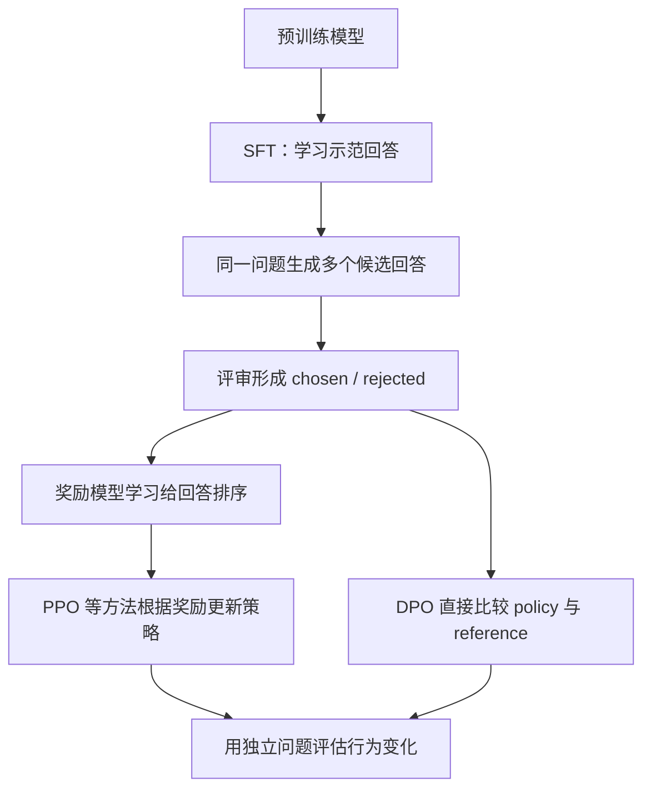

# 第 5 章 偏好优化实战：从比较到可验证的行为变化

上一章用监督微调（Supervised Fine-Tuning，SFT）教模型模仿示范回答。示范很有用，但有些问题并没有唯一标准答案：有人更喜欢详细步骤，有人更在意简洁；两条回答也可能一条更完整、另一条更谨慎。遇到这种情况，给每条回答各打一个绝对分数往往不容易，直接比较同一个问题下的两个回答却更自然。

偏好优化把这种比较变成训练信号。它不告诉模型“这句话是唯一正确答案”，而是记录“在这次任务和评审标准下，哪条回答更值得选择”。本章要完成的事情很具体：从一条偏好记录出发，理解奖励模型和 DPO 各自怎样使用它，跟着一组小数字算出 DPO loss，再看这些计算怎样落到 token 和训练器里，最后设计实验判断模型是否真的按预期改变了回答。

我们会反复使用同一个问题：“我每天只有 20 分钟，怎么开始学 Python？”假设本次评审关注的是“回答是否能直接照着做”，那么一份分配清楚的 20 分钟计划可能胜过一句“每天安排时间、多做练习”。换成“回答是否简短”这个标准，比较结果就可能不同。下面所有示例都是教学用的假设数据；它们说明计算过程，不代表真实模型实验结果。



图里有两条路线。传统的 RLHF 流程会先训练奖励模型，再让策略模型根据奖励继续优化；DPO 直接从偏好对训练策略模型，省去单独拟合奖励模型和训练时反复采样的环节。DPO 仍需要一个参考模型，也仍然依赖偏好数据的质量。原始 DPO 论文说明了它与 KL 约束奖励优化之间的关系；InstructGPT 则展示了先 SFT、收集回答排序、再用强化学习优化的典型流程。[DPO 原论文](https://arxiv.org/abs/2305.18290v3)，[InstructGPT 论文](https://arxiv.org/abs/2203.02155)

下文说的 policy（策略）就是当前负责生成回答的模型及其条件概率分布；reference（参考策略）是用来比较它变化幅度的起始模型分布。它们是训练中的角色名称，不是两种不同的语言模型架构。

## 5.1 把“更喜欢哪一个”写成数据

先看两种训练记录有什么不同。SFT 通常拿一个问题和一条示范回答训练模型；偏好优化需要同一个问题和两条候选回答，并标出评审者更喜欢哪一条。

```text
问题：我每天只有 20 分钟，怎么开始学 Python？
chosen：先用 5 分钟复习昨天的内容，再用 10 分钟完成一个小练习，最后用 5 分钟记下卡住的地方。
rejected：每天安排 20 分钟学习，尽量多做练习，并定期回顾薄弱内容。
评审标准：回答是否能直接照着做。
```

这份记录里的 chosen 指当前标准下被选中的回答，rejected 指这次比较中没有被选中的回答。它们不是“正确答案”和“错误答案”的同义词。第二条建议并非完全错误，只是没有把 20 分钟具体分配出来。

一条样本可以写成三元组：

```math
(x,\ y^+,\ y^-)
```

其中 $x$ 是问题及其必要上下文，$y^+$ 是 chosen，$y^-$ 是 rejected。上标“+”和“-”只是标记本次比较的胜负方向。整个数据集可以写成：

```math
\mathcal{D}_{\mathrm{pref}}
=
\{(x_i,y_i^+,y_i^-)\}_{i=1}^{N}
```

三部分必须对应同一个问题。若一个回答是在回答“每天怎么学习”，另一个回答却针对“学 Python 要装什么软件”，它们的优劣差异无法告诉模型怎样比较同一道题的回答。

### SFT 和偏好优化分别教什么

SFT 让模型提高示范回答的生成概率。对一个问题 $x$，它希望模型更容易生成训练答案 $y$。偏好训练看的是两条回答的相对关系：在同一个问题下，模型是否比参考状态更愿意生成 chosen，而不是 rejected。

```text
SFT：给定问题 x，示范回答 y 应该更容易出现。
偏好优化：给定问题 x，y+ 应该比 y- 更受当前目标偏好。
```

因此，偏好对不能代替 SFT 的基础作用。若模型连基本对话格式都不会，少量“哪个回答更好”的比较通常也无法教会它所有必要格式和技能。实际项目往往从一个已经过 SFT 的模型开始，再用偏好数据调整回答倾向。

### 一条偏好记录应该让人看得懂

数据字段不只是为了让训练器接受输入，也要让后来的人能复核“为什么这条回答赢了”。最简单的存储形式是：

```json
{
  "prompt": "我每天只有 20 分钟，怎么开始学 Python？",
  "chosen": "先用 5 分钟复习昨天的内容，再用 10 分钟完成一个小练习，最后用 5 分钟记下卡住的地方。",
  "rejected": "每天安排 20 分钟学习，尽量多做练习，并定期回顾薄弱内容。",
  "criterion": "回答是否能直接照着做",
  "reason": "chosen 把总时长拆成了三个可执行步骤。"
}
```

criterion 和 reason 不一定直接送进训练器，但在数据审查和后续分析中很有用。若许多 chosen 都比 rejected 更长、语气更客气或带有固定开头，模型可能学到这些表面特征，而不是评审真正想要的质量。保存比较标准、候选来源和必要的评审说明，能帮助定位这种偏差。

聊天模型的 prompt 往往不只是用户的一句话，也可能包括 system 指令和此前对话。训练时，chosen 与 rejected 应共享完全相同的上下文，并经过相同的聊天模板。若 prompt 已经包含在答案字段中，训练器又自动拼接一次，就可能把问题重复输入；若两条候选的角色标记不同，模型也可能把格式差异误当成偏好。

TRL v1.14.1 接受显式的 prompt、chosen、rejected 字段，也支持对话消息列表；对话格式会使用模型的聊天模板。[TRL v1.14.1 数据格式](https://huggingface.co/docs/trl/v1.14.1/dataset_formats)，[TRL v1.14.1 DPOTrainer](https://huggingface.co/docs/trl/v1.14.1/dpo_trainer)

### 评审者比较的标准也属于数据

标注时应把问题说清楚：本次主要比较事实准确性、完整性、格式遵循、简洁度，还是安全边界？如果评审者只看到“选一个更好的”，他们可能一会儿选更短的，一会儿选更详细的，模型得到的信号就互相冲突。

一份 rejected 最好有具体而可信的不足，例如：

- 结论基本相关，却遗漏了问题中的关键限制；
- 解释有条理，但把公式或概念关系说错；
- 回答内容正确，却没有按要求输出 JSON；
- 语气流畅，但给出了没有依据的细节；
- 在可以正常回答的问题上拒绝作答。

乱码、空字符串或完全答非所问的回答也能用于某些格式排错，但它们通常太容易识别，无法教模型区分两条都看起来合理的回答。偏好数据质量不只由 pair 数量决定，也取决于候选是否可比、标签是否可靠，以及被比较的差异是否对应目标行为。

### 用小脚本先挡住明显的数据错误

下面的检查只找空字段、两边相同和完全重复的记录。它不会判断哪条回答更好，也不能代替人工抽样。

> 代码状态：静态审阅，未运行（2026-11-13）

```python
rows = [
    {
        "prompt": "我每天只有 20 分钟，怎么开始学 Python？",
        "chosen": "用 5 分钟复习、10 分钟练习、5 分钟记录问题。",
        "rejected": "每天安排时间学习，多做练习。",
    },
    {
        "prompt": "我每天只有 20 分钟，怎么开始学 Python？",
        "chosen": "用 5 分钟复习、10 分钟练习、5 分钟记录问题。",
        "rejected": "每天安排时间学习，多做练习。",
    },
    {
        "prompt": "怎样开始学 Python？",
        "chosen": "先写一个小程序。",
        "rejected": "先写一个小程序。",
    },
]


def audit(rows):
    issues = []
    seen = set()

    for row_id, row in enumerate(rows):
        values = {}
        for field in ("prompt", "chosen", "rejected"):
            value = row.get(field)
            if not isinstance(value, str) or not value.strip():
                issues.append(f"row {row_id}: empty or invalid {field}")
            else:
                values[field] = value.strip()

        if len(values) == 3:
            if values["chosen"] == values["rejected"]:
                issues.append(f"row {row_id}: chosen equals rejected")

            key = (values["prompt"], values["chosen"], values["rejected"])
            if key in seen:
                issues.append(f"row {row_id}: duplicate pair")
            seen.add(key)

    return issues


print(audit(rows))
```

按代码中的三条记录，审计会报告一条重复 pair 和一条 chosen/rejected 完全相同。它没有检查 token 截断、事实正确性、评审标准是否稳定，也没有识别语义相同但措辞不同的重复样本。把检查结果当作排查入口，比把它当作“数据质量分”更合适。

另一个常见错误出现在数据切分。同一个问题若生成了多个回答组合，所有这些 pair 应放在同一个训练或验证分区里。否则模型训练时见过这个问题，验证时再遇到它的近似版本，验证成绩会显得过于乐观。最好按 prompt ID 或更高层级的数据来源分组，再报告 pair 数和独立 prompt 数。

模型读入的不是字符，而是 tokenizer 切出的 token。两条回答的 token 长度、截断位置和保留下来的回答 token 数都值得检查。字符数只能做粗略筛查，不能代替目标 tokenizer 的计数。若 chosen 被截得只剩开头，训练器实际比较的就不是评审者当初看过的那条回答了。

至此，我们知道偏好数据里记录了什么，以及它有哪些可能的偏差。接下来要问：这些只有胜负方向的标签，怎样变成模型可用的数值目标？

## 5.2 先看奖励模型：从偏好标签到回答分数

奖励模型（Reward Model，RM）不负责生成回答。它接收一个问题和一条回答，输出一个实数分数：

```math
r_\phi(x,y)\in\mathbb{R}
```

这个分数不是正确率，也没有天然的 0 到 100 刻度。对每个偏好对，奖励模型分别给 chosen 和 rejected 打分：

```math
r_i^+=r_\phi(x_i,y_i^+),
\qquad
r_i^-=r_\phi(x_i,y_i^-)
```

训练希望 chosen 的分数高于 rejected。只写成 $r_i^+>r_i^-$ 还不够，因为训练需要一个可以连续优化的损失。Bradley–Terry 模型用分数差表示 chosen 胜出的概率：

```math
P(y_i^+\succ y_i^-\mid x_i)
=
\sigma(r_i^+-r_i^-),
\qquad
\sigma(z)=\frac{1}{1+\exp(-z)}
```

当分数差为 0，模型给这次比较的胜出概率是 0.5；差值越大，概率越接近 1。这里的概率描述的是一个排序模型对比较结果的估计，不是回答事实正确的概率。

训练时要让模型把较大的胜出概率分给数据中的 chosen，因此最小化负对数似然：

```math
\mathcal{L}_{\mathrm{RM}}
=
-\frac{1}{B}\sum_{i=1}^{B}
\log\sigma(r_i^+-r_i^-)
```

$B$ 是一批偏好对的数量。现在代入贯穿例子的假设分数：具体计划得 1.2 分，笼统建议得 -0.3 分。分差为 $1.2-(-0.3)=1.5$，胜出概率约为 $\sigma(1.5)=0.818$，单条样本的损失约为 $-\ln(0.818)=0.201$。若把两条回答的分数反过来，胜出概率约为 0.182，损失约为 1.701。模型因此会从被排错的样本得到更强的纠正信号。

Bradley–Terry 在这里是一个关于评审偏好的建模假设：给定两条回答，分数差决定 chosen 胜出的概率。DPO 的原始推导也采用这个两两比较模型。[DPO 原论文 §3](https://arxiv.org/html/2305.18290v3)

分数只通过差值进入这个损失。给两条回答都加上 10，概率和损失都不改变，所以 RM 的分数没有固定原点。我们可以用它给候选排序，却不能说“2 分回答是 1 分回答的两倍好”。

对损失关于两个分数求导，能看到模型要往哪个方向改：

```math
\frac{\partial \ell}{\partial r^+}
=
\sigma(r^+-r^-)-1,
\qquad
\frac{\partial \ell}{\partial r^-}
=
1-\sigma(r^+-r^-)
```

在刚才的例子里，chosen 的梯度约为 -0.182，rejected 的梯度约为 0.182。梯度下降会提高 chosen 的分数、降低 rejected 的分数。真实模型更新时，梯度还会沿着打分头和网络层传回参数；这两个数只展示最后的分数头所接收到的方向。

### RM 和 PPO 怎样接在一起

RLHF（Reinforcement Learning from Human Feedback，基于人类反馈的强化学习）的一条经典路线可以拆成三个模型角色：

| 角色 | 输入和输出 | 训练中的工作 |
| --- | --- | --- |
| 策略模型（policy） | 输入问题，生成回答 | 需要被偏好优化的语言模型 |
| 奖励模型（RM） | 输入问题和回答，输出分数 | 用偏好对学习评审者倾向 |
| 参考模型（reference） | 输入问题，生成概率分布 | 作为策略的起点参照，限制策略漂移 |

常见的奖励模型会让语言模型读入问题和回答，再用一个打分头把回答表示压成单个实数。这样，输入是一整条回答，输出却是一个可比较的分数；具体取哪个 token 的隐藏状态、怎样处理结束标记，则依实现而异。

训练 RM 后，PPO（Proximal Policy Optimization，近端策略优化）路线会让 policy 生成回答，由 RM 打分，再用强化学习更新 policy。可以把它看成一个循环：当前 policy 先回答一批问题，RM 给回答打分，训练过程再根据奖励与 reference 的偏离调整 policy，然后重新生成一批回答。PPO 用裁剪后的策略目标限制新旧策略概率比的变化，降低单次更新过大的风险。这个流程增加了独立模型和在线生成、更新步骤，也给了训练过程一个明确的奖励信号。[InstructGPT 论文 §3](https://arxiv.org/abs/2203.02155)，[PPO 原论文](https://arxiv.org/abs/1707.06347v2)

RM 的弱点在于，它只是对已有偏好标签的近似。如果训练数据偏爱某种表面写法，或者评审标准含糊，RM 可能会把这些偏差学进去；后续策略也可能学会提高 RM 分数，却没有提高真实任务质量。这种现象常被称为 reward hacking（奖励投机）。所以 RM 的排序准确率需要在留出的偏好对上测量，策略输出仍要另行评估。

DPO 会保留偏好对和参考策略，但不单独训练 RM。理解这个选择之前，先补上一块语言模型基础：模型怎样给一整条回答计算概率。

## 5.3 DPO：从回答概率推到偏好目标

### 一条回答的概率怎样由 token 组成

语言模型逐个 token 生成回答，而不是一次给整句话分配一个概率。给定问题 $x$ 和回答 $y=(y_1,\ldots,y_T)$，整条回答的条件概率等于每一步 token 条件概率的乘积：

```math
\pi(y\mid x)
=
\prod_{t=1}^{T}
\pi(y_t\mid x,y_{1:t-1})
```

这里 $y_{1:t-1}$ 表示第 $t$ 个 token 之前已经生成的前缀；当 $t=1$ 时，前缀为空。直接相乘会让很小的数字继续变小，所以通常取对数，把乘法改成加法：

```math
\log\pi(y\mid x)
=
\sum_{t=1}^{T}
\log\pi(y_t\mid x,y_{1:t-1})
```

例如，三个 token 的条件概率分别是 0.5、0.2、0.4，那么回答概率为 $0.5\times0.2\times0.4=0.04$，log 概率约为 $\ln0.5+\ln0.2+\ln0.4=-3.219$。log 概率通常是负数，数值越大（越接近 0），模型给这条回答的概率越高。它只衡量模型自身的概率分布，不是回答正确的概率。

### 参考模型解决什么问题

如果只要求模型不断提高 chosen 的概率、降低 rejected 的概率，模型可能离开原来的能力分布，甚至把偏好数据中的偶然特征学得过头。RLHF 常用 KL 散度约束新策略相对 reference 的变化。把这个想法写成目标：

```math
\max_{\pi}
\quad
\mathbb{E}_{x\sim\mathcal{D},\,y\sim\pi(\cdot\mid x)}
\left[
r(x,y)
\right]
-
\beta\,
\mathbb{E}_{x\sim\mathcal{D}}
\left[
D_{\mathrm{KL}}\!\left(
\pi(\cdot\mid x)\,\|\,\pi_{\mathrm{ref}}(\cdot\mid x)
\right)
\right]
```

第一项希望策略生成高奖励回答；第二项惩罚新策略偏离参考策略。$\beta>0$ 控制二者的权衡。在这套目标下，奖励越重要，策略越愿意偏离 reference；约束越强，策略越靠近 reference。

对固定问题 $x$，这个 KL 正则化目标有一个闭式最优策略。这里的推导依赖几个设定：偏好标签可用 Bradley–Terry 两两比较模型描述，reference 在候选回答上有非零概率，优化目标是带 KL 约束的奖励最大化，而且 reference 在训练时保持固定。条件改变时，下面这个等价关系未必原样成立：

```math
\pi^*(y\mid x)
=
\frac{1}{Z(x)}
\pi_{\mathrm{ref}}(y\mid x)
\exp\!\left(\frac{r(x,y)}{\beta}\right)
```

$Z(x)$ 是归一化常数，确保所有回答概率加起来为 1。对数化并移项，可把奖励写成：

```math
r(x,y)
=
\beta\log\frac{\pi^*(y\mid x)}{\pi_{\mathrm{ref}}(y\mid x)}
+
\beta\log Z(x)
```

这一步的直觉是：相对 reference，最优策略越愿意生成某条回答，它隐含的奖励就越高。归一化项 $Z(x)$ 只随问题变化，对同一问题下的两条回答相减时会抵消。

### DPO 把比较直接写成策略的 loss

Bradley–Terry 偏好模型只关心同一道题两条回答的奖励差：

```math
P(y^+\succ y^-\mid x)
=
\sigma\!\left(r(x,y^+)-r(x,y^-)\right)
```

把刚才由策略概率表示的奖励代入，$Z(x)$ 在差分中消去，得到 DPO 的偏好 logit：

```math
z_\theta
=
\beta
\left[
\log\frac{\pi_\theta(y^+\mid x)}
{\pi_{\mathrm{ref}}(y^+\mid x)}
-
\log\frac{\pi_\theta(y^-\mid x)}
{\pi_{\mathrm{ref}}(y^-\mid x)}
\right]
```

训练时要让数据里的 chosen 更可能胜过 rejected，因此最小化负对数似然：

```math
\mathcal{L}_{\mathrm{DPO}}
=
-\mathbb{E}_{(x,y^+,y^-)\sim\mathcal{D}_{\mathrm{pref}}}
\left[
\log\sigma(z_\theta)
\right]
```

这个目标中，$\pi_\theta$ 是要更新的策略模型，$\pi_{\mathrm{ref}}$ 是固定的参考模型。括号里的每一项都是一条完整回答在给定问题后的 log 概率；分子、分母取对数后，等价于相减。DPO 不是直接问“chosen 的概率绝对有多高”，而是问“相对 reference，当前策略对 chosen 的支持是否比对 rejected 增长得更多”。[DPO 原论文 §3–4](https://arxiv.org/html/2305.18290v3)

### 用一组数字手算 DPO

假设在同一个问题下，我们算得：

| 回答 | 当前 policy 的 log 概率 | reference 的 log 概率 | policy 相对 reference 的变化 |
| --- | ---: | ---: | ---: |
| chosen | -3.0 | -3.2 | $-3.0-(-3.2)=0.2$ |
| rejected | -4.2 | -3.7 | $-4.2-(-3.7)=-0.5$ |

假设 $\beta=0.5$。chosen 相对 reference 增加了 0.2，rejected 相对 reference 减少了 0.5，所以两者的相对差为 $0.2-(-0.5)=0.7$。乘上 $\beta$ 后，DPO logit 是 $z=0.35$。于是 chosen 胜出的模型概率为 $\sigma(0.35)\approx0.587$，单样本 loss 为 $-\ln(0.587)\approx0.533$。

这些 log 概率和 beta 是为了手算而设的数值，不代表一次真实训练。若把两条回答相对 reference 的变化调换，logit 就变成负数，loss 会更大，表示当前策略把这条偏好排反了。随着训练，损失会推动 policy 改变这种相对排序；它不保证每一步都单独提高 chosen 的绝对概率，实际变化可能主要来自压低 rejected。

### 三个模型角色要分清

DPO 去掉了独立奖励模型，但仍有两个语言模型角色：

| 名称 | 是否更新 | 在标准 DPO 中做什么 |
| --- | --- | --- |
| policy / 策略模型 $\pi_\theta$ | 是 | 对 chosen 和 rejected 计算概率，并通过 loss 更新 |
| reference / 参考模型 $\pi_{\mathrm{ref}}$ | 否 | 提供初始概率基线，衡量 policy 相对它的变化 |
| Reward Model | 标准 DPO 中不需要 | 在另一条 RLHF + PPO 路线中给回答打分 |

实践中，两份模型通常都从同一个 SFT checkpoint 开始：一份作为可训练 policy，另一份作为冻结的 reference。reference 不是每个 prompt 的标准答案，也不会给回答打分；它回答的是“起始模型原本会多大程度支持这条回答”。

现在可以把 DPO 的训练步骤连起来：

1. 取一条同 prompt 的偏好对。
2. 用相同的模板和 tokenizer 分别处理 prompt + chosen、prompt + rejected。
3. 用 policy 和 reference 计算回答部分的 log 概率。
4. 计算两条回答相对 reference 的 log 概率变化，再形成 $z_\theta$。
5. 用 $-\log\sigma(z_\theta)$ 得到 loss，只更新 policy 参数。
6. 对一批样本重复上述计算；标准离线 DPO 训练时直接使用固定偏好数据，不需要在每次更新前重新采样回答。

这就是 DPO 的核心：模型表示为回答概率分布，学习目标是提高 chosen 相对 rejected 的 reference-adjusted 概率差，算法则把回答 token 的概率汇总成序列分数，再用二分类损失更新策略。

## 5.4 从序列公式到 token 级计算

公式里的 $\pi(y\mid x)$ 是整条回答的概率，但模型输出的是每个位置上对下一个 token 的 logits（归一化前的分数）。先对 logits 做 log-softmax，得到每个可能 token 的 log 概率，再取出实际回答 token 对应的项，最后沿回答位置求和。

要特别留心因果语言模型的“错一格”问题：位置 $t$ 的 logits 预测的是下一个 token $y_{t+1}$。因此，训练时要把 logits 和目标 token 各向左、右错开一位，再只汇总回答 token。问题 token 用来提供上下文，不应混进回答分数。

下面函数展示这一步的序列求和。输入的 input_ids 是 prompt 与回答拼接后的 token ID；response_mask 在要计入回答分数的位置为 1，在 prompt 和 padding 位置为 0。实际项目还需按所用模型的 EOS、聊天模板和截断规则检查 mask 的定义。

> 代码状态：静态审阅，未运行（2026-11-13）

```python
import torch
import torch.nn.functional as F


def sequence_log_probs(logits, input_ids, response_mask):
    """
    logits:        [batch, length, vocabulary_size]
    input_ids:     [batch, length]
    response_mask: [batch, length], 回答 token 为 1，其余为 0
    返回每条序列的回答 log 概率和，形状为 [batch]。
    """
    if logits.ndim != 3 or input_ids.ndim != 2 or response_mask.ndim != 2:
        raise ValueError("unexpected tensor rank")
    if logits.shape[:2] != input_ids.shape or input_ids.shape != response_mask.shape:
        raise ValueError("sequence dimensions must match")
    if input_ids.shape[1] < 2:
        raise ValueError("at least two positions are required")

    # 第 t 个位置的 logits 预测第 t+1 个位置的 token。
    shifted_logits = logits[:, :-1, :]
    target_ids = input_ids[:, 1:]
    target_mask = response_mask[:, 1:].to(logits.dtype)

    token_log_probs = F.log_softmax(shifted_logits, dim=-1)
    selected_log_probs = token_log_probs.gather(
        dim=-1,
        index=target_ids.unsqueeze(-1),
    ).squeeze(-1)

    return (selected_log_probs * target_mask).sum(dim=-1)
```

logits 的形状是 [batch, length, vocabulary]，每个位置都有整个词表的分数；gather 取出真实下一个 token 的那一列。乘以 mask 后，问题和 padding 位置不会参与求和。函数采用序列 log 概率的“求和”口径，这与前面的概率乘积公式一致。

同一条回答通常由 policy 和 reference 各计算一次，因此得到四个量：policy 的 chosen/rejected log 概率，以及 reference 的 chosen/rejected log 概率。把它们送入 DPO loss：

> 代码状态：静态审阅，未运行（2026-11-13）

```python
import torch.nn.functional as F


def dpo_loss(
    policy_chosen_logp,
    policy_rejected_logp,
    reference_chosen_logp,
    reference_rejected_logp,
    beta=0.1,
):
    if beta <= 0:
        raise ValueError("beta must be positive")

    chosen_ratio = policy_chosen_logp - reference_chosen_logp.detach()
    rejected_ratio = policy_rejected_logp - reference_rejected_logp.detach()
    preference_logit = beta * (chosen_ratio - rejected_ratio)
    return -F.logsigmoid(preference_logit).mean()
```

这段函数只实现损失层，不包含模型加载、数据拼接、反向传播或 optimizer step。它假设调用者已导入 torch.nn.functional 并在计算 reference 概率时关闭梯度；detach 也会阻止梯度回传到 reference。若它收到前一个函数输出的 [batch] 张量，结果是一个 batch 的平均 loss。手算例子里的 $z=0.35$ 就是 preference_logit 的单条数值；代码用 log-sigmoid 直接算 loss，数值上比先算 sigmoid 概率再取 log 稳定。

sequence_log_probs 只汇总了实际回答 token，这一点由 response_mask 决定。若 mask 把 prompt、padding 或错误位置包括进去，得到的就不是 DPO 公式所需的回答 log 概率。mask 的位置应与 causal shift 对齐；包含不包含 EOS 也要在训练与评估中保持一致。

### 求和还是平均，会改变什么

原始序列概率是 token 条件概率的乘积，所以取对数后自然得到 token log 概率之和。某些实现会改成有效回答 token 的平均值，以减小长回答与短回答的尺度差异。这不是纯粹的代码细节：求和与平均可能让长度不同的 pair 产生不同的 logit 和梯度，因此会改变训练目标。复现实验时应记录 reduction 口径，不能把两种实现的 loss 数值直接对比。

TRL v1.14.1 文档中的 logps/chosen 与 logps/rejected 日志采用回答 token 平均 log 概率；本节手写函数则采用回答 token 求和。两者服务于不同的实现口径，公式解释与日志分析时要先确认具体版本和计算方式。[TRL v1.14.1 DPOTrainer 指标说明](https://huggingface.co/docs/trl/v1.14.1/dpo_trainer)

实现中还需要核对以下位置：

- chosen 和 rejected 是否共享同一个 prompt、模板和截断策略；
- padding 的 token 是否被 mask 掉；
- 截断后每一侧是否仍保留有效回答 token；
- reference 是否冻结，并且与 policy 使用兼容的 tokenizer 和模板；
- batch 维度上 chosen 与 rejected 是否一一对应。

这些检查看似琐碎，却直接决定代码算出的数字是否对应公式中的对象。知道数据契约后，才适合把训练循环交给框架处理。

## 5.5 用 TRL 训练一个 DPO policy

上一节的代码把 DPO 最关键的两步显式写出来：取回答 token 的 log 概率，再计算 pairwise loss。实际训练还要处理模型加载、设备、动态 padding、梯度累积、checkpoint 和日志。TRL 的 DPOTrainer 把这些流程封装起来。本节按 TRL v1.14.1 的接口示意；切换版本前应重新核对数据格式和参数，文档版本也不等于已经验证过的一套依赖锁。

### 先准备明确的训练和验证数据

以下是一条对话格式偏好数据的样子。实际保存为 JSONL 时，应把每条记录写成一行；提示和两条回答分开存储，训练器再按聊天模板组合。

```json
{
  "prompt": [
    {"role": "user", "content": "我每天只有 20 分钟，怎么开始学 Python？"}
  ],
  "chosen": [
    {"role": "assistant", "content": "先用 5 分钟复习昨天的内容，再用 10 分钟完成一个小练习，最后用 5 分钟记下卡住的地方。"}
  ],
  "rejected": [
    {"role": "assistant", "content": "每天安排 20 分钟学习，尽量多做练习，并定期回顾薄弱内容。"}
  ]
}
```

真实训练数据需要足够多且符合任务目标的偏好对。示例只展示字段，不适合作为模型训练集。训练集和验证集要按 prompt 或更高层级的数据来源分组；两个文件中不要出现同一问题的近似候选。

### 加载 SFT 起点并启动训练器

下面的代码假设 data/preferences/train.jsonl 和 data/preferences/eval.jsonl 已经准备好，且 outputs/sft/final 是上一章得到的 SFT checkpoint。它演示框架调用关系，不代表本地已安装这些版本、已联调依赖或已经训练出有效模型。

> 代码状态：静态审阅，未运行（2026-11-13）

```python
from datasets import load_dataset
from transformers import AutoModelForCausalLM, AutoTokenizer
from trl import DPOConfig, DPOTrainer


sft_path = "outputs/sft/final"

tokenizer = AutoTokenizer.from_pretrained(sft_path)
if tokenizer.pad_token is None:
    if tokenizer.eos_token is None:
        raise ValueError("tokenizer needs a pad_token or eos_token")
    tokenizer.pad_token = tokenizer.eos_token
tokenizer.padding_side = "left"

policy = AutoModelForCausalLM.from_pretrained(sft_path)
policy.config.pad_token_id = tokenizer.pad_token_id

datasets = load_dataset(
    "json",
    data_files={
        "train": "data/preferences/train.jsonl",
        "eval": "data/preferences/eval.jsonl",
    },
)

args = DPOConfig(
    output_dir="outputs/dpo-python-plan",
    beta=0.1,
    loss_type="sigmoid",
    learning_rate=5e-6,
    per_device_train_batch_size=1,
    gradient_accumulation_steps=4,
    num_train_epochs=1,
    max_length=1024,
    eval_strategy="epoch",
    save_strategy="epoch",
    logging_steps=10,
    report_to="none",
)

trainer = DPOTrainer(
    model=policy,
    ref_model=None,
    args=args,
    train_dataset=datasets["train"],
    eval_dataset=datasets["eval"],
    processing_class=tokenizer,
)

trainer.train()
trainer.save_model("outputs/dpo-python-plan/final")
tokenizer.save_pretrained("outputs/dpo-python-plan/final")
```

在 TRL v1.14.1 中，ref_model=None 表示训练器使用 DPO 开始前的初始 policy 作为 reference；训练过程中更新 policy，reference 保持参照状态。实际占用的显存取决于模型和框架实现，不能因为代码里没有显式加载第二个模型，就推断 reference 不需要计算或存储成本。

max_length 限制模板处理后的总序列长度，prompt 与回答都会占用这个预算。训练前应抽样检查截断结果，确保回答没有被截空，也没有把决定偏好优劣的关键部分切掉。该配置示例使用 eval_strategy 和 processing_class 等 v1.14.1 参数；不要把其他版本的示例字段混进同一配置。[TRL v1.14.1 DPOTrainer API](https://huggingface.co/docs/trl/v1.14.1/dpo_trainer)

beta 不是越大越好。它控制偏好信号与参考模型约束之间的权衡；在 TRL 的 DPO 配置说明中，较大的 beta 对应较小的 reference 偏离。learning_rate、数据质量、训练步数、batch 和回答长度也会影响策略变化。教学代码只展示参数的位置，不给出适用于所有模型和数据的默认配方。

这段代码默认使用完整模型参数更新，模型太大时可能无法放进显存。上一章介绍过 LoRA 和 QLoRA；它们可以减少需要训练或存储的参数，但不会改变偏好数据和 DPO 的目标。把 adapter 接到 DPOTrainer 时，要根据模型架构选目标模块，并按对应 TRL/PEFT 版本确认 reference 与 adapter 的行为。目标模块名不能从一个模型直接照抄到所有模型。

开始正式训练前，至少保存一份可复核的实验记录：SFT checkpoint 的 revision、训练和验证数据版本、聊天模板、tokenizer、TRL/Transformers/PyTorch 版本、最大长度、截断检查结果、beta、学习率、训练步数、LoRA 配置以及随机种子。loss 下降能说明模型在拟合训练目标，后面还要检查回答。

## 5.6 训练后，怎样知道回答有没有变好

训练日志回答的是“优化器是否在降低当前 loss”，而实际问题是“模型在目标任务上的回答是否按预期改变”。两者之间需要一份独立评估。

### 固定比较条件

比较 SFT 与 DPO 时，让两者回答同一批未参与训练的问题。保持 system prompt、聊天模板、最大生成长度、停止规则和采样参数一致；若使用随机采样，应为每个模型固定相同的生成设置，并保存种子。否则，输出变化可能来自评测条件，而不是偏好优化。

评测集可以按目标拆成几组：

| 评测切片 | 要观察的问题 |
| --- | --- |
| 目标偏好附近 | 回答是否更符合本次训练的标准 |
| 未见过的相似问题 | 学到的行为能否迁移到新 prompt |
| 事实与推理 | 训练后是否出现事实或逻辑退化 |
| 格式约束 | 是否遵循 JSON、列表或结构化输出要求 |
| 安全边界 | 该拒绝时是否拒绝，不该拒绝时是否仍能回答 |
| 无关回归任务 | 其他原有能力是否受到影响 |

对同一个 prompt，可以把 SFT 与 DPO 输出匿名并随机左右位置，让评审者根据预先写好的规则选择更好的一条，也允许平局。人工偏好胜率必须写清分母。例如 40 个问题中，DPO 有 25 胜、9 负、6 平：只看有明确胜负的题，胜率是 $25/(25+9)\approx73.5\%$；把平局也放进总题数，比例是 $25/40=62.5\%$。两种数字回答的是不同口径，报告时应同时给出胜、负、平的数量。

### 指标要贴着任务走

如果目标是让回答更可执行，可以人工评估步骤是否完整、时间预算是否满足、读者能否照做；如果目标是 JSON 格式，就直接解析并检查字段。如果目标是代码生成，可以运行独立测试；如果目标是准确回答事实问题，则需核对依据。一个关键词是否出现、某个格式是否通过，都只能说明对应的局部属性。

整体平均分也可能遮住一类明显退化。除了总体结果，还应按任务类别、回答长度、风险类型和数据来源分桶，列出几条胜例与失败例。若 DPO 更常写出“看起来完整”的答案，却开始加入无依据细节，平均偏好分不应盖住这个问题。

### 训练指标能说明什么

DPO trainer 可能记录偏好 loss、chosen/rejected 的隐式 reward 差、偏好准确率、token 准确率等。它们能帮忙发现训练方向或数值异常，但仍来自训练目标、训练数据或框架定义，不能代替独立生成评估。

例如，训练偏好准确率升高只说明 policy 在训练 pair 上更常把 chosen 排在 rejected 前面；它不能证明模型回答了新的问题，也不能证明 chosen 内容真实。若 RM 的离线排序准确率很高，也只说明 RM 能重现留出偏好标签，不能保证策略优化后不会找到 RM 的弱点。

### 把结果写成有边界的结论

假设 40 道盲评题得到 25 胜、9 负、6 平，且 DPO 在格式切片上的通过数上升，但未见事实题出现了两条无依据回答。合适的结论可以是：

> 在本次固定模板与生成设置下，DPO 的回答在目标偏好评审中获得 25 胜、9 负、6 平；格式切片通过率也有所提高。未见事实题出现两条无依据回答，因此当前证据支持“目标表达和格式行为改善”，还不足以说明事实能力整体提高。

这类结论既报告变化，也保留负例和评估范围。样本数、评审者、评分规则、生成条件和不确定性都要能追溯。样本不多时，把结果视作一次阶段性检查，不要用小数点很多位制造确定感。

## 5.7 DPO 适合什么问题，又留下什么问题

DPO 适合这样的场景：已有可用的 SFT 模型，能收集同一问题下的成对偏好数据，目标是把某种回答倾向写进策略模型；同时，团队希望用固定数据做一次相对直接的离线训练。DPO 不需要独立 RM 和 PPO 更新循环，工程路径通常更简单。

这并不说明 PPO 已经没有用途。若任务需要模型与环境交互、奖励会在训练中动态产生，或者需要探索新的回答再获得反馈，在线强化学习路线仍可能合适。DPO 与 PPO 的比较取决于数据条件、奖励是否可用、采样成本、优化稳定性和评估方法。原始 DPO 论文报告的是论文所选任务、模型与基线下的结果，不能据此推出 DPO 在所有任务上优于 PPO。[DPO 原论文实验与讨论](https://arxiv.org/html/2305.18290v3)

偏好优化有几条边界需要记住：

- 标签表达的是特定评审者、任务和标准下的相对选择；数据不等于普遍的人类价值共识。
- chosen 也可能有事实错误。DPO 能拟合偏好标签，不能自动核实内容。
- reference 约束的是策略相对起点的变化，不会给新回答提供事实保证。
- 训练集上的偏好排序提升不等于新任务上的质量提升；过窄的数据可能带来模板化、过度简短或过度拒答。
- 序列求和、token 平均、EOS 处理、mask 和截断都会影响实现目标，必须与代码和日志口径一致。

回看开篇问题，偏好优化并没有给“怎么学 Python”定义一个永远正确的答案。它把某个明确标准下的比较转成训练信号，再用模型概率变化去拟合这些比较。要知道改变是否值得保留，还得回到独立问题、固定条件和真实失败样例上检查。

## 本章实践：留下可复核的偏好优化记录

围绕一个狭窄而具体的目标完成一次小实验，例如“回答是否遵守给定 JSON 字段”或“步骤是否符合用户的时间预算”。交付时保留：

1. 训练与验证数据的 schema、样本来源、评审标准和按 prompt 分组的方法；
2. 初始 SFT 模型、tokenizer、模板、依赖版本和训练配置；
3. 截断与有效回答 token 的抽样检查，以及训练过程中保存的日志；
4. SFT 和 DPO 在相同未见问题上的原始输出、评分口径、胜负平数量和失败样例；
5. 一段说明结果支持什么、尚未验证什么的结论。

若没有可用 GPU，可以用前面的小数值例子和 DPO loss 函数追踪一批假设 log 概率，练习解释 beta、reference 和 mask 的作用；这能验证自己是否读懂目标函数，但不能声称完成了语言模型训练实验。

## 资料与实现边界

- Rafailov et al., [Direct Preference Optimization: Your Language Model is Secretly a Reward Model](https://arxiv.org/html/2305.18290v3)，用于核对 KL 约束目标、闭式策略、Bradley–Terry 假设和 DPO 推导。
- Ouyang et al., [Training language models to follow instructions with human feedback](https://arxiv.org/abs/2203.02155)，用于核对 SFT、偏好排序和 PPO 式 RLHF 的训练流程及其评估边界。
- Schulman et al., [Proximal Policy Optimization Algorithms](https://arxiv.org/abs/1707.06347v2)，用于核对 PPO 的采样与策略更新思路。
- Hugging Face TRL [v1.14.1 DPOTrainer 文档](https://huggingface.co/docs/trl/v1.14.1/dpo_trainer)与[数据格式说明](https://huggingface.co/docs/trl/v1.14.1/dataset_formats)，用于核对本章框架示例的数据字段和参数接口。

文档和论文支持的是其中定义的机制、版本接口和实验条件；本章的手算分数、log 概率、偏好样本及评估数字均为教学假设。代码块经过静态审阅，未在本地环境运行，也不证明所选模型、硬件和依赖可以直接联调。
