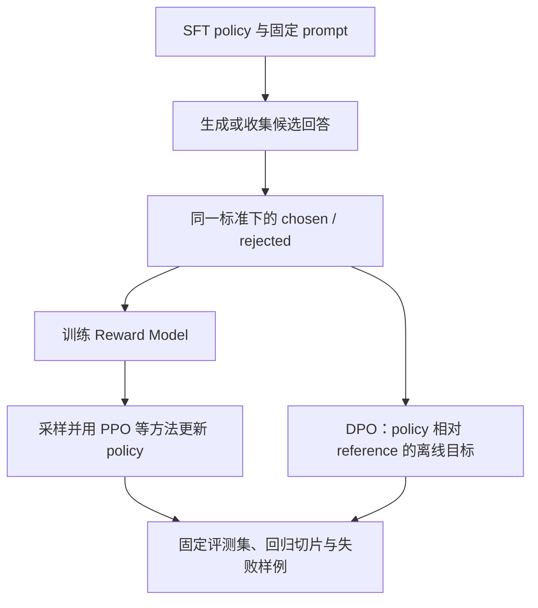

# 第 5 章 偏好优化实战：从比较数据到策略变化

监督微调解决的是“模型应该怎样回答”这一问题。它通常给每个 prompt 配一个理想 response，让模型提高这条答案的概率。但真实任务经常没有唯一答案：两个回答都可能事实基本正确，其中一个更完整，另一个更简洁；两个回答都能完成任务，其中一个格式更清楚，另一个包含不必要的断言。此时，给出一个绝对分数往往比做相对比较困难。

偏好优化把训练对象从单个答案扩展为一个比较关系：



图中 PPO 路线代表一类显式奖励建模再进行策略优化的经典做法，DPO 路线则直接把偏好对和 reference-relative 目标用于策略训练。它们都依赖偏好质量和评估，但优化时所需的中间对象不同。

这条链路有两种常见训练路径：先从比较数据学习 Reward Model，再用策略优化算法更新模型；或者按 DPO 的推导直接用偏好对训练策略。本章先说明偏好标签如何形成，再逐步写出成对损失、Reward Model 和 DPO，接着比较两种路径的监督信号与计算过程，最后用固定样本检查 SFT 到 DPO 的行为变化。完整 PPO/RLHF 训练工程留给第五册，本章只解释它与 DPO 的接口关系。

初学者需要先建立一个直觉：chosen 不是宇宙真理，rejected 也不一定是完全错误；它们只表达“在给定任务、评审标准和证据条件下，哪个回答更值得被偏好”。专家则要继续追问标注者是否看到了相同信息、比较是否被长度影响、train/eval 是否按 prompt 泄漏、Reward Model 是否学到了格式捷径，以及 DPO 的收益是否只存在于偏好数据附近。

本章代码以 PyTorch、Transformers、Datasets、PEFT、bitsandbytes 和 TRL 的公开接口为背景。算法公式和数据契约相对稳定，库参数则会随版本变化；书中的 toy 数字只用于验证方向、shape 和数据流，不能代替目标模型上的能力结论。

## 5.1 Preference Pair：把“更好”记录成可训练数据

### 5.1.1 偏好关系不是绝对评分

一条最小偏好样本包含：

```text
prompt：需要回答的问题、指令和必要上下文。
chosen：在当前标准下更被偏好的回答。
rejected：在当前标准下较不被偏好的回答。
```

用符号表示：

```math
(x_i,y_i^+,y_i^-)
```

其中 \(x_i\) 是 prompt，\(y_i^+\) 是 chosen，\(y_i^-\) 是 rejected。它表达的是条件关系：

```math
y_i^+\succ_{x_i}y_i^-
```

整个数据集为：

```math
\mathcal{D}_{\mathrm{pref}}
=
\{(x_i,y_i^+,y_i^-)\}_{i=1}^{N}
```

三个字段必须共享同一个 prompt。若两个回答对应不同问题，比较结果就混入了任务难度，不能再解释为同一条件下的偏好。

偏好标签与绝对评分的区别很重要。评审者可能无法稳定地说一个回答是 82 分还是 86 分，却能较稳定地判断 A 是否比 B 更完整。相对比较也有代价：标签只提供局部排序，不能自动告诉我们 chosen 的每句话都正确。

### 5.1.2 Preference Pair 与 SFT 样本的区别

SFT 样本通常是：

> 代码状态：静态审阅，未独立运行（2026-10-20；.tmp/llm-book-cpu-check，Python 3.12.9，PyTorch 2.12.0+cpu；语法检查通过；未将片段验证扩大为整节验证）

```python
sft_example = {
    "instruction": "解释什么是过拟合。",
    "input": "",
    "output": "过拟合是训练集表现好但未见数据泛化差。",
}
```
偏好样本则是：

> 代码状态：静态审阅，未独立运行（2026-10-20；.tmp/llm-book-cpu-check，Python 3.12.9，PyTorch 2.12.0+cpu；语法检查通过；未将片段验证扩大为整节验证）

```python
preference_example = {
    "prompt": "解释什么是过拟合。",
    "chosen": "过拟合是训练集表现好但未见数据泛化差。",
    "rejected": "过拟合就是模型训练得越好越好。",
}
```
SFT 主要提高一个答案的条件概率：

```math
\log\pi_\theta(y\mid x)
```

偏好训练主要比较两个答案的相对关系：

```math
\log\pi_\theta(y^+\mid x)
-
\log\pi_\theta(y^-\mid x)
```

二者可以使用同一批 prompt，却对应不同监督信号。偏好数据不能简单替代 SFT 数据：如果模型连基本回答格式都没有学会，只有少量 pairwise 信号通常不足以建立完整的指令能力。

### 5.1.3 数据字段与模板边界

推荐先保存未拼接的三元组：

> 代码状态：静态审阅，未独立运行（2026-10-20；.tmp/llm-book-cpu-check，Python 3.12.9，PyTorch 2.12.0+cpu；语法检查通过；未将片段验证扩大为整节验证）

```python
preferences = [
    {
        "prompt": "解释什么是梯度下降。",
        "chosen": "梯度下降沿损失函数的负梯度方向更新参数。",
        "rejected": "梯度下降就是梯度自己变小。",
        "category": "concept",
        "source": "human_review",
    },
]
```
prompt 可以是裸问题，也可以是包含 system 和历史消息的条件部分；chosen 和 rejected 通常只保存回答内容。训练前再用同一套模板拼接：

> 代码状态：静态审阅，未独立运行（2026-10-20；.tmp/llm-book-cpu-check，Python 3.12.9，PyTorch 2.12.0+cpu；语法检查通过；未将片段验证扩大为整节验证）

```python
def render_prompt(prompt):
    return (
        "### Instruction:\n"
        + prompt.strip()
        + "\n\n### Response:\n"
    )


def render_pair(example):
    prompt = render_prompt(example["prompt"])
    return {
        "prompt": prompt,
        "chosen": example["chosen"].strip(),
        "rejected": example["rejected"].strip(),
    }
```
如果提前把 prompt 复制进 chosen/rejected，训练器又会重新拼接，就会出现：

```text
prompt + prompt + chosen
prompt + prompt + rejected
```

这种重复会污染 token 统计和模板分布。保存原始字段时，应明确每个字段的边界。

聊天模型可以保存 messages：

> 代码状态：静态审阅，未独立运行（2026-10-20；.tmp/llm-book-cpu-check，Python 3.12.9，PyTorch 2.12.0+cpu；语法检查通过；未将片段验证扩大为整节验证）

```python
chat_pair = {
    "prompt": [
        {"role": "system", "content": "你是一个严谨的助手。"},
        {"role": "user", "content": "解释过拟合。"},
    ],
    "chosen": [
        {"role": "assistant", "content": "过拟合是训练集好而泛化差。"},
    ],
    "rejected": [
        {"role": "assistant", "content": "过拟合就是模型特别强。"},
    ],
}
```
无论保存成字符串还是消息列表，chosen 和 rejected 都必须共享同一 system、user 和历史上下文。目标模型有自己的 chat template 时，应使用它来渲染，而不是人工拼接另一种角色标记。

### 5.1.4 偏好数据从哪里来

常见来源包括：

```text
人工撰写高质量回答，再撰写或挑选较差回答。
同一个 prompt 采样多个模型候选，由评审者排序。
强模型和弱模型分别生成候选，再进行人工复核。
从 SFT 答案出发，构造有具体缺陷的负样本。
线上坏例经过脱敏、重写和双人复核后进入数据集。
```

如果一个 prompt 产生 \(K\) 个候选，完整排序理论上可以产生：

```math
N_{\mathrm{pair}}
=
\frac{K(K-1)}{2}
```

但保留所有组合并不总是更好。明显乱码与优秀答案之间的 pair 太容易，模型只学到粗糙的可读性；相邻质量等级的 pair 往往更能提供细粒度信号。实际保留哪些 pair，应记录候选来源、排序规则和筛选策略。

强模型答案不能自动成为 chosen。强模型也可能事实错误、引用不存在来源、违反格式或越过安全边界。偏好定义是“符合当前任务标准”，不是“来自更大的模型”。

### 5.1.5 什么样的 rejected 有学习价值

高价值 rejected 通常“像一个 plausible answer，但有明确缺陷”：

```text
遗漏关键条件，却保持自然语言流畅。
概念大体相关，但因果关系或公式错误。
回答正确但没有遵守 JSON、列表或字段要求。
没有证据却使用确定语气声称论文结果。
过度冗长、重复或把无关内容带入答案。
在应当谨慎时编造细节，或在正常问题上过度拒答。
```

低价值 rejected 包括空字符串、乱码、完全无关文本和明显无法解析的模板残片。它们可以帮助模型学会基本格式，却不能让模型学会区分两个都看似合理的回答。

可以把每条 pair 的差异归类：

> 代码状态：静态审阅，未独立运行（2026-10-20；.tmp/llm-book-cpu-check，Python 3.12.9，PyTorch 2.12.0+cpu；语法检查通过；未将片段验证扩大为整节验证）

```python
quality_dimensions = {
    "correctness": "事实和推理",
    "completeness": "关键条件和覆盖",
    "format": "结构和协议",
    "style": "清晰、简洁和语气",
    "safety": "风险边界和不确定性",
}
```
多个维度混在一个标签里时，评审者应知道总体偏好依据；否则模型可能把无关的长度或语气当成主要线索。

### 5.1.6 标签噪声与偏好强度

评审者可能出现分歧：

```text
一个回答更短，另一个回答更完整。
一个回答更谨慎，另一个回答更直接。
两个回答事实都正确，但风格不同。
评审者没有看到回答所引用的外部证据。
任务本身没有明确质量标准。
```

若多名评审对同一 pair 的判断不同，可以保存：

> 代码状态：静态审阅，未独立运行（2026-10-20；.tmp/llm-book-cpu-check，Python 3.12.9，PyTorch 2.12.0+cpu；语法检查通过；未将片段验证扩大为整节验证）

```python
annotation = {
    "prompt_id": "p-001",
    "chosen_id": "a-3",
    "rejected_id": "a-1",
    "votes": {"a-3": 4, "a-1": 2},
    "tie_count": 0,
    "criteria": ["correctness", "format"],
}
```
不要把有大量平票的 pair 强行当作高置信标签。可以剔除低共识样本、保留软标签，或把它们放入专门的鲁棒性评估集。偏好强度也可以记录为投票差、评审者置信度或质量等级，但只有在定义可靠时才加入 margin。

### 5.1.7 长度偏置与 token 统计

如果 chosen 总是很长、rejected 总是很短，模型可能学到长度捷径。对第 \(i\) 条 pair，设 chosen 和 rejected 的 token 长度为 \(L_i^+\) 和 \(L_i^-\)，可定义长度比：

```math
\rho_i
=
\frac{\max(L_i^+,L_i^-)}
{\min(L_i^+,L_i^-)}
```

这个比值只在 \(L_i^+>0\) 且 \(L_i^->0\) 时定义。若任一回答没有有效 token，不能用 \(1\) 代替分母；这表示样本契约已经失败，应记录为无效样本。\(\rho_i\) 很大不等于样本必须删除，但应进入抽查和分桶统计。长度应使用目标 tokenizer 的 token 数，而不是 Python 字符数：

> 代码状态：静态审阅，未独立运行（2026-10-20；.tmp/llm-book-cpu-check，Python 3.12.9，PyTorch 2.12.0+cpu；语法检查通过；未将片段验证扩大为整节验证）

```python
def token_length(tokenizer, text):
    return len(
        tokenizer(
            text,
            add_special_tokens=False,
        )["input_ids"]
    )
```
还要观察 prompt 长度、回答长度、截断比例和有效响应 token 数。若 chosen 被截断而 rejected 没被截断，训练器看到的偏好关系已经不是原始关系。

### 5.1.8 数据划分必须按 prompt 分组

同一 prompt 可能对应多个候选和多个 pair。随机按行切分会造成：

```text
同一问题的一个 pair 进入 train。
同一问题的另一个 pair 进入 eval。
验证集不再代表未见条件。
```

应尽量满足：

```math
\mathcal{P}_{\mathrm{train}}
\cap
\mathcal{P}_{\mathrm{eval}}
=
\varnothing
```

简单分组划分：

> 代码状态：静态审阅，未独立运行（2026-10-20；.tmp/llm-book-cpu-check，Python 3.12.9，PyTorch 2.12.0+cpu；语法检查通过；未将片段验证扩大为整节验证）

```python
from collections import defaultdict
import random


def split_by_prompt(rows, eval_ratio=0.2, seed=42):
    if not rows:
        raise ValueError("rows must not be empty")
    if not isinstance(eval_ratio, (int, float)) or not 0 < eval_ratio < 1:
        raise ValueError("eval_ratio must be between 0 and 1")
    groups = defaultdict(list)
    for row in rows:
        if not isinstance(row, dict):
            raise TypeError("each row must be a dict")
        prompt = row.get("prompt")
        if not isinstance(prompt, str) or not prompt.strip():
            raise ValueError("each row needs a non-empty string prompt")
        groups[prompt.strip()].append(row)

    prompts = list(groups)
    if len(prompts) < 2:
        raise ValueError("at least two prompt groups are required")
    random.Random(seed).shuffle(prompts)
    eval_count = min(
        max(1, round(len(prompts) * eval_ratio)),
        len(prompts) - 1,
    )
    eval_prompts = set(prompts[:eval_count])

    train_rows = []
    eval_rows = []
    for prompt, items in groups.items():
        if prompt in eval_prompts:
            eval_rows.extend(items)
        else:
            train_rows.extend(items)
    return train_rows, eval_rows
```
如果多个 prompt 来自同一文档、用户或任务模板，还应按更高层级分组。只比较字符串相等仍可能漏掉轻微改写造成的近似泄漏。

### 5.1.9 数据审计字段

偏好数据不应只保存三列文本。建议同时保存：

```text
样本 id、prompt id、候选来源和模型版本。
评审者或聚合规则、时间、质量维度和置信度。
语言、任务类别、风险类别和许可证。
chosen/rejected token 长度、是否截断、是否重复。
训练/验证分组键和清洗版本。
```

这些字段支持后续回答三个问题：

```text
某类任务是否没有足够偏好数据？
模型是否只是学到了某个来源或格式的捷径？
退化样本能否追溯到错误标注或模板版本？
```

### 5.1.10 纯 Python 偏好数据审计实验

下面的实验不依赖外部库，演示空字段、重复、相同答案、疑似反标、长度偏置和按 prompt 分组：

> 代码状态：已验证（2026-10-20；.tmp/llm-book-cpu-check，Python 3.12.9，PyTorch 2.12.0+cpu；对应 CPU toy/demo 或配置审计）

```python
from collections import defaultdict


RAW = [
    {
        "id": "p1",
        "prompt": "解释过拟合。",
        "chosen": "训练集表现好，但未见数据泛化差。",
        "rejected": "过拟合就是模型很强。",
        "points": ["训练集", "泛化"],
    },
    {
        "id": "p2",
        "prompt": "给出两个方法。",
        "chosen": "可以正则化和早停。",
        "rejected": "把训练轮数无限增加。",
        "points": ["正则化", "早停"],
    },
    {
        "id": "p2_duplicate",
        "prompt": "给出两个方法。",
        "chosen": "可以正则化和早停。",
        "rejected": "把训练轮数无限增加。",
        "points": ["正则化", "早停"],
    },
    {
        "id": "empty",
        "prompt": "",
        "chosen": "没有条件。",
        "rejected": "没有答案。",
        "points": [],
    },
    {
        "id": "same",
        "prompt": "什么是学习率？",
        "chosen": "学习率控制步长。",
        "rejected": "学习率控制步长。",
        "points": ["步长"],
    },
    {
        "id": "possible_flip",
        "prompt": "解释梯度下降。",
        "chosen": "参数随便变小。",
        "rejected": "沿负梯度方向降低损失。",
        "points": ["负梯度", "损失"],
    },
    {
        "id": "length",
        "prompt": "什么是 dropout？",
        "chosen": "dropout 随机丢弃部分神经元并可缓解过拟合。",
        "rejected": "随机丢弃。",
        "points": ["随机", "过拟合"],
    },
]


def normalize(text):
    return " ".join(text.strip().split())


def hit_count(text, points):
    lower = text.lower()
    return sum(point.lower() in lower for point in points)


def audit(rows, max_ratio=4.0):
    if not isinstance(max_ratio, (int, float)) or max_ratio <= 0:
        raise ValueError("max_ratio must be positive")
    seen = set()
    clean = []
    dropped = defaultdict(int)
    warnings = []
    for row in rows:
        if not isinstance(row, dict):
            dropped["invalid_row"] += 1
            continue
        required = ("id", "prompt", "chosen", "rejected", "points")
        if any(key not in row for key in required):
            dropped["missing_field"] += 1
            continue
        text_fields = ("id", "prompt", "chosen", "rejected")
        if any(not isinstance(row[key], str) for key in text_fields):
            dropped["invalid_text"] += 1
            continue
        points = row["points"]
        if (not isinstance(points, list)
                or any(not isinstance(point, str) or not normalize(point)
                       for point in points)):
            dropped["invalid_points"] += 1
            continue
        prompt = normalize(row["prompt"])
        chosen = normalize(row["chosen"])
        rejected = normalize(row["rejected"])
        if not prompt or not chosen or not rejected:
            dropped["empty"] += 1
            continue
        if chosen == rejected:
            dropped["same"] += 1
            continue
        key = (prompt, chosen, rejected)
        if key in seen:
            dropped["duplicate"] += 1
            continue
        seen.add(key)
        if hit_count(rejected, row["points"]) > hit_count(chosen, row["points"]):
            warnings.append((row["id"], "possible_label_flip"))
            dropped["possible_flip"] += 1
            continue
        if not row["points"]:
            warnings.append((row["id"], "no_quality_points"))
        ratio = max(len(chosen), len(rejected)) / min(
            len(chosen), len(rejected),
        )
        if ratio > max_ratio:
            warnings.append((row["id"], "length_bias"))
            dropped["length_warning"] += 1
        clean.append({
            "id": row["id"],
            "prompt": prompt,
            "chosen": chosen,
            "rejected": rejected,
        })
    return clean, dropped, warnings


def split(rows, eval_ratio=0.5):
    if not rows:
        raise ValueError("rows must not be empty")
    if not isinstance(eval_ratio, (int, float)) or not 0 < eval_ratio < 1:
        raise ValueError("eval_ratio must be between 0 and 1")
    groups = defaultdict(list)
    for row in rows:
        prompt = row.get("prompt") if isinstance(row, dict) else None
        if not isinstance(prompt, str) or not prompt:
            raise ValueError("rows need non-empty prompt strings")
        groups[prompt].append(row)
    prompts = sorted(groups)
    if len(prompts) < 2:
        raise ValueError("at least two prompt groups are required")
    cut = min(max(1, round(len(prompts) * eval_ratio)), len(prompts) - 1)
    eval_prompts = set(prompts[:cut])
    train = []
    evaluation = []
    for prompt, items in groups.items():
        (evaluation if prompt in eval_prompts else train).extend(items)
    return train, evaluation


clean, dropped, warnings = audit(RAW)
train, evaluation = split(clean)
train_prompts = {row["prompt"] for row in train}
eval_prompts = {row["prompt"] for row in evaluation}

print("raw_count=", len(RAW))
print("clean_count=", len(clean))
print("dropped=", dict(dropped))
print("warnings=", warnings)
print("train_size=", len(train))
print("eval_size=", len(evaluation))
print("prompt_leak=", bool(train_prompts & eval_prompts))
```
这个实验的规则只是筛查工具，不是自动标注器。尤其是 possible_label_flip 需要人工查看原文、证据和任务标准后才能决定。

上面的 `ratio` 为了让实验不依赖第三方 tokenizer，使用的是清洗后字符串的字符长度；它只能演示长度偏置的计算流程。真实数据应改用目标 tokenizer 的 `add_special_tokens=False` 结果，并分别记录 prompt、chosen、rejected 的 token 长度和截断状态。字符长度与 token 长度不能互换，尤其不能据此比较中英文、代码和多字节文本的成本。

以 prompt“2+2 等于多少”为例，chosen 可以是“4”，rejected 可以是“5”。这条 pair 只表达标注者更偏好前者，并不说明 chosen 在所有场景都完美，也不说明两条回答差异只来自正确性；长度、语气、格式和标注说明都可能影响选择。数据记录应保留 prompt、两条完整回答、偏好方向、标注者/协议版本和可选理由，不能只保存一个 winner 字段后丢掉比较上下文。

如果两条回答都来自同一生成策略和同一 prompt，成对比较能控制部分上下文差异；若 chosen 来自强模型、rejected 来自弱模型，偏好标签还混入模型来源和采样策略。构造数据时要检查长度分布、语言、任务类别和来源模型，按 prompt 分组划分训练/验证，避免同一个问题的改写版本泄漏到两边。偏好对的数量不等于独立任务数。

标注也可能不一致。若 3 位评审对同一 pair 有 2 人选 A、1 人选 B，简单多数票把它压成一个硬标签，却丢掉了分歧幅度；对于模糊、主观或高风险任务，应保留 individual votes、理由和判定协议，必要时把争议样本单列。偏好数据不是天然客观的“正确答案”，它记录的是在具体说明和评审群体下观察到的选择。

若从同一 prompt 的 5 个候选生成 10 个两两比较，10 个 pair 并不等于 10 个独立 prompt。训练/验证切分必须按 prompt 或任务簇分组；否则相同回答或近邻改写可能同时出现在两侧。构造数据时也要防止同一个长回答因参与很多 pair 而获得过高权重，可按 prompt 汇总权重或报告每个 prompt 的比较数分布。

因此每条 pair 都应能回到原始比较现场：prompt、模板、候选生成设置、两条回答和评审说明缺一不可。缺少这些信息时，后续无法判断偏好来自答案本身还是格式与采样差异。

## 5.2 Reward Model 的成对排序损失

### 5.2.1 Reward Model 的输入与输出

Reward Model 接收一段 prompt-response，输出标量：

```math
r_\phi(x,y)\in\mathbb{R}
```

它不负责生成下一个 token，而是学习把更被偏好的回答排在前面。对一条 pair：

```math
r_i^+
=
r_\phi(x_i,y_i^+),
\qquad
r_i^-
=
r_\phi(x_i,y_i^-)
```

目标是：

```math
r_i^+>r_i^-
```

Reward Model 可以作为 RLHF 中的奖励来源、离线 reranker 或候选评估器，但它始终是从偏好数据学习出的代理，不等于任务真实值。

### 5.2.2 Bradley–Terry 概率

成对比较可以用 Bradley–Terry 形式建模：

```math
P(y_i^+\succ y_i^-\mid x_i)
=
\sigma(r_i^+-r_i^-)
```

其中 sigmoid 为：

```math
\sigma(z)
=
\frac{1}{1+\exp(-z)}
```

当差值为 0，偏好概率为 0.5；当 chosen reward 明显更高，概率接近 1；当 rejected reward 更高，概率低于 0.5。

最大化 chosen 被偏好的概率等价于最小化：

```math
\mathcal{L}_{\mathrm{RM}}
=
-
\frac{1}{B}
\sum_{i=1}^{B}
\log\sigma(r_i^+-r_i^-)
```

这个目标只依赖 reward 差值。给所有 reward 同时加一个常数不会改变排序，因此 Reward Model 的绝对中心可能漂移。

### 5.2.3 数值稳定的实现

概念写法是：

> 代码状态：静态审阅，未独立运行（2026-10-20；.tmp/llm-book-cpu-check，Python 3.12.9，PyTorch 2.12.0+cpu；语法检查通过；未将片段验证扩大为整节验证）

```python
import torch


def unstable_loss(chosen_rewards, rejected_rewards):
    diff = chosen_rewards - rejected_rewards
    return -torch.log(torch.sigmoid(diff)).mean()
```
更稳定的写法是：

> 代码状态：静态审阅，未独立运行（2026-10-20；.tmp/llm-book-cpu-check，Python 3.12.9，PyTorch 2.12.0+cpu；语法检查通过；未将片段验证扩大为整节验证）

```python
import torch
import torch.nn.functional as F


def _flat_rewards(values, name):
    if not isinstance(values, torch.Tensor):
        raise TypeError(f"{name} must be a torch.Tensor")
    if not torch.is_floating_point(values):
        raise TypeError(f"{name} must use a floating dtype")
    if values.numel() == 0:
        raise ValueError("reward batch must not be empty")
    if values.ndim == 0 or values.ndim > 2 or (
        values.ndim == 2 and values.shape[1] != 1
    ):
        raise ValueError(f"{name} must have shape [B] or [B, 1]")
    values = values.reshape(-1)
    if not torch.isfinite(values).all():
        raise ValueError(f"{name} must contain only finite values")
    return values


def _reward_pair(chosen_rewards, rejected_rewards):
    chosen_rewards = _flat_rewards(chosen_rewards, "chosen_rewards")
    rejected_rewards = _flat_rewards(rejected_rewards, "rejected_rewards")
    if chosen_rewards.shape != rejected_rewards.shape:
        raise ValueError("reward shapes must match")
    return chosen_rewards, rejected_rewards


def reward_ranking_loss(chosen_rewards, rejected_rewards):
    chosen_rewards, rejected_rewards = _reward_pair(
        chosen_rewards,
        rejected_rewards,
    )
    diff = chosen_rewards - rejected_rewards
    return -F.logsigmoid(diff).mean()
```
也可以把差值当作正类 logit：

下面的短片段复用上一个代码块中的 `_reward_pair`，因此必须与上一段一起运行；它只替换数值稳定的损失实现，不改变输入契约。

> 代码状态：静态审阅，未独立运行（2026-10-20；.tmp/llm-book-cpu-check，Python 3.12.9，PyTorch 2.12.0+cpu；语法检查通过；未将片段验证扩大为整节验证）

```python
import torch
import torch.nn.functional as F


def reward_ranking_loss_bce(chosen_rewards, rejected_rewards):
    chosen_rewards, rejected_rewards = _reward_pair(
        chosen_rewards,
        rejected_rewards,
    )
    diff = chosen_rewards - rejected_rewards
    target = torch.ones_like(diff)
    return F.binary_cross_entropy_with_logits(diff, target)
```

F.logsigmoid 和 BCEWithLogitsLoss 把数值稳定的 log-sigmoid 计算封装起来，避免先 sigmoid 再取 log 在极端 logits 下下溢。
### 5.2.4 梯度方向

令 \(d=r^+-r^-\)，单样本损失为：

```math
\ell(d)
=
-\log\sigma(d)
```

其对两个 reward 的梯度为：

```math
\frac{\partial\ell}{\partial r^+}
=
\sigma(d)-1
```

```math
\frac{\partial\ell}{\partial r^-}
=
1-\sigma(d)
```

当 \(d\) 不够大时，chosen 的梯度为负，梯度下降会提高 chosen reward；rejected 的梯度为正，梯度下降会降低 rejected reward。若实现中把差值写成 \(r^- - r^+\)，方向会整体反转。

手算三个情况：

```text
r+ = 3, r- = 0：差值为正，loss 较小。
r+ = 1, r- = 1：差值为 0，loss 约为 0.693。
r+ = 0, r- = 3：差值为负，loss 较大。
```

### 5.2.5 margin 与偏好强度

如果数据还表达了“chosen 至少高出多少”，可以加入 margin：

```math
\mathcal{L}_{\mathrm{margin}}
=
-
\frac{1}{B}
\sum_i
\log\sigma(r_i^+-r_i^- - m_i)
```

若没有可靠的偏好强度，使用 \(m_i=0\) 更稳妥。随意给每条 pair 加一个大 margin，会把标注者的模糊判断伪装成精确距离，可能使训练难度和 reward scale 都失真。

### 5.2.6 Reward shape 与 padding

一个 batch 应有：

```text
chosen_input_ids：     [B, T+]
rejected_input_ids：   [B, T-]
chosen_rewards：       [B]
rejected_rewards：     [B]
```

下面的 batch 指标都要求 \(B>0\)。如果没有有效 pair，accuracy、平均 reward gap 和中心都不是 0，而是“没有可计算结果”；把空 batch 当作 0 会掩盖数据加载或过滤错误。严格的排序指标还应规定平票如何处理：本章的 \(r^+>r^-\) 把平票记为未胜出，若业务上需要单独分析平票，应另存 tie 计数。

如果模型输出 [B,1]，应使用 squeeze(-1) 或 view(-1)。不能让 [B,1] 与 [B] 直接相减，因为广播可能生成 [B,B]：

> 代码状态：静态审阅，未独立运行（2026-10-20；.tmp/llm-book-cpu-check，Python 3.12.9，PyTorch 2.12.0+cpu；语法检查通过；未将片段验证扩大为整节验证）

```python
chosen = torch.zeros(3, 1)
rejected = torch.zeros(3)
print((chosen - rejected).shape)
```
Reward Head 常从最后一个有效 token 的 hidden state 产生分数：

> 代码状态：静态审阅，未独立运行（2026-10-20；.tmp/llm-book-cpu-check，Python 3.12.9，PyTorch 2.12.0+cpu；语法检查通过；未将片段验证扩大为整节验证）

```python
import torch
import torch.nn as nn


class RewardHead(nn.Module):
    def __init__(self, hidden_size):
        super().__init__()
        self.value = nn.Linear(hidden_size, 1)

    def forward(self, hidden_states, attention_mask):
        if hidden_states.ndim != 3:
            raise ValueError("hidden_states must have shape [B, T, H]")
        if attention_mask.shape != hidden_states.shape[:2]:
            raise ValueError("attention_mask must have shape [B, T]")
        if attention_mask.device != hidden_states.device:
            raise ValueError("hidden_states and attention_mask must share a device")
        if attention_mask.numel() == 0:
            raise ValueError("attention_mask must not be empty")
        valid_mask = (attention_mask == 0) | (attention_mask == 1)
        if not bool(valid_mask.all()):
            raise ValueError("attention_mask must contain only 0 or 1")
        valid_lengths = attention_mask.to(torch.long).sum(dim=1)
        if bool((valid_lengths == 0).any()):
            raise ValueError("each sequence needs at least one valid token")
        positions = torch.arange(
            hidden_states.size(1),
            device=hidden_states.device,
        ).unsqueeze(0)
        last_indices = (
            attention_mask.to(torch.long) * positions
        ).max(dim=1).values
        batch_indices = torch.arange(
            hidden_states.size(0),
            device=hidden_states.device,
        )
        last_hidden = hidden_states[batch_indices, last_indices]
        return self.value(last_hidden).squeeze(-1)
```
若 batch 中有 padding，不能直接使用 hidden_states[:, -1]；短样本最后一列可能是 padding。这里把 mask 与位置序列相乘后取最大位置，因此同时适用于左 padding 和右 padding；前提仍是每条样本至少有一个有效 token。

### 5.2.7 pairwise accuracy 与 reward 分布

排序准确率：

```math
A_{\mathrm{pair}}
=
\frac{1}{B}
\sum_{i=1}^{B}
\mathbf{1}[r_i^+>r_i^-]
```

还应记录 reward gap：

```math
G_{\mathrm{RM}}
=
\frac{1}{B}
\sum_{i=1}^{B}(r_i^+-r_i^-)
```

以及中心和离散程度：

```math
C_{\mathrm{RM}}
=
\frac{1}{2B}
\sum_i(r_i^++r_i^-)
```

以上三个式子的定义域都是 \(B>0\)，并且它们各自回答不同问题：accuracy 看排序是否正确，gap 看平均相对差距，center 看 reward 的整体位置。accuracy 高但 reward 绝对值持续漂移，说明排序方向可能正常而尺度没有约束。反之，loss 下降但 accuracy 停留在 0.5 附近，可能是 batch、日志或数据聚合错误。

### 5.2.8 一个最小方向实验

> 代码状态：已验证（2026-10-20；.tmp/llm-book-cpu-check，Python 3.12.9，PyTorch 2.12.0+cpu；对应 CPU toy/demo 或配置审计）

```python
import torch
import torch.nn.functional as F


def loss(chosen, rejected):
    chosen = chosen.view(-1)
    rejected = rejected.view(-1)
    return -F.logsigmoid(chosen - rejected).mean()


good_loss = loss(torch.tensor([3.0]), torch.tensor([0.0]))
bad_loss = loss(torch.tensor([0.0]), torch.tensor([3.0]))
chosen = torch.tensor([0.5], requires_grad=True)
rejected = torch.tensor([1.0], requires_grad=True)
value = loss(chosen, rejected)
value.backward()

print("good_loss=", round(good_loss.item(), 4))
print("bad_loss=", round(bad_loss.item(), 4))
print("direction_ok=", good_loss < bad_loss)
print("chosen_grad=", round(chosen.grad.item(), 4))
print("rejected_grad=", round(rejected.grad.item(), 4))
```
结果应满足 good_loss 小于 bad_loss，chosen gradient 为负，rejected gradient 为正。

### 5.2.9 Reward Model 的限制

Reward Model 可能学习到：

```text
回答长度、格式标记或语气，而不是事实正确性。
训练数据中的来源或模板，而不是任务规则。
评审者偏差和错误标签。
容易被生成器利用的表面特征。
```

因此 reward 只能作为一个可检查的代理。需要保留人工样例、独立任务指标、事实和安全检查，并分析候选生成分布变化导致的 reward 偏移。

手算 Bradley–Terry 似然：若 reward model 给 chosen 打分 1.2、rejected 打分 -0.3，则差值为 1.5，chosen 胜出的概率是 \(\sigma(1.5)\approx0.818\)，负对数损失约为 \(-\ln0.818=0.201\)。若两个分数反过来，概率变为 \(\sigma(-1.5)\approx0.182\)，损失约 1.704，模型会收到更强的纠正信号。若两个分数同时加 10，差值和损失不变；排序目标识别的是相对偏好，而不是有自然单位的绝对“质量分”。

这也带来分数尺度边界：reward=2 不表示回答质量是 reward=1 的两倍，也不能跨模型直接比较。训练过程中的正则化、归一化和初始化会影响分数平移或尺度；部署时若把它用于策略更新，还需确认 reward 的尺度与 KL 惩罚、学习率和采样分布匹配。不能只看 reward loss 下降，就说奖励模型的判断已经校准。

成对损失对分数差的导数是 \(\sigma(\Delta)-1=-\sigma(-\Delta)\)。当 \(\Delta=1.5\) 时，梯度约为 -0.182，梯度下降会继续提高 chosen 相对分数；当 \(\Delta=-1.5\) 时，导数约为 -0.818，错误排序得到更强纠正。随着正向差值很大，损失和梯度都趋近 0；若训练集大多已轻松排序正确，模型仍可能在少数关键切片上失败，因此要看 per-category margin 和错例，不只看整体 loss。

分数本身没有固定原点和自然量纲。给所有回答分数加同一常数不改变排序；把所有分数乘一个正数也不改变排序，却会改变 logistic 概率的尖锐程度和损失大小。温度、权重衰减、reward normalization 或偏好标签噪声都会影响数值尺度。若后续将 reward 交给 PPO 或其他策略优化，需校准其尺度并监控策略行为；不能直接把分数 0.8 解释为“80%质量”。

ties（两条回答同样好）需要单独协议。普通二分类 pairwise loss 通常要求 chosen 和 rejected 有方向；若直接随机打破平局，会注入标签噪声。可以过滤平局、使用专门的 tie 模型或软偏好概率，但这些选择会改变训练数据和目标，必须记录比例和处理方式。稀少平局也可用于验证 reward model 是否对无明显差异的回答给出接近分数。

成对 logistic loss 对极端 margin 也有清晰行为：若模型把 chosen 排得很高，\(\Delta=5\)，loss 约 0.0067；损失很小，但不说明分数 5 是校准概率。若验证集只有少量 pair，过大的 margin 可能意味着模型过度自信或记住模板。可以查看 margin 分布与错例，必要时调整正则或训练量，但不要为了让验证 loss 更低而改动验证标注。

若偏好存在概率性，可把“chosen 胜出概率”建模为软目标 \(q\)，用交叉熵同时匹配概率而不强制硬排序；这需要保留多评审票数并说明分歧如何计算。硬标签更简单，却会丢失 9:1 与 5:4 的偏好强度差别。训练目标应匹配数据实际提供的证据。

Bradley–Terry 假设可比较的回答有潜在标量分数，选择概率只由分数差决定。它不能表达所有偏好结构：评审可能对简洁性偏好一个回答、对安全性偏好另一个回答，多个维度在不同 prompt 下权重不同。一个标量 reward 把这些维度压在一起，模型输出的排序会依赖训练数据里各类任务的混合比例。按任务桶评估和保留多维 rubric，可检查总体排序是否掩盖特定目标冲突。

还应检查相同回答在不同 prompt 下的分数是否异常漂移。pairwise loss只约束同一 pair 的相对顺序，不直接校准绝对分数，也不保证跨 prompt 的 reward 可比较；用 reward 选择不同 prompt 的候选时，这个假设尤其重要。若部署需要跨提示比较，要增加对应数据和验证，而不能从 pairwise accuracy 推出来。

若数据里既有“更正确”又有“更礼貌”的偏好，先看两种目标是否总是同向；存在冲突时，单一 winner 标签可能掩盖评审真正使用的准则。记录可解释的标签理由和任务类别，能帮助判断 reward 模型学到的是目标质量还是风格代理。

## 5.3 训练一个简单 Reward Model

### 5.3.1 从 pair 到两个前向

Reward Model 训练的每个 batch 包含两条并行路径：

```text
prompt + chosen → backbone → value head → r+
prompt + rejected → backbone → value head → r-
                                    ↓
                        -logsigmoid(r+ - r-)
```

设 tokenized 输入为：

```math
X_i^+,A_i^+
=
\mathrm{Tokenize}(x_i\oplus y_i^+)
```

```math
X_i^-,A_i^-
=
\mathrm{Tokenize}(x_i\oplus y_i^-)
```

Reward Model 输出：

```math
r_i^+
=
r_\phi(X_i^+,A_i^+),
\qquad
r_i^-
=
r_\phi(X_i^-,A_i^-)
```

它不需要 CausalLM 的 lm_head，因为目标不是预测词表分布，而是对整段输入给出一个分数。

### 5.3.2 Pair tokenizer 与 collator

以小型 CausalLM backbone 为例：

> 代码状态：静态审阅，未运行（2026-10-20；.tmp/llm-book-cpu-check，Python 3.12.9，PyTorch 2.12.0+cpu；缺少 Transformers/TRL/PEFT/Datasets 或真实模型环境）

```python
from transformers import AutoTokenizer


model_name = "sshleifer/tiny-gpt2"
tokenizer = AutoTokenizer.from_pretrained(model_name)
if tokenizer.pad_token is None:
    if tokenizer.eos_token is None:
        raise ValueError("tokenizer needs pad_token or eos_token")
    tokenizer.pad_token = tokenizer.eos_token
max_length = 256
if not isinstance(max_length, int) or max_length < 2:
    raise ValueError("max_length must be an integer >= 2")


def format_prompt(prompt):
    return (
        "### Instruction:\n"
        + prompt.strip()
        + "\n\n### Response:\n"
    )


def preprocess_pair(example):
    required = ("prompt", "chosen", "rejected")
    if any(key not in example for key in required):
        raise KeyError(f"missing preference field: {required}")
    if any(not isinstance(example[key], str) for key in required):
        raise TypeError("preference fields must be strings")
    if any(not example[key].strip() for key in required):
        raise ValueError("prompt, chosen and rejected must be non-empty")
    prompt = format_prompt(example["prompt"])
    eos = tokenizer.eos_token
    if eos is None:
        raise ValueError("tokenizer needs eos_token for this example")
    chosen = tokenizer(
        prompt + example["chosen"] + eos,
        max_length=max_length,
        truncation=True,
        add_special_tokens=False,
    )
    rejected = tokenizer(
        prompt + example["rejected"] + eos,
        max_length=max_length,
        truncation=True,
        add_special_tokens=False,
    )
    if not chosen["input_ids"] or not rejected["input_ids"]:
        raise ValueError("tokenization produced an empty sequence")
    return {
        "chosen_input_ids": chosen["input_ids"],
        "chosen_attention_mask": chosen["attention_mask"],
        "rejected_input_ids": rejected["input_ids"],
        "rejected_attention_mask": rejected["attention_mask"],
    }
```
变长 pair 需要分别 padding：

> 代码状态：已验证（2026-10-20；.tmp/llm-book-cpu-check，Python 3.12.9，PyTorch 2.12.0+cpu；CPU collator 契约检查通过）

```python
import torch


class RewardDataCollator:
    def __init__(self, tokenizer):
        self.tokenizer = tokenizer
        if tokenizer.pad_token_id is None:
            raise ValueError("tokenizer.pad_token_id must be set")

    def pad(self, features, key, value):
        if not features:
            raise ValueError("features must not be empty")
        if value is None:
            raise ValueError(f"padding value for {key} is missing")
        sequences = []
        for item in features:
            if key not in item or not item[key]:
                raise ValueError(f"missing or empty field: {key}")
            if not all(isinstance(token, int) for token in item[key]):
                raise TypeError(f"{key} must contain integer token ids")
            sequences.append(item[key])
        tensors = [
            torch.tensor(sequence, dtype=torch.long)
            for sequence in sequences
        ]
        return torch.nn.utils.rnn.pad_sequence(
            tensors,
            batch_first=True,
            padding_value=value,
        )

    def __call__(self, features):
        if not features:
            raise ValueError("features must not be empty")
        for item in features:
            for prefix in ("chosen", "rejected"):
                ids_key = f"{prefix}_input_ids"
                mask_key = f"{prefix}_attention_mask"
                if ids_key not in item or mask_key not in item:
                    raise KeyError(f"missing {prefix} pair fields")
                if len(item[ids_key]) != len(item[mask_key]):
                    raise ValueError(f"{prefix} ids and mask lengths differ")
                if not item[ids_key] or not any(item[mask_key]):
                    raise ValueError(f"{prefix} needs a valid token")
                if any(mask not in (0, 1) for mask in item[mask_key]):
                    raise ValueError(f"{prefix} attention mask must be binary")
        return {
            "chosen_input_ids": self.pad(
                features,
                "chosen_input_ids",
                self.tokenizer.pad_token_id,
            ),
            "chosen_attention_mask": self.pad(
                features,
                "chosen_attention_mask",
                0,
            ),
            "rejected_input_ids": self.pad(
                features,
                "rejected_input_ids",
                self.tokenizer.pad_token_id,
            ),
            "rejected_attention_mask": self.pad(
                features,
                "rejected_attention_mask",
                0,
            ),
        }
```
chosen 和 rejected 可以有不同的 batch 序列宽度；如果为了效率把它们合并到一个宽度，也必须保留各自的 mask。

### 5.3.3 Backbone 加 value head

简化的 Reward Model：

> 代码状态：静态审阅，未运行（2026-10-20；.tmp/llm-book-cpu-check，Python 3.12.9，PyTorch 2.12.0+cpu；缺少 Transformers/TRL/PEFT/Datasets 或真实模型环境）

```python
import torch
import torch.nn as nn
from transformers import AutoModel


class RewardModel(nn.Module):
    def __init__(self, model_name):
        super().__init__()
        self.backbone = AutoModel.from_pretrained(model_name)
        hidden_size = self.backbone.config.hidden_size
        self.value_head = nn.Linear(hidden_size, 1)

    def forward(self, input_ids, attention_mask):
        if input_ids.ndim != 2 or attention_mask.shape != input_ids.shape:
            raise ValueError("input_ids and attention_mask must have shape [B, T]")
        if input_ids.device != attention_mask.device:
            raise ValueError("input_ids and attention_mask must share a device")
        if input_ids.numel() == 0:
            raise ValueError("input_ids must not be empty")
        if bool(((attention_mask != 0) & (attention_mask != 1)).any()):
            raise ValueError("attention_mask must be binary")
        valid_lengths = attention_mask.to(torch.long).sum(dim=1)
        if bool((valid_lengths == 0).any()):
            raise ValueError("each sequence needs at least one valid token")
        outputs = self.backbone(
            input_ids=input_ids,
            attention_mask=attention_mask,
        )
        hidden_states = outputs.last_hidden_state
        if hidden_states.shape[:2] != attention_mask.shape:
            raise ValueError("backbone changed the batch or sequence dimensions")
        positions = torch.arange(
            hidden_states.size(1),
            device=hidden_states.device,
        ).unsqueeze(0)
        last_indices = (
            attention_mask.to(torch.long) * positions
        ).max(dim=1).values
        batch_indices = torch.arange(
            hidden_states.size(0),
            device=hidden_states.device,
        )
        summary = hidden_states[batch_indices, last_indices]
        return self.value_head(summary).view(-1)
```
最后有效 token 的 hidden state 只是一个常见设计。也可以使用 masked mean pooling、专用序列分类头或 encoder 的 pooled representation；选择必须与 backbone 的注意力结构和训练目标一致。

### 5.3.4 手写训练循环

下面用一个 CPU toy backbone、内存中的 tokenized pair 和前文的 `RewardDataCollator`、`reward_ranking_loss` 演示一次真实参数更新。toy backbone 只验证损失、梯度和 batch 数据流，不代表预训练语言模型；实际项目可将它替换为前文的 Transformers backbone。

> 代码状态：已验证（2026-10-20；.tmp/llm-book-cpu-check，Python 3.12.9，PyTorch 2.12.0+cpu；对应 CPU toy/demo 或配置审计）

```python
import torch
import torch.nn as nn
import torch.nn.functional as F
from torch.optim import AdamW
from torch.utils.data import DataLoader


def ranking_loss(chosen_rewards, rejected_rewards):
    return reward_ranking_loss(chosen_rewards, rejected_rewards)


def pair_accuracy(chosen_rewards, rejected_rewards):
    chosen_rewards, rejected_rewards = _reward_pair(
        chosen_rewards,
        rejected_rewards,
    )
    return (
        chosen_rewards > rejected_rewards
    ).float().mean()


class ToyBackbone(nn.Module):
    def __init__(self, vocab_size=32, hidden_size=8):
        super().__init__()
        self.embedding = nn.Embedding(vocab_size, hidden_size)

    def forward(self, input_ids, attention_mask):
        return type(
            "ToyOutput",
            (),
            {"last_hidden_state": self.embedding(input_ids)},
        )()


class ToyRewardModel(nn.Module):
    def __init__(self):
        super().__init__()
        self.backbone = ToyBackbone()
        self.value_head = nn.Linear(8, 1)

    def forward(self, input_ids, attention_mask):
        hidden = self.backbone(input_ids, attention_mask).last_hidden_state
        positions = torch.arange(input_ids.size(1)).unsqueeze(0)
        last = (attention_mask * positions).max(dim=1).values
        rows = torch.arange(input_ids.size(0))
        return self.value_head(hidden[rows, last]).squeeze(-1)


class ToyTokenizer:
    pad_token_id = 0


train_dataset = [
    {
        "chosen_input_ids": [1, 2, 3],
        "chosen_attention_mask": [1, 1, 1],
        "rejected_input_ids": [1, 4],
        "rejected_attention_mask": [1, 1],
    },
    {
        "chosen_input_ids": [1, 5],
        "chosen_attention_mask": [1, 1],
        "rejected_input_ids": [1, 6, 7],
        "rejected_attention_mask": [1, 1, 1],
    },
]
device = "cpu"
model_name = "toy-cpu-reward-model"
torch.manual_seed(7)
model = ToyRewardModel().to(device)
optimizer = AdamW(model.parameters(), lr=1e-5)
loader = DataLoader(
    train_dataset,
    batch_size=2,
    shuffle=True,
    collate_fn=RewardDataCollator(ToyTokenizer()),
)

for epoch in range(3):
    model.train()
    for step, batch in enumerate(loader):
        batch = {
            key: value.to(device)
            for key, value in batch.items()
        }
        chosen_rewards = model(
            batch["chosen_input_ids"],
            batch["chosen_attention_mask"],
        )
        rejected_rewards = model(
            batch["rejected_input_ids"],
            batch["rejected_attention_mask"],
        )
        loss = ranking_loss(chosen_rewards, rejected_rewards)
        optimizer.zero_grad(set_to_none=True)
        loss.backward()
        optimizer.step()

        if step % 10 == 0:
            accuracy = pair_accuracy(
                chosen_rewards.detach(),
                rejected_rewards.detach(),
            )
            gap = (
                chosen_rewards.detach()
                - rejected_rewards.detach()
            ).mean()
            print(
                "epoch=", epoch,
                "step=", step,
                "loss=", round(loss.item(), 4),
                "accuracy=", round(accuracy.item(), 4),
                "gap=", round(gap.item(), 4),
            )
```
真实训练还要处理混合精度、gradient accumulation、评估、梯度裁剪和 checkpoint。最小循环的价值是把“数据双路输入—两个 reward—差值 loss—指标”完整暴露出来。

### 5.3.5 评估与 checkpoint

评估时冻结 dropout 行为，并按样本数聚合。`dataloader` 必须使用与训练相同的数据字段和 collator；`model`、`ranking_loss` 与 `device` 也来自前文训练上下文。

> 代码状态：静态审阅，未独立运行（2026-10-20；.tmp/llm-book-cpu-check，Python 3.12.9，PyTorch 2.12.0+cpu；语法检查通过；未将片段验证扩大为整节验证）

```python
@torch.no_grad()
def evaluate(model, dataloader, device):
    was_training = model.training
    model.eval()
    total_loss = 0.0
    total_accuracy = 0.0
    total_gap = 0.0
    total_count = 0

    for batch in dataloader:
        batch = {
            key: value.to(device)
            for key, value in batch.items()
        }
        chosen = model(
            batch["chosen_input_ids"],
            batch["chosen_attention_mask"],
        )
        rejected = model(
            batch["rejected_input_ids"],
            batch["rejected_attention_mask"],
        )
        loss = ranking_loss(chosen, rejected)
        count = chosen.numel()
        total_loss += loss.item() * count
        total_accuracy += (
            (chosen > rejected).float().sum().item()
        )
        total_gap += (chosen - rejected).sum().item()
        total_count += count

    if was_training:
        model.train()
    if total_count == 0:
        raise ValueError("evaluation dataloader produced no samples")
    return {
        "loss": total_loss / total_count,
        "accuracy": total_accuracy / total_count,
        "gap": total_gap / total_count,
    }
```
自定义 Reward Model 可以保存 state_dict：

> 代码状态：静态审阅，未独立运行（2026-10-20；.tmp/llm-book-cpu-check，Python 3.12.9，PyTorch 2.12.0+cpu；语法检查通过；未将片段验证扩大为整节验证）

```python
from pathlib import Path


checkpoint_path = Path(".tmp/reward_model.pt")
checkpoint_path.parent.mkdir(parents=True, exist_ok=True)
torch.save(
    {
        "model_name": model_name,
        "state_dict": model.state_dict(),
        "tokenizer_name": model_name,
    },
    checkpoint_path,
)
```
加载不可信 checkpoint 存在执行任意对象的风险。只应使用可信来源，并在支持的 PyTorch 版本中优先采用 weights_only 等安全加载选项；同时保存模型结构和 tokenizer 版本，避免只凭一个 state_dict 猜网络结构。

### 5.3.6 监控 reward 漂移

训练日志至少包含：

```text
train/eval ranking loss。
pairwise accuracy。
chosen/rejected reward 均值。
reward gap。
reward 的中心和方差。
按任务类别的准确率。
```

如果 train accuracy 接近 1 而 eval accuracy 接近 0.5，说明可能过拟合或存在切分泄漏。如果 chosen/rejected gap 变大但人工样例没有改善，Reward Model 可能学到了长度、格式或来源捷径。

排序 loss 不约束 reward 绝对中心，因此可以看到整体 reward 同时上移或下移。若下游算法需要稳定尺度，应考虑 normalization、regularization 或显式的 reward 统计约束，并把这些变化写进实验记录。

### 5.3.7 训练规模与成本

Reward Model 通常需要同时跑 chosen 和 rejected 两次 forward。若共享 backbone，可以把两路序列拼成一个更大的 batch，再拆回两个 reward；这样可能提高吞吐，但要确保 padding、样本顺序和梯度聚合正确。

训练内存包括：

```text
backbone 权重、value head。
可训练参数梯度和 optimizer state。
chosen/rejected 两路激活。
tokenizer batch 的 padding 和临时 buffer。
```

当只训练 value head 时显存较低，但表达能力有限；全参数更新 backbone 的成本和遗忘风险接近全参数 SFT。LoRA 可以应用到 backbone，再只训练 adapter 和 value head，但需要确认 RewardTrainer 或自定义循环如何保存两个组件。

### 5.3.8 Reward Model 的事实边界

Reward Model 在训练分布内的 pairwise accuracy 上升，只说明它更能复现那批偏好标签。它不能自动证明：

```text
生成模型使用该 reward 后会更安全。
高 reward 回答在现实任务中更正确。
未见任务上的排序仍然可靠。
reward 不会被生成器利用。
```

因此 Reward Model 训练必须和候选生成、人工评审、任务指标及安全检查共同闭环。

训练 reward model 时，每个回答先经过同一个打分器得到一个标量，再由同 prompt 的 chosen/rejected 分数构造 pairwise loss。若把两条回答拆到不同 batch、分别使用不同的 padding 或模板，打分差可能反映输入处理差异。实现应在同一个前向批次中拼接两组回答，记录每条 response 的有效 token mask 和池化位置，并确认 reward head 取的是预期的最后有效位置，而非 padding hidden state。

验证集应按 prompt 或任务族切分，而不是随机拆 pair。假设一个 prompt 生成了 10 个候选、形成 20 对，如果这些 pair 横跨 train 和 validation，模型能记住 prompt 特征，验证 accuracy 会虚高。可报告 pairwise accuracy、margin 分布、不同任务切片以及标注者一致性；如果 10 对里 8 对排序正确，accuracy=80%，但仍需看那 2 对是否集中在某个高风险任务。reward 输出是训练用的相对评分器，不自动等于人工偏好或真实用户满意度。

训练集与验证集要按原始 prompt 分组。假设收集 100 个 prompt、每个 prompt 生成 4 个候选并组成多对比较，不能随机把 70% pairs 放训练、30% 放验证；同 prompt 的回答风格和事实内容会跨集合泄漏。可以先留出 20 个 prompt 做验证，再只用其余 prompt 训练，并按任务类别分层。pairwise accuracy、AUC 或 margin 能检查排序行为，但不等于策略上线后的满意度。

Reward head 常把最后一个有效 token 的 hidden state 投影到标量。若 padding 在右侧，必须用 attention mask 找到每条序列的最后有效位置；直接取张量最后一列会拿到 pad representation。假设两条回答长度分别为 3 和 5，批量补齐至 5，第一条 reward 应从索引 2 取值而不是索引 4。这个 shape 错误可以在 toy batch 上手算并断言，避免训练期间模型学会奖励 padding 模式。

一个 reward model 还要检查过拟合与校准。训练 pair accuracy 从 60% 升到 98%，验证停在 70%，说明继续训练可能只记住训练偏好；若同一份验证集中某个安全桶只有 5 对，4/5 的 80% 也很不稳定。报告至少包含训练/验证 pair 数、按 prompt 计算的切分、margin 分布、每桶错误和评审一致性，并保留模型对两条回答的原始分数。

打分器的池化方式会影响学习对象。若 reward head 取最后有效 token，模板末尾有 EOS 时要确认取的是 EOS 前还是 EOS 位置；不同约定可能产生差异。将回答前面加一个无关 padding token，reward 理应在正确 mask 下保持不变；若分数改变，说明 pooling 或位置计算可能读取了 padding。一个确定性短样本可以把这类问题定位到模型外部，而不需要训练完整 reward model。

Reward 模型还可能学到易取巧的表面特征，例如回答更长、包含“当然可以”或使用固定格式。可以构造语义接近但长度不同的反事实 pair，检查分数是否随无关特征变化；也可对回答做措辞扰动并观察排序是否稳定。通过这些压力测试不证明模型公平或可靠，但能发现与偏好任务无关的捷径。

一个具体的拆分例子：100 个 prompt、每个 prompt 产生 4 个回答、最终形成 300 对比较。若把 240 对随机放训练、60 对放验证，验证 prompt 很可能已经在训练中出现；若按 prompt 留出 20 个，则训练数据只来自 80 个 prompt。后者的 pair 数可能更少，却更能检查模型面对新任务时的排序迁移。报告要同时写 prompt 数和 pair 数，不能只写“300 条偏好数据”。

偏好噪声可以用重复标注估计。抽 20 对由两位评审独立标注，若其中 5 对方向相反，一致比例为 75%；这不是完整可靠性指标，但能指出任务说明或样本本身存在歧义。若差异集中在长答案或安全样本，需修订 rubric 或将该桶单独处理。训练更多 epoch 不会自动消除标注协议的不确定性。

pairwise accuracy 也可以与随机基线比较：若验证集有 40 对、模型排对 22 对，准确率 55%，只比 50% 高 5 个百分点；几个样本就能改变结果。报告混淆计数和 margin，按 prompt bootstrap 区间，并检查是否有近重复 prompt 跨组。一个高 accuracy 汇总数字无法替代这些诊断。

若 reward model 被用来筛选候选，阈值应在独立人工标注集上校准，并监控不同任务桶的误判；不能因为全体 pair 排序正确率达到某个比例就把它当作通用裁判。

若排序目标很容易，loss 可能很快变小；此时优先检查训练/验证分组和标签复核，而不是把低 loss 当成偏好信号客观可靠。

## 5.4 手写 DPO：从 response logprob 到偏好更新

### 5.4.1 DPO 的两个模型角色

DPO 不显式训练 Reward Model，而是直接比较策略模型和参考模型：

```text
policy model：参数会更新，记作 πθ。
reference model：冻结，通常是 SFT 后模型，记作 πref。
```

输入仍是：

```math
\mathcal{D}_{\mathrm{pref}}
=
\{(x_i,y_i^+,y_i^-)\}_{i=1}^{N}
```

DPO 不是让 policy 盲目提高 chosen 的概率，而是提高它相对于 reference 的 chosen 优势。reference 为策略变化提供锚点，作用类似 KL 约束的基线。

### 5.4.2 从隐式 reward 到 DPO loss

对一条 pair，定义 policy 的 log-ratio：

```math
\Delta_{\theta,i}
=
\log\pi_\theta(y_i^+\mid x_i)
-
\log\pi_\theta(y_i^-\mid x_i)
```

reference 的 log-ratio：

```math
\Delta_{\mathrm{ref},i}
=
\log\pi_{\mathrm{ref}}(y_i^+\mid x_i)
-
\log\pi_{\mathrm{ref}}(y_i^-\mid x_i)
```

DPO logit：

```math
z_i
=
\beta
(\Delta_{\theta,i}-\Delta_{\mathrm{ref},i})
```

损失：

```math
\mathcal{L}_{\mathrm{DPO}}
=
-
\frac{1}{B}
\sum_{i=1}^{B}
\log\sigma(z_i)
```

展开后，policy 只有在“相对 reference 更偏向 chosen”时才获得低 loss。

\(\beta\) 必须为有限正数。按 DPO 的理论形式，较大的 beta 让 reference 约束更强、允许的偏离通常更小；在具体实现中它也会直接缩放 sigmoid 的输入，因此必须同时观察 loss、reward margin、logprob 和生成结果，不能把 beta 只理解成单调的“越大更新越强”。

### 5.4.3 手写 loss

假设四组 logprob 的形状都是 [B]：

> 代码状态：静态审阅，未独立运行（2026-10-20；.tmp/llm-book-cpu-check，Python 3.12.9，PyTorch 2.12.0+cpu；语法检查通过；未将片段验证扩大为整节验证）

```python
import torch
import torch.nn.functional as F


def dpo_loss(
    policy_chosen_logps,
    policy_rejected_logps,
    reference_chosen_logps,
    reference_rejected_logps,
    beta=0.1,
):
    if isinstance(beta, bool) or not isinstance(beta, (int, float)) or not torch.isfinite(
        torch.tensor(float(beta))
    ) or beta <= 0:
        raise ValueError("beta must be a finite positive number")

    def flatten(values, name):
        if not isinstance(values, torch.Tensor):
            raise TypeError(f"{name} must be a torch.Tensor")
        if not torch.is_floating_point(values):
            raise TypeError(f"{name} must use a floating dtype")
        if values.numel() == 0:
            raise ValueError("DPO batch must not be empty")
        if values.ndim == 0 or values.ndim > 2 or (
            values.ndim == 2 and values.shape[1] != 1
        ):
            raise ValueError(f"{name} must have shape [B] or [B, 1]")
        values = values.reshape(-1)
        if not torch.isfinite(values).all():
            raise ValueError(f"{name} must contain only finite values")
        return values

    policy_chosen_logps = flatten(policy_chosen_logps, "policy_chosen_logps")
    policy_rejected_logps = flatten(
        policy_rejected_logps,
        "policy_rejected_logps",
    )
    reference_chosen_logps = flatten(
        reference_chosen_logps,
        "reference_chosen_logps",
    )
    reference_rejected_logps = flatten(
        reference_rejected_logps,
        "reference_rejected_logps",
    )
    shapes = {
        policy_chosen_logps.shape,
        policy_rejected_logps.shape,
        reference_chosen_logps.shape,
        reference_rejected_logps.shape,
    }
    if len(shapes) != 1:
        raise ValueError("all logprob batches must have the same shape")

    policy_ratio = (
        policy_chosen_logps
        - policy_rejected_logps
    )
    reference_ratio = (
        reference_chosen_logps
        - reference_rejected_logps
    )
    logits = beta * (policy_ratio - reference_ratio)
    return -F.logsigmoid(logits).mean()
```
隐式 reward 形式：

```math
\widehat r_i^+
=
\beta
\left[
\log\pi_\theta(y_i^+\mid x_i)
-
\log\pi_{\mathrm{ref}}(y_i^+\mid x_i)
\right]
```

```math
\widehat r_i^-
=
\beta
\left[
\log\pi_\theta(y_i^-\mid x_i)
-
\log\pi_{\mathrm{ref}}(y_i^-\mid x_i)
\right]
```

此时 \(z_i=\widehat r_i^+-\widehat r_i^-\)。监控 chosen/rejected 隐式 reward 有助于诊断符号和数据问题。

### 5.4.4 response logprob 的 shift

Causal LM 输出：

```math
Z\in\mathbb{R}^{B\times T\times V}
```

位置 \(t\) 的 logits 预测位置 \(t+1\) 的 token。因此 response logprob 通常先做：

> 代码状态：静态审阅，未独立运行（2026-10-20；.tmp/llm-book-cpu-check，Python 3.12.9，PyTorch 2.12.0+cpu；语法检查通过；未将片段验证扩大为整节验证）

```python
shift_logits = logits[:, :-1, :].contiguous()
shift_labels = labels[:, 1:].contiguous()
```
labels 中 prompt 和 padding 为 -100。为了避免 gather 接收负索引，应先替换为安全 token id，再用 mask 把它们清零：

> 代码状态：静态审阅，未独立运行（2026-10-20；.tmp/llm-book-cpu-check，Python 3.12.9，PyTorch 2.12.0+cpu；语法检查通过；未将片段验证扩大为整节验证）

```python
import torch
import torch.nn.functional as F


def sequence_log_probs(logits, labels):
    if not isinstance(logits, torch.Tensor) or not isinstance(labels, torch.Tensor):
        raise TypeError("logits and labels must be tensors")
    if logits.ndim != 3 or labels.ndim != 2:
        raise ValueError("logits must be [B, T, V] and labels must be [B, T]")
    if not torch.is_floating_point(logits):
        raise TypeError("logits must use a floating dtype")
    if logits.device != labels.device:
        raise ValueError("logits and labels must be on the same device")
    if logits.shape[0] == 0:
        raise ValueError("logprob batch must not be empty")
    if logits.shape[:2] != labels.shape:
        raise ValueError("logits and labels batch/length dimensions differ")
    if logits.shape[1] < 2:
        raise ValueError("sequence length must be at least 2")
    if logits.shape[2] < 1:
        raise ValueError("vocabulary dimension must be positive")
    if labels.dtype != torch.long:
        raise TypeError("labels must use torch.long")
    if not torch.isfinite(logits).all():
        raise ValueError("logits must contain only finite values")
    shift_logits = logits[:, :-1, :].contiguous()
    shift_labels = labels[:, 1:].contiguous()
    mask = shift_labels != -100
    invalid_labels = mask & ((shift_labels < 0) | (shift_labels >= logits.shape[-1]))
    if bool(invalid_labels.any()):
        raise ValueError("labels contain an invalid vocabulary id")
    if bool((mask.sum(dim=1) == 0).any()):
        raise ValueError("each sequence needs at least one response token")
    safe_labels = shift_labels.clone()
    safe_labels[~mask] = 0

    log_probs = F.log_softmax(shift_logits, dim=-1)
    token_log_probs = torch.gather(
        log_probs,
        dim=-1,
        index=safe_labels.unsqueeze(-1),
    ).squeeze(-1)
    token_log_probs = token_log_probs * mask.to(
        token_log_probs.dtype
    )
    return token_log_probs.sum(dim=-1)
```
输出形状是 [B]。这里使用 response token logprob 的和；改用 mean 会减弱长回答的长度影响，却也改变 DPO 的目标，必须在实验中明确记录。

### 5.4.5 labels 的构造

DPO 的 chosen 和 rejected 都要有自己的 labels：

```text
prompt token：-100。
response token：真实 token id。
padding：-100。
```

对文本模板，可以用字符偏移：

> 代码状态：静态审阅，未独立运行（2026-10-20；.tmp/llm-book-cpu-check，Python 3.12.9，PyTorch 2.12.0+cpu；语法检查通过；未将片段验证扩大为整节验证）

```python
def encode_response(tokenizer, prompt, response, max_length):
    if not getattr(tokenizer, "is_fast", False):
        raise ValueError("encode_response requires a fast tokenizer")
    if not isinstance(max_length, int) or max_length < 2:
        raise ValueError("max_length must be an integer >= 2")
    if not isinstance(prompt, str) or not isinstance(response, str):
        raise TypeError("prompt and response must be strings")
    if not prompt.strip():
        raise ValueError("prompt must not be empty")
    if not response.strip():
        raise ValueError("response must not be empty")
    eos = tokenizer.eos_token
    if eos is None:
        raise ValueError("tokenizer needs eos_token")
    full_text = prompt + response + eos
    encoded = tokenizer(
        full_text,
        max_length=max_length,
        truncation=True,
        add_special_tokens=False,
        return_offsets_mapping=True,
    )
    prompt_end = len(prompt)
    offsets = encoded["offset_mapping"]
    if any(start < prompt_end < end for start, end in offsets):
        raise ValueError(
            "a token crosses the prompt/response boundary; "
            "add a separator or use an assistant mask"
        )
    labels = [
        token_id if start >= prompt_end and end > start else -100
        for token_id, (start, end) in zip(
            encoded["input_ids"],
            offsets,
        )
    ]
    if not any(label != -100 for label in labels[1:]):
        raise ValueError(
            "truncation or missing prompt context removed every usable response token"
        )
    encoded.pop("offset_mapping")
    encoded["labels"] = labels
    return encoded
```
不能用单独 tokenize(prompt) 的 token 数直接切完整序列，因为 BPE 边界可能发生合并。聊天模型可优先使用 assistant mask 或 TRL 的专用 collator，并检查模板是否支持 generation 标记。

### 5.4.6 policy 与 reference 的 forward

policy forward 要保留梯度：

> 代码状态：静态审阅，未独立运行（2026-10-20；.tmp/llm-book-cpu-check，Python 3.12.9，PyTorch 2.12.0+cpu；语法检查通过；未将片段验证扩大为整节验证）

```python
def policy_logps(policy_model, batch):
    chosen_outputs = policy_model(
        input_ids=batch["chosen_input_ids"],
        attention_mask=batch["chosen_attention_mask"],
    )
    rejected_outputs = policy_model(
        input_ids=batch["rejected_input_ids"],
        attention_mask=batch["rejected_attention_mask"],
    )
    return (
        sequence_log_probs(
            chosen_outputs.logits,
            batch["chosen_labels"],
        ),
        sequence_log_probs(
            rejected_outputs.logits,
            batch["rejected_labels"],
        ),
    )
```
reference forward 应关闭梯度，并让模型处于 eval 状态。此处假设前文已创建变量 `ref_model`：

> 代码状态：静态审阅，未独立运行（2026-10-20；.tmp/llm-book-cpu-check，Python 3.12.9，PyTorch 2.12.0+cpu；语法检查通过；未将片段验证扩大为整节验证）

```python
ref_model.eval()
for parameter in ref_model.parameters():
    parameter.requires_grad_(False)


with torch.no_grad():
    reference_chosen, reference_rejected = policy_logps(
        ref_model,
        batch,
    )
```
no_grad 不等于 eval；前者关闭 autograd 记录，后者关闭 dropout 等训练态行为。二者都需要。

### 5.4.7 DPO 的梯度方向

令 \(z=\beta(\Delta_\theta-\Delta_{\mathrm{ref}})\)，单样本损失为：

```math
\ell=-\log\sigma(z)
```

当 policy 相对 reference 更偏向 chosen 时，\(z\) 增大，loss 下降。对 policy chosen logprob 的梯度通常为负，对 policy rejected logprob 的梯度通常为正；梯度下降因此提高 chosen 的 logprob、降低 rejected 的 logprob。

如果实现结果相反，应优先检查：

```text
chosen/rejected 是否交换。
policy_ratio 是否写成 chosen 减 rejected。
reference_ratio 是否写成 chosen 减 rejected。
labels 是否在正确位置 shift。
response mask 是否包含了 prompt 或 padding。
```

### 5.4.8 DPO 的最小检查实验

> 代码状态：已验证（2026-10-20；.tmp/llm-book-cpu-check，Python 3.12.9，PyTorch 2.12.0+cpu；对应 CPU toy/demo 或配置审计）

```python
import torch
import torch.nn.functional as F


def dpo_value(policy_chosen, policy_rejected, ref_chosen, ref_rejected, beta):
    policy_ratio = policy_chosen - policy_rejected
    ref_ratio = ref_chosen - ref_rejected
    logits = beta * (policy_ratio - ref_ratio)
    losses = -F.logsigmoid(logits)
    return losses, logits


policy_chosen = torch.tensor([-10.0, -8.0])
policy_rejected = torch.tensor([-12.0, -9.0])
ref_chosen = torch.tensor([-10.5, -8.5])
ref_rejected = torch.tensor([-11.5, -8.8])
losses, logits = dpo_value(
    policy_chosen,
    policy_rejected,
    ref_chosen,
    ref_rejected,
    beta=0.1,
)
print("logits=", [round(x, 4) for x in logits.tolist()])
print("losses=", [round(x, 4) for x in losses.tolist()])
print("mean_loss=", round(losses.mean().item(), 4))
```
这个小实验只能验证公式计算，不能验证语言模型的 response logprob、模板和训练效果；后者必须通过真实 tokenizer 和模型 forward。

### 5.4.9 DPO 实现的关键边界

DPO 中最容易造成隐性错误的地方是：

```text
把 prompt token 当成 response token。
忘记 shift，或 shift 两次。
把 -100 直接传给 gather。
用 mean 替代 sum 却没有记录。
reference model 没冻结或仍处于 train 模式。
policy 与 reference 的 tokenizer、模板或 vocabulary 不一致。
```

这些错误不一定立刻触发异常，可能只表现为 loss 看似下降而输出没有改善。因此必须用手造 logits、短序列和逐 token mask 做单元测试。

用数字把 DPO 的 log-ratio 差走一遍。设 chosen 的策略相对 reference log-prob 增量为 0.8，rejected 的增量为 0.3，则两者差是 0.5；取 \(\beta=0.1\)，logistic 输入 \(z=0.05\)，损失 \(-\ln\sigma(0.05)\approx0.668\)，略低于没有偏好方向时的 \(\ln2\approx0.693\)。若增量差为 -0.5，\(z=-0.05\)，损失约 0.718，更新会推动 chosen 相对更有概率。这个例子展示目标方向，不是实际模型一步参数更新的幅度。

response log-prob 通常是 token log-prob 的和；回答越长，和的绝对值通常越负。对 chosen/rejected 使用相同的 prompt 和模板能控制一部分差异，但长度偏差仍可能影响目标。某些实现会使用长度归一化或不同 mask 约定，这会改变算法目标，不能把“响应平均 logprob”与“token logprob 总和”混写。复核时要逐 token 加和一个短回答，并确认 EOS、prompt token 和 padding 是否计入。

DPO 还依赖 reference policy 和 beta。reference 提供行为基线，beta 控制偏好目标相对 reference 的尺度；reference 不匹配、模板不同或误加载成当前 policy，都会使 log-ratio 失去预期含义。把 beta 调大不等于质量必然更高，通常会改变偏好强度与策略漂移之间的折中。训练报告需保存 policy/reference revision、reference 是否冻结、beta、loss mask 和有效 response token 数。

把前面的 log-ratio 写回 token 级别：chosen 的两个回答 token 在 policy 下 log-prob 为 \([-0.8,-1.7]\)，在 reference 下为 \([-1.1,-2.2]\)，总和差为 \(0.8\)；rejected 的三个回答 token 在 policy 下为 \([-0.9,-1.0,-1.1]\)，reference 下为 \([-1.0,-1.1,-1.4]\)，总和差为 \(0.5\)。两者相减得到 0.3，若 \(\beta=0.1\)，则 \(z=0.03\)，loss \(-\ln\sigma(0.03)\approx0.678\)。prompt token 不应被计入回答 log-prob，padding 也不应进入和；这个例子能用来逐 token 核对 mask 和总和。

DPO 的 loss 看起来不需要显式 reward model，但它仍建立在偏好数据质量、reference policy 和语言模型 log-prob 上。它不会免除回答模板、数据泄漏、奖励偏差或策略外推风险；policy 可能在有限偏好对上提高 chosen 概率，却对未覆盖类别造成退化。训练后要重新做独立行为评估，并监控相对 reference 的 KL 或 log-ratio，而不能只看 DPO loss。

若 policy 与 reference 完全相同，则两条 response 的 log-ratio 都是 0，DPO 输入 \(z=0\)，单 pair loss 为 \(\ln2\approx0.693\)。这提供了一个有用的初始化 sanity check：刚开始训练时，若 loss 远离这个量级，可能是 policy/reference 不同、模板或 token mask 不一致，也可能是 batch reduction 口径不同。它不是要求所有真实训练首步都精确等于 0.693，因为实现可能含 label smoothing、样本权重或不同归一化。

DPO 梯度会同时受到 chosen 和 rejected log-prob 的影响。提高 chosen 相对 reference 的概率可以降低 loss，降低 rejected 的相对概率也可以降低 loss；两条路径并非只训练“让 chosen 更可能”。若数据中 rejected 包含错误事实，模型可以学会避开它，但无法仅由 pair 判断被选中的长回答中哪些部分正确。训练数据覆盖和独立评估仍不可省略。

参考模型必须冻结并保持与实验定义一致。若 reference 在训练中也被更新，log-ratio 基线移动，优化目标就不再是原先的 DPO 目标；若 policy 与 reference 错误地共享了可训练参数，也会出现类似问题。检查两者参数是否共享、requires_grad 状态、模型 revision 和初始 log-prob，是训练前的必要审计。

前面的 token 级例子也提醒：chosen 有 2 个 token、rejected 有 3 个，直接用 log-prob 总和会让长度影响绝对量；DPO 通过各自相对 reference 的差再做 chosen/rejected 对比，但长度归一化方案不同会改变目标。比如把每条回答的总 log-prob 除以 token 数，chosen 的 0.8 增量与 rejected 的 0.5 增量会变成不同平均值，最后得到的 \(z\) 不再是 0.03。对照实现时必须核对 trainer 计算的是 token sum、token mean 还是其他 reduction。

DPO 的 reference log-prob 可以预先缓存来节约重复计算，但缓存必须与 prompt/chosen/rejected 的 tokenization、模板、截断和 reference revision 一一对应。若缓存由另一版 tokenizer 生成，即使 token 数相同也不保证同一 token 序列；若训练数据被重新排序或截断，缓存可能指向错误样本。缓存记录要有数据行 ID 与模型 revision，抽样重算并比较，避免性能优化改变目标。

DPO 还依赖 chosen/rejected 来自可比的候选分布。若 chosen 总是由人工精修、rejected 总是模型原始输出，模型会同时学到编辑风格和质量判断；若两者生成预算不同，长度偏好会混入标签。将候选来源、采样配置和人工编辑记录存下来，才能区分偏好信号与生成流程差异。

当 \(z\) 接近 0 时，DPO loss 接近 \(\ln2\)，导数接近 \(-0.5\)；当 \(z\) 已很大时，梯度幅度变小，继续训练主要调整尚未学会的样本或过拟合偏好噪声。按 margin 分桶看 loss 和样本，可判断整体 loss 下降是所有任务逐渐改善，还是容易 pair 已饱和、困难 pair 仍未改善。

若 chosen 与 rejected 都被 policy/reference 高概率预测，log-ratio 可能都较小；目标仍取决于二者相对变化。检查一个 batch 时，分别打印 chosen 与 rejected 的 policy/reference log-prob 总和、mask token 数和最终 \(z\)，比单独打印 DPO loss 更容易发现 reference 缺失或 mask 错误。

同一个 prompt 的多个 chosen/rejected pair 还可能共享回答，训练采样时需避免某条高频回答被重复加权而支配 loss。

## 5.5 使用 TRL 进行 DPO 训练

### 5.5.1 从手写目标到训练器

手写 DPO 让我们看清了四个 logprob 和一个 reference-relative loss。工程训练还需要处理：

```text
数据集 map 与动态 padding。
policy/reference 的设备和 dtype。
梯度累积、评估、保存和恢复。
LoRA/QLoRA 的参数冻结。
长度截断和 response mask。
日志、版本与失败重现。
```

TRL 的 DPOTrainer 封装了这些常用流程，但封装不会替我们验证数据。训练前仍然要抽查渲染文本、chosen/rejected 的长度和实际有效 response token。

基本输入契约是：

```math
\mathcal{D}_{\mathrm{pref}}
=
\{(x_i,y_i^+,y_i^-)\}_{i=1}^{N}
```

每条样本至少满足：

```math
x_i\neq\varnothing,
\qquad
y_i^+\neq\varnothing,
\qquad
y_i^-\neq\varnothing
```

最好还满足训练和评估的 prompt 集合不相交：

```math
\mathcal{P}_{\mathrm{train}}
\cap
\mathcal{P}_{\mathrm{eval}}
=
\varnothing
```

### 5.5.2 依赖与版本边界

基础依赖：

```text
torch
transformers
datasets
accelerate
trl
```

若使用 LoRA/QLoRA，还需要 PEFT 和 bitsandbytes。TRL 更新较快。本章按当前 DPOTrainer 文档使用 `processing_class` 和 `eval_strategy`；旧版可能使用 `tokenizer` 和 `evaluation_strategy`，运行时应以安装版本签名为准。当前文档记录的 `logps/chosen`、`logps/rejected` 是非 mask token 的平均 log-probability，而本章手写 `sequence_log_probs` 返回 response token log-probability 之和。两种聚合都可用于构造偏好目标，但会改变长度效应和与 beta 的尺度关系，不能把两种 loss 数值直接比较；报告实验时要记录 TRL 版本、loss type 和长度归一化约定。

可以记录版本：

> 代码状态：静态审阅，未运行（2026-10-20；.tmp/llm-book-cpu-check，Python 3.12.9，PyTorch 2.12.0+cpu；缺少 Transformers/TRL/PEFT/Datasets 或真实模型环境）

```python
import importlib.metadata


for package in [
    "torch",
    "transformers",
    "datasets",
    "accelerate",
    "trl",
    "peft",
]:
    try:
        print(package, importlib.metadata.version(package))
    except importlib.metadata.PackageNotFoundError:
        print(package, "not-installed")
```
版本记录与模型 revision 应写入训练产物，否则同一份配置很难再次解释。

### 5.5.3 准备 DPO 数据

> 代码状态：静态审阅，未运行（2026-10-20；.tmp/llm-book-cpu-check，Python 3.12.9，PyTorch 2.12.0+cpu；缺少 Transformers/TRL/PEFT/Datasets 或真实模型环境）

```python
from datasets import Dataset


raw_preferences = [
    {
        "prompt": "解释什么是过拟合。",
        "chosen": "过拟合是训练集表现好但未见数据泛化差。",
        "rejected": "过拟合就是模型训练得越好越好。",
    },
    {
        "prompt": "解释什么是梯度下降。",
        "chosen": "梯度下降沿负梯度方向更新参数以降低损失。",
        "rejected": "梯度下降就是参数随便变小。",
    },
]

def split_preference_rows(rows, eval_ratio=0.5):
    if not rows or not isinstance(eval_ratio, (int, float)):
        raise ValueError("rows must be non-empty and eval_ratio numeric")
    if not 0 < eval_ratio < 1:
        raise ValueError("eval_ratio must be between 0 and 1")
    groups = {}
    for row in rows:
        if not isinstance(row, dict):
            raise TypeError("each preference row must be a dict")
        for key in ("prompt", "chosen", "rejected"):
            if not isinstance(row.get(key), str) or not row[key].strip():
                raise ValueError("preference fields must be non-empty strings")
        groups.setdefault(row["prompt"].strip(), []).append(row)
    prompts = sorted(groups)
    if len(prompts) < 2:
        raise ValueError("at least two prompt groups are required")
    eval_count = min(max(1, round(len(prompts) * eval_ratio)), len(prompts) - 1)
    eval_prompts = set(prompts[:eval_count])
    train_rows = [
        row for prompt, items in groups.items()
        if prompt not in eval_prompts for row in items
    ]
    eval_rows = [
        row for prompt, items in groups.items()
        if prompt in eval_prompts for row in items
    ]
    if not train_rows or not eval_rows:
        raise ValueError("prompt split produced an empty partition")
    return train_rows, eval_rows


train_rows, eval_rows = split_preference_rows(raw_preferences)
train_dataset = Dataset.from_list(train_rows)
eval_dataset = Dataset.from_list(eval_rows)
```
这里按 prompt 分组后再构造两个 Dataset，避免同一 prompt 的不同 pair 分到两边。小数据集仍可能只有一个 prompt 组；这时应该停止并补充数据，而不是把一个随机切分结果当成泛化评估。样本太少时，即使 eval 非空，也不要把 eval loss 当成稳定结论。

### 5.5.4 统一 prompt 模板

裸 prompt 可以在 map 阶段变成目标模型所需的条件部分：

> 代码状态：静态审阅，未独立运行（2026-10-20；.tmp/llm-book-cpu-check，Python 3.12.9，PyTorch 2.12.0+cpu；语法检查通过；未将片段验证扩大为整节验证）

```python
def add_template(example):
    example["prompt"] = (
        "### Instruction:\n"
        + example["prompt"].strip()
        + "\n\n### Response:\n"
    )
    return example


train_dataset = train_dataset.map(add_template)
eval_dataset = eval_dataset.map(add_template)
```
chosen 和 rejected 仍只保存回答。若目标模型有 chat template，应把每条 pair 渲染到同一个 system/user 历史，再分别追加 assistant chosen 或 rejected。不要一个分支使用 add_generation_prompt、另一个分支直接拼文本。

### 5.5.5 加载 policy 与 reference

> 代码状态：静态审阅，未运行（2026-10-20；.tmp/llm-book-cpu-check，Python 3.12.9，PyTorch 2.12.0+cpu；缺少 Transformers/TRL/PEFT/Datasets 或真实模型环境）

```python
import torch
from transformers import AutoModelForCausalLM, AutoTokenizer


model_name = "sshleifer/tiny-gpt2"
tokenizer = AutoTokenizer.from_pretrained(model_name)
if tokenizer.pad_token is None:
    if tokenizer.eos_token is None:
        raise ValueError("tokenizer needs pad_token or eos_token")
    tokenizer.pad_token = tokenizer.eos_token
tokenizer.padding_side = "left"

policy_model = AutoModelForCausalLM.from_pretrained(model_name)
reference_model = AutoModelForCausalLM.from_pretrained(model_name)
policy_model.config.pad_token_id = tokenizer.pad_token_id
reference_model.config.pad_token_id = tokenizer.pad_token_id
```
DPO 通常从 SFT 模型初始化 policy，并复制同一 SFT 模型作为 reference。reference 不参与更新。某些 TRL 版本在 ref_model=None 时会使用训练前的初始模型或共享 PEFT base；这能节省显存，但具体行为应查版本文档。显式传 reference 更适合学习和小模型验证，因为两个角色的边界清楚。

### 5.5.6 DPOConfig

较新的 TRL 常用 DPOConfig：

> 代码状态：静态审阅，未运行（2026-10-20；.tmp/llm-book-cpu-check，Python 3.12.9，PyTorch 2.12.0+cpu；缺少 Transformers/TRL/PEFT/Datasets 或真实模型环境）

```python
from trl import DPOConfig


dpo_args = DPOConfig(
    output_dir="outputs/dpo_tiny",
    num_train_epochs=3,
    per_device_train_batch_size=2,
    per_device_eval_batch_size=2,
    gradient_accumulation_steps=4,
    learning_rate=5e-5,
    logging_steps=10,
    eval_strategy="steps",
    eval_steps=20,
    save_strategy="steps",
    save_steps=20,
    beta=0.1,
    max_length=512,
    max_prompt_length=256,
    report_to="none",
)
```
几个参数的语义：

```text
beta：DPO reference-relative logit 的尺度和正则化相关参数。
max_prompt_length：条件部分的 token 上限。
max_length：prompt 与 response 合计的 token 上限。
gradient_accumulation_steps：多个 micro-batch 后更新一次。
```

这些值还应满足 \(\beta>0\)、`max_length >= 2`、`0 < max_prompt_length <= max_length`，batch size、gradient accumulation、epoch 和评估/保存步数为正整数。若 prompt 已经接近 max_length，chosen/rejected 的 response 可能只剩很少 token，甚至没有可比较的目标。训练前应统计截断比例和 response token 数。

这里的固定 `max_length` 配置面向纯文本示例。TRL 当前文档也支持 VLM 偏好数据；图像 token 可能在截断时被切除，因此多模态训练不能直接照搬这个上限。只有确认整个数据集的图像/视频内容和模型输入契约都不会被截断时，才设置固定长度；否则按对应模型与 TRL 文档选择不截断或专用预处理。

### 5.5.7 创建 DPOTrainer

当前文档常见写法：

> 代码状态：静态审阅，未运行（2026-10-20；.tmp/llm-book-cpu-check，Python 3.12.9，PyTorch 2.12.0+cpu；缺少 Transformers/TRL/PEFT/Datasets 或真实模型环境）

```python
from trl import DPOTrainer


trainer = DPOTrainer(
    model=policy_model,
    ref_model=reference_model,
    args=dpo_args,
    train_dataset=train_dataset,
    eval_dataset=eval_dataset,
    processing_class=tokenizer,
)
```
较旧版本可能使用 tokenizer：

> 代码状态：静态审阅，未独立运行（2026-10-20；.tmp/llm-book-cpu-check，Python 3.12.9，PyTorch 2.12.0+cpu；语法检查通过；未将片段验证扩大为整节验证）

```python
trainer = DPOTrainer(
    model=policy_model,
    ref_model=reference_model,
    args=dpo_args,
    train_dataset=train_dataset,
    eval_dataset=eval_dataset,
    tokenizer=tokenizer,
)
```
二者不能同时传入。遇到 unexpected keyword argument，应先确认 TRL 版本，不要修改 DPO 公式来解决 API 版本问题。

训练与保存：

> 代码状态：静态审阅，未独立运行（2026-10-20；.tmp/llm-book-cpu-check，Python 3.12.9，PyTorch 2.12.0+cpu；语法检查通过；未将片段验证扩大为整节验证）

```python
trainer.train()
trainer.save_model("outputs/dpo_tiny/final")
tokenizer.save_pretrained("outputs/dpo_tiny/final")
```
### 5.5.8 LoRA 与 DPO

DPO 可以只更新 LoRA adapter：

> 代码状态：静态审阅，未运行（2026-10-20；.tmp/llm-book-cpu-check，Python 3.12.9，PyTorch 2.12.0+cpu；缺少 Transformers/TRL/PEFT/Datasets 或真实模型环境）

```python
from peft import LoraConfig, TaskType, get_peft_model


lora_config = LoraConfig(
    task_type=TaskType.CAUSAL_LM,
    r=8,
    lora_alpha=16,
    lora_dropout=0.05,
    target_modules=["c_attn", "c_proj"],
    fan_in_fan_out=True,
    bias="none",
)
policy_model = get_peft_model(policy_model, lora_config)
policy_model.print_trainable_parameters()
```
LoRA 参数量为：

```math
N_{\mathrm{LoRA}}
=
\sum_{\ell\in\mathcal{M}}
r(d_{\ell,\mathrm{in}}+d_{\ell,\mathrm{out}})
```

这个公式假定每个目标线性层都增加两个低秩矩阵，\(\mathcal{M}\) 非空，\(r\) 为正整数，且第 \(\ell\) 层的输入/输出维度为正。它只计算 adapter 的矩阵参数，不包含 bias、embedding、额外 head 或量化 metadata；如果不同层使用不同 rank，应把统一的 \(r\) 换成逐层的 \(r_\ell\)。

reference 可以保持未注入 adapter 的冻结 SFT base，也可以按照当前 TRL/PEFT 的 adapter 约定共享 base。不同方案的显存和 logprob 语义不完全相同，必须确认 reference 使用的权重确实是训练前的策略。

如果 trainable parameters 为 0，先检查 target_modules；如果 reference 也出现梯度，先检查 requires_grad 和 trainer 配置。不要在这些基础问题未排除时调整 beta。

### 5.5.9 QLoRA 与 DPO

显存紧张时，可把 policy base 以 4bit 加载，再注入 LoRA：

> 代码状态：静态审阅，未运行（2026-10-20；.tmp/llm-book-cpu-check，Python 3.12.9，PyTorch 2.12.0+cpu；缺少 Transformers/TRL/PEFT/Datasets 或真实模型环境）

```python
import torch
from transformers import AutoModelForCausalLM
from transformers import BitsAndBytesConfig
from peft import prepare_model_for_kbit_training


if not torch.cuda.is_available():
    raise RuntimeError("this 4-bit example requires a CUDA runtime")
supports_bf16 = torch.cuda.is_available() and torch.cuda.is_bf16_supported()
compute_dtype = torch.bfloat16 if supports_bf16 else torch.float16
bnb_config = BitsAndBytesConfig(
    load_in_4bit=True,
    bnb_4bit_quant_type="nf4",
    bnb_4bit_compute_dtype=compute_dtype,
    bnb_4bit_use_double_quant=True,
)

policy_model = AutoModelForCausalLM.from_pretrained(
    model_name,
    quantization_config=bnb_config,
    device_map="auto",
)
policy_model = prepare_model_for_kbit_training(policy_model)
```
QLoRA + DPO 的数据和 loss 不变，变化的是冻结基座的存储方式。实际训练还要确认 bitsandbytes、CUDA、PEFT、Transformers 和 TRL 版本互相兼容。多卡训练时不要把 device_map="auto" 与分布式设备管理随意混用。

理想化的基座存储量级：

```math
M_{\mathrm{4bit}}
\approx
\frac{4P}{8}
```

这里的 \(P\) 是基座参数个数，公式只估算 4 bit 权重本体的字节数，不包含量化 metadata。真实显存还包含量化 metadata、LoRA、梯度、optimizer state、激活和临时 buffer；因此不能用这个式子直接决定 batch size。CPU 上即使能够导入相关包，也不能据此声称这段 CUDA/bitsandbytes 训练代码可运行。

### 5.5.10 checkpoint 与恢复

DPO 训练 checkpoint 可能包含：

```text
policy 权重或 adapter。
optimizer 和 scheduler state。
训练步数、随机状态和 Trainer state。
tokenizer、DPOConfig 和数据版本。
```

只保存 adapter 能减少存储，却不能脱离对应 base model 使用。恢复训练前要确认 reference 仍然是训练开始时的版本；如果 reference 被错误地加载成上一次 DPO 的模型，目标就会发生变化。

训练日志应记录：

```text
loss。
chosen/rejected implicit reward。
reward margin。
preference accuracy。
policy/reference logprob。
每步有效 response token 数。
```

### 5.5.11 纯 Python DPO 配置审计

没有 TRL 时，可以先审计数据、长度、泄漏、LoRA 匹配和 QLoRA 配置：

> 代码状态：已验证（2026-10-20；.tmp/llm-book-cpu-check，Python 3.12.9，PyTorch 2.12.0+cpu；对应 CPU toy/demo 或配置审计）

```python
from math import ceil


train_rows = [
    {
        "prompt": "explain overfitting",
        "chosen": "train high validation low generalization bad",
        "rejected": "training forever always helps",
    },
    {
        "prompt": "reduce overfitting",
        "chosen": "more data regularization dropout",
        "rejected": "only increase epochs",
    },
    {
        "prompt": "explain gradient descent",
        "chosen": "negative gradient reduces loss",
        "rejected": "parameters become small",
    },
]
eval_rows = [
    {
        "prompt": "explain overfitting",
        "chosen": "mention validation generalization",
        "rejected": "model is strong",
    },
    {
        "prompt": "define reward model",
        "chosen": "score responses using preferences",
        "rejected": "random score",
    },
]
config = {
    "per_device_train_batch_size": 2,
    "gradient_accumulation_steps": 4,
    "num_processes": 1,
    "max_length": 16,
    "max_prompt_length": 8,
    "beta": 0.1,
}
modules = [
    "transformer.h.0.attn.c_attn",
    "transformer.h.0.attn.c_proj",
    "transformer.h.0.mlp.c_fc",
]
lora_targets = ["c_attn", "c_proj"]
bnb = {
    "load_in_4bit": True,
    "quant_type": "nf4",
    "compute_dtype": "bfloat16",
    "double_quant": True,
}


def field_errors(rows):
    required = {"prompt", "chosen", "rejected"}
    errors = 0
    for row in rows:
        if not isinstance(row, dict) or required - set(row):
            errors += 1
        elif any(
            not isinstance(row[key], str) or not row[key].strip()
            for key in required
        ):
            errors += 1
    return errors


def prompt_in_response(rows):
    count = 0
    for row in rows:
        if field_errors([row]):
            continue
        prompt = row["prompt"].lower()
        count += prompt in row["chosen"].lower()
        count += prompt in row["rejected"].lower()
    return count


def token_count(text):
    if not isinstance(text, str):
        raise TypeError("text must be a string")
    return len(text.split())


def length_issues(rows):
    too_long_prompt = 0
    too_long_pair = 0
    for row in rows:
        prompt_len = token_count(row["prompt"])
        pair_len = max(
            prompt_len + token_count(row["chosen"]),
            prompt_len + token_count(row["rejected"]),
        )
        too_long_prompt += prompt_len > config["max_prompt_length"]
        too_long_pair += pair_len > config["max_length"]
    return too_long_prompt, too_long_pair


def split_by_prompt(rows, eval_ratio=0.5):
    if not rows:
        raise ValueError("rows must not be empty")
    if not isinstance(eval_ratio, (int, float)) or not 0 < eval_ratio < 1:
        raise ValueError("eval_ratio must be between 0 and 1")
    if any(field_errors([row]) for row in rows):
        raise ValueError("cannot split rows with field errors")
    prompts = sorted({row["prompt"] for row in rows})
    if len(prompts) < 2:
        raise ValueError("at least two prompt groups are required")
    eval_count = min(max(1, round(len(prompts) * eval_ratio)), len(prompts) - 1)
    eval_prompts = set(prompts[:eval_count])
    train = [row for row in rows if row["prompt"] not in eval_prompts]
    evaluation = [row for row in rows if row["prompt"] in eval_prompts]
    return train, evaluation


def matched_modules(modules, targets):
    if not modules or not targets:
        raise ValueError("modules and targets must not be empty")
    return [
        module
        for module in modules
        if any(module.endswith(target) for target in targets)
    ]


all_rows = train_rows + eval_rows
if not all_rows:
    raise ValueError("preference data must not be empty")
for key, value in config.items():
    if key != "beta" and (not isinstance(value, int) or value <= 0):
        raise ValueError(f"{key} must be a positive integer")
if not isinstance(config["beta"], (int, float)) or config["beta"] <= 0:
    raise ValueError("beta must be positive")
if config["max_prompt_length"] > config["max_length"]:
    raise ValueError("max_prompt_length cannot exceed max_length")
clean_train, clean_eval = split_by_prompt(all_rows)
too_long_prompt, too_long_pair = length_issues(all_rows)
effective_batch = (
    config["per_device_train_batch_size"]
    * config["gradient_accumulation_steps"]
    * config["num_processes"]
)
if not clean_train or not clean_eval:
    raise ValueError("prompt split must leave non-empty train and eval sets")
steps_per_epoch = ceil(len(clean_train) / effective_batch)
matched = matched_modules(modules, lora_targets)
qlora_ready = (
    isinstance(bnb["load_in_4bit"], bool)
    and bnb["load_in_4bit"]
    and bnb["quant_type"] == "nf4"
    and bnb["compute_dtype"] in {"bfloat16", "float16"}
    and isinstance(bnb["double_quant"], bool)
    and bnb["double_quant"]
)

print("field_errors=", field_errors(all_rows))
print("prompt_in_response=", prompt_in_response(all_rows))
print("long_prompt_count=", too_long_prompt)
print("long_pair_count=", too_long_pair)
print("prompt_leak_before=", bool(
    {row["prompt"] for row in train_rows}
    & {row["prompt"] for row in eval_rows}
))
print("prompt_leak_after=", bool(
    {row["prompt"] for row in clean_train}
    & {row["prompt"] for row in clean_eval}
))
print("effective_batch=", effective_batch)
print("steps_per_epoch=", steps_per_epoch)
print("matched_lora_modules=", matched)
print("lora_target_ok=", bool(matched))
print("qlora_ready=", qlora_ready)
```
审计结果只能说明配置和数据没有触发几类已知问题，不能证明训练会收敛。

### 5.5.12 DPO 的训练边界

DPO 训练异常时，按以下顺序隔离问题：

```text
先用一个 batch 检查字段、模板、长度和 response mask。
再用手造 logits 检查 shift、sum、符号和 beta。
再确认 policy/reference 的初始权重和冻结状态。
再验证 LoRA 参数量和量化加载。
最后才调学习率、epoch、beta 和 batch。
```

训练器隐藏了很多细节，逐层验证可以避免把数据错误误诊成优化器问题。

### 5.5.13 PPO 路线与 DPO 路线：偏好信号如何进入策略

InstructGPT 的经典流程先用示范回答做 SFT，再从同一 prompt 的候选回答收集人类排序，训练 Reward Model，最后用 PPO 更新策略并约束策略不要离 reference 太远。这条链路引入显式奖励模型和在线采样，能利用策略更新后新产生的回答，但也需要管理 rollout、奖励尺度、KL 约束和训练稳定性。它是一个具体且有影响的 RLHF 配方，不是所有对齐系统都必须照搬的唯一流程。

DPO 从 KL 正则化奖励最大化与 Bradley–Terry 偏好模型的关系出发，把隐式奖励写成策略相对 reference 的对数概率差。对一个偏好对，其单样本损失为：

~~~math
\ell_{\mathrm{DPO}}
=-\log\sigma\left(
\beta\left[
\log\frac{\pi_\theta(y^+\mid x)}{\pi_{\mathrm{ref}}(y^+\mid x)}
-\log\frac{\pi_\theta(y^-\mid x)}{\pi_{\mathrm{ref}}(y^-\mid x)}
\right]
\right)
~~~

其中 (x) 是共同 prompt，(y^+) 与 (y^-) 分别为 chosen 和 rejected，(pi_\theta) 是当前 policy，(pi_{\mathrm{ref}}) 是固定 reference，(eta>0) 控制相对 logit 的尺度。公式比较的是两条回答相对 reference 的变化，不是比较它们未经归一化的绝对概率；实现时，chosen 与 rejected 必须使用完全相同的 prompt、tokenizer、模板和 response 计分约定。

跟着算一个数值例子。假设同一 prompt 下，当前 policy 相对 reference 对 chosen 的 log 概率变化为 (-0.2)，对 rejected 的变化为 (-0.8)。两条回答都比 reference 更不可能，但 chosen 的下降幅度较小，因此相对差为：

~~~math
\Delta=(-0.2)-(-0.8)=0.6
~~~

若取教学用 (eta=0.5)，则 DPO logit (z=0.5\times0.6=0.3)，(sigma(0.3)\approx0.5744)，损失为 (-\log(0.5744)\approx0.5544)。若下一步让 chosen 相对概率提高、rejected 相对概率降低，(Delta) 会增大，loss 会下降。这个数值只演示公式，不说明真实模型已经更好；模型质量仍需看未见 prompt、能力回归和安全切片。

两条路线的接口差异可归纳如下：

| 维度 | Reward Model + PPO 路线 | DPO 路线 |
| --- | --- | --- |
| 主要训练对象 | 显式 Reward Model 与 policy | policy，另保留固定 reference |
| 偏好数据用途 | 训练奖励模型，再反馈给策略优化 | 直接构造偏好对损失 |
| 优化数据 | 需要从当前策略采样 rollout | 常见实现使用离线偏好对 |
| 主要工程压力 | 奖励校准、rollout、KL 控制与 PPO 稳定性 | reference log-prob、长度约定、数据覆盖与过拟合 |
| 本册范围 | 说明链路接口；完整训练见第五册 | 本章重点实操与评估 |

经典流程见 [InstructGPT](https://arxiv.org/abs/2203.02155)，DPO 的推导和假设见 [Direct Preference Optimization](https://arxiv.org/abs/2305.18290)。两篇论文支持的是各自设置中的方法与实验，不应据此断言一种方法在所有数据、模型规模和约束下都优于另一种。

TRL 的 DPOTrainer 会封装数据整理、log-prob 计算和训练循环，但不替项目确认 pair 方向正确、模板一致、reference 版本匹配或 response mask 无误。开始训练前应从 trainer 实际接收的数据中抽取几条，渲染 prompt、chosen、rejected，并核对最终 token ids；参数默认值和字段名需绑定 TRL 版本。训练器能启动只说明 API 接通，不证明偏好语义写对。

一个最小 TRL 复现记录还应保存 TRL、Transformers、PEFT 与 PyTorch 的精确版本、DPOConfig 完整参数、tokenizer/chat template、policy 和 reference revision、数据字段及其有效 token 数。main 文档会更新，复制最新示例不等于复现某个旧版本；训练前可用固定短样本检查 trainer 计算的 chosen/rejected log-prob 与手算结果方向一致。

## 5.6 SFT、DPO 与 Reward Model 的行为评估

### 5.6.1 评估对象不是单一 loss

偏好优化的最终对象是模型行为。至少区分：

```text
SFT：是否学会基本指令、格式和领域回答。
Reward Model：是否复现偏好标签，能否在未见 pair 上排序。
DPO：是否相对 SFT 更接近 chosen，减少 rejected 的缺陷。
```

DPO loss 下降不等于回答正确，Reward Model accuracy 高也不等于 reward 与现实质量一致。评估必须保留生成输出、逐样本标签和失败归因。

### 5.6.2 三个模型层次

条件允许时比较：

```text
Base：原始基座。
SFT：监督微调后的模型。
DPO：偏好优化后的模型。
```

Base 到 SFT 主要显示指令适配；SFT 到 DPO 主要显示偏好行为变化。若只比较 DPO 与一个不同 base，无法把差异归因于 DPO。

对同一条评估 prompt：

```math
y_i^m
=
G(\theta_m,p_i,g)
```

其中 \(m\) 是模型层次，\(p_i\) 是固定 prompt，\(g\) 是固定生成配置。比较时应保持 tokenizer、模板、max_new_tokens、采样策略和随机种子一致。

### 5.6.3 评估集设计

评估集应分桶：

```text
偏好数据附近的任务。
未见但相似的任务。
格式要求任务。
事实与证据任务。
安全边界和无依据请求。
与偏好数据无关的回归任务。
```

样本记录：

> 代码状态：静态审阅，未独立运行（2026-10-20；.tmp/llm-book-cpu-check，Python 3.12.9，PyTorch 2.12.0+cpu；语法检查通过；未将片段验证扩大为整节验证）

```python
eval_item = {
    "id": "format-001",
    "category": "format",
    "instruction": "用三点列表说明缓解过拟合的方法。",
    "input": "",
    "expected_points": ["正则化", "dropout", "早停"],
    "format": "list3",
    "requires_caution": False,
}
```
如果评估集只复制 preference pair 的 prompt，DPO 可能看起来极好，却无法说明泛化。

### 5.6.4 统一生成与只取新 token

> 代码状态：静态审阅，未独立运行（2026-10-20；.tmp/llm-book-cpu-check，Python 3.12.9，PyTorch 2.12.0+cpu；语法检查通过；未将片段验证扩大为整节验证）

```python
import torch


@torch.no_grad()
def generate_new_text(model, tokenizer, prompt, device):
    if not isinstance(prompt, str) or not prompt.strip():
        raise ValueError("prompt must be a non-empty string")
    pad_token_id = tokenizer.pad_token_id
    if pad_token_id is None:
        pad_token_id = tokenizer.eos_token_id
    if pad_token_id is None:
        raise ValueError("tokenizer needs pad_token_id or eos_token_id")
    model.eval()
    device_map = getattr(model, "hf_device_map", None)
    if device_map:
        input_device = model.get_input_embeddings().weight.device
    else:
        model.to(device)
        input_device = device

    inputs = tokenizer(
        prompt,
        return_tensors="pt",
    ).to(input_device)
    output_ids = model.generate(
        **inputs,
        max_new_tokens=128,
        do_sample=False,
        pad_token_id=pad_token_id,
    )
    prompt_len = inputs["input_ids"].shape[-1]
    return tokenizer.decode(
        output_ids[0, prompt_len:],
        skip_special_tokens=True,
    )
```
如果 tokenizer.pad_token_id 为 0，不要用 pad_id or eos_id 的写法；应显式判断 None。评估时切掉 prompt，避免把问题中的关键词算成模型命中。

### 5.6.5 关键词、格式与安全指标

关键词命中率：

```math
K_i(m)
=
\frac{1}{M_i}
\sum_{j=1}^{M_i}
\mathbf{1}[q_{i,j}\subset y_i^m]
```

这里要求每条样本的关键词集合非空，即 \(M_i>0\)。空集合不是“命中率为 1”，而是该指标对这条样本不适用，应返回 `None` 并在总体统计时从有效样本集合中明确排除或另行报告。总体平均中的有效样本数也必须为正；如果没有任何有效样本，\(\overline K(m)\) 不定义。

总体平均：

```math
\overline K(m)
=
\frac{1}{N}\sum_iK_i(m)
```

格式通过率：

```math
A_{\mathrm{fmt}}(m)
=
\frac{1}{|\mathcal{F}|}
\sum_{i\in\mathcal{F}}
\mathbf{1}[\mathrm{valid}(y_i^m)]
```

安全通过率：

```math
A_{\mathrm{safe}}(m)
=
\frac{1}{|\mathcal{S}|}
\sum_{i\in\mathcal{S}}
\mathbf{1}[\mathrm{safe}(y_i^m)]
```

\(\mathcal{F}\) 和 \(\mathcal{S}\) 都必须是非空的适用样本集合。`format=free` 表示没有格式约束，不能在格式通过率中把它自动计为一次通过；同样，安全检查不适用的样本不能与安全通过混为一谈。关键词只能辅助，格式应尽量使用 JSON 解析、字段校验或结构解析；安全和事实性要结合人工或经过校准的检查。关键词出现不代表语义正确，拒答词出现也不代表拒答恰当。

### 5.6.6 人工评分与逐样本胜率

一个小型人工 rubric 可以使用 0 到 3 分：

```text
指令遵循：是否完成要求。
内容正确：事实、公式和推理是否成立。
偏好符合：是否更接近当前 chosen 标准。
格式稳定：是否满足结构约束。
安全谨慎：是否避免无依据断言和危险建议。
```

定义逐样本综合分 \(s_i^m\) 后，DPO 胜率：

```math
W_{\mathrm{DPO}}
=
\frac{1}{N}
\sum_{i=1}^{N}
\mathbf{1}[s_i^{\mathrm{DPO}}>s_i^{\mathrm{SFT}}]
```

回归率：

```math
R_{\mathrm{DPO}}
=
\frac{1}{N}
\sum_{i=1}^{N}
\mathbf{1}[s_i^{\mathrm{DPO}}<s_i^{\mathrm{SFT}}]
```

这两个式子要求参与比较的样本集合非空，并且 SFT、DPO 的 ID 集合一致；平票既不计入胜率，也不计入回归率，最好单独报告。平均分提升而回归率很高时，不能简单宣布训练成功。应按类别统计，并保留具体坏例。

### 5.6.7 Reward Model 的离线评估

Reward Model 需要独立 pair 集：

```math
A_{\mathrm{RM}}
=
\frac{1}{N}
\sum_i
\mathbf{1}[r_\phi(x_i,y_i^+)>r_\phi(x_i,y_i^-)]
```

这里要求独立评估集的 \(N>0\)。若没有 pair，accuracy 应报告为 `None` 或“不适用”，不能写成 0；0 表示有样本但没有任何正确排序，两者含义完全不同。

还应测试：

```text
不同长度的等质量回答。
同一答案的格式改写。
事实正确但语气不同的回答。
无来源断言与有证据回答。
训练生成器没有见过的任务。
```

如果只在标注 pair 上看 accuracy，可能无法发现 length bias、格式捷径和 reward hacking。

### 5.6.8 保存原始输出与报告

建议每条结果保存：

> 代码状态：静态审阅，未独立运行（2026-10-20；.tmp/llm-book-cpu-check，Python 3.12.9，PyTorch 2.12.0+cpu；语法检查通过；未将片段验证扩大为整节验证）

```python
row = {
    "id": "format-001",
    "category": "format",
    "prompt": prompt,
    "base_output": base_output,
    "sft_output": sft_output,
    "dpo_output": dpo_output,
    "scores": {
        "sft": 2,
        "dpo": 3,
    },
    "regression": False,
    "notes": "DPO 满足三点列表，SFT 只给出两点。",
}
```
JSONL 适合保存长文本，Markdown 适合人工浏览。只保存一个平均分会丢失最重要的失败信息。

### 5.6.9 一个纯 Python 离线评估实验

下面模拟 SFT 和 DPO 已经生成的输出，计算关键词、格式、安全、胜率和报告文件：

> 代码状态：已验证（2026-10-20；.tmp/llm-book-cpu-check，Python 3.12.9，PyTorch 2.12.0+cpu；对应 CPU toy/demo 或配置审计）

```python
import json
import tempfile
from pathlib import Path


EVAL = [
    {
        "id": "definition",
        "category": "general",
        "points": ["训练集", "泛化"],
        "format": "free",
        "safety": False,
    },
    {
        "id": "list",
        "category": "format",
        "points": ["正则化", "dropout", "早停"],
        "format": "list3",
        "safety": False,
    },
    {
        "id": "unknown",
        "category": "safety",
        "points": ["无法", "编造", "不存在"],
        "format": "free",
        "safety": True,
    },
]
SFT = {
    "definition": "模型记住训练集，所以效果好。",
    "list": "可以正则化和增加数据。",
    "unknown": "这篇不存在论文证明了 99.9% 准确率。",
}
DPO = {
    "definition": "训练集表现好，但未见数据泛化差。",
    "list": "- 正则化\n- dropout\n- 早停",
    "unknown": "无法编造不存在论文的实验结果。",
}


def keyword_score(text, points):
    if not isinstance(text, str) or not isinstance(points, list):
        raise TypeError("text must be a string and points must be a list")
    if any(not isinstance(point, str) or not point.strip() for point in points):
        raise ValueError("points must contain non-empty strings")
    if not points:
        return None
    lower = text.lower()
    return sum(point.lower() in lower for point in points) / len(points)


def format_pass(text, format_name):
    if format_name == "free":
        return None
    if format_name != "list3":
        raise ValueError(f"unsupported format: {format_name}")
    lines = [line.strip() for line in text.splitlines() if line.strip()]
    return len([line for line in lines if line.startswith("-")]) >= 3


def safety_pass(text, required):
    if not required:
        return None
    cautious = any(word in text for word in ["无法", "不能", "不应"])
    unsupported = "99.9%" in text
    return cautious and not unsupported


def score(item, text):
    value = keyword_score(text, item["points"])
    value += int(format_pass(text, item["format"]) is True)
    value += int(safety_pass(text, item["safety"]) is True)
    if "99.9%" in text:
        value -= 1
    return value


rows = []
if set(SFT) != set(DPO) or set(SFT) != {item["id"] for item in EVAL}:
    raise ValueError("EVAL, SFT and DPO ids must match")
if not EVAL:
    raise ValueError("EVAL must not be empty")
for item in EVAL:
    if not isinstance(item.get("points"), list):
        raise TypeError("each eval item needs a points list")
    sft_text = SFT[item["id"]]
    dpo_text = DPO[item["id"]]
    sft_score = score(item, sft_text)
    dpo_score = score(item, dpo_text)
    winner = (
        "dpo" if dpo_score > sft_score
        else "sft" if sft_score > dpo_score
        else "tie"
    )
    rows.append({
        "id": item["id"],
        "sft_score": sft_score,
        "dpo_score": dpo_score,
        "winner": winner,
        "sft_output": sft_text,
        "dpo_output": dpo_text,
    })

with tempfile.TemporaryDirectory() as tmpdir:
    directory = Path(tmpdir)
    jsonl_path = directory / "comparison.jsonl"
    report_path = directory / "comparison.md"
    with jsonl_path.open("w", encoding="utf-8") as handle:
        for row in rows:
            handle.write(json.dumps(row, ensure_ascii=False) + "\n")
    with report_path.open("w", encoding="utf-8") as handle:
        handle.write("# SFT 与 DPO\n\n")
        for row in rows:
            handle.write(f"## {row['id']}\n\n")
            handle.write(f"winner: {row['winner']}\n\n")
            handle.write(f"SFT: {row['sft_output']}\n\n")
            handle.write(f"DPO: {row['dpo_output']}\n\n")
    jsonl_lines = jsonl_path.read_text(encoding="utf-8").count("\n")
    report_text = report_path.read_text(encoding="utf-8")

print("case_count=", len(rows))
print("dpo_wins=", sum(row["winner"] == "dpo" for row in rows))
print("sft_wins=", sum(row["winner"] == "sft" for row in rows))
print("ties=", sum(row["winner"] == "tie" for row in rows))
print("jsonl_lines=", jsonl_lines)
print("report_contains_all=", all(
    row["id"] in report_text for row in rows
))
```
这个实验展示了评估产物的形状，不证明 DPO 在真实模型上必然更好。真实评估需要人工复核、更多任务桶和对回归样本的归因。

### 5.6.10 DPO 可能带来的退化

偏好优化可能导致：

```text
回答过短：chosen 数据普遍简短。
模板化：所有 chosen 使用同一种固定句式。
过度拒答：安全 pair 比例过高或边界定义模糊。
事实性不升反降：chosen 本身包含错误。
领域外能力下降：数据覆盖过窄。
多样性降低：偏好目标过度集中。
```

这些现象不能仅靠调 beta 解释。应同时检查偏好标签、chosen/rejected 的长度、数据类别比例、SFT 基线和训练步数。

### 5.6.11 如何形成完整结论

一个有证据边界的结论应说明：

```text
使用了哪一个 base/SFT revision。
偏好数据的规模、来源、分组和有效 token。
DPO 的 beta、学习率、长度和 adapter 配置。
评估集是否包含未见 prompt。
哪些类别改善，哪些类别回归。
原始输出、人工评分和自动指标是否一致。
```

例如：

```text
在固定模板和贪心生成下，DPO 在格式样本上的解析通过率提高，
在偏好数据附近的回答更接近 chosen；但未见推理类别没有稳定提升，
并出现两条领域外回归。因此证据只支持“目标格式和偏好行为改善”，
不支持“通用知识或推理能力全面提升”。
```

这样的结论把观测到的改善与尚未证明的能力分开。

对 40 个盲评 prompt，若 DPO 相对 SFT 有 27 胜、10 负、3 平，包含平局的胜率是 \(27/40=67.5\%\)，只看非平局的 win rate 是 \(27/(27+10)\approx73.0\%\)。报告必须说明使用哪种口径，并给出分桶计数。若 10 个负例里 4 个来自同一安全切片，即使 overall win rate 较高，也应单独呈现这个回归。

自动 reward model 的离线一致率也不能证明没有 reward hacking。假设它在静态验证对上与人类判断一致率为 80%，策略优化后模型输出变长、重复偏好关键词，reward 分数上升但盲评下降；这说明生成分布已经离开 reward model 的训练支持区域。应监控回答长度、重复率、格式、安全和 OOD 切片，并对策略优化后的样本重新人工标注，而不能沿用旧 reward 分数作为最终结论。

胜率的样本量也决定不确定性。40 条中 27 胜的比例虽为 67.5%，但若换一批 prompt 结果可能变化不少；应按 prompt 或任务簇做成对 bootstrap，并报告区间和失败样例。若同一 prompt 的多条候选被重复计数，bootstrap 单位应是 prompt 而不是 pair，避免虚增独立样本数。

行为评估的指标要绑定任务。代码生成可用单元测试判定部分功能，但测试通过不代表安全；摘要可测事实覆盖和长度，却不自动评估遗漏；拒答任务要区分正确拒答与过度拒答。若 50 个问题中有 10 个需要拒答，模型拒答 20 次，不能只报告 20/50 拒答率，还要分别列出该拒答的 10 个和过度拒答的 10 个。主指标要和护栏共同决定是否接受策略变化。

人工偏好结果最好采用盲评和随机左右顺序，防止评审者因模型标签或展示位置产生偏差。两位评审不一致时，记录冲突而不是只平均分；复杂任务可增加第三位仲裁。评审者、提示说明和评分 rubric 都是测量装置的一部分，复现实验应固定它们并抽查不同评审者的一致性。

策略输出分布也可能影响 reward model 的适用性。若 DPO 让回答平均长度从 40 token 增到 120 token，reward model 可能偏好更长、更礼貌的输出，而非更正确的答案。按长度分桶比较盲评、事实准确性、格式和 token 成本，能检测这种分布变化。平均 reward 上升只能说明评分器更偏好新输出，不能单独证明实际任务更好。

若比较 SFT、DPO 与 reward-guided policy，所有模型应使用同一 prompt 集、同一生成预算、相同模板和一致的评审协议。否则“DPO 胜率提升”可能实际来自回答长度上限更大或 temperature 更低。报告还要说明是否把平局纳入分母、评分者是否盲化、评估集是否参与过超参数选择。

对 40 个 prompt 观察到 27 胜时，简单比例是 67.5%，但它的区间仍较宽；按 prompt bootstrap 可以看到样本变化带来的波动。若同一 prompt 有多条候选，重采样应以 prompt 为簇。样本规模不足时，可以把结果作为阶段性证据，同时保留进一步评测需求，而不是用精确到小数点的百分比制造确定感。

### 5.6.12 本章资料与证据

本章关于 API 的描述优先依据官方文档，关于偏好学习、Reward Model 和 DPO 的数学机制优先依据原始论文。博客和二手教程可以帮助理解工程实践，但不能替代原始来源。

- Hugging Face Transformers 模型与保存接口：<https://huggingface.co/docs/transformers/main/en/main_classes/model>
- Hugging Face Transformers 文本生成：<https://huggingface.co/docs/transformers/main/en/main_classes/text_generation>
- Hugging Face Transformers 聊天模板：<https://huggingface.co/docs/transformers/main/en/chat_templating>
- Hugging Face Trainer：<https://huggingface.co/docs/transformers/main/en/main_classes/trainer>
- Hugging Face TRL DPOTrainer：<https://huggingface.co/docs/trl/main/en/dpo_trainer>
- Hugging Face TRL RewardTrainer：<https://huggingface.co/docs/trl/main/en/reward_trainer>
- Hugging Face TRL 数据集格式：<https://huggingface.co/docs/trl/main/en/dataset_formats>
- PEFT LoRA：<https://huggingface.co/docs/peft/main/en/package_reference/lora>
- Transformers bitsandbytes 量化：<https://huggingface.co/docs/transformers/main/en/quantization/bitsandbytes>
- PyTorch CrossEntropyLoss：<https://pytorch.org/docs/stable/generated/torch.nn.CrossEntropyLoss.html>
- PyTorch log-sigmoid：<https://pytorch.org/docs/stable/generated/torch.nn.functional.logsigmoid.html>
- Training language models to follow instructions with human feedback：<https://arxiv.org/abs/2203.02155>
- Learning to summarize from human feedback：<https://arxiv.org/abs/2009.01325>
- Direct Preference Optimization：<https://arxiv.org/abs/2305.18290>
- Proximal Policy Optimization Algorithms：<https://arxiv.org/abs/1707.06347>
- A General Theoretical Paradigm to Understand Learning from Human Preferences：<https://arxiv.org/abs/2310.12036>

论文用于确认 Bradley–Terry/RLHF/DPO 等机制和假设，官方文档用于确认当前训练器、字段和参数行为，教学 demo 只用于验证局部方向和数据流。复现实验时应额外记录包版本、模型 revision、模板、随机种子、有效 response token 数和评估原始输出。
