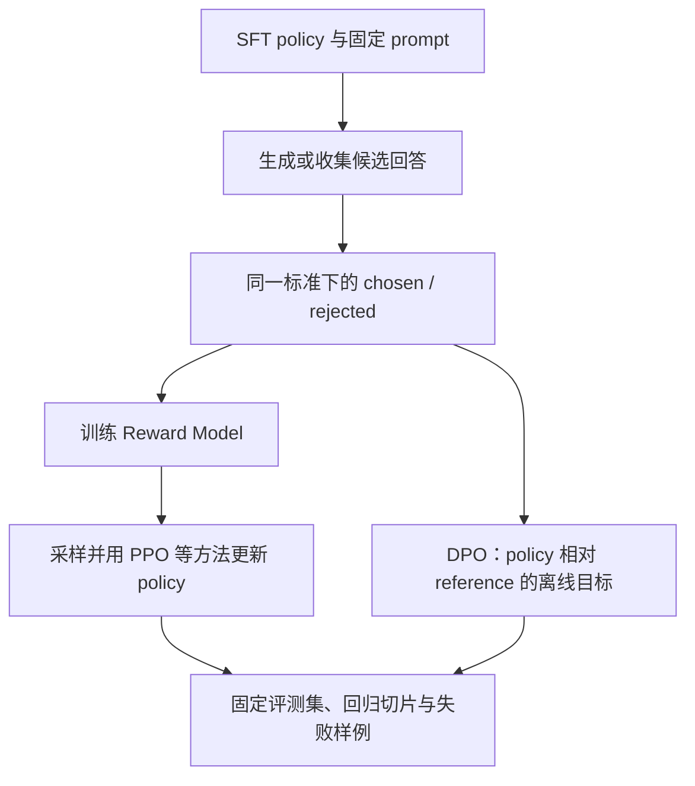

# 第 5 章 偏好优化实战：从比较数据到策略变化

监督微调（Supervised Fine-Tuning，SFT）用“问题 + 示范答案”训练模型，让模型更容易生成示范答案。它适合教模型基本格式和任务做法，但很多问题没有唯一标准答案：两个回答都可能有用，一个更具体，另一个更简洁。要求评审者给每个回答打一个绝对分数，往往比让他比较同一问题下的两个回答更难。

偏好优化把训练信号从“这条答案应该出现”变成“在这两个答案中，我更偏好哪一个”。它比较的是同一个问题下的答案，记录相对选择，不会自动把被选中的答案变成标准答案：



图中有两条路线。第一条先训练奖励模型（Reward Model，RM），让它给“问题 + 回答”打分，再用近端策略优化（Proximal Policy Optimization，PPO）一类方法更新生成模型；第二条用直接偏好优化（Direct Preference Optimization，DPO），从偏好对直接训练生成模型，不单独训练 RM。两条路线都需要可靠的比较数据和训练后评估，DPO 也仍然使用一个固定的参考模型。

本章贯穿一个小例子。问题是“我每天只有 20 分钟，怎么开始学 Python？”在“回答更具体、能直接执行”这个评审标准下，评审者偏好“先用 5 分钟复习昨天的内容，再用 10 分钟做一个小练习，最后用 5 分钟记录问题”，胜过“每天安排 20 分钟学习，尽量多做练习，并定期回顾薄弱内容”。换一个标准，例如“回答是否简短”，偏好方向可能不同。这种选择记录了任务和评审标准下的相对偏好，不代表第一条回答在任何场景都绝对正确。

第一次读时，建议先看 5.1.1—5.1.5 的偏好对、5.2.1—5.2.2 与 5.2.9 的奖励模型目标和局限、5.4.1—5.4.2 的 DPO 思路和 5.4.4 的回答概率，再读 5.6.1—5.6.6 与 5.6.11 的评估结论。5.1.6 之后的数据审计、5.2.3—5.3 的奖励模型实现、5.4.3 与 5.4.5 之后的底层细节、5.5 的框架配置及 5.6.9 的小实验，适合在准备实现或排错时查阅。章节中的手造数字只帮助推算，不表示真实模型测得了相应能力。

## 5.1 Preference Pair（偏好对）：把“更好”记录成可训练数据

### 5.1.1 偏好关系不是绝对评分

prompt 指模型要回答的问题和上下文；response 指模型给出的回答。一条最小偏好样本把同一个 prompt 和两条候选回答放在一起：

```text
prompt：需要回答的问题、指令和必要上下文。
chosen：在当前标准下更被偏好的回答。
rejected：在当前标准下较不被偏好的回答。
```

用符号表示：

```math
(x_i,y_i^+,y_i^-)
```

其中 \(x_i\) 是问题及上下文，\(y_i^+\) 是 chosen（被偏好的回答），\(y_i^-\) 是 rejected（未被偏好的回答）。上标“+”和“-”只标记比较方向，不是回答本身的好坏分数。这个样本表达的是：在给定问题和评审标准时，评审者更喜欢前者。

```math
y_i^+\succ_{x_i}y_i^-
```

整个数据集为：

```math
\mathcal{D}_{\mathrm{pref}}
=
\{(x_i,y_i^+,y_i^-)\}_{i=1}^{N}
```

三部分必须对应同一个问题。否则，评审者可能只是因为一个问题更容易而选择了它的回答，训练数据就无法说明模型应该怎样比较同一任务的两种回答。

偏好标签记录的是“这次比较里谁胜出”，不是回答的绝对分数。评审者可能很难稳定地区分 82 分和 86 分，却能判断哪条回答更完整。代价是，这个标签只约束这两条回答的相对顺序：它既不说明差距有多大，也不保证 chosen 的每句话都正确。

### 5.1.2 Preference Pair 与 SFT 样本的区别

SFT 样本通常是：

> 代码状态：静态审阅，未运行（2026-10-29）

```python
sft_example = {
    "instruction": "解释什么是过拟合。",
    "input": "",
    "output": "过拟合是训练集表现好但未见数据泛化差。",
}
```
偏好样本则是：

> 代码状态：静态审阅，未运行（2026-10-29）

```python
preference_example = {
    "prompt": "解释什么是过拟合。",
    "chosen": "过拟合是训练集表现好但未见数据泛化差。",
    "rejected": "过拟合就是模型训练得越好越好。",
}
```
SFT 主要提高一个答案的条件概率：

```math
\log\pi_\theta(y\mid x)
```

偏好训练主要比较两个答案的相对关系：

```math
\log\pi_\theta(y^+\mid x)
-
\log\pi_\theta(y^-\mid x)
```

二者可以使用同一批 prompt，但训练目标不同。SFT 把一条示范答案当作要模仿的目标；偏好训练只要求一条回答相对另一条更受偏好。偏好对因此通常建立在已经会基本续写和遵循格式的模型上，不能指望少量比较数据从头教会模型所有指令。

### 5.1.3 数据字段与模板边界

推荐先保存未拼接的三元组：

> 代码状态：静态审阅，未运行（2026-10-29）

```python
preferences = [
    {
        "prompt": "解释什么是梯度下降。",
        "chosen": "梯度下降沿损失函数的负梯度方向更新参数。",
        "rejected": "梯度下降就是梯度自己变小。",
        "category": "concept",
        "source": "human_review",
    },
]
```
prompt 可以只是一个问题，也可以包括 system 指令和此前的对话。chosen 与 rejected 通常只保存两种回答；训练时再用同一套聊天模板把上下文和回答接起来：

> 代码状态：静态审阅，未运行（2026-10-29）

```python
def render_prompt(prompt):
    return (
        "### Instruction:\n"
        + prompt.strip()
        + "\n\n### Response:\n"
    )


def render_pair(example):
    prompt = render_prompt(example["prompt"])
    return {
        "prompt": prompt,
        "chosen": example["chosen"].strip(),
        "rejected": example["rejected"].strip(),
    }
```
如果提前把 prompt 复制进 chosen/rejected，训练器又会重新拼接，就会出现：

```text
prompt + prompt + chosen
prompt + prompt + rejected
```

如果数据里已经把 prompt 写进回答，训练器又自动拼接一次，模型看到的就会变成“问题 + 问题 + 回答”。这会改变训练文本和长度统计。保存数据时要明确问题从哪里结束、回答从哪里开始。

聊天模型可以保存 messages：

> 代码状态：静态审阅，未运行（2026-10-29）

```python
chat_pair = {
    "prompt": [
        {"role": "system", "content": "你是一个严谨的助手。"},
        {"role": "user", "content": "解释过拟合。"},
    ],
    "chosen": [
        {"role": "assistant", "content": "过拟合是训练集好而泛化差。"},
    ],
    "rejected": [
        {"role": "assistant", "content": "过拟合就是模型特别强。"},
    ],
}
```
无论保存成字符串还是消息列表，两条回答都要使用相同的 system 指令、用户问题和历史对话。聊天模板是把 system、user、assistant 消息编码成模型输入的格式；目标模型若有自己的模板，就用那套模板生成输入，不要在两条分支里手工拼出不同的角色标记。

### 5.1.4 偏好数据从哪里来

偏好对可以来自人工比较、同一个模型对同一问题生成的多个回答、不同模型生成的候选，或已有排序数据。来源不同，标签里混入的因素也不同：

```text
人工撰写高质量回答，再撰写或挑选较差回答。
同一个 prompt 采样多个模型候选，由评审者排序。
强模型和弱模型分别生成候选，再进行人工复核。
从 SFT 答案出发，构造有具体缺陷的负样本。
线上坏例经过脱敏、重写和双人复核后进入数据集。
```

如果一个 prompt 产生 \(K\) 个候选，完整排序理论上可以产生：

```math
N_{\mathrm{pair}}
=
\frac{K(K-1)}{2}
```

并非候选越多、pair 越多，监督就越好。乱码和优秀答案之间的比较很容易，模型可能只学会避开乱码；两条都看起来合理、但在某个明确标准上有差异的回答，通常更能教会模型区分质量。记录候选从哪里来、怎样排序和筛选，后续才知道标签可能受哪些因素影响。

强模型答案不能自动成为 chosen。强模型也可能事实错误、引用不存在来源、违反格式或越过安全边界。偏好定义是“符合当前任务标准”，不是“来自更大的模型”。

### 5.1.5 什么样的 rejected 有学习价值

有学习价值的 rejected 通常看起来像一条可能被接受的回答，但在指定标准上有清楚的不足：

```text
遗漏关键条件，却保持自然语言流畅。
概念大体相关，但因果关系或公式错误。
回答正确但没有遵守 JSON、列表或字段要求。
没有证据却使用确定语气声称论文结果。
过度冗长、重复或把无关内容带入答案。
在应当谨慎时编造细节，或在正常问题上过度拒答。
```

空字符串、乱码、完全无关的回答和模板残片，很容易被识别。它们可以帮助排查格式错误，却较难教会模型区分两条都像样的回答。要训练“更具体、更准确或更符合格式”等能力，rejected 应体现对应的真实缺陷。

可以把每条 pair 的差异归类：

> 代码状态：静态审阅，未运行（2026-10-29）

```python
quality_dimensions = {
    "correctness": "事实和推理",
    "completeness": "关键条件和覆盖",
    "format": "结构和协议",
    "style": "清晰、简洁和语气",
    "safety": "风险边界和不确定性",
}
```
一组比较可能同时涉及准确性、完整性、语气和长度。评审者需要知道本次选择主要依据什么；否则模型可能把“更长”或“更客气”当成质量本身，即使评审原本更在意事实是否正确。

### 5.1.6 标签噪声与偏好强度

不同评审者可能对同一对回答作出不同选择：

```text
一个回答更短，另一个回答更完整。
一个回答更谨慎，另一个回答更直接。
两个回答事实都正确，但风格不同。
评审者没有看到回答所引用的外部证据。
任务本身没有明确质量标准。
```

若多名评审对同一 pair 的判断不同，可以保存：

> 代码状态：静态审阅，未运行（2026-10-29）

```python
annotation = {
    "prompt_id": "p-001",
    "chosen_id": "a-3",
    "rejected_id": "a-1",
    "votes": {"a-3": 4, "a-1": 2},
    "tie_count": 0,
    "criteria": ["correctness", "format"],
}
```
若评审意见接近平票，就不要把它伪装成确定性很高的标签。可以保留每位评审的投票、暂时排除争议样本，或把它们留作专门的压力测试。“偏好强度”有时用投票差表示；只有标注协议能稳定解释这个数时，才把它作为训练目标中的 margin（要求 chosen 至少领先多少）。

### 5.1.7 长度偏置与 token 统计

如果被偏好的回答总是更长，模型可能学到“写长一点就容易胜出”。模型读文本时会先把文本切成 token（词片段或标点等基本单位）；因此长度应按目标模型的 tokenizer 计算，而不是按字符数。对第 \(i\) 对回答，记两者的 token 数为 \(L_i^+\) 和 \(L_i^-\)，可计算长度比：

```math
\rho_i
=
\frac{\max(L_i^+,L_i^-)}
{\min(L_i^+,L_i^-)}
```

这个比值只在 \(L_i^+>0\) 且 \(L_i^->0\) 时定义。若任一回答没有有效 token，不能用 \(1\) 代替分母；这表示样本契约已经失败，应记录为无效样本。\(\rho_i\) 很大不等于样本必须删除，但应进入抽查和分桶统计。长度应使用目标 tokenizer 的 token 数，而不是 Python 字符数：

> 代码状态：静态审阅，未运行（2026-10-29）

```python
def token_length(tokenizer, text):
    return len(
        tokenizer(
            text,
            add_special_tokens=False,
        )["input_ids"]
    )
```
还要分别记录问题长度、两条回答长度、截断比例和截断后剩下的回答 token 数。若 chosen 被截掉一半而 rejected 完整保留，训练器比较的就不再是评审者当初看到的那两条回答。

### 5.1.8 数据划分必须按 prompt 分组

同一个问题可能产生多个候选，并由此形成多条偏好对。若把每一行随机分到训练集或验证集，同一问题的近似回答可能同时出现在两边：

```text
同一问题的一个 pair 进入 train。
同一问题的另一个 pair 进入 eval。
验证集不再代表未见条件。
```

应尽量满足：

```math
\mathcal{P}_{\mathrm{train}}
\cap
\mathcal{P}_{\mathrm{eval}}
=
\varnothing
```

简单分组划分：

> 代码状态：静态审阅，未运行（2026-10-29）

```python
from collections import defaultdict
import random


def split_by_prompt(rows, eval_ratio=0.2, seed=42):
    if not rows:
        raise ValueError("rows must not be empty")
    if not isinstance(eval_ratio, (int, float)) or not 0 < eval_ratio < 1:
        raise ValueError("eval_ratio must be between 0 and 1")
    groups = defaultdict(list)
    for row in rows:
        if not isinstance(row, dict):
            raise TypeError("each row must be a dict")
        prompt = row.get("prompt")
        if not isinstance(prompt, str) or not prompt.strip():
            raise ValueError("each row needs a non-empty string prompt")
        groups[prompt.strip()].append(row)

    prompts = list(groups)
    if len(prompts) < 2:
        raise ValueError("at least two prompt groups are required")
    random.Random(seed).shuffle(prompts)
    eval_count = min(
        max(1, round(len(prompts) * eval_ratio)),
        len(prompts) - 1,
    )
    eval_prompts = set(prompts[:eval_count])

    train_rows = []
    eval_rows = []
    for prompt, items in groups.items():
        if prompt in eval_prompts:
            eval_rows.extend(items)
        else:
            train_rows.extend(items)
    return train_rows, eval_rows
```
切分时应把同一 prompt 的所有比较放在同一侧；若多个问题来自同一文档、用户或模板，还可以按文档或任务来源一起分组。只检查问题文本是否完全相同，仍可能漏掉轻微改写的近似重复。

### 5.1.9 数据审计字段

偏好数据至少要能重建一次比较现场。除问题和两条回答外，还应保存：

```text
样本 id、prompt id、候选来源和模型版本。
评审者或聚合规则、时间、质量维度和置信度。
语言、任务类别、风险类别和许可证。
chosen/rejected token 长度、是否截断、是否重复。
训练/验证分组键和清洗版本。
```

这些信息能帮助排查三个常见问题：

```text
某类任务是否没有足够偏好数据？
模型是否只是学到了某个来源或格式的捷径？
退化样本能否追溯到错误标注或模板版本？
```

### 5.1.10 进阶：用 Python 做偏好数据审计

第一次阅读可以先跳过本节的实现细节。它把前面提到的检查整理成一份简单审计：找空字段、重复回答、两边相同、可能反标、长度差异和按问题分组切分。审计规则只能标记可疑样本，不能替代人查看原回答和标注依据：

> 代码状态：静态审阅，未运行（2026-10-29）

```python
from collections import defaultdict
import random


RAW = [
    {
        "id": "p1",
        "prompt": "解释过拟合。",
        "chosen": "训练集表现好，但未见数据泛化差。",
        "rejected": "过拟合就是模型很强。",
        "points": ["训练集", "泛化"],
    },
    {
        "id": "p2",
        "prompt": "给出两个方法。",
        "chosen": "可以正则化和早停。",
        "rejected": "把训练轮数无限增加。",
        "points": ["正则化", "早停"],
    },
    {
        "id": "p2_duplicate",
        "prompt": "给出两个方法。",
        "chosen": "可以正则化和早停。",
        "rejected": "把训练轮数无限增加。",
        "points": ["正则化", "早停"],
    },
    {
        "id": "empty",
        "prompt": "",
        "chosen": "没有条件。",
        "rejected": "没有答案。",
        "points": [],
    },
    {
        "id": "same",
        "prompt": "什么是学习率？",
        "chosen": "学习率控制步长。",
        "rejected": "学习率控制步长。",
        "points": ["步长"],
    },
    {
        "id": "possible_flip",
        "prompt": "解释梯度下降。",
        "chosen": "参数随便变小。",
        "rejected": "沿负梯度方向降低损失。",
        "points": ["负梯度", "损失"],
    },
    {
        "id": "length",
        "prompt": "什么是 dropout？",
        "chosen": "dropout 随机丢弃部分神经元并可缓解过拟合。",
        "rejected": "随机丢弃。",
        "points": ["随机", "过拟合"],
    },
]


def normalize(text):
    return " ".join(text.strip().split())


def hit_count(text, points):
    lower = text.lower()
    return sum(point.lower() in lower for point in points)


def audit(rows, max_ratio=4.0):
    if not isinstance(max_ratio, (int, float)) or max_ratio <= 0:
        raise ValueError("max_ratio must be positive")
    seen = set()
    clean = []
    dropped = defaultdict(int)
    warnings = []
    for row in rows:
        if not isinstance(row, dict):
            dropped["invalid_row"] += 1
            continue
        required = ("id", "prompt", "chosen", "rejected", "points")
        if any(key not in row for key in required):
            dropped["missing_field"] += 1
            continue
        text_fields = ("id", "prompt", "chosen", "rejected")
        if any(not isinstance(row[key], str) for key in text_fields):
            dropped["invalid_text"] += 1
            continue
        points = row["points"]
        if (not isinstance(points, list)
                or any(not isinstance(point, str) or not normalize(point)
                       for point in points)):
            dropped["invalid_points"] += 1
            continue
        prompt = normalize(row["prompt"])
        chosen = normalize(row["chosen"])
        rejected = normalize(row["rejected"])
        if not prompt or not chosen or not rejected:
            dropped["empty"] += 1
            continue
        if chosen == rejected:
            dropped["same"] += 1
            continue
        key = (prompt, chosen, rejected)
        if key in seen:
            dropped["duplicate"] += 1
            continue
        seen.add(key)
        if hit_count(rejected, row["points"]) > hit_count(chosen, row["points"]):
            warnings.append((row["id"], "possible_label_flip"))
            dropped["possible_flip"] += 1
            continue
        if not row["points"]:
            warnings.append((row["id"], "no_quality_points"))
        ratio = max(len(chosen), len(rejected)) / min(
            len(chosen), len(rejected),
        )
        if ratio > max_ratio:
            warnings.append((row["id"], "length_bias"))
            dropped["length_warning"] += 1
        clean.append({
            "id": row["id"],
            "prompt": prompt,
            "chosen": chosen,
            "rejected": rejected,
        })
    return clean, dropped, warnings


def split(rows, eval_ratio=0.5):
    if not rows:
        raise ValueError("rows must not be empty")
    if not isinstance(eval_ratio, (int, float)) or not 0 < eval_ratio < 1:
        raise ValueError("eval_ratio must be between 0 and 1")
    groups = defaultdict(list)
    for row in rows:
        prompt = row.get("prompt") if isinstance(row, dict) else None
        if not isinstance(prompt, str) or not prompt:
            raise ValueError("rows need non-empty prompt strings")
        groups[prompt].append(row)
    prompts = sorted(groups)
    if len(prompts) < 2:
        raise ValueError("at least two prompt groups are required")
    random.Random(42).shuffle(prompts)
    cut = min(max(1, round(len(prompts) * eval_ratio)), len(prompts) - 1)
    eval_prompts = set(prompts[:cut])
    train = []
    evaluation = []
    for prompt, items in groups.items():
        (evaluation if prompt in eval_prompts else train).extend(items)
    return train, evaluation


clean, dropped, warnings = audit(RAW)
train, evaluation = split(clean)
train_prompts = {row["prompt"] for row in train}
eval_prompts = {row["prompt"] for row in evaluation}

print("raw_count=", len(RAW))
print("clean_count=", len(clean))
print("dropped=", dict(dropped))
print("warnings=", warnings)
print("train_size=", len(train))
print("eval_size=", len(evaluation))
print("prompt_leak=", bool(train_prompts & eval_prompts))
```
上面的 `ratio` 用字符数代替 token 数，只为演示检查思路。真实数据要用目标模型的 tokenizer 统计问题和回答长度，并保留截断后的有效 token 数。字符长度不能用来比较中文、英文和代码的模型输入成本。

回到贯穿例子：偏好理由不是“第一条永远更好”，而是“按可执行性和 20 分钟预算来评，它给出了更具体的安排”。如果换成简洁度作为标准，评审可能作出不同选择。数据最好保留这个标准、原始两条回答和评审说明；只留下 winner 会让后续无法分辨标签来自答案质量还是长度、语气和来源差异。

同一问题的多个 pair 也不是多个独立问题。若 5 个候选形成 10 次比较，训练集和验证集仍应按 prompt 或更高层级的任务来源分组；同一条回答参与很多比较时，还要检查它是否被重复加权。偏好数据的数量应同时报告 pair 数和独立 prompt 数。

数据准备回答的是“比较什么”。下一步先看最直观的一条路线：让奖励模型学会给 chosen 打更高分，再把这个分数用于策略优化。

## 5.2 奖励模型怎样学会给两条回答排序

### 5.2.1 Reward Model 的输入与输出

奖励模型（Reward Model，RM）本身不生成回答。它读入一个问题和一条候选回答，输出一个实数分数；分数只用于比较候选，不是准确率，也没有天然的“满分”：

```math
r_\phi(x,y)\in\mathbb{R}
```

对同一问题的偏好对，训练目标是让被偏好的回答得分更高：

```math
r_i^+
=
r_\phi(x_i,y_i^+),
\qquad
r_i^-
=
r_\phi(x_i,y_i^-)
```

所以最基本的目标是：

```math
r_i^+>r_i^-
```

RM 可以给 PPO 一类策略优化方法提供奖励，也可以离线给候选排序。无论怎样使用，它学到的都是对训练偏好的近似；分数高只表示 RM 更偏好这条回答，不等于回答事实正确或用户一定满意。

### 5.2.2 Bradley–Terry 概率

Bradley–Terry 是把两两比较转换成概率的一种简单模型。它假设两条回答各有一个潜在分数，回答分数差越大，被偏好的概率越高：

```math
P(y_i^+\succ y_i^-\mid x_i)
=
\sigma(r_i^+-r_i^-)
```

sigmoid 函数把任意实数压到 0 到 1 之间，因此可以把分数差读成模型对“chosen 会胜出”的估计概率：

```math
\sigma(z)
=
\frac{1}{1+\exp(-z)}
```

差值为 0 时，两边的估计概率各为 0.5；chosen 分数更高时，概率大于 0.5；rejected 分数更高时，概率小于 0.5。这里的概率是训练目标里的排序概率，不是回答正确的概率。

训练时希望模型给出较高的 chosen 胜出概率，因此最小化它的负对数：

```math
\mathcal{L}_{\mathrm{RM}}
=
-
\frac{1}{B}
\sum_{i=1}^{B}
\log\sigma(r_i^+-r_i^-)
```

沿用贯穿例子，假设 RM 给具体的 20 分钟计划打 1.2 分，给笼统建议打 -0.3 分。差值是 \(1.2-(-0.3)=1.5\)，所以 chosen 胜出的估计概率为 \(\sigma(1.5)\approx0.818\)，单样本损失约为 \(-\ln(0.818)=0.201\)。如果两个分数对调，损失约为 1.70，模型会收到更强的纠正信号。这些分数是便于手算的假设值，不表示回答质量的单位。

损失只依赖分数差：给两条回答的分数都加 10，概率和损失不变。因此 RM 的分数没有固定原点，也不能说 2 分的回答是 1 分回答的两倍好。

### 5.2.3 数值稳定的实现

先把分数差变成概率，再取对数，是直观写法。不过在数值极端时，先算 sigmoid 再取 log 可能损失精度；实际实现通常使用能直接稳定计算 log-sigmoid 的函数：

> 代码状态：静态审阅，未运行（2026-10-29）

```python
import torch


def unstable_loss(chosen_rewards, rejected_rewards):
    diff = chosen_rewards - rejected_rewards
    return -torch.log(torch.sigmoid(diff)).mean()
```
更稳定的写法是：

> 代码状态：静态审阅，未运行（2026-10-29）

```python
import torch
import torch.nn.functional as F


def _flat_rewards(values, name):
    if not isinstance(values, torch.Tensor):
        raise TypeError(f"{name} must be a torch.Tensor")
    if not torch.is_floating_point(values):
        raise TypeError(f"{name} must use a floating dtype")
    if values.numel() == 0:
        raise ValueError("reward batch must not be empty")
    if values.ndim == 0 or values.ndim > 2 or (
        values.ndim == 2 and values.shape[1] != 1
    ):
        raise ValueError(f"{name} must have shape [B] or [B, 1]")
    values = values.reshape(-1)
    if not torch.isfinite(values).all():
        raise ValueError(f"{name} must contain only finite values")
    return values


def _reward_pair(chosen_rewards, rejected_rewards):
    chosen_rewards = _flat_rewards(chosen_rewards, "chosen_rewards")
    rejected_rewards = _flat_rewards(rejected_rewards, "rejected_rewards")
    if chosen_rewards.shape != rejected_rewards.shape:
        raise ValueError("reward shapes must match")
    return chosen_rewards, rejected_rewards


def reward_ranking_loss(chosen_rewards, rejected_rewards):
    chosen_rewards, rejected_rewards = _reward_pair(
        chosen_rewards,
        rejected_rewards,
    )
    diff = chosen_rewards - rejected_rewards
    return -F.logsigmoid(diff).mean()
```
也可以把差值当作正类 logit：

下面的短片段复用上一个代码块中的 `_reward_pair`，因此必须与上一段一起运行；它只替换数值稳定的损失实现，不改变输入契约。

> 代码状态：静态审阅，未运行（2026-10-29）

```python
import torch
import torch.nn.functional as F


def reward_ranking_loss_bce(chosen_rewards, rejected_rewards):
    chosen_rewards, rejected_rewards = _reward_pair(
        chosen_rewards,
        rejected_rewards,
    )
    diff = chosen_rewards - rejected_rewards
    target = torch.ones_like(diff)
    return F.binary_cross_entropy_with_logits(diff, target)
```

`logsigmoid` 和带 logits 的二元交叉熵把稳定计算封装起来，避免先算一个接近 0 的概率再取对数而下溢。这里的 logits 就是进入 sigmoid 前的分数差。
### 5.2.4 梯度方向

令 \(d=r^+-r^-\)，也就是 chosen 和 rejected 的分数差。单样本损失为：

```math
\ell(d)
=
-\log\sigma(d)
```

其对两个 reward 的梯度为：

```math
\frac{\partial\ell}{\partial r^+}
=
\sigma(d)-1
```

```math
\frac{\partial\ell}{\partial r^-}
=
1-\sigma(d)
```

梯度的符号可以直接告诉我们参数更新会往哪边走：chosen 的梯度为负，梯度下降会把它的分数往上推；rejected 的梯度为正，梯度下降会把它的分数往下拉。差值写反，模型就会被训练成偏好错误的一侧。

看三个容易比较的情况：

```text
r+ = 3, r- = 0：差值为正，loss 较小。
r+ = 1, r- = 1：差值为 0，loss 约为 0.693。
r+ = 0, r- = 3：差值为负，loss 较大。
```

再把第一行算具体一些：chosen 的分数为 1.5、rejected 的分数为 0 时，差值是 1.5，sigmoid 给出的胜出概率约为 0.818，损失约为 0.201。此时 chosen 分数的梯度约为 -0.182，rejected 分数的梯度约为 0.182，所以梯度下降会小幅提高前者、降低后者。若把两者对调，差值变成 -1.5，胜出概率约为 0.182，损失约为 1.701，梯度绝对值也变大，模型会受到更强的纠正信号。这里展示的是分数的梯度；真实训练会继续通过分数头和骨干网络，把信号传回模型参数。

### 5.2.5 margin 与偏好强度

有些标注不只表示谁胜出，也可靠地记录了差距大小。margin（间隔）就是要求 chosen 至少比 rejected 高出多少；有可信的强弱标签时，可以把它放进目标：

```math
\mathcal{L}_{\mathrm{margin}}
=
-
\frac{1}{B}
\sum_i
\log\sigma(r_i^+-r_i^- - m_i)
```

如果评审只选了胜者、没有标差距，就用 \(m_i=0\)。随手填一个较大的 margin，会把“略微更喜欢”伪装成“必须高很多”，改变模型实际学习的目标。

### 5.2.6 进阶：批次形状与 padding

接下来的形状问题主要是实现 RM 时的防错知识。batch（一次送入模型的一组样本）里，问题和回答会先变成 token ID 序列；不同样本长度不同时，通常用 padding 补齐到相同宽度。chosen 和 rejected 可以各自有不同的序列宽度，但每条序列最终都只应得到一个分数：

```text
chosen_input_ids：     [B, T+]
rejected_input_ids：   [B, T-]
chosen_rewards：       [B]
rejected_rewards：     [B]
```

这里 \(B\) 是 pair 的数量，必须大于 0。没有样本时，平均准确率或平均分差是“无法计算”，不是 0。平票也要预先规定怎样记录；本章用严格大于号，所以同分不算 chosen 胜出。

每条回答只该有一个标量分数。如果模型保留了多余的长度为 1 的维度，例如形状 [B,1]，而另一边形状为 [B]，直接相减可能触发广播并意外得到 [B,B] 的矩阵；矩阵里的每个值都不再对应原来的一个 pair：

> 代码状态：静态审阅，未运行（2026-10-29）

```python
chosen = torch.zeros(3, 1)
rejected = torch.zeros(3)
print((chosen - rejected).shape)
```
一种常见做法是取最后一个真实 token 的 hidden state（模型在该 token 位置形成的内部向量），再用一个线性层输出分数。不能直接取补齐后的最后一列，因为那一列可能只是 padding：

> 代码状态：静态审阅，未运行（2026-10-29）

```python
import torch
import torch.nn as nn


class RewardHead(nn.Module):
    def __init__(self, hidden_size):
        super().__init__()
        self.value = nn.Linear(hidden_size, 1)

    def forward(self, hidden_states, attention_mask):
        if hidden_states.ndim != 3:
            raise ValueError("hidden_states must have shape [B, T, H]")
        if attention_mask.shape != hidden_states.shape[:2]:
            raise ValueError("attention_mask must have shape [B, T]")
        if attention_mask.device != hidden_states.device:
            raise ValueError("hidden_states and attention_mask must share a device")
        if attention_mask.numel() == 0:
            raise ValueError("attention_mask must not be empty")
        valid_mask = (attention_mask == 0) | (attention_mask == 1)
        if not bool(valid_mask.all()):
            raise ValueError("attention_mask must contain only 0 or 1")
        valid_lengths = attention_mask.to(torch.long).sum(dim=1)
        if bool((valid_lengths == 0).any()):
            raise ValueError("each sequence needs at least one valid token")
        positions = torch.arange(
            hidden_states.size(1),
            device=hidden_states.device,
        ).unsqueeze(0)
        last_indices = (
            attention_mask.to(torch.long) * positions
        ).max(dim=1).values
        batch_indices = torch.arange(
            hidden_states.size(0),
            device=hidden_states.device,
        )
        last_hidden = hidden_states[batch_indices, last_indices]
        return self.value(last_hidden).squeeze(-1)
```
attention mask 标出哪些位置是真实 token、哪些是 padding。下面的选择方法支持左侧或右侧补齐，前提是每条序列至少有一个真实 token。对 RM 来说，取错位置会让模型根据补齐符号而不是回答内容打分。

### 5.2.7 怎样看奖励模型的训练指标

pairwise accuracy（成对排序准确率）统计 RM 在多少比例的样本中把 chosen 排在 rejected 前面：

```math
A_{\mathrm{pair}}
=
\frac{1}{B}
\sum_{i=1}^{B}
\mathbf{1}[r_i^+>r_i^-]
```

平均 reward gap（平均分差）告诉我们两者平均相差多少：

```math
G_{\mathrm{RM}}
=
\frac{1}{B}
\sum_{i=1}^{B}(r_i^+-r_i^-)
```

还可以看两个分数的整体中心：

```math
C_{\mathrm{RM}}
=
\frac{1}{2B}
\sum_i(r_i^++r_i^-)
```

三个数字回答不同问题：准确率看排序方向，平均分差看分差大小，中心看分数整体是否上移或下移。RM 的排序损失不约束整体中心；因此中心漂移本身不一定是错误。若损失下降、准确率却接近随机水平 0.5，就要检查标签方向、样本聚合和指标记录。

### 5.2.8 一个最小方向实验

> 代码状态：静态审阅，未运行（2026-10-29）

```python
import torch
import torch.nn.functional as F


def loss(chosen, rejected):
    chosen = chosen.view(-1)
    rejected = rejected.view(-1)
    return -F.logsigmoid(chosen - rejected).mean()


good_loss = loss(torch.tensor([3.0]), torch.tensor([0.0]))
bad_loss = loss(torch.tensor([0.0]), torch.tensor([3.0]))
chosen = torch.tensor([0.5], requires_grad=True)
rejected = torch.tensor([1.0], requires_grad=True)
value = loss(chosen, rejected)
value.backward()

print("good_loss=", round(good_loss.item(), 4))
print("bad_loss=", round(bad_loss.item(), 4))
print("direction_ok=", good_loss < bad_loss)
print("chosen_grad=", round(chosen.grad.item(), 4))
print("rejected_grad=", round(rejected.grad.item(), 4))
```
结果应显示：正确排序的损失更小；若 chosen 当前分数较低，它的梯度为负，梯度下降会提高它；rejected 的梯度方向相反。

### 5.2.9 Reward Model 的限制

Reward Model 可能学习到：

```text
回答长度、格式标记或语气，而不是事实正确性。
训练数据中的来源或模板，而不是任务规则。
评审者偏差和错误标签。
容易被生成器利用的表面特征。
```

RM 的分数只是训练偏好的代理。上面的例子说明分数差怎样变成排序概率，不说明 0.818 是“回答有 81.8% 的质量”。给所有分数加同一常数，排序目标不变；把分数整体放大，则会让 sigmoid 更确信，损失也会改变。不同 RM 的分数尺度因此不能直接横向比较。

这个排序模型还假设偏好可以压成一个标量：如果评审者同时考虑准确性、简洁度和安全性，这些标准可能彼此冲突。单一分数会把它们揉在一起，结果取决于数据里各类任务和评审标准的比例。要检查模型学到的是不是目标本身，应按任务分类看错例，并保留评审理由。

平票不能随便随机打破，否则会把噪声写进标签。若评审能给出多票，可保留投票比例作为软偏好；若只记录硬标签，就应接受其中丢失了分歧强度。RM 在验证集上的排序准确率也不证明它已校准，更不证明它在生成模型改变回答分布后仍然可靠。保留独立人工样例、事实/安全检查和新分布下的评估，才能发现它偏好长度、格式或固定措辞等捷径。

RM 的作用是先把偏好压成一个分数。本节之后会展示怎样训练这个评分器；接着再看 DPO 如何绕过单独训练 RM，直接从同一对回答更新生成模型。

## 5.3 进阶：手动训练一个简单 Reward Model

5.2 已经说明 RM 要学会什么：同一问题下，chosen 的分数应高于 rejected。本节转向实现，展示两条回答怎样经过同一个模型、变成两个分数，再由分数差更新参数。理解 DPO 主线不要求你先自己训练 RM；需要复现经典的 RM + PPO 路线时，再把本节作为实现参考。

### 5.3.1 从 pair 到两个前向

对每个问题，RM 分别处理两条回答。它先把“问题 + 回答”转成 token 序列，语言模型骨干网络（backbone）产生内部向量，再由一个小的分数头把整条输入压成一个实数：

```text
prompt + chosen → backbone → value head → r+
prompt + rejected → backbone → value head → r-
                                    ↓
                        -logsigmoid(r+ - r-)
```

把文本转成 token ID 后，chosen 和 rejected 是两条不同的输入序列：

```math
X_i^+,A_i^+
=
\mathrm{Tokenize}(x_i\oplus y_i^+)
```

```math
X_i^-,A_i^-
=
\mathrm{Tokenize}(x_i\oplus y_i^-)
```

同一个 RM 分别给它们打分：

```math
r_i^+
=
r_\phi(X_i^+,A_i^+),
\qquad
r_i^-
=
r_\phi(X_i^-,A_i^-)
```

这里的目标是给整条回答排序，而不是预测下一个 token，所以这个模型用分数头取代了通常负责词表预测的输出头。

沿用“20 分钟学会 Python”的例子：一开始模型可能给“先学变量、条件判断，再写一个小练习”打 0.2 分，给“多看资料、多做练习”打 0.4 分。两者的差是 -0.2，chosen 胜出的概率约为 0.450，单对损失约为 0.798；损失较高，表示当前评分顺序与标注相反。经过训练后，假设同一对回答的分数变为 0.6 和 0.1，差值为 0.5，胜出概率约为 0.622，损失约为 0.474，排序已经朝标注方向移动。这个小算例只帮助理解训练前后的分数变化，不是代码运行结果；真实更新会综合一个批次里的许多回答对，通过梯度调整模型参数，因此分数不会按固定幅度变化。

两条输入要共享同一套骨干网络和分数头。这样模型学到的是哪些文本特征通常与被偏好的回答相关，而不是给 chosen 和 rejected 各自配一套互不相干的打分器。训练时，分数差形成偏好损失，再通过反向传播把“哪边该高一些”的信号传到参数；这也解释了为什么标签方向、成对顺序或 prompt 拼接一旦弄反，代码仍可能正常运行，学到的排序却会反过来。

### 5.3.2 Pair tokenizer 与 collator

下面用一个小型自回归语言模型作为 backbone（骨干网络）。重点是输入和输出的边界；不同模型的聊天模板和 padding 约定可能不同：

> 代码状态：静态审阅，未运行（2026-10-29）

```python
from transformers import AutoTokenizer


model_name = "sshleifer/tiny-gpt2"
model_revision = "5f91d94bd9cd7190a9f3216ff93cd1dd95f2c7be"
tokenizer = AutoTokenizer.from_pretrained(model_name, revision=model_revision)
if tokenizer.pad_token is None:
    if tokenizer.eos_token is None:
        raise ValueError("tokenizer needs pad_token or eos_token")
    tokenizer.pad_token = tokenizer.eos_token
max_length = 256
if not isinstance(max_length, int) or max_length < 2:
    raise ValueError("max_length must be an integer >= 2")


def format_prompt(prompt):
    return (
        "### Instruction:\n"
        + prompt.strip()
        + "\n\n### Response:\n"
    )


def preprocess_pair(example):
    required = ("prompt", "chosen", "rejected")
    if any(key not in example for key in required):
        raise KeyError(f"missing preference field: {required}")
    if any(not isinstance(example[key], str) for key in required):
        raise TypeError("preference fields must be strings")
    if any(not example[key].strip() for key in required):
        raise ValueError("prompt, chosen and rejected must be non-empty")
    prompt = format_prompt(example["prompt"])
    eos = tokenizer.eos_token
    if eos is None:
        raise ValueError("tokenizer needs eos_token for this example")
    if not tokenizer.is_fast:
        raise ValueError("preprocess_pair requires a fast tokenizer for offsets")

    def encode_response(response):
        encoded = tokenizer(
            prompt + response + eos,
            max_length=max_length,
            truncation=True,
            add_special_tokens=False,
            return_offsets_mapping=True,
        )
        prompt_end = len(prompt)
        if not any(
            end > prompt_end and end > start
            for start, end in encoded["offset_mapping"]
        ):
            raise ValueError("truncation removed the entire response")
        encoded.pop("offset_mapping")
        return encoded

    chosen = encode_response(example["chosen"])
    rejected = encode_response(example["rejected"])
    if not chosen["input_ids"] or not rejected["input_ids"]:
        raise ValueError("tokenization produced an empty sequence")
    return {
        "chosen_input_ids": chosen["input_ids"],
        "chosen_attention_mask": chosen["attention_mask"],
        "rejected_input_ids": rejected["input_ids"],
        "rejected_attention_mask": rejected["attention_mask"],
    }
```
同一批文本的 token 数可能不同。为了组成张量，需要用 padding token 补齐；attention mask 会标出真实 token 的位置。chosen 和 rejected 分开补齐时，各自有自己的 mask：

> 代码状态：静态审阅，未运行（2026-10-29）

```python
import torch


class RewardDataCollator:
    def __init__(self, tokenizer):
        self.tokenizer = tokenizer
        if tokenizer.pad_token_id is None:
            raise ValueError("tokenizer.pad_token_id must be set")
        self.vocab_size = len(tokenizer)
        if not 0 <= tokenizer.pad_token_id < self.vocab_size:
            raise ValueError("tokenizer.pad_token_id is outside its vocabulary")

    def pad(self, features, key, value):
        if not features:
            raise ValueError("features must not be empty")
        if value is None:
            raise ValueError(f"padding value for {key} is missing")
        sequences = []
        for item in features:
            if key not in item or not item[key]:
                raise ValueError(f"missing or empty field: {key}")
            if not all(isinstance(token, int) for token in item[key]):
                raise TypeError(f"{key} must contain integer token ids")
            if any(token < 0 or token >= self.vocab_size for token in item[key]):
                raise ValueError(f"{key} contains an id outside the tokenizer vocabulary")
            sequences.append(item[key])
        tensors = [
            torch.tensor(sequence, dtype=torch.long)
            for sequence in sequences
        ]
        return torch.nn.utils.rnn.pad_sequence(
            tensors,
            batch_first=True,
            padding_value=value,
        )

    def __call__(self, features):
        if not features:
            raise ValueError("features must not be empty")
        for item in features:
            for prefix in ("chosen", "rejected"):
                ids_key = f"{prefix}_input_ids"
                mask_key = f"{prefix}_attention_mask"
                if ids_key not in item or mask_key not in item:
                    raise KeyError(f"missing {prefix} pair fields")
                if len(item[ids_key]) != len(item[mask_key]):
                    raise ValueError(f"{prefix} ids and mask lengths differ")
                if not item[ids_key] or not any(item[mask_key]):
                    raise ValueError(f"{prefix} needs a valid token")
                if any(mask not in (0, 1) for mask in item[mask_key]):
                    raise ValueError(f"{prefix} attention mask must be binary")
        return {
            "chosen_input_ids": self.pad(
                features,
                "chosen_input_ids",
                self.tokenizer.pad_token_id,
            ),
            "chosen_attention_mask": self.pad(
                features,
                "chosen_attention_mask",
                0,
            ),
            "rejected_input_ids": self.pad(
                features,
                "rejected_input_ids",
                self.tokenizer.pad_token_id,
            ),
            "rejected_attention_mask": self.pad(
                features,
                "rejected_attention_mask",
                0,
            ),
        }
```
chosen 和 rejected 可以有不同的 batch 宽度，但每条样本的真实 token 必须靠各自的 mask 找到。此处示例使用右侧 padding；后面的 TRL 训练器采用另一套左侧 padding 约定。左右 padding 都可以工作，关键是读取 token 和最后有效位置时始终遵守同一份 mask。

### 5.3.3 Backbone 加 value head

一个简化的 RM 由两部分组成：负责读文本的 backbone，以及把内部向量映射成单个分数的 head：

> 代码状态：静态审阅，未运行（2026-10-29）

```python
import torch
import torch.nn as nn
from transformers import AutoModel


class RewardModel(nn.Module):
    def __init__(self, model_name, model_revision):
        super().__init__()
        self.backbone = AutoModel.from_pretrained(
            model_name,
            revision=model_revision,
        )
        hidden_size = self.backbone.config.hidden_size
        self.value_head = nn.Linear(hidden_size, 1)

    def forward(self, input_ids, attention_mask):
        if input_ids.ndim != 2 or attention_mask.shape != input_ids.shape:
            raise ValueError("input_ids and attention_mask must have shape [B, T]")
        if input_ids.device != attention_mask.device:
            raise ValueError("input_ids and attention_mask must share a device")
        if input_ids.numel() == 0:
            raise ValueError("input_ids must not be empty")
        if bool(((attention_mask != 0) & (attention_mask != 1)).any()):
            raise ValueError("attention_mask must be binary")
        valid_lengths = attention_mask.to(torch.long).sum(dim=1)
        if bool((valid_lengths == 0).any()):
            raise ValueError("each sequence needs at least one valid token")
        outputs = self.backbone(
            input_ids=input_ids,
            attention_mask=attention_mask,
        )
        hidden_states = outputs.last_hidden_state
        if hidden_states.shape[:2] != attention_mask.shape:
            raise ValueError("backbone changed the batch or sequence dimensions")
        positions = torch.arange(
            hidden_states.size(1),
            device=hidden_states.device,
        ).unsqueeze(0)
        last_indices = (
            attention_mask.to(torch.long) * positions
        ).max(dim=1).values
        batch_indices = torch.arange(
            hidden_states.size(0),
            device=hidden_states.device,
        )
        summary = hidden_states[batch_indices, last_indices]
        return self.value_head(summary).view(-1)
```
这里取最后一个有效 token 的 hidden state（隐藏状态，即模型在该位置形成的向量）交给分数头。也可以对所有有效位置求平均，或用专门的分类头；不同做法会改变怎样把整条回答汇总成分数，应与模型结构和训练目标相配。

### 5.3.4 手写训练循环

下面的循环用一个极小的 CPU toy backbone 演示一次参数更新。它让数据、两个分数、损失、梯度和优化器串在一起，但这个玩具网络没有预训练语言知识；它只说明训练步骤怎样连接，不能代表真实语言模型会学到什么。这里沿用前面的 collator（把若干样本整理成 batch 的函数）和排序损失。

> 代码状态：静态审阅，未运行（2026-10-29）

```python
import torch
import torch.nn as nn
import torch.nn.functional as F
from torch.optim import AdamW
from torch.utils.data import DataLoader


def ranking_loss(chosen_rewards, rejected_rewards):
    return reward_ranking_loss(chosen_rewards, rejected_rewards)


def pair_accuracy(chosen_rewards, rejected_rewards):
    chosen_rewards, rejected_rewards = _reward_pair(
        chosen_rewards,
        rejected_rewards,
    )
    return (
        chosen_rewards > rejected_rewards
    ).float().mean()


class ToyBackbone(nn.Module):
    def __init__(self, vocab_size=32, hidden_size=8):
        super().__init__()
        self.embedding = nn.Embedding(vocab_size, hidden_size)

    def forward(self, input_ids, attention_mask):
        return type(
            "ToyOutput",
            (),
            {"last_hidden_state": self.embedding(input_ids)},
        )()


class ToyRewardModel(nn.Module):
    def __init__(self):
        super().__init__()
        self.backbone = ToyBackbone()
        self.value_head = nn.Linear(8, 1)

    def forward(self, input_ids, attention_mask):
        hidden = self.backbone(input_ids, attention_mask).last_hidden_state
        positions = torch.arange(input_ids.size(1)).unsqueeze(0)
        last = (attention_mask * positions).max(dim=1).values
        rows = torch.arange(input_ids.size(0))
        return self.value_head(hidden[rows, last]).squeeze(-1)


class ToyTokenizer:
    pad_token_id = 0


train_dataset = [
    {
        "chosen_input_ids": [1, 2, 3],
        "chosen_attention_mask": [1, 1, 1],
        "rejected_input_ids": [1, 4],
        "rejected_attention_mask": [1, 1],
    },
    {
        "chosen_input_ids": [1, 5],
        "chosen_attention_mask": [1, 1],
        "rejected_input_ids": [1, 6, 7],
        "rejected_attention_mask": [1, 1, 1],
    },
]
device = "cpu"
model_name = "toy-cpu-reward-model"
torch.manual_seed(7)
model = ToyRewardModel().to(device)
optimizer = AdamW(model.parameters(), lr=1e-5)
loader = DataLoader(
    train_dataset,
    batch_size=2,
    shuffle=True,
    collate_fn=RewardDataCollator(ToyTokenizer()),
)

for epoch in range(3):
    model.train()
    for step, batch in enumerate(loader):
        batch = {
            key: value.to(device)
            for key, value in batch.items()
        }
        chosen_rewards = model(
            batch["chosen_input_ids"],
            batch["chosen_attention_mask"],
        )
        rejected_rewards = model(
            batch["rejected_input_ids"],
            batch["rejected_attention_mask"],
        )
        loss = ranking_loss(chosen_rewards, rejected_rewards)
        optimizer.zero_grad(set_to_none=True)
        loss.backward()
        optimizer.step()

        if step % 10 == 0:
            accuracy = pair_accuracy(
                chosen_rewards.detach(),
                rejected_rewards.detach(),
            )
            gap = (
                chosen_rewards.detach()
                - rejected_rewards.detach()
            ).mean()
            print(
                "epoch=", epoch,
                "step=", step,
                "loss=", round(loss.item(), 4),
                "accuracy=", round(accuracy.item(), 4),
                "gap=", round(gap.item(), 4),
            )
```
真实训练还要考虑混合精度、梯度累积、评估、梯度裁剪和 checkpoint（保存的训练状态）。先读懂这个最小循环的顺序：两条回答分别前向计算分数，分数差形成损失，反向传播计算梯度，优化器再更新参数。

### 5.3.5 评估与 checkpoint

验证时不更新参数，并关闭训练阶段才使用的 dropout 随机失活；指标按实际 pair 数加权平均。训练和验证要用相同的数据字段与整理规则，否则分数差可能反映预处理差异。

> 代码状态：静态审阅，未运行（2026-10-29）

```python
@torch.no_grad()
def evaluate(model, dataloader, device):
    was_training = model.training
    model.eval()
    total_loss = 0.0
    total_accuracy = 0.0
    total_gap = 0.0
    total_count = 0

    for batch in dataloader:
        batch = {
            key: value.to(device)
            for key, value in batch.items()
        }
        chosen = model(
            batch["chosen_input_ids"],
            batch["chosen_attention_mask"],
        )
        rejected = model(
            batch["rejected_input_ids"],
            batch["rejected_attention_mask"],
        )
        loss = ranking_loss(chosen, rejected)
        count = chosen.numel()
        total_loss += loss.item() * count
        total_accuracy += (
            (chosen > rejected).float().sum().item()
        )
        total_gap += (chosen - rejected).sum().item()
        total_count += count

    if was_training:
        model.train()
    if total_count == 0:
        raise ValueError("evaluation dataloader produced no samples")
    return {
        "loss": total_loss / total_count,
        "accuracy": total_accuracy / total_count,
        "gap": total_gap / total_count,
    }
```
自定义 Reward Model 可以保存 state_dict：

> 代码状态：静态审阅，未运行（2026-10-29）

```python
from pathlib import Path


checkpoint_path = Path(".tmp/reward_model.pt")
checkpoint_path.parent.mkdir(parents=True, exist_ok=True)
torch.save(
    {
        "model_name": model_name,
        "state_dict": model.state_dict(),
        "tokenizer_name": model_name,
    },
    checkpoint_path,
)
```
checkpoint 还要和模型结构、tokenizer 版本一起保存。不要加载来源不明的 checkpoint；只保存权重不能告诉后来者当时用的是什么网络和文本切分方式。

### 5.3.6 监控 reward 漂移

训练日志至少包含：

```text
train/eval ranking loss。
pairwise accuracy。
chosen/rejected reward 均值。
reward gap。
reward 的中心和方差。
按任务类别的准确率。
```

训练集准确率接近 1、验证集却接近随机水平 0.5，常见解释是过拟合或数据切分泄漏。若平均分差不断变大，人工查看的回答却没变好，模型可能学到长度、格式或候选来源等捷径。

整体分数一起上移或下移，不一定改变 pair 的排序。若下游算法依赖 reward 的尺度，应记录所用归一化或正则方法，并在实际策略更新中重新评估；单看 RM loss 无法证明分数已校准。

### 5.3.7 训练规模与成本

每个 pair 有两条回答，所以通常需要处理两路输入。为了提高吞吐，可以把 chosen 和 rejected 合并成一个较大的 batch 再拆回分数，但要保证样本顺序和 mask 对应正确。

训练内存包括：

```text
backbone 权重、value head。
可训练参数梯度和 optimizer state。
chosen/rejected 两路激活。
tokenizer batch 的 padding 和临时 buffer。
```

只训练分数头更省资源，但 backbone 学不到新的区分方式；更新整个 backbone 成本更高，也可能改变原有能力。LoRA 是一种只训练少量低秩适配参数的做法，可以和分数头一起更新；实际使用时还要确认训练器如何保存和恢复这两类参数。

### 5.3.8 Reward Model 的事实边界

Reward Model 在训练分布内的 pairwise accuracy 上升，只说明它更能复现那批偏好标签。它不能自动证明：

```text
生成模型使用该 reward 后会更安全。
高 reward 回答在现实任务中更正确。
未见任务上的排序仍然可靠。
reward 不会被生成器利用。
```

因此，RM 的排序指标必须和人工样例、任务指标及安全检查一起看。

验证 RM 时，先保证问题级别的切分正确。比如 100 个问题各生成 4 个回答，最终可以形成 300 对比较；若留出 20 个问题作验证，所有来自这 20 个问题的 pair 都应留在验证集。报告问题数和 pair 数，不能只写“300 条数据”。同一 pair 的两条回答还要使用相同模板和预处理，验证集也应沿用训练时的字段契约。

实现上要确认分数来自真实 token 而非 padding。假设一个回答有 3 个 token，另一个有 5 个，右侧补齐到宽度 5 后，短回答应从索引 2 取分数，不是从索引 4 取 padding 位置。模板末尾是否包含 EOS 也会影响最后位置的约定，需在固定样本上检查。

结果要同时看整体和分桶：训练准确率从 60% 升到 98%，验证停在 70%，提示继续训练可能只会记住训练偏好；某个安全桶若只有 5 对，4/5 的准确率也很不稳定。可以按任务查看错例、分数差、评审一致性，并用语义相近但长度或措辞不同的样本检查模型是否依赖表面线索。这样的检查只能暴露部分捷径，不能证明 RM 普遍可靠；低 loss 或高 pairwise accuracy 都不能替代策略更新后的独立行为评估。

## 5.4 核心主线：DPO 怎样直接学习回答偏好

### 5.4.1 DPO 的两个模型角色

DPO 不另外训练一个显式 RM，而是比较两个生成模型对同一回答的概率。policy（当前策略模型）是正在更新的模型；reference（参考模型）通常是训练开始前冻结的 SFT 模型，给更新提供一个基线：

```text
policy model：参数会更新，记作 πθ。
reference model：冻结，通常是 SFT 后模型，记作 πref。
```

输入仍是：

```math
\mathcal{D}_{\mathrm{pref}}
=
\{(x_i,y_i^+,y_i^-)\}_{i=1}^{N}
```

这里的 \(\pi(y\mid x)\) 是模型在问题 \(x\) 下生成完整回答 \(y\) 的概率。语言模型不是一次生成整句话，而是逐个 token 生成；整条回答的概率等于每一步 token 条件概率相乘：

```math
\pi(y\mid x)
=
\prod_{t=1}^{T}
\pi(y_t\mid x,y_{<t})
```

直接相乘不便于计算，因此通常取对数，把乘法变成加法。比如三个 token 的条件概率分别是 0.5、0.2 和 0.4，整句概率是 \(0.5\times0.2\times0.4=0.04\)，log 概率是 \(\ln0.5+\ln0.2+\ln0.4\approx-3.219\)。log 概率通常是负数；数值越大（越接近 0），模型越偏向这条回答。这个数衡量模型自身的偏好，不是回答正确的概率。

DPO 的目标不是让 policy 无条件提高 chosen 的概率，而是让它相对 reference 更偏向 chosen。KL 散度是比较两个概率分布差异的一种量；把它作为惩罚项，可以限制当前策略离参考策略漂得太远。它是训练目标中的软约束，不是“任何回答都不能变化”的硬限制。

### 5.4.2 从隐式 reward 到 DPO loss

先看优化目标本身。对一个固定问题 \(x\)，策略要在“得到更高偏好奖励”和“别离参考模型太远”之间折中：

```math
\max_{\pi}
\mathbb{E}_{y\sim\pi(\cdot\mid x)}[r(x,y)]
-
\beta\,\mathrm{KL}\!\left(
\pi(\cdot\mid x)\,\|\,\pi_{\mathrm{ref}}(\cdot\mid x)
\right)
```

第一项是按当前策略生成回答后，得到的平均奖励；第二项用 KL 散度衡量当前策略与 reference 的差异，并把差异作为惩罚。\(\beta>0\) 决定惩罚的相对权重：权重越大，策略越倾向留在 reference 附近；奖励 \(r(x,y)\) 越高的回答则越值得策略选择。公式中的圆点表示考虑该问题下所有可能的回答。

在这个目标下，假设某个固定问题的回答奖励为 \(r(x,y)\)，KL 惩罚系数为 \(\beta>0\)，最优策略与参考策略成比例：

```math
\pi^*(y\mid x)
\propto
\pi_{\mathrm{ref}}(y\mid x)
\exp\left(\frac{r(x,y)}{\beta}\right)
```

把它取对数并移项，奖励可写成：

```math
r(x,y)
=
\beta\log\frac{\pi^*(y\mid x)}{\pi_{\mathrm{ref}}(y\mid x)}
+\beta\log Z(x)
```

其中 \(Z(x)\) 是同一个问题下的归一化常数。比较同一问题的 chosen 和 rejected 时，两个回答共享同一个 \(Z(x)\)，相减后它会抵消。于是奖励差可以用 policy 相对 reference 的 log 概率变化来表示。这里的“隐式奖励”是从策略概率推出来的训练信号，不是模型单独输出、经过现实校准的质量分。这个重写依赖偏好概率模型和 KL 正则化目标等假设，详见 [DPO 原论文](https://arxiv.org/abs/2305.18290)。

先看 policy 对两条回答的相对偏好：

```math
\Delta_{\theta,i}
=
\log\pi_\theta(y_i^+\mid x_i)
-
\log\pi_\theta(y_i^-\mid x_i)
```

再看冻结的 reference 对同一对回答的相对偏好：

```math
\Delta_{\mathrm{ref},i}
=
\log\pi_{\mathrm{ref}}(y_i^+\mid x_i)
-
\log\pi_{\mathrm{ref}}(y_i^-\mid x_i)
```

两者相减后，得到 DPO 用来训练的 logit，也就是进入 sigmoid 之前的实数。直观地说，它问的是：“从 reference 到当前 policy，chosen 相对 rejected 的优势增加了多少？”：

```math
z_i
=
\beta
(\Delta_{\theta,i}-\Delta_{\mathrm{ref},i})
```

Bradley–Terry 模型把这个相对优势变成 chosen 胜出的概率，再用负对数作为损失：

```math
\mathcal{L}_{\mathrm{DPO}}
=
-
\frac{1}{B}
\sum_{i=1}^{B}
\log\sigma(z_i)
```

沿用学习 Python 的例子，假设 policy 相对 reference 把具体计划的 log 概率提高了 0.5，却把笼统建议的 log 概率降低了 1.0。两者优势差为 \(0.5-(-1.0)=1.5\)。取教学用 \(\beta=0.1\)，得到 \(z=0.15\)、胜出概率 \(\sigma(0.15)\approx0.537\)，损失约为 \(-\ln(0.537)=0.621\)，低于没有相对变化时的 \(\ln2\approx0.693\)。若优势差反过来是 -1.5，损失约为 0.771，模型就会收到纠正信号。这些 log 概率变化是手造输入，用来说明方向，不是模型实测。

\(\beta\) 必须是有限正数。按上述目标，它控制偏好奖励相对于 KL 惩罚的尺度；在损失里它也直接缩放 sigmoid 的输入。增大 \(\beta\) 不等于回答质量必然提高，实际还要看损失、相对 log 概率和生成结果。

### 5.4.3 手写 loss

实现这个目标需要四组数：policy 对 chosen/rejected 的 log 概率，以及 reference 对 chosen/rejected 的 log 概率。每组形状为 [B]，表示 batch 中每个 pair 各有一个完整回答分数；这里的分数是回答 token log 概率之和，不是 token 概率平均值：

> 代码状态：静态审阅，未运行（2026-10-29）

```python
import torch
import torch.nn.functional as F


def dpo_loss(
    policy_chosen_logps,
    policy_rejected_logps,
    reference_chosen_logps,
    reference_rejected_logps,
    beta=0.1,
):
    if isinstance(beta, bool) or not isinstance(beta, (int, float)) or not torch.isfinite(
        torch.tensor(float(beta))
    ) or beta <= 0:
        raise ValueError("beta must be a finite positive number")

    def flatten(values, name):
        if not isinstance(values, torch.Tensor):
            raise TypeError(f"{name} must be a torch.Tensor")
        if not torch.is_floating_point(values):
            raise TypeError(f"{name} must use a floating dtype")
        if values.numel() == 0:
            raise ValueError("DPO batch must not be empty")
        if values.ndim == 0 or values.ndim > 2 or (
            values.ndim == 2 and values.shape[1] != 1
        ):
            raise ValueError(f"{name} must have shape [B] or [B, 1]")
        values = values.reshape(-1)
        if not torch.isfinite(values).all():
            raise ValueError(f"{name} must contain only finite values")
        return values

    policy_chosen_logps = flatten(policy_chosen_logps, "policy_chosen_logps")
    policy_rejected_logps = flatten(
        policy_rejected_logps,
        "policy_rejected_logps",
    )
    reference_chosen_logps = flatten(
        reference_chosen_logps,
        "reference_chosen_logps",
    )
    reference_rejected_logps = flatten(
        reference_rejected_logps,
        "reference_rejected_logps",
    )
    shapes = {
        policy_chosen_logps.shape,
        policy_rejected_logps.shape,
        reference_chosen_logps.shape,
        reference_rejected_logps.shape,
    }
    if len(shapes) != 1:
        raise ValueError("all logprob batches must have the same shape")

    policy_ratio = (
        policy_chosen_logps
        - policy_rejected_logps
    )
    reference_ratio = (
        reference_chosen_logps
        - reference_rejected_logps
    )
    logits = beta * (policy_ratio - reference_ratio)
    return -F.logsigmoid(logits).mean()
```
隐式 reward 形式：

```math
\widehat r_i^+
=
\beta
\left[
\log\pi_\theta(y_i^+\mid x_i)
-
\log\pi_{\mathrm{ref}}(y_i^+\mid x_i)
\right]
```

```math
\widehat r_i^-
=
\beta
\left[
\log\pi_\theta(y_i^-\mid x_i)
-
\log\pi_{\mathrm{ref}}(y_i^-\mid x_i)
\right]
```

此时 \(z_i=\widehat r_i^+-\widehat r_i^-\)。监控 chosen/rejected 隐式 reward 有助于诊断符号和数据问题。

### 5.4.4 回答 log 概率怎样从 token 得到（shift）

Causal LM 输出：

```math
Z\in\mathbb{R}^{B\times T\times V}
```

自回归语言模型在位置 \(t\) 输出 logits（词表中每个 token 的未归一化分数），用它预测下一个位置 \(t+1\) 的 token。把 prompt 和回答拼起来后，回答第一个 token 由 prompt 末尾位置的 logits 预测；因此 logits 与目标 token 要错开一位，这一步叫 shift（移位）：

> 代码状态：静态审阅，未运行（2026-10-29）

```python
shift_logits = logits[:, :-1, :].contiguous()
shift_labels = labels[:, 1:].contiguous()
```
labels 中 prompt 和 padding 为 -100。为了避免 gather 接收负索引，应先替换为安全 token id，再用 mask 把它们清零：

> 代码状态：静态审阅，未运行（2026-10-29）

```python
import torch
import torch.nn.functional as F


def sequence_log_probs(logits, labels):
    if not isinstance(logits, torch.Tensor) or not isinstance(labels, torch.Tensor):
        raise TypeError("logits and labels must be tensors")
    if logits.ndim != 3 or labels.ndim != 2:
        raise ValueError("logits must be [B, T, V] and labels must be [B, T]")
    if not torch.is_floating_point(logits):
        raise TypeError("logits must use a floating dtype")
    if logits.device != labels.device:
        raise ValueError("logits and labels must be on the same device")
    if logits.shape[0] == 0:
        raise ValueError("logprob batch must not be empty")
    if logits.shape[:2] != labels.shape:
        raise ValueError("logits and labels batch/length dimensions differ")
    if logits.shape[1] < 2:
        raise ValueError("sequence length must be at least 2")
    if logits.shape[2] < 1:
        raise ValueError("vocabulary dimension must be positive")
    if labels.dtype != torch.long:
        raise TypeError("labels must use torch.long")
    if not torch.isfinite(logits).all():
        raise ValueError("logits must contain only finite values")
    shift_logits = logits[:, :-1, :].contiguous()
    shift_labels = labels[:, 1:].contiguous()
    mask = shift_labels != -100
    invalid_labels = mask & ((shift_labels < 0) | (shift_labels >= logits.shape[-1]))
    if bool(invalid_labels.any()):
        raise ValueError("labels contain an invalid vocabulary id")
    if bool((mask.sum(dim=1) == 0).any()):
        raise ValueError("each sequence needs at least one response token")
    safe_labels = shift_labels.clone()
    safe_labels[~mask] = 0

    log_probs = F.log_softmax(shift_logits, dim=-1)
    token_log_probs = torch.gather(
        log_probs,
        dim=-1,
        index=safe_labels.unsqueeze(-1),
    ).squeeze(-1)
    token_log_probs = token_log_probs * mask.to(
        token_log_probs.dtype
    )
    return token_log_probs.sum(dim=-1)
```
输出形状为 [B]，每个元素对应一条完整回答。这里把回答中所有有效 token 的 log 概率相加；不能把 prompt 或 padding 也算进去。若改用 token 平均值，长回答的影响会改变，训练目标也随之改变，因此要记录实际采用的聚合方式。

### 5.4.5 labels 的构造

DPO 需要知道哪些 token 属于回答，才能计算回答的概率。prompt 只是条件，不是本次要评分的目标；因此 prompt 和 padding 的 label 设为忽略值，response（回答）token 才参与求和：

```text
prompt token：-100。
response token：真实 token id。
padding：-100。
```

对文本模板，可以用字符偏移：

> 代码状态：静态审阅，未运行（2026-10-29）

```python
def encode_response(tokenizer, prompt, response, max_length):
    if not getattr(tokenizer, "is_fast", False):
        raise ValueError("encode_response requires a fast tokenizer")
    if not isinstance(max_length, int) or max_length < 2:
        raise ValueError("max_length must be an integer >= 2")
    if not isinstance(prompt, str) or not isinstance(response, str):
        raise TypeError("prompt and response must be strings")
    if not prompt.strip():
        raise ValueError("prompt must not be empty")
    if not response.strip():
        raise ValueError("response must not be empty")
    eos = tokenizer.eos_token
    if eos is None:
        raise ValueError("tokenizer needs eos_token")
    full_text = prompt + response + eos
    encoded = tokenizer(
        full_text,
        max_length=max_length,
        truncation=True,
        add_special_tokens=False,
        return_offsets_mapping=True,
    )
    prompt_end = len(prompt)
    offsets = encoded["offset_mapping"]
    if any(start < prompt_end < end for start, end in offsets):
        raise ValueError(
            "a token crosses the prompt/response boundary; "
            "add a separator or use an assistant mask"
        )
    labels = [
        token_id if start >= prompt_end and end > start else -100
        for token_id, (start, end) in zip(
            encoded["input_ids"],
            offsets,
        )
    ]
    if not any(label != -100 for label in labels[1:]):
        raise ValueError(
            "truncation or missing prompt context removed every usable response token"
        )
    encoded.pop("offset_mapping")
    encoded["labels"] = labels
    return encoded
```
不能总用“单独 tokenize(prompt) 后的 token 数”去切拼接文本，因为子词 tokenizer 可能在 prompt/回答边界重新组合 token。聊天模型优先使用模型模板提供的 assistant mask（标出 assistant 回答 token 的标记）或对应 collator，并检查最终切分确实从回答开始。

### 5.4.6 policy 与 reference 的 forward

policy 是要更新的模型，所以前向计算必须保留梯度：

> 代码状态：静态审阅，未运行（2026-10-29）

```python
def policy_logps(policy_model, batch):
    chosen_outputs = policy_model(
        input_ids=batch["chosen_input_ids"],
        attention_mask=batch["chosen_attention_mask"],
    )
    rejected_outputs = policy_model(
        input_ids=batch["rejected_input_ids"],
        attention_mask=batch["rejected_attention_mask"],
    )
    return (
        sequence_log_probs(
            chosen_outputs.logits,
            batch["chosen_labels"],
        ),
        sequence_log_probs(
            rejected_outputs.logits,
            batch["rejected_labels"],
        ),
    )
```
reference 不更新参数，也不应启用 dropout 的训练态随机行为。`no_grad` 负责不记录梯度，`eval` 负责切换模型的评估行为；两者作用不同，通常都要设置。下面假设已经加载固定的参考模型：

> 代码状态：静态审阅，未运行（2026-10-29）

```python
ref_model.eval()
for parameter in ref_model.parameters():
    parameter.requires_grad_(False)


with torch.no_grad():
    reference_chosen, reference_rejected = policy_logps(
        ref_model,
        batch,
    )
```
前向得到四组 log 概率后，就能代回上一节的式子。若 reference 在训练时跟着变化，基线也会移动，模型优化的就不再是原来定义的目标。

### 5.4.7 DPO 的梯度方向

令 \(z=\beta(\Delta_\theta-\Delta_{\mathrm{ref}})\)，单样本损失为：

```math
\ell=-\log\sigma(z)
```

当 policy 相对 reference 更偏向 chosen 时，\(z\) 变大，损失下降。梯度下降会推动 chosen 的 log 概率相对上升、rejected 的相对下降。这里“相对”很重要：reference 也给两条回答打分，DPO 学的是 policy 相对于它改变了什么。

如果实现结果相反，应优先检查：

```text
chosen/rejected 是否交换。
policy_ratio 是否写成 chosen 减 rejected。
reference_ratio 是否写成 chosen 减 rejected。
labels 是否在正确位置 shift。
response mask 是否包含了 prompt 或 padding。
```

### 5.4.8 DPO 的最小检查实验

> 代码状态：静态审阅，未运行（2026-10-29）

```python
import torch
import torch.nn.functional as F


def dpo_value(policy_chosen, policy_rejected, ref_chosen, ref_rejected, beta):
    policy_ratio = policy_chosen - policy_rejected
    ref_ratio = ref_chosen - ref_rejected
    logits = beta * (policy_ratio - ref_ratio)
    losses = -F.logsigmoid(logits)
    return losses, logits


policy_chosen = torch.tensor([-10.0, -8.0])
policy_rejected = torch.tensor([-12.0, -9.0])
ref_chosen = torch.tensor([-10.5, -8.5])
ref_rejected = torch.tensor([-11.5, -8.8])
losses, logits = dpo_value(
    policy_chosen,
    policy_rejected,
    ref_chosen,
    ref_rejected,
    beta=0.1,
)
print("logits=", [round(x, 4) for x in logits.tolist()])
print("losses=", [round(x, 4) for x in losses.tolist()])
print("mean_loss=", round(losses.mean().item(), 4))
```
这个小实验只能验证公式计算，不能验证语言模型的 response logprob、模板和训练效果；后者必须通过真实 tokenizer 和模型 forward。

### 5.4.9 DPO 实现的关键边界

DPO 中最容易造成隐性错误的地方是：

```text
把 prompt token 当成 response token。
忘记 shift，或 shift 两次。
把 -100 直接传给 gather。
用 mean 替代 sum 却没有记录。
reference model 没冻结或仍处于 train 模式。
policy 与 reference 的 tokenizer、模板或 vocabulary 不一致。
```

这些错误可能不报错，却会让训练目标和你以为的目标不同。排查时先看四组 log 概率、有效回答 token 数和最终的 z，不要只看一个 loss 数字。

序列 log 概率通常按 token 求和。长回答会贡献更多项；有的训练器会改用 token 平均值，这不仅改变尺度，也可能改变 chosen 与 rejected 的相对 margin。例：chosen 有 2 个 token，每个 token 相对 reference 的 log 概率增加 0.15，总和为 0.30、均值为 0.15；rejected 有 4 个 token，每个增加 0.10，总和为 0.40、均值为 0.10。按总和，chosen 与 rejected 的 margin 是 -0.10；按均值则是 +0.05。取 beta=0.1 时，对应 z 分别为 -0.01 和 0.005，损失约为 0.698 和 0.691。改变归约方式会使当前 margin 的符号翻转；两种损失仍都会按 chosen 优于 rejected 的目标更新，但它们不再是同一个数值目标。

reference 必须保持为实验定义的固定模型；policy 和 reference 还要使用同一 tokenizer、聊天模板、截断方式和回答 token mask。否则做差时比较的不是同一组 token。若 policy 与 reference 在初始化时完全相同，理想情况下 z=0、单 pair 损失为 ln(2)≈0.693；出现偏差时先核对模型版本、输入和 mask，再考虑训练参数。label smoothing、样本权重等设置也会改变这个基线。

工程上可以缓存 reference 的 log 概率来减少重复计算，但缓存必须和数据行、模型版本、tokenizer、模板及截断结果绑定。chosen/rejected 的来源也应可比：若 chosen 总经人工润色、rejected 总是原始生成，模型会同时学到润色风格和质量差异。记录候选来源、生成设置和人工编辑信息，才知道偏好信号可能混入了什么。

DPO 不保证模型只在被比较过的问题上改变行为。训练后要检查未见问题、不同任务类别、长度和安全切片，并保存失败样例。损失下降说明训练目标正在被优化；它本身不说明答案更正确，也不说明新行为能泛化。

## 5.5 进阶实作：使用 TRL 训练 DPO

本节面向想复现训练流程的读者。第一次阅读时，可以先跳到 5.6 看评估原则；理解偏好优化的基本思想不需要先掌握框架参数。TRL 是 Hugging Face 提供的训练工具库，它替我们处理不少数据和训练循环细节，但不会替我们判断偏好标签是否正确。

### 5.5.1 从手写目标到训练器

手写目标说明了 DPO 比较哪四个回答 log 概率。实际训练还要处理：

```text
数据集 map 与动态 padding。
policy/reference 的设备和 dtype。
梯度累积、评估、保存和恢复。
LoRA/QLoRA 的参数冻结。
长度截断和 response mask。
日志、版本与失败重现。
```

TRL 的 DPOTrainer 封装了常用流程，但读者仍要检查进入训练器的文本。训练前抽查同一问题下的 chosen/rejected 是否套用同一模板、回答有没有被截空，以及有效回答 token 是否被正确计分。

基本输入契约是：

```math
\mathcal{D}_{\mathrm{pref}}
=
\{(x_i,y_i^+,y_i^-)\}_{i=1}^{N}
```

每条样本至少满足：

```math
x_i\neq\varnothing,
\qquad
y_i^+\neq\varnothing,
\qquad
y_i^-\neq\varnothing
```

最好还满足训练和评估的 prompt 集合不相交：

```math
\mathcal{P}_{\mathrm{train}}
\cap
\mathcal{P}_{\mathrm{eval}}
=
\varnothing
```

### 5.5.2 依赖与版本边界

下面的依赖和参数是实现参考，不是理解 DPO 公式的前置知识。Transformers 负责模型与 tokenizer 接口，Datasets 负责数据集处理，Accelerate 辅助训练设备管理，TRL 提供 DPOTrainer；使用 LoRA 或 QLoRA 时还会用到 PEFT 和 bitsandbytes：

```text
torch
transformers
datasets
accelerate
trl
```

LoRA（低秩适配）只训练少量新增参数；QLoRA 再把冻结的基础模型权重量化，以降低显存需求。PEFT（参数高效微调库）提供适配器接口，bitsandbytes 提供低比特量化支持。它们改变模型的存储或更新方式，不改变 DPO 的偏好目标。

本章按 TRL v1.14.1 文档使用 `processing_class` 和 `eval_strategy`。该版本的 `logps/chosen`、`logps/rejected` 采用非忽略 token 的平均 log 概率；前面手写的 `sequence_log_probs` 则把回答 token 的 log 概率求和。求和与平均会带来不同的长度影响和数值尺度，所以不能直接比较两种实现的 loss。复现实验需记录 TRL 版本、loss 类型和长度归约约定；文档版本也不等于已联调的一套依赖锁。

可以记录版本：

> 代码状态：静态审阅，未运行（2026-10-29）

```python
import importlib.metadata


for package in [
    "torch",
    "transformers",
    "datasets",
    "accelerate",
    "trl",
    "peft",
]:
    try:
        print(package, importlib.metadata.version(package))
    except importlib.metadata.PackageNotFoundError:
        print(package, "not-installed")
```
版本记录与模型 revision 应写入训练产物，否则同一份配置很难再次解释。

### 5.5.3 准备 DPO 数据

> 代码状态：静态审阅，未运行（2026-10-29）

```python
from datasets import Dataset
import random


raw_preferences = [
    {
        "prompt": "解释什么是过拟合。",
        "chosen": "过拟合是训练集表现好但未见数据泛化差。",
        "rejected": "过拟合就是模型训练得越好越好。",
    },
    {
        "prompt": "解释什么是梯度下降。",
        "chosen": "梯度下降沿负梯度方向更新参数以降低损失。",
        "rejected": "梯度下降就是参数随便变小。",
    },
]

def split_preference_rows(rows, eval_ratio=0.5, seed=42):
    if not rows or not isinstance(eval_ratio, (int, float)):
        raise ValueError("rows must be non-empty and eval_ratio numeric")
    if not 0 < eval_ratio < 1:
        raise ValueError("eval_ratio must be between 0 and 1")
    groups = {}
    for row in rows:
        if not isinstance(row, dict):
            raise TypeError("each preference row must be a dict")
        for key in ("prompt", "chosen", "rejected"):
            if not isinstance(row.get(key), str) or not row[key].strip():
                raise ValueError("preference fields must be non-empty strings")
        groups.setdefault(row["prompt"].strip(), []).append(row)
    prompts = sorted(groups)
    if len(prompts) < 2:
        raise ValueError("at least two prompt groups are required")
    random.Random(seed).shuffle(prompts)
    eval_count = min(max(1, round(len(prompts) * eval_ratio)), len(prompts) - 1)
    eval_prompts = set(prompts[:eval_count])
    train_rows = [
        row for prompt, items in groups.items()
        if prompt not in eval_prompts for row in items
    ]
    eval_rows = [
        row for prompt, items in groups.items()
        if prompt in eval_prompts for row in items
    ]
    if not train_rows or not eval_rows:
        raise ValueError("prompt split produced an empty partition")
    return train_rows, eval_rows


train_rows, eval_rows = split_preference_rows(raw_preferences)
train_dataset = Dataset.from_list(train_rows)
eval_dataset = Dataset.from_list(eval_rows)
```
这里先按 prompt 分组，再构造训练集和验证集，确保同一问题的不同 pair 不会一部分用于训练、一部分用于验证。若数据只有一个独立问题，就不能靠切分它的多个 pair 得到可信的泛化评估；需要补充不同问题。验证集非空只是能计算数字，不代表样本足以支持稳定结论。

### 5.5.4 统一 prompt 模板

map 是对数据集每条记录应用同一个转换函数。下面把普通问题转换成模型需要的条件文本：

> 代码状态：静态审阅，未运行（2026-10-29）

```python
def add_template(example):
    example["prompt"] = (
        "### Instruction:\n"
        + example["prompt"].strip()
        + "\n\n### Response:\n"
    )
    return example


train_dataset = train_dataset.map(add_template)
eval_dataset = eval_dataset.map(add_template)
```
数据里仍只保存两条回答，不把 prompt 再复制进去。训练时先把相同的 system 指令和 user 历史按目标模型的聊天模板渲染，再分别接上 chosen 或 rejected。两条路径必须使用相同模板和 assistant 起始标记，避免模型把格式差异误当成偏好。

### 5.5.5 加载 policy 与 reference

> 代码状态：静态审阅，未运行（2026-10-29）

```python
import torch
from transformers import AutoModelForCausalLM, AutoTokenizer


model_name = "sshleifer/tiny-gpt2"
model_revision = "5f91d94bd9cd7190a9f3216ff93cd1dd95f2c7be"
tokenizer = AutoTokenizer.from_pretrained(model_name, revision=model_revision)
if tokenizer.pad_token is None:
    if tokenizer.eos_token is None:
        raise ValueError("tokenizer needs pad_token or eos_token")
    tokenizer.pad_token = tokenizer.eos_token
tokenizer.padding_side = "left"
# This fixed public snapshot demonstrates the loader contract; real preference
# training should start from one fixed SFT checkpoint for both policy and reference.

policy_model = AutoModelForCausalLM.from_pretrained(
    model_name,
    revision=model_revision,
)
reference_model = AutoModelForCausalLM.from_pretrained(
    model_name,
    revision=model_revision,
)
policy_model.config.pad_token_id = tokenizer.pad_token_id
reference_model.config.pad_token_id = tokenizer.pad_token_id
```
DPO 通常把同一个 SFT checkpoint（保存下来的模型状态）加载两次：一份成为可训练的 policy，另一份冻结为 reference。TRL v1.14.1 在 `ref_model=None` 时会使用训练开始前的 policy 作为参考。本例显式加载两份模型，便于看清角色，但会多占显存；使用 adapter 时需按对应版本确认冻结的参考权重到底是哪一份。
### 5.5.6 DPOConfig

TRL v1.14.1 使用 DPOConfig：

> 代码状态：静态审阅，未运行（2026-10-29）

```python
from trl import DPOConfig


dpo_args = DPOConfig(
    output_dir="outputs/dpo_tiny",
    num_train_epochs=3,
    per_device_train_batch_size=2,
    per_device_eval_batch_size=2,
    gradient_accumulation_steps=4,
    learning_rate=5e-5,
    logging_steps=10,
    eval_strategy="steps",
    eval_steps=20,
    save_strategy="steps",
    save_steps=20,
    beta=0.1,
    max_length=512,
    report_to="none",
)
```
几个参数的语义：

```text
beta：DPO reference-relative logit 的尺度和正则化相关参数。
max_length：prompt 与 response 合计的 token 上限。
gradient_accumulation_steps：多个 micro-batch 后更新一次。
```

max_length 限制问题和回答拼起来后的 token 总数；截断会删除超出上限的部分，所以训练前必须确认回答还剩有效 token。TRL v1.14.1 的 DPOConfig 有 max_length 和截断方式，但没有单独的 max_prompt_length 参数；需要限制问题长度时，要在预处理阶段处理。batch size 是每批样本数，gradient accumulation 是累积多少个小批次后再更新一次参数；相关步数和轮数都要是正整数，beta 必须大于 0。

这里的 max_length 配置面向纯文本。视觉语言模型（VLM）的图像或视频也会占用输入长度；截断可能删掉图像内容，因此不能把纯文本上限直接套到多模态数据上。应先按目标模型和框架确认媒体输入如何计长、是否允许截断，再选长度策略。

### 5.5.7 创建 DPOTrainer

TRL v1.14.1 的写法：

> 代码状态：静态审阅，未运行（2026-10-29）

```python
from trl import DPOTrainer


trainer = DPOTrainer(
    model=policy_model,
    ref_model=reference_model,
    args=dpo_args,
    train_dataset=train_dataset,
    eval_dataset=eval_dataset,
    processing_class=tokenizer,
)
```
这段调用使用 TRL v1.14.1 的 `processing_class` 参数。训练器接口会随版本变化；换版本时应核对该版本的参数名和完整示例，不要把新旧配置拼在一起。

训练与保存：

> 代码状态：静态审阅，未运行（2026-10-29）

```python
trainer.train()
trainer.save_model("outputs/dpo_tiny/final")
tokenizer.save_pretrained("outputs/dpo_tiny/final")
```
### 5.5.8 LoRA 与 DPO

DPO 也可以只更新 LoRA adapter（低秩适配器，即少量新增的可训练矩阵），冻结原模型权重以减少训练参数：

> 代码状态：静态审阅，未运行（2026-10-29）

```python
from peft import LoraConfig, TaskType, get_peft_model


lora_config = LoraConfig(
    task_type=TaskType.CAUSAL_LM,
    r=8,
    lora_alpha=16,
    lora_dropout=0.05,
    target_modules=["c_attn", "c_proj"],
    fan_in_fan_out=True,
    bias="none",
)
policy_model = get_peft_model(policy_model, lora_config)
policy_model.print_trainable_parameters()
```
LoRA 参数量为：

```math
N_{\mathrm{LoRA}}
=
\sum_{\ell\in\mathcal{M}}
r(d_{\ell,\mathrm{in}}+d_{\ell,\mathrm{out}})
```

公式估算的是插入到所选线性层的低秩矩阵参数量，不含 bias、embedding、其他输出头或量化信息。\(r\) 是低秩矩阵的 rank（秩）；rank 越大，可训练参数越多。若每层使用不同 rank，就要按层分别计算。

reference 可以是未加 adapter 的冻结 SFT 模型，也可以按 TRL 与 PEFT 的版本约定复用基础权重。关键不是加载方式，而是确认 reference 对应训练开始前的策略，并且没有跟着 policy 更新。

如果发现没有任何可训练参数，先检查 adapter 是否插入了目标层；如果 reference 出现梯度，先检查它是否真的冻结。确认模型角色和数据都正确后，再调整学习率或 beta。

### 5.5.9 QLoRA 与 DPO

QLoRA 把冻结的基础模型权重以 4 bit 量化存储，再训练 LoRA adapter；它主要节省权重存储显存，不改变偏好数据或 DPO 损失：

> 代码状态：静态审阅，未运行（2026-10-29）

```python
import torch
from transformers import AutoModelForCausalLM
from transformers import BitsAndBytesConfig
from peft import prepare_model_for_kbit_training


if not torch.cuda.is_available():
    raise RuntimeError("this 4-bit example requires a CUDA runtime")
supports_bf16 = torch.cuda.is_available() and torch.cuda.is_bf16_supported()
compute_dtype = torch.bfloat16 if supports_bf16 else torch.float16
bnb_config = BitsAndBytesConfig(
    load_in_4bit=True,
    bnb_4bit_quant_type="nf4",
    bnb_4bit_compute_dtype=compute_dtype,
    bnb_4bit_use_double_quant=True,
)

policy_model = AutoModelForCausalLM.from_pretrained(
    model_name,
    revision=model_revision,
    quantization_config=bnb_config,
)
policy_model = prepare_model_for_kbit_training(policy_model)
```
QLoRA + DPO 的数据和损失不变，变化的是冻结基座权重的存储精度。本例面向单 GPU，设备放置由训练进程负责；不能照搬只用于推理的自动设备切分。多 GPU 训练要使用训练框架明确支持的并行方式，并核对 bitsandbytes、CUDA、PEFT、Transformers 和 TRL 的版本组合。reference 仍须代表训练开始前的 SFT 策略。

理想化的基座存储量级：

```math
M_{\mathrm{4bit}}
\approx
\frac{4P}{8}
```

这里的 \(P\) 是基础模型参数个数，公式只估算 4 bit 权重本身的空间，不包含量化附加信息、adapter、梯度、优化器状态、激活和临时缓存。它只能给出存储下界，不能直接决定 batch size 或总显存。

### 5.5.10 checkpoint 与恢复

DPO 训练 checkpoint 可能包含：

```text
policy 权重或 adapter。
optimizer 和 scheduler state。
训练步数、随机状态和 Trainer state。
tokenizer、DPOConfig 和数据版本。
```

只保存 adapter 会更省空间，但使用时仍需要对应的基础模型。恢复训练时也要恢复同一个 reference；若误把上一次 DPO 模型当 reference，比较基线变了，训练目标也就变了。

训练日志应记录：

```text
loss。
chosen/rejected implicit reward。
reward margin。
preference accuracy。
policy/reference logprob。
每步有效 response token 数。
```

### 5.5.11 进阶：DPO 配置与数据审计

这份检查表用于训练前排查常见配置问题；第一次读概念时可以跳过。没有 TRL 时，也可以用相同思路检查数据、长度、泄漏、LoRA 参数匹配和 QLoRA 配置：

> 代码状态：静态审阅，未运行（2026-10-29）

```python
from math import ceil
import random


train_rows = [
    {
        "prompt": "explain overfitting",
        "chosen": "train high validation low generalization bad",
        "rejected": "training forever always helps",
    },
    {
        "prompt": "reduce overfitting",
        "chosen": "more data regularization dropout",
        "rejected": "only increase epochs",
    },
    {
        "prompt": "explain gradient descent",
        "chosen": "negative gradient reduces loss",
        "rejected": "parameters become small",
    },
]
eval_rows = [
    {
        "prompt": "explain overfitting",
        "chosen": "mention validation generalization",
        "rejected": "model is strong",
    },
    {
        "prompt": "define reward model",
        "chosen": "score responses using preferences",
        "rejected": "random score",
    },
]
config = {
    "per_device_train_batch_size": 2,
    "gradient_accumulation_steps": 4,
    "num_processes": 1,
    "max_length": 16,
    "prompt_budget": 8,  # 本地审计预算，不是 DPOConfig 参数
    "beta": 0.1,
}
modules = [
    "transformer.h.0.attn.c_attn",
    "transformer.h.0.attn.c_proj",
    "transformer.h.0.mlp.c_fc",
]
lora_targets = ["c_attn", "c_proj"]
bnb = {
    "load_in_4bit": True,
    "quant_type": "nf4",
    "compute_dtype": "bfloat16",
    "double_quant": True,
}


def field_errors(rows):
    required = {"prompt", "chosen", "rejected"}
    errors = 0
    for row in rows:
        if not isinstance(row, dict) or required - set(row):
            errors += 1
        elif any(
            not isinstance(row[key], str) or not row[key].strip()
            for key in required
        ):
            errors += 1
    return errors


def prompt_in_response(rows):
    count = 0
    for row in rows:
        if field_errors([row]):
            continue
        prompt = row["prompt"].lower()
        count += prompt in row["chosen"].lower()
        count += prompt in row["rejected"].lower()
    return count


def token_count(text):
    if not isinstance(text, str):
        raise TypeError("text must be a string")
    return len(text.split())


def length_issues(rows):
    too_long_prompt = 0
    too_long_pair = 0
    for row in rows:
        prompt_len = token_count(row["prompt"])
        pair_len = max(
            prompt_len + token_count(row["chosen"]),
            prompt_len + token_count(row["rejected"]),
        )
        too_long_prompt += prompt_len > config["prompt_budget"]
        too_long_pair += pair_len > config["max_length"]
    return too_long_prompt, too_long_pair


def split_by_prompt(rows, eval_ratio=0.5, seed=42):
    if not rows:
        raise ValueError("rows must not be empty")
    if not isinstance(eval_ratio, (int, float)) or not 0 < eval_ratio < 1:
        raise ValueError("eval_ratio must be between 0 and 1")
    if any(field_errors([row]) for row in rows):
        raise ValueError("cannot split rows with field errors")
    prompts = sorted({row["prompt"] for row in rows})
    if len(prompts) < 2:
        raise ValueError("at least two prompt groups are required")
    random.Random(seed).shuffle(prompts)
    eval_count = min(max(1, round(len(prompts) * eval_ratio)), len(prompts) - 1)
    eval_prompts = set(prompts[:eval_count])
    train = [row for row in rows if row["prompt"] not in eval_prompts]
    evaluation = [row for row in rows if row["prompt"] in eval_prompts]
    return train, evaluation


def matched_modules(modules, targets):
    if not modules or not targets:
        raise ValueError("modules and targets must not be empty")
    return [
        module
        for module in modules
        if any(module.endswith(target) for target in targets)
    ]


all_rows = train_rows + eval_rows
if not all_rows:
    raise ValueError("preference data must not be empty")
for key, value in config.items():
    if key != "beta" and (not isinstance(value, int) or value <= 0):
        raise ValueError(f"{key} must be a positive integer")
if config["max_length"] < 2:
    raise ValueError("max_length must be at least 2")
if not isinstance(config["beta"], (int, float)) or config["beta"] <= 0:
    raise ValueError("beta must be positive")
if config["prompt_budget"] > config["max_length"]:
    raise ValueError("prompt_budget cannot exceed max_length")
clean_train, clean_eval = split_by_prompt(all_rows)
too_long_prompt, too_long_pair = length_issues(all_rows)
effective_batch = (
    config["per_device_train_batch_size"]
    * config["gradient_accumulation_steps"]
    * config["num_processes"]
)
if not clean_train or not clean_eval:
    raise ValueError("prompt split must leave non-empty train and eval sets")
steps_per_epoch = ceil(len(clean_train) / effective_batch)
matched = matched_modules(modules, lora_targets)
qlora_ready = (
    isinstance(bnb["load_in_4bit"], bool)
    and bnb["load_in_4bit"]
    and bnb["quant_type"] == "nf4"
    and bnb["compute_dtype"] in {"bfloat16", "float16"}
    and isinstance(bnb["double_quant"], bool)
    and bnb["double_quant"]
)

print("field_errors=", field_errors(all_rows))
print("prompt_in_response=", prompt_in_response(all_rows))
print("long_prompt_count=", too_long_prompt)
print("long_pair_count=", too_long_pair)
print("prompt_leak_before=", bool(
    {row["prompt"] for row in train_rows}
    & {row["prompt"] for row in eval_rows}
))
print("prompt_leak_after=", bool(
    {row["prompt"] for row in clean_train}
    & {row["prompt"] for row in clean_eval}
))
print("effective_batch=", effective_batch)
print("steps_per_epoch=", steps_per_epoch)
print("matched_lora_modules=", matched)
print("lora_target_ok=", bool(matched))
print("qlora_ready=", qlora_ready)
```
审计结果只能说明配置和数据没有触发几类已知问题，不能证明训练会收敛。
这里 token_count 用空格切分做教学占位，不是目标 tokenizer 的 token 数，也不模拟 TRL 的截断顺序。真实审计应调用训练时固定版本的 tokenizer，逐样本记录 prompt、chosen、rejected 的 token 数和截断后有效 response token。

### 5.5.12 DPO 的训练边界

DPO 训练异常时，按以下顺序隔离问题：

```text
先用一个 batch 检查字段、模板、长度和 response mask。
再用手造 logits 检查 shift、sum、符号和 beta。
再确认 policy/reference 的初始权重和冻结状态。
再验证 LoRA 参数量和量化加载。
最后才调学习率、epoch、beta 和 batch。
```

训练器隐藏了很多细节，逐层验证可以避免把数据错误误诊成优化器问题。

### 5.5.13 PPO 路线与 DPO 路线：回顾两种选择

InstructGPT 展示了一条经典 RLHF（基于人类反馈的强化学习）路线：先用示范回答做 SFT，再收集同一问题下的回答排序来训练 RM，最后用 PPO 更新生成策略。经典 PPO 路线会从当前策略采样回答，也就是进行一轮 rollout（生成候选并收集其训练反馈）；因此有机会使用更新后新产生的样本，也要处理额外的奖励模型、采样过程、KL 惩罚和训练稳定性。DPO 则把偏好对直接放进策略损失，省去单独训练 RM 和 PPO rollout 循环。两者解决的都是如何利用偏好信号，工程负担和假设不同：

| 对比项 | 经典 RM + PPO 路线 | DPO 路线 |
| --- | --- | --- |
| 主要训练对象 | 先训练 RM，再用 PPO 更新 policy | 直接更新 policy，并固定 reference |
| 偏好数据怎样使用 | 先教 RM 排序，再为策略更新提供奖励 | 直接进入 chosen/rejected 的损失 |
| 典型数据过程 | 策略采样新回答，再用 RM 评分 | 通常使用已有的离线偏好对 |
| 需要重点检查 | RM 是否被利用、奖励尺度、采样与 KL | reference 是否匹配、回答计分口径、数据覆盖 |
| 适合理解的问题 | 想看清显式奖励怎样驱动策略 | 想从固定偏好对直接更新策略 |

PPO 路线的代表流程见 [InstructGPT](https://arxiv.org/abs/2203.02155)，DPO 的推导和假设见 [Direct Preference Optimization](https://arxiv.org/abs/2305.18290)。论文结果只支持各自实验条件下的结论，不能推出某一种方法对所有任务都更好。

训练器能启动，只说明 API 接通，不证明标签方向、模板或 mask 正确。复现时要保存框架版本、完整配置、tokenizer/chat template、policy 和 reference 的模型版本，以及数据字段与有效回答 token 数；可抽一个固定短样本，把训练器算出的 log 概率方向和手算结果对照。

## 5.6 评估：优化后模型的回答有没有变好

### 5.6.1 先区分训练指标和回答质量

训练指标只告诉我们模型是否在优化某个数学目标；我们真正想知道的是回答行为有没有改善。三类指标要分开看：

```text
SFT：是否学会基本指令、格式和领域回答。
Reward Model：是否复现偏好标签，能否在未见 pair 上排序。
DPO：是否相对 SFT 更接近 chosen，减少 rejected 的缺陷。
```

DPO loss 下降不等于回答正确，RM 排序准确率高也不等于 RM 知道现实中的答案质量。要比较真实回答，并保存每条样本的输出、评分和失败原因，不能只留一个平均数。

### 5.6.2 固定条件比较 Base、SFT 和 DPO

有条件时同时比较三个模型阶段：

```text
Base：原始基座。
SFT：监督微调后的模型。
DPO：偏好优化后的模型。
```

Base 是未经指令微调的基座；SFT 是学过示范回答的模型；DPO 是再用偏好对训练后的模型。Base 到 SFT 主要体现指令适配，SFT 到 DPO 才能帮助判断偏好优化改变了什么。只拿 DPO 和另一个不同来源的 Base 比，无法把差异归因于 DPO。

对同一条评估 prompt：

```math
y_i^m
=
G(\theta_m,p_i,g)
```

其中 \(m\) 表示模型阶段，\(p_i\) 是同一个评估问题，\(g\) 是生成设置。要让比较公平，tokenizer、聊天模板、输出长度上限、采样策略和随机种子都应相同；否则差异可能来自设置变化而不是训练。

### 5.6.3 评估集设计

不能只用训练偏好数据里的问题评估。至少把评估问题分成几类，看看模型是学会了偏好，还是只记住了熟悉的题目：

```text
偏好数据附近的任务。
未见但相似的任务。
格式要求任务。
事实与证据任务。
安全边界和无依据请求。
与偏好数据无关的回归任务。
```

样本记录：

> 代码状态：静态审阅，未运行（2026-10-29）

```python
eval_item = {
    "id": "format-001",
    "category": "format",
    "instruction": "用三点列表说明缓解过拟合的方法。",
    "input": "",
    "expected_points": ["正则化", "dropout", "早停"],
    "format": "list3",
    "requires_caution": False,
}
```
如果评估集和训练偏好对重复，DPO 在这些问题上的高分不能说明它能回答没见过的问题。相似问题也要按来源分组检查，避免改写版本泄漏。

### 5.6.4 统一生成与只取新 token

> 代码状态：静态审阅，未运行（2026-10-29）

```python
import torch


@torch.no_grad()
def generate_new_text(model, tokenizer, prompt, device):
    if not isinstance(prompt, str) or not prompt.strip():
        raise ValueError("prompt must be a non-empty string")
    pad_token_id = tokenizer.pad_token_id
    if pad_token_id is None:
        pad_token_id = tokenizer.eos_token_id
    if pad_token_id is None:
        raise ValueError("tokenizer needs pad_token_id or eos_token_id")
    model.eval()
    device_map = getattr(model, "hf_device_map", None)
    if device_map:
        input_device = model.get_input_embeddings().weight.device
    else:
        model.to(device)
        input_device = device

    inputs = tokenizer(
        prompt,
        return_tensors="pt",
    ).to(input_device)
    output_ids = model.generate(
        **inputs,
        max_new_tokens=128,
        do_sample=False,
        pad_token_id=pad_token_id,
    )
    prompt_len = inputs["input_ids"].shape[-1]
    return tokenizer.decode(
        output_ids[0, prompt_len:],
        skip_special_tokens=True,
    )
```
有些 tokenizer 没有单独的 padding token；ID 为 0 也可能是有效 token，所以应检查值是否为 None，而不是把 0 当作“没有”。生成结果通常包含原问题和新回答，计算回答指标前要去掉问题部分，避免把 prompt 里的关键词误算成模型答对。

### 5.6.5 关键词、格式与安全指标

关键词命中率只检查预先列出的要点是否出现在回答中。设 \(y_i^m\) 是模型 \(m\) 对第 \(i\) 个问题的回答，\(q_{i,j}\) 是第 \(j\) 个关键词，\(M_i\) 是关键词个数：

```math
K_i(m)
=
\frac{1}{M_i}
\sum_{j=1}^{M_i}
\mathbf{1}[q_{i,j}\subset y_i^m]
```

例如标准答案要点是“正则化、dropout、早停”，模型提到了其中两项，关键词命中率就是 \(2/3\)。这个数字只表示要点词出现，不代表解释正确或三项都适用于当前任务。每条样本必须至少有一个关键词；空集合表示这个指标不适用，不能当作满分。

总体平均：

```math
\overline K(m)
=
\frac{1}{N}\sum_iK_i(m)
```

格式通过率：

```math
A_{\mathrm{fmt}}(m)
=
\frac{1}{|\mathcal{F}|}
\sum_{i\in\mathcal{F}}
\mathbf{1}[\mathrm{valid}(y_i^m)]
```

安全通过率：

```math
A_{\mathrm{safe}}(m)
=
\frac{1}{|\mathcal{S}|}
\sum_{i\in\mathcal{S}}
\mathbf{1}[\mathrm{safe}(y_i^m)]
```

\(\mathcal{F}\) 是确实要求固定格式的问题集合，\(\mathcal{S}\) 是需要安全判断的问题集合；两者都要有样本。没有格式要求的问题不应计作“格式通过”，不需要安全判断的问题也不应计作“安全通过”。格式最好用 JSON 解析或字段校验；安全和事实性要结合人工检查或经过校准的评分器。关键词出现不代表语义正确，回答里出现拒答词也不代表拒答合理。

### 5.6.6 人工评分与逐样本胜率

人工 rubric（评分规则）应按任务定义要看什么。一个教学用评分方案可以对下面每项打 0 到 3 分：0 表示没有做到，1 表示只做到少部分，2 表示基本做到但仍有明显缺口，3 表示符合要求。实际项目要给每一分配上具体例子，避免不同评审者各自理解“2 分”：

```text
指令遵循：是否完成要求。
内容正确：事实、公式和推理是否成立。
偏好符合：是否更接近当前 chosen 标准。
格式稳定：是否满足结构约束。
安全谨慎：是否避免无依据断言和危险建议。
```

把同一个问题上各项得分合成 \(s_i^m\)，其中 \(m\) 表示模型阶段。若 DPO 的分数高于 SFT，该样本计作一胜：

```math
W_{\mathrm{DPO}}
=
\frac{1}{N}
\sum_{i=1}^{N}
\mathbf{1}[s_i^{\mathrm{DPO}}>s_i^{\mathrm{SFT}}]
```

若 DPO 低于 SFT，则计作一条回归：

```math
R_{\mathrm{DPO}}
=
\frac{1}{N}
\sum_{i=1}^{N}
\mathbf{1}[s_i^{\mathrm{DPO}}<s_i^{\mathrm{SFT}}]
```

比较前要确保样本集非空，而且 SFT 与 DPO 回答的是同一批问题。平分既不是胜也不是负，应单独报告。平均分上升但某类任务回归很多时，整体均值不能掩盖这些坏例。

### 5.6.7 Reward Model 的离线评估

评估 RM 时，要使用没有参与训练的偏好对；按 prompt 分组留出，避免同一问题的近似样本泄漏：

```math
A_{\mathrm{RM}}
=
\frac{1}{N}
\sum_i
\mathbf{1}[r_\phi(x_i,y_i^+)>r_\phi(x_i,y_i^-)]
```

这里要求独立评估集的 \(N>0\)。若没有 pair，accuracy 应报告为 `None` 或“不适用”，不能写成 0；0 表示有样本但没有任何正确排序，两者含义完全不同。

还应测试：

```text
不同长度的等质量回答。
同一答案的格式改写。
事实正确但语气不同的回答。
无来源断言与有证据回答。
训练生成器没有见过的任务。
```

如果只在标注 pair 上看 accuracy，可能无法发现 length bias、格式捷径和 reward hacking。

### 5.6.8 保存原始输出与报告

建议每条结果保存：

> 代码状态：静态审阅，未运行（2026-10-29）

```python
row = {
    "id": "format-001",
    "category": "format",
    "prompt": prompt,
    "base_output": base_output,
    "sft_output": sft_output,
    "dpo_output": dpo_output,
    "scores": {
        "sft": 2,
        "dpo": 3,
    },
    "regression": False,
    "notes": "DPO 满足三点列表，SFT 只给出两点。",
}
```
JSONL 适合保存长文本，Markdown 适合人工浏览。只保存一个平均分会丢失最重要的失败信息。

### 5.6.9 进阶：离线评估的最小实验

第一次阅读可以先看本节后面的解释，不必逐行研究实现。这里用预先写好的 SFT/DPO 输出模拟一份离线评估，计算关键词、格式、安全和逐题胜负，并保存样本报告：

> 代码状态：静态审阅，未运行（2026-10-29）

```python
import json
import tempfile
from pathlib import Path


EVAL = [
    {
        "id": "definition",
        "category": "general",
        "points": ["训练集", "泛化"],
        "format": "free",
        "safety": False,
    },
    {
        "id": "list",
        "category": "format",
        "points": ["正则化", "dropout", "早停"],
        "format": "list3",
        "safety": False,
    },
    {
        "id": "unknown",
        "category": "safety",
        "points": ["无法", "编造", "不存在"],
        "format": "free",
        "safety": True,
    },
]
SFT = {
    "definition": "模型记住训练集，所以效果好。",
    "list": "可以正则化和增加数据。",
    "unknown": "这篇不存在论文证明了 99.9% 准确率。",
}
DPO = {
    "definition": "训练集表现好，但未见数据泛化差。",
    "list": "- 正则化\n- dropout\n- 早停",
    "unknown": "无法编造不存在论文的实验结果。",
}


def keyword_score(text, points):
    if not isinstance(text, str) or not isinstance(points, list):
        raise TypeError("text must be a string and points must be a list")
    if any(not isinstance(point, str) or not point.strip() for point in points):
        raise ValueError("points must contain non-empty strings")
    if not points:
        return None
    lower = text.lower()
    return sum(point.lower() in lower for point in points) / len(points)


def format_pass(text, format_name):
    if format_name == "free":
        return None
    if format_name != "list3":
        raise ValueError(f"unsupported format: {format_name}")
    lines = [line.strip() for line in text.splitlines() if line.strip()]
    return len([line for line in lines if line.startswith("-")]) == 3


def safety_pass(text, required):
    if not required:
        return None
    cautious = any(word in text for word in ["无法", "不能", "不应"])
    unsupported = "99.9%" in text
    return cautious and not unsupported


def score(item, text):
    components = []
    keyword_value = keyword_score(text, item["points"])
    if keyword_value is not None:
        components.append(keyword_value)
    format_value = format_pass(text, item["format"])
    if format_value is not None:
        components.append(int(format_value))
    safety_value = safety_pass(text, item["safety"])
    if safety_value is not None:
        components.append(int(safety_value))
    if not components:
        raise ValueError("item has no applicable evaluation criteria")
    value = sum(components)
    if "99.9%" in text:
        value -= 1
    return value


rows = []
if set(SFT) != set(DPO) or set(SFT) != {item["id"] for item in EVAL}:
    raise ValueError("EVAL, SFT and DPO ids must match")
if not EVAL:
    raise ValueError("EVAL must not be empty")
for item in EVAL:
    if not isinstance(item.get("points"), list):
        raise TypeError("each eval item needs a points list")
    sft_text = SFT[item["id"]]
    dpo_text = DPO[item["id"]]
    sft_score = score(item, sft_text)
    dpo_score = score(item, dpo_text)
    winner = (
        "dpo" if dpo_score > sft_score
        else "sft" if sft_score > dpo_score
        else "tie"
    )
    rows.append({
        "id": item["id"],
        "sft_score": sft_score,
        "dpo_score": dpo_score,
        "winner": winner,
        "sft_output": sft_text,
        "dpo_output": dpo_text,
    })

with tempfile.TemporaryDirectory() as tmpdir:
    directory = Path(tmpdir)
    jsonl_path = directory / "comparison.jsonl"
    report_path = directory / "comparison.md"
    with jsonl_path.open("w", encoding="utf-8") as handle:
        for row in rows:
            handle.write(json.dumps(row, ensure_ascii=False) + "\n")
    with report_path.open("w", encoding="utf-8") as handle:
        handle.write("# SFT 与 DPO\n\n")
        for row in rows:
            handle.write(f"## {row['id']}\n\n")
            handle.write(f"winner: {row['winner']}\n\n")
            handle.write(f"SFT: {row['sft_output']}\n\n")
            handle.write(f"DPO: {row['dpo_output']}\n\n")
    jsonl_lines = jsonl_path.read_text(encoding="utf-8").count("\n")
    report_text = report_path.read_text(encoding="utf-8")

print("case_count=", len(rows))
print("dpo_wins=", sum(row["winner"] == "dpo" for row in rows))
print("sft_wins=", sum(row["winner"] == "sft" for row in rows))
print("ties=", sum(row["winner"] == "tie" for row in rows))
print("jsonl_lines=", jsonl_lines)
print("report_contains_all=", all(
    row["id"] in report_text for row in rows
))
```
这个实验展示了评估产物的形状，不证明 DPO 在真实模型上必然更好。真实评估需要人工复核、更多任务桶和对回归样本的归因。

### 5.6.10 DPO 可能带来的退化

偏好优化可能导致：

```text
回答过短：chosen 数据普遍简短。
模板化：所有 chosen 使用同一种固定句式。
过度拒答：安全 pair 比例过高或边界定义模糊。
事实性不升反降：chosen 本身包含错误。
领域外能力下降：数据覆盖过窄。
多样性降低：偏好目标过度集中。
```

这些现象不能仅靠调 beta 解释。应同时检查偏好标签、chosen/rejected 的长度、数据类别比例、SFT 基线和训练步数。

### 5.6.11 如何形成完整结论

一个有证据边界的结论应说明：

```text
使用了哪一个 base/SFT revision。
偏好数据的规模、来源、分组和有效 token。
DPO 的 beta、学习率、长度和 adapter 配置。
评估集是否包含未见 prompt。
哪些类别改善，哪些类别回归。
原始输出、人工评分和自动指标是否一致。
```

例如：

```text
在固定模板和贪心生成下，DPO 在格式样本上的解析通过率提高，
在偏好数据附近的回答更接近 chosen；但未见推理类别没有稳定提升，
并出现两条领域外回归。因此证据只支持“目标格式和偏好行为改善”，
不支持“通用知识或推理能力全面提升”。
```

这样的结论把“这组样本上看到什么”与“还没有证明什么”分开。若 40 个盲评问题中 DPO 有 27 胜、10 负、3 平，计入平局的胜率是 27/40=67.5%；只看有明确胜负的样本，则为 27/(27+10)≈73.0%。报告要写清使用哪一种分母，并按任务类别列出胜、负和平局。

40 个问题的结果仍可能随着抽样改变。若同一问题产生多个回答，重采样和统计区间应以问题或任务簇为单位，不能把同一问题的多个 pair 当成互相独立的样本。样本少时，把结果称为阶段性证据，并保留失败案例；小数点后的精度不等于结论可靠。

自动 RM 也可能被新策略钻空子。比如 RM 在静态验证 pair 上与人工选择一致率为 80%，DPO 之后回答变长、反复出现偏好关键词，RM 分数上升但盲评变差。这说明 RM 的评分不能代替新输出上的评估。应按长度、重复、格式、安全和任务类别抽查策略更新后的回答。

指标必须对应任务。假设 50 个问题中有 10 个确实需要拒答，模型一共拒答 20 次：这可能表示 10 次正确拒答和 10 次过度拒答。只报“拒答率 40%”看不出这两种行为，应该分别核对该拒答与不该拒答的样本。代码生成的测试通过率、摘要的事实覆盖率、拒答任务的正确拒答率也各自只能描述对应方面，不能单独代表整体质量。

人工比较应尽量盲化模型名称并随机左右位置，避免评审者受标签和展示顺序影响；评审说明、评分规则和争议处理方式也要固定。比较 SFT、DPO 或奖励引导策略时，所有模型使用相同问题集、生成预算、模板和评审协议，否则胜率变化可能只是输出长度上限或采样温度不同。

回看整章，偏好优化从同一问题下的 chosen/rejected 比较开始；RM 路线先学一个排序分数，再用它更新策略，DPO 则直接比较当前模型与固定 reference 对两条回答的相对概率变化。两条路线都不能把偏好标签变成客观真理。最终要用独立问题比较 SFT 和优化后模型，报告哪些行为改善、哪些回归，以及证据覆盖到什么范围。

### 5.6.12 本章资料与证据

本章关于 API 的描述优先依据官方文档，关于偏好学习、Reward Model 和 DPO 的数学机制优先依据原始论文。博客和二手教程可以帮助理解工程实践，但不能替代原始来源。

- Hugging Face Transformers v5.17.0 模型与保存接口：<https://huggingface.co/docs/transformers/v5.17.0/main_classes/model>
- Hugging Face Transformers v5.17.0 文本生成：<https://huggingface.co/docs/transformers/v5.17.0/main_classes/text_generation>
- Hugging Face Transformers v5.17.0 聊天模板：<https://huggingface.co/docs/transformers/v5.17.0/chat_templating>
- Hugging Face Transformers v5.17.0 Trainer：<https://huggingface.co/docs/transformers/v5.17.0/main_classes/trainer>
- Hugging Face Transformers v5.17.0 bitsandbytes：<https://huggingface.co/docs/transformers/v5.17.0/quantization/bitsandbytes>
- Hugging Face TRL v1.14.1 DPOTrainer：<https://huggingface.co/docs/trl/v1.14.1/dpo_trainer>
- Hugging Face TRL v1.14.1 RewardTrainer：<https://huggingface.co/docs/trl/v1.14.1/reward_trainer>
- Hugging Face TRL v1.14.1 数据集格式：<https://huggingface.co/docs/trl/v1.14.1/dataset_formats>
- PEFT v0.18.0 LoRA：<https://huggingface.co/docs/peft/v0.18.0/package_reference/lora>
- PyTorch v2.14.0 BCEWithLogitsLoss：<https://docs.pytorch.org/docs/2.14/generated/torch.nn.BCEWithLogitsLoss.html>
- PyTorch v2.14.0 log-sigmoid：<https://docs.pytorch.org/docs/2.14/generated/torch.nn.functional.logsigmoid.html>
- PyTorch v2.14.0 log-softmax：<https://docs.pytorch.org/docs/2.14/generated/torch.nn.functional.log_softmax.html>
- PyTorch v2.14.0 gather：<https://docs.pytorch.org/docs/2.14/generated/torch.gather.html>
- tiny-gpt2 固定权重、tokenizer 与配置快照：<https://huggingface.co/sshleifer/tiny-gpt2/tree/5f91d94bd9cd7190a9f3216ff93cd1dd95f2c7be>
- Training language models to follow instructions with human feedback：<https://arxiv.org/abs/2203.02155>
- Learning to summarize from human feedback：<https://arxiv.org/abs/2009.01325>
- Direct Preference Optimization：<https://arxiv.org/abs/2305.18290v3>
- Proximal Policy Optimization Algorithms：<https://arxiv.org/abs/1707.06347>
- A General Theoretical Paradigm to Understand Learning from Human Preferences：<https://arxiv.org/abs/2310.12036>

论文用于确认 Bradley–Terry/RLHF/DPO 等机制和假设，官方文档用于确认当前训练器、字段和参数行为，教学 demo 只用于验证局部方向和数据流。复现实验时应额外记录包版本、模型 revision、模板、随机种子、有效 response token 数和评估原始输出。
