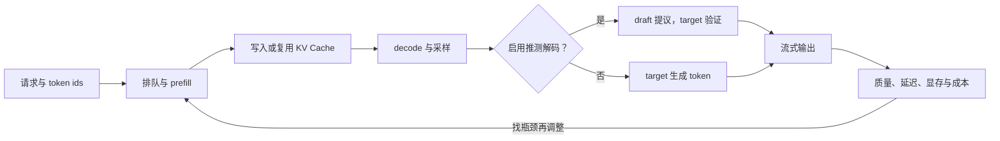

# 第 6 章（上）：KV Cache——生成时保存什么

用户发来的问题和上下文（prompt）先经 tokenizer 变成 token ids，语言模型读取这些输入后，再逐个生成回答 token。每生成一步，模型都会用当前 token 和前文计算注意力。如果每一步都从头重算前文，计算会越来越多；如果把中间结果留下，又要付出显存和管理成本。本篇从这个取舍开始：KV Cache 保存了什么，能省下什么，又有哪些条件不能弄错？

本章的七篇沿一次推理服务实验递进。每一篇都改动或测量服务中的不同部分，不能把它们的收益混成一个“推理更快”：

| 篇 | 要回答的问题 | 改变或测量的对象 | 交接结果 |
| --- | --- | --- | --- |
| [上篇：KV Cache](06-推理优化实战-1-kv-cache.md) | 解码为什么要保留 Key/Value，怎样估算容量？ | 历史状态与位置契约 | 可核对的 cache 账本 |
| [第二篇：Prefill 与 Decode](06-推理优化实战-2-prefill-decode.md) | 用户等待时间由哪些阶段组成？ | 计时边界和负载指标 | 可复算的延迟指标 |
| [第三篇：Serving runtime](06-推理优化实战-3-serving-runtime.md) | 多个请求如何共享 KV 内存和计算资源？ | 内存布局与调度 | 可比较的服务负载 |
| [第四篇：量化](06-推理优化实战-4-量化.md) | 低位宽表示究竟减少哪项资源？ | 权重、计算或 KV 的表示 | 显存与质量对照 |
| [第五篇：推测解码](06-推理优化实战-5-speculative-decoding.md) | draft 模型怎样帮助 target 少做串行步骤？ | 生成算法和候选验证 | 收益与正确性证据 |
| [第六篇：长上下文压测](06-推理优化实战-6-长上下文压测.md) | 能接收长输入，是否等于能用好它？ | 长度、位置、任务与负载 | 分层质量和容量结果 |
| [第七篇：实验报告](06-推理优化实战-7-实验报告.md) | 怎样判断优化是否值得留下？ | 上述方案的联合结果 | 带条件和失败项的报告 |

读到后文时，始终对齐三件事：系统表示和保存了什么状态，优化目标是什么，runtime 或算法怎样实现这个目标。比如量化改变数值表示，PagedAttention 改变缓存的组织与分配方式，推测解码改变生成步骤；它们用的资源账本不同，必须在同一模型、请求分布和质量门槛下比较。

下面的图先把请求的主要阶段连起来。`prefill` 处理输入上下文，`decode` 逐步生成；中途可以复用前缀、采用推测解码，最后用延迟、资源和任务结果判断是否达标。



本章涉及的易变接口固定以 Transformers v5.17.0、PyTorch 2.14.0 和 vLLM v0.32.0 文档作说明；这是核对接口语义的版本，不表示三者组成了已联调环境，更不代替目标硬件上的测量。

## 6.1 KV Cache：把历史注意力状态保存下来

### 6.1.1 每生成一个 token，为什么要保留前面的计算结果

自回归语言模型按 token 一个接一个生成；一个 token 可能是一个字、词的一部分或标点，并不等于一个完整汉字。模型生成第 $t$ 个 token 时，会根据前面的 token 计算注意力。最直接的做法是每次都把完整前缀重新送过所有层。假设已有 4000 个 token，正在生成第 4001 个，那么下一个位置若完全重算，又要处理这 4001 个历史 token。

这些历史 token 在每一层产生的 Key 和 Value 并不会因为新 token 到来而改变。KV Cache 就是把它们保存起来，让下一步只计算新 token 的 Query、Key、Value，并让新 Query 读取旧的 K/V。

可以把它想成查阅一份已经整理好的索引：

```text
第一次处理 prompt：
  计算 q、k、v
  把所有位置的 k、v 保存到 cache

生成下一个 token：
  只为新位置计算 q_new、k_new、v_new
  cache 追加 k_new、v_new
  q_new 读取 cache 中的全部 k、v
```

KV Cache 不保存“模型已经理解的结论”，也不等同于跨请求的记忆。它保存的是某个模型、某个层、某个位置上的中间张量。改变 tokenizer、chat template、模型权重、LoRA adapter、位置编号或注意力 mask，都可能让原来的 cache 不再适用。

### 6.1.2 从注意力公式看 cache 保存了什么

对单层注意力，设隐藏维度为 $d_{\mathrm{model}}$，头数为 $n_h$，每个头的维度为 $d_h$，则：

```math
d_{\mathrm{model}}=n_h d_h
```

给定输入隐藏状态 $X$，线性投影产生：

```math
Q=XW_Q,\qquad K=XW_K,\qquad V=XW_V
```

单个头的因果注意力可以写成：

```math
\mathrm{Attn}(Q,K,V)
=
\mathrm{softmax}
\left(
\frac{QK^\top}{\sqrt{d_h}}+M
\right)V
```

其中 $M$ 是因果 mask。对于已经处理过的前缀，$K$ 和 $V$ 是后续 decode 步骤需要的历史状态；$Q$ 只需要为当前新位置计算。若当前序列已经有 $T$ 个 token，第 $T+1$ 个位置的计算大致变成：

```math
q_{T+1}\in\mathbb{R}^{n_h\times d_h},
\qquad
K_{1:T+1}\in\mathbb{R}^{n_{\mathrm{kv}}\times (T+1)\times d_h},
\qquad
V_{1:T+1}\in\mathbb{R}^{n_{\mathrm{kv}}\times (T+1)\times d_h}
```

这里先使用 $n_{\mathrm{kv}}$ 表示 K/V 头数。Multi-Head Attention 中 $n_{\mathrm{kv}}=n_h$；MQA 中 $n_{\mathrm{kv}}=1$；GQA 中 $1<n_{\mathrm{kv}}<n_h$。不同 query 头可以共享一组 K/V 头。

这些符号有明确的定义域：$B,L,T,n_h,n_{\mathrm{kv}},d_h$ 都是正整数，通常还要求 $n_h$ 能被 $n_{\mathrm{kv}}$ 整除，使每个 K/V 头对应整数个 query heads。具体 runtime 的张量排列可以不同，但不能改变这些数量关系。

### 6.1.3 MHA、GQA 和 MQA 如何改变 cache 形状

在常见的 batch-first 表示中，K/V Cache 可以抽象成：

```math
\mathrm{shape}(K_{\mathrm{cache}})
=
[B,\ L,\ n_{\mathrm{kv}},\ T,\ d_h]
```

有些 runtime 使用 $[B,n_{\mathrm{kv}},T,d_h]$，有些把 layer 放在外层，有些按 page/block 保存。形状排列不同并不改变元素数量，但会改变 kernel 的读取方式、内存连续性和分块策略。

三种注意力的比较如下：

```text
MHA：每个 query head 有一份 K/V
     n_kv = n_h

GQA：一组 K/V 供多个 query head 共享
     1 < n_kv < n_h

MQA：全部 query head 共享一份 K/V
     n_kv = 1
```

在相同层数、序列长度和 head dimension 下，KV Cache 的主要大小正比于 $n_{\mathrm{kv}}$。GQA 不是“免费压缩”：它改变了模型结构和训练/微调分布，减少头数后可能带来质量变化；但它通常能明显减少 serving 时的历史状态带宽和显存。

### 6.1.4 KV Cache 显存公式

每个 token、每层需要保存 K 和 V 两份张量。如果数据类型每个元素占 $s$ 字节，那么 batch 为 $B$、序列长度为 $T$、层数为 $L$ 时，基础 KV Cache 字节数为：

```math
M_{\mathrm{KV}}
=
2\cdot B\cdot L\cdot T\cdot n_{\mathrm{kv}}\cdot d_h\cdot s
```

公式中的 2 来自 K 和 V，不是 query/key/value 三者都缓存。若使用 FP16 或 BF16，通常 $s=2$；FP8 或 INT8 cache 的元素部分可以近似使用 $s=1$，但量化 scale、元数据和 kernel 工作区仍需另外计算。

上式适用于各层都缓存完整历史、且 KV head 数和 head dimension 相同的情况。滑动窗口、分块注意力或混合注意力模型中，各层保存的历史长度可能不同。令第 $l$ 层的 KV 头数、head dimension 和有效历史长度分别为 $n_{\mathrm{kv},l}$、$d_{h,l}$ 和 $T_l$，单条请求可用更一般的账本：

```math
M_{\mathrm{KV}}
\approx
2s\sum_{l=1}^{L}T_l n_{\mathrm{kv},l}d_{h,l}
```

完整注意力层有 $T_l=T$；窗口大小为 $W_l$ 的滑动窗口层可按实现近似取 $T_l=\min(T,W_l)$。若某种 chunked-attention runtime 明确只保留长度为 $C_l$ 的单个 chunk，则用其实际缓存上限近似 $T_l=\min(T,C_l)$；不能从“分块计算”本身推定只保留一个 chunk。若 batch 中各请求长度不同，应再按请求分别求和，而不能把 padding 宽度当作每层都实际保留的 token 数。混合架构中的 recurrent state 或其他状态缓存不在此 KV 元素公式内，须另列。

基础全历史公式要求 $B,L,T,n_{\mathrm{kv}},d_h$ 为正整数且 $s>0$。如果把多条序列合并计算，应使用每条序列的实际有效长度，而不是把 padding token 当作真实历史；如果 runtime 以 page 保存 cache，还要把 block table 和尾部未填满的空间单独计入。

例如，假设：

```math
B=1,\quad L=32,\quad T=8192,\quad n_{\mathrm{kv}}=8,\quad d_h=128,\quad s=2
```

则：

```math
M_{\mathrm{KV}}
=
2\cdot32\cdot8192\cdot8\cdot128\cdot2
=1{,}073{,}741{,}824\ \mathrm{bytes}
\approx 1\ \mathrm{GiB}
```

如果同一个模型使用 MHA 且 $n_h=32$，近似大小会变成 4 GiB。这个数字只描述一个请求、一个 batch、全部层的 K/V 元素；权重、临时激活、CUDA graph、通信缓冲区、allocator 碎片和其他序列都还没有放进来。

对于多条序列，需要把各序列当前长度求和：

```math
M_{\mathrm{KV,total}}
=
2Ls\,
n_{\mathrm{kv}}d_h
\sum_{i=1}^{N_{\mathrm{seq}}}T_i
```

这条简式假设所有层都缓存完整历史且层形状相同。若层类型或窗口不同，应对每条请求、每一层的实际缓存长度分别求和：

```math
M_{\mathrm{KV,total}}
\approx
2s\sum_{i=1}^{N_{\mathrm{seq}}}\sum_{l=1}^{L}
T_{i,l}n_{\mathrm{kv},l}d_{h,l}
```

如果使用 beam search，逻辑上每条 beam 往往拥有自己的后缀状态；如果多个 beam 共享前缀，runtime 可以做 copy-on-write 或引用计数，但不能把会发生不同写入的后缀当成同一块内存。

### 6.1.5 Prefill 和 Decode 阶段的 cache 写入

Prefill 处理一段已有 prompt。对长度 $T$ 的 prompt，模型一次可以并行处理许多位置，并把每层的 K/V 写入 cache：

```math
K_{\mathrm{cache}}^{(0:T-1)}
\leftarrow
K_{\mathrm{prefill}}^{(0:T-1)},
\qquad
V_{\mathrm{cache}}^{(0:T-1)}
\leftarrow
V_{\mathrm{prefill}}^{(0:T-1)}
```

Decode 每次通常只输入一个新 token，新增一行或一个小 block：

```math
K_{\mathrm{cache}}^{(T)}
\leftarrow k_T,
\qquad
V_{\mathrm{cache}}^{(T)}
\leftarrow v_T
```

如果服务把多条序列放在一起，某个 batch step 中每条序列的当前长度可能不同。实现不能简单假设所有序列都写到同一个位置；需要 sequence length、slot mapping、block table 或类似元数据描述每个 token 的物理位置。

一个教学版 cache 容器可以先只管理形状和逻辑位置：

> 代码状态：静态审阅，未运行（2026-10-29）
```python
from dataclasses import dataclass


@dataclass
class ToyKVCache:
    layers: int
    kv_heads: int
    head_dim: int
    capacity: int
    position: int = 0

    def __post_init__(self):
        for name in ("layers", "kv_heads", "head_dim", "capacity"):
            value = getattr(self, name)
            if type(value) is not int or value <= 0:
                raise ValueError(f"{name} must be a positive integer")
        if type(self.position) is not int:
            raise ValueError("position must be an integer")
        if not 0 <= self.position <= self.capacity:
            raise ValueError("position must be within cache capacity")

    def append(self, token_count):
        if type(token_count) is not int or token_count < 0:
            raise ValueError("token_count must be a non-negative integer")
        if self.position + token_count > self.capacity:
            raise ValueError("KV cache capacity exceeded")
        start = self.position
        self.position += token_count
        return start, self.position


cache = ToyKVCache(layers=2, kv_heads=2, head_dim=4, capacity=8)
print("prefill_range=", cache.append(5))
print("decode_range=", cache.append(1))
print("used_tokens=", cache.position)
```
这个 demo 没有存储真实张量，只验证“预填充后从正确的绝对位置继续追加”。真实实现还需要 dtype、device、stride、batch slot、layer index 和物理地址。

### 6.1.6 RoPE offset：cache 正确性中的位置编号

旋转位置编码会按照位置 $p$ 旋转 Query 和 Key。把二维子空间中的一对坐标写成向量 $u$，旋转矩阵为：

```math
R(\theta)=
\begin{bmatrix}
\cos\theta & -\sin\theta\\
\sin\theta & \cos\theta
\end{bmatrix}
```

对第 $j$ 个二维频率，常见角度形式是：

```math
\theta_{p,j}
=
p\cdot \omega_j,
\qquad
\omega_j
=
\theta_{\mathrm{base}}^{-2j/d_h}
```

然后：

```math
\widetilde q_p=R_pq_p,
\qquad
\widetilde k_p=R_pk_p
```

如果 prompt 长度是 $T$，生成的第一个新 token 位置通常是 $p=T$，而不是重新从 0 开始。cache 中的历史 Key 已经用 $0,\ldots,T-1$ 的位置旋转；新 Query 和新 Key 必须继续使用绝对位置 $T$。

这里的 $p$ 是非负整数位置，$d_h$ 通常需要能被二维旋转子空间整齐划分，$\theta_{\mathrm{base}}>1$。如果 runtime 使用滑动窗口、位置插值或其他缩放，位置变换必须和 prefill、decode 两条路径使用同一配置。

下面的无依赖 demo 展示二维旋转的相对位置差异：

> 代码状态：静态审阅，未运行（2026-10-29）
```python
import math


def rotate_pair(vector, position, base=10000.0):
    if len(vector) != 2:
        raise ValueError("vector must contain exactly two values")
    if (not isinstance(position, int) or isinstance(position, bool)
            or position < 0):
        raise ValueError("position must be a non-negative integer")
    if not math.isfinite(base) or base <= 0:
        raise ValueError("base must be finite and positive")
    if not all(math.isfinite(value) for value in vector):
        raise ValueError("vector must contain finite values")
    angle = position / base
    cosine = math.cos(angle)
    sine = math.sin(angle)
    x, y = vector
    return (
        cosine * x - sine * y,
        sine * x + cosine * y,
    )


vector = (1.0, 0.0)
at_zero = rotate_pair(vector, 0)
at_five = rotate_pair(vector, 5)
print("position_0=", tuple(round(x, 6) for x in at_zero))
print("position_5=", tuple(round(x, 6) for x in at_five))
assert at_zero != at_five
```
这是位置编码的局部数学演示，不代表任何特定模型采用的 base、缩放策略或长上下文外推策略。实际模型可能使用不同的 RoPE scaling、YaRN、NTK-aware 变换、分段频率或其他位置方法，配置文件和模型实现才是具体依据。

### 6.1.7 Prefix Cache、会话 cache 和语义记忆不是一回事

服务中至少要区分三类“缓存”：

```text
单次请求 KV Cache：
  服务当前生成过程中复用同一请求的历史 K/V。

Prefix Cache：
  多个请求共享完全相同的前缀对应的 K/V，常见于固定 system prompt、
  长文档前缀或重复模板。

应用层语义记忆：
  把用户事实、历史摘要或检索文档保存成文本/向量/结构化记录，
  下一次请求重新编码或检索。
```

Prefix Cache 的命中条件比“字符串开头一样”更严格。至少需要考虑：

1. tokenizer 和 tokenizer revision 相同；
2. chat template、system 消息和特殊 token 相同；
3. 模型权重、LoRA adapter、量化方式和位置配置相同；
4. prefix 后的注意力 mask 与位置编号解释一致；
5. 租户隔离、权限和数据保留策略允许复用；
6. 缓存条目没有过期，也没有被错误版本继续读取。

如果只比较原始字符串而不比较 token ids，Unicode 归一化、空格、特殊 token 和模板版本都可能导致错误命中。错误命中一般不是显存问题，而是结果悄悄偏离，排查成本更高。

还要把“活跃请求需要多少 KV payload”和“跨请求的 prefix cache 要留多少容量”分开。KVSET 预印本用访问 trace 估计 LRU prefix cache 在不同容量下的命中/覆盖率；其结果来自内部 coding-agent trace，方法范围限于 LRU 与 full-attention KV，不能代替上面的活动请求容量公式。Tessera 则提出从检索到的重复片段复用非前缀 KV 的原型路线，但其论文评估限定在 RoPE、全注意力模型等条件下；它不取消模型、位置、授权范围和租户隔离检查。见 [KVSET v1](https://arxiv.org/abs/2609.27746v1) 与 [Tessera v1](https://arxiv.org/abs/2609.32999v1)。

### 6.1.8 失败模式：从形状到账本逐层定位

KV Cache 相关问题可以按以下顺序定位：

```text
结果错误？
  → 先比较 full recompute 与 cached decode 的 token、logits 和位置编号

显存突然增长？
  → 检查 batch、活动序列数、sum(T_i)、beam 数和 cache dtype

吞吐下降？
  → 检查 cache 是否连续、slot mapping 是否正确、读取是否成为带宽瓶颈

长 prompt 到某个长度才失败？
  → 检查 max_position、RoPE 配置、block 数、workspace 和 allocator 碎片

多租户出现串文？
  → 检查 prefix key、adapter 标识、缓存生命周期和租户隔离
```

一个有用的正确性测试是：固定随机种子、固定采样参数，分别运行“每步完整重算”和“使用 cache 的 decode”，比较每一步 logits 的最大绝对差：

```math
\Delta_{\max}
=
\max_{t,v}
\left|
z^{\mathrm{full}}_{t,v}
-
z^{\mathrm{cache}}_{t,v}
\right|
```

低精度 kernel 允许存在很小的数值差异，但应预先定义容忍度，并同时检查 greedy token 是否一致。不能只看最终文本，因为早期一个微小差异可能被后续采样掩盖，也可能在很晚才放大。

### 6.1.9 资料与证据边界

KV Cache 的注意力公式来自 Transformer 原论文；GQA 的头共享方式可参考 GQA 论文；具体 cache shape、cache class 和 generation 行为应以目标 Transformers/runtime 版本的官方文档与源码为准。

- Transformer：<https://arxiv.org/abs/1706.03762>
- GQA：<https://arxiv.org/abs/2305.13245>
- Hugging Face Cache 文档（Transformers v5.17.0）：<https://huggingface.co/docs/transformers/v5.17.0/en/kv_cache>
- Hugging Face Generation 文档（Transformers v5.17.0）：<https://huggingface.co/docs/transformers/v5.17.0/en/main_classes/text_generation>
- PyTorch scaled dot product attention（2.14.0）：<https://docs.pytorch.org/docs/2.14/generated/torch.nn.functional.scaled_dot_product_attention.html>

论文能支持机制和复杂度推理，官方 API 能支持接口形状和参数语义，教学 demo 只验证局部位置和计数关系。具体模型的 cache dtype、量化格式和 paged layout 需要目标 runtime 的实测与日志确认。

到这里，cache 的两个问题已经分开：公式估算活动请求会占多少状态，缓存 key 与生命周期决定这些状态能否安全复用。下一篇转向时间账本：同一个请求从到达到首 token、再到最后一个 token，分别要等多久？
