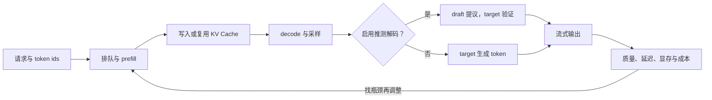

# 第 6 章（第一部分）：缓存、延迟与服务调度

用户发来的问题和上下文（prompt）先经 tokenizer 变成 token ids，语言模型读取这些输入后，再逐个生成回答 token。每生成一步，模型都会用当前 token 和前文计算注意力。如果每一步都从头重算前文，计算会越来越多；如果把中间结果留下，又要付出显存和管理成本。本部分从这个取舍开始：KV Cache 保存了什么，能省下什么，又有哪些条件不能弄错？

本章沿一次推理服务实验分成三个阶段：

| 阶段 | 主要工作 | 留下的结果 |
| --- | --- | --- |
| 缓存、延迟与服务调度 | 追踪 KV 状态，定义用户等待时间，并检查请求调度 | 可比较的服务负载与基线指标 |
| 量化与推测解码 | 分别改变数值表示和生成步骤，核对收益、代价与正确性 | 两类优化的质量和性能对照 |
| 长上下文压测与报告 | 检查容量、有效能力和任务成本，汇总全部实验条件 | 带失败样例和验收门槛的报告 |

读到后文时，始终对齐三件事：系统保存了什么状态，优化目标是什么，runtime 或算法怎样实现这个目标。比如量化改变数值表示，PagedAttention 改变缓存的组织与分配方式，推测解码改变生成步骤；它们占用的资源不同，必须在同一模型、请求分布和质量门槛下比较。

下面的图先把请求的主要阶段连起来。`prefill` 处理输入上下文，`decode` 逐步生成；中途可以复用前缀、采用推测解码，最后用延迟、资源和任务结果判断是否达标。



本章涉及的易变接口固定以 Transformers v5.17.0、PyTorch 2.14.0 和 vLLM v0.32.0 文档作说明；这是核对接口语义的版本，不表示三者组成了已联调环境，更不代替目标硬件上的测量。

## 6.1 KV Cache：把历史注意力状态保存下来

### 6.1.1 每生成一个 token，为什么要保留前面的计算结果

自回归语言模型按 token 一个接一个生成；一个 token 可能是一个字、词的一部分或标点，并不等于一个完整汉字。模型生成第 $t$ 个 token 时，会根据前面的 token 计算注意力。最直接的做法是每次都把完整前缀重新送过所有层。假设已有 4000 个 token，正在生成第 4001 个，那么下一个位置若完全重算，又要处理这 4001 个历史 token。

这些历史 token 在每一层产生的 Key 和 Value 并不会因为新 token 到来而改变。KV Cache 就是把它们保存起来，让下一步只计算新 token 的 Query、Key、Value，并让新 Query 读取旧的 K/V。

可以把它想成查阅一份已经整理好的索引：

```text
第一次处理 prompt：
  计算 q、k、v
  把所有位置的 k、v 保存到 cache

生成下一个 token：
  只为新位置计算 q_new、k_new、v_new
  cache 追加 k_new、v_new
  q_new 读取 cache 中的全部 k、v
```

KV Cache 不保存“模型已经理解的结论”，也不等同于跨请求的记忆。它保存的是某个模型、某个层、某个位置上的中间张量。改变 tokenizer、chat template、模型权重、LoRA adapter、位置编号或注意力 mask，都可能让原来的 cache 不再适用。

### 6.1.2 从注意力公式看 cache 保存了什么

对单层注意力，设隐藏维度为 $d_{\mathrm{model}}$，头数为 $n_{h}$，每个头的维度为 $d_{h}$，则：

```math
d_{\mathrm{model}}=n_{h} d_{h}
```

给定输入隐藏状态 $X$，线性投影产生：

```math
Q=XW_{Q},\qquad K=XW_{K},\qquad V=XW_{V}
```

单个头的因果注意力可以写成：

```math
\mathrm{Attn}(Q,K,V)
=
\mathrm{softmax}
\left(
\frac{QK^\top}{\sqrt{d_{h}}}+M
\right)V
```

其中 $M$ 是因果 mask。对于已经处理过的前缀， $K$ 和 $V$ 是后续 decode 步骤需要的历史状态； $Q$ 只需要为当前新位置计算。若当前序列已经有 $T$ 个 token，第 $T+1$ 个位置的计算大致变成：

```math
q_{T+1}\in\mathbb{R}^{n_{h}\times d_{h}},
\qquad
K_{1:T+1}\in\mathbb{R}^{n_{\mathrm{kv}}\times (T+1)\times d_{h}},
\qquad
V_{1:T+1}\in\mathbb{R}^{n_{\mathrm{kv}}\times (T+1)\times d_{h}}
```

这里先使用 $n_{\mathrm{kv}}$ 表示 K/V 头数。Multi-Head Attention 中 $n_{\mathrm{kv}}=n_{h}$；MQA 中 $n_{\mathrm{kv}}=1$；GQA 中 $1\lt n_{\mathrm{kv}}\lt n_{h}$。不同 query 头可以共享一组 K/V 头。

这些符号有明确的定义域： $B,L,T,n_{h},n_{\mathrm{kv}},d_{h}$ 都是正整数，通常还要求 $n_{h}$ 能被 $n_{\mathrm{kv}}$ 整除，使每个 K/V 头对应整数个 query heads。具体 runtime 的张量排列可以不同，但不能改变这些数量关系。

### 6.1.3 MHA、GQA 和 MQA 如何改变 cache 形状

在常见的 batch-first 表示中，K/V Cache 可以抽象成：

```math
\mathrm{shape}(K_{\mathrm{cache}})
=
[B,\ L,\ n_{\mathrm{kv}},\ T,\ d_{h}]
```

有些 runtime 使用 $[B,n_{\mathrm{kv}},T,d_{h}]$，有些把 layer 放在外层，有些按 page/block 保存。形状排列不同并不改变元素数量，但会改变 kernel 的读取方式、内存连续性和分块策略。

三种注意力的比较如下：

```text
MHA：每个 query head 有一份 K/V
     n_kv = n_h

GQA：一组 K/V 供多个 query head 共享
     1 < n_kv < n_h

MQA：全部 query head 共享一份 K/V
     n_kv = 1
```

在相同层数、序列长度和 head dimension 下，KV Cache 的主要大小正比于 $n_{\mathrm{kv}}$。GQA 不是“免费压缩”：它改变了模型结构和训练/微调分布，减少头数后可能带来质量变化；但它通常能明显减少 serving 时的历史状态带宽和显存。

### 6.1.4 KV Cache 显存公式

每个 token、每层需要保存 K 和 V 两份张量。如果数据类型每个元素占 $s$ 字节，那么 batch 为 $B$、序列长度为 $T$、层数为 $L$ 时，基础 KV Cache 字节数为：

```math
M_{\mathrm{KV}}
=
2\cdot B\cdot L\cdot T\cdot n_{\mathrm{kv}}\cdot d_{h}\cdot s
```

公式中的 2 来自 K 和 V，不是 query/key/value 三者都缓存。若使用 FP16 或 BF16，通常 $s=2$；FP8 或 INT8 cache 的元素部分可以近似使用 $s=1$，但量化 scale、元数据和 kernel 工作区仍需另外计算。

上式适用于各层都缓存完整历史、且 KV head 数和 head dimension 相同的情况。滑动窗口、分块注意力或混合注意力模型中，各层保存的历史长度可能不同。令第 $l$ 层的 KV 头数、head dimension 和有效历史长度分别为 $n_{\mathrm{kv},l}$、 $d_{h,l}$ 和 $T_{l}$，单条请求可用下面这个更一般的估算式：

```math
M_{\mathrm{KV}}
\approx
2s\sum_{l=1}^{L}T_{l} n_{\mathrm{kv},l}d_{h,l}
```

完整注意力层有 $T_{l}=T$；窗口大小为 $W_{l}$ 的滑动窗口层可按实现近似取 $T_{l}=\min(T,W_{l})$。若某种 chunked-attention runtime 明确只保留长度为 $C_{l}$ 的单个 chunk，则用其实际缓存上限近似 $T_{l}=\min(T,C_{l})$；不能从“分块计算”本身推定只保留一个 chunk。若 batch 中各请求长度不同，应再按请求分别求和，而不能把 padding 宽度当作每层都实际保留的 token 数。混合架构中的 recurrent state 或其他状态缓存不在此 KV 元素公式内，须另列。

基础全历史公式要求 $B,L,T,n_{\mathrm{kv}},d_{h}$ 为正整数且 $s>0$。如果把多条序列合并计算，应使用每条序列的实际有效长度，而不是把 padding token 当作真实历史；如果 runtime 以 page 保存 cache，还要把 block table 和尾部未填满的空间单独计入。

例如，假设：

```math
B=1,\quad L=32,\quad T=8192,\quad n_{\mathrm{kv}}=8,\quad d_{h}=128,\quad s=2
```

则：

```math
M_{\mathrm{KV}}
=
2\cdot32\cdot8192\cdot8\cdot128\cdot2
=1{,}073{,}741{,}824\ \mathrm{bytes}
\approx 1\ \mathrm{GiB}
```

如果同一个模型使用 MHA 且 $n_{h}=32$，近似大小会变成 4 GiB。这个数字只描述一个请求、一个 batch、全部层的 K/V 元素；权重、临时激活、CUDA graph、通信缓冲区、allocator 碎片和其他序列都还没有放进来。

对于多条序列，需要把各序列当前长度求和：

```math
M_{\mathrm{KV,total}}
=
2Ls\,
n_{\mathrm{kv}}d_{h}
\sum_{i=1}^{N_{\mathrm{seq}}}T_{i}
```

这条简式假设所有层都缓存完整历史且层形状相同。若层类型或窗口不同，应对每条请求、每一层的实际缓存长度分别求和：

```math
M_{\mathrm{KV,total}}
\approx
2s\sum_{i=1}^{N_{\mathrm{seq}}}\sum_{l=1}^{L}
T_{i,l}n_{\mathrm{kv},l}d_{h,l}
```

如果使用 beam search，逻辑上每条 beam 往往拥有自己的后缀状态；如果多个 beam 共享前缀，runtime 可以做 copy-on-write 或引用计数，但不能把会发生不同写入的后缀当成同一块内存。

### 6.1.5 Prefill 和 Decode 阶段的 cache 写入

Prefill 处理一段已有 prompt。对长度 $T$ 的 prompt，模型一次可以并行处理许多位置，并把每层的 K/V 写入 cache：

```math
K_{\mathrm{cache}}^{(0:T-1)}
\leftarrow
K_{\mathrm{prefill}}^{(0:T-1)},
\qquad
V_{\mathrm{cache}}^{(0:T-1)}
\leftarrow
V_{\mathrm{prefill}}^{(0:T-1)}
```

Decode 每次通常只输入一个新 token，新增一行或一个小 block：

```math
K_{\mathrm{cache}}^{(T)}
\leftarrow k_{T},
\qquad
V_{\mathrm{cache}}^{(T)}
\leftarrow v_{T}
```

如果服务把多条序列放在一起，某个 batch step 中每条序列的当前长度可能不同。实现不能简单假设所有序列都写到同一个位置；需要 sequence length、slot mapping、block table 或类似元数据描述每个 token 的物理位置。

一个教学版 cache 容器可以先只管理形状和逻辑位置：

> 代码状态：静态审阅，未运行（2026-10-29）
```python
from dataclasses import dataclass


@dataclass
class ToyKVCache:
    layers: int
    kv_heads: int
    head_dim: int
    capacity: int
    position: int = 0

    def __post_init__(self):
        for name in ("layers", "kv_heads", "head_dim", "capacity"):
            value = getattr(self, name)
            if type(value) is not int or value <= 0:
                raise ValueError(f"{name} must be a positive integer")
        if type(self.position) is not int:
            raise ValueError("position must be an integer")
        if not 0 <= self.position <= self.capacity:
            raise ValueError("position must be within cache capacity")

    def append(self, token_count):
        if type(token_count) is not int or token_count < 0:
            raise ValueError("token_count must be a non-negative integer")
        if self.position + token_count > self.capacity:
            raise ValueError("KV cache capacity exceeded")
        start = self.position
        self.position += token_count
        return start, self.position


cache = ToyKVCache(layers=2, kv_heads=2, head_dim=4, capacity=8)
print("prefill_range=", cache.append(5))
print("decode_range=", cache.append(1))
print("used_tokens=", cache.position)
```
这个 demo 没有存储真实张量，只验证“预填充后从正确的绝对位置继续追加”。真实实现还需要 dtype、device、stride、batch slot、layer index 和物理地址。

### 6.1.6 RoPE offset：cache 正确性中的位置编号

旋转位置编码会按照位置 $p$ 旋转 Query 和 Key。把二维子空间中的一对坐标写成向量 $u$，旋转矩阵为：

```math
R(\theta)=
\begin{bmatrix}
\cos\theta & -\sin\theta\\
\sin\theta & \cos\theta
\end{bmatrix}
```

对第 $j$ 个二维频率，常见角度形式是：

```math
\theta_{p,j}
=
p\cdot \omega_{j},
\qquad
\omega_{j}
=
\theta_{\mathrm{base}}^{-2j/d_{h}}
```

然后：

```math
\widetilde q_{p}=R_{p}q_{p},
\qquad
\widetilde k_{p}=R_{p}k_{p}
```

如果 prompt 长度是 $T$，生成的第一个新 token 位置通常是 $p=T$，而不是重新从 0 开始。cache 中的历史 Key 已经用 $0,\ldots,T-1$ 的位置旋转；新 Query 和新 Key 必须继续使用绝对位置 $T$。

这里的 $p$ 是非负整数位置， $d_{h}$ 通常需要能被二维旋转子空间整齐划分， $\theta_{\mathrm{base}}>1$。如果 runtime 使用滑动窗口、位置插值或其他缩放，位置变换必须和 prefill、decode 两条路径使用同一配置。

下面的无依赖 demo 展示二维旋转的相对位置差异：

> 代码状态：静态审阅，未运行（2026-10-29）
```python
import math


def rotate_pair(vector, position, base=10000.0):
    if len(vector) != 2:
        raise ValueError("vector must contain exactly two values")
    if (not isinstance(position, int) or isinstance(position, bool)
            or position < 0):
        raise ValueError("position must be a non-negative integer")
    if not math.isfinite(base) or base <= 0:
        raise ValueError("base must be finite and positive")
    if not all(math.isfinite(value) for value in vector):
        raise ValueError("vector must contain finite values")
    angle = position / base
    cosine = math.cos(angle)
    sine = math.sin(angle)
    x, y = vector
    return (
        cosine * x - sine * y,
        sine * x + cosine * y,
    )


vector = (1.0, 0.0)
at_zero = rotate_pair(vector, 0)
at_five = rotate_pair(vector, 5)
print("position_0=", tuple(round(x, 6) for x in at_zero))
print("position_5=", tuple(round(x, 6) for x in at_five))
assert at_zero != at_five
```
这是位置编码的局部数学演示，不代表任何特定模型采用的 base、缩放策略或长上下文外推策略。实际模型可能使用不同的 RoPE scaling、YaRN、NTK-aware 变换、分段频率或其他位置方法，配置文件和模型实现才是具体依据。

### 6.1.7 Prefix Cache、会话 cache 和语义记忆不是一回事

服务中至少要区分三类“缓存”：

```text
单次请求 KV Cache：
  服务当前生成过程中复用同一请求的历史 K/V。

Prefix Cache：
  多个请求共享完全相同的前缀对应的 K/V，常见于固定 system prompt、
  长文档前缀或重复模板。

应用层语义记忆：
  把用户事实、历史摘要或检索文档保存成文本/向量/结构化记录，
  下一次请求重新编码或检索。
```

Prefix Cache 的命中条件比“字符串开头一样”更严格。至少需要考虑：

1. tokenizer 和 tokenizer revision 相同；
2. chat template、system 消息和特殊 token 相同；
3. 模型权重、LoRA adapter、量化方式和位置配置相同；
4. prefix 后的注意力 mask 与位置编号解释一致；
5. 租户隔离、权限和数据保留策略允许复用；
6. 缓存条目没有过期，也没有被错误版本继续读取。

如果只比较原始字符串而不比较 token ids，Unicode 归一化、空格、特殊 token 和模板版本都可能导致错误命中。错误命中一般不是显存问题，而是结果悄悄偏离，排查成本更高。

还要把“活跃请求需要多少 KV payload”和“跨请求的 prefix cache 要留多少容量”分开。KVSET 预印本用访问 trace 估计 LRU prefix cache 在不同容量下的命中/覆盖率；其结果来自内部 coding-agent trace，方法范围限于 LRU 与 full-attention KV，不能代替上面的活动请求容量公式。Tessera 则提出从检索到的重复片段复用非前缀 KV 的原型路线，但其论文评估限定在 RoPE、全注意力模型等条件下；它不取消模型、位置、授权范围和租户隔离检查。见 [KVSET v1](https://arxiv.org/abs/2609.27746v1) 与 [Tessera v1](https://arxiv.org/abs/2609.32999v1)。

### 6.1.8 失败模式：从形状和长度逐步定位

KV Cache 相关问题可以按以下顺序定位：

```text
结果错误？
  → 先比较 full recompute 与 cached decode 的 token、logits 和位置编号

显存突然增长？
  → 检查 batch、活动序列数、sum(T_i)、beam 数和 cache dtype

吞吐下降？
  → 检查 cache 是否连续、slot mapping 是否正确、读取是否成为带宽瓶颈

长 prompt 到某个长度才失败？
  → 检查 max_position、RoPE 配置、block 数、workspace 和 allocator 碎片

多租户出现串文？
  → 检查 prefix key、adapter 标识、缓存生命周期和租户隔离
```

一个有用的正确性测试是：固定随机种子、固定采样参数，分别运行“每步完整重算”和“使用 cache 的 decode”，比较每一步 logits 的最大绝对差：

```math
\Delta_{\max}
=
\max_{t,v}
\left|
z^{\mathrm{full}}_{t,v}
-
z^{\mathrm{cache}}_{t,v}
\right|
```

低精度 kernel 允许存在很小的数值差异，但应预先定义容忍度，并同时检查 greedy token 是否一致。不能只看最终文本，因为早期一个微小差异可能被后续采样掩盖，也可能在很晚才放大。

### 6.1.9 资料与证据边界

KV Cache 的注意力公式来自 Transformer 原论文；GQA 的头共享方式可参考 GQA 论文；具体 cache shape、cache class 和 generation 行为应以目标 Transformers/runtime 版本的官方文档与源码为准。

- Transformer：<https://arxiv.org/abs/1706.03762>
- GQA：<https://arxiv.org/abs/2305.13245>
- Hugging Face Cache 文档（Transformers v5.17.0）：<https://huggingface.co/docs/transformers/v5.17.0/en/kv_cache>
- Hugging Face Generation 文档（Transformers v5.17.0）：<https://huggingface.co/docs/transformers/v5.17.0/en/main_classes/text_generation>
- PyTorch scaled dot product attention（2.14.0）：<https://docs.pytorch.org/docs/2.14/generated/torch.nn.functional.scaled_dot_product_attention.html>

论文能支持机制和复杂度推理，官方 API 能支持接口形状和参数语义，教学 demo 只验证局部位置和计数关系。具体模型的 cache dtype、量化格式和 paged layout 需要目标 runtime 的实测与日志确认。

到这里，cache 的两个问题已经分开：公式估算活动请求会占用多少内存，缓存 key 与生命周期决定这些状态能否安全复用。下一节转向请求的时间构成：从请求到达到首 token、再到最后一个 token，分别要等多久？

上一段说明了模型为什么保存 KV Cache。现在换成用户视角：一次回答为什么首 token 要等一会儿，后面的 token 又按另一种节奏到达？服务把 prompt 分成 prefill 和逐步 decode 两段处理，但用户实际等待还可能包含排队、分词、网络和客户端缓冲。

本节先定义 TTFT、TPOT、ITL 和吞吐，再把一次请求的时间拆开计算。重点是确认计时起止点、分母和失败请求的处理方式；如果这些没对齐，性能比较没有意义。测出的瓶颈会交给后面的分页缓存和调度部分。

## 6.2 Prefill/Decode：把延迟和吞吐拆成可测量的部分

### 6.2.1 从一次请求的时间线开始

用户发送 prompt 后，服务先要把已有文本整体处理一遍，这一步叫 prefill。prefill 可以在序列维度上并行计算，主要压力来自长 prompt 的矩阵乘法、注意力和 KV 写入。

第一个输出 token 生成前，服务还需要完成排队、tokenize、prefill、调度和采样，所以用户感受到的首 token 时间通常明显高于后续 token 之间的间隔。后续 decode 每轮只生成少量新 token，却要读取越来越长的 KV Cache，常常更受显存带宽、kernel launch 和调度开销影响。

```text
请求到达 ── 排队 ── tokenize ── prefill ── 首 token ── decode ── 结束
             │                         │          │
             │                         │          └─ 每 token 间隔
             └─ 用户可见 TTFT 包含哪些部分取决于计时点
```

所以“平均每秒生成多少 token”无法单独描述体验。短回答可能首 token 很快但总吞吐低，长 prompt 可能首 token 较慢但之后每 token 稳定；两种请求不能只用一个平均数比较。

### 6.2.2 四个基本指标

设请求进入服务的时间为 $t_{\mathrm{req}}$，首个可交付输出 token 的时间为 $t_{1}$，第 $n$ 个输出 token 到达时间为 $t_{n}$。

用户可见的首 token 延迟可以写成：

```math
\mathrm{TTFT}_{\mathrm{user}}
=
t_{1}-t_{\mathrm{req}}
```

如果只想测模型计算，不应把排队和网络混进来，可以另记：

```math
\mathrm{TTFT}_{\mathrm{model}}
=
t_{\mathrm{prefill,end}}-t_{\mathrm{prefill,start}}
```

两者都合理，但名字和采样点必须明确。逐 token 延迟可以定义为：

```math
\mathrm{TPOT}
=
\frac{t_{n}-t_{1}}{n-1},
\qquad n>1
```

相邻 token 的延迟序列更能发现抖动：

```math
\mathrm{ITL}_{i}=t_{i}-t_{i-1},
\qquad i=2,\ldots,n
```

服务端指标还会把这两个量具体化。vLLM v0.32.0 文档区分 `vllm:inter_token_latency_seconds`（流式输出事件之间的间隔）与 `vllm:request_time_per_output_token_seconds`（按请求计算的 TPOT，近似为 `(end-to-end latency - TTFT) / (output_tokens - 1)`）。当一次流式事件打包多个 token、或汇总时采用不同权重，两者会不同；该版本还说明，输出不超过一个 token 的请求在 Prometheus TPOT 指标中记为 0，而 `vllm bench serve` 的 TPOT 统计会排除这类请求。指标名称、分母和特殊值会随版本变化，部署报告应绑定 vLLM 版本并核对[v0.32.0 生产指标说明](https://docs.vllm.ai/en/v0.32.0/usage/metrics/)及[延迟指标定义](https://docs.vllm.ai/en/v0.32.0/design/metrics/)。

输出吞吐通常记为：

```math
\mathrm{throughput}
=
\frac{\sum_{i} \mathrm{output\_tokens}_{i}}
{\mathrm{wall\_clock\_seconds}}
```

这里的 $\mathrm{wall\_clock\_seconds}$ 必须是同一次负载实验中的正数经过时间；输出 token 数为非负整数。如果没有完成的请求或计时区间为零，应报告为无效样本，不应用一个默认值把分母藏起来。

把几个指标放在同一条请求上看：从请求到首 token 用时 0.30 秒，端到端用时 2.00 秒，共生成 40 个 token。TPOT 用首 token 之后的 39 个间隔作分母，约为 $(2.00-0.30)/39=0.0436$ 秒，即 43.6 ms/token；端到端输出速率则是 $40/2.00=20$ token/s。它们回答不同问题，所以不能互相替代。

如果服务有排队时间、输入 token 和输出 token，报告至少应分别给出：

```text
request rate：每秒进入多少请求
input tokens/s：每秒处理多少输入 token
output tokens/s：每秒产生多少输出 token
TTFT 的 p50/p95/p99
TPOT 或 ITL 的 p50/p95/p99
完成率、超时率、取消率和错误率
```

### 6.2.3 一个简单的时间拆分

对单个请求，可以把端到端时间近似拆成：

```math
T_{\mathrm{e2e}}
=
T_{\mathrm{queue}}
+T_{\mathrm{tokenize}}
+T_{\mathrm{prefill}}
+T_{\mathrm{decode}}
+T_{\mathrm{network}}
```

如果输出 $N_{\mathrm{out}}$ 个 token，decode 阶段还可以近似写成：

```math
T_{\mathrm{decode}}
\approx
N_{\mathrm{out}}\cdot T_{\mathrm{step}}
```

这里 $T_{\mathrm{step}}$ 并不是常数。随着 batch 中序列长度变化，调度、KV 读取和 kernel 形状都会变化；如果使用 speculative decoding，单位“输出 token”还不再对应一次 target 单 token forward。

并发提高时，单请求 latency 和系统总 throughput 可能朝相反方向变化。一个请求独占 GPU 时，batch 太小导致硬件利用率不足；并发很多时，continuous batching 能提高吞吐，但排队和共享 batch 也会增加 p95。

### 6.2.4 为什么 CUDA 异步会让计时失真

GPU kernel 发射通常是异步的。CPU 记录了结束时间，并不表示 GPU 已经完成最后一个 kernel。如果直接使用 Python 的 time.perf_counter 包住模型调用，测到的可能只是 kernel launch 时间。

PyTorch 官方提供了同步和 CUDA Event 等方式。一个依赖 PyTorch 的最小计时片段如下：

> 代码状态：静态审阅，未运行（2026-10-29）
```python
import torch


def timed_model_call(model, input_ids, stream=None):
    if not torch.cuda.is_available():
        raise RuntimeError("CUDA is required for this timing example")
    if not isinstance(input_ids, torch.Tensor) or not input_ids.is_cuda:
        raise ValueError("input_ids must be a CUDA tensor")
    if stream is None:
        stream = torch.cuda.current_stream(device=input_ids.device)

    stream.synchronize()
    start_event = torch.cuda.Event(enable_timing=True)
    end_event = torch.cuda.Event(enable_timing=True)
    with torch.cuda.stream(stream):
        start_event.record()
        result = model(input_ids)
        end_event.record()
    end_event.synchronize()
    milliseconds = start_event.elapsed_time(end_event)
    return result, milliseconds / 1000.0


# model and input_ids must be created on the same CUDA device. If the
# model launches work on another stream, that stream must be synchronized too.
result, elapsed_seconds = timed_model_call(model, input_ids)
```
这里的 model 和 input_ids 是上下文变量，函数使用同一条 CUDA stream 记录模型调用的起止。它不能在没有模型和 CUDA 设备的环境直接运行；如果 model 内部还使用了其他 stream，就要把那些 stream 也纳入同步边界。

基准测试至少要包含 warmup。第一次执行可能触发 CUDA context 初始化、权重加载、kernel 选择、内存分配、编译或 graph capture；如果把它和稳态请求混在一起，p50 和 p95 都会失真。

### 6.2.5 Prefill 和 Decode 各自消耗哪些资源

Prefill 通常有较大的输入矩阵，比较容易利用矩阵乘法单元；Decode 的 token 数少，batch 形状碎片化，常常需要频繁读取权重和 KV Cache。不能简单把“prefill 快”或“decode 快”当成绝对结论，因为硬件、量化 kernel、序列长度和 batch 都会改变结果。

注意力的理论 score cell 数量可以写成：

```math
C_{\mathrm{attn}}
=
B\cdot n_{h}\cdot T_{q}\cdot T_{k}
```

在 prefill 中， $T_{q}$ 和 $T_{k}$ 都可能接近 prompt 长度；在单 token decode 中， $T_{q}\approx1$， $T_{k}$ 是当前历史长度。即使 FlashAttention 不把完整 $T_{q}\times T_{k}$ 矩阵落到显存，依赖关系的规模仍然随这些维度增长。

KV 读取的元素量还可以粗略写成：

```math
E_{\mathrm{KV,read}}
\propto
B\cdot L\cdot T_{k}\cdot n_{\mathrm{kv}}\cdot d_{h}
```

这解释了为什么 GQA、KV Cache 量化、paged layout、prefix sharing 和 batch 调度会直接影响 decode 性能。它们减少的是历史状态的存储或读取压力，但不会自动解决所有矩阵乘法和采样开销。

### 6.2.6 无依赖的延迟计算示例

下面的 demo 用确定性数字模拟不同请求的时间组成。它不调用模型，只帮助检查指标计算和 p95 的定义。

> 代码状态：静态审阅，未运行（2026-10-29）
```python
import math


REQUESTS = [
    {"queue": 2.0, "tokenize": 1.0, "prefill": 18.0, "decode": 40.0, "network": 2.0},
    {"queue": 8.0, "tokenize": 1.0, "prefill": 36.0, "decode": 54.0, "network": 3.0},
    {"queue": 1.0, "tokenize": 1.0, "prefill": 12.0, "decode": 24.0, "network": 2.0},
    {"queue": 12.0, "tokenize": 2.0, "prefill": 48.0, "decode": 72.0, "network": 4.0},
]


COMPONENTS = ("queue", "tokenize", "prefill", "decode", "network")


def checked_total(item):
    values = [item[name] for name in COMPONENTS]
    if any(
        not isinstance(value, (int, float))
        or not math.isfinite(value)
        or value < 0
        for value in values
    ):
        raise ValueError("every duration must be finite and non-negative")
    return sum(values)


def percentile(values, quantile):
    if not values:
        raise ValueError("percentile requires at least one sample")
    if not 0 <= quantile <= 1:
        raise ValueError("quantile must be between 0 and 1")
    ordered = sorted(values)
    position = (len(ordered) - 1) * quantile
    lower = math.floor(position)
    upper = math.ceil(position)
    if lower == upper:
        return ordered[lower]
    weight = position - lower
    return ordered[lower] * (1 - weight) + ordered[upper] * weight


if not REQUESTS:
    raise ValueError("at least one completed request is required")
e2e = [checked_total(item) for item in REQUESTS]
ttft = [
    item["queue"] + item["tokenize"] + item["prefill"] + item["network"]
    for item in REQUESTS
]
p95_ttft = percentile(ttft, 0.95)

print("ttft_ms=", [round(value, 2) for value in ttft])
print("e2e_ms=", [round(value, 2) for value in e2e])
print("ttft_p95_ms=", round(p95_ttft, 2))
assert all(total >= first for total, first in zip(e2e, ttft))
```
真实压测通常需要更多样本，p95 应使用事先约定的分位数算法，不能用“取最大值”或隐式的索引规则替代。样本数、失败请求是否排除、分位数算法和负载生成器的时间戳来源都应记录。

### 6.2.7 Chunked Prefill 与调度取舍

长 prompt 的 prefill 如果一次占满 GPU，正在 decode 的短请求可能长时间得不到调度，表现为 TPOT 抖动。Chunked prefill 把长 prompt 切成多个片段，与 decode token 交替安排：

```text
没有 chunked prefill：
  长 prompt prefill ────────────────
  短请求 decode                    等待

有 chunked prefill：
  prompt chunk 1 → decode → prompt chunk 2 → decode → ...
```

chunk 大小过大，仍然会阻塞 decode；过小，则 kernel launch 和调度开销增加，prefill 的矩阵效率下降。应在固定请求分布下扫描 chunk size，观察 TTFT、TPOT、吞吐和 p99，而不是凭单个请求的结果选择。

再进一步，可以把 Prefill 与 Decode 放到不同 worker：前者偏好大批量并行计算，后者需要持续读取 KV 并逐步产出 token。解耦后能分别配置资源，但每次交接都要传递 KV 状态，网络和拓扑可能抵消调度收益。vLLM 2026 年工程说明强调，这类架构的目标通常是在 TTFT/ITL 约束下提高 goodput，不保证固定 GPU 数下的原始 token 吞吐更高；其 L40S/Qwen2.5-7B 单机数据绑定约 8K 输入、256 输出、Poisson 到达、prefix cache 关闭与指定传输代理。若目标机器缺少高效 GPU peer-to-peer，KV 传输还可能推高 TTFT。见 [vLLM Prefill/Decode 解耦工程说明](https://vllm-project.github.io/2026/09/29/disaggregated-serving-guide.html)。

### 6.2.8 失败模式：指标好看但体验变差

测量出问题时，先按现象查计时边界，不要马上把原因算在模型头上：

| 观察到的现象 | 先核对什么 |
| --- | --- |
| TTFT 高 | 队列、tokenize、prompt 长度、prefill 和客户端到达时间；确认报告的是用户 TTFT 还是模型阶段时间 |
| TPOT 抖动 | 活跃序列、KV 读取、chunked prefill、调度、流式事件粒度和网络缓冲 |
| GPU 调用时间异常短 | CUDA 是否异步返回；起止 event 是否记录在实际执行工作的 stream 上 |
| 输出吞吐高但用户体验差 | TTFT/尾延迟、超时与取消、错误重试、输出长度和完成率是否被省略 |
| 两个方案无法公平比较 | 模型/tokenizer、prompt 分布、并行拓扑、量化 kernel、缓存命中、warmup 和停止条件是否一致 |

分位数也要连着样本数与算法读。假设 10 个请求中 9 个 TTFT 为 0.3 秒、1 个为 3.0 秒，均值是 0.57 秒；若采用 nearest-rank，P95 是 3.0 秒。换成插值算法，P95 会得到另一个数。因此报告应固定算法并保留请求级样本，不能把不同工具给出的 P95 当成同一口径。

诊断时先沿请求时间线查看队列、GPU、CPU、显存和网络 trace，再判断模型或 runtime 是否是瓶颈。p95 变差可能来自长 prompt、排队、锁竞争或网络，不只来自 kernel。

### 6.2.9 资料与证据边界

- PyTorch CUDA 同步（2.14.0）：<https://docs.pytorch.org/docs/2.14/generated/torch.cuda.synchronize.html>
- PyTorch CUDA Event（2.14.0）：<https://docs.pytorch.org/docs/2.14/generated/torch.cuda.Event.html>
- PyTorch Profiler（2.14.0）：<https://docs.pytorch.org/docs/2.14/profiler.html>
- vLLM metrics（v0.32.0）：<https://docs.vllm.ai/en/v0.32.0/usage/metrics/>
- NVIDIA CUDA C Best Practices Guide（13.0）：<https://docs.nvidia.com/cuda/archive/13.0.0/cuda-c-best-practices-guide/index.html>

延迟公式是测量定义，不是某个框架的专属接口。官方文档可以支持同步、event 和 metrics 的使用方式；具体 p95、吞吐和显存数字必须来自目标硬件、目标版本和代表性负载。

前面的部分已经把“等了多久”拆成可比较的量。接下来从多个请求同时运行的角度，解释 KV block、continuous batching 和服务协议怎样改变这条时间线。

测量若显示排队、KV 容量或请求长度差异正在限制服务，就要看 runtime 如何安排内存和计算。静态 batching 等整批请求一起完成，长短请求混在一起时容易互相拖慢；按需分页可以减少预留浪费，却会引入 block table、引用计数和调度决策。本节用 vLLM 的术语解释这些机制，同时把公开 API 兼容与真实语义兼容分开。

我们会从一个序列的逻辑 token 位置追到物理 KV block，再看请求怎样进入和离开活动 batch。读完后，读者应能根据负载选择要记录的吞吐、尾延迟、显存和协议结果，而不是把“开启 PagedAttention”当作优化结论。

## 6.3 vLLM：PagedAttention、连续批处理和协议边界

### 6.3.1 KV Cache 为什么可以分块存放

最早的推理服务可以为每条请求预留一块连续 KV Cache。问题是，服务不知道请求最终会生成多少 token。若按最大长度预留，短请求浪费大量空间；若按当前长度不断搬家，扩容和复制成本又很高。多个请求交错结束时，还会产生空洞和碎片。

PagedAttention 的核心思路是把逻辑上的连续序列切成固定大小的 block，再把这些 block 映射到不必连续的物理内存。它和操作系统的分页有相似之处，但具体 kernel、block table 和调度实现属于 serving runtime 的设计。

```text
逻辑序列：token 0 1 2 3 | 4 5 6 7 | 8 9 ...
                 block 0 |  block 1 | block 2

物理显存：      page 12 | page  3 | page 27

block table：
逻辑 block 0 → 物理 page 12
逻辑 block 1 → 物理 page  3
逻辑 block 2 → 物理 page 27
```

这样可以按需分配，序列结束时释放自己的 block；共享相同前缀的请求还可以通过引用计数复用前缀 block。

### 6.3.2 KV block 容量估算

设 token block 大小为 $b$，每个物理 block 对一层的 K/V 元素数为：

```math
E_{\mathrm{block,layer}}
=
2\cdot b\cdot n_{\mathrm{kv}}\cdot d_{h}
```

所有 $L$ 层、每元素 $s$ 字节时：

```math
B_{\mathrm{block}}
=
2\cdot L\cdot b\cdot n_{\mathrm{kv}}\cdot d_{h}\cdot s
```

如果为 KV Cache 预留的显存池大小为 $M_{\mathrm{pool}}$，忽略元数据和碎片时，物理 block 数近似为：

```math
N_{\mathrm{blocks}}
=
\left\lfloor
\frac{M_{\mathrm{pool}}}{B_{\mathrm{block}}}
\right\rfloor
```

这些容量式默认 $L,b,n_{\mathrm{kv}},d_{h}$ 是正整数， $s$ 是正的数据类型字节数， $M_{\mathrm{pool}}>0$ 且与上述单位一致。否则 $B_{\mathrm{block}}$ 可能为零或单位错位，分块数也就没有可解释的物理意义。

可容纳的逻辑 token 总量则近似为：

```math
T_{\mathrm{capacity}}
\approx
b\cdot N_{\mathrm{blocks}}
```

举例，取 $L=32$、 $b=16$、 $n_{\mathrm{kv}}=8$、 $d_{h}=128$、 $s=2$：

```math
B_{\mathrm{block}}
=
2\cdot32\cdot16\cdot8\cdot128\cdot2
=2{,}097{,}152\ \mathrm{bytes}
\approx2\ \mathrm{MiB}
```

若 KV 池恰好有 1 GiB，粗略可放约 512 个 block，也就是约 8192 个 token。真实服务还要扣除权重、CUDA workspace、activation、通信缓冲区、block table、量化 scale 和 allocator 预留，因此这只是容量估算，不是启动参数的保证值。

### 6.3.3 分页为什么能减少浪费，但不能消灭开销

最后一个 block 通常没有填满。若一条序列长度为 $T$，block size 为 $b$，内部碎片上界小于 $b$ 个 token：

```math
N_{\mathrm{logical}}
=
\left\lceil\frac{T}{b}\right\rceil,
\qquad
0\leq
bN_{\mathrm{logical}}-T
\lt b
```

block 越小，尾部浪费越少，但 block table 更大、地址计算更频繁、kernel 访问粒度更碎；block 越大，元数据和寻址更简单，却可能浪费更多最后一页，还可能降低共享前缀的精细程度。

前缀共享也有代价：

1. 需要为每个物理 block 维护引用计数或等价生命周期信息；
2. 不同请求只能共享完全一致且只读的前缀；
3. 一旦某个序列要修改共享 block，必须 copy-on-write；
4. cache key 必须包括 token ids、模型 revision、adapter 和相关配置；
5. 共享内容的隐私和租户隔离需要由上层策略保证。

例如 block size 取 16、序列已有 1000 个 token，需要 $\lceil1000/16\rceil=63$ 个 block，分配容量为 1008 个位置，最后一块空 8 个位置。这个 8/1008 是单条序列尾块的内部浪费，不是整张 GPU 的碎片率。按最大上下文 4096 预留连续区域会留出更多空位；分页按需分配则用 block table 和调度管理换取更细的分配粒度。

### 6.3.4 Continuous Batching：按 token 调度，而不是等整批结束

静态 batching 需要等一批请求都准备好，再一起运行；其中一个长请求可能拖住短请求。Continuous batching 把调度单位变成正在运行的序列和下一 token step，完成的序列可以退出，新序列可以补入。

```text
时间 t0：A、B 运行
时间 t1：A 完成，B 继续，C 加入
时间 t2：B、C 继续，D 加入
时间 t3：C 完成，D、E 继续
```

调度器需要同时回答：

1. 哪些序列处于 waiting、running、finished、cancelled；
2. 本轮给每条序列分配多少 decode token；
3. 长 prompt 是否切成 chunk；
4. 新请求是否会挤压已经运行的请求；
5. 显存 block 是否足够；
6. 达到 max batch tokens、max sequences 或超时后如何选择；
7. 取消请求时如何释放 block 和回收流式连接。

因此 continuous batching 不是一个只改启动参数的优化。它把运行时变成了一个资源调度器；调度策略会影响平均吞吐、短请求公平性、长请求等待和 p99。

### 6.3.5 一个无依赖的 block allocator demo

下面的代码模拟物理 block 分配、释放和前缀共享引用计数。它没有实现 attention kernel，但可以帮助检查生命周期。

> 代码状态：静态审阅，未运行（2026-10-29）
```python
class BlockPool:
    def __init__(self, size):
        if type(size) is not int or size <= 0:
            raise ValueError("size must be a positive integer")
        self.all_blocks = set(range(size))
        self.free = list(range(size))
        self.refs = {}

    def _validate(self, blocks, require_allocated):
        blocks = list(blocks)
        if not blocks:
            raise ValueError("blocks must not be empty")
        if len(set(blocks)) != len(blocks):
            raise ValueError("a block may appear only once per operation")
        for block in blocks:
            if type(block) is not int or block not in self.all_blocks:
                raise ValueError("unknown physical block")
            if require_allocated and block not in self.refs:
                raise ValueError("block is not currently allocated")
        return blocks

    def allocate(self, count):
        if type(count) is not int or count <= 0:
            raise ValueError("count must be a positive integer")
        if count > len(self.free):
            raise RuntimeError("not enough physical blocks")
        blocks = [self.free.pop() for _ in range(count)]
        for block in blocks:
            self.refs[block] = 1
        return blocks

    def share(self, blocks):
        blocks = self._validate(blocks, require_allocated=True)
        for block in blocks:
            self.refs[block] += 1

    def release(self, blocks):
        blocks = self._validate(blocks, require_allocated=True)
        for block in blocks:
            self.refs[block] -= 1
            if self.refs[block] == 0:
                del self.refs[block]
                self.free.append(block)


pool = BlockPool(size=4)
prefix = pool.allocate(2)
pool.share(prefix)
suffix = pool.allocate(1)
pool.release(suffix)
pool.release(prefix)
assert len(pool.free) == 2
pool.release(prefix)
assert len(pool.free) == 4
print("free_blocks=", len(pool.free))
```
这里最后两次 release 代表两个引用分别结束。真实实现必须处理异常、取消、重复释放、跨请求隔离和并发原子性，不能把这个列表实现直接用于多线程服务。

### 6.3.6 vLLM 参数如何映射到资源问题

不同版本的 vLLM 参数会变化，常见配置意图可以按资源问题理解：

```text
model：
  权重和 tokenizer 的来源；revision、trust_remote_code 等会影响可复现性。

dtype：
  权重/计算的默认数据类型；不等于 KV Cache 一定使用同一种 dtype。

max-model-len：
  允许的最大序列长度；过大可能提高预留和调度压力。

gpu-memory-utilization：
  runtime 用于估计可用显存池的比例；不是把所有显存安全地变成 KV。

tensor-parallel-size：
  把模型计算与状态分布到多张 GPU；通信和拓扑会改变收益。

enable-prefix-caching：
  尝试复用相同 token 前缀；必须验证 key、租户和版本边界。

kv-cache-dtype：
  指定 KV Cache 的表示；要确认硬件 kernel、scale 和质量影响。
```

一个典型的启动命令可以写成：

```text
vllm serve MODEL_ID
  --dtype auto
  --max-model-len 8192
  --gpu-memory-utilization 0.90
  --enable-prefix-caching
```

这里的命令只是配置形状示例，`MODEL_ID` 是要替换为实际模型仓库名的占位符。某个版本是否支持某个参数、参数名称是否变化、模型是否需要 custom code，都应在目标环境执行 help、查看版本文档并记录 revision。不能根据另一台机器的启动命令推断本地 kernel、显存和模型格式一定兼容。

### 6.3.7 OpenAI 兼容服务的边界

OpenAI 兼容通常表示 HTTP 路径、请求字段和响应外形接近某种 API。客户端能发出请求，不代表所有语义完全一致。至少要核对：

1. chat template 如何把 messages 转成 token；
2. system、tool、developer、assistant 等角色是否被保留；
3. stop、max_tokens、max_completion_tokens、temperature、top_p 的处理；
4. stream chunk 的 data 格式、结束标志和 usage 字段；
5. tool calling 的 JSON schema、并行调用和错误返回；
6. logprobs、seed、reasoning 字段是否真的支持；
7. prompt token、completion token 和缓存 token 的统计口径；
8. 客户端取消后 GPU 计算和 KV block 是否及时释放。

服务可以用一个简单的 HTTP 请求做协议冒烟：

```text
POST /v1/chat/completions
Content-Type: application/json

{
  "model": "MODEL_ID",
  "messages": [
    {"role": "user", "content": "用一句话解释 KV Cache。"}
  ],
  "max_tokens": 32,
  "temperature": 0
}
```

请求里的 `MODEL_ID` 要替换为服务端公开的模型名。冒烟测试只证明路径能够返回某种响应。生产验证还要覆盖流式断开、超时、空 messages、超长输入、工具 schema 错误、并发取消、错误码和 token usage。

### 6.3.8 vLLM 与其他 runtime 的比较方法

PagedAttention、continuous batching、prefix cache 和 OpenAI adapter 并不是 vLLM 独占的抽象。SGLang、TensorRT-LLM、TGI、llama.cpp 等 runtime 可能采用不同的 cache layout、调度器、编译路径和量化 kernel。

比较 runtime 时，应该固定：

```text
同一模型 revision 和 tokenizer
同一 prompt/输出分布
同一硬件、驱动和并行拓扑
同一 dtype、量化格式和最大长度
同一请求到达率与并发模型
同一停止条件、采样参数和流式统计
同一正确性回归集
```

如果只比较一个“最高 tokens/s”，可能测到的是不同 batch、不同输出长度或不同的 warmup 状态，而不是 runtime 的普遍优势。

### 6.3.9 资料与证据边界

- vLLM 官方文档：<https://docs.vllm.ai/>
- vLLM PagedAttention 论文：<https://arxiv.org/abs/2309.06180>
- vLLM EngineArgs（v0.32.0）：<https://docs.vllm.ai/en/v0.32.0/configuration/engine_args/>
- vLLM OpenAI 兼容服务（v0.32.0）：<https://docs.vllm.ai/en/v0.32.0/serving/online_serving/>
- vLLM Paged Attention 设计页（v0.32.0 历史说明，不代表当前实现）：<https://docs.vllm.ai/en/v0.32.0/design/paged_attention/>
- SGLang 官方文档：<https://docs.sglang.ai/>
- TensorRT-LLM 官方文档：<https://nvidia.github.io/TensorRT-LLM/>
- Hugging Face Text Generation Inference：<https://huggingface.co/docs/text-generation-inference/index>

PagedAttention 论文支持分页 KV 的机制动机和实验背景；官方 runtime 文档支持参数和服务接口；具体吞吐、并发和显存容量属于目标版本与目标硬件上的实测结果。

需要区分论文给出的分页机制与当前 runtime 实现：vLLM v0.32.0 的 Paged Attention 设计页已说明它是基于论文的历史文档，不再描述当前代码。分页能减少按最大长度预留造成的浪费，但活跃请求、权重、workspace 和运行时仍受总显存限制；continuous batching 能补入已完成请求留下的计算空隙，却需要同时观察短请求尾延迟与长请求饥饿。下一部分转向另一类显存优化：改变权重或 KV 数值的表示。
