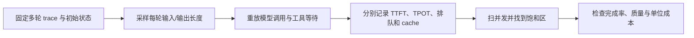

# 第 6 章（第三部分）：长上下文压测与实验报告

接口接受 64K 或 1M token，只能说明某种请求在某些配置下没有被入口拒绝。它不能说明证据放在中间时仍会被用到，也不能说明并发、延迟、显存和成本过关。本节把长上下文拆成容量、性能、答案质量和成功任务成本，带读者设计能发现“截断、位置退化、检索失败、推理失败”差异的压测矩阵。

前面各部分给出的 cache、延迟、量化和调度指标会在这里一起出现。我们先固定长度和证据位置，再按任务和并发重复；测试结论随后汇总成可复查的推理报告。

## 6.6 长上下文压测：从“能接收”到“能完成任务”

### 6.6.1 最大上下文长度能证明什么

一个接口宣称支持很长的上下文，首先说明 tokenizer、请求协议、模型配置和 runtime 在某种条件下允许较长输入。它没有自动说明模型能在最远位置找到证据、正确合并多个片段、保持指令优先级、输出正确格式，也没有说明这次请求的显存和延迟是否可接受。

长上下文至少包含四个问题：

```text
容量：输入真的能放进去吗？
性能：TTFT、TPOT、吞吐和显存如何随长度变化？
质量：证据在不同位置时，答案是否仍然正确？
成本：一次成功任务需要多少 GPU 时间、token 和重试？
```

如果只把最大 token 数写进配置，实际上只回答了第一个问题的一部分。

### 6.6.2 长度如何影响注意力和 KV

全注意力的 score cell 数量近似为：

```math
C_{\mathrm{score}}
=
B\cdot n_h\cdot T_q\cdot T_k
```

对于完整 prefill，$T_q\approx T_k\approx T$，所以理论依赖规模接近：

```math
C_{\mathrm{prefill}}
\propto
B\cdot n_h\cdot T^2
```

对于单 token decode，$T_q=1$、$T_k\approx T$，于是每步注意力读取随历史长度近似线性：

```math
C_{\mathrm{decode,step}}
\propto
B\cdot n_h\cdot T
```

KV Cache 也随总历史 token 线性增长：

```math
M_{\mathrm{KV}}(T)
=
2BLTn_{\mathrm{kv}}d_hs
```

FlashAttention 等 kernel 可以避免显式保存完整 score 矩阵，降低中间显存峰值并改善 IO，但不会让所有长上下文计算都变成常数时间。实际 wall-clock 还取决于 kernel、分块、并行度、带宽、缓存复用和调度。

### 6.6.3 估算推理需要的总显存

服务显存可以先按项目拆开：

```math
M_{\mathrm{total}}
\approx
M_{\mathrm{weights}}
+M_{\mathrm{KV}}
+M_{\mathrm{activation}}
+M_{\mathrm{workspace}}
+M_{\mathrm{communication}}
+M_{\mathrm{fragmentation}}
```

如果固定模型和硬件，把输入长度从 $T_1$ 增加到 $T_2$，KV 增量近似为：

```math
\Delta M_{\mathrm{KV}}
=
2BL(T_2-T_1)n_{\mathrm{kv}}d_hs
```

这个增量可以用于解释 OOM 是怎么出现的：如果权重已经接近显存上限，即使只增加一小段长 prompt，也可能没有空间放新增 cache 或 workspace。

长上下文容量实验不能只记录“最大成功长度”。还要记录：

```text
输入 token 数与实际 token ids；
模型 revision、RoPE/位置配置和 max length；
batch、并发序列数和输出上限；
权重 dtype、KV dtype、量化和 runtime；
峰值 allocated/reserved 显存；
OOM 发生阶段：加载、prefill、decode 或扩容；
是否有 prefix cache 命中；
成功请求的 TTFT、TPOT 和错误率。
```

### 6.6.4 Needle-in-a-Haystack 只是起点

最小的检索测试可以在大量干扰文本中放入一个唯一事实，要求模型返回它。若 needle 放在位置 $p$，上下文长度为 $T$，相对位置为：

```math
r=\frac{p}{T}
```

上式把位置编号 $p$ 取为 $0$ 到 $T-1$ 的整数，且要求 $T>0$。若要让末尾位置也恰好对应相对位置 $1$，可在 $T>1$ 时改用 $r=p/(T-1)$；长度为 $1$ 时只有位置 $0$，应单独约定 $r=0$。

在多个长度和多个相对位置上测得准确率：

```math
A(T,r)
=
\frac{\text{正确找回 needle 的样本数}}
{\text{该长度与位置的样本总数}}
```

分母必须是正数；没有完成样本时应标记为缺失，而不是把准确率写成 $0$ 或 $1$。

可以绘制 $T$ 与 $r$ 的二维结果，而不是只报一个最高长度。测试位置应覆盖开头、前 25%、中间、后 75% 和结尾；还要使用多个 needle 表述、多个干扰主题和多个随机种子，避免模型只记住某种句式。

但 needle 测试很窄。它通常只检查“找到一个局部事实”，不能充分检查：

1. 多处证据合并；
2. 证据之间冲突时的版本判断；
3. 长文档结构理解；
4. 数字计算和单位换算；
5. 引用是否支持具体 claim；
6. 恶意指令和无关文本对任务的干扰；
7. 多轮工具调用或结构化输出。

因此应把它和多跳检索、长文档问答、位置打乱、冲突证据和引用核验组合起来。

2026 年的 LongHarness Bench 预印本把“模型加长上下文处理器”作为评估对象，任务覆盖多条件检索、跨文档记忆、程序执行轨迹和等价程序搜索；作者报告同一模型在不同 harness/任务组合上的质量与成本会变化。这提示实验报告还要固定上下文切分、检索或执行工具、harness 和费用口径。论文结果只适用于其自建任务与模型配置，不是生产 Agent 排名。见 [LongHarness Bench v1](https://arxiv.org/abs/2609.38137v1)。

### 6.6.5 Lost-in-the-middle 与位置曲线

有些任务中，模型对开头和结尾的信息使用较好，对中间信息使用较差。可以把同一个事实放在不同位置，保持 token 数、干扰文本和问题不变，得到位置准确率曲线：

```math
A_{\mathrm{pos}}(r)
=
\Pr(\text{answer correct}\mid \text{needle relative position}=r)
```

如果只在开头放 needle，无法发现中间位置退化。还要区分：

```text
retrieval failure：
  输出完全没有找到证据。

reasoning failure：
  找到了相关片段，但没有完成合并或计算。

attribution failure：
  答案碰巧正确，但引用不支持答案。

protocol failure：
  内容基本正确，却没有满足 JSON、字段或停止协议。
```

这种分解比单一 accuracy 更有诊断价值。

### 6.6.6 无依赖的位置检索 demo

下面构造一个简单的长文本位置实验。它只模拟一个检索器按距离衰减的 toy 行为，用来说明如何按位置统计，不代表任何模型的真实曲线。

> 代码状态：静态审阅，未运行（2026-10-29）
```python
def toy_retrieve(context_length, needle_position):
    if type(context_length) is not int or context_length <= 0:
        raise ValueError("context_length must be a positive integer")
    if type(needle_position) is not int:
        raise ValueError("needle_position must be an integer")
    if not 0 <= needle_position < context_length:
        raise ValueError("needle_position must be within the context")
    center = (context_length - 1) / 2
    distance = abs(needle_position - center) / max(center, 1)
    score = 1.0 - 0.35 * (1.0 - distance)
    return score >= 0.72


lengths = [100, 200, 400]
fractions = [0.0, 0.25, 0.5, 0.75, 1.0]
for length in lengths:
    row = []
    for fraction in fractions:
        position = round(fraction * (length - 1))
        row.append(int(toy_retrieve(length, position)))
    print("length=", length, "positions=", row)
```
真实实验应让模型生成答案，再由规则、人工或独立评审器判断；不能把一个内部 toy 函数的输出当成被测模型性能。

### 6.6.7 一个可复现的长上下文压测矩阵

测试矩阵至少要有以下轴：

```text
长度轴：
  4K、8K、16K、32K……直到目标上限附近，具体数值按模型和硬件调整。

位置轴：
  开头、四分之一、中间、四分之三、结尾，以及随机位置。

任务轴：
  单事实、多事实、多跳、冲突证据、表格/代码、结构化输出。

负载轴：
  单请求、固定并发、开放负载、不同输入/输出比例。

系统轴：
  FP16/BF16、不同量化、不同 KV dtype、不同 block/chunk 配置。

协议轴：
  普通回答、streaming、tool call、JSON schema、取消和超时。
```

每个格子最好有多个样本和固定随机种子。比如先做一个小规模试验：3 种长度 × 3 个证据位置 × 每格 20 个样本，共 180 次请求；每个长度/位置格子的准确率分母是 20，不能把 180 个样本只汇总成一个总分。报告结果时同时给质量与系统指标：

```text
context_tokens
needle_position
task_category
answer_correct
evidence_supported
format_valid
ttft_ms
tpot_ms
peak_memory_mb
error_type
model_revision
runtime_version
```

可以把“单位成功任务成本”定义为：

```math
C_{\mathrm{success}}
=
\frac{
C_{\mathrm{gpu}}+C_{\mathrm{cpu}}+C_{\mathrm{network}}+C_{\mathrm{retry}}
}{
N_{\mathrm{successful\ tasks}}
}
```

这里要求各项成本是同一计价周期内的非负值，且 $N_{\mathrm{successful\ tasks}}>0$。如果一次实验没有成功任务，结果应报告为“无成功样本”，不能用零或任务总数替代分母。

若只把失败请求排除在分母外，质量下降可能被隐藏；若把重试算在成功请求之外，成本又会被低估。成功的定义需要提前写清楚：答案正确、证据支持、格式可解析、延迟未超时，通常都应同时满足。

### 6.6.8 定位显存溢出、超时和质量下降的原因

长上下文失败不只有一种原因：

```text
加载阶段 OOM：
  权重、量化、tensor parallel 或加载临时副本问题。

Prefill 阶段 OOM：
  输入太长、activation/workspace 峰值、attention 实现或 batch 问题。

Decode 阶段 OOM：
  KV Cache 随输出增长、并发序列增加或 block 池耗尽。

TTFT 超时：
  长 prefill、排队、网络、CPU tokenize 或 kernel 选择问题。

TPOT 抖动：
  continuous batching、chunked prefill、cache 读取、抢占或 host 调度问题。

答案错误：
  检索不到、位置退化、推理失败、证据冲突或协议解析错误。
```

诊断时不要把所有问题都说成“模型上下文能力不足”。先保存 request trace、token ids、位置编号、KV 分配、GPU memory snapshot 和原始输出，再逐项比较，找出问题最早出现在哪个环节。

### 6.6.9 长上下文压测伪代码

一个真实压测器通常需要分别负责生成负载、调用服务和保存结果的组件。下面约定 `client.stream()` 每次只返回新生成的文本；如果具体 SDK 每次都返回从开头累计的文本，应先转换成增量再传入：

> 代码状态：静态审阅，未运行（2026-10-29）
```python
import time


def run_case(client, prompt, expected, metadata):
    if not isinstance(prompt, str) or not isinstance(expected, str):
        raise TypeError("prompt and expected must be strings")
    started = time.perf_counter()
    events = []
    first_token_received_at = None
    for event in client.stream(prompt):
        received_at = time.perf_counter()
        event_text = getattr(event, "text", None)
        if not isinstance(event_text, str):
            raise TypeError("each stream event must expose string text")
        events.append((event_text, received_at))
        if event_text and first_token_received_at is None:
            first_token_received_at = received_at
    finished = time.perf_counter()
    text = "".join(event_text for event_text, _ in events)
    return {
        "metadata": metadata,
        "output": text,
        "correct": expected in text,
        "ttft_ms": (
            (first_token_received_at - started) * 1000
            if first_token_received_at is not None else None
        ),
        "e2e_ms": (finished - started) * 1000,
        "event_count": len(events),
    }
```
client 和 event 是外部依赖。示例在客户端收到每个事件时用同一个本地 monotonic clock 记录时间，因此没有把服务端 timestamp 与本地 perf_counter 直接相减；空 keep-alive 事件也不会被误认为首 token。真实压测还应把每个 case 的上下文长度、needle 位置、模型 revision、runtime 版本和错误信息一起写入结果，而不是最后只打印一个平均数。

### 6.6.10 “支持 1M”应如何写成有边界的结论

面对很大的 context claim，可以按证据层级记录：

```text
接口层：
  请求字段和 tokenizer 允许多少 token，超出时如何报错。

运行层：
  在指定硬件、dtype、并发和输出上限下，是否能稳定完成 prefill/decode。

检索层：
  在不同长度、位置和干扰下能否找到目标证据。

推理层：
  能否合并多段证据、计算、处理冲突并给出可核验结论。

协议层：
  长上下文下是否仍保持 JSON、tool call、引用和停止条件正确。

成本层：
  成功任务的 TTFT、TPOT、显存、吞吐、失败率和单位成本是否可接受。
```

因此更准确的结论类似于：

```text
在模型 revision X、tokenizer Y、runtime Z、单请求、BF16、
输入长度 T 和输出上限 O 的条件下，请求可以完成；在位置分层的
检索任务上，长度增加后中间位置准确率下降，TTFT 与 KV 显存近似增长。
该实验支持“接口和该负载下的运行能力”，不支持“所有长文档任务都能可靠理解”。
```

这类表述把实测条件、可观察结果和没有被证明的泛化能力分开。

### 6.6.11 资料与证据边界

- Transformers Cache (v5.17.0)：<https://huggingface.co/docs/transformers/v5.17.0/en/kv_cache>
- PyTorch CUDA memory (2.14.0)：<https://docs.pytorch.org/docs/2.14/torch_cuda_memory.html>
- PyTorch memory snapshot (2.14.0)：<https://docs.pytorch.org/docs/2.14/torch_cuda_memory.html#snapshot>
- vLLM EngineArgs (v0.32.0)：<https://docs.vllm.ai/en/v0.32.0/configuration/engine_args/>
- RULER 长上下文评测：<https://arxiv.org/abs/2404.06654>
- Lost in the Middle：<https://arxiv.org/abs/2307.03172>
- Needle-in-a-Haystack 项目：<https://github.com/gkamradt/LLMTest_NeedleInAHaystack>
- LongBench：<https://arxiv.org/abs/2308.14508>

官方文档可支持 cache、memory 和 runtime 参数的接口事实；论文和公开 benchmark 可支持评测设计与已报告现象；某个模型在某个长度上的准确率、延迟和成本必须来自相同条件下的复现实验。

判断答案前先确认目标证据真的进入了模型。比如 tokenizer 后得到 70K token、服务上限是 64K，若尾部被截断且 needle 正好在那里，答错说明输入协议丢了证据，不能据此判断模型的远距离注意力能力。记录原文长度、tokenized 长度、截断位置以及服务端最终长度，才能把截断、位置退化和推理失败区分开。

单请求结果可以定位模型对位置的使用；并发结果还要纳入 KV 分配、超时和拒绝。完整输入的质量、服务未完成的比例和单位成功成本将一起进入后面的报告。

前面几部分分别说明了缓存、计时、调度、量化、推测解码和长上下文。现在要回答实际决策问题：某个方案更快或更省显存，质量有没有下降？测试是否使用了同一模型、同一请求分布和同一验收门槛？本节把这些证据收进一份报告，并用一组小数据演示分母、失败请求和单位成功成本怎样影响结论。

报告的中心不是展示最好看的峰值，而是让别人能从摘要追到模型与运行条件、原始请求、失败样例和判定规则。完成后，这份推理负载清单可以继续交给 RAG、Agent 和线上评估项目复用。

## 6.7 把前述优化放进一份推理实验报告

### 6.7.1 先写清楚实验对象

一份可以复查的报告应先固定：

```text
model_id 与 revision
tokenizer_id 与 chat template
runtime、依赖版本、驱动和 CUDA 版本
GPU 型号、数量、显存和并行拓扑
权重 dtype、计算 dtype、KV dtype 和量化配置
max input tokens、max output tokens、batch/并发上限
采样参数、stop 条件和是否使用 speculative decoding
```

缺少这些字段时，两个“同样的模型、同样的 4 bit、同样的 32K”实验可能根本不是同一个系统。

### 6.7.2 结果表应同时包含质量和系统指标

每条请求至少保留一行原始结果，汇总时再按任务类型、输入长度和并发情况分组：

```text
case_id | input_tokens | output_tokens | concurrency | cache_hit
ttft_ms | tpot_ms | output_tokens_per_s | peak_memory_mb
accepted_draft_tokens | answer_correct | evidence_supported
format_valid | error_type | model_revision | runtime_version
```

汇总行应同时显示质量护栏与系统代价。例如：

| 方案 | P95 TTFT | TPOT | 任务成功 | 峰值显存 |
| --- | ---: | ---: | ---: | ---: |
| 基线 A | 0.8 s | 35 ms | 88/100 | 38 GiB |
| 候选 B | 0.6 s | 32 ms | 82/100 | 30 GiB |

B 更快也更省显存，但少完成 6 个任务。如果事先规定质量至少 85/100、P95 TTFT 不超过 0.7 秒，那么 A 和 B 都不满足全部门槛：A 超过延迟线，B 没通过质量线。这个小样本只演示决策方法，不表示 100 个样本足以证明两方案有统计差异。

比较量化、分页 cache、chunked prefill 或 speculative decoding 时，每轮只改变一个主要变量；先确认输出协议和功能正确，再测代表性负载，最后按长上下文等任务类别检查结果。否则同时出现质量下降和速度变化时，很难判断是哪项变化造成的。

### 6.7.3 最小的决策顺序

先定验收线，再看候选结果。实际操作可以按这个顺序推进：

1. 先建立未优化基线，并保存原始输出和逐步指标；
2. 确认 cache 版本与 full recompute 的正确性；
3. 用同步计时区分 prefill、decode、排队和网络；
4. 按权重、KV、workspace 和显存碎片分别估算，判断主要瓶颈在哪里；
5. 再选择 GQA、paged cache、batch、量化或 speculative 路线；
6. 每项优化都重新跑格式、任务、长上下文和故障回归；
7. 用单位成功任务成本而不是单一峰值吞吐决定是否保留；
8. 记录回退条件，让质量或协议回归时可以切回基线。

决定对象是目标请求分布下的完整服务。局部 kernel 更快、单请求更短或显存更低，都要放回任务成功率、错误和成本的约束中判断。

### 6.7.4 多轮 Agent 负载：把真实会话形状放进压测

单轮请求的长度分布不能代表 Agent 会话。Agent 会把前几轮对话和工具回执带进后续调用，输入长度、工具等待和轮数会一起变化；固定 2K 输入、256 输出的负载可能适合普通问答，却没有覆盖浏览器或多工具任务的上下文增长。

重放时为每次调用保留脱敏后的 session id、turn index、输入/输出 token、工具类型与等待时间、到达时间、prefix cache 状态、并发度和最终任务结果。另固定任务来源及版本、轮数/长度分布、到达率、输出上限、超时定义、模型与引擎版本。合成负载可以复现长度和调度压力，但随机 token 不能测真实语义质量或工具运行。

AgentPerfBench（2026 年 9 月预印本）用 SWE-Bench、TerminalBench 等来源的多轮 trace 描述每轮输入/输出长度和 turn count，并讨论上下文累积与饱和测量。论文中的模型、GPU 和延迟数字只适用于其设置；这里借用 workload manifest 的思路，不将结果当作通用预测。见 [AgentPerfBench v1](https://arxiv.org/abs/2609.34683v1)。

看一个四轮请求：未命中 prefix cache 时，四轮分别输入 512、1,800、4,200 和 9,000 token，总 prefill 输入为：

~~~math
512+1{,}800+4{,}200+9{,}000=15{,}512
~~~

如果只把首轮的 512 token 当作整个任务输入，就会把累计输入工作量低估约 $15{,}512/512=30.3$ 倍。实际重算量受请求拼接与 cache 命中影响，报告要同时记录逻辑上下文长度和复用状态；会话耗时还包括生成、排队、工具等待和网络。



单次模型调用和完整会话要分开统计。调用级记录 TTFT、TPOT、prefill/decode 吞吐；会话级还要记录轮数、端到端耗时、工具等待、最大上下文、超限、任务成功和单位成功成本。工具等待 8 秒时，模型 TPOT 仍可能是 20 ms/token，但用户并没有在 20 ms/token 的时间里完成任务。

每个比率都要保留分母和失败样本。假设 200 秒压测收到 100 个请求，80 个完成并输出 16,000 token，20 个超时：完成输出吞吐为 $16{,}000/200=80$ token/s，完成率是 80%。若只有 72 个请求通过任务验收，任务成功率应按原始 100 个请求计算，为 72%；只在完成的 80 个请求里算 90%，会隐藏超时用户。整段实验耗费 0.40 美元，则单位成功任务成本为 $0.40/72\approx0.0056$ 美元；失败重试也要计入成本。若成功任务数为零，这个单位成本没有定义，应报告消耗和失败率。

交付时保留模型/引擎 revision、输入 token、时间戳、错误码、生成结果和判定依据；敏感 trace 应脱敏并限制访问。面向公开作品集时使用合成或风险审查后的材料。性能数字只描述已测的模型、硬件、运行时和负载。

### 6.7.5 把结果整理成可交付报告

报告中的主张要和证据类型对应：

```text
原始论文：
  支持注意力、GQA、PagedAttention、量化、推测解码和长上下文评测的机制与实验背景。

官方文档：
  支持 PyTorch 同步/显存接口、Transformers cache/generation、
  vLLM/SGLang/TensorRT-LLM 等 runtime 的当前参数和服务行为。

教学 demo：
  只验证形状、计数、公式、分位数、分组量化和 toy 接受率。

目标系统实测：
  才能回答具体模型在具体硬件、版本、负载和协议下的延迟、
  显存、质量、错误率和单位成本。
```

实验结论应写成“在这些条件下观察到这些结果”，并列出没有验证的范围。这样，下一位读者可以判断该结论是否适用于自己的模型、设备和请求分布。
