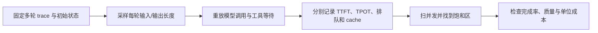

# 第 6 章（第七篇）：推理实验报告——让优化结论经得起复查

前六篇分别说明了缓存、计时、调度、量化、推测解码和长上下文。现在要回答实际决策问题：某个方案更快或更省显存，质量有没有下降？测试是否使用了同一模型、同一请求分布和同一验收门槛？本篇把这些证据收进一份报告，并用一组小数据演示分母、失败请求和单位成功成本怎样影响结论。

报告的中心不是展示最好看的峰值，而是让别人能从摘要追到模型与运行条件、原始请求、失败样例和判定规则。完成后，这份推理负载清单可以继续交给 RAG、Agent 和线上评估项目复用。

## 6.7 把前述优化放进一份推理实验报告

### 6.7.1 先写清楚实验对象

一份可以复查的报告应先固定：

```text
model_id 与 revision
tokenizer_id 与 chat template
runtime、依赖版本、驱动和 CUDA 版本
GPU 型号、数量、显存和并行拓扑
权重 dtype、计算 dtype、KV dtype 和量化配置
max input tokens、max output tokens、batch/并发上限
采样参数、stop 条件和是否使用 speculative decoding
```

缺少这些字段时，两个“同样的模型、同样的 4 bit、同样的 32K”实验可能根本不是同一个系统。

### 6.7.2 结果表应同时包含质量和系统指标

每条请求至少保留一行原始结果，汇总时再按任务类型、输入长度和并发情况分组：

```text
case_id | input_tokens | output_tokens | concurrency | cache_hit
ttft_ms | tpot_ms | output_tokens_per_s | peak_memory_mb
accepted_draft_tokens | answer_correct | evidence_supported
format_valid | error_type | model_revision | runtime_version
```

汇总行应同时显示质量护栏与系统代价。例如：

| 方案 | P95 TTFT | TPOT | 任务成功 | 峰值显存 |
| --- | ---: | ---: | ---: | ---: |
| 基线 A | 0.8 s | 35 ms | 88/100 | 38 GiB |
| 候选 B | 0.6 s | 32 ms | 82/100 | 30 GiB |

B 更快也更省显存，但少完成 6 个任务。如果事先规定质量至少 85/100、P95 TTFT 不超过 0.7 秒，那么 A 和 B 都不满足全部门槛：A 超过延迟线，B 没通过质量线。这个小样本只演示决策方法，不表示 100 个样本足以证明两方案有统计差异。

比较量化、分页 cache、chunked prefill 或 speculative decoding 时，每轮只改变一个主要变量；先确认输出协议和功能正确，再测代表性负载，最后按长上下文等任务类别检查结果。否则同时出现质量下降和速度变化时，很难判断是哪项变化造成的。

### 6.7.3 最小的决策顺序

先定验收线，再看候选结果。实际操作可以按这个顺序推进：

1. 先建立未优化基线，并保存原始输出和逐步指标；
2. 确认 cache 版本与 full recompute 的正确性；
3. 用同步计时区分 prefill、decode、排队和网络；
4. 按权重、KV、workspace 和显存碎片分别估算，判断主要瓶颈在哪里；
5. 再选择 GQA、paged cache、batch、量化或 speculative 路线；
6. 每项优化都重新跑格式、任务、长上下文和故障回归；
7. 用单位成功任务成本而不是单一峰值吞吐决定是否保留；
8. 记录回退条件，让质量或协议回归时可以切回基线。

决定对象是目标请求分布下的完整服务。局部 kernel 更快、单请求更短或显存更低，都要放回任务成功率、错误和成本的约束中判断。

### 6.7.4 多轮 Agent 负载：把真实会话形状放进压测

单轮请求的长度分布不能代表 Agent 会话。Agent 会把前几轮对话和工具回执带进后续调用，输入长度、工具等待和轮数会一起变化；固定 2K 输入、256 输出的负载可能适合普通问答，却没有覆盖浏览器或多工具任务的上下文增长。

重放时为每次调用保留脱敏后的 session id、turn index、输入/输出 token、工具类型与等待时间、到达时间、prefix cache 状态、并发度和最终任务结果。另固定任务来源及版本、轮数/长度分布、到达率、输出上限、超时定义、模型与引擎版本。合成负载可以复现长度和调度压力，但随机 token 不能测真实语义质量或工具运行。

AgentPerfBench（2026 年 9 月预印本）用 SWE-Bench、TerminalBench 等来源的多轮 trace 描述每轮输入/输出长度和 turn count，并讨论上下文累积与饱和测量。论文中的模型、GPU 和延迟数字只适用于其设置；这里借用 workload manifest 的思路，不将结果当作通用预测。见 [AgentPerfBench v1](https://arxiv.org/abs/2609.34683v1)。

看一个四轮请求：未命中 prefix cache 时，四轮分别输入 512、1,800、4,200 和 9,000 token，总 prefill 输入为：

~~~math
512+1{,}800+4{,}200+9{,}000=15{,}512
~~~

如果只把首轮的 512 token 当作整个任务输入，就会把累计输入工作量低估约 $15{,}512/512=30.3$ 倍。实际重算量受请求拼接与 cache 命中影响，报告要同时记录逻辑上下文长度和复用状态；会话耗时还包括生成、排队、工具等待和网络。



单次模型调用和完整会话要分开统计。调用级记录 TTFT、TPOT、prefill/decode 吞吐；会话级还要记录轮数、端到端耗时、工具等待、最大上下文、超限、任务成功和单位成功成本。工具等待 8 秒时，模型 TPOT 仍可能是 20 ms/token，但用户并没有在 20 ms/token 的时间里完成任务。

每个比率都要保留分母和失败样本。假设 200 秒压测收到 100 个请求，80 个完成并输出 16,000 token，20 个超时：完成输出吞吐为 $16{,}000/200=80$ token/s，完成率是 80%。若只有 72 个请求通过任务验收，任务成功率应按原始 100 个请求计算，为 72%；只在完成的 80 个请求里算 90%，会隐藏超时用户。整段实验耗费 0.40 美元，则单位成功任务成本为 $0.40/72\approx0.0056$ 美元；失败重试也要计入成本。若成功任务数为零，这个单位成本没有定义，应报告消耗和失败率。

交付时保留模型/引擎 revision、输入 token、时间戳、错误码、生成结果和判定依据；敏感 trace 应脱敏并限制访问。面向公开作品集时使用合成或风险审查后的材料。性能数字只描述已测的模型、硬件、运行时和负载。

### 6.7.5 把结果整理成可交付报告

报告中的主张要和证据类型对应：

```text
原始论文：
  支持注意力、GQA、PagedAttention、量化、推测解码和长上下文评测的机制与实验背景。

官方文档：
  支持 PyTorch 同步/显存接口、Transformers cache/generation、
  vLLM/SGLang/TensorRT-LLM 等 runtime 的当前参数和服务行为。

教学 demo：
  只验证形状、计数、公式、分位数、分组量化和 toy 接受率。

目标系统实测：
  才能回答具体模型在具体硬件、版本、负载和协议下的延迟、
  显存、质量、错误率和单位成本。
```

实验结论应写成“在这些条件下观察到这些结果”，并列出没有验证的范围。这样，下一位读者可以判断该结论是否适用于自己的模型、设备和请求分布。
