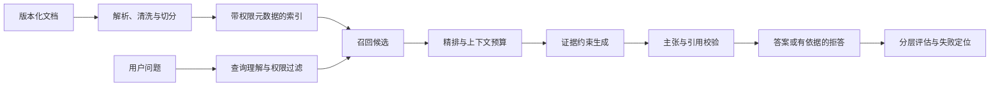

# 第 7 章（上篇）：RAG 项目实战——从文档到可检索片段

上一章把模型放进服务负载里，比较缓存、调度和生成成本。现在把问题转到“模型依据什么回答”：员工问今年的年假天数，参数里记得的旧答案不能代替当前制度；系统必须找到用户有权查看、版本有效、内容确实支持结论的那段原文。

RAG（检索增强生成）把外部文档检索和语言模型生成连起来。它不会自动让答案正确，但会留下可检查的中间过程：文档怎样解析、哪些片段进入候选、最后把哪些证据交给模型、每个回答主张引用什么。遇到错误时，我们可以判断是原文没抽出来、检索漏了、排序不对、上下文没装下，还是模型误读了证据。

本章是第三册从“服务性能”走向“应用证据”的一环。六篇沿同一次知识问答请求推进；第八章再把这份只读证据交给 Agent，讨论它能不能调用工具或改变外部状态。

| 部分 | 要回答的问题 | 交接结果 |
| --- | --- | --- |
| [上篇：文档与切分](07-rag项目实战-1-文档与切分.md) | 原始文件怎样变成带版本、位置和权限的片段？ | 可检查的文档与 chunk 清单 |
| [第二篇：检索与上下文](07-rag项目实战-2-检索与上下文.md) | 用户问题怎样找到候选证据并装进预算？ | 可复查的候选集合和上下文 |
| [第三篇：候选重排](07-rag项目实战-3-候选重排.md) | 怎样在有限候选中把真正相关的片段排前？ | 排序前后的候选和延迟变化 |
| [第四篇：引用与证据](07-rag项目实战-4-引用与证据.md) | 每个回答主张怎样回到当前来源？ | claim—evidence 对照表 |
| [第五篇：评估指标](07-rag项目实战-5-评估指标.md) | 怎样分别测量检索、回答、引用和拒答？ | 固定评估集与分层指标 |
| [第六篇：失败定位与报告](07-rag项目实战-6-失败归因与报告.md) | 结果不好时先改哪一层，怎样留下证据？ | 可复查的实验报告和改进决定 |

下面的图展示请求和文档怎样汇合。文档先被解析、切分并建索引；检索时，问题会带上可信的用户身份和权限范围；生成之后，系统再检查主张、引用和拒答条件。权限过滤必须在可信边界内完成，无权查看的文档内容、元数据和分数不能传给重排器、生成模型或普通运行日志（trace）。



完整的 RAG 不等于“embedding 加一个 prompt”。文档解析和切分决定证据是否完整，召回决定证据有没有机会进入候选，重排决定有限上下文里先读什么，答案协议和评估再检查这些证据是否真的支撑结论。每一层都可能引入自己的错误。

跨文档实体关系或全库主题摘要，可能需要图结构而不只是片段检索。微软的 [GraphRAG 索引方法文档](https://github.com/microsoft/graphrag/blob/main/docs/index/methods.md)将它描述为研究 RAG 索引方法的平台：标准流程用语言模型抽取实体和关系并生成社区报告；FastGraphRAG 用部分 NLP 方法换取较低的索引成本，但抽取图会更嘈杂。它适合解决不同的问题，不是所有知识问答的默认升级路线；更完整的图检索和 Agentic RAG 由[第十七册](../../book-17-agent-tool-use/chapters/06-agentic-rag.md)展开。

## 7.1 文档准备：从原文件到稳定的检索片段

检索做得再复杂，也无法找回解析时丢掉的表格单位、否定词或版本信息。先约定系统里的一条证据记录是什么：

| 字段 | 用途 |
| --- | --- |
| doc_id、doc_version | 识别原文及其有效版本 |
| source_uri、page、section_path | 回到原文件、页码、标题或条款 |
| chunk_id、text | 标识可检索片段并保留实际文本 |
| 租户、访问控制列表（ACL）、有效期、语言 | 限定当前用户可见的候选范围 |
| 解析程序版本、嵌入模型版本 | 复查文本如何抽取、向量如何生成 |

切分后供检索和回答使用的文本片段称为 chunk。每个 chunk 都要能回到原文，而不只是带着一串向量出现在数据库里。

向量索引只是查找结构，不应成为唯一的事实来源。原文件、解析后的文本、片段清单和索引版本要能互相对应；这样更新或撤回制度时，系统才能停用旧证据、发布新证据，而不是把新旧版本混在同一个候选集合里。

### 7.1.1 文档读取和清洗

第一版可以从纯文本开始：

> 代码状态：静态审阅，未运行（2026-10-30）

```python
documents = [
    {
        "doc_id": "policy_001",
        "doc_version": "2026-08-01",
        "title": "年假制度",
        "text": "工作满一年后，每位员工每年享有 10 天带薪年假。年假需要提前三天申请。",
        "access": ["employee"],
    },
    {
        "doc_id": "policy_002",
        "doc_version": "2026-08-02",
        "title": "差旅报销制度",
        "text": "差旅报销需要提交发票、行程单和审批记录。单笔超过 5000 元需要部门负责人额外审批。",
        "access": ["employee", "finance"],
    },
]
```
PDF、DOCX、HTML、扫描件和数据库记录需要不同的解析器。解析阶段不只产生 text，还应保留页码、段落、表格行列、标题层级和原始位置。表格中的金额和单位如果在纯文本化时被打散，后面的 embedding 再强也无法恢复结构。

清洗可以处理重复空格、无意义页眉、页脚和控制字符，但不能随意删除数字、否定词、单位和标题。下面是一个保守的文本规范化示例：

> 代码状态：静态审阅，未运行（2026-10-30）

```python
import re


def normalize_text(text):
    if not isinstance(text, str):
        raise TypeError("text must be a string")
    text = text.replace("\r\n", "\n").replace("\r", "\n")
    text = re.sub(r"[ \t]+", " ", text)
    text = re.sub(r"\n{3,}", "\n\n", text)
    return text.strip()


sample = "标题：年假制度\r\n\r\n\r\n工作满一年\t后，每年 10 天。"
print(normalize_text(sample))
```
清洗函数应有样本快照。对一份表格、合同或代码文档，先人工检查原文和清洗后的文本，避免把格式问题误认为检索问题。


文档更新也要有明确的交接。假设制度从 2026-08-01 更新到 2026-09-15，索引构建应保存新版本的解析结果、片段标识和 ACL，再以一次可确认的发布切换当前版本；失效版本要按保留策略停止参与普通检索。若只把新片段追加进去，旧条款仍可能被召回；若删除向量却没更新来源元数据，引用又可能指向已经失效的位置。索引不是制度的权威版本库，它必须跟着原始文档的生效与撤回状态更新。

### 7.1.2 Chunk 不是任意长度的字符串

文档会先经过分词器（tokenizer），变成模型处理的 token 序列。一个 token 可能对应一个词、一段子词或字符片段，不等同于汉字数。设文档 token 序列为 $x_{1:N}$，按窗口长度 $w$ 和重叠长度 $o$ 切分，步长为：

```math
s=w-o,
\qquad
0\leq o<w
```

第 $j$ 个窗口可以近似表示为：

```math
c_j=x_{1+js:\ \min(1+js+w-1,N)}
```

overlap 可以减少事实刚好位于边界两侧时的信息丢失，但会增加 chunk 数和索引重复量。对长文档，若总 token 数为 $N$，chunk size 为 $w$，步长为 $s$，chunk 数近似为：

```math
M
\approx
\left\lceil\frac{\max(N-w,0)}{s}\right\rceil+1
```

这个近似式假设 $N>0$、$w$ 和 $s=w-o$ 为正整数；空文档应单独定义为零个 chunk，而不是套用公式得到一个虚假的占位片段。

固定字符数并不等于固定 token 数。中文、英文、代码、表格和特殊符号的 token 化比例不同；上线前应统计实际 tokenizer token，而不是只记录 Python 字符长度。

一个基础切分函数如下：

> 代码状态：静态审阅，未运行（2026-10-30）

```python
def chunk_text(text, chunk_size=120, overlap=24):
    if not isinstance(text, str):
        raise TypeError("text must be a string")
    if type(chunk_size) is not int or chunk_size <= 0:
        raise ValueError("chunk_size must be a positive integer")
    if type(overlap) is not int or not 0 <= overlap < chunk_size:
        raise ValueError("overlap must satisfy 0 <= overlap < chunk_size")

    rows = []
    start = 0
    while start < len(text):
        end = min(start + chunk_size, len(text))
        rows.append(text[start:end])
        if end == len(text):
            break
        start = end - overlap
    return rows


pieces = chunk_text("甲乙丙丁戊己庚辛壬癸" * 20, chunk_size=30, overlap=5)
print("chunk_count=", len(pieces))
print("first_length=", len(pieces[0]))
print("last_length=", len(pieces[-1]))
```
这段代码以字符为单位，是教学实现。生产系统通常先按标题、段落、列表、表格行或代码函数切分，再在过长单元内部使用 token 窗口。语义边界优先于机械窗口，窗口只是超长内容的兜底。

### 7.1.3 Chunk size 的取舍

chunk 太大时，一个向量混入多个主题，查询命中后仍需要模型在片段内部寻找答案；chunk 太小时，定义、条件和例外可能被拆开。可以把一次检索的有效性写成两个目标的平衡：

```math
J_{\mathrm{chunk}}
=
\lambda R_{\mathrm{coverage}}
+
(1-\lambda)R_{\mathrm{precision}}
-
\mu C_{\mathrm{tokens}}
```

其中 $R_{\mathrm{coverage}}$ 表示相关证据是否共同出现在可检索片段中，$R_{\mathrm{precision}}$ 表示片段中无关内容的比例，$C_{\mathrm{tokens}}$ 表示送入模型的 token 成本。这个式子不是通用训练目标，只是帮助比较切分方案的简化指标。

对制度文档，标题和条款编号常常比固定字符数更重要。对代码文档，函数和类应尽量完整；对 FAQ，问题和答案最好作为同一个 chunk；对表格，应保存表头和行的关系，不要只把每个单元格独立切开。

把窗口代入一个可复核的例子：一份 320-token 的制度章节采用 120-token chunk、20-token overlap，步长是 100，因此从 token 1、101、201 开始，形成三个窗口，合计存储 360 token，其中有 40 token 是重复的。若改成 40-token overlap，步长变为 80，会形成四个窗口，窗口总长度约 440 token，重复部分升到 120 token。后一种切法更可能让跨边界的例外条件同时出现在一个片段里，但索引容量、候选重复和 prompt 噪声也上升。该算术假定固定 token 窗口且最后一块截到文档末尾；真实语料应先按标题、条款或表格结构切，再对超长单元做窗口化，并用跨边界问题检查是否真的减少漏证据。


把这些片段和来源位置保存好后，下一篇再讨论如何把用户问题映射到候选集合，以及权限过滤和上下文预算怎样共同限制搜索范围。
