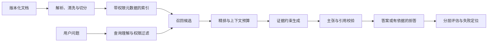

# 第 7 章（第一部分）：文档、检索与上下文

上一章把模型放进服务负载里，比较缓存、调度和生成成本。现在把问题转到“模型依据什么回答”：员工问今年的年假天数，参数里记得的旧答案不能代替当前制度；系统必须找到用户有权查看、版本有效、内容确实支持结论的那段原文。

RAG（检索增强生成）把外部文档检索和语言模型生成连起来。它不会自动让答案正确，但会留下可检查的中间过程：文档怎样解析、哪些片段进入候选、最后把哪些证据交给模型、每个回答主张引用什么。遇到错误时，我们可以判断是原文没抽出来、检索漏了、排序不对、上下文没装下，还是模型误读了证据。

本章是第三册从“服务性能”走向“应用证据”的一环。三个部分沿同一次知识问答请求推进；第八章再把这份只读证据交给 Agent，讨论它能不能调用工具或改变外部状态。

| 部分 | 要回答的问题 | 交接结果 |
| --- | --- | --- |
| 文档、检索与上下文 | 怎样把原文变成有权限的候选证据，并控制上下文预算？ | 可检查的文档、候选集合和上下文 |
| [重排、引用与证据](07-rag项目实战-2-重排与证据.md) | 怎样把有限候选排好，并让每项回答主张回到来源？ | 排序对照和 claim—evidence 对照表 |
| [评估与失败归因](07-rag项目实战-3-评估与失败归因.md) | 怎样分别测量各层表现并找到最先失败的环节？ | 固定评估集、失败样例和改进报告 |

下面的图展示请求和文档怎样汇合。文档先被解析、切分并建索引；检索时，问题会带上可信的用户身份和权限范围；生成之后，系统再检查主张、引用和拒答条件。权限过滤必须在可信边界内完成，无权查看的文档内容、元数据和分数不能传给重排器、生成模型或普通运行日志（trace）。



完整的 RAG 不等于“embedding 加一个 prompt”。文档解析和切分决定证据是否完整，召回决定证据有没有机会进入候选，重排决定有限上下文里先读什么，答案协议和评估再检查这些证据是否真的支撑结论。每一层都可能引入自己的错误。

跨文档实体关系或全库主题摘要，可能需要图结构而不只是片段检索。微软的 [GraphRAG 索引方法文档](https://github.com/microsoft/graphrag/blob/main/docs/index/methods.md)将它描述为研究 RAG 索引方法的平台：标准流程用语言模型抽取实体和关系并生成社区报告；FastGraphRAG 用部分 NLP 方法换取较低的索引成本，但抽取图会更嘈杂。它适合解决不同的问题，不是所有知识问答的默认升级路线；更完整的图检索和 Agentic RAG 由[第十七册](../../book-17-agent-tool-use/chapters/06-agentic-rag.md)展开。

## 7.1 文档准备：从原文件到稳定的检索片段

检索做得再复杂，也无法找回解析时丢掉的表格单位、否定词或版本信息。先约定系统里的一条证据记录是什么：

| 字段 | 用途 |
| --- | --- |
| doc_id、doc_version | 识别原文及其有效版本 |
| source_uri、page、section_path | 回到原文件、页码、标题或条款 |
| chunk_id、text | 标识可检索片段并保留实际文本 |
| 租户、访问控制列表（ACL）、有效期、语言 | 限定当前用户可见的候选范围 |
| 解析程序版本、嵌入模型版本 | 复查文本如何抽取、向量如何生成 |

切分后供检索和回答使用的文本片段称为 chunk。每个 chunk 都要能回到原文，而不只是带着一串向量出现在数据库里。

向量索引只是查找结构，不应成为唯一的事实来源。原文件、解析后的文本、片段清单和索引版本要能互相对应；这样更新或撤回制度时，系统才能停用旧证据、发布新证据，而不是把新旧版本混在同一个候选集合里。

### 7.1.1 文档读取和清洗

第一版可以从纯文本开始：

> 代码状态：静态审阅，未运行（2026-10-30）

```python
documents = [
    {
        "doc_id": "policy_001",
        "doc_version": "2026-08-01",
        "title": "年假制度",
        "text": "工作满一年后，每位员工每年享有 10 天带薪年假。年假需要提前三天申请。",
        "access": ["employee"],
    },
    {
        "doc_id": "policy_002",
        "doc_version": "2026-08-02",
        "title": "差旅报销制度",
        "text": "差旅报销需要提交发票、行程单和审批记录。单笔超过 5000 元需要部门负责人额外审批。",
        "access": ["employee", "finance"],
    },
]
```
PDF、DOCX、HTML、扫描件和数据库记录需要不同的解析器。解析阶段不只产生 text，还应保留页码、段落、表格行列、标题层级和原始位置。表格中的金额和单位如果在纯文本化时被打散，后面的 embedding 再强也无法恢复结构。

清洗可以处理重复空格、无意义页眉、页脚和控制字符，但不能随意删除数字、否定词、单位和标题。下面是一个保守的文本规范化示例：

> 代码状态：静态审阅，未运行（2026-10-30）

```python
import re


def normalize_text(text):
    if not isinstance(text, str):
        raise TypeError("text must be a string")
    text = text.replace("\r\n", "\n").replace("\r", "\n")
    text = re.sub(r"[ \t]+", " ", text)
    text = re.sub(r"\n{3,}", "\n\n", text)
    return text.strip()


sample = "标题：年假制度\r\n\r\n\r\n工作满一年\t后，每年 10 天。"
print(normalize_text(sample))
```
清洗函数应有样本快照。对一份表格、合同或代码文档，先人工检查原文和清洗后的文本，避免把格式问题误认为检索问题。


文档更新也要有明确的交接。假设制度从 2026-08-01 更新到 2026-09-15，索引构建应保存新版本的解析结果、片段标识和 ACL，再以一次可确认的发布切换当前版本；失效版本要按保留策略停止参与普通检索。若只把新片段追加进去，旧条款仍可能被召回；若删除向量却没更新来源元数据，引用又可能指向已经失效的位置。索引不是制度的权威版本库，它必须跟着原始文档的生效与撤回状态更新。

### 7.1.2 Chunk 不是任意长度的字符串

文档会先经过分词器（tokenizer），变成模型处理的 token 序列。一个 token 可能对应一个词、一段子词或字符片段，不等同于汉字数。设文档 token 序列为 $x_{1:N}$，按窗口长度 $w$ 和重叠长度 $o$ 切分，步长为：

```math
s=w-o,
\qquad
0\leq o<w
```

第 $j$ 个窗口可以近似表示为：

```math
c_j=x_{1+js:\ \min(1+js+w-1,N)}
```

overlap 可以减少事实刚好位于边界两侧时的信息丢失，但会增加 chunk 数和索引重复量。对长文档，若总 token 数为 $N$，chunk size 为 $w$，步长为 $s$，chunk 数近似为：

```math
M
\approx
\left\lceil\frac{\max(N-w,0)}{s}\right\rceil+1
```

这个近似式假设 $N>0$、$w$ 和 $s=w-o$ 为正整数；空文档应单独定义为零个 chunk，而不是套用公式得到一个虚假的占位片段。

固定字符数并不等于固定 token 数。中文、英文、代码、表格和特殊符号的 token 化比例不同；上线前应统计实际 tokenizer token，而不是只记录 Python 字符长度。

一个基础切分函数如下：

> 代码状态：静态审阅，未运行（2026-10-30）

```python
def chunk_text(text, chunk_size=120, overlap=24):
    if not isinstance(text, str):
        raise TypeError("text must be a string")
    if type(chunk_size) is not int or chunk_size <= 0:
        raise ValueError("chunk_size must be a positive integer")
    if type(overlap) is not int or not 0 <= overlap < chunk_size:
        raise ValueError("overlap must satisfy 0 <= overlap < chunk_size")

    rows = []
    start = 0
    while start < len(text):
        end = min(start + chunk_size, len(text))
        rows.append(text[start:end])
        if end == len(text):
            break
        start = end - overlap
    return rows


pieces = chunk_text("甲乙丙丁戊己庚辛壬癸" * 20, chunk_size=30, overlap=5)
print("chunk_count=", len(pieces))
print("first_length=", len(pieces[0]))
print("last_length=", len(pieces[-1]))
```
这段代码以字符为单位，是教学实现。生产系统通常先按标题、段落、列表、表格行或代码函数切分，再在过长单元内部使用 token 窗口。语义边界优先于机械窗口，窗口只是超长内容的兜底。

### 7.1.3 Chunk size 的取舍

chunk 太大时，一个向量混入多个主题，查询命中后仍需要模型在片段内部寻找答案；chunk 太小时，定义、条件和例外可能被拆开。可以把一次检索的有效性写成两个目标的平衡：

```math
J_{\mathrm{chunk}}
=
\lambda R_{\mathrm{coverage}}
+
(1-\lambda)R_{\mathrm{precision}}
-
\mu C_{\mathrm{tokens}}
```

其中 $R_{\mathrm{coverage}}$ 表示相关证据是否共同出现在可检索片段中，$R_{\mathrm{precision}}$ 表示片段中无关内容的比例，$C_{\mathrm{tokens}}$ 表示送入模型的 token 成本。这个式子不是通用训练目标，只是帮助比较切分方案的简化指标。

对制度文档，标题和条款编号常常比固定字符数更重要。对代码文档，函数和类应尽量完整；对 FAQ，问题和答案最好作为同一个 chunk；对表格，应保存表头和行的关系，不要只把每个单元格独立切开。

把窗口代入一个可复核的例子：一份 320-token 的制度章节采用 120-token chunk、20-token overlap，步长是 100，因此从 token 1、101、201 开始，形成三个窗口，合计存储 360 token，其中有 40 token 是重复的。若改成 40-token overlap，步长变为 80，会形成四个窗口，窗口总长度约 440 token，重复部分升到 120 token。后一种切法更可能让跨边界的例外条件同时出现在一个片段里，但索引容量、候选重复和 prompt 噪声也上升。该算术假定固定 token 窗口且最后一块截到文档末尾；真实语料应先按标题、条款或表格结构切，再对超长单元做窗口化，并用跨边界问题检查是否真的减少漏证据。


把这些片段和来源位置保存好后，下一节再讨论如何把用户问题映射到候选集合，以及权限过滤和上下文预算怎样共同限制搜索范围。

上一节把原文变成带来源位置和版本的片段，并为它们留下了可检索的文本。现在用户提出问题，系统要把问题变成一组有用的候选。这里有两个不同的工作：表示问题和片段，让相近内容能被找到；再在可信的租户、权限和版本范围内筛选候选。相似度只是搜索信号，不是证据已经正确的判定。

## 7.2 检索与上下文：从查询到有限候选

### 7.2.1 Embedding 与相似度

文本嵌入（embedding）模型把问题和片段映射到 $d$ 维向量：

```math
e_j=f_{\mathrm{emb}}(c_j)\in\mathbb{R}^{d},
\qquad
u=f_{\mathrm{emb}}(q)\in\mathbb{R}^{d}
```

如果向量做 L2 归一化：

```math
\bar e_j=\frac{e_j}{\lVert e_j\rVert_2},
\qquad
\bar u=\frac{u}{\lVert u\rVert_2}
```

归一化要求 $\lVert e_j\rVert_2>0$ 且 $\lVert u\rVert_2>0$。零向量没有定义好的方向，应在 embedding 或索引阶段记录为无效向量，不能用一个默认分母把它伪装成正常语义表示。

则点积等于余弦相似度：

```math
s(q,c_j)
=
\bar u^\top\bar e_j
=
\cos(\bar u,\bar e_j)
```

用两个维度手算一次。令问题向量为 $u=(3,4)$，两个候选片段向量为 $e_1=(4,3)$、$e_2=(3,0)$。三者的长度分别是 $5$、$5$ 和 $3$，因此归一化后，问题与片段 1 的点积是 $(3\cdot4+4\cdot3)/(5\cdot5)=24/25=0.96$；与片段 2 的点积是 $(3\cdot3+4\cdot0)/(5\cdot3)=9/15=0.60$。在这个玩具例子里，片段 1 更接近问题。真实 embedding 有几百或几千维，仍做同一种计算；高相似度只表示模型把两段文字放得较近，不保证片段包含答案或当前有效。

初检索选择分数最高的 $K$ 个 chunk：

```math
I_K
=
\mathrm{TopK}_{j\in\{1,\ldots,M\}}s(q,c_j)
```

这里要求候选数量 $M>0$，并约定 $1\leq K\leq M$；如果索引为空，应返回“无候选”状态，而不是把空集合解释成低分命中。

相似度分数只适合在同一个 embedding 模型、同一个归一化方式和相同索引条件下比较。不同模型的分数范围不能直接拼接成一个统一质量标准。

### 7.2.2 Sentence Transformers 和 FAISS 接口

如果有外部依赖，可以用 Sentence Transformers 编码。下面的接口按 Sentence Transformers 6.2.0 官方文档整理，FAISS 示例按 faiss-cpu 1.15.1 的接口整理；仓库的 `uv.lock` 没有锁定这两项依赖，所以这些代码片段还不是一套已经联调的环境。实际运行前，要锁定 Python、PyTorch、Transformers、NumPy、Sentence Transformers、FAISS 和对应平台的 wheel，并在目标环境验证。模型 revision 固定为所示的 Hub commit；检索任务使用 `encode_document` 和 `encode_query`。如果模型定义了不同的 query/document prompt，应按模型卡和评测结果确定具体输入。

> 代码状态：静态审阅，未运行（2026-10-30）

```python
# Requires numpy, sentence-transformers, and the selected model files.
import numpy as np
from sentence_transformers import SentenceTransformer


chunks = [
    {"text": "工作满一年后，每年有 10 天带薪年假。"},
    {"text": "单笔超过 5000 元需要额外审批。"},
]
embed_model = SentenceTransformer(
    "BAAI/bge-small-zh-v1.5",
    revision="7999e1d3359715c523056ef9478215996d62a620",
)
texts = [row["text"] for row in chunks]
embeddings = embed_model.encode_document(
    texts,
    normalize_embeddings=True,
    convert_to_numpy=True,
).astype("float32")
print("embedding_shape=", embeddings.shape)
```
输出形状为 `(片段数, embedding_dimension)`；具体维度由 checkpoint 决定，行数应等于输入片段数。

如果使用 FAISS 的 inner-product 索引：

> 代码状态：静态审阅，未运行（2026-10-30）

```python
# Requires numpy, faiss-cpu (or a compatible FAISS build), sentence-transformers,
# and the selected model files.
import numpy as np
import faiss
from sentence_transformers import SentenceTransformer


texts = [
    "工作满一年后，每年有 10 天带薪年假。",
    "单笔超过 5000 元需要额外审批。",
]
embed_model = SentenceTransformer(
    "BAAI/bge-small-zh-v1.5",
    revision="7999e1d3359715c523056ef9478215996d62a620",
)
embeddings = embed_model.encode_document(
    texts,
    normalize_embeddings=True,
    convert_to_numpy=True,
).astype("float32")
dimension = embeddings.shape[1]
index = faiss.IndexFlatIP(dimension)
index.add(embeddings)
query_vector = embed_model.encode_query(
    ["员工年假有多少天？"],
    normalize_embeddings=True,
    convert_to_numpy=True,
).astype("float32")
k = min(3, len(texts))
scores, indices = index.search(query_vector, k)
```
运行这两个片段需要目标版本的 Python、sentence-transformers、numpy、faiss 和模型文件。IndexFlatIP 会逐项精确计算相似度；数据规模较大时，可以改用 HNSW、IVF、PQ 或托管向量数据库，但近似索引需要在召回率和内存占用之间取舍。

### 7.2.3 无依赖的稀疏向量 RAG demo

为了在没有模型权重的环境中验证数据流，下面用字符 unigram 和 bigram 构造稀疏字典向量。它不是语义 embedding，只能帮助理解归一化、点积、top-k 和来源保留。

> 代码状态：静态审阅，未运行（2026-10-30）

```python
from math import sqrt


DOCUMENTS = [
    {
        "doc_id": "policy_001",
        "text": "工作满一年后，每位员工每年享有 10 天带薪年假。年假需要提前三天申请。",
    },
    {
        "doc_id": "policy_002",
        "text": "差旅报销需要提交发票、行程单和审批记录。单笔超过 5000 元需要部门负责人额外审批。",
    },
    {
        "doc_id": "tech_001",
        "text": "RAG 先检索相关文档片段，再让语言模型基于片段生成回答。",
    },
]
STOP = set("，。：；！？、 的了是和在中每")


def chunk_documents(documents, size=80, overlap=16):
    if type(size) is not int or size <= 0:
        raise ValueError("size must be a positive integer")
    if type(overlap) is not int or not 0 <= overlap < size:
        raise ValueError("overlap must satisfy 0 <= overlap < size")
    rows = []
    for document in documents:
        text = document["text"]
        if not isinstance(text, str):
            raise TypeError("document text must be a string")
        start = 0
        chunk_number = 0
        while start < len(text):
            end = min(start + size, len(text))
            rows.append({
                "chunk_id": f"{document['doc_id']}_{chunk_number}",
                "doc_id": document["doc_id"],
                "text": text[start:end],
            })
            chunk_number += 1
            if end == len(text):
                break
            start = end - overlap
    return rows


def tokens(text):
    chars = [ch for ch in text.lower() if ch.strip() and ch not in STOP]
    return chars + ["".join(chars[i:i + 2]) for i in range(len(chars) - 1)]


def embed(text):
    vector = {}
    for token in tokens(text):
        vector[token] = vector.get(token, 0.0) + 1.0
    if not vector:
        raise ValueError("text produced no usable features")
    norm = sqrt(sum(value * value for value in vector.values()))
    if norm <= 0:
        raise ValueError("embedding norm must be positive")
    return {token: value / norm for token, value in vector.items()}


def dot(left, right):
    if len(left) > len(right):
        left, right = right, left
    return sum(value * right.get(key, 0.0) for key, value in left.items())


def retrieve(query, chunks, top_k=2):
    if not isinstance(query, str):
        raise TypeError("query must be a string")
    if type(top_k) is not int or top_k <= 0:
        raise ValueError("top_k must be a positive integer")
    query_vector = embed(query)
    scored = [
        {**chunk, "score": round(dot(query_vector, embed(chunk["text"])), 4)}
        for chunk in chunks
    ]
    return sorted(scored, key=lambda row: row["score"], reverse=True)[:top_k]


def build_prompt(query, retrieved):
    context = "\n\n".join(
        f"[{i}] {row['doc_id']} / {row['chunk_id']}\n{row['text']}"
        for i, row in enumerate(retrieved, start=1)
    )
    return (
        "只根据资料回答；没有资料时回答资料中没有提到。\n"
        f"资料：\n{context}\n\n问题：{query}\n答案："
    )


chunks = chunk_documents(DOCUMENTS)
query = "员工年假有多少天？"
retrieved = retrieve(query, chunks)
prompt = build_prompt(query, retrieved)
print("chunk_count=", len(chunks))
print("top_ids=", [row["chunk_id"] for row in retrieved])
print("top_scores=", [row["score"] for row in retrieved])
print("prompt_has_source=", "policy_001" in prompt)
```
这个 demo 的 toy 输出不能证明稀疏字符特征能替代中文 embedding，也不是 BM25 的实现。关键词检索（例如 BM25）更容易保留错误码、产品名、条款号和阈值等精确词项；稠密检索更关注查询与文档的语义相近。若单一路线漏掉了另一类问题，可以并行召回后做混合排序。两种检索器的原始分数往往不在同一尺度，常见做法是先归一化再融合，或按各自名次使用倒数排名融合（Reciprocal Rank Fusion，RRF）；完整机制和分数例子见[第二册《长上下文 RAG 与 Agent》](../../book-02-advanced-100/chapters/07-长上下文rag与agent.md)，RRF 的定义也可参阅[Elasticsearch 官方说明](https://www.elastic.co/docs/reference/elasticsearch/rest-apis/reciprocal-rank-fusion)。

BM25 是一种按词项匹配给文档排序的经典方法。它先看查询词有没有出现在文档里，再按词频、词项在整个语料中的稀有程度和文档长度调整分数。词出现得更多通常有帮助，但贡献会逐渐饱和；很长的文档也不会只因包含更多词就自动占优。下面采用 Apache Lucene 10.3.1 文档中的 BM25 形式和 IDF 形式；不同搜索引擎可能采用参数默认值或细节不同的变体。

对查询词 $t$ 在文档 $d$ 中的一项贡献，可以写成：

```math
\mathrm{score}(t,d)
=
\mathrm{IDF}(t)
\frac{f(t,d)(k_1+1)}{f(t,d)+k_1(1-b+b\,|d|/\mathrm{avgdl})}
```

这里 $f(t,d)$ 是词频，$|d|$ 是文档长度，$\mathrm{avgdl}$ 是语料平均文档长度；$k_1$ 控制词频增加后的饱和程度，$b$ 控制长度归一化强度。IDF（inverse document frequency，逆文档频率）让在较少文档中出现的词通常贡献更高分。Lucene 文档给出的 IDF 形式为：

```math
\mathrm{IDF}(t)
=
\ln\left(1+\frac{N-df(t)+0.5}{df(t)+0.5}\right)
```

其中 $N$ 是文档数，$df(t)$ 是包含词项 $t$ 的文档数。用一项假设值算一下：设 $\mathrm{IDF}=2$、$k_1=1.2$、$b=0.75$、文档长度恰好等于平均长度。词频 $f=1$ 时，分数是 $2\times1\times2.2/(1+1.2)=2$；词频加到 $2$ 时，分数变为 $2\times2\times2.2/(2+1.2)=2.75$。词频翻倍，贡献只从 2 增到 2.75，体现了饱和。若词频仍为 1、文档长度变成平均长度的两倍，分数约为 $4.4/3.1=1.42$，长度归一化会压低这项贡献。该例只解释单个词的分数，不是完整查询的实际检索结果。[Lucene BM25Similarity 文档](https://lucene.apache.org/core/10_3_1/core/org/apache/lucene/search/similarities/BM25Similarity.html)列出对应的词频饱和、长度参数和 IDF 实现。

BM25 依赖文本分析器把文档和查询切成可匹配的词项。若中文分词把“年假制度”和“年假”处理成不同词项，或清洗时删除条款号，精确匹配也可能失败；稠密向量可能找回表达不同但意思接近的查询，却也可能把数字条件相反的片段排进来。因此，混合召回不是简单把两种分数相加：先对齐权限、版本和候选标识，再用受控的分数融合或排名融合，并在分层评估集上检查它补回了哪些问题。

在本项目中，两个召回分支应使用同一用户的租户、权限和有效版本范围，并用稳定的 `chunk_id` 合并、去重。评测集应分别包含精确编号、同义改写、否定、数值条件和跨段证据问题；比较 Recall@k、排序指标、最终答案支持率、延迟和上下文 token 数。混合召回可能找回单一路线漏掉的候选，但会增加索引和维护成本，也不能保证最终答案更正确。

### 7.2.4 查询改写与过滤

用户问题不一定是适合检索的完整句子。可以先抽取实体、时间、产品和约束，再构造检索查询。查询改写不能擅自改变用户意图，例如“是否必须”不能被改成“怎么申请”。

检索过滤可以在向量搜索前或后执行，具体取决于索引是否支持元数据过滤；安全边界要落在可信的数据访问层：

```text
租户过滤：只看当前租户文档。
权限过滤：只看用户有权读取的文档。
版本过滤：优先当前生效版本。
语言过滤：根据问题语言选择候选。
时间过滤：排除已失效的制度。
```

有原生过滤时，优先把租户、ACL 和有效版本条件下推到每个召回器。若只能在召回后过滤，必须在可信检索层完成，并且在过滤前不得把无权文档的文本、元数据或分数交给 reranker、生成模型、外部服务、用户或常规 trace；过滤后候选数不足时，只能在相同授权范围内补召回。权限过滤不是 prompt 里的文字约束，也不能靠“模型会不会引用”来决定。

### 7.2.5 上下文预算

假设系统指令 token 数为 $T_{\mathrm{sys}}$，问题 token 数为 $T_q$，选中 chunk 的 token 数为 $T_{c_i}$，输出预留为 $T_{\mathrm{out}}$，则：

```math
T_{\mathrm{sys}}
+
T_q
+
\sum_{i\in I_K}T_{c_i}
+
T_{\mathrm{out}}
\le
L_{\mathrm{ctx}}
```

如果只把 top-k 数字固定为 5，无法保证每个问题的文本长度都可控。可以按 token 预算动态选取：

> 代码状态：静态审阅，未运行（2026-10-30）

```python
def select_by_budget(rows, budget):
    if type(budget) is not int or budget < 0:
        raise ValueError("budget must be a non-negative integer")
    selected = []
    used = 0
    for row in rows:
        token_count = row["token_count"]
        if type(token_count) is not int or token_count < 0:
            raise ValueError("token_count must be a non-negative integer")
        if used + token_count > budget:
            continue
        selected.append(row)
        used += token_count
    return selected, used


rows = [
    {"chunk_id": "a", "token_count": 40},
    {"chunk_id": "b", "token_count": 70},
    {"chunk_id": "c", "token_count": 50},
]
selected, used = select_by_budget(rows, budget=100)
print("selected_ids=", [row["chunk_id"] for row in selected])
print("used_tokens=", used)
```
按代码中的顺序，片段 a 用掉 40 token；片段 b 再加入会超过 100，所以跳过；片段 c 加入后总数为 90。结果是 a 和 c，而不是先把 top-k 设成固定数量。真正的 token_count 应由目标 tokenizer 计算；字符长度只是占位。预算策略也可以综合分数、文档多样性和证据覆盖，避免 top-k 全部来自同一段重复文本。

### 7.2.6 失败模式与诊断顺序

检索结果为空或不相关时，按以下顺序排查：

```text
1. 原文是否真的包含答案，解析阶段是否丢了数字、表格或否定词？
2. chunk 是否把问题所需的条件拆散？
3. query 和文档是否使用不同术语或语言？
4. embedding 模型是否适合领域和语言？
5. 索引是否使用了相同的模型、归一化和版本？
6. 权限/版本过滤是否误删了正确证据？
7. top-k 和 token budget 是否过小？
8. 近似索引的参数是否导致召回下降？
```

先打印原文、chunk、query、top-k、分数和过滤条件，再考虑换生成模型。检索缺证据时，调 prompt 不能真正修复问题。

### 7.2.7 资料与证据边界

- Retrieval-Augmented Generation：<https://arxiv.org/abs/2005.11401>
- Sentence-BERT：<https://arxiv.org/abs/1908.10084>
- Sentence Transformers embedding 与 query/document API：<https://www.sbert.net/docs/sentence_transformer/usage/usage.html>
- Sentence Transformers 6.2.0 发布记录：<https://pypi.org/project/sentence-transformers/>
- BGE small-zh-v1.5 固定模型 revision：<https://huggingface.co/BAAI/bge-small-zh-v1.5/commit/7999e1d3359715c523056ef9478215996d62a620>
- FAISS 内积与余弦相似度：<https://github.com/facebookresearch/faiss/wiki/MetricType-and-distances>
- FAISS 索引精确性对照：<https://github.com/facebookresearch/faiss/wiki/Faiss-indexes>
- faiss-cpu 1.15.1 安装说明：<https://github.com/facebookresearch/faiss/blob/main/INSTALL.md>
- MTEB：<https://arxiv.org/abs/2210.07316>
- BEIR：<https://arxiv.org/abs/2104.08663>

原论文支持 RAG 和双编码器的机制背景，官方文档支持当前编码和索引接口，教学 demo 只验证局部相似度和预算关系。具体中文模型的召回质量必须在目标语料和评估集上实测。


候选召回完成后，下一部分只在这个有限集合上做更细的成对判断；排序不能补回召回阶段已经漏掉的证据。
