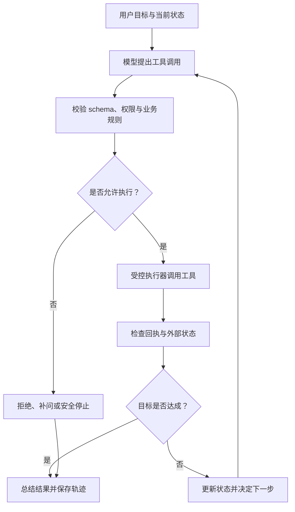

# 第 8 章 Agent 项目实战（1）：工具调用协议

第七章的 RAG 能从有权限的文档中找证据，却不会替用户操作业务系统。现在把问题往前推一步：用户问“这笔 6,000 元报销是否需要额外审批”，系统要先找当前制度，再比较金额，最后说明结论。这里仍是只读查询；如果用户改口要求“直接帮我提交报销”，系统就进入另一类动作，需要额外权限和确认。

本章沿着一条执行链展开：模型提出动作，程序检查动作，执行器调用真实工具，系统接收回执，再决定是否继续。每一环都回答不同的问题：模型建议了什么？应用允许什么？外部系统实际做了什么？任务最后是否达成？把它们混成一句“Agent 调用了工具”，就很难判断动作有没有发生、结果能不能相信。




五篇依次讨论调用协议、ReAct 状态循环、执行安全、轨迹评估和端到端验收。可以从[状态循环](08-agent项目实战-2-react状态循环.md)继续看多步任务如何收敛；需要定位风险时看[执行安全](08-agent项目实战-3-执行安全与授权.md)和[轨迹评估](08-agent项目实战-4-轨迹审计与评估.md)，最后用[贯通项目](08-agent项目实战-5-贯通项目验收.md)把各层接起来。

## 8.1 模型提出请求，程序决定是否执行

### 8.1.1 为什么需要工具调用协议

普通聊天的输出是一段文本。用户问“今天账户余额是多少”，模型可能生成一句回答，但如果它没有连接账户系统，这句话不表示它真的查过余额。接入工具后，模型可以提出结构化请求，例如调用 get_balance 并提供账户标识；应用先检查用户权限，再决定是否访问余额服务。只有工具服务的返回值才是这次查询的外部观察。

一次最小往返按顺序是：用户提出请求；模型给出工具名和参数；应用检查工具是否存在、参数是否合格、用户是否有权；执行器调用对应函数或 API；工具回传结果和原调用标识；模型再根据结果回答或提出下一步。

这条链上有两个容易混淆的边界。第一，模型提出调用，不等于调用已经执行。第二，工具返回成功，不等于用户目标已经完成。数据库返回“订单已找到”只证明查询成功，并不表示退款已经完成。

设应用允许使用的工具集合为 $\mathcal{T}=\{t_1,\ldots,t_n\}$。模型提出的调用可抽象为 $c=(\mathrm{id},\mathrm{name},\mathrm{arguments})$。执行器只有在工具名已注册、参数通过检查且授权成立时才运行对应函数。这个抽象帮助理解职责；真实 API 的字段名称和消息往返形式由供应商决定。

### 8.1.2 Schema 能检查形状，不能替代授权

工具 schema 描述可提交的字段、字段类型和必填项，像一张输入表格：它可以阻止把数字字段填成对象，却不能判断这个数字是否属于当前用户、是否超过业务限额、是否会造成重复扣款。

下面的 TOOLS 是应用内部的简化目录，不是任何供应商都能直接接收的完整请求对象；接入具体 API 时还要转换为该接口要求的外层结构和调用参数。

> 代码状态：静态审阅，未运行（2026-10-30）

```python
TOOLS = [
    {
        "name": "calculator",
        "description": "计算只包含数字和基础算术运算的表达式。",
        "parameters": {
            "type": "object",
            "properties": {
                "expression": {"type": "string"},
            },
            "required": ["expression"],
            "additionalProperties": False,
        },
    },
    {
        "name": "search_docs",
        "description": "查询当前用户有权访问的制度文档。",
        "parameters": {
            "type": "object",
            "properties": {
                "query": {"type": "string"},
            },
            "required": ["query"],
            "additionalProperties": False,
        },
    },
]
print("tool_names=", [tool["name"] for tool in TOOLS])
```


以 OpenAI Function Calling 的 strict mode 为例，对象需要明确禁止额外字段，声明的字段都要列为必填；业务上可选的值可以通过允许 null 表达。当前 Responses API 与 Chat Completions 的默认行为有差异，不能把某一种调用模式的默认值当作所有接口的统一规则。schema 约束请求形状；用户身份、对象归属、数值范围和风险策略仍由程序检查。[OpenAI Function Calling 文档](https://developers.openai.com/api/docs/guides/function-calling)给出当前 API 的具体规则。

例如，amount 类型为 number 只能排除“六千元”这样的字符串，不能排除负数、超出订单可退金额、超出当前角色限额或精度不合规的值。结构校验和业务授权是两道检查，不能合并成“schema 通过了”。

### 8.1.3 先把一个小工具做得可控

一个安全计算器能展示“模型给表达式，程序按白名单计算”这条边界。直接对模型生成的字符串调用 Python eval，会把任意表达式交给执行环境；教学实现可以解析抽象语法树，只允许少量数字和四则运算节点。

> 代码状态：静态审阅，未运行（2026-10-30）

```python
import ast
import math
import operator


OPS = {
    ast.Add: operator.add,
    ast.Sub: operator.sub,
    ast.Mult: operator.mul,
    ast.Div: operator.truediv,
}


def evaluate_node(node):
    if isinstance(node, ast.Expression):
        return evaluate_node(node.body)
    if isinstance(node, ast.Constant) and isinstance(node.value, (int, float)):
        if isinstance(node.value, bool):
            raise ValueError("boolean is not allowed")
        return node.value
    if isinstance(node, ast.UnaryOp) and isinstance(node.op, (ast.UAdd, ast.USub)):
        value = evaluate_node(node.operand)
        return value if isinstance(node.op, ast.UAdd) else -value
    if isinstance(node, ast.BinOp) and type(node.op) in OPS:
        return OPS[type(node.op)](
            evaluate_node(node.left),
            evaluate_node(node.right),
        )
    raise ValueError("unsupported expression")


def calculator(expression):
    if not isinstance(expression, str):
        return "错误：表达式必须是字符串"
    if len(expression) > 64:
        return "错误：表达式过长"
    allowed = set("0123456789+-*/(). ")
    if any(char not in allowed for char in expression):
        return "错误：表达式包含非法字符"
    try:
        tree = ast.parse(expression, mode="eval")
        result = evaluate_node(tree)
        if isinstance(result, float) and not math.isfinite(result):
            return "错误：结果不是有限数"
        return str(result)
    except (SyntaxError, TypeError, ValueError, ZeroDivisionError, OverflowError) as exc:
        return f"错误：{exc}"


print("calculator_result=", calculator("128 * 256"))
print("calculator_rejected=", calculator("__import__('os')"))
```


示例用字符白名单限制输入，再用 AST 节点白名单限制语法。它适合解释执行边界，不是生产计算器：真实服务还需限制数值大小、运算步数、耗时、精度和资源用量。2 + 3 可通过并得到 5；包含函数调用或属性访问的表达式会被拒绝。安全性来自程序规定的允许范围，不来自模型“答应只做算术”。

### 8.1.4 工具目录、参数检查与执行函数要分开

工具目录告诉模型有哪些选项，可执行注册表告诉程序每个选项对应哪段受控逻辑。两者都由应用维护。不要根据模型返回的工具名动态导入模块，也不要把未知字段静默删掉后继续执行；前者扩大执行面，后者会悄悄改写意图。

下面的检查先确认工具已注册，再检查参数对象、必填字段、额外字段和简单类型，最后才执行函数。真实项目还要把范围、单位、对象归属和授权放进服务端检查。

> 代码状态：静态审阅，未运行（2026-10-30）

```python
TOOLS = [
    {
        "name": "calculator",
        "parameters": {
            "properties": {"expression": {"type": "string"}},
            "required": ["expression"],
            "additionalProperties": False,
        },
    },
    {
        "name": "search_docs",
        "parameters": {
            "properties": {"query": {"type": "string"}},
            "required": ["query"],
            "additionalProperties": False,
        },
    },
]
REGISTRY = {
    "calculator": lambda expression: "5" if expression == "2 + 3" else "unsupported",
    "search_docs": lambda query: "检索结果：" + query,
}
SCHEMA_BY_NAME = {tool["name"]: tool for tool in TOOLS}


def validate_arguments(tool_name, arguments):
    if not isinstance(tool_name, str):
        return False, "tool_name_must_be_string"
    schema = SCHEMA_BY_NAME.get(tool_name)
    if schema is None:
        return False, "unknown_tool"
    if not isinstance(arguments, dict):
        return False, "arguments_must_be_object"
    properties = schema["parameters"].get("properties", {})
    required = schema["parameters"].get("required", [])
    missing = [key for key in required if key not in arguments]
    extra = [key for key in arguments if key not in properties]
    type_errors = [
        key
        for key, spec in properties.items()
        if key in arguments
        and spec.get("type") == "string"
        and not isinstance(arguments[key], str)
    ]
    if missing or extra or type_errors:
        return False, {
            "missing": missing,
            "extra": extra,
            "type_errors": type_errors,
        }
    return True, "ok"


def execute_registered(tool_name, arguments):
    ok, detail = validate_arguments(tool_name, arguments)
    if not ok:
        return {"ok": False, "error": detail}
    if tool_name not in REGISTRY:
        return {"ok": False, "error": "not_executable"}
    try:
        result = REGISTRY[tool_name](**arguments)
    except Exception:
        # Return a stable public error; production code should log details securely.
        return {"ok": False, "error": "tool_execution_failed"}
    return {"ok": True, "result": result}


print("good_call=", execute_registered("calculator", {"expression": "2 + 3"}))
print("bad_call=", execute_registered("calculator", {"expr": "2 + 3"}))
print("unknown_call=", execute_registered("delete_file", {"path": "x"}))
```


validate_arguments 只做结构层面的简化校验。search_docs 查询文本合法，不代表用户有权查看检索命中的每一份文档；最终数据范围仍应由可信检索服务依据认证上下文确定。把 schema_valid 和 authorized 分成两个状态，日志才看得出“参数不合格”还是“用户无权”。

### 8.1.5 调用标识、并行和结果状态

请求、调用和副作用通常有不同标识。request_id 关联用户的一次任务；tool_call_id（某些 API 使用 tool_use_id）把调用提议和对应结果配对；idempotency_key 用于让写服务识别同一副作用的重复提交。调用标识不等于授权凭证；幂等键也不代替权限判断。

模型一轮可能提出多条调用。它们只有互不依赖时才适合并行，例如同时查询制度和读取当前用户自己的部门信息。若第二条调用需要第一条结果，就必须按顺序执行。执行器还要限制一轮最多执行几条、最多并发多少、每条调用可等待多久和读取多少数据。

> 代码状态：静态审阅，未运行（2026-10-30）

```python
def execute_registered(name, arguments):
    if not isinstance(name, str) or not isinstance(arguments, dict):
        return {"ok": False, "error": "invalid_call"}
    if name == "calculator" and set(arguments) == {"expression"}:
        return {"ok": True, "result": str(128 * 256)}
    if name == "search_docs" and set(arguments) == {"query"}:
        return {"ok": True, "result": "检索结果：" + arguments["query"]}
    return {"ok": False, "error": "invalid_or_unknown_call"}


DECISION = {
    "tool_calls": [
        {
            "id": "call_calc",
            "name": "calculator",
            "arguments": {"expression": "128 * 256"},
        },
        {
            "id": "call_search",
            "name": "search_docs",
            "arguments": {"query": "员工年假"},
        },
    ]
}


outputs = []
for call in DECISION["tool_calls"]:
    result = execute_registered(call["name"], call["arguments"])
    outputs.append({"tool_call_id": call["id"], **result})
print("output_ids=", [item["tool_call_id"] for item in outputs])
```


网络返回顺序可能不同于模型提出顺序，因此结果应按调用标识配对，而不是按列表位置猜测。供应商接口还可能区分客户端执行工具与托管工具；执行方和回传形状要按目标工具类型核对。[Anthropic 的工具调用说明](https://platform.claude.com/docs/en/agents-and-tools/tool-use/handle-tool-calls)展示客户端工具提出、应用执行后回传的流程，也说明服务端工具有不同责任边界。

| 状态 | 含义 | 后续处理 |
| --- | --- | --- |
| rejected | 校验或授权失败，尚未执行 | 补充信息、拒绝或停止 |
| succeeded | 外部系统明确返回成功 | 校验结果和业务后置条件 |
| failed | 外部系统明确返回失败 | 记录原因，不包装成成功 |
| unknown | 请求可能已产生副作用，但回执不确定 | 查询原动作状态或转人工 |

尤其要留心超时：只读查询在安全条件下可以重试；写操作超时可能意味着请求已受理但响应丢失。除非执行器能确认原请求未生效，或外部服务支持同一个幂等键的安全查询，否则不能盲目再执行一次。

### 8.1.6 让调用过程留下可读回执

一次请求可以记录模型提出了哪些调用、哪些检查通过、哪些工具真的执行，以及结果是什么状态。轨迹帮助复盘“哪个环节发生了什么”，但不是越完整越好：用户原文和工具内容可能含敏感信息，普通运行记录应默认保存关联 ID、工具名、策略版本、判定、状态和耗时；原文只进入经过授权和脱敏的诊断流程。

下面的示例用 mock 工具展示调用 ID 怎样被保留下来。它把调用信息暂存于内存，方便读者看清结构；不能据此推断生产日志应该保存所有原文。

> 代码状态：静态审阅，未运行（2026-10-30）

```python
def mock_decision(query):
    if not isinstance(query, str):
        raise TypeError("query must be a string")
    if "计算" in query:
        return {
            "tool_calls": [
                {
                    "id": "call_0",
                    "name": "calculator",
                    "arguments": {"expression": "128 * 256"},
                }
            ]
        }
    if "年假" in query:
        return {
            "tool_calls": [
                {
                    "id": "call_1",
                    "name": "search_docs",
                    "arguments": {"query": query},
                }
            ]
        }
    return {"tool_calls": []}


def run_tool_calls(query):
    decision = mock_decision(query)
    if not isinstance(decision, dict) or not isinstance(
        decision.get("tool_calls"), list
    ):
        raise ValueError("model decision must contain a tool_calls list")
    trace = [{"kind": "model_request", "payload": decision}]
    results = []
    seen_ids = set()
    for call in decision["tool_calls"]:
        if not isinstance(call, dict):
            raise ValueError("each tool call must be an object")
        call_id = call.get("id")
        if not isinstance(call_id, str) or not call_id or call_id in seen_ids:
            raise ValueError("tool call ids must be unique non-empty strings")
        seen_ids.add(call_id)
        result = execute_registered(call.get("name"), call.get("arguments"))
        results.append({"tool_call_id": call_id, **result})
    trace.append({"kind": "tool_results", "payload": results})
    return trace


def execute_registered(name, arguments):
    if not isinstance(name, str) or not isinstance(arguments, dict):
        return {"ok": False, "error": "invalid_call"}
    if name == "calculator" and set(arguments) == {"expression"}:
        return {"ok": True, "result": "32768"}
    if name == "search_docs" and set(arguments) == {"query"}:
        return {"ok": True, "result": "检索结果：" + arguments["query"]}
    return {"ok": False, "error": "invalid_or_unknown_call"}


for query in ("帮我计算 128 * 256", "员工年假有多少天？", "你好"):
    trace = run_tool_calls(query)
    print(
        "query=", query,
        "tool_count=", len(trace[1]["payload"]),
        "ids=", [item["tool_call_id"] for item in trace[1]["payload"]],
    )
```


完成这一步后，我们已有了“模型请求—程序校验—工具回执”的协议。多步任务还要记录当前目标、已确认观察、剩余预算和停止原因；这些状态由[下一篇的 ReAct 循环](08-agent项目实战-2-react状态循环.md)接着处理。
