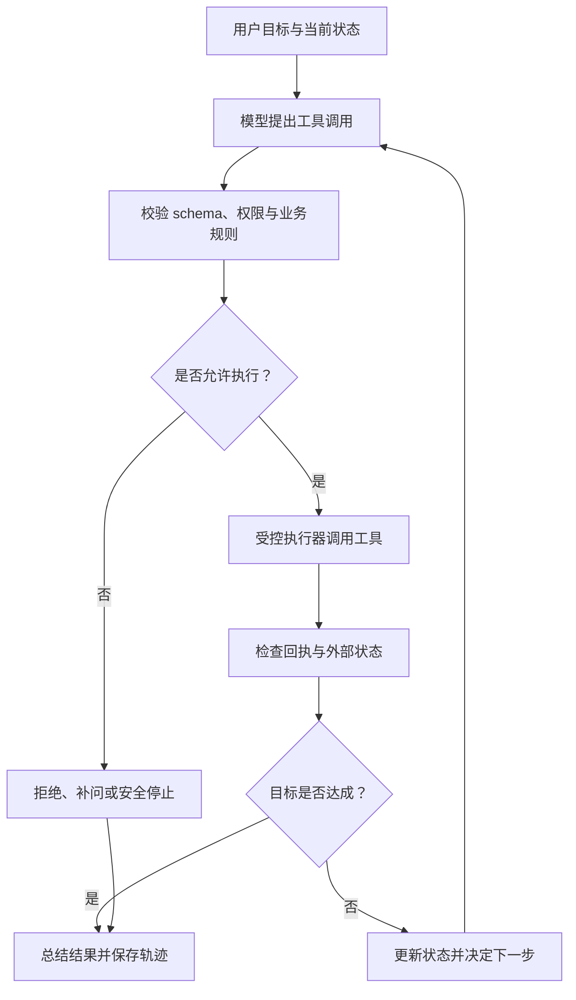

# 第 8 章（第一部分）：工具协议与状态循环

第七章的 RAG 能从有权限的文档中找证据，却不会替用户操作业务系统。现在把问题往前推一步：用户问“这笔 6,000 元报销是否需要额外审批”，系统要先找当前制度，再比较金额，最后说明结论。这里仍是只读查询；如果用户改口要求“直接帮我提交报销”，系统就进入另一类动作，需要额外权限和确认。

本章沿着一条执行链展开：模型提出动作，程序检查动作，执行器调用真实工具，系统接收回执，再决定是否继续。每一环都回答不同的问题：模型建议了什么？应用允许什么？外部系统实际做了什么？任务最后是否达成？把它们混成一句“Agent 调用了工具”，就很难判断动作有没有发生、结果能不能相信。




本章分为两个部分。这里先讲工具协议和 ReAct 状态循环；[下一部分](08-agent项目实战-2-安全审计与验收.md)再把权限与副作用控制、轨迹审计和项目验收连成一条执行链。

## 8.1 模型提出请求，程序决定是否执行

### 8.1.1 为什么需要工具调用协议

普通聊天的输出是一段文本。用户问“今天账户余额是多少”，模型可能生成一句回答，但如果它没有连接账户系统，这句话不表示它真的查过余额。接入工具后，模型可以提出结构化请求，例如调用 get_balance 并提供账户标识；应用先检查用户权限，再决定是否访问余额服务。只有工具服务的返回值才是这次查询的外部观察。

一次最小往返按顺序是：用户提出请求；模型给出工具名和参数；应用检查工具是否存在、参数是否合格、用户是否有权；执行器调用对应函数或 API；工具回传结果和原调用标识；模型再根据结果回答或提出下一步。

这条链上有两个容易混淆的边界。第一，模型提出调用，不等于调用已经执行。第二，工具返回成功，不等于用户目标已经完成。数据库返回“订单已找到”只证明查询成功，并不表示退款已经完成。

设应用允许使用的工具集合为 $\mathcal{T}=\{t_1,\ldots,t_n\}$。模型提出的调用可抽象为 $c=(\mathrm{id},\mathrm{name},\mathrm{arguments})$。执行器只有在工具名已注册、参数通过检查且授权成立时才运行对应函数。这个抽象帮助理解职责；真实 API 的字段名称和消息往返形式由供应商决定。

### 8.1.2 Schema 能检查形状，不能替代授权

工具 schema 描述可提交的字段、字段类型和必填项，像一张输入表格：它可以阻止把数字字段填成对象，却不能判断这个数字是否属于当前用户、是否超过业务限额、是否会造成重复扣款。

下面的 TOOLS 是应用内部的简化目录，不是任何供应商都能直接接收的完整请求对象；接入具体 API 时还要转换为该接口要求的外层结构和调用参数。

> 代码状态：静态审阅，未运行（2026-10-30）

```python
TOOLS = [
    {
        "name": "calculator",
        "description": "计算只包含数字和基础算术运算的表达式。",
        "parameters": {
            "type": "object",
            "properties": {
                "expression": {"type": "string"},
            },
            "required": ["expression"],
            "additionalProperties": False,
        },
    },
    {
        "name": "search_docs",
        "description": "查询当前用户有权访问的制度文档。",
        "parameters": {
            "type": "object",
            "properties": {
                "query": {"type": "string"},
            },
            "required": ["query"],
            "additionalProperties": False,
        },
    },
]
print("tool_names=", [tool["name"] for tool in TOOLS])
```


以 OpenAI Function Calling 的 strict mode 为例，对象需要明确禁止额外字段，声明的字段都要列为必填；业务上可选的值可以通过允许 null 表达。当前 Responses API 与 Chat Completions 的默认行为有差异，不能把某一种调用模式的默认值当作所有接口的统一规则。schema 约束请求形状；用户身份、对象归属、数值范围和风险策略仍由程序检查。[OpenAI Function Calling 文档](https://developers.openai.com/api/docs/guides/function-calling)给出当前 API 的具体规则。

例如，amount 类型为 number 只能排除“六千元”这样的字符串，不能排除负数、超出订单可退金额、超出当前角色限额或精度不合规的值。结构校验和业务授权是两道检查，不能合并成“schema 通过了”。

### 8.1.3 先把一个小工具做得可控

一个安全计算器能展示“模型给表达式，程序按白名单计算”这条边界。直接对模型生成的字符串调用 Python eval，会把任意表达式交给执行环境；教学实现可以解析抽象语法树，只允许少量数字和四则运算节点。

> 代码状态：静态审阅，未运行（2026-10-30）

```python
import ast
import math
import operator


OPS = {
    ast.Add: operator.add,
    ast.Sub: operator.sub,
    ast.Mult: operator.mul,
    ast.Div: operator.truediv,
}


def evaluate_node(node):
    if isinstance(node, ast.Expression):
        return evaluate_node(node.body)
    if isinstance(node, ast.Constant) and isinstance(node.value, (int, float)):
        if isinstance(node.value, bool):
            raise ValueError("boolean is not allowed")
        return node.value
    if isinstance(node, ast.UnaryOp) and isinstance(node.op, (ast.UAdd, ast.USub)):
        value = evaluate_node(node.operand)
        return value if isinstance(node.op, ast.UAdd) else -value
    if isinstance(node, ast.BinOp) and type(node.op) in OPS:
        return OPS[type(node.op)](
            evaluate_node(node.left),
            evaluate_node(node.right),
        )
    raise ValueError("unsupported expression")


def calculator(expression):
    if not isinstance(expression, str):
        return "错误：表达式必须是字符串"
    if len(expression) > 64:
        return "错误：表达式过长"
    allowed = set("0123456789+-*/(). ")
    if any(char not in allowed for char in expression):
        return "错误：表达式包含非法字符"
    try:
        tree = ast.parse(expression, mode="eval")
        result = evaluate_node(tree)
        if isinstance(result, float) and not math.isfinite(result):
            return "错误：结果不是有限数"
        return str(result)
    except (SyntaxError, TypeError, ValueError, ZeroDivisionError, OverflowError) as exc:
        return f"错误：{exc}"


print("calculator_result=", calculator("128 * 256"))
print("calculator_rejected=", calculator("__import__('os')"))
```


示例用字符白名单限制输入，再用 AST 节点白名单限制语法。它适合解释执行边界，不是生产计算器：真实服务还需限制数值大小、运算步数、耗时、精度和资源用量。2 + 3 可通过并得到 5；包含函数调用或属性访问的表达式会被拒绝。安全性来自程序规定的允许范围，不来自模型“答应只做算术”。

### 8.1.4 工具目录、参数检查与执行函数要分开

工具目录告诉模型有哪些选项，可执行注册表告诉程序每个选项对应哪段受控逻辑。两者都由应用维护。不要根据模型返回的工具名动态导入模块，也不要把未知字段静默删掉后继续执行；前者扩大执行面，后者会悄悄改写意图。

下面的检查先确认工具已注册，再检查参数对象、必填字段、额外字段和简单类型，最后才执行函数。真实项目还要把范围、单位、对象归属和授权放进服务端检查。

> 代码状态：静态审阅，未运行（2026-10-30）

```python
TOOLS = [
    {
        "name": "calculator",
        "parameters": {
            "properties": {"expression": {"type": "string"}},
            "required": ["expression"],
            "additionalProperties": False,
        },
    },
    {
        "name": "search_docs",
        "parameters": {
            "properties": {"query": {"type": "string"}},
            "required": ["query"],
            "additionalProperties": False,
        },
    },
]
REGISTRY = {
    "calculator": lambda expression: "5" if expression == "2 + 3" else "unsupported",
    "search_docs": lambda query: "检索结果：" + query,
}
SCHEMA_BY_NAME = {tool["name"]: tool for tool in TOOLS}


def validate_arguments(tool_name, arguments):
    if not isinstance(tool_name, str):
        return False, "tool_name_must_be_string"
    schema = SCHEMA_BY_NAME.get(tool_name)
    if schema is None:
        return False, "unknown_tool"
    if not isinstance(arguments, dict):
        return False, "arguments_must_be_object"
    properties = schema["parameters"].get("properties", {})
    required = schema["parameters"].get("required", [])
    missing = [key for key in required if key not in arguments]
    extra = [key for key in arguments if key not in properties]
    type_errors = [
        key
        for key, spec in properties.items()
        if key in arguments
        and spec.get("type") == "string"
        and not isinstance(arguments[key], str)
    ]
    if missing or extra or type_errors:
        return False, {
            "missing": missing,
            "extra": extra,
            "type_errors": type_errors,
        }
    return True, "ok"


def execute_registered(tool_name, arguments):
    ok, detail = validate_arguments(tool_name, arguments)
    if not ok:
        return {"ok": False, "error": detail}
    if tool_name not in REGISTRY:
        return {"ok": False, "error": "not_executable"}
    try:
        result = REGISTRY[tool_name](**arguments)
    except Exception:
        # Return a stable public error; production code should log details securely.
        return {"ok": False, "error": "tool_execution_failed"}
    return {"ok": True, "result": result}


print("good_call=", execute_registered("calculator", {"expression": "2 + 3"}))
print("bad_call=", execute_registered("calculator", {"expr": "2 + 3"}))
print("unknown_call=", execute_registered("delete_file", {"path": "x"}))
```


validate_arguments 只做结构层面的简化校验。search_docs 查询文本合法，不代表用户有权查看检索命中的每一份文档；最终数据范围仍应由可信检索服务依据认证上下文确定。把 schema_valid 和 authorized 分成两个状态，日志才看得出“参数不合格”还是“用户无权”。

### 8.1.5 调用标识、并行和结果状态

请求、调用和副作用通常有不同标识。request_id 关联用户的一次任务；tool_call_id（某些 API 使用 tool_use_id）把调用提议和对应结果配对；idempotency_key 用于让写服务识别同一副作用的重复提交。调用标识不等于授权凭证；幂等键也不代替权限判断。

模型一轮可能提出多条调用。它们只有互不依赖时才适合并行，例如同时查询制度和读取当前用户自己的部门信息。若第二条调用需要第一条结果，就必须按顺序执行。执行器还要限制一轮最多执行几条、最多并发多少、每条调用可等待多久和读取多少数据。

> 代码状态：静态审阅，未运行（2026-10-30）

```python
def execute_registered(name, arguments):
    if not isinstance(name, str) or not isinstance(arguments, dict):
        return {"ok": False, "error": "invalid_call"}
    if name == "calculator" and set(arguments) == {"expression"}:
        return {"ok": True, "result": str(128 * 256)}
    if name == "search_docs" and set(arguments) == {"query"}:
        return {"ok": True, "result": "检索结果：" + arguments["query"]}
    return {"ok": False, "error": "invalid_or_unknown_call"}


DECISION = {
    "tool_calls": [
        {
            "id": "call_calc",
            "name": "calculator",
            "arguments": {"expression": "128 * 256"},
        },
        {
            "id": "call_search",
            "name": "search_docs",
            "arguments": {"query": "员工年假"},
        },
    ]
}


outputs = []
for call in DECISION["tool_calls"]:
    result = execute_registered(call["name"], call["arguments"])
    outputs.append({"tool_call_id": call["id"], **result})
print("output_ids=", [item["tool_call_id"] for item in outputs])
```


网络返回顺序可能不同于模型提出顺序，因此结果应按调用标识配对，而不是按列表位置猜测。供应商接口还可能区分客户端执行工具与托管工具；执行方和回传形状要按目标工具类型核对。[Anthropic 的工具调用说明](https://platform.claude.com/docs/en/agents-and-tools/tool-use/handle-tool-calls)展示客户端工具提出、应用执行后回传的流程，也说明服务端工具有不同责任边界。

| 状态 | 含义 | 后续处理 |
| --- | --- | --- |
| rejected | 校验或授权失败，尚未执行 | 补充信息、拒绝或停止 |
| succeeded | 外部系统明确返回成功 | 校验结果和业务后置条件 |
| failed | 外部系统明确返回失败 | 记录原因，不包装成成功 |
| unknown | 请求可能已产生副作用，但回执不确定 | 查询原动作状态或转人工 |

尤其要留心超时：只读查询在安全条件下可以重试；写操作超时可能意味着请求已受理但响应丢失。除非执行器能确认原请求未生效，或外部服务支持同一个幂等键的安全查询，否则不能盲目再执行一次。

### 8.1.6 让调用过程留下可读回执

一次请求可以记录模型提出了哪些调用、哪些检查通过、哪些工具真的执行，以及结果是什么状态。轨迹帮助复盘“哪个环节发生了什么”，但不是越完整越好：用户原文和工具内容可能含敏感信息，普通运行记录应默认保存关联 ID、工具名、策略版本、判定、状态和耗时；原文只进入经过授权和脱敏的诊断流程。

下面的示例用 mock 工具展示调用 ID 怎样被保留下来。它把调用信息暂存于内存，方便读者看清结构；不能据此推断生产日志应该保存所有原文。

> 代码状态：静态审阅，未运行（2026-10-30）

```python
def mock_decision(query):
    if not isinstance(query, str):
        raise TypeError("query must be a string")
    if "计算" in query:
        return {
            "tool_calls": [
                {
                    "id": "call_0",
                    "name": "calculator",
                    "arguments": {"expression": "128 * 256"},
                }
            ]
        }
    if "年假" in query:
        return {
            "tool_calls": [
                {
                    "id": "call_1",
                    "name": "search_docs",
                    "arguments": {"query": query},
                }
            ]
        }
    return {"tool_calls": []}


def run_tool_calls(query):
    decision = mock_decision(query)
    if not isinstance(decision, dict) or not isinstance(
        decision.get("tool_calls"), list
    ):
        raise ValueError("model decision must contain a tool_calls list")
    trace = [{"kind": "model_request", "payload": decision}]
    results = []
    seen_ids = set()
    for call in decision["tool_calls"]:
        if not isinstance(call, dict):
            raise ValueError("each tool call must be an object")
        call_id = call.get("id")
        if not isinstance(call_id, str) or not call_id or call_id in seen_ids:
            raise ValueError("tool call ids must be unique non-empty strings")
        seen_ids.add(call_id)
        result = execute_registered(call.get("name"), call.get("arguments"))
        results.append({"tool_call_id": call_id, **result})
    trace.append({"kind": "tool_results", "payload": results})
    return trace


def execute_registered(name, arguments):
    if not isinstance(name, str) or not isinstance(arguments, dict):
        return {"ok": False, "error": "invalid_call"}
    if name == "calculator" and set(arguments) == {"expression"}:
        return {"ok": True, "result": "32768"}
    if name == "search_docs" and set(arguments) == {"query"}:
        return {"ok": True, "result": "检索结果：" + arguments["query"]}
    return {"ok": False, "error": "invalid_or_unknown_call"}


for query in ("帮我计算 128 * 256", "员工年假有多少天？", "你好"):
    trace = run_tool_calls(query)
    print(
        "query=", query,
        "tool_count=", len(trace[1]["payload"]),
        "ids=", [item["tool_call_id"] for item in trace[1]["payload"]],
    )
```


完成这一步后，我们已有了“模型请求—程序校验—工具回执”的协议。多步任务还要记录当前目标、已确认观察、剩余预算和停止原因；这些状态由下一节的 ReAct 循环接着处理。

一次工具调用只能完成一步。用户问“6,000 元报销是否需要审批”，系统可能要先查询当前制度，再比较金额，最后引用对应条款。Agent 的工作不是“让模型多说几轮”，而是把每一步的目标、动作、外部观察和终止条件接起来。

如果模型生成“超过 5,000 元，需要审批”，它可能只生成了一句话；如果执行器真的查询到生效版本的条款、计算器返回 true，系统再根据两条证据组织结论，我们才有一条可检查的任务轨迹。

## 8.2 从一次调用走到有界循环

### 8.2.1 用轨迹表示一轮 Agent 任务

ReAct 把模型决策与环境观察交替组织。[原论文](https://arxiv.org/abs/2210.03629)研究模型交错生成任务相关轨迹与动作、再从外部知识库或环境取得观察的做法。对一条包含 $K$ 次动作的轨迹，可记为：

```math
\tau=(q,a_1,o_1,a_2,o_2,\ldots,a_K,o_K,y)
```

其中 $q$ 是用户目标，$a_k$ 是第 $k$ 步提出的动作，$o_k$ 是执行器返回的观察，$y$ 是最终结果。状态可以写成 $s_{k+1}=s_k\oplus(a_k,o_k)$：把新动作和观察加入已有状态，再让模型基于更新后的状态决定下一步。

这里的“思考”指决定下一步的过程，不意味着必须展示或保存完整内部推理。系统可以记录结构化计划、工具提议、校验结果和必要的理由代码；决定外部世界发生什么的，是执行器返回的观察和回执。

一次报销判断可以按顺序走：目标是判断是否触发审批；先查询当前制度；观察到“单笔超过 5,000 元需额外审批”；再调用受限比较器判断 6,000 是否大于 5,000；得到真后，给出带制度来源的结论。每个 observation 都来自外部工具，不能由模型自己补写。

### 8.2.2 把状态存成事件，而不是一段不断变长的文字

最简单的 demo 会把历史拼成 scratchpad。短任务容易看懂；长任务则不断重复旧文本、增加 token 成本，也难以定位事实来自用户、模型还是工具。更稳妥的状态至少区分目标、事件、已确认事实、待解决问题、预算和终态。

> 代码状态：静态审阅，未运行（2026-10-30）

```python
state = {
    "task_id": "expense_001",
    "user_query": "6000 元报销是否需要额外审批？",
    "events": [
        {
            "kind": "tool_call",
            "call_id": "call_1",
            "name": "search_docs",
            "arguments": {"query": "报销金额审批规则"},
        },
        {
            "kind": "tool_result",
            "call_id": "call_1",
            "status": "ok",
            "content": "超过 5000 元需要部门负责人额外审批。",
        },
    ],
    "budget": {"steps": 2, "tool_calls": 1, "tokens": 180},
}
print("event_kinds=", [event["kind"] for event in state["events"]])
```


事件保存后，系统可以只把下一步需要的信息重新组织给模型，而不是无条件复制全部历史。比如“当前制度版本 P-17 的阈值是 5,000 元”应附来源与版本；“需要审批”是基于金额比较得到的结论。二者证据类型不同，不能只留一个混合摘要。

### 8.2.3 Tool Calling 是协议，ReAct 是循环

| 概念 | 解决的问题 | 典型内容 |
| --- | --- | --- |
| Tool Calling | 如何表达并执行一条工具调用 | 工具名、参数、调用 ID、工具结果 |
| ReAct | 如何把多步动作组织成任务 | 状态更新、行动、观察、重规划、停止 |

可以在每一步都使用结构化 Tool Calling：模型提出调用，应用校验并执行，再把结果写入状态，模型基于新状态决定继续还是结束。这样保留多步任务能力，同时避免依赖脆弱的自由文本解析。

如果模型没有原生工具协议，教学实现可能让它输出：

```text
Action: search_docs
Action Input: 报销金额审批规则
```

解析器再把文本转成动作：

> 代码状态：静态审阅，未运行（2026-10-30）

```python
import re


def parse_react(text):
    if not isinstance(text, str):
        return {"kind": "error", "raw": text}
    final = re.search(r"Final Answer:\s*(.*)", text, flags=re.S)
    if final:
        return {"kind": "final", "answer": final.group(1).strip()}
    action = re.search(r"Action:\s*([A-Za-z_][A-Za-z0-9_]*)", text)
    argument = re.search(r"Action Input:\s*(.*)", text, flags=re.S)
    if action and argument:
        return {
            "kind": "action",
            "name": action.group(1),
            "input": argument.group(1).strip(),
        }
    return {"kind": "error", "raw": text}


print(parse_react("Action: search_docs\nAction Input: 年假制度"))
print(parse_react("Final Answer: 资料不足。"))
```


自由文本会受空格、标点、代码块和多行参数影响；解析失败必须进入明确错误状态，不能把不完整字段猜成有效调用。能用结构化协议时应优先使用结构化协议；ReAct 的重点是循环和状态，并非某种文本格式。

### 8.2.4 给循环设硬预算和终止状态

循环需要有限预算，例如最大决策步数、工具调用数、累计输入与输出 token、总耗时和金额成本：

```math
B=(B_{\mathrm{steps}},B_{\mathrm{calls}},B_{\mathrm{tokens}},B_{\mathrm{time}},B_{\mathrm{cost}})
```

执行器每一步检查已用预算；触及任一上限，任务进入 budget_exhausted。Prompt 中写“请不要调用太多工具”只是软提示，不能代替程序里的硬限制。

循环可以因目标完成、证据不足、权限拒绝、工具明确失败、外部状态未知、用户取消、无进展或预算耗尽而停止。不要把这些终态压成“成功/失败”两个值：final 表示目标条件有证据支持，refused 表示策略阻断，tool_error 表示工具明确失败，unknown 表示副作用状态不能确认，partial 表示只完成部分目标。

下面的无依赖 demo 用固定 mock policy 展示查询、比较和总结；它只帮助看循环顺序，不是实际模型评估。

> 代码状态：静态审阅，未运行（2026-10-30）

```python
import ast
import math
import operator
import re


DOC = "报销制度：单笔超过 5000 元需要部门负责人额外审批。"


def search_docs(query):
    return DOC if "报销" in query or "审批" in query else "未找到资料"


def compare(expression):
    operators = {ast.Gt: operator.gt, ast.GtE: operator.ge}
    tree = ast.parse(expression, mode="eval")
    node = tree.body
    if not isinstance(node, ast.Compare) or len(node.ops) != 1:
        return "错误：只允许单个比较"
    values = [node.left.value, *[item.value for item in node.comparators]] if all(
        isinstance(item, ast.Constant) for item in [node.left, *node.comparators]
    ) else []
    if not values or any(
        isinstance(value, bool)
        or not isinstance(value, (int, float))
        or (isinstance(value, float) and not math.isfinite(value))
        for value in values
    ):
        return "错误：只允许数字"
    fn = operators.get(type(node.ops[0]))
    if fn is None:
        return "错误：不支持的比较"
    return str(fn(values[0], values[1]))


def mock_policy(scratchpad):
    if "Observation:" not in scratchpad:
        return "Action: search_docs\nAction Input: 报销金额审批规则"
    if "compare" not in scratchpad:
        return "Action: compare\nAction Input: 6000 > 5000"
    return "Final Answer: 需要额外审批；6000 元超过 5000 元。"


TOOLS = {"search_docs": search_docs, "compare": compare}


def parse(text):
    if not isinstance(text, str):
        return {"kind": "error"}
    final = re.search(r"Final Answer:\s*(.*)", text, flags=re.S)
    if final:
        return {"kind": "final", "answer": final.group(1).strip()}
    action = re.search(r"Action:\s*(\w+)", text)
    argument = re.search(r"Action Input:\s*(.*)", text)
    if not action or not argument:
        return {"kind": "error"}
    return {"kind": "action", "name": action.group(1), "input": argument.group(1)}


def run(max_steps=4, policy=mock_policy):
    if type(max_steps) is not int or max_steps < 0:
        raise ValueError("max_steps must be a non-negative integer")
    scratchpad = ""
    events = []
    seen = set()
    for step in range(max_steps):
        if not callable(policy):
            raise TypeError("policy must be callable")
        model_output = policy(scratchpad)
        parsed = parse(model_output)
        events.append({"kind": "model", "step": step, "parsed": parsed})
        if parsed["kind"] == "final":
            events.append({"kind": "final", "answer": parsed["answer"]})
            return {"answer": parsed["answer"], "events": events, "stop": "final"}
        if parsed["kind"] != "action" or parsed["name"] not in TOOLS:
            return {"answer": "动作解析或工具校验失败。", "events": events, "stop": "error"}
        key = (parsed["name"], parsed["input"])
        if key in seen:
            return {"answer": "检测到重复动作。", "events": events, "stop": "repeat"}
        seen.add(key)
        observation = TOOLS[parsed["name"]](parsed["input"])
        events.append({
            "kind": "observation",
            "step": step,
            "name": parsed["name"],
            "content": observation,
        })
        scratchpad += model_output + "\nObservation: " + observation + "\n"
    return {"answer": "达到步数上限，任务未完成。", "events": events, "stop": "budget"}


result = run()
short = run(max_steps=1)
print("answer=", result["answer"])
print("stop=", result["stop"])
print("observation_count=", sum(event["kind"] == "observation" for event in result["events"]))
print("short_stop=", short["stop"])
```


max_steps=1 的结果应是未完成，而不是把尚未比较的任务包装成答案。mock policy 也不代表真实模型能稳定选对工具，教学中的状态转换与生产 Agent 的任务质量要分开评价。

### 8.2.5 “有进展”要能被检查

每轮调用工具不等于任务向前走了一步。一次观察只有在补齐字段、关闭子目标、改变可信外部状态，或让证据从不足变为充分时，才算有进展。如果 Agent 连续对同一查询得到同一空结果，再提出相同调用，调用次数增加了，信息却没有增加。

执行器可以对规范化的“工具名 + 参数”计算动作指纹，再结合观察摘要和无进展计数识别重复。允许一次有理由的查询改写，和无限重复同一请求，是两件事。重复判定还要考虑动作语义：同一个只读查询有时可以重试，但扣款、退款或发邮件不能因为“还没看到回执”而无条件重发。

### 8.2.6 持久化状态，让任务能在中断后恢复

长任务要保存当前业务状态，而不只是整段对话：目标及版本、已确认事实及来源、待办子目标、最近一次工具提议、外部执行状态、累计预算和停止原因。服务重启后，恢复程序先读取这些字段和最近回执，再判断应继续、查状态还是交给人工。

查询制度失败通常是只读操作，可以在期限内受限重试；写请求已经送到外部服务但响应丢失，就要用原幂等键查询结果。不能因为模型没看到回执，就生成新的幂等键再做一遍。如果工具已完成而模型尚未消费结果，可以把原 call/result 事件接回轨迹，并区分“执行器已完成”和“Agent 已观察”。

用户取消任务也不一定撤销已发出的副作用。系统需分别记录取消请求、执行器是否停止、外部动作是否提交及最终能否确认状态。可恢复意味着恢复真实业务状态，不是把同一段 prompt 重新发送一次。

持久化边界也要有选择：保存足以恢复任务的目标、结构化事件、工具回执、预算和终态，不必把每轮自由文本推理都当成业务状态。不可逆动作应分别记录执行意图和外部回执；若服务在两者之间崩溃，恢复流程根据幂等键查询外部状态，而不是猜测最后一步。只读任务通常可以从最近一个已确认观察继续；写任务则要先解决“动作是否已经生效”，再让模型规划后续。

### 8.2.7 用一个可核算例子估算循环成本

假设三次模型调用分别读入 700、900、1,050 token，分别输出 120、45、80 token；模型耗时为 420、580、360 ms，两次工具耗时为 90 和 2 ms。累计输入是 $700+900+1{,}050=2{,}650$ token，输出是 $120+45+80=245$ token，模型耗时 1,360 ms，工具耗时 92 ms，整轮约 1.452 秒。

这里用一组假设数字估算成本，不代表模型或系统的实测成绩。后续请求往往再次携带问题、工具观察和状态摘要；只记录最后一次请求的 1,050 token 会低估整轮输入。实际比较还要分别记录模型等待、工具等待、排队、重试和失败。

下一部分会把循环里的“允许执行”变成具体控制：谁能读什么、哪些参数可执行、风险动作如何确认，以及超时后怎样避免重复副作用。
