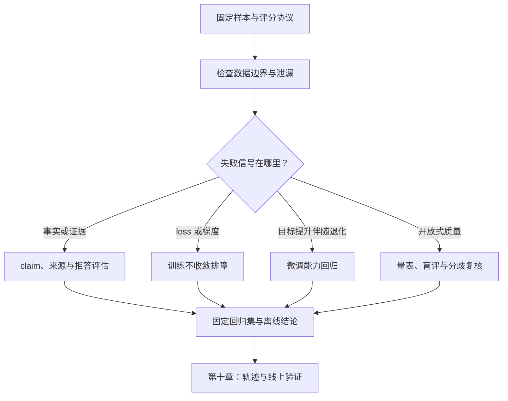

# 第 9 章（1）：评测协议与小型 benchmark

模型、提示词、数据或检索器改过之后，团队常会听到“这版好像更好了”。但“好”具体指什么、哪些输入变好了、有没有一类用户变差了？没有固定样本和评分规则，一次运行只能留下印象，不能成为下一次决策的依据。

本章先把离线评估的对象、样本和规则固定下来，再逐步检查分数是否受到数据泄漏影响、回答中的事实是否有证据、训练更新为何没有按预期发生、微调是否损害原有能力，以及开放式质量怎样通过人工判断得到可复查的结论。

图中几条诊断支路并不互相替代：同一个总分变化，可能来自评测样本不干净、训练数据或梯度有问题，也可能是模型确实做出了能力取舍。先固定测量协议，再根据失败信号选择诊断方法；得到可信的离线结论后，第十章才把证据带到 Agent 轨迹和线上流量。



实际做一次实验时，可以按这个顺序来：固定样本、模型和评分规则，运行基线和候选，保留每条样本的输出，按任务类别分别找失败，再提出一个可以用下一轮实验检验的原因。如果一次同时改提示词、检索、模型和评分器，即使总分变了，也无法判断是哪项改动造成的。

```text
固定样本、模型与评分规则
    ↓
运行基线和候选并保存逐样本输出
    ↓
按任务类别分别统计，再抽取失败样例
    ↓
提出一个能被实验推翻的解释，每次只改一个主要变量
    ↓
重跑回归集，解释收益、退化与证据边界
```

这套流程既适合刚开始做评估的人，也能支撑严谨比较。后者还需固定 tokenizer、数据快照、模型 revision、随机种子、解码参数、硬件、精度、评估脚本和样本筛选规则；否则分数差异可能来自运行条件，而非待比较的改动。

前置知识可以按需回看：[第一章的训练循环](01-pytorch基础实战.md)、[第七章的 RAG 证据校验](07-rag项目实战-2-重排与证据.md)和[分层失败定位报告](07-rag项目实战-3-评估与失败归因.md)，以及[第八章的状态循环](08-agent项目实战-1-协议与状态循环.md)、[执行安全](08-agent项目实战-2-安全审计与验收.md)和[轨迹评估](08-agent项目实战-2-安全审计与验收.md)。本章示例使用合成记录，演示评分和排查机制，不代表真实模型质量。

## 9.1 小型 benchmark：把“感觉变好”变成可复现测量

### 9.1.1 先从一个具体场景开始

假设一个客服问答模型经过微调后出现了三种现象：短问题回答更快，复杂问题更完整，但用户投诉“有时把退款条件说错了”。如果只抽取一条回答，三种现象都可能被某一个样例掩盖。我们需要一组固定样本，同时测量事实、完整性、格式、拒答和延迟，并能回答“退化发生在哪一类输入”。

benchmark 的作用不是制造一个漂亮的总分，而是把一次模型运行变成可比较的实验记录。一个合格的最小评测集至少要回答四个问题：测量什么能力，样本来自哪里，怎样评分，哪一个版本和哪些条件产生了这个结果。

### 先把考题固定下来，分数才有比较意义

如果每次都临时想问题，模型今天得到一组容易题，明天得到一组难题，分数自然不能比较。固定评测集的价值在于让输入保持稳定；当模型、提示词或数据发生变化时，输出变化才有解释空间。

但固定不等于永远不变。评测集应有版本：旧样本保留用于回归，新样本定期加入以覆盖线上新错误。若只维护一套静态题目，模型可能逐渐适应题目表面形式，分数上升却没有获得相应能力。

### 固定的不只是题目，还有测量协议

把 benchmark 写成一个对象集合：

```math
D^{(v)}=\{z_i\}_{i=1}^{n},\qquad
z_i=(x_i,y_i,c_i,h_i,m_i,r_i)
```

其中：

- $v$ 是评测集版本；
- $x_i$ 是输入，可能包含上下文、工具状态或对话历史；
- $y_i$ 是参考答案、标签或一组可接受答案；
- $c_i$ 是任务类别；
- $h_i$ 是难度或风险分层；
- $m_i$ 是评分方法；
- $r_i$ 是来源、时间、权限和数据许可等记录。

模型和运行配置也应成为评测输入的一部分：

```math
\hat y_i=M_{\theta,\pi,\rho,\sigma}(x_i)
```

这里 $\theta$ 是模型版本，$\pi$ 是提示词或模板版本，$\rho$ 是检索、工具和外部数据版本，$\sigma$ 是解码与硬件配置。只记录模型名而不记录这些变量，会把多个变化混成一个结论。

### 9.1.2 三类评测集各自解决什么问题

公开通用 benchmark 适合观察通用能力和与公开工作对照，例如 MMLU、GSM8K、HumanEval、CMMLU、C-Eval、BIG-bench 等。它们的优点是定义和结果容易交流，缺点是未必覆盖本业务的长尾输入、权限边界和输出协议；公开题目还需要考虑训练数据污染。

业务 benchmark 围绕具体任务建立，例如合同条款抽取、企业知识库问答、代码修复、工具调用和多轮客服。它对产品最有价值，但数据制作和维护成本较高，评分规则也需要业务专家参与。

回归集保存曾经失败过的样例：线上投诉、格式解析失败、危险请求、检索证据不支持答案、工具重复执行等。回归集的重点不是覆盖所有能力，而是防止已知错误被新版本重新引入。

三者可以并存：公开集提供外部参照，业务集测量当前任务，回归集守住已知错误。不要用公开集的总分替代业务集，也不要让回归集增长成没有分类和版本管理的“错误垃圾桶”。

### 9.1.3 样本设计：覆盖结构比数量更重要

早期可以从 50--200 条高质量样本开始，但这不是一个普适的充分样本量。小样本适合快速迭代和人工复核，不能支撑非常细的百分点结论。随着系统稳定，应按任务、难度、长度、语言、风险和证据状态分层扩展。

一个客服问答集可以按下列维度做交叉抽样：

```text
任务：事实问答、政策解释、订单查询、投诉处理、拒答
难度：直接查找、多条件组合、跨段推理、信息不足
输入：短问题、长问题、多轮对话、错别字、口语表达
证据：证据充分、证据冲突、证据过期、没有证据
输出：自然语言、JSON、引用、工具调用
风险：普通咨询、隐私、支付、医疗或安全敏感请求
```

如果总集里 90% 是容易的短问题，一个总体准确率会掩盖长上下文和证据不足场景的退化。每一类都应保存样本数，报告中同时给出总体指标和分组指标。

训练、调参和最终评估必须尽量分离。一个实用的划分是：

```text
development：允许频繁查看，用于调试评分器和提示词
validation：用于选择模型、超参数和停止时机
test：在方案基本固定后使用，报告最终结果
private holdout：不公开、不参与日常调参，用于防止过拟合
```

如果团队反复查看 test 的失败样例并修改模型，再把同一个 test 分数当作“未见数据”结果，test 已经被逐渐吸收到开发流程中。版本名改变并不能自动恢复独立性。

### 9.1.4 样例 schema：让评分所需信息随数据保存

一个最小 JSONL 样例可以写成如下形式：

```text
{"id":"mc_001","category":"multiple_choice","difficulty":"easy","input":"LayerNorm 的主要作用是什么？","reference":"稳定激活分布","scoring":"keyword","keywords":["稳定","激活"],"source":"curated_v1"}
{"id":"qa_001","category":"short_qa","difficulty":"medium","input":"为什么 decoder-only 模型使用 causal mask？","reference":"防止当前位置看到未来 token，保证自回归生成只依赖历史信息。","scoring":"claim_check","claims":["不能看到未来 token","生成依赖历史信息"],"source":"curated_v1"}
{"id":"fmt_001","category":"format_following","difficulty":"easy","input":"只输出 JSON：张三，18 岁。","scoring":"json_schema","schema":{"type":"object","required":["name","age"]},"source":"regression_v3"}
{"id":"rag_001","category":"grounded_qa","difficulty":"hard","input":"根据给定政策说明退款到账时间。","context":"退款通常在三个工作日内到账；特殊支付渠道可能需要五个工作日。","reference":"通常为三个工作日，特殊支付渠道可能需要五个工作日。","scoring":"claim_check","claims":["通常三个工作日","特殊渠道可能五个工作日"],"source":"policy_2026_08"}
```

`scoring` 不应由评测脚本根据输入猜测。评分方式明确写在样例里，才能知道一个分数是精确匹配、结构化解析、关键词覆盖还是人工判断。RAG 样例还应保存文档版本和片段 ID；否则文档更新后，旧答案可能被错误地当作当前标准。

### 9.1.5 常用评分方法以及它们看不见什么

选择题、标签分类和严格协议适合 exact match：

```math
s_i^{\mathrm{EM}}=\mathbb{1}[\mathrm{normalize}(\hat y_i)=\mathrm{normalize}(y_i)]
```

其中 `normalize` 只能做预先约定的处理，例如去掉首尾空白、统一大小写或抽取选项字母。不能为了让分数变高而任意删除内容。

开放问答可以拆成多个关键事实，用部分覆盖代替“一字不差”：

```math
s_i^{\mathrm{claim}}=
\frac{\sum_{j=1}^{k_i}w_{ij}\mathbb{1}[\mathrm{support}(\hat y_i,c_{ij})]}{\sum_{j=1}^{k_i}w_{ij}}
```

其中 $k_i>0$，$w_{ij}$ 是有限的非负权重，且该样例的权重和必须大于 0；$c_{ij}$ 是第 $i$ 条样例的第 $j$ 个关键 claim。这个分数只表示关键事实覆盖，不自动表示没有额外错误；答案可能覆盖了两个正确 claim，同时添加一个未经支持的第三个 claim。没有 claim 或权重和为 0 时，分数应记为“不适用”，不能把它伪装成 0 分。

关键词评分成本低、容易复现，适合早期粗筛，但同义改写会漏判，堆砌关键词也会得到虚高分。语义相似度评分能减少字面差异，却可能把流畅但错误的答案判为相似；使用 embedding 或另一个语言模型评分时，应保留评分模型版本和人工校验结果。

结构化输出至少需要检查语法、类型、必填字段、枚举值和业务约束：

```math
s_i^{\mathrm{schema}}=
\mathbb{1}[\mathrm{parse}(\hat y_i)]\cdot
\mathbb{1}[\mathrm{schema\_valid}(\hat y_i)]\cdot
\mathbb{1}[\mathrm{business\_valid}(\hat y_i)]
```

三个条件不能合成“看起来像 JSON”。例如 `{"age":"十八"}` 可能是合法 JSON，却不符合数值字段约束；`{"name":"张三","age":18,"action":"refund"}` 可能通过 schema，却没有权限执行退款。

### 9.1.6 总体分数、分组结果和不确定性

样例分数记作 $s_i\in[0,1]$，微平均分是：

```math
S_{\mathrm{micro}}=\frac{1}{n}\sum_{i=1}^{n}s_i
```

若第 $g$ 组样本记作 $D_g$，则：

```math
S_g=\frac{1}{|D_g|}\sum_{i\in D_g}s_i
```

若不希望样本多的组完全支配结果，可以先求每组平均分，再做 macro average：

```math
S_{\mathrm{macro}}=\frac{1}{|G|}\sum_{g\in G}S_g
```

这些式子分别要求 $n>0$、每个被报告的分组 $D_g\ne\varnothing$，以及 $G\ne\varnothing$。空 benchmark、空分组或没有可报告的类别都没有平均分；程序应返回“不适用”或直接报告配置错误。微平均回答“所有样本中有多少得分”，宏平均回答“各类任务平均表现如何”。两者差异很大时，通常说明样本分布不均，或模型在某些任务类别上的表现不稳定。

例如，简单题这一组有 8/10 条通过，困难题这一组有 1/2 条通过。微平均是 $(8+1)/(10+2)=9/12=0.75$，每题权重相同；宏平均是 $(8/10+1/2)/2=(0.8+0.5)/2=0.65$，每组权重相同。二者回答不同问题，报告时应同时说明使用哪一种，以及各组怎样划分。

对 $0\le x\le n$ 且 $n>0$ 的二值结果，成功率 $\hat p=x/n$ 的简单标准误近似为：

```math
\mathrm{SE}(\hat p)=\sqrt{\frac{\hat p(1-\hat p)}{n}}
```

小样本或成功率接近 0、1 时，直接使用正态区间可能不可靠。Wilson 区间通常更稳健：

```math
\mathrm{CI}_{\mathrm{Wilson}}=
\frac{\hat p+\frac{z^2}{2n}\pm z\sqrt{\frac{\hat p(1-\hat p)}{n}+\frac{z^2}{4n^2}}}{1+\frac{z^2}{n}}
```

Wilson 式同样要求 $n>0$、$0\le x\le n$，并且 $z>0$ 为有限的临界值；$n=0$ 时区间未定义，不能返回 $[0,0]$ 来制造“没有成功”的错觉。评估报告至少要同时给出样本数、点估计、区间、分组结果和失败样例。一个 20 条样本的 95% 准确率，与一个 20,000 条样本的 95% 准确率，证据强度并不相同。

手算 4/4 全部成功的例子：$\hat p=1$、$z=1.96$，分母为 $1+3.8416/4=1.9604$；区间中心为 $(1+3.8416/8)/1.9604\approx0.7551$，半宽为 $1.96\sqrt{3.8416/64}/1.9604\approx0.2450$，所以区间约为 $[0.5101,1.0000]$。点估计虽为 100%，小样本下限仍约为 51%，这正是不能把四题全对写成“准确率已证明接近 100%”的原因。

### 9.1.7 一个零依赖 benchmark runner

下面的实现只使用 Python 标准库，以内存中的样例字典演示模型接口、不同评分器、分组统计和 Wilson 区间。若从 JSONL 读取，应逐行解析后调用同一个 `validate_rows`；本例不包含文件读取。真实项目可以把 `call_model` 替换为本地模型、vLLM、远程 API 或 RAG pipeline；评测主流程不应因此改变。

> 代码状态：静态审阅，未运行（2026-10-30）

```python
import json
import math
from collections import defaultdict


DATA = [
    {
        "id": "mc_001",
        "category": "choice",
        "input": "LayerNorm 的主要作用是稳定激活分布。请回答：正确还是错误？",
        "reference": "正确",
        "scoring": "exact",
    },
    {
        "id": "qa_001",
        "category": "causal_mask",
        "input": "为什么 decoder-only 模型使用 causal mask？",
        "claims": ["未来 token", "历史信息"],
        "scoring": "keywords",
    },
    {
        "id": "fmt_001",
        "category": "json",
        "input": "只输出 JSON：姓名张三，年龄18。",
        "required": ["name", "age"],
        "scoring": "json",
    },
    {
        "id": "qa_002",
        "category": "causal_mask",
        "input": "解释 causal mask 的作用。",
        "claims": ["未来 token", "历史信息"],
        "scoring": "keywords",
    },
]


def call_model(text):
    if "LayerNorm" in text:
        return "正确"
    if "causal mask" in text:
        return "它阻止当前位置读取未来 token，因此当前预测只使用历史信息。"
    if "只输出 JSON" in text:
        return '{"name": "张三", "age": 18}'
    return "无法回答"


def require_text(value, field):
    if not isinstance(value, str) or not value.strip():
        raise ValueError(f"{field} must be a non-empty string")


def validate_rows(rows):
    if not isinstance(rows, list) or not rows:
        raise ValueError("DATA must contain at least one evaluation row")
    seen = set()
    for row in rows:
        if not isinstance(row, dict):
            raise TypeError("each evaluation row must be a dictionary")
        for field in ("id", "category", "input", "scoring"):
            require_text(row.get(field), field)
        if row["id"] in seen:
            raise ValueError(f"duplicate sample id: {row['id']}")
        seen.add(row["id"])
        if row["scoring"] == "exact":
            require_text(row.get("reference"), "reference")
        elif row["scoring"] == "keywords":
            keywords = row.get("claims")
            if not isinstance(keywords, list) or not keywords:
                raise ValueError("keywords scoring requires a non-empty claims list")
            for keyword in keywords:
                require_text(keyword, "keyword")
        elif row["scoring"] == "json":
            required = row.get("required")
            if not isinstance(required, list) or not required:
                raise ValueError("json scoring requires a non-empty required list")
            for key in required:
                require_text(key, "required key")
        else:
            raise ValueError(f"unknown scoring method: {row['scoring']}")


def exact_score(prediction, reference):
    require_text(prediction, "prediction")
    require_text(reference, "reference")
    return float(prediction.strip() == reference.strip())


def keyword_score(prediction, keywords):
    require_text(prediction, "prediction")
    if not isinstance(keywords, list) or not keywords:
        raise ValueError("keyword_score requires a non-empty keyword list")
    for keyword in keywords:
        require_text(keyword, "keyword")
    hits = sum(keyword in prediction for keyword in keywords)
    return hits / len(keywords)


def json_score(prediction, required):
    require_text(prediction, "prediction")
    if not isinstance(required, list) or not required:
        raise ValueError("json_score requires a non-empty required list")
    for key in required:
        require_text(key, "required key")
    try:
        value = json.loads(prediction)
    except json.JSONDecodeError:
        return 0.0
    if not isinstance(value, dict):
        return 0.0
    return float(all(key in value for key in required))


def score(row, prediction):
    require_text(row.get("scoring"), "scoring")
    method = row["scoring"]
    if method == "exact":
        return exact_score(prediction, row["reference"])
    if method == "keywords":
        return keyword_score(prediction, row["claims"])
    if method == "json":
        return json_score(prediction, row["required"])
    raise ValueError(f"unknown scoring method: {method}")


def wilson(successes, total, z=1.96):
    if not isinstance(successes, int) or isinstance(successes, bool):
        raise TypeError("successes must be an integer")
    if not isinstance(total, int) or isinstance(total, bool):
        raise TypeError("total must be an integer")
    if total <= 0:
        raise ValueError("Wilson interval is undefined when total <= 0")
    if not 0 <= successes <= total:
        raise ValueError("successes must satisfy 0 <= successes <= total")
    if not math.isfinite(z) or z <= 0:
        raise ValueError("z must be a finite positive number")
    p = successes / total
    denominator = 1 + z * z / total
    center = (p + z * z / (2 * total)) / denominator
    margin = z * math.sqrt(
        p * (1 - p) / total + z * z / (4 * total * total)
    ) / denominator
    return (center - margin, center + margin)


validate_rows(DATA)
rows = []
for example in DATA:
    prediction = call_model(example["input"])
    value = score(example, prediction)
    rows.append({
        "id": example["id"],
        "category": example["category"],
        "score": value,
        "prediction": prediction,
    })

groups = defaultdict(list)
for row in rows:
    groups[row["category"]].append(row["score"])

total = sum(row["score"] for row in rows)
successes = sum(row["score"] == 1.0 for row in rows)
report = {
    "micro_mean": round(total / len(rows), 4),
    "fully_correct_rate": round(successes / len(rows), 4),
    "fully_correct_ci95": [round(x, 4) for x in wilson(successes, len(rows))],
    "by_category": {
        category: round(sum(scores) / len(scores), 4)
        for category, scores in sorted(groups.items())
    },
    "rows": rows,
}
print(json.dumps(report, ensure_ascii=False, sort_keys=True))
```
四条样例都通过时，`micro_mean` 和 `fully_correct_rate` 的点估计都是 1.0；Wilson 区间仍约为 `[0.5101, 1.0]`，不能据此宣称系统可靠。JSON 评分器只检查对象和必填键，不验证类型、业务权限或完整 JSON Schema；例如年龄为字符串仍会通过。关键词分数是连续值，而 `fully_correct_rate` 只把完整命中的样例算作成功，两者回答不同问题。示例中的模型调用是确定性占位函数。真实运行至少记录请求 ID、错误码、延迟、输入输出 token 数和采样配置版本；原始输入、上下文和响应不应默认进入普通日志，只有在授权、隔离、脱敏并受访问和保留策略约束的离线评估环境中才保存内容。空输出应作为失败记录，不应让整个评测批次丢失。

### 9.1.8 失败样例比总分更能指导改动

评估完成后应保存每条样例的 ID、分数、错误标签和运行版本；输入、上下文和输出放在受限的评估数据区，常规报告通过样本 ID 或受保护引用关联，不复制进一般日志。错误标签最好是互斥主标签加可重复副标签，例如：

```text
主标签：wrong_fact / missing_evidence / format_invalid / refusal / irrelevant
副标签：long_context / multi_turn / ambiguous / unsafe / tool_error
```

分析时先问“错误集中在哪里”，再问“怎样修复”。如果 `format_invalid` 只出现在长输出，优先检查模板、停止条件和解析器；如果 `wrong_fact` 只出现在新文档，优先检查检索版本和文档切分；如果所有类别都下降，才需要扩大到模型、解码和服务层排查。

一个好的 benchmark 记录应像实验日志，而不是一张只有总分的排行榜：

```text
benchmark_version
dataset_commit
model_revision
prompt_revision
retriever_revision
tool_revision
tokenizer_revision
decoding: temperature / top_p / max_tokens / seed
hardware_and_precision
sample_counts_by_slice
scores_and_intervals
error_labels_and_examples
```

### 9.1.9 证据层级与适用范围

[HELM 论文](https://arxiv.org/abs/2211.09110)把多维度、可复现和透明报告作为语言模型评估的重要原则；[OpenAI Evals](https://github.com/openai/evals) 提供了可扩展的评测组织方式；[lm-evaluation-harness](https://github.com/EleutherAI/lm-evaluation-harness) 展示了统一任务接口和标准化运行的工程路径。这些项目能帮助我们理解评测基础设施的组织方式，但它们的任务和评分器不能直接替代某个业务的验收定义。

因此，本节的公式和零依赖代码是教学实现。真正的业务结论必须绑定数据版本、运行配置、样本来源和人工复核结果；一个小 benchmark 可以帮助快速定位问题，却不能单独证明模型已经具备通用可靠性。

评测协议固定后，还要问一个更早的问题：这些题目是否在训练或调参时已经被看过？接下来读[数据污染与评测泄漏](09-评估与debug实战-2-数据与事实性核验.md)，沿着信息流检查比较对象是否可信。
