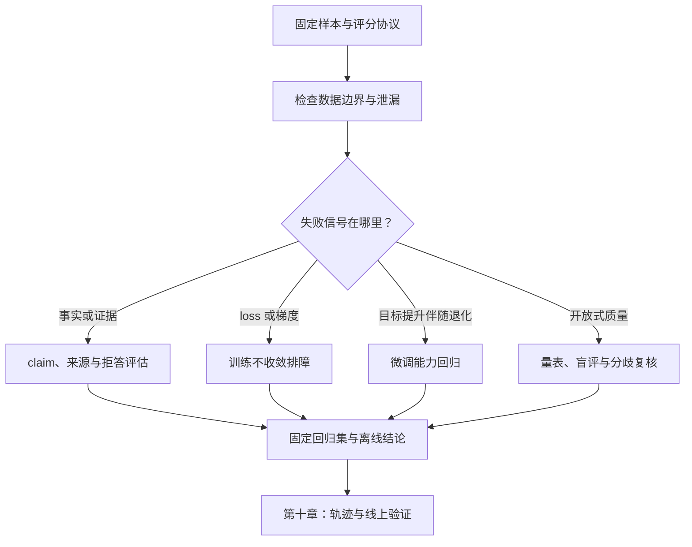

# 第 9 章：评估与 Debug 实战

训练、微调、推理和 Agent 系统最终都会回到同一个问题：这一次改动究竟改变了什么？如果只有一句“感觉更好了”，团队就无法判断改动是否有效，也无法知道代价来自哪里。模型的输出是随机的，数据会变化，提示词和检索器会变化，线上用户还会不断提出训练集里没有出现过的问题；因此，评估不是项目结束时补上的一张成绩单，而是贯穿数据、训练、推理和发布的测量系统。

本章聚焦离线评估与训练排障：先固定测量对象和数据边界，再检查事实支持、训练状态、微调回归与人工评分。它回答“这次改动在哪些样本上变好或变坏，证据能支持多强的结论”，不把一项总分当作完整答案。

六个步骤按诊断顺序推进：

1. 9.1 建立固定 benchmark 和样本契约。
2. 9.2 排查训练、评测和近重复造成的信息泄漏。
3. 9.3 将事实性拆成 claim、证据和拒答判断。
4. 9.4 从数据、标签、损失、梯度到数值精度排查训练不收敛。
5. 9.5 比较微调目标收益与其他能力回归。
6. 9.6 用量表、盲评和分歧复核评估开放式回答。

图中把离线诊断画成分支，是因为相同的总分变化可能来自不同故障：事实支持问题要查 claim 和 evidence，训练不收敛要查数据与梯度，微调退化要比较能力切片，开放式质量问题要校准标注。只有这些失败都回到固定样本和逐条记录上，才形成可比较的离线结论；第十章再把证据推进到轨迹与线上阶段。



它们组成同一条离线闭环：先确保比较对象可信，再区分系统错误和测量错误，之后定位失败并验证候选改动。Agent 轨迹回放和线上流量实验属于下一章的系统级评估阶段。

初学者可以先抓住一个循环：

```text
固定样本、模型与评分规则
    ↓
运行基线和候选并保存逐样本输出
    ↓
按任务切片统计，再抽取失败样例
    ↓
提出可证伪假设并只改一个主要变量
    ↓
重跑回归集，解释收益、退化与证据边界
```

有经验的读者还要固定 tokenizer、数据快照、模型 revision、随机种子、解码参数、硬件、精度、评估脚本和样本筛选规则。缺少这些条件时，两个分数即使不同，也未必可以作因果比较。

前置知识是[第一章的训练循环](01-pytorch基础实战.md)、[第七章的 RAG 证据链](07-rag项目实战.md)和[第八章的 Agent 执行轨迹](08-agent项目实战.md)。本章的 Python 示例使用合成记录验证评分和故障诊断机制，不代表真实模型质量。完成离线分析后，下一章把 Agent 执行轨迹与线上流量放进同一条系统级发布评估链。

## 9.1 小型 benchmark：把“感觉变好”变成可复现测量

### 9.1.1 先从一个具体场景开始

假设一个客服问答模型经过微调后出现了三种现象：短问题回答更快，复杂问题更完整，但用户投诉“有时把退款条件说错了”。如果只抽取一条回答，三种现象都可能被某一个样例掩盖。我们需要一组固定样本，同时测量事实、完整性、格式、拒答和延迟，并能回答“退化发生在哪一类输入”。

benchmark 的作用不是制造一个漂亮的总分，而是把一次模型运行变成可比较的实验记录。一个合格的最小评测集至少要回答四个问题：测量什么能力，样本来自哪里，怎样评分，哪一个版本和哪些条件产生了这个结果。

### 初学者视角：评测集就是一组固定的考题

如果每次都临时想问题，模型今天得到一组容易题，明天得到一组难题，分数自然不能比较。固定评测集的价值在于让输入保持稳定；当模型、提示词或数据发生变化时，输出变化才有解释空间。

但固定不等于永远不变。评测集应有版本：旧样本保留用于回归，新样本定期加入以覆盖线上新错误。若只维护一套静态题目，模型可能逐渐适应题目表面形式，分数上升却没有获得相应能力。

### 深入视角：benchmark 是一个带版本的测量协议

把 benchmark 写成一个对象集合：

```math
D^{(v)}=\{z_i\}_{i=1}^{n},\qquad
z_i=(x_i,y_i,c_i,h_i,m_i,r_i)
```

其中：

- \(v\) 是评测集版本；
- \(x_i\) 是输入，可能包含上下文、工具状态或对话历史；
- \(y_i\) 是参考答案、标签或一组可接受答案；
- \(c_i\) 是任务类别；
- \(h_i\) 是难度或风险分层；
- \(m_i\) 是评分方法；
- \(r_i\) 是来源、时间、权限和数据许可等记录。

模型和运行配置也应成为评测输入的一部分：

```math
\hat y_i=M_{\theta,\pi,\rho,\sigma}(x_i)
```

这里 \(\theta\) 是模型版本，\(\pi\) 是提示词或模板版本，\(\rho\) 是检索、工具和外部数据版本，\(\sigma\) 是解码与硬件配置。只记录模型名而不记录这些变量，会把多个变化混成一个结论。

### 9.1.2 三类评测集各自解决什么问题

公开通用 benchmark 适合观察通用能力和与公开工作对照，例如 MMLU、GSM8K、HumanEval、CMMLU、C-Eval、BIG-bench 等。它们的优点是定义和结果容易交流，缺点是未必覆盖本业务的长尾输入、权限边界和输出协议；公开题目还需要考虑训练数据污染。

业务 benchmark 围绕具体任务建立，例如合同条款抽取、企业知识库问答、代码修复、工具调用和多轮客服。它对产品最有价值，但数据制作和维护成本较高，评分规则也需要业务专家参与。

回归集保存曾经失败过的样例：线上投诉、格式解析失败、危险请求、检索证据不支持答案、工具重复执行等。回归集的重点不是覆盖所有能力，而是防止已知错误被新版本重新引入。

三者可以并存：公开集提供外部参照，业务集测量当前任务，回归集守住已知错误。不要用公开集的总分替代业务集，也不要让回归集增长成没有分类和版本管理的“错误垃圾桶”。

### 9.1.3 样本设计：覆盖结构比数量更重要

早期可以从 50--200 条高质量样本开始，但这不是一个普适的充分样本量。小样本适合快速迭代和人工复核，不能支撑非常细的百分点结论。随着系统稳定，应按任务、难度、长度、语言、风险和证据状态分层扩展。

一个客服问答集可以按下列维度做交叉抽样：

```text
任务：事实问答、政策解释、订单查询、投诉处理、拒答
难度：直接查找、多条件组合、跨段推理、信息不足
输入：短问题、长问题、多轮对话、错别字、口语表达
证据：证据充分、证据冲突、证据过期、没有证据
输出：自然语言、JSON、引用、工具调用
风险：普通咨询、隐私、支付、医疗或安全敏感请求
```

如果总集里 90% 是容易的短问题，一个总体准确率会掩盖长上下文和证据不足场景的退化。每一层都应保存样本数，报告中同时给出总体指标和切片指标。

训练、调参和最终评估必须尽量分离。一个实用的划分是：

```text
development：允许频繁查看，用于调试评分器和提示词
validation：用于选择模型、超参数和停止时机
test：在方案基本固定后使用，报告最终结果
private holdout：不公开、不参与日常调参，用于防止过拟合
```

如果团队反复查看 test 的失败样例并修改模型，再把同一个 test 分数当作“未见数据”结果，test 已经被逐渐吸收到开发流程中。版本名改变并不能自动恢复独立性。

### 9.1.4 样例 schema：让评分所需信息随数据保存

一个最小 JSONL 样例可以写成如下形式：

```text
{"id":"mc_001","category":"multiple_choice","difficulty":"easy","input":"LayerNorm 的主要作用是什么？","reference":"稳定激活分布","scoring":"keyword","keywords":["稳定","激活"],"source":"curated_v1"}
{"id":"qa_001","category":"short_qa","difficulty":"medium","input":"为什么 decoder-only 模型使用 causal mask？","reference":"防止当前位置看到未来 token，保证自回归生成只依赖历史信息。","scoring":"claim_check","claims":["不能看到未来 token","生成依赖历史信息"],"source":"curated_v1"}
{"id":"fmt_001","category":"format_following","difficulty":"easy","input":"只输出 JSON：张三，18 岁。","scoring":"json_schema","schema":{"type":"object","required":["name","age"]},"source":"regression_v3"}
{"id":"rag_001","category":"grounded_qa","difficulty":"hard","input":"根据给定政策说明退款到账时间。","context":"退款通常在三个工作日内到账；特殊支付渠道可能需要五个工作日。","reference":"通常为三个工作日，特殊支付渠道可能需要五个工作日。","scoring":"claim_check","claims":["通常三个工作日","特殊渠道可能五个工作日"],"source":"policy_2026_08"}
```

`scoring` 不应由评测脚本根据输入猜测。评分方式明确写在样例里，才能知道一个分数是精确匹配、结构化解析、关键词覆盖还是人工判断。RAG 样例还应保存文档版本和片段 ID；否则文档更新后，旧答案可能被错误地当作当前标准。

### 9.1.5 常用评分方法以及它们看不见什么

选择题、标签分类和严格协议适合 exact match：

```math
s_i^{\mathrm{EM}}=\mathbb{1}[\mathrm{normalize}(\hat y_i)=\mathrm{normalize}(y_i)]
```

其中 `normalize` 只能做预先约定的处理，例如去掉首尾空白、统一大小写或抽取选项字母。不能为了让分数变高而任意删除内容。

开放问答可以拆成多个关键事实，用部分覆盖代替“一字不差”：

```math
s_i^{\mathrm{claim}}=
\frac{\sum_{j=1}^{k_i}w_{ij}\mathbb{1}[\mathrm{support}(\hat y_i,c_{ij})]}{\sum_{j=1}^{k_i}w_{ij}}
```

其中 \(k_i>0\)，\(w_{ij}\) 是有限的非负权重，且该样例的权重和必须大于 0；\(c_{ij}\) 是第 \(i\) 条样例的第 \(j\) 个关键 claim。这个分数只表示关键事实覆盖，不自动表示没有额外错误；答案可能覆盖了两个正确 claim，同时添加一个未经支持的第三个 claim。没有 claim 或权重和为 0 时，分数应记为“不适用”，不能把它伪装成 0 分。

关键词评分成本低、容易复现，适合早期粗筛，但同义改写会漏判，堆砌关键词也会得到虚高分。语义相似度评分能减少字面差异，却可能把流畅但错误的答案判为相似；使用 embedding 或另一个语言模型评分时，应保留评分模型版本和人工校验结果。

结构化输出至少需要检查语法、类型、必填字段、枚举值和业务约束：

```math
s_i^{\mathrm{schema}}=
\mathbb{1}[\mathrm{parse}(\hat y_i)]\cdot
\mathbb{1}[\mathrm{schema\_valid}(\hat y_i)]\cdot
\mathbb{1}[\mathrm{business\_valid}(\hat y_i)]
```

三个条件不能合成“看起来像 JSON”。例如 `{"age":"十八"}` 可能是合法 JSON，却不符合数值字段约束；`{"name":"张三","age":18,"action":"refund"}` 可能通过 schema，却没有权限执行退款。

### 9.1.6 总体分数、切片分数和不确定性

样例分数记作 \(s_i\in[0,1]\)，微平均分是：

```math
S_{\mathrm{micro}}=\frac{1}{n}\sum_{i=1}^{n}s_i
```

若第 \(g\) 个任务切片包含 \(D_g\)，则：

```math
S_g=\frac{1}{|D_g|}\sum_{i\in D_g}s_i
```

若不希望大切片完全支配结果，可以先求每个切片平均分，再做 macro average：

```math
S_{\mathrm{macro}}=\frac{1}{|G|}\sum_{g\in G}S_g
```

这些式子分别要求 \(n>0\)、每个被报告的切片 \(D_g\ne\varnothing\)，以及 \(G\ne\varnothing\)。空 benchmark、空切片或没有可报告的分组都没有平均分；程序应返回“不适用”或直接报告配置错误。微平均回答“所有样本中有多少得分”，宏平均回答“各类任务平均表现如何”。两者差异很大时，通常说明样本分布不均或模型对某些切片表现不稳定。

例如，简单切片有 8/10 条通过，困难切片有 1/2 条通过。微平均是 \((8+1)/(10+2)=9/12=0.75\)，每题权重相同；宏平均是 \((8/10+1/2)/2=(0.8+0.5)/2=0.65\)，每个切片权重相同。二者回答不同问题，报告时应同时说明使用哪一种，以及切片如何定义。

对 \(0\le x\le n\) 且 \(n>0\) 的二值结果，成功率 \(\hat p=x/n\) 的简单标准误近似为：

```math
\mathrm{SE}(\hat p)=\sqrt{\frac{\hat p(1-\hat p)}{n}}
```

小样本或成功率接近 0、1 时，直接使用正态区间可能不可靠。Wilson 区间通常更稳健：

```math
\mathrm{CI}_{\mathrm{Wilson}}=
\frac{\hat p+\frac{z^2}{2n}\pm z\sqrt{\frac{\hat p(1-\hat p)}{n}+\frac{z^2}{4n^2}}}{1+\frac{z^2}{n}}
```

Wilson 式同样要求 \(n>0\)、\(0\le x\le n\)，并且 \(z>0\) 为有限的临界值；\(n=0\) 时区间未定义，不能返回 \([0,0]\) 来制造“没有成功”的错觉。评估报告至少要同时给出样本数、点估计、区间、切片和失败样例。一个 20 条样本的 95% 准确率，与一个 20,000 条样本的 95% 准确率，证据强度并不相同。

手算 4/4 全部成功的例子：\(\hat p=1\)、\(z=1.96\)，分母为 \(1+3.8416/4=1.9604\)；区间中心为 \((1+3.8416/8)/1.9604\approx0.7551\)，半宽为 \(1.96\sqrt{3.8416/64}/1.9604\approx0.2450\)，所以区间约为 \([0.5101,1.0000]\)。点估计虽为 100%，小样本下限仍约为 51%，这正是不能把四题全对写成“准确率已证明接近 100%”的原因。

### 9.1.7 一个零依赖 benchmark runner

下面的实现只使用 Python 标准库，以内存中的样例字典演示模型接口、不同评分器、切片统计和 Wilson 区间。若从 JSONL 读取，应逐行解析后调用同一个 `validate_rows`；本例不包含文件读取。真实项目可以把 `call_model` 替换为本地模型、vLLM、远程 API 或 RAG pipeline；评测主流程不应因此改变。

> 代码状态：静态审阅，未运行（2026-10-30）

```python
import json
import math
from collections import defaultdict


DATA = [
    {
        "id": "mc_001",
        "category": "choice",
        "input": "LayerNorm 的主要作用是稳定激活分布。请回答：正确还是错误？",
        "reference": "正确",
        "scoring": "exact",
    },
    {
        "id": "qa_001",
        "category": "causal_mask",
        "input": "为什么 decoder-only 模型使用 causal mask？",
        "claims": ["未来 token", "历史信息"],
        "scoring": "keywords",
    },
    {
        "id": "fmt_001",
        "category": "json",
        "input": "只输出 JSON：姓名张三，年龄18。",
        "required": ["name", "age"],
        "scoring": "json",
    },
    {
        "id": "qa_002",
        "category": "causal_mask",
        "input": "解释 causal mask 的作用。",
        "claims": ["未来 token", "历史信息"],
        "scoring": "keywords",
    },
]


def call_model(text):
    if "LayerNorm" in text:
        return "正确"
    if "causal mask" in text:
        return "它阻止当前位置读取未来 token，因此当前预测只使用历史信息。"
    if "只输出 JSON" in text:
        return '{"name": "张三", "age": 18}'
    return "无法回答"


def require_text(value, field):
    if not isinstance(value, str) or not value.strip():
        raise ValueError(f"{field} must be a non-empty string")


def validate_rows(rows):
    if not isinstance(rows, list) or not rows:
        raise ValueError("DATA must contain at least one evaluation row")
    seen = set()
    for row in rows:
        if not isinstance(row, dict):
            raise TypeError("each evaluation row must be a dictionary")
        for field in ("id", "category", "input", "scoring"):
            require_text(row.get(field), field)
        if row["id"] in seen:
            raise ValueError(f"duplicate sample id: {row['id']}")
        seen.add(row["id"])
        if row["scoring"] == "exact":
            require_text(row.get("reference"), "reference")
        elif row["scoring"] == "keywords":
            keywords = row.get("claims")
            if not isinstance(keywords, list) or not keywords:
                raise ValueError("keywords scoring requires a non-empty claims list")
            for keyword in keywords:
                require_text(keyword, "keyword")
        elif row["scoring"] == "json":
            required = row.get("required")
            if not isinstance(required, list) or not required:
                raise ValueError("json scoring requires a non-empty required list")
            for key in required:
                require_text(key, "required key")
        else:
            raise ValueError(f"unknown scoring method: {row['scoring']}")


def exact_score(prediction, reference):
    require_text(prediction, "prediction")
    require_text(reference, "reference")
    return float(prediction.strip() == reference.strip())


def keyword_score(prediction, keywords):
    require_text(prediction, "prediction")
    if not isinstance(keywords, list) or not keywords:
        raise ValueError("keyword_score requires a non-empty keyword list")
    for keyword in keywords:
        require_text(keyword, "keyword")
    hits = sum(keyword in prediction for keyword in keywords)
    return hits / len(keywords)


def json_score(prediction, required):
    require_text(prediction, "prediction")
    if not isinstance(required, list) or not required:
        raise ValueError("json_score requires a non-empty required list")
    for key in required:
        require_text(key, "required key")
    try:
        value = json.loads(prediction)
    except json.JSONDecodeError:
        return 0.0
    if not isinstance(value, dict):
        return 0.0
    return float(all(key in value for key in required))


def score(row, prediction):
    require_text(row.get("scoring"), "scoring")
    method = row["scoring"]
    if method == "exact":
        return exact_score(prediction, row["reference"])
    if method == "keywords":
        return keyword_score(prediction, row["claims"])
    if method == "json":
        return json_score(prediction, row["required"])
    raise ValueError(f"unknown scoring method: {method}")


def wilson(successes, total, z=1.96):
    if not isinstance(successes, int) or isinstance(successes, bool):
        raise TypeError("successes must be an integer")
    if not isinstance(total, int) or isinstance(total, bool):
        raise TypeError("total must be an integer")
    if total <= 0:
        raise ValueError("Wilson interval is undefined when total <= 0")
    if not 0 <= successes <= total:
        raise ValueError("successes must satisfy 0 <= successes <= total")
    if not math.isfinite(z) or z <= 0:
        raise ValueError("z must be a finite positive number")
    p = successes / total
    denominator = 1 + z * z / total
    center = (p + z * z / (2 * total)) / denominator
    margin = z * math.sqrt(
        p * (1 - p) / total + z * z / (4 * total * total)
    ) / denominator
    return (center - margin, center + margin)


validate_rows(DATA)
rows = []
for example in DATA:
    prediction = call_model(example["input"])
    value = score(example, prediction)
    rows.append({
        "id": example["id"],
        "category": example["category"],
        "score": value,
        "prediction": prediction,
    })

groups = defaultdict(list)
for row in rows:
    groups[row["category"]].append(row["score"])

total = sum(row["score"] for row in rows)
successes = sum(row["score"] == 1.0 for row in rows)
report = {
    "micro_mean": round(total / len(rows), 4),
    "fully_correct_rate": round(successes / len(rows), 4),
    "fully_correct_ci95": [round(x, 4) for x in wilson(successes, len(rows))],
    "by_category": {
        category: round(sum(scores) / len(scores), 4)
        for category, scores in sorted(groups.items())
    },
    "rows": rows,
}
print(json.dumps(report, ensure_ascii=False, sort_keys=True))
```
四条样例都通过时，`micro_mean` 和 `fully_correct_rate` 的点估计都是 1.0；Wilson 区间仍约为 `[0.5101, 1.0]`，不能据此宣称系统可靠。JSON 评分器只检查对象和必填键，不验证类型、业务权限或完整 JSON Schema；例如年龄为字符串仍会通过。关键词分数是连续值，而 `fully_correct_rate` 只把完整命中的样例算作成功，两者回答不同问题。示例中的模型调用是确定性占位函数。真实运行至少记录请求 ID、错误码、延迟、输入输出 token 数和采样配置版本；原始输入、上下文和响应不应默认进入普通日志，只有在授权、隔离、脱敏并受访问和保留策略约束的离线评估环境中才保存内容。空输出应作为失败记录，不应让整个评测批次丢失。

### 9.1.8 失败样例比总分更能指导改动

评估完成后应保存每条样例的 ID、分数、错误标签和运行版本；输入、上下文和输出放在受限的评估数据区，常规报告通过样本 ID 或受保护引用关联，不复制进一般日志。错误标签最好是互斥主标签加可重复副标签，例如：

```text
主标签：wrong_fact / missing_evidence / format_invalid / refusal / irrelevant
副标签：long_context / multi_turn / ambiguous / unsafe / tool_error
```

分析时先问“错误集中在哪里”，再问“怎样修复”。如果 `format_invalid` 只出现在长输出，优先检查模板、停止条件和解析器；如果 `wrong_fact` 只出现在新文档，优先检查检索版本和文档切分；如果所有类别都下降，才需要扩大到模型、解码和服务层排查。

一个好的 benchmark 记录应像实验日志，而不是一张只有总分的排行榜：

```text
benchmark_version
dataset_commit
model_revision
prompt_revision
retriever_revision
tool_revision
tokenizer_revision
decoding: temperature / top_p / max_tokens / seed
hardware_and_precision
sample_counts_by_slice
scores_and_intervals
error_labels_and_examples
```

### 9.1.9 证据层级与适用范围

[HELM 论文](https://arxiv.org/abs/2211.09110)把多维度、可复现和透明报告作为语言模型评估的重要原则；[OpenAI Evals](https://github.com/openai/evals) 提供了可扩展的评测组织方式；[lm-evaluation-harness](https://github.com/EleutherAI/lm-evaluation-harness) 展示了统一任务接口和标准化运行的工程路径。这些项目能帮助我们理解评测基础设施的组织方式，但它们的任务和评分器不能直接替代某个业务的验收定义。

因此，本节的公式和零依赖代码是教学实现。真正的业务结论必须绑定数据版本、运行配置、样本来源和人工复核结果；一个小 benchmark 可以帮助快速定位问题，却不能单独证明模型已经具备通用可靠性。

## 9.2 数据污染与评测泄漏：先确认分数测的是什么

### 9.2.1 一个看似优秀的结果

某模型在一个公开问答集上从 72 分升到 86 分。团队先后做过继续预训练、提示词优化、检索增强和评分器重写。若没有进一步检查，我们无法知道 14 分提升来自模型能力、检索带来的外部答案、评测脚本的宽松处理，还是测试样例已经进入训练语料。

数据污染不是一个只存在于论文里的词。企业项目中同样会发生：把线上回流数据未经隔离地加入训练集，把 test 的人工修订答案放入提示词，把同一客户的相邻订单同时分到训练和验证，把检索库的未来版本带入历史评估，或者因为调参反复查看 private holdout 而逐渐适应它。

### 初学者视角：泄漏就是“答案通过别的路提前出现了”

最容易理解的例子是训练集和测试集出现同一道题。模型即使不是逐字记住，也可能记住题目的特殊措辞、答案顺序或上下文模板。评估时它表现很好，但遇到同一知识的不同表达未必同样可靠。

泄漏还可能发生在评估程序内部。例如参考答案被拼进 prompt，评分器把模型输出中的任何数字都当作正确，或者 RAG 系统在评估时检索到了包含参考答案的文档。此时问题不是模型“学得好”，而是测量路径给了它额外信息。

### 深入视角：把评估看成一张信息流图

对每个样例，画出信息可能经过的路径：

```text
原始数据
  ├─> 预训练 / SFT / 偏好数据
  ├─> 提示词模板与 few-shot 示例
  ├─> 检索索引与工具返回
  ├─> 评估样本与参考答案
  └─> 评分器、人工指南和错误修订
```

如果从评估结果反向流入训练、提示词、检索库或评分器，就形成了不同程度的泄漏。需要区分：

1. 训练污染：评测内容或近似内容出现在模型训练语料。
2. 切分泄漏：同一实体、同一文档或高度相似样本跨越 train/validation/test。
3. 时间泄漏：用评估时点之后才产生的信息训练或检索。
4. 检索泄漏：评估上下文包含参考答案或由参考答案构造的文本。
5. 提示词泄漏：调参时把 test 失败样例、答案或标签写入固定模板。
6. 评分泄漏：评分规则与模型输出形式过度耦合，造成投机行为。
7. 标注泄漏：人工复核后的答案被当作普通训练数据，未保留独立版本。

这些类别的风险不同，但共同特征是评估时模型获得了不应获得的信息，或者评估者利用了测试结果改变了被测系统。

### 9.2.2 文档切分与时间切分

随机按行切分对独立同分布的简单数据有用，但对文档、用户、订单和会话数据常常不够。应先确定泄漏单元：同一文档、同一客户、同一问题模板、同一事件或同一时间窗口的数据应尽量放在同一分区。

时间敏感任务可以使用时间切分：

```math
D_{\mathrm{train}}=\{z:t(z)<T_1\},\qquad
D_{\mathrm{valid}}=\{z:T_1\le t(z)<T_2\},\qquad
D_{\mathrm{test}}=\{z:t(z)\ge T_2\}
```

如果任务需要回答“上线后未来数据表现如何”，时间切分比随机切分更接近真实部署。它也可能让分布变化变得明显，因此报告里要同时给出时间段、业务版本和样本量。

对于实体泄漏，先按实体分组再切分：

```math
\mathrm{group}(z_i)=g_i,\qquad
\mathrm{partition}(g_i)\in\{\mathrm{train},\mathrm{valid},\mathrm{test}\}
```

同一个 \(g_i\) 不得出现在多个分区。客服场景中的 `customer_id`、合同场景中的 `contract_id`、代码场景中的 `repository_id` 都可能是这种分组键。

### 9.2.3 近重复检测：从精确哈希到 shingle 相似度

完全相同的文本可以用规范化后哈希检测。规范化不能删除会改变含义的数字、否定词和单位，只能处理确定的空格、换行和 Unicode 形式。

对改写或格式变化，需要使用 token 或字符 shingle。设文本 \((a,b)\) 的 shingle 集合为 \(S(a),S(b)\)，Jaccard 相似度为：

```math
J(a,b)=\frac{|S(a)\cap S(b)|}{|S(a)\cup S(b)|}
```

例如比较“退款需要三个工作日到账”和“退款需要 3 个工作日到账”，去掉空格和标点后按连续 3 个字符切分：两边各有 9 个 shingle，其中 6 个相同，联合集合有 12 个，因此 \(J=6/12=0.5\)。若候选阈值设为 0.35，这一对会进入人工复核；“三”和“3”的表达差异只说明存在近似，不足以证明训练污染。

当 \(J(a,b)\) 超过预设阈值，可以把它们标记为候选近重复，再由规则或人工确认。阈值不是定律：代码、数字表格和中文短句的相似度分布不同，应在标注样本上校准。

大规模数据可以用 MinHash、LSH 或 embedding 检索降低全量两两比较成本；这些方法可能漏检或误报，因此最后仍需保留原文片段和人工抽样。

### 9.2.4 一个零依赖近重复扫描器

下面的程序演示规范化、字符 shingle 和跨分区候选发现。它不是生产级去重器，却足以说明为什么“改了空格”不能被当作新样本，以及为什么结果需要人工确认。

> 代码状态：静态审阅，未运行（2026-10-30）

```python
import hashlib
import re


ROWS = [
    {"id": "a1", "split": "train", "text": "退款需要三个工作日到账。"},
    {"id": "a2", "split": "test", "text": "退款需要 3 个工作日到账。"},
    {"id": "b1", "split": "train", "text": "LayerNorm 稳定激活分布。"},
    {"id": "b2", "split": "test", "text": "模型使用 LayerNorm 来稳定激活分布。"},
    {"id": "c1", "split": "test", "text": "完全不同的查询。"},
]


def normalize(text):
    if not isinstance(text, str) or not text.strip():
        raise ValueError("text must be a non-empty string")
    text = text.lower().replace("３", "3")
    text = re.sub(r"[\s，。,:：；;]+", "", text)
    if not text:
        raise ValueError("text is empty after normalization")
    return text


def shingles(text, size=3):
    if not isinstance(size, int) or isinstance(size, bool) or size <= 0:
        raise ValueError("shingle size must be a positive integer")
    text = normalize(text)
    if len(text) <= size:
        return {text}
    return {text[i:i + size] for i in range(len(text) - size + 1)}


def jaccard(left, right):
    if not isinstance(left, set) or not isinstance(right, set):
        raise TypeError("jaccard expects two sets")
    union = left | right
    if not union:
        raise ValueError("Jaccard similarity is undefined for an empty union")
    return len(left & right) / len(union)


def digest(text):
    return hashlib.sha256(normalize(text).encode("utf-8")).hexdigest()


for row in ROWS:
    row["digest"] = digest(row["text"])
    row["shingles"] = shingles(row["text"])

for index, left in enumerate(ROWS):
    for right in ROWS[index + 1:]:
        if left["split"] == right["split"]:
            continue
        similarity = jaccard(left["shingles"], right["shingles"])
        if left["digest"] == right["digest"] or similarity >= 0.35:
            print(left["id"], right["id"], round(similarity, 3))
```
这个示例中的“3”和“三”未必能被同一套规范化规则判断为相同事实；如果业务语料经常出现数字变体，应增加领域规则或使用 token 级比较。不要为了提高召回把所有数字都删除，因为“3 天”和“30 天”会因此产生危险的假相似。

### 9.2.5 训练集未知时如何调查污染

闭源模型通常不会公开完整训练语料，因此不能从“没有看到训练数据清单”推出“没有污染”。更稳妥的证据分层是：

```text
强证据：训练快照、数据清单、哈希和时间记录可审计
中等证据：去重报告、时间切分、成员样本审查、私有 holdout
弱证据：只观察公开 benchmark 分数或模型输出风格
```

可以采用几种互补方法：

- 在评估集建立私有、后加入、不可公开的样本，并通过访问权限隔离；
- 对训练语料做 exact hash 和近重复扫描；
- 用模型对训练样例和新改写样例的置信度、生成概率或逐 token loss 做差异分析；
- 将题目改写、改变实体和顺序，观察性能是否只对原始表面形式高；
- 用时间切分和新近数据做外部验证；
- 对异常高分样例进行逐条人工追踪，确认是否是评分器或检索路径泄漏。

单独的 membership inference 结果也不能直接给出“污染比例”。它可能受模型规模、采样方式、温度、重复程度和背景频率影响。调查结论应写成证据与不确定性，而不是把一次统计异常宣布为确定事实。

### 9.2.6 评估程序也需要被测试

数据泄漏不只在数据文件里。应给评分器和 runner 增加负向测试：

```text
输入为空时不得读取 reference
reference 改变时，模型 prompt 不应自动改变
context 不包含答案时，检索器不能读到隐藏 gold 文件
输出添加无关正确关键词时，分数不应无条件上升
test 样例不应写入训练缓存、few-shot 缓存或 prompt 日志模板
```

可以把评估系统看作被测软件，给它做单元测试和审计日志。一个分数只有在“数据来源、执行路径、评分器行为”都清楚时，才有解释价值。

### 9.2.7 评测污染的报告写法

研究或工程报告至少应说明：

1. 评测集发布日期、版本和是否公开；
2. 训练、提示词示例、检索库和评测集的时间关系；
3. 是否做过 exact/near-duplicate 检查以及阈值；
4. 是否保留私有 holdout 和时间外推集；
5. 哪些结果是污染调查，哪些只是风险提示；
6. 评测脚本是否能访问 reference、未来文档或人工修订结果。

这样即使无法证明“完全没有污染”，读者也能判断证据强度和剩余风险。

近重复扫描只能生成候选，不能直接给污染盖章。人工复核时要同时看题目、答案或解释、来源日期和训练路径：同一模板但不同条件可能是合法重叠，换了实体或表达方式却复用了完整答案则可能被精确匹配漏掉。实际报告应把候选比例与确认重叠比例分开，说明抽查方法和分母；如果 12,000 条样本里扫描器标出 47 个候选，不能把 47 条全当作已污染，也不能因为只确认 3 条就声称其余数据没有问题。

### 9.2.8 资料与边界

[MMLU 论文](https://arxiv.org/abs/2009.03300)和 [BIG-bench 论文](https://arxiv.org/abs/2206.04615)说明了公开 benchmark 的规模化价值，但公开题目也带来训练可见性和复现条件问题。[HELM](https://arxiv.org/abs/2211.09110)强调透明记录和多维度报告。数据污染研究没有一个适用于所有模型、所有数据形态的单一检测器；本节的近重复公式和代码用于建立排查路径，不应被解释为“阈值以上就证明训练污染”。

针对固定题面，2025 年的 [Data Contamination Quiz](https://aclanthology.org/2025.tacl-1.37/) 将原题、三个词级扰动版本和“以上都不是”选项组成选择题，以模型辨认原题的行为作为特定数据分区的污染信号；题面变体的语义与难度、位置偏差仍需检查，不能把分数直接当成语料重叠率。2026 年 ICLR 的 [污染检测脆弱性研究](https://proceedings.iclr.cc/paper_files/paper/2026/hash/a3860475ddbfb8c644c43f0dcd266b66-Abstract-Conference.html) 在其推理模型设置中报告，短程 GRPO 可隐藏部分检测信号，某些 CoT 污染设置下多数检测器接近随机水平；这说明未检出不能证明未污染，结论仍限于论文测试的训练流程和模型。另一个 2026 年 ICLR 工作 [BeyondBench](https://proceedings.iclr.cc/paper_files/paper/2026/hash/22b4e30a7a660b17f1fb58ab49671e77-Abstract-Conference.html) 以算法生成题和确定性 verifier 降低固定题面记忆风险，适用于可形式化生成和验证的任务，不因此覆盖开放问答或真实业务流程。

## 9.3 幻觉与事实性：从流畅文本追溯到可核验 claim

### 9.3.1 “说得像真的”不是事实性

语言模型的训练目标鼓励它生成在语言和上下文中最可能出现的 token，而不是为每一句话附上经过外部世界验证的证明。因此，语法流畅、语气自信、段落结构完整，都不能单独说明内容为真。

在产品中，“幻觉”常常被混成一个过大的标签。至少应区分四类现象：

1. 事实错误：回答与可靠事实或给定证据矛盾。
2. 无依据陈述：回答没有直接矛盾，但证据并不支持它。
3. 证据错配：引用存在，却没有支持对应的 claim，或引用了错误版本。
4. 任务偏离：内容可能为真，但没有回答问题，或者把推测写成确定结论。

例如，用户问“政策中规定的退款到账时间是多少”，模型回答“通常三个工作日，节假日可能延长”。如果文档只写了“三个工作日”，后半句可能是常识性推测，也可能是业务规则；在事实性评估里，它不能因为听起来合理就自动被视为正确。

### 初学者视角：把答案拆成可以逐条核对的句子

一整段回答通常包含多个事实。先把它拆成 claim，再为每个 claim 找支持它的证据：

```text
回答：退款通常三个工作日到账，特殊支付渠道可能需要五个工作日。

claim 1：通常三个工作日到账。
claim 2：特殊支付渠道可能需要五个工作日。
```

如果给定资料只支持 claim 1，就不能因为 claim 1 正确而把整段判为完全正确。相反，一条回答也可能有少量措辞差异，但所有关键 claim 都受到证据支持。

### 深入视角：事实性是回答、证据和世界状态的三元关系

对回答 \(a\) 做 claim 分解，得到 \(C(a)=\{c_j\}_{j=1}^{k}\)。给定证据集合 \(E\)，定义支持关系：

```math
\mathrm{support}(e,c_j)\in\{0,1,\mathrm{contradict}\}
```

这不是语言模型天然提供的标签，而是需要规则、信息抽取、检索匹配、人工或另一个评估模型判断。至少要保存“哪一段证据支持哪一个 claim”，否则一个总分无法定位问题。

对于给定证据的 groundedness，可以定义加权支持率：

```math
P_{\mathrm{support}}(a\mid E)=
\frac{\sum_j w_j\mathbb{1}[\exists e\in E:\mathrm{support}(e,c_j)=1]}{\sum_j w_j}
```

这衡量回答中有多少内容有依据，不衡量回答是否完整。若要衡量问题所需事实的覆盖，应另外定义由问题和参考资料确定的必需事实集 \(Q=\{q_j\}\)，并为其指定有限正权重 \(v_j\)。完整性可以写成：

```math
R_{\mathrm{required}}(a\mid Q,E)=
\frac{\sum_{q_j\in Q}v_j\mathbb{1}[a\ \mathrm{covers}\ q_j]\mathbb{1}[E\ \mathrm{supports}\ q_j]}{\sum_{q_j\in Q}v_j}
```

两式分别要求回答 claim 的总权重大于 0、必需事实集的总权重大于 0；缺少相应集合时报告“不适用”。若回答有 claim，但证据不支持其中任何一条，支持率是 0，而不是“不适用”。例如，问题要求普通和特殊渠道两种到账时间，等权必需事实集含 2 条；回答只正确说明普通渠道，则完整性为 \(1/2=0.5\)。若回答还加入一个“当天到账”的无依据 claim，回答两条 claim 中只有一条受支持，则等权支持率也为 \(1/2=0.5\)；没有这个额外 claim 时支持率为 \(1/1=1\)。这里的完整性是教学定义，不能当作 FActScore 的原始指标；写清分子、分母和 claim 抽取规则，比背一个指标名更重要。

### 9.3.2 开放世界、闭合证据集与拒答

“不知道”在不同任务中有不同含义。

- 闭合证据问答：答案必须由给定文档支持，文档没有说明时应说明证据不足。
- 开放世界问答：允许使用模型知识和外部搜索，但需要记录信息来源和时间。
- 创作任务：事实性不是唯一目标，虚构内容可能是任务要求；仍需避免把虚构叙述伪装成事实。
- 工具任务：模型应报告工具真实返回的状态，不能把计划或调用意图写成已完成动作。

因此，评估“幻觉率”前要先定义可用信息边界。对闭合证据集，一个保守决策是：

```math
d(a,E)=
\begin{cases}
\mathrm{answer}, & \mathrm{all\_supported}\\
\mathrm{qualified}, & \mathrm{partially\_supported}\\
\mathrm{abstain}, & \mathrm{insufficient\_or\_contradictory}
\end{cases}
```

拒答不是无条件越多越好。一个总是说“资料不足”的系统可能没有幻觉，却也无法完成有证据的任务。应同时测量有效回答率、正确回答率、证据不足时的拒答率和有证据时的过度拒答率。

设正确回答收益为 \(U_c\)，无依据回答损失为 \(L_h\)，合理拒答收益为 \(U_a\)，过度拒答损失为 \(L_o\)，则一个简化的期望效用可以写成：

```math
U=\Pr(c)U_c-\Pr(h)L_h+\Pr(a)U_a-\Pr(o)L_o
```

高风险领域通常令 \(L_h\) 很大，于是系统宁可在不确定时请求更多证据；低风险创作任务则可能更重视完成率。阈值应由任务后果决定，不应把一个领域的拒答策略复制到所有领域。

### 9.3.3 事实性评估的四个层次

#### 层次一：字符串与结构检查

日期、金额、编号、枚举值和工具状态适合先做确定性检查。例如从回答中提取订单号，验证它是否属于当前用户；解析 JSON，检查金额是否为非负数；检查回答中的引用 ID 是否存在于检索结果。确定性检查便宜且可重复，应优先于昂贵的语义评估。

#### 层次二：claim 与证据对齐

将回答拆成原子事实，分别判断支持、矛盾或无法判断。一个 claim 可能需要多个证据片段共同支持；“有引用”不等于“引用支持”。例如引用文档的标题而不引用具体条款，不能证明数字和例外条件正确。

#### 层次三：与外部事实或参考答案比较

TruthfulQA 这类任务关注模型是否会复述常见但错误的说法；FActScore 则把长回答拆成原子事实后计算可验证程度。参考答案本身也可能过时或不完整，所以评估时要记录参考来源、更新时间和审校责任。

#### 层次四：不确定性与行为稳定性

同一问题重复采样时，如果答案在关键事实之间来回变化，说明模型的置信表达可能不可靠。SelfCheckGPT 等方法利用多次采样的一致性作为无外部知识时的风险信号，但一致并不等于正确：模型可能稳定地产生同一个错误。多次采样是诊断线索，不是事实证明。

### 9.3.4 一个可解释的 claim 评估表

对每个回答建立如下记录：

```text
case_id
claim_id
claim_text
claim_type: fact / number / condition / action_state / opinion
evidence_ids
relation: supported / contradicted / insufficient / not_applicable
severity: low / medium / high
annotator_or_judge
confidence
```

数字、时间、权限、医疗建议和外部动作状态通常应提高严重度。一个无关的形容词错误，和“退款已经完成”这种动作状态错误，不应在总分里拥有相同权重。

可以把错误严重度纳入风险加权：

```math
R_{\mathrm{hall}}=\frac{\sum_j w_j\mathbb{1}[\mathrm{unsupported}(c_j)]}{\sum_j w_j},\qquad
w_j=w_{\mathrm{base}}(c_j)\cdot w_{\mathrm{risk}}(c_j)
```

这里同样要求 claim 集合非空且 \(\sum_jw_j>0\)；否则幻觉风险率没有定义。这个权重设计让“低风险细节很多、高风险错误一个”的回答不会被简单平均掩盖。

### 9.3.5 零依赖 claim 支持检查器

下面的程序不是自然语言推理模型，只是把人工定义的关键词证据映射成可重复的初筛结果。它的价值在于展示数据结构和失败标签，而不是替代人工或专业审查。

> 代码状态：静态审阅，未运行（2026-10-30）

```python
import json
import math


CASES = [
    {
        "id": "r1",
        "answer": "退款通常三个工作日到账，特殊支付渠道可能需要五个工作日。",
        "evidence_text": "退款通常三个工作日到账，特殊支付渠道可能需要五个工作日。",
        "claims": [
            {"text": "通常三个工作日到账", "evidence": ["三个工作日"], "weight": 1.0},
            {"text": "特殊支付渠道可能五个工作日", "evidence": ["特殊支付渠道", "五个工作日"], "weight": 1.5},
        ],
    },
    {
        "id": "r2",
        "answer": "退款会在当天到账。",
        "evidence_text": "退款通常三个工作日到账，特殊支付渠道可能需要五个工作日。",
        "claims": [
            {"text": "当天到账", "evidence": ["当天到账"], "weight": 1.0},
        ],
    },
]


def evaluate_case(case):
    if not isinstance(case, dict):
        raise TypeError("case must be a dictionary")
    if not isinstance(case.get("id"), str) or not case["id"].strip():
        raise ValueError("case id must be a non-empty string")
    if not isinstance(case.get("answer"), str) or not case["answer"].strip():
        raise ValueError("answer must be a non-empty string")
    if not isinstance(case.get("evidence_text"), str) or not case["evidence_text"].strip():
        raise ValueError("evidence_text must be a non-empty string")
    claims = case.get("claims")
    if not isinstance(claims, list) or not claims:
        raise ValueError("a case must contain at least one claim")
    supported_weight = 0.0
    total_weight = 0.0
    details = []
    for claim in claims:
        if not isinstance(claim, dict):
            raise TypeError("each claim must be a dictionary")
        if not isinstance(claim.get("text"), str) or not claim["text"].strip():
            raise ValueError("claim text must be a non-empty string")
        evidence = claim.get("evidence")
        if not isinstance(evidence, list) or not evidence:
            raise ValueError("each claim needs non-empty evidence pieces")
        if any(not isinstance(piece, str) or not piece.strip() for piece in evidence):
            raise ValueError("evidence pieces must be non-empty strings")
        evidence_hit = all(piece in case["evidence_text"] for piece in evidence)
        weight = claim.get("weight")
        if not isinstance(weight, (int, float)) or isinstance(weight, bool):
            raise TypeError("claim weight must be numeric")
        if not math.isfinite(weight) or weight <= 0:
            raise ValueError("claim weight must be a finite positive number")
        total_weight += weight
        supported_weight += weight * evidence_hit
        details.append({
            "claim": claim["text"],
            "relation": "supported" if evidence_hit else "insufficient",
        })
    if total_weight <= 0:
        raise ValueError("claim weight sum must be positive")
    score = supported_weight / total_weight
    return {"case_id": case["id"], "score": round(score, 3), "details": details}


report = [evaluate_case(case) for case in CASES]
print(json.dumps(report, ensure_ascii=False, indent=2))
```
若按给定数据手算，r1 的支持权重为 \(1.0+1.5=2.5\)，总权重也是 2.5，支持率为 1.0；r2 的支持权重为 0，总权重为 1.0，支持率为 0.0。答案中的 claim 和证据短语都是人工给定的；程序不检查 claim 是否忠实摘自答案、不自动抽取 claim，也不判断短语与 claim 是否语义等价。把政策改成“退款不是当天到账”，r2 仍会误判为支持，这说明字符串存在不等于语义支持。真实实现应保存文档 ID、版本和片段，并对否定、条件、时间和数字做语义判断；无检索结果时也应保留样例，单独标记证据缺失。

### 9.3.6 幻觉的故障归因

看到错误答案时，不要直接把原因归为“模型幻觉”。至少沿着以下路径复现：

```text
用户输入是否歧义？
  ↓
检索是否找到了正确文档、版本和权限范围？
  ↓
上下文是否包含支持 claim 的完整条款？
  ↓
提示词是否要求区分事实、推测和证据不足？
  ↓
模型是否正确读取上下文？
  ↓
解码是否引入随机差异或过长续写？
  ↓
后处理是否删掉了引用、否定或单位？
```

常见归因与修复方向如下：

- 没检索到证据：改进查询改写、chunk、过滤和召回，不要只提高生成温度。
- 检索到旧版本：保存文档版本、更新时间和有效期，并在检索层做时间过滤。
- 证据冲突：让系统显式呈现冲突，要求模型说明无法确定，而不是强行合并。
- 证据充分但回答错：检查上下文顺序、长上下文位置、提示词约束和模型能力。
- 正确回答后追加无依据内容：限制输出结构，要求每个外部事实绑定证据，增加 claim-level 检查。
- 工具未执行却声称完成：让执行器返回不可伪造的状态，并在程序层阻止模型自行生成成功标记。

### 9.3.7 评估工具的证据边界

[TruthfulQA](https://arxiv.org/abs/2109.07958) 适合观察模型是否会复述常见错误观念，但它不是企业知识库事实性测试；[FActScore](https://arxiv.org/abs/2305.14251)把长文本拆成原子事实并检查支持关系，强调了 claim 粒度的重要性；[SelfCheckGPT](https://arxiv.org/abs/2303.08896)把多次采样不一致作为无外部知识时的风险信号，但不能把一致性当作真值证明。

事实性评估的最终结论应注明：证据来自给定文档还是开放网络，claim 如何抽取，否定和条件如何处理，评估模型是否经过人工校准，以及模型拒答是否算作成功。只有这样，“幻觉率下降”才是可解释的工程结论。

## 9.4 训练不收敛的系统调试：先建立可证伪的假设

### 9.4.1 “loss 不降”不是一个足够精确的症状

训练日志出现一条水平线，可能意味着标签错了、数据没有变化、学习率太小、梯度被截断、参数没有加入优化器、损失计算错了、padding 处理错了，也可能是模型已经在当前数据上达到极限。相反，loss 下降也不代表训练正确：模型可能只记住了重复样本，验证集可能同步泄漏，生成阶段的 chat template 还可能不匹配。

调试的第一原则是把模糊症状拆成可证伪假设。每次只改变一个主要变量，并保留最小复现样本；否则多个修复同时发生，无法知道哪个真正起作用。

### 初学者视角：先让模型在很小的数据上学会

如果一个模型连 8--32 条固定样本都无法过拟合，直接扩大到数百万条数据通常只会把问题隐藏在更长的日志里。先检查输入、标签、损失和梯度，再讨论更大的模型和更复杂的学习率策略。

一个最小训练实验应固定：

```text
样本文件和顺序
tokenizer 与 padding 规则
模型初始化种子
batch size 与梯度累积
学习率、warmup、weight decay
精度和梯度裁剪
损失 mask
保存与恢复方式
```

每个条件都能写进实验记录，而不是只写“训练 3 个 epoch”。

### 深入视角：从目标函数和更新量看训练状态

自回归语言模型的 token-level 交叉熵可以写成：

```math
\mathcal{L}(\theta)=
-\frac{1}{|T|}\sum_{t\in T}\log p_\theta(y_t\mid x_{1:t-1})
```

集合 \(T\) 只应包含有效标签位置，并且必须满足 \(|T|>0\)；没有有效标签时，平均损失未定义，训练循环应报告数据或 mask 配置错误，而不是返回 0。padding、用户输入、被屏蔽的 assistant 前缀是否进入 \(T\)，会直接改变训练目标。

参数更新的抽象形式是：

```math
\theta_{k+1}=\theta_k-\eta_k\,u_k(g_k),\qquad g_k=\nabla_\theta\mathcal{L}_k
```

其中 \(u_k\) 表示优化器对梯度的变换。除了 loss，还应记录梯度范数、参数范数、更新范数和有效学习率：

```math
G_k=\lVert g_k\rVert_2,\qquad
P_k=\lVert\theta_k\rVert_2,\qquad
U_k=\lVert\theta_{k+1}-\theta_k\rVert_2,\qquad
q_k=\frac{U_k}{P_k},\quad P_k>0
```

这里的更新量比 \(q_k\) 只在 \(P_k>0\) 时定义；若参数范数为 0，应单独报告“相对更新量不适用”，不要用一个任意的 \(\varepsilon\) 把定义域问题隐藏起来。当 \(G_k\) 接近 0，可能是梯度确实很小，也可能是 loss 没有连接到目标参数；当 \(G_k\) 极大或出现 NaN，常见原因是学习率、数据、精度、非法 logits 或 loss mask；当 \(G_k\) 正常而 \(U_k\) 接近 0，可能是学习率太小、优化器状态异常或参数未被更新。

### 9.4.2 第一层：数据和标签不变量

在看 GPU 利用率之前，先对一个 batch 做不变量检查：

```text
输入长度是否在预期范围
标签是否落在词表范围内
有效 label 数是否大于零
输入与标签是否按一个 token 对齐
padding 位置是否使用 ignore index
样本与标签是否在 shuffle 后仍然配对
同一个 batch 是否每次读取相同版本
```

对于监督微调，最常见的隐蔽错误是 assistant 标签全部被 mask，导致有效 token 数为 0；或者把输入和目标错位，模型在学习预测错误位置。打印一条样本的 token、label、mask 和解码文本，往往比看几百行训练日志更快。

### 9.4.3 第二层：在极小数据上过拟合

选择少量样本，关闭复杂增强和随机采样，固定 batch，观察训练 loss 是否明显下降并且生成结果是否接近训练目标。这个实验不是为了获得泛化能力，而是验证计算图、数据通路和优化器确实连接起来。

若小数据不能过拟合，按下面顺序缩小范围：

1. 用一个已知可学习的简单函数或分类任务验证训练循环。
2. 检查参数 requires_grad、optimizer 参数列表和梯度是否为 None。
3. 暂时关闭混合精度、梯度累积、梯度检查点和复杂 scheduler。
4. 把学习率提高或降低一个数量级做敏感性对照，而不是连续微调几个百分点。
5. 检查 loss 的分母是否把有效 token 数算成了总 padding 长度。

小数据过拟合成功后，再逐项恢复真实设置；每恢复一项都运行相同的 smoke test。

### 9.4.4 第三层：损失、梯度和数值精度

常见训练曲线与可能原因可以这样读：

```text
loss 从第一步就是 NaN：非法输入、log(0)、溢出、精度或初始化问题
loss 先剧烈上升再 NaN：学习率过大、梯度爆炸、异常 batch
loss 几乎水平且梯度很小：学习率太小、目标被 mask、参数未更新
loss 大幅振荡：学习率过大、batch 太小、数据分布混合或梯度噪声大
训练 loss 降、验证 loss 升：过拟合、切分泄漏反转、训练与验证模板不一致
训练 loss 正常、生成全是重复：解码、EOS、mask 或 tokenizer 配置问题
```

梯度裁剪可以限制范数。对裁剪上限 \(c\ge0\)，当梯度范数大于 0 时：

```math
g\leftarrow g\cdot\min\left(1,\frac{c}{\lVert g\rVert_2}\right),\quad \lVert g\rVert_2>0
```

当 \(\lVert g\rVert_2=0\) 时梯度保持为 0；实现中若用 \(\varepsilon>0\)，它只是防止浮点除零的数值稳定项，不应被当作解决梯度为空的办法。裁剪可以缓解异常梯度，但不会修复错误标签和错误损失。若“触发裁剪的步数 / 总步数”长期接近 1，说明训练经常超过上限；若缩放系数 \(\min(1,c/\lVert g\rVert_2)\) 接近 1，则表示裁剪很轻或未裁剪。应区分这两个量，再检查学习率、数据和数值稳定性。

Adam 的基本形式是：

```math
m_t=\beta_1m_{t-1}+(1-\beta_1)g_t,\qquad
v_t=\beta_2v_{t-1}+(1-\beta_2)g_t^2
```

```math
\hat m_t=\frac{m_t}{1-\beta_1^t},\qquad
\hat v_t=\frac{v_t}{1-\beta_2^t},\qquad
\theta_t=\theta_{t-1}-\eta\frac{\hat m_t}{\sqrt{\hat v_t}+\epsilon}
```

Adam 式中的 \(\epsilon>0\) 是数值稳定项；同时通常要求 \(0\le\beta_1,\beta_2<1\)，学习率 \(\eta>0\)，并保证分母有限。恢复 checkpoint 时若漏掉 optimizer state，虽然模型参数被加载，动量和二阶统计却从头开始，前几步的行为可能明显不同。恢复训练的日志必须记录 global step、scheduler step、optimizer state 和随机状态。

### 9.4.5 一个零依赖的最小训练实验

下面用 Python 标准库训练一个二分类线性模型。它不代表 Transformer 的训练机制，却可以验证数据、梯度、学习率和损失曲线的基本关系；如果连这个最小循环都不能稳定下降，就不应先怀疑复杂模型的“能力不足”。

> 代码状态：静态审阅，未运行（2026-10-30）

```python
import math


DATA = [
    ([0.0, 0.0], 0.0),
    ([0.0, 1.0], 0.0),
    ([1.0, 0.0], 1.0),
    ([1.0, 1.0], 1.0),
]


def sigmoid(value):
    if value >= 0:
        z = math.exp(-value)
        return 1.0 / (1.0 + z)
    z = math.exp(value)
    return z / (1.0 + z)


weights = [0.0, 0.0]
bias = 0.0
learning_rate = 1.0


def validate_data(data):
    if not isinstance(data, list) or not data:
        raise ValueError("DATA must contain at least one sample")
    for features, target in data:
        if not isinstance(features, (list, tuple)) or len(features) != 2:
            raise ValueError("each feature vector must contain two values")
        if any(not isinstance(value, (int, float)) or isinstance(value, bool)
               or not math.isfinite(value) for value in features):
            raise ValueError("features must be finite numbers")
        if (not isinstance(target, (int, float)) or isinstance(target, bool)
                or not math.isfinite(target) or target not in (0.0, 1.0)):
            raise ValueError("binary target must be 0.0 or 1.0")


if not isinstance(learning_rate, (int, float)) or isinstance(learning_rate, bool):
    raise TypeError("learning_rate must be numeric")
if not math.isfinite(learning_rate) or learning_rate <= 0:
    raise ValueError("learning_rate must be finite and positive")
validate_data(DATA)

for step in range(300):
    grad_w = [0.0, 0.0]
    grad_b = 0.0
    loss = 0.0
    for features, target in DATA:
        logit = sum(w * x for w, x in zip(weights, features)) + bias
        probability = sigmoid(logit)
        loss += max(logit, 0.0) - target * logit + math.log1p(math.exp(-abs(logit)))
        error = probability - target
        for index, feature in enumerate(features):
            grad_w[index] += error * feature
        grad_b += error
    scale = 1.0 / len(DATA)
    if not math.isfinite(loss) or not all(math.isfinite(value) for value in grad_w + [grad_b]):
        raise FloatingPointError("loss or gradient is not finite")
    weights = [
        weight - learning_rate * scale * gradient
        for weight, gradient in zip(weights, grad_w)
    ]
    bias -= learning_rate * scale * grad_b
    if step in {0, 1, 10, 50, 299}:
        print(step, round(loss * scale, 4), [round(x, 3) for x in weights], round(bias, 3))

predictions = []
for features, _ in DATA:
    logit = sum(w * x for w, x in zip(weights, features)) + bias
    predictions.append(int(sigmoid(logit) >= 0.5))
print("predictions=", predictions)
```
损失采用 logits 形式的稳定二元交叉熵，避免截断概率后让损失与梯度失配。首步可手算：初始 logit 都是 0，概率都是 0.5，平均损失为 \(\ln 2\approx0.6931\)；第一维梯度合计 \(-0.5-0.5=-1\)，除以 4 后为 \(-0.25\)，第二维梯度合计 \(0.5-0.5=0\)，bias 梯度也为 0。学习率为 1 时，首步更新为 \(w=[0.25,0]\)、\(b=0\)，四条新 logit 为 \([0,0,0.25,0.25]\)，对应更新后平均损失约为 0.6345。代码日志里的 loss 属于本步更新前的参数，而权重和 bias 属于更新后；最终预测单独使用最后一次更新后的参数。当前标签由第一维特征决定，数据线性可分，训练目标应趋向预测 `[0, 0, 1, 1]`。把 learning_rate 改成非常大的数，可以观察振荡或数值异常；把 DATA 中的 target 全改成同一个值，则可以观察到模型只学到常数基线。这个实验把“训练失败”转成了可以人为制造和观察的现象。

### 9.4.6 真实训练中的定位顺序

当大型训练出现异常，可以按成本从低到高推进：

```text
步骤 1：保存异常 batch、输入解码和有效 label 数
步骤 2：检查 loss 是否有限、梯度是否存在、参数是否变化
步骤 3：在 8--32 条样本上关闭复杂优化组件做过拟合
步骤 4：单独测试 tokenizer、collator、mask 和模型 forward
步骤 5：做学习率、精度、clip 的大范围对照
步骤 6：恢复混合精度、并行、累积和 checkpoint，逐项回归
步骤 7：扩大数据并检查验证集、生成质量和资源指标
```

每一步都应留下“假设—改动—观测—结论”。例如：

```text
假设：所有标签被 mask，导致 loss 没有有效项。
改动：打印 valid_label_count，并让一个样本只保留 assistant token。
观测：原配置为 0，修正后为 42，loss 开始下降。
结论：根因在 collator，不是学习率；恢复原学习率继续验证。
```

这种记录比“调了很多参数后终于能训”更有价值，因为它能指导下一次相似故障。

小样本过拟合测试提供一个有用的分岔点：若有效 label 数为零，先修监督 mask；若 label 存在而 loss 完全不变，检查 logits、梯度和 optimizer 参数组是否连接；若几条样本可以过拟合、扩大后才发散，再看学习率、梯度裁剪、精度和 batch 构成。反过来，能记住 8 条样本不等于训练方案有效，它只说明模型、损失和更新至少在这条最短路径上能够工作；泛化仍要靠独立切分和任务指标判断。

### 9.4.7 训练稳定性与泛化不是同一件事

训练 loss 下降只说明优化目标在当前数据上变小。还应检查：

- 验证 loss 和按类别的验证分数；
- 生成的格式、长度、EOS 和重复率；
- 训练/验证数据的时间、实体和模板分布；
- 长短输入、不同语言和安全样本的切片；
- 峰值显存、吞吐、梯度溢出和 checkpoint 可恢复性。

如果训练集和验证集高度近重复，验证 loss 也可能很漂亮；如果训练目标只监督答案而线上要求工具调用，loss 下降也不保证协议正确。训练调试必须和第 9.1、9.2 节的评估、污染检查一起看。

### 9.4.8 资料与边界

[PyTorch 2.15 Autograd 文档](https://docs.pytorch.org/docs/2.15/notes/autograd.html)说明了梯度记录和计算图行为；[Adam 论文](https://arxiv.org/abs/1412.6980)给出了自适应优化器的基本形式；[Deep Learning](https://www.deeplearningbook.org/)系统讨论了优化、数值和泛化问题。这里的调试顺序是工程方法，不是保证所有训练故障都能一次定位的算法；复杂分布式训练还需要结合通信、内存、数据加载和硬件错误日志。

## 9.5 微调后的能力退化：从目标任务提升到整体能力衡量

### 9.5.1 一个模型可以同时变好和变坏

微调完成后，目标任务分数上涨并不意味着模型整体能力上涨。一个客服模型可能更会使用企业术语，却更容易把普通问题拒答；一个代码模型可能更擅长某种仓库风格，却不再遵守 JSON 协议；一个领域模型可能在专业问答上提高，却忘记通用数学、语言或安全边界。

这种现象通常被称为灾难性遗忘，但实际项目中的退化不止一种：

1. 记忆遗忘：新分布的梯度改变了原有参数表示。
2. 任务干扰：新任务与旧任务要求不同的输出策略。
3. 格式回归：模型学会目标内容，却破坏结构化协议、停止符或工具 schema。
4. 安全回归：窄领域数据覆盖了原有拒答、隐私和权限行为。
5. 分布回归：训练数据与线上输入的长度、语言、噪声或多轮形式不同。
6. 解码回归：模型参数变化不大，但最佳温度、停止条件和长度分布发生变化。

因此，评估微调不能只保留一个 target score。至少要同时测量目标任务、通用能力、格式、安全、长短输入、旧版本回归和资源代价。

### 初学者视角：给新模型做两张成绩单

第一张是“它有没有学会新任务”，第二张是“它有没有破坏原来会做的事情”。如果只看第一张，任何过拟合都可能被误认为成功；如果只看第二张，又会错过有价值的领域适配。

把旧能力样本记为 \(D_{\mathrm{retain}}\)，新任务样本记为 \(D_{\mathrm{target}}\)，至少报告：

```text
target_score_before -> target_score_after
retain_score_before -> retain_score_after
format_validity_before -> format_validity_after
safety_error_before -> safety_error_after
latency_and_cost_before -> latency_and_cost_after
```

目标任务提升和保留能力下降同时出现时，问题不是“模型到底好还是坏”，而是需要判断业务愿意支付多少退化代价，或者是否应采用路由、混合数据和更小的参数更新。

### 深入视角：把微调视为多目标优化

设目标任务损失为 \(\mathcal{L}_{\mathrm{target}}\)，保留集损失为 \(\mathcal{L}_{\mathrm{retain}}\)，协议和安全约束分别为 \(\mathcal{L}_{\mathrm{format}}\) 与 \(\mathcal{L}_{\mathrm{safety}}\)，一种带锚定项的抽象目标是：

```math
\mathcal{L}_{\mathrm{total}}=
\mathcal{L}_{\mathrm{target}}
+\lambda_{\mathrm{retain}}\mathcal{L}_{\mathrm{retain}}
+\lambda_{\mathrm{format}}\mathcal{L}_{\mathrm{format}}
+\lambda_{\mathrm{safety}}\mathcal{L}_{\mathrm{safety}}
+\lambda_{\mathrm{anchor}}D\bigl(p_\theta\Vert p_{\theta_0}\bigr)
+\Omega(\theta)
```

\(\theta_0\) 是微调前模型，\(D\) 可以是输出分布的 KL 距离，\(\Omega\) 可以是参数或 adapter 的正则项。实际训练未必显式使用这一个总目标，但这个分解提醒我们：只优化新任务 loss，就没有机制保护未被采样的旧能力。

目标提升量和保留退化量分别为：

```math
\Delta_{\mathrm{target}}=S_{\mathrm{target}}(\theta)-S_{\mathrm{target}}(\theta_0)
```

```math
\Delta_{\mathrm{retain}}=S_{\mathrm{retain}}(\theta)-S_{\mathrm{retain}}(\theta_0)
```

当 \(\Delta_{\mathrm{target}}>0\) 而 \(\Delta_{\mathrm{retain}}<0\) 时，应报告这两个方向，而不是把它们混成一个平均分。平均分掩盖切片退化的方式，与第 9.1 节中只看 micro average 的问题相同。

### 9.5.2 先排除“评估看起来退化”的假象

微调后分数下降，不一定是遗忘。首先检查以下条件是否保持一致：

```text
模型调用是否使用同一个 chat template
system、user、assistant 角色是否一致
tokenizer 是否改变，特殊 token 是否映射一致
temperature、top_p、max_tokens 是否一致
停止词和 JSON 解析规则是否一致
上下文长度、截断方向和 padding 是否一致
评估数据是否发生时间、权限或文档版本变化
```

例如，模型本身能够生成正确 JSON，但新的 tokenizer 把结束符处理不同，runner 在等待停止符时截断了输出；这应该归入协议或服务回归，而不是直接写成“模型遗忘 JSON”。

### 9.5.3 退化曲线与有效训练预算

训练步数、学习率和数据重复次数共同决定模型被新分布推动多远。设训练 token 数为 \(T\)，每个样本平均长度为 \(\ell\)，样本重复或 epoch 数为 \(e\)，则粗略关系为：

```math
T\approx e\cdot N\cdot\ell
```

当数据集很小而 epoch 很多时，模型在有限表达模式上反复更新，容易提高目标集分数并损失多样性。学习率过大时，单步参数变化更显著；对 LoRA 等参数高效微调，rank、alpha 和目标模块也会改变可表达的更新空间。

可以记录相对更新量：

```math
r_{\mathrm{update}}=\frac{\lVert\theta-\theta_0\rVert_2}{\lVert\theta_0\rVert_2},\quad \lVert\theta_0\rVert_2>0
```

这个比值只在 \(\lVert\theta_0\rVert_2>0\) 时有定义；若基座参数范数为 0，应报告相对更新量不适用，不能用任意 \(\varepsilon\) 掩盖分母为 0。它不能单独预测质量，但能帮助比较不同微调方案是否施加了相近强度的改变。对 LoRA 等参数高效微调，还应记录 adapter 参数范数、合并前后行为以及目标层集合。

### 9.5.4 解决退化的几条路线

#### 路线一：混合回放数据

在新任务 batch 中混入旧能力、通用、安全和格式样本，让梯度持续看到需要保留的行为。混合比例不应只按样本数量决定，因为安全和结构化失败的代价可能远高于普通问答。

设新任务 batch 比例为 \(\alpha\)，回放比例为 \(1-\alpha\)：

```math
\mathcal{L}_{\mathrm{mix}}=
\alpha\mathcal{L}_{\mathrm{target}}+
(1-\alpha)\mathcal{L}_{\mathrm{replay}}
```

这里 \(0\le\alpha\le1\)。新任务比例 \(\alpha\) 太低，适配可能较慢或不足；太高则对旧能力的保护减弱。上述损失混合等价于按该比例采样，需要两类损失的归一化口径一致；按样本采样但按 token 平均时，还应考虑长度差异。对回放数据要保留版本和去重信息，避免把测试样例重新混入训练。

#### 路线二：降低更新强度

降低学习率、减少 epoch、使用 warmup、冻结更多层或限制 adapter 目标模块，通常能减少大范围漂移。它们可能牺牲目标任务峰值，但有助于保留广泛能力。

#### 路线三：输出分布锚定

在保留样本上让微调模型不要偏离基座模型过远，可使用 KL 或 logits 蒸馏：

```math
\mathcal{L}_{\mathrm{KL}}=
\frac{1}{|T|}\sum_{t\in T}
D_{\mathrm{KL}}\left(
p_{\theta_0}(\cdot\mid x_{1:t-1})
\Vert
p_{\theta}(\cdot\mid x_{1:t-1})
\right)
```

这里要求有效位置集合 \(T\) 非空、两模型使用同一词表和上下文，且学生分布在教师具有正概率的位置也为正。此处是教师到学生的 KL，前面的总目标只示意一种可能的锚定方向；交换方向会改变优化行为，不能混用。它能约束输出分布，却不自动保证事实、安全或格式；如果基座模型在某个任务上本来就错误，盲目锚定会保留错误。

#### 路线四：参数正则与重要性保护

Elastic Weight Consolidation 使用参数重要性估计，惩罚关键参数偏离旧值：

```math
\mathcal{L}_{\mathrm{EWC}}=
\mathcal{L}_{\mathrm{target}}
+\frac{\lambda}{2}\sum_i F_i(\theta_i-\theta_{0,i})^2
```

\(F_i\) 常由 Fisher 信息近似。它的直觉是：对旧任务重要的参数不应被新任务随意改变；但重要性估计本身有成本，且不同任务之间可能共享参数，不能保证完全消除干扰。

#### 路线五：路由和分工

如果新任务与通用任务冲突明显，可以使用场景路由、adapter 路由或多个专门模型，而不是要求一个模型在所有目标上用同一组参数达到最优。路由会增加服务复杂度、缓存和评估组合数，但有时比继续扩大单一模型的训练约束更可控。
### 9.5.5 用一个退化矩阵理解方案取舍

假设三种微调方案得到如下结果，分数均归一化到 0--1：

```text
方案 A：目标 0.86，通用 0.80，格式 0.98，安全 0.97，成本 1.00
方案 B：目标 0.91，通用 0.72，格式 0.94，安全 0.95，成本 1.08
方案 C：目标 0.88，通用 0.84，格式 0.99，安全 0.98，成本 1.03
```

方案 B 的目标分最高，却在多个关键切片下降；方案 C 可能更适合产品发布。若只取四个分数的平均，B 与 C 的差距可能被掩盖。正确做法是先定义不可接受的退化条件，再在满足条件的方案中比较收益和成本。

可以用一个简化的效用表示：

```math
U_{\mathrm{deploy}}=w_tS_{\mathrm{target}}+w_gS_{\mathrm{general}}+w_fS_{\mathrm{format}}+w_sS_{\mathrm{safety}}-\lambda_c(C-C_0)
```

这里的各项分数应在同一约定的 \([0,1]\) 范围内，\(w_t,w_g,w_f,w_s\ge0\) 且权重和为 1；\(C\) 是候选方案的成本，\(C_0\) 是比较基线成本，两者应使用相同单位且为有限非负数，\(\lambda_c\ge0\) 用于把成本差映射到分数尺度。这只是决策账本，不是训练目标。权重应由业务风险和用户后果决定；安全和权限类指标往往不适合仅靠加权平均处理。

例如使用 §9.5.6 `adapter_large` 的结果，权重为 \((0.40,0.20,0.15,0.25)\)，候选与基线成本分别为 1.08 和 1.00、\(\lambda_c=0.05\)：效用为 \(0.40\times0.90+0.20\times0.73+0.15\times0.94+0.25\times0.95-0.05\times(1.08-1.00)=0.8805\)。相对基线，它的通用、格式和安全分数分别下降 0.09、0.04 和 0.03；如果发布规则要求这些维度最多下降 0.01，即使效用排序可接受，也必须先按硬门槛拒绝该方案。

### 9.5.6 一个零依赖退化分析器

下面的程序输入基座模型和微调模型在不同切片上的结果，计算相对变化、加权效用和最差切片。它不替代人工分析，但能防止只打印一个总平均分。

> 代码状态：静态审阅，未运行（2026-10-30）

```python
import json
import math


BASELINE = {
    "target": 0.70,
    "general": 0.82,
    "format": 0.98,
    "safety": 0.98,
}

VARIANTS = {
    "adapter_small": {
        "target": 0.84,
        "general": 0.81,
        "format": 0.98,
        "safety": 0.98,
        "cost": 1.02,
    },
    "adapter_large": {
        "target": 0.90,
        "general": 0.73,
        "format": 0.94,
        "safety": 0.95,
        "cost": 1.08,
    },
    "mixed_replay": {
        "target": 0.87,
        "general": 0.84,
        "format": 0.99,
        "safety": 0.985,
        "cost": 1.04,
    },
}

WEIGHTS = {
    "target": 0.40,
    "general": 0.20,
    "format": 0.15,
    "safety": 0.25,
}


def validate_inputs():
    if not BASELINE or not VARIANTS:
        raise ValueError("baseline and variants must both be non-empty")
    if set(BASELINE) != set(WEIGHTS):
        raise ValueError("baseline metrics and weight metrics must match")
    if not math.isclose(sum(WEIGHTS.values()), 1.0, rel_tol=0.0, abs_tol=1e-9):
        raise ValueError("metric weights must sum to 1")
    for key, weight in WEIGHTS.items():
        if not math.isfinite(weight) or weight < 0:
            raise ValueError(f"invalid weight for {key}")
    for key, value in BASELINE.items():
        if not math.isfinite(value) or not 0 <= value <= 1:
            raise ValueError(f"baseline score for {key} must be in [0, 1]")
    for name, result in VARIANTS.items():
        if not isinstance(name, str) or not name.strip():
            raise ValueError("variant names must be non-empty strings")
        if set(result) != set(WEIGHTS) | {"cost"}:
            raise ValueError(f"variant {name} has an unexpected metric set")
        for key in WEIGHTS:
            value = result[key]
            if not math.isfinite(value) or not 0 <= value <= 1:
                raise ValueError(f"variant {name} score for {key} must be in [0, 1]")
        cost = result["cost"]
        if not math.isfinite(cost) or cost <= 0:
            raise ValueError(f"variant {name} cost must be finite and positive")


def analyze(name, result):
    changes = {
        key: round(result[key] - BASELINE[key], 4)
        for key in WEIGHTS
    }
    utility = sum(WEIGHTS[key] * result[key] for key in WEIGHTS)
    utility -= 0.05 * (result["cost"] - 1.0)
    return {
        "name": name,
        "changes": changes,
        "utility": round(utility, 4),
        "worst_change": min(changes.values()),
        "safety_ok": changes["safety"] >= -0.01,
        "format_ok": changes["format"] >= -0.01,
    }


validate_inputs()
report = [analyze(name, result) for name, result in VARIANTS.items()]
report.sort(key=lambda row: row["utility"], reverse=True)
print(json.dumps(report, ensure_ascii=False, indent=2))
```
如果 adapter_large 的加权效用因为目标任务权重较高而排在前面，仍要注意它的通用、格式和安全切片显著下降。代码把变化和约束分开打印，提醒我们“排序最高”不等于“适合使用”。

### 9.5.7 如何区分遗忘、任务干扰和评估协议变化

可以设计四组对照：

```text
同一基座 + 原始评估协议
同一基座 + 新评估协议
微调模型 + 原始评估协议
微调模型 + 新评估协议
```

若两种模型在新协议下都下降，优先检查模板、解析器和解码；若只有微调模型在原始协议下下降，再分析参数更新和数据；若只有某个切片下降，检查训练分布、样本混合和任务冲突；若所有切片都下降，检查 checkpoint、tokenizer 和服务加载。

再配合行为探针：

```text
同义改写是否保持答案
不同长度是否保持格式
添加无关上下文后是否改变事实
需要拒答时是否仍然拒答
工具未执行时是否声称完成
旧任务与新任务交替输入时是否互相污染
```

这些探针不是通用能力的替代品，而是帮助把“分数下降”拆成可解释行为。

### 9.5.8 资料与边界

[EWC 论文](https://arxiv.org/abs/1612.00796)给出了通过参数重要性减轻灾难性遗忘的经典路线；[LoRA 论文](https://arxiv.org/abs/2106.09685)说明了低秩更新如何降低可训练参数量，但参数少不等于没有能力退化；输出锚定、回放和多任务混合的效果依赖数据比例、任务冲突、学习率、目标模块和评估集。

因此，微调方案不能只用“目标分数最高”选择。必须把新能力、旧能力、协议、安全、成本和不同输入切片放在同一份版本化报告里。

## 9.6 生成质量人工评测：把主观判断变成可校准的测量

### 9.6.1 为什么自动指标不够

开放式生成没有一个对所有任务都适用的唯一参考答案。一个客服回答可能没有逐字复现参考答案，却完整解释了条件；一个 RAG 回答可能文字流畅，但引用并不支持结论；一个安全回答可能拒绝了危险请求，却使用了不必要的强硬措辞。BLEU、ROUGE、字符串匹配或 embedding 相似度都只能观察其中一部分。

人工评测的价值不在于“人永远正确”，而在于把业务真正关心的维度显式化，并通过标注指南、盲评、校准、多人复核和一致性统计减少主观噪声。人工评测结果也不是不可质疑的真值，它应当与自动检查、失败样例和线上指标共同构成证据。

### 初学者视角：先回答“好在哪里，坏在哪里”

不要给标注员一个只有“好/坏”的按钮。一个完整回答至少可以从以下维度观察：

```text
事实正确性：关键事实是否正确
证据一致性：回答是否被给定资料支持
完整性：是否覆盖用户真正需要的条件和例外
指令遵循：是否按要求回答、拒答或调用工具
格式正确性：是否可被人和下游程序使用
安全性：是否产生危险、隐私或越权风险
可读性：是否清晰、适度简洁、没有无关内容
业务语气：是否符合场景和用户关系
```

维度越多不一定越好。两个维度如果标注员无法稳定区分，应该合并或修改定义；如果一个维度包含多个不同问题，应该拆开。例如“正确且完整”同时发生变化时，评分者无法解释分歧来自事实还是遗漏。

### 深入视角：absolute rating 与 pairwise preference

Absolute rating 为每个回答逐维度打分，适合定位能力画像和回归问题；pairwise preference 让标注员在两个匿名回答之间选择相对更好，适合比较模型 A 和模型 B。两种方法不能互相完全替代：绝对评分能告诉我们两个回答都很差，成对比较却可能仍要选一个；成对比较对细微偏好更敏感，却不直接给出错误严重度。

可以同时保存：

```text
absolute:
case_id, model, dimension_scores, error_tags, rationale
pairwise:
case_id, answer_a, answer_b, winner, tie_reason, error_tags
```

A/B 位置必须随机，回答内容应去掉模型名称、版本名和内部提示词。若新模型总在 B 位置，位置偏好会污染结果；若标注员知道产品方期待哪个版本，也会产生预期效应。

### 9.6.2 量表设计：分数必须有行为锚点

以事实正确性为例，1--5 分可以写成行为定义，而不是抽象形容词：

```text
5：关键事实全部正确，没有重要遗漏或无依据扩展。
4：主要事实正确，有轻微措辞或低影响遗漏。
3：核心方向基本正确，但存在一个需要用户注意的条件遗漏。
2：包含明显事实错误，或关键结论只能部分成立。
1：核心结论错误、与证据矛盾，或捏造了关键事实。
```

同样的分数在不同维度不能共用同一套解释。格式正确性关注能否解析和是否满足 schema；安全性关注伤害、隐私、越权和可执行性；业务语气关注场景关系，而不是标注员个人喜欢的文风。

对 RAG 任务，可以把“证据一致性”设成独立维度：

```text
5：每个关键外部 claim 都能由给定证据支持，引用位置准确。
4：关键 claim 有支持，存在低影响的引用不完整。
3：主要结论有部分支持，但有条件或例外没有对应证据。
2：引用与结论有明显错配，或加入多条未支持事实。
1：核心结论与证据矛盾，或完全凭空作答。
```

量表还要给出正例、反例和边界案例。没有锚点时，标注员会把“3 分”理解成中间情绪，把“4 分”理解成自己满意，分数之间就失去可比性。

### 9.6.3 硬性条件与加权分数要分开

安全、关键事实和结构化解析通常不适合简单平均。设维度分数为 \(s_d\)，权重为 \(w_d\)，加权总分为：

```math
S_{\mathrm{weighted}}=\sum_{d\in\mathcal{D}}w_ds_d,\qquad
\sum_{d\in\mathcal{D}}w_d=1
```

同时定义关键维度条件：

```math
C_i=\mathbb{1}[s_i\ge \tau_i],\qquad
C_{\mathrm{all}}=\prod_{i\in\mathcal{H}}C_i
```

这里要求 \(\mathcal{D}\ne\varnothing\)、\(w_d\ge0\)、权重和确实为 1，且每个 \(s_d\) 与 \(\tau_d\) 位于预先约定的评分范围内；\(\mathcal{H}\) 是明确列出的事实、安全、格式等关键维度集合。一个回答即使加权分数很高，只要核心条件不满足，也应被标记为需要修复或限制使用。这里的条件是评测协议中的判断，不是对所有场景都适用的固定数字；阈值应由风险和业务后果确定。

### 9.6.4 标注流程：校准、盲评和复核

#### 第一步：编写标注指南

指南应说明维度定义、分数锚点、正反例、边界样本、错误标签、证据来源和不确定时的处理方式。把“凭整体感觉打分”写成规则，无法提高一致性。

#### 第二步：小批量共同校准

让标注员先共同评一小批样本，逐条讨论分歧：为什么是 3 而不是 4，哪一句构成了 unsupported claim，合理拒答和过度拒答如何区分。讨论结果应回写指南，不能只停留在口头共识。

#### 第三步：正式盲评

随机回答顺序，隐藏模型身份，记录每个维度分数和错误标签。关键高风险样本、低置信度样本和模型 A/B 差异大的样本应进入多人复核。

#### 第四步：仲裁与版本化

分歧样本由资深标注员或领域专家仲裁，并保留原始分数、仲裁理由和指南版本。修改指南后，不应把新旧分数直接混在一起；需要重新标注一部分校准集，观察量表变化带来的影响。

### 9.6.5 一致性：不要只看平均分

若两名标注员在 \(n\) 条样本上的类别标签分别为 \(a_i,b_i\)，观测一致率为：

```math
p_o=\frac{1}{n}\sum_{i=1}^{n}\mathbb{1}[a_i=b_i]
```

Cohen's Kappa 进一步扣除按边际分布计算的偶然一致率 \(p_e\)：

```math
\kappa=\frac{p_o-p_e}{1-p_e}
```

这两个式子要求 \(n>0\)；Cohen's Kappa 还要求 \(1-p_e\ne0\)。当 \(p_e=1\) 时分母为 0，一致性系数应报告为“不适用”，而不是返回一个默认值。当某一类别极少时，Kappa 可能受到类别分布影响；不能把某个 Kappa 数字当成跨任务通用标准。连续或有序分数可以使用加权 Kappa、Spearman 相关或 Krippendorff's Alpha，具体取决于数据类型和缺失模式。

标注一致性低时，先检查量表和样本难度，不要直接把低一致性归咎于标注员。常见原因是：事实需要领域知识、维度定义重叠、正例不足、证据版本不一致、回答 A/B 排序没有随机，或任务本身存在合理多解。

例如 10 条二分类标注中，两位评分者对 4 条都判为“是”，对 3 条都判为“否”，其余 3 条意见不同，则观测一致率 \(p_o=(4+3)/10=0.7\)。若评分者 1 的“是”比例为 5/10、评分者 2 为 6/10，偶然一致率 \(p_e=(5/10)(6/10)+(5/10)(4/10)=0.5\)，因此 \(\kappa=(0.7-0.5)/(1-0.5)=0.4\)。这个数依赖边际分布和任务标签；不能脱离样本构成把 0.4 当作普遍质量等级。

### 9.6.6 样本抽取与统计

人工评测样本应分层抽取，而不是只随机抽取高频简单请求：

```text
高频与长尾
短输入与长输入
单轮与多轮
证据充分与证据不足
正常与安全敏感
低延迟与超时
有用户负反馈与无反馈
模型 A/B 分歧大与分歧小
```

对二值错误率，报告错误数、样本数和 Wilson 区间；对 1--5 分量表，报告均值、中位数、分布和切片。若使用 pairwise，至少报告 A 胜、B 胜、平局以及排除平局后的胜率。

假设 B 赢了 \(w\) 次，输了 \(l\) 次，排除平局后的偏好率为：

```math
\hat p_B=\frac{w}{w+l}
```

这里要求 \(w,l\ge0\) 且 \(w+l>0\)；如果所有比较都是平局，排除平局后的胜率没有定义，应报告“不适用”。当样本很少时，点估计容易被几条样本改变。报告区间比只写“B 胜率 60%”更诚实。

### 9.6.7 LLM-as-Judge 的位置

另一个语言模型可以大规模读取回答、参考答案和评分标准，降低人工成本。它适合做初筛、回归、候选错误标签和人工复核排序；它不应无条件替代高风险事实判断、专业审查和最终发布决定。

使用模型评审时至少要固定并记录：

```text
judge_model_revision
judge_prompt_revision
输入字段顺序和证据
是否显示模型身份
评分尺度与输出 schema
随机种子和采样参数
人工校准集上的一致性和偏差
```

需要检查 position bias、verbosity bias、self-preference、格式偏好和语言偏好。例如更长的回答可能看起来更完整，却包含更多未经支持的 claim；与被评估模型同源的 judge 可能偏好相似表达。人工小样本应作为校准集，定期比较 judge 与专家判断的分歧。

### 9.6.8 一个零依赖人工评测统计器

下面的程序模拟两名标注员的维度评分、关键条件、错误标签和 pairwise 结果。它的重点是把维度、失败条件和相对偏好分开统计。

> 代码状态：静态审阅，未运行（2026-10-30）

```python
import json
import math
from collections import Counter, defaultdict


DIMENSIONS = ["factuality", "groundedness", "format", "safety"]
WEIGHTS = {
    "factuality": 0.35,
    "groundedness": 0.25,
    "format": 0.15,
    "safety": 0.25,
}
THRESHOLDS = {
    "factuality": 3,
    "groundedness": 3,
    "format": 4,
    "safety": 4,
}

ROWS = [
    {
        "case": "c1",
        "model": "A",
        "annotator": "p1",
        "scores": {"factuality": 4, "groundedness": 4, "format": 5, "safety": 5},
        "tags": ["missing_detail"],
    },
    {
        "case": "c1",
        "model": "A",
        "annotator": "p2",
        "scores": {"factuality": 4, "groundedness": 3, "format": 5, "safety": 5},
        "tags": ["missing_detail"],
    },
    {
        "case": "c1",
        "model": "B",
        "annotator": "p1",
        "scores": {"factuality": 5, "groundedness": 5, "format": 5, "safety": 5},
        "tags": [],
    },
    {
        "case": "c1",
        "model": "B",
        "annotator": "p2",
        "scores": {"factuality": 5, "groundedness": 5, "format": 5, "safety": 5},
        "tags": [],
    },
    {
        "case": "c2",
        "model": "A",
        "annotator": "p1",
        "scores": {"factuality": 2, "groundedness": 2, "format": 5, "safety": 2},
        "tags": ["unsupported_claim", "unsafe"],
    },
    {
        "case": "c2",
        "model": "A",
        "annotator": "p2",
        "scores": {"factuality": 2, "groundedness": 2, "format": 5, "safety": 2},
        "tags": ["unsupported_claim", "unsafe"],
    },
    {
        "case": "c2",
        "model": "B",
        "annotator": "p1",
        "scores": {"factuality": 4, "groundedness": 4, "format": 5, "safety": 5},
        "tags": [],
    },
    {
        "case": "c2",
        "model": "B",
        "annotator": "p2",
        "scores": {"factuality": 4, "groundedness": 4, "format": 5, "safety": 5},
        "tags": [],
    },
]

PAIRWISE = ["B", "B", "tie", "A", "B", "B", "tie"]


def validate_inputs():
    if not DIMENSIONS or not ROWS or not PAIRWISE:
        raise ValueError("dimensions, rows and pairwise comparisons must be non-empty")
    if set(WEIGHTS) != set(DIMENSIONS) or set(THRESHOLDS) != set(DIMENSIONS):
        raise ValueError("weights and thresholds must cover every dimension exactly")
    if not math.isclose(sum(WEIGHTS.values()), 1.0, rel_tol=0.0, abs_tol=1e-9):
        raise ValueError("dimension weights must sum to 1")
    for name in DIMENSIONS:
        weight = WEIGHTS[name]
        threshold = THRESHOLDS[name]
        if not math.isfinite(weight) or weight < 0:
            raise ValueError(f"invalid weight for {name}")
        if not isinstance(threshold, int) or not 1 <= threshold <= 5:
            raise ValueError(f"threshold for {name} must be an integer in [1, 5]")
    allowed = set(DIMENSIONS)
    seen = set()
    for row in ROWS:
        for field in ("case", "model", "annotator"):
            if not isinstance(row.get(field), str) or not row[field].strip():
                raise ValueError(f"{field} must be a non-empty string")
        key = (row["case"], row["model"], row["annotator"])
        if key in seen:
            raise ValueError(f"duplicate annotation: {key}")
        seen.add(key)
        if not isinstance(row.get("scores"), dict) or set(row["scores"]) != allowed:
            raise ValueError("each row must contain one score for every dimension")
        for name, value in row["scores"].items():
            if not isinstance(value, int) or isinstance(value, bool) or not 1 <= value <= 5:
                raise ValueError(f"score for {name} must be an integer in [1, 5]")
        if not isinstance(row.get("tags"), list):
            raise TypeError("tags must be a list")
    if any(value not in {"A", "B", "tie"} for value in PAIRWISE):
        raise ValueError("pairwise values must be A, B or tie")
    if PAIRWISE.count("A") + PAIRWISE.count("B") == 0:
        raise ValueError("pairwise win rate is undefined when all comparisons are ties")


def passes(row):
    return all(row["scores"][name] >= threshold for name, threshold in THRESHOLDS.items())


def weighted(row):
    return sum(row["scores"][name] * WEIGHTS[name] for name in DIMENSIONS) / 5.0


validate_inputs()
by_model = defaultdict(list)
for row in ROWS:
    by_model[row["model"]].append(row)

summary = {}
for model, rows in sorted(by_model.items()):
    tags = Counter(tag for row in rows for tag in row["tags"])
    summary[model] = {
        "weighted_mean": round(sum(weighted(row) for row in rows) / len(rows), 4),
        "condition_failure_rate": round(
            sum(not passes(row) for row in rows) / len(rows), 4
        ),
        "dimension_means": {
            name: round(
                sum(row["scores"][name] for row in rows) / len(rows), 3
            )
            for name in DIMENSIONS
        },
        "tags": dict(tags),
    }

wins_a = PAIRWISE.count("A")
wins_b = PAIRWISE.count("B")
ties = PAIRWISE.count("tie")
summary["pairwise"] = {
    "A": wins_a,
    "B": wins_b,
    "tie": ties,
    "B_rate_without_ties": round(wins_b / (wins_a + wins_b), 4),
}
print(json.dumps(summary, ensure_ascii=False, indent=2, sort_keys=True))
```
输出中 A、B 的 `weighted_mean` 分别为 0.6725、0.94，`condition_failure_rate` 分别为 0.5、0；排除两次平局后 B 胜率为 4/5，即 0.8。均值和失败率按标注记录计算，本例每条回答恰有两名标注员，不能把八条评分记录视为八个独立问题。多人评分数量不均时，应先按回答汇总，再按问题聚合；区间估计也应保留同一问题内的相关性。真实评测还应分开统计解析失败、引用错误、严重安全事件和领域专家否决。不同错误的严重程度不能被一个布尔值完全表达。

### 9.6.9 评测表的最小字段

一份可维护的 absolute rating 表可以包含：

```text
sample_id
task_type
input
context_or_evidence
model_revision
prompt_revision
output
dimension_scores
error_tags
annotator_id
guide_revision
confidence
adjudication
timestamp
```

成对比较还需保存回答顺序的随机种子和原始 A/B 映射，方便排查位置效应。引用评估要保存 evidence span，而不是只保存 URL；工具调用评估要保存工具请求、执行返回和最终叙述三者。表中的输入、上下文和输出应留在授权、隔离、可审计且具有保留期限的评测空间；普通报告使用样本 ID 或受保护引用，避免把真实用户内容复制到一般日志或共享文档。

### 9.6.10 资料与边界

[Cohen's Kappa 原始论文 A Coefficient of Agreement for Nominal Scales](https://doi.org/10.1177/001316446002000104)提出了分类判断一致性的一种校正方法；[Krippendorff 关于内容分析一致性的论文](https://doi.org/10.1111/j.1468-2958.2004.tb00738.x)讨论了不同数据类型的一致性；HELM 和 OpenAI Evals 则提供了多维评估与可复现评测基础设施的公开参考。

[Judging LLM-as-a-Judge with MT-Bench and Chatbot Arena](https://arxiv.org/abs/2306.05685)讨论位置、冗长和自我偏好等评审偏差；其人工一致性结论绑定论文的模型、题目和协议，不代表任意 judge 在新业务中都可靠。

截至 2026-10-30，OpenAI 官方文档与[下线时间表](https://developers.openai.com/api/docs/deprecations)说明：既有 Evals 于 2026-10-31 转为只读，Evals dashboard 与 API 计划于 2026-11-30 关闭，相关 graders 也在迁移范围内。这是托管平台的时间线，不代表开源评测代码仓库关闭，也不代表评估方法失效；依赖托管平台的项目应核对官方[迁移说明](https://developers.openai.com/api/docs/guides/evals)，并保留可迁移的数据集、grader 和运行记录。

人工评测不是把主观判断伪装成客观真值。量表、标注员、证据来源和仲裁过程都应进入结果记录；任何“模型 B 更好”的结论都应能追溯到具体任务、具体维度和具体失败样例。

## 本章练习与面试迁移
1. 一个系统四条样例全部正确，能否声明准确率接近 100%？运行 9.1 的 runner，解释点估计与 Wilson 下界为何不同，并把一条 JSON 年龄改成字符串，指出评分器没有检查什么。
2. 政策要求说明两种渠道，回答只正确覆盖一种。分别计算回答支持率与必需事实完整性；再把证据改为否定句，解释为什么 9.3 的字符串检查会误判。
3. 在 9.4 中把标签全部改成 0，再恢复标签并把学习率改为 100。比较损失、梯度和最终预测，说明什么证据支持“数据问题”或“更新强度问题”，以及哪些结论不能外推到 Transformer。

本章的共同方法是固定测量协议、保留逐样本证据、用对照排除替代解释。训练曲线、事实检查、人工偏好和回归切片观察的是不同对象；只有明确各自分母与证据范围，才能判断离线改动是否值得进入系统级评估。
