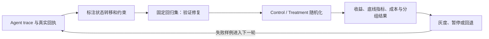
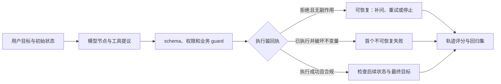

# 第 10 章（1）：Agent 轨迹与失败诊断

第九章的[离线评测集与评分规则](09-评估与debug实战-1-评测协议与benchmark.md)已经固定下来，但一次失败仍可能有很多解释。对 Agent 来说，最终回答只显示任务有没有完成；轨迹还要说明模型提出了什么、程序放行了什么、工具实际做了什么。这一篇从一次地址修改任务开始，把这些责任边界分开，并把可复现的失败转成回归样例。

线上评估不是给单条输出打分，而是估计一个候选版本在合格流量中的收益和风险。因此本章先诊断轨迹，再做随机比较，最后把结果转成可执行的扩量、暂停或回退条件。

单条轨迹帮助定位失败，回归集帮助确认修复是否重复有效，线上实验估计真实用户流量中的效果。三种证据回答不同问题，不能互相替代。下面的数字只演示事件、分母和决策过程；指标、实验窗口和回退条件应在读取 Treatment 结果前确定。

## 10.1 轨迹回放：从工具提议查出最早的关键错误

第八章已经让 Agent 把模型请求、工具执行和回执放进一条状态轨迹。评估时不能只检查最后一句答复：两个 Agent 可能都没有完成任务，一个是因为工具暂时超时、随后安全停止；另一个却先越权修改数据，再在最终总结中承认失败。只记“成功/失败”会把这两种完全不同的系统行为压成同一个标签。

Agent 轨迹至少要同时回答三个问题：用户目标有没有达成，过程中的每个动作是否满足当时生效的工具和业务约束，失败最早在何处从可恢复变成不可恢复。这里的“第一处可疑”不必然是根因；一个错误格式的工具提议可能被执行器拒绝并安全恢复。根因分析关注的是最早破坏关键不变量、且后续步骤无法撤销其影响的事件。

以“把订单 741 的收货地址改到新地址”为例，业务规则要求先核验订单归属，再向用户展示新地址并获得明确确认，最后调用更新工具。若轨迹显示模型在确认之前发出 `update_address`，这只是候选动作；若执行器根据缺少确认的回执拒绝执行，外部状态没有变化，Agent 仍可补问。相反，如果执行器返回 `accepted=true`，订单状态已经更新，而轨迹中不存在确认事件，那么第一个不可恢复的策略失败发生在这次已执行的工具调用。后面的“已为您更改”也许是真的，但不能反过来证明动作合规。

一次可审计轨迹应保留伪名化任务与会话 ID、目标状态、模型和提示版本、每轮事件关系、工具名称和参数约定、工具执行回执、动作前后状态摘要、策略版本、guard 判定、时间戳、停止原因和最终状态。完整提示词、生成内容、检索文本和敏感工具参数不要默认写入普通 trace；优先保存脱敏摘要、必要统计及受控证据库引用。若排障确需原文，应在单独授权、访问控制和留存期限下保存，并由 trace 指向该证据。[OpenTelemetry GenAI 语义约定](https://github.com/open-telemetry/semantic-conventions-genai/blob/main/docs/gen-ai/gen-ai-spans.md)也提醒，输入输出、系统指令和工具参数/结果可能含敏感内容且体积较大，默认建议不记录。

离线重放要把外部副作用关在可控边界内：用固定状态快照和模拟工具回执重建决策路径，写操作默认改为记录意图而不触碰真实系统，并为可重复请求设置幂等键。网络波动、异步任务和随机生成未必能逐字复现，所以重放的验收对象应是状态迁移、权限检查和恢复分支；它能验证执行协议，却不能单独证明线上故障概率或模型输出分布。

标注前先把每个任务的状态变化和规则写清：初始状态是什么，目标状态是什么，需要先确认什么、必须具备哪些权限、哪些外部变化不可逆。再把轨迹事件按“模型提议、程序判定、工具实际执行、外部状态变化、用户可见答复”分层。这样，执行器拦截越权提议时，报告仍能分别统计模型提出了多少次、程序拦下了多少次；只有请求真的改变了外部状态，才计入副作用违规。若只保存最终答复，这两种情况就会被混成同一个错误。

例如 20 条需确认后才能改地址的任务中，模型有 4 次在确认前提议更新；执行器拦截其中 3 次，另 1 次实际修改成功但缺少确认。可以分别报告提前提议率 4/20=20%、拦截率 3/4=75% 和未授权副作用率 1/20=5%。不能把被拦截的 3 次从模型行为分析中抹去，也不能把它们计作已经发生的外部副作用。样本量只有 20 时，这些比例只用于定位和回归，不足以证明低频安全风险已经受控。

回归集优先使用合成值；确需真实证据时，按最小权限与期限保管，避免把原始个人信息复制到普通日志或长期样例集。

图里把动作提议、guard 判定、真实执行和最终目标拆成不同节点，是因为它们对应不同责任边界。评测器如果只读取模型输出，就不知道工具是否真的执行；如果只读取外部最终状态，又可能漏掉一个被正确拦截、但频繁发生的高风险提议。可靠报告应把过程诊断和任务结果并排呈现。

| 指标 | 计算对象 | 适合回答的问题 | 不能代替什么 |
| --- | --- | --- | --- |
| 任务成功率 | 达到预先定义终态的任务数 / 纳入任务数 | 用户目标是否完成 | 过程是否合规、失败在哪一步 |
| 工具选择准确率 | 选择正确工具的适用节点 / 需要工具的节点 | 路由是否合适 | 参数是否合法、工具结果是否正确 |
| 参数检查通过率 | 合法参数调用数 / 已发起工具调用数 | schema 和参数检查是否通过 | 权限、业务状态与副作用安全 |
| 策略违例率 | 有效违例轨迹数 / 相关策略适用轨迹数 | 安全边界是否被突破 | 对低发生率高后果风险的完整认识 |
| 失败定位准确率 | 首个关键失败节点被正确标出的样例 / 有金标失败样例数 | 诊断是否找对位置 | 根因类别是否正确、修复是否有效 |

分母必须按适用事件定义。例如，没有任何需要调用工具的任务，工具选择准确率应记为 N/A，而不是 100%；策略从未适用的轨迹也不能进入违例率分母。一个小型标注集可以先有 12 条轨迹：其中 8 条达到目标，任务成功率是 `8/12=66.7%`；10 条工具选择正确，适用节点共 12 个，选择准确率是 `10/12=83.3%`；1 条发生真实越权副作用，策略违例率是 `1/12=8.3%`。这三个数字同时描述系统，不能平均成一个“综合成功分”掩盖安全事件。样本只有 12 条也不足以给低概率风险作稳定估计，必须把逐条事件和不确定性保留下来。

诊断顺序可以从可执行的硬约束开始：schema、权限、金额边界、必需确认、幂等键和外部状态迁移优先用代码核对；再由经过人工校准的评审者分析策略遵循、证据支持和对话质量。自动评审的输入要包含相关轨迹节点和执行回执，不能让 judge 依据最终自然语言猜测是否发生了副作用。系统级汇总再找共因，例如所有失败都发生在某个工具 schema 版本，或长对话的 token 截断让确认状态丢失。

OpenAI 的 [Agent Evals 文档](https://developers.openai.com/api/docs/guides/agent-evals)把单条 trace 用于调试，并建议在“好”的标准明确后转为固定数据集和重复评测；[Agentic CLEAR](https://aclanthology.org/2026.acl-demo.74/)探索 system、trace、node 多层诊断；Microsoft Research 发布的 [AgentRx](https://www.microsoft.com/en-us/research/blog/systematic-debugging-for-ai-agents-introducing-the-agentrx-framework/)以带 guard 条件的约束和逐步证据日志寻找 critical failure step。这些材料说明了可操作的评估方向，不代表其产品接口、论文分数或 115 条失败样例可以直接替代本项目的目标任务和独立复核。

实际改进时，应把一次失败轨迹转成最小回归样例：固定初始状态、预期允许/禁止动作、工具返回和验收条件；只修改一个主要变量，然后重放原失败集和安全回归集。若最终任务成功率提高、但工具授权违例或虚报完成率也提高，改动不能据此放行。修复后仍需检查新数据是否覆盖同类失败、是否引入新路径，最后才把稳定的离线版本送入有护栏的灰度实验。

### 10.1.1 资料与证据边界

- [OpenAI Agent Evals](https://developers.openai.com/api/docs/guides/agent-evals) 建议先用单条 trace 定位工作流问题，再转向固定数据集和重复评测。截至 2026-11-16，OpenAI 官方[评测指南](https://developers.openai.com/api/docs/guides/evals)说明既有托管 Evals 已于 2026-10-31 进入只读期，平台计划于 2026-11-30 下线；接入或迁移时须复核[官方时间表](https://developers.openai.com/api/docs/deprecations)。这只是服务生命周期信息，不改变单条轨迹的诊断方法。
- [Agentic CLEAR](https://aclanthology.org/2026.acl-demo.74/) 已发表于 ACL 2026 System Demonstrations，提出 system、trace 和 node 三层诊断；论文在四个 benchmark、七种 agent 设置和数万次模型调用上报告了与人工错误标注的对齐及任务成功预测能力，结论受其数据、模型和评审协议约束。
- [AgentRx](https://www.microsoft.com/en-us/research/blog/systematic-debugging-for-ai-agents-introducing-the-agentrx-framework/) 是 Microsoft Research 对框架和 115 条人工标注失败轨迹的介绍；发布方报告的定位提升数字不是本地复现结果。
- [OpenTelemetry GenAI spans](https://github.com/open-telemetry/semantic-conventions-genai/blob/main/docs/gen-ai/gen-ai-spans.md) 将完整输入、输出及工具内容列为可能敏感且体积较大的数据，并建议默认不记录；该页面是动态开发中规范，部署时须固定采用的版本。

本节数值为合成例子，代码 guard 适合验证结构化约束，LLM judge 适合产生需要复核的语义候选；任何一种都不能单独证明真实系统安全。轨迹中的策略版本、执行器状态和标注协议应跟着结果保存。

完成一次轨迹复盘后，先把最小失败样例加入固定回归集；再读[线上 A/B 实验设计](10-agent轨迹与线上评估实战-2-ab实验设计.md)，估计修复后的系统在真实流量中的收益和代价。
