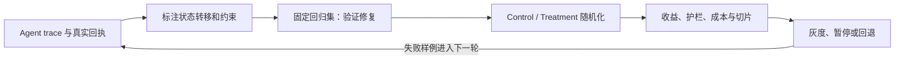
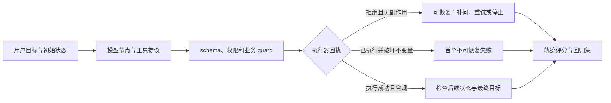

# 第 10 章 Agent 轨迹与线上评估实战

上一章建立了固定数据上的离线比较。本章继续沿着系统生命周期向前：先从 Agent trace 检查工具提议、程序决策和外部状态之间的因果链，再用线上随机化比较验证收益，最后通过分阶段灰度、暂停和回退控制发布风险。

单条轨迹帮助定位失败，回归集帮助确认修复是否重复有效，线上实验则估计真实用户流量中的效果。三者使用不同的证据和分母，不能互相替代。图中每一步都留下可回放记录；出现高风险事件时可以暂停扩量，并将新失败转回回归集。



本章的数字案例用于跟算事件定义、分母和决策过程；它们不提供任何模型上线结论。具体指标、实验窗口和回退条件必须在读取 Treatment 结果前预先确定。

## 10.1 轨迹回放：从工具提议定位首个关键失败

第八章已经让 Agent 把模型请求、工具执行和回执放进一条状态轨迹。评估时不能只检查最后一句答复：两个 Agent 可能都没有完成任务，一个是因为工具暂时超时、随后安全停止；另一个却先越权修改数据，再在最终总结中承认失败。只记“成功/失败”会把这两种完全不同的系统行为压成同一个标签。

Agent 轨迹至少要同时回答三个问题：用户目标有没有达成，过程中的每个动作是否满足当时生效的工具和业务约束，失败最早在何处从可恢复变成不可恢复。这里的“第一处可疑”不必然是根因；一个错误格式的工具提议可能被执行器拒绝并安全恢复。根因分析关注的是最早破坏关键不变量、且后续步骤无法撤销其影响的事件。

以“把订单 741 的收货地址改到新地址”为例，业务规则要求先核验订单归属，再向用户展示新地址并获得明确确认，最后调用更新工具。若轨迹显示模型在确认之前发出 `update_address`，这只是候选动作；若执行器根据缺少确认的回执拒绝执行，外部状态没有变化，Agent 仍可补问。相反，如果执行器返回 `accepted=true`，订单状态已经更新，而轨迹中不存在确认事件，那么第一个不可恢复的策略失败发生在这次已执行的工具调用。后面的“已为您更改”也许是真的，但不能反过来证明动作合规。

一次可审计轨迹应保留任务与会话 ID、目标状态、模型和提示版本、每轮输入/输出、工具名称与参数、工具执行回执、动作前后状态、策略版本、guard 判定、时间戳、停止原因和最终状态。

离线重放要把外部副作用关在可控边界内：用固定状态快照和模拟工具回执重建决策路径，写操作默认改为记录意图而不触碰真实系统，并为可重复请求设置幂等键。网络波动、异步任务和随机生成未必能逐字复现，所以重放的验收对象应是状态迁移、权限检查和恢复分支；它能验证执行协议，却不能单独证明线上故障概率或模型输出分布。

标注前先把每个任务写成状态转移契约：初始状态是什么，目标状态是什么，哪些前置确认或权限必须存在，哪些外部变化不可逆。再把轨迹事件按“模型提议、程序判定、工具实际执行、外部状态变化、用户可见答复”分层。这样，执行器拦截了越权提议时，报告仍能指出模型提议率和 guard 拦截率；只有请求真的改变了外部状态，才计入副作用违规。若只保存最终答复，这两个事件会被压成同一条错误。

例如 20 条需确认后才能改地址的任务中，模型有 4 次在确认前提议更新；执行器拦截其中 3 次，另 1 次实际修改成功但缺少确认。可以分别报告提前提议率 4/20=20%、拦截率 3/4=75% 和未授权副作用率 1/20=5%。不能把被拦截的 3 次从模型行为分析中抹去，也不能把它们计作已经发生的外部副作用。样本量只有 20 时，这些比例只用于定位和回归，不足以证明低频安全风险已经受控。

敏感字段需要脱敏，原始证据应按访问策略保管；调试样例能使用合成值时，不要把真实个人信息复制进回归集。



图里把动作提议、guard 判定、真实执行和最终目标拆成不同节点，是因为它们对应不同责任边界。评测器如果只读取模型输出，就不知道工具是否真的执行；如果只读取外部最终状态，又可能漏掉一个被正确拦截、但频繁发生的高风险提议。可靠报告应把过程诊断和任务结果并排呈现。

| 指标 | 计算对象 | 适合回答的问题 | 不能代替什么 |
| --- | --- | --- | --- |
| 任务成功率 | 达到预先定义终态的任务数 / 纳入任务数 | 用户目标是否完成 | 过程是否合规、失败在哪一步 |
| 工具选择准确率 | 选择正确工具的适用节点 / 需要工具的节点 | 路由是否合适 | 参数是否合法、工具结果是否正确 |
| 参数契约通过率 | 合法参数调用数 / 已发起工具调用数 | schema 和参数检查是否通过 | 权限、业务状态与副作用安全 |
| 策略违例率 | 有效违例轨迹数 / 相关策略适用轨迹数 | 安全边界是否被突破 | 对低发生率高后果风险的完整认识 |
| 失败定位准确率 | 首个关键失败节点被正确标出的样例 / 有金标失败样例数 | 诊断是否找对位置 | 根因类别是否正确、修复是否有效 |

分母必须按适用事件定义。例如，没有任何需要调用工具的任务，工具选择准确率应记为 N/A，而不是 100%；策略从未适用的轨迹也不能进入违例率分母。一个小型标注集可以先有 12 条轨迹：其中 8 条达到目标，任务成功率是 `8/12=66.7%`；10 条工具选择正确，适用节点共 12 个，选择准确率是 `10/12=83.3%`；1 条发生真实越权副作用，策略违例率是 `1/12=8.3%`。这三个数字同时描述系统，不能平均成一个“综合成功分”掩盖安全事件。样本只有 12 条也不足以给低概率风险作稳定估计，必须把逐条事件和不确定性保留下来。

诊断顺序可以从可执行的硬约束开始：schema、权限、金额边界、必需确认、幂等键和外部状态迁移优先用代码核对；再由经过人工校准的评审者分析策略遵循、证据支持和对话质量。自动评审的输入要包含相关轨迹节点和执行回执，不能让 judge 依据最终自然语言猜测是否发生了副作用。系统级汇总再找共因，例如所有失败都发生在某个工具 schema 版本，或长对话的 token 截断让确认状态丢失。

OpenAI 的 Agent Evals 文档把单条 trace 用于调试，并建议在“好”的标准明确后转为固定数据集和重复评测；Agentic CLEAR 研究探索 system、trace、node 多层诊断；Microsoft Research 发布的 AgentRx 以带 guard 条件的约束和逐步证据日志寻找 critical failure step。这些材料说明了可操作的评估方向，不代表其产品接口、论文分数或 115 条失败样例可以直接替代本项目的目标任务和独立复核。

实际改进时，应把一次失败轨迹转成最小回归样例：固定初始状态、预期允许/禁止动作、工具返回和验收条件；只修改一个主要变量，然后重放原失败集和安全回归集。若最终任务成功率提高、但工具授权违例或虚报完成率也提高，改动不能据此放行。修复后仍需检查新数据是否覆盖同类失败、是否引入新路径，最后才把稳定的离线版本送入有护栏的灰度实验。

### 10.1.1 资料与证据边界

- [OpenAI Agent Evals](https://developers.openai.com/api/docs/guides/agent-evals) 区分单条轨迹诊断和固定数据集上的重复评测。
- [Agentic CLEAR](https://arxiv.org/abs/2605.22608) 是 2026 年研究预印本，报告 system、trace 和 node 层面的诊断方法；其结果受论文中的 benchmark 和评审协议约束。
- [AgentRx](https://www.microsoft.com/en-us/research/blog/systematic-debugging-for-ai-agents-introducing-the-agentrx-framework/) 是 Microsoft Research 对框架和 115 条人工标注失败轨迹的介绍；发布方报告的定位提升数字不是本地复现结果。

本节数值为合成例子，代码 guard 适合验证结构化约束，LLM judge 适合产生需要复核的语义候选；任何一种都不能单独证明真实系统安全。轨迹中的策略版本、执行器状态和标注协议应跟着结果保存。

## 10.2 线上 A/B 与灰度实验：在真实流量中验证收益和代价

### 10.2.1 离线变好，为什么还要线上实验

离线评估集可以控制输入和参考答案，却不能完整模拟真实用户。线上系统还有多轮上下文、缓存、检索版本、工具失败、网络延迟、用户中途退出、重复追问、成本预算和安全举报。一个新模型在离线问答集上提高 3%，可能因为输出更长而让 P95 延迟增加 40%；也可能因为更积极地调用工具而提高解决率，却增加了错误动作。

A/B 实验把真实流量随机分成对照组和实验组，在相同业务环境中比较预先定义的指标。它不是把一个版本“盖章”为永远正确，而是在一段时间和一组流量条件下估计变化，并持续观察风险。

### 初学者视角：先固定人，再比较模型

如果同一个用户今天使用 A，下一轮又使用 B，他可能会把两种模型的答案混在同一段对话中。对单轮独立请求，这种随机方式有时可以接受；对多轮客服、Agent、个性化推荐和长期留存，应优先使用会话级或用户级分配，让实验单元在实验期间保持稳定。

```text
Control：旧模型或当前线上版本
Treatment：新模型、提示词或系统版本
实验单元：用户、会话、请求或组织
主指标：希望改善的业务结果
护栏指标：不能出现不可接受恶化的安全、质量、成本和稳定性指标
诊断指标：帮助解释变化来自哪里
```

### 深入视角：A/B 是一个随机化估计问题

令实验单元为 \(u\)，实验名为 \(e\)，哈希函数把它映射到 \(M\) 个桶，Treatment 比例为 \(\rho\)：

```math
r(u)=\frac{h(e,u)\bmod M}{M},\qquad
b(u)=\mathbb{1}[r(u)<\rho]
```

这里要求 \(M\) 是正整数，且 \(0\le\rho\le1\)；在真正比较两组时还应有 \(0<\rho<1\)，否则某一组没有样本。哈希结果和分桶规则必须保持稳定。同一 \(e,u\) 必须得到稳定的 \(b(u)\)。实验名进入哈希键，可以避免同一用户在不同实验中意外共享分桶结果；组织级产品还要考虑同一企业内多个用户互相影响，不能只看个人随机化。

对二值指标，Control 组成功数和样本数为 \((x_A,n_A)\)，Treatment 组为 \((x_B,n_B)\)：

```math
\hat p_A=\frac{x_A}{n_A},\qquad
\hat p_B=\frac{x_B}{n_B},\qquad
\Delta=\hat p_B-\hat p_A
```

提升量的近似标准误为：

```math
\mathrm{SE}_{\Delta}=
\sqrt{\frac{\hat p_A(1-\hat p_A)}{n_A}
+\frac{\hat p_B(1-\hat p_B)}{n_B}}
```

这些比例要求 \(n_A,n_B>0\)，并且 \(0\le x_A\le n_A\)、\(0\le x_B\le n_B\)。95% 近似区间为 \(\Delta\pm1.96\mathrm{SE}_{\Delta}\)。检验两组是否来自同一成功率时，常用合并比例：

```math
\hat p=\frac{x_A+x_B}{n_A+n_B}
```

```math
z=\frac{\hat p_B-\hat p_A}
{\sqrt{\hat p(1-\hat p)(1/n_A+1/n_B)}}
```

合并比例还要求 \(n_A+n_B>0\)，而 z 统计量的分母必须大于 0；如果两组成功率都处在完全相同的 0 或 1 边界，普通 z 值未定义，应使用适合边界比例的区间或只报告点估计。这些公式依赖独立样本、合理的随机化和足够的近似条件。多轮会话、同一用户多次请求和用户之间的社交影响都会让样本相关，不能机械地把每个请求当成独立观测。

### 10.2.2 先定义主指标、护栏和诊断指标

主指标应在实验开始前确定，例如客服场景的问题解决率、用户明确满意率、人工转接率或有效任务完成率。主指标不能在实验结束后从十几个指标中挑一个看起来最好的数字。

护栏指标观察不应被牺牲的维度：

```text
安全违规率和高风险错误率
事实错误或用户投诉率
请求失败率和工具执行失败率
P50、P95、P99 延迟以及首 token 延迟
输入输出 token、单次成本和日预算
格式解析失败率、过度拒答率
核心用户群和关键业务场景的退化
```

诊断指标帮助解释主指标变化：

```text
平均输出长度
检索命中与引用覆盖率
工具调用次数、成功率和重试次数
二次追问率与会话轮数
不同 query 长度、语言、渠道和任务类型的切片
缓存命中率、队列等待和模型服务错误码
```

一个完整的结论不应只有“解决率提高”，而应说明提高是否伴随更长回答、更高成本、更少人工转接，或者只是某一类简单问题占比改变。

### 10.2.3 实验单元的选择

#### 请求级随机

每个请求独立分配。它实现简单、样本增长快，适合单轮、无状态、结果互不影响的任务。缺点是同一用户或会话会在 A/B 之间切换，无法评价连贯的多轮体验。

#### 会话级随机

同一 session 固定模型。它适合客服、RAG 多轮问答和 Agent 任务，可以测量一次完整会话的解决率、工具成功率和用户是否继续追问。需要稳定保存 session 与实验组映射，跨设备或登录状态变化时要有明确规则。

#### 用户级随机

同一用户在实验周期内固定模型。它适合留存、长期满意度、复购和个性化产品，能减少跨组污染，但需要更长实验周期和更大样本量。

#### 组织级随机

企业客户常有共享知识库、团队策略和预算。如果同一组织内不同用户被分到不同模型，模型结果可能相互影响；对于组织级策略，应考虑按 tenant 或工作空间随机，同时关注组织间规模差异。

选择原则不是“粒度越细越科学”，而是选择能够保持因果链和用户体验稳定的最小实验单元。

### 10.2.4 Sample Ratio Mismatch：先检查分桶是否真的生效

假设计划按 50:50 分组，但实际日志中 Control 有 6,000 条，Treatment 有 4,000 条。直接计算满意率没有意义，因为流量分配、过滤、日志丢失或缓存路由可能已经破坏了随机化。

对 \(k\) 个分组，观测数为 \(o_j\)，期望数为 \(e_j\)，可以计算：

```math
\chi^2_{\mathrm{SRM}}=\sum_{j=1}^{k}\frac{(o_j-e_j)^2}{e_j}
```

该式要求每个期望计数 \(e_j>0\)，且总样本数大于 0；如果某个分组的计划比例为 0，卡方统计量不适用。卡方近似还需要足够的期望计数，稀疏分桶应使用适合小样本的方法。计数应对应分配的随机化单元；按用户分桶时，不能直接用受到 treatment 影响的请求数检验原定用户比例。SRM 异常可能来自：

```text
实验路由条件与统计过滤条件不一致
某组请求更容易超时或被丢弃
缓存 key 没有包含实验组
登录、设备或渠道字段在一组缺失
重复请求和重试只在一组被计数
实验配置没有在所有服务实例同步
日志采集延迟或字段解析错误
```

SRM 本身不解释业务指标，但它是随机化有效性的前置检查。发现异常时，应先修复或隔离实验数据，而不是继续解释谁更好。

### 10.2.5 样本量、显著性和实际意义

如果基线成功率为 \(p_1\)，希望检测到 \(p_2\)，两组近似等量时，常见的样本量估计如下。这里通常要求 \(0<p_1,p_2<1\)、\(p_1\ne p_2\)，并预先给定显著性水平 \(\alpha\) 与检验功效 \(1-\beta\)：

```math
n\approx
\frac{\left(
z_{1-\alpha/2}\sqrt{2\bar p(1-\bar p)}
+z_{1-\beta}\sqrt{p_1(1-p_1)+p_2(1-p_2)}
\right)^2}{(p_2-p_1)^2},
\qquad
\bar p=\frac{p_1+p_2}{2}
```

这里 \(z_q\) 为标准正态分布的第 \(q\) 分位数，\(n\) 是每组样本量。例如 \(p_1=0.77,p_2=0.79,\alpha=0.05\)、功效 0.8 时，取 \(z_{0.975}\approx1.96,z_{0.8}\approx0.842\)，每组约需 6,736 个独立单元（将近似值 6,735.15 向上取整）。预期提升越小，所需样本量按提升量平方的倒数增长。用户反馈有延迟、指标方差很大或用户级随机化时，有效样本量还会进一步下降。

统计显著不等于业务值得。一个 0.1 个百分点的提升可能在百万请求下显著，却无法覆盖新增 token 成本；一个高风险错误率的微小上升可能未达到显著，却仍值得暂停扩量。报告要同时给出点估计、置信区间、样本量、成本和风险后果。

实验期间频繁查看结果并在某个好看的时刻提前结束，会增加假阳性。若业务必须连续监控，应使用预先设计的 sequential testing 或明确的停止规则，不要把普通固定样本检验反复使用。

### 10.2.6 一个零依赖的 A/B 统计 demo

下面的程序演示稳定分桶、SRM、二比例差异、Wilson 区间、延迟和成本护栏。数字是教学数据，不能代表任何真实服务。

> 代码状态：已验证（2026-10-22；Python 3.12.9，无第三方依赖；历史记录中的输入、输出与边界检查适用于此代码）

```python
import hashlib
import json
import math


def assign_bucket(unit_id, experiment, treatment_ratio):
    if not isinstance(unit_id, str) or not unit_id.strip():
        raise ValueError("unit_id must be a non-empty string")
    if not isinstance(experiment, str) or not experiment.strip():
        raise ValueError("experiment must be a non-empty string")
    if not isinstance(treatment_ratio, (int, float)) or isinstance(treatment_ratio, bool):
        raise TypeError("treatment_ratio must be numeric")
    if not math.isfinite(treatment_ratio) or not 0 <= treatment_ratio <= 1:
        raise ValueError("treatment_ratio must be finite and in [0, 1]")
    key = f"{experiment}:{unit_id}".encode("utf-8")
    value = int(hashlib.sha256(key).hexdigest(), 16) % 10000
    return "treatment" if value / 10000 < treatment_ratio else "control"


def normal_cdf(value):
    if not math.isfinite(value):
        raise ValueError("normal_cdf input must be finite")
    return 0.5 * (1.0 + math.erf(value / math.sqrt(2.0)))


def two_rate_delta(success_a, total_a, success_b, total_b):
    for name, successes, total in (
        ("control", success_a, total_a),
        ("treatment", success_b, total_b),
    ):
        if not isinstance(successes, int) or isinstance(successes, bool):
            raise TypeError(f"{name} successes must be an integer")
        if not isinstance(total, int) or isinstance(total, bool):
            raise TypeError(f"{name} total must be an integer")
        if total <= 0 or not 0 <= successes <= total:
            raise ValueError(f"{name} must satisfy total > 0 and 0 <= successes <= total")
    rate_a = success_a / total_a
    rate_b = success_b / total_b
    delta = rate_b - rate_a
    pooled = (success_a + success_b) / (total_a + total_b)
    pooled_se = math.sqrt(
        pooled * (1 - pooled) * (1 / total_a + 1 / total_b)
    )
    z_score = delta / pooled_se if pooled_se > 0 else None
    p_value = (
        2 * (1 - normal_cdf(abs(z_score)))
        if z_score is not None else None
    )
    unpooled_se = math.sqrt(
        rate_a * (1 - rate_a) / total_a
        + rate_b * (1 - rate_b) / total_b
    )
    ci95 = (
        [
            round(delta - 1.96 * unpooled_se, 4),
            round(delta + 1.96 * unpooled_se, 4),
        ]
        if unpooled_se > 0 else None
    )
    return {
        "control_rate": round(rate_a, 4),
        "treatment_rate": round(rate_b, 4),
        "delta": round(delta, 4),
        "z": round(z_score, 4) if z_score is not None else None,
        "p_value": round(p_value, 6) if p_value is not None else None,
        "ci95": ci95,
    }


def wilson(successes, total, z=1.96):
    if not isinstance(successes, int) or isinstance(successes, bool):
        raise TypeError("successes must be an integer")
    if not isinstance(total, int) or isinstance(total, bool):
        raise TypeError("total must be an integer")
    if total <= 0:
        raise ValueError("Wilson interval is undefined when total <= 0")
    if not 0 <= successes <= total:
        raise ValueError("successes must satisfy 0 <= successes <= total")
    if not math.isfinite(z) or z <= 0:
        raise ValueError("z must be a finite positive number")
    p_hat = successes / total
    denominator = 1 + z * z / total
    center = (p_hat + z * z / (2 * total)) / denominator
    margin = z * math.sqrt(
        p_hat * (1 - p_hat) / total + z * z / (4 * total * total)
    ) / denominator
    return [round(center - margin, 4), round(center + margin, 4)]


def srm(control_count, treatment_count, expected_treatment_ratio=0.5):
    if not isinstance(control_count, int) or isinstance(control_count, bool):
        raise TypeError("control_count must be an integer")
    if not isinstance(treatment_count, int) or isinstance(treatment_count, bool):
        raise TypeError("treatment_count must be an integer")
    if control_count < 0 or treatment_count < 0:
        raise ValueError("group counts cannot be negative")
    if not isinstance(expected_treatment_ratio, (int, float)) or isinstance(expected_treatment_ratio, bool):
        raise TypeError("expected_treatment_ratio must be numeric")
    if not math.isfinite(expected_treatment_ratio) or not 0 < expected_treatment_ratio < 1:
        raise ValueError("expected_treatment_ratio must be in (0, 1)")
    total = control_count + treatment_count
    if total <= 0:
        raise ValueError("SRM is undefined when total count is zero")
    expected_treatment = total * expected_treatment_ratio
    expected_control = total - expected_treatment
    statistic = (
        (control_count - expected_control) ** 2 / expected_control
        + (treatment_count - expected_treatment) ** 2 / expected_treatment
    )
    # For one degree of freedom, this is the upper-tail probability.
    p_value = math.erfc(math.sqrt(statistic / 2))
    return {
        "chi_square": round(statistic, 4),
        "p_value": round(p_value, 6),
        "no_srm_detected": p_value >= 0.001,
    }


control = {
    "sessions": 12000,
    "resolved": 9240,
    "negative_feedback": 960,
    "safety_events": 6,
    "p95_latency_ms": 1800,
    "avg_cost": 0.0032,
}
treatment = {
    "sessions": 12080,
    "resolved": 9590,
    "negative_feedback": 890,
    "safety_events": 7,
    "p95_latency_ms": 1950,
    "avg_cost": 0.0037,
}

for group_name, group in (("control", control), ("treatment", treatment)):
    sessions = group["sessions"]
    if not isinstance(sessions, int) or isinstance(sessions, bool) or sessions <= 0:
        raise ValueError(f"{group_name} sessions must be a positive integer")
    for metric in ("resolved", "negative_feedback", "safety_events"):
        count = group[metric]
        if not isinstance(count, int) or isinstance(count, bool):
            raise TypeError(f"{group_name} {metric} must be an integer")
        if not 0 <= count <= sessions:
            raise ValueError(f"{group_name} {metric} must be in [0, sessions]")
    if not math.isfinite(group["p95_latency_ms"]) or group["p95_latency_ms"] <= 0:
        raise ValueError(f"{group_name} latency must be finite and positive")
    if not math.isfinite(group["avg_cost"]) or group["avg_cost"] <= 0:
        raise ValueError(f"{group_name} cost must be finite and positive")

resolution = two_rate_delta(
    control["resolved"],
    control["sessions"],
    treatment["resolved"],
    treatment["sessions"],
)
negative_feedback = two_rate_delta(
    control["negative_feedback"],
    control["sessions"],
    treatment["negative_feedback"],
    treatment["sessions"],
)

latency_change = treatment["p95_latency_ms"] / control["p95_latency_ms"] - 1
cost_change = treatment["avg_cost"] / control["avg_cost"] - 1
safety_change = (
    treatment["safety_events"] / treatment["sessions"]
    - control["safety_events"] / control["sessions"]
)

conditions = {
    "srm_ok": srm(control["sessions"], treatment["sessions"])["no_srm_detected"],
    "resolution_lower_bound_above_1pt": (
        resolution["ci95"] is not None and resolution["ci95"][0] > 0.01
    ),
    "negative_feedback_upper_bound_below_0.1pt": (
        negative_feedback["ci95"] is not None
        and negative_feedback["ci95"][1] <= 0.001
    ),
    "p95_latency_increase_under_15pct": latency_change <= 0.15,
    "cost_increase_under_20pct": cost_change <= 0.20,
    "safety_review_passed": False,
}

report = {
    "bucket_examples": {
        user_id: assign_bucket(user_id, "assistant_v2", 0.5)
        for user_id in ["u001", "u002", "u003", "u004"]
    },
    "srm": srm(control["sessions"], treatment["sessions"]),
    "resolution": resolution,
    "negative_feedback": negative_feedback,
    "pairwise_b_win_ci95": wilson(580, 890),
    "latency_change": round(latency_change, 4),
    "cost_change": round(cost_change, 4),
    "safety_rate_change": round(safety_change, 6),
    "conditions": conditions,
    "decision": "expand_to_25_percent" if all(conditions.values()) else "hold_and_investigate",
}
print(json.dumps(report, ensure_ascii=False, indent=2, sort_keys=True))
```
本例把每个会话当作独立分配单元，且每个安全计数代表发生事件的会话数，不是同一会话内的事件总次数。解决率由 0.77 升到约 0.7939，差约 2.39 个百分点；延迟增加约 8.33%，成本增加约 15.63%。安全事件只有 6 与 7 次，点估计差很小也不能证明满足安全非劣效要求，所以 `safety_review_passed` 显式为 False，输出决策为 `hold_and_investigate`。真实放行应事先定义安全容忍界限，结合适合稀疏事件的区间、定向离线测试和人工复核，不能把这个布尔值直接改成 True 来替代证据。

`no_srm_detected` 只表示在预定阈值下没有检出分配比例异常，不证明所有随机化条件成立。`two_rate_delta` 的普通正态区间用于本例成功/失败数充足的指标；稀疏或边界比例应改用专门方法。即使 resolution 的区间为正，如果成本、延迟或安全条件不满足，也不应只凭一个正向数字扩大流量。真实分析还要考虑多重比较、集群随机化、分层协变量、缺失数据和实验周期。

### 10.2.7 日志字段决定实验能否解释

至少保存以下字段：

```text
request_id
user_id / session_id / tenant_id
experiment_name
assignment_time and bucket
model_revision
prompt_revision
retriever_revision
tool_revision
tokenizer and decoding parameters
input and output token counts
retrieved document IDs and versions
tool requests, returns and retries
latency breakdown
cost estimate
error code and timeout
user feedback and later correction
timestamp and locale
```

如果 prompt、检索器和模型同时变化，只记录 model_revision，就无法解释结果。缓存 key 也必须包含会改变输出的实验条件，否则 Control 可能命中 Treatment 产生的缓存。

### 10.2.8 大模型实验的特殊变量

#### 输出随机性

固定或记录 temperature、top_p、max_tokens、seed、停止条件和并行采样策略。不同版本即使使用同一 seed，也不一定产生相同输出，因为 logits、tokenizer 或后端 kernel 可能变化。

#### 多轮状态

会话级分桶后，整个历史仍需保持一致。若摘要器、记忆服务或工具版本独立变化，模型版本的因果解释仍会被污染。

#### 成本和延迟

更长的回答、更多的 reasoning token、更多工具轮次和更低缓存命中率都会提高成本。应分开看首 token 延迟、生成间隔、完整响应时间、队列时间、检索时间和工具时间，而不是只看平均总延迟。

#### 低频高后果事件

安全违规、隐私泄露、错误退款和错误删除可能在小流量里没有发生，但不能据此证明风险为零。上线前应结合离线红队、定向高风险样本、线上分类器、人工抽检和举报通道。

### 10.2.9 灰度、暂停和回退

一个可操作的灰度序列可以是：

```text
离线回归与安全测试
内部用户或低风险场景
1% 受控流量
5% 低风险全场景
10%--25% 分层扩量
更大比例对照
达到预先定义的收益与风险条件后逐步扩大
```

每个阶段都应记录进入下一阶段的条件和观察窗口。回退动作要可执行：切回旧模型、按渠道或场景关闭新版本、暂停外部工具、降低输出预算、切换保守提示词、增加人工复核或冻结高风险动作。

触发回退的不应只有一个平均指标。可以包括安全事件、错误率连续异常、P95 延迟、成本突增、关键用户群退化、集中投诉和工具副作用。回退后还要保留实验日志和失败样本，避免只把流量切回旧版本却丢失根因。

### 10.2.10 切片分析：总体提升可能掩盖局部退化

至少按以下维度切片：

```text
任务类型与业务渠道
query 长度、上下文长度和语言
新用户与老用户
低风险与高风险
有证据与无证据
工具成功与工具失败
低延迟与高延迟
不同模型路由和缓存状态
```

如果总体问题解决率提升 2%，但高价值客户下降 3%，总体平均不能直接代表产品体验。对小切片要同时报告样本量和区间，避免把几个异常样本过度解读；对明确的高后果退化，即使样本不大也应进入人工复核。

### 10.2.11 结果报告应包含什么

一份可复查的报告可以按以下顺序组织：

```text
实验范围、随机化单元和运行时间
Control / Treatment 的流量与 SRM 检查
主指标：点估计、置信区间、样本量
护栏：安全、事实、格式、延迟、成本、错误率
诊断：长度、工具、检索、缓存和任务切片
人工抽检：样本来源、盲评结果和严重错误
异常：日志缺失、协议变化、缓存污染或业务活动
决策：扩大、保持、暂停、回退或定向路由
后续：待修复问题和下一轮实验条件
```

例如，“Treatment 问题解决率提升 2.3%，95% 区间为 1.1%--3.5%；P95 延迟增加 8%，成本增加 12%；高风险切片没有显著改善，长问题提升明显；人工抽检发现多轮对话仍有少量过度解释，因此扩大到 25% 并继续观察”比“B 比 A 好”更接近可执行的工程结论。

### 10.2.12 资料与边界

[Trustworthy Online Controlled Experiments: Five Puzzling Outcomes Explained](https://doi.org/10.1145/2339530.2339653)讨论了线上实验中容易误读的结果和可信度问题；[Microsoft SRM 排查说明](https://www.microsoft.com/en-us/research/articles/diagnosing-sample-ratio-mismatch-in-a-b-testing/)提供了比例异常的诊断入口；[NIST 比例置信区间说明](https://www.itl.nist.gov/div898/handbook/prc/section2/prc241.htm)解释了 Wilson 和精确区间。CUPED 的原始论文 [Improving the sensitivity of online controlled experiments by utilizing pre-experiment data](https://doi.org/10.1145/2433396.2433413)展示了如何用实验前协变量降低方差。不应把一段 Python demo 当作完整统计软件。

A/B 实验的证据范围始终有限：它回答的是某个版本、某组流量、某段时间和某套系统条件下的差异。模型、提示词、检索器、工具、用户群和业务活动改变后，结论需要重新验证。


## 本章练习与面试迁移

4. 面试中回答“新模型离线提升了，为什么不扩量”：先明确评估版本和随机化单元，再报告区间、SRM、成本延迟与安全证据；用 10.2 的 6/7 次安全事件说明“没有显著变差”为什么不等于“已经证明安全非劣效”。

把 Agent 轨迹中的“模型提出了什么”和“系统实际执行了什么”分开计数，再用同一组样本设计 Control/Treatment、风险护栏和回退条件。样本数不足以证明安全时，应明确保留风险，不把“未观察到事故”写成“系统安全”。
