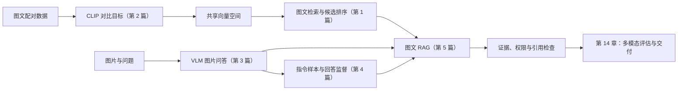

# 第 11 章（第一部分）：CLIP 图文检索与对比学习

假设一家公司有上万张商品图、设置页面和票据。用户搜“带红色按钮的设置页面”时，系统要先从图库里找出候选；它不能只返回一个看似合理的分数，还得说明排名怎样算、哪些图算相关，以及这个结果能否进入后续回答。

本章先从 CLIP 的图像和文本向量开始，沿着一次检索走到候选索引，再用直观方式说明共享表征为什么能支持 zero-shot 分类。读完后，你应能手算相似度、看懂 Recall@K 和 MRR 的分母，并知道一个高相似度分数为什么不是正确概率。这里先把编码器当作现成工具；接下来的对比学习部分会把训练目标拆成张量、损失、梯度方向和跨卡标签顺序。

本章后续还会从检索走向图片问答、训练样本和图文 RAG。读图时要区分“找到相似图片”和“回答受到图片证据支持”：前者负责找候选，后者还要检查原图、OCR 或结构化字段、模型回答和业务规则。

图按知识依赖画：训练目标先形成共享表征，再用于检索；正文从读者看得见的检索结果讲起，然后回头解释目标函数。下面的检索实验使用手工构造的向量，只核对排序和指标算法，不加载真实 CLIP 权重，也不证明真实图像能力。

## 11.1 使用 CLIP 做图文检索

### 11.1.1 从“图片像什么”到“图片与文字是否对应”

图文检索的任务不是给图片生成一段漂亮描述，而是在一组候选中找出与查询语义最接近的对象。给定一句“带红色按钮的设置页面”，系统应该从图片库中找出相关截图；给定一张商品图片，系统应该从商品描述库中找出匹配文本。

CLIP 的关键设计是两个编码器：图像编码器把图片映射到向量空间，文本编码器把文字映射到同一个向量空间。训练数据中的匹配图文被拉近，不匹配组合被推远。训练完成后，检索不必为每个新类别重新训练分类头，而是可以直接把候选类别或查询写成文本。

设图像为 $I_{i}$，文本为 $T_{j}$，两个编码器分别为 $f_{\mathrm{img}}$ 和 $f_{\mathrm{txt}}$：

~~~math
u_{i}=f_{\mathrm{img}}(I_{i}),\qquad v_{j}=f_{\mathrm{txt}}(T_{j})
~~~

检索前通常做 L2 归一化：

~~~math
\hat{u}_{i}=\frac{u_{i}}{\|u_{i}\|_{2}},\qquad
\hat{v}_{j}=\frac{v_{j}}{\|v_{j}\|_{2}}
~~~

归一化后，图文相似度可以用点积表示：

~~~math
s_{ij}=\hat{u}_{i}^{\mathsf T}\hat{v}_{j}
~~~

如果有 $N$ 张图片和 $M$ 条文本，整个相似度矩阵是：

~~~math
S=\hat{U}\hat{V}^{\mathsf T},\qquad S\in\mathbb{R}^{N\times M}
~~~

这里要求图像集合和文本集合非空，即 $N>0$、 $M>0$，并要求两个编码器输出相同维度且每个向量范数严格大于零。若某一侧没有候选，检索结果和 Recall@K 都是不适用，而不是一个可以继续排序的空矩阵。

$S_{i,j}$ 只表示当前编码器、当前预处理和当前候选集合下的相似度。它不是概率，也不能直接解释为“图片属于文本类别的概率”。不同查询、不同模型和不同图库之间的分数通常不能直接横向比较。

### 11.1.2 对比学习为什么能支持 zero-shot 分类

训练 batch 中有 $N$ 个配对样本 $(I_{i},T_{i})$。对于第 $i$ 张图片， $T_{i}$ 是正文本，其他文本是负文本；对于第 $i$ 条文本， $I_{i}$ 是正图片，其他图片是负图片。带温度的图像到文本损失可以写为：

~~~math
L_{\mathrm{i2t}}
=-\frac{1}{N}\sum_{i=1}^{N}
\log\frac{\exp(z_{ii})}{\sum_{j=1}^{N}\exp(z_{ij})}
~~~

文本到图像方向则对转置矩阵计算交叉熵：

~~~math
L_{\mathrm{t2i}}
=-\frac{1}{N}\sum_{j=1}^{N}
\log\frac{\exp(z_{jj})}{\sum_{i=1}^{N}\exp(z_{ij})}
~~~

总损失通常取两个方向的平均：

~~~math
L_{\mathrm{clip}}=\frac{L_{\mathrm{i2t}}+L_{\mathrm{t2i}}}{2}
~~~

对比损失要求 batch 中有 $N>0$ 个配对样本，温度满足 $\tau>0$，并且每个图像/文本 embedding 可归一化。若 batch 为空或出现零向量，正样本概率和平均损失都没有定义。

$z_{ij}$ 可以写为 $s_{ij}/\tau$，也可以写为 $\exp(g)s_{ij}$。后一种写法把 $g$ 作为可学习的 logit scale 参数。温度较小时，softmax 更尖锐，模型会更强地惩罚正负样本分数接近的情况；温度过小也可能放大噪声和梯度不稳定。

CLIP 的两个方向都在 batch 内对候选做 softmax，所有候选通过同一个分母相互竞争。SigLIP 保留图文双编码器和配对数据，但把每个图文组合当作带标签的二分类项：匹配为正，其他组合为负；它不使用 CLIP 式的全局 softmax 分母。令 $s_{ij}$ 是图文相似度， $\alpha$ 是缩放系数， $b$ 是偏置， $y_{ij}$ 为正例 $+1$ 或负例 $-1$：

~~~math
x_{ij}=\alpha s_{ij}+b,\qquad
\ell_{ij}=-\log\sigma(y_{ij}x_{ij})
~~~

取一个可手算的单 pair 输入 $x=1$。若它是正例， $\sigma(1)\approx0.7311$，损失为 $-\ln(0.7311)\approx0.313$；若同一分数被标作负例，则 $\sigma(-1)\approx0.2689$，损失为 $-\ln(0.2689)\approx1.313$。这个计算只说明标签怎样改变单 pair 目标，不是模型输出或训练结果。取消全局 softmax 不会自动消除伪负例；若完整计算一个 batch 的所有图文组合，pair 数仍为 $B^2$，归一化约定也会影响 loss 尺度。SigLIP 2 又把该目标与多语言训练、数据筛选、自蒸馏和其他任务组合，因此论文中的效果不能只算在 sigmoid 损失头上。

zero-shot 分类只是检索的一个特例。假设候选类别是“猫、狗、汽车、花”，先把类别写成文本模板：

~~~text
a photo of a cat
a photo of a dog
a photo of a car
a photo of a flower
~~~

再计算图片与这些候选文本的相似度，取分数最高的类别。类别名称、模板措辞、语言和领域分布都会影响结果，因此 zero-shot 并不意味着不需要验证。

### 11.1.3 最小检索实验

下面的实验不依赖模型下载。它用手写向量模拟编码器输出，验证四个局部事实：归一化后向量长度为 1，匹配对的排名靠前，打乱文本会破坏排名，Recall@K 和 MRR 能把排序结果转成指标。

> 代码状态：静态审阅，未运行（2026-10-30）

~~~python
import math

def normalize(vector):
    if not isinstance(vector, (list, tuple)) or not vector:
        raise ValueError("vector must be non-empty")
    if any(isinstance(value, bool) or not isinstance(value, (int, float))
           or not math.isfinite(value) for value in vector):
        raise ValueError("vector values must be finite numbers")
    norm = math.sqrt(sum(value * value for value in vector))
    if not math.isfinite(norm) or norm == 0:
        raise ValueError("zero vector cannot be normalized")
    return [value / norm for value in vector]

def dot(left, right):
    if (not isinstance(left, (list, tuple)) or not isinstance(right, (list, tuple))
            or not left or len(left) != len(right)):
        raise ValueError("dot product dimensions must match and be non-empty")
    return sum(a * b for a, b in zip(left, right))

images = {
    "cat.jpg": [3.0, 1.0, 0.0, 0.0],
    "dog.jpg": [0.0, 3.0, 1.0, 0.0],
    "car.jpg": [0.0, 0.0, 3.0, 1.0],
    "flower.jpg": [1.0, 0.0, 0.0, 3.0],
}
texts = {
    "cat": [2.8, 1.0, 0.0, 0.1],
    "dog": [0.1, 2.7, 1.0, 0.0],
    "car": [0.0, 0.2, 2.8, 1.0],
    "flower": [0.9, 0.0, 0.1, 2.8],
}

image_names = list(images)
text_names = list(texts)
if not image_names or not text_names:
    raise ValueError("image and text collections must be non-empty")
if len({len(vector) for vector in images.values()}) != 1:
    raise ValueError("image vectors must have a common dimension")
if len({len(vector) for vector in texts.values()}) != 1:
    raise ValueError("text vectors must have a common dimension")
if len(next(iter(images.values()))) != len(next(iter(texts.values()))):
    raise ValueError("image and text dimensions must match")
image_vectors = [normalize(images[name]) for name in image_names]
text_vectors = [normalize(texts[name]) for name in text_names]
similarity = [
    [dot(image, text) for text in text_vectors]
    for image in image_vectors
]

def text_to_image_rank(text_index):
    if (isinstance(text_index, bool) or not isinstance(text_index, int)
            or not 0 <= text_index < len(text_names)):
        raise ValueError("text_index is out of range")
    order = sorted(
        range(len(image_names)),
        key=lambda image_index: similarity[image_index][text_index],
        reverse=True,
    )
    correct_name = text_names[text_index] + ".jpg"
    return order.index(image_names.index(correct_name)) + 1

ranks = [text_to_image_rank(index) for index in range(len(text_names))]
recall_at_1 = sum(rank <= 1 for rank in ranks) / len(ranks)
recall_at_2 = sum(rank <= 2 for rank in ranks) / len(ranks)
mrr = sum(1 / rank for rank in ranks) / len(ranks)

# 保持原来的正确图片标签，只轮换实际使用的文本向量。
shuffled_ranks = []
for index in range(len(text_names)):
    source_column = (index + 1) % len(text_names)
    order = sorted(range(len(image_names)),
                   key=lambda i: similarity[i][source_column], reverse=True)
    shuffled_ranks.append(order.index(image_names.index(text_names[index] + ".jpg")) + 1)
shuffled_recall_at_1 = sum(rank == 1 for rank in shuffled_ranks) / len(shuffled_ranks)

assert all(abs(sum(value * value for value in vector) - 1.0) < 1e-12
           for vector in image_vectors + text_vectors)
assert ranks == [1, 1, 1, 1]
assert recall_at_1 == 1.0
assert recall_at_2 == 1.0
assert mrr == 1.0
assert shuffled_recall_at_1 == 0.0
print("similarity_shape=", (len(similarity), len(similarity[0])))
print("ranks=", ranks)
print("recall_at_1=", recall_at_1)
print("mrr=", round(mrr, 4))
print("shuffled_recall_at_1=", shuffled_recall_at_1)
~~~
本例相似度矩阵为 $4\times4$，正常配对四个排名均为 $1$，MRR 和 Recall@1 均为 $1$；只轮换向量、保留原标签后 Recall@1 为 $0$。同步轮换向量和正确标签只是改变排列。每个查询只有一个相关图片时，这里的 Recall@K 等于 Hit@K；多相关图片时须用命中相关图片数除以该查询全部相关图片数。

这个实验没有证明真实 CLIP 的泛化能力，因为向量本身是人为构造的。它只验证所列输入上的排序与指标。真实实验还需要固定 checkpoint、图像预处理、文本模板、候选集合、数据切分和版本，并按任务类别报告 Recall@K，而不是只展示一张图片的 top-1 结果。

### 11.1.4 从一次查询到可维护索引

图库规模较小时，可以在线编码图片并计算矩阵；规模变大后，图片编码应当离线完成。一个可回放的索引条目至少保留：

~~~text
image_id
image_path 或对象存储 URI
encoder_name 与 model_revision
preprocess_revision
embedding_dim 与 dtype
source、tenant、permission_version
created_at 与 index_version
~~~

在线请求只编码查询文本，再从图片向量索引中取候选。FAISS 的 inner-product 索引在向量已归一化时可以用于 cosine 检索；近似索引还需要通过 Recall@K、延迟、内存和更新成本做选型。图片权限不能在向量相似度之后才完全补救，租户和访问范围应进入检索过滤条件。

如果一张图片对应多个描述，训练和评估不能机械地使用一条对角线标签。多正样本可以使用集合标签：

~~~math
Y_{ij}\in\{0,1\}
~~~

当文本 $T_{j}$ 是图片 $I_{i}$ 的合法描述时，令 $Y_{ij}=1$；否则令 $Y_{ij}=0$。

评估时也要允许任意一个合法文本命中，否则会把“描述不同但事实都正确”的结果误判为错误。相反，如果同一图片的近重复描述同时出现在训练和测试，检索分数会被高估，因此图片级 hash、来源和时间切分都应纳入数据治理。

#### 跟着算一次：相似度不是概率

把查询“红色按钮的设置页面”编码成单位向量 $q=[1,0]$。为了只看排序过程，假设三个候选页面的向量分别是 $d_{1}=[0.8,0.6]$、 $d_{2}=[0.6,0.8]$、 $d_{3}=[0.1,\sqrt{0.99}]$。它们的范数都为 $1$，因此余弦相似度就是点积： $q\cdot d_{1}=0.8$， $q\cdot d_{2}=0.6$， $q\cdot d_{3}=0.1$。系统先给出 $d_{1},d_{2},d_{3}$ 的顺序，再由标注判断相关项是否排在前面。

如果第一名的分数是 0.8，这不表示“有 80% 概率找对”。将所有候选都替换成完全不相关的图片，模型仍会从中挑一个分数最高的结果；分数只描述候选之间的相对相似程度。若业务需要拒答，应在独立验证集上校准阈值，并报告阈值附近的误召回和漏召回。离线评估至少要同时记录 Recall@1、Recall@5、查询延迟和候选总数；只报告 top-1 示例会掩盖图库变大后出现的近似负例。

上述向量是手工构造的几何例子，不是 CLIP 的实测输出。真实 embedding 的维数可能很高，语义相近、视觉相似和业务相关也不是同一标签。上线前应按截图、商品、图表、中文文字和长尾类别分别检查，并把每个 query 的正确对象集合写清楚；这一步决定 Recall@K 的分母和“命中”含义。

#### 候选集合怎样改变 Recall@K 的读法

再看指标分母。假设 $20$ 个查询中，每个查询平均有 $3$ 张合法相关图片。若系统对某查询的 top-5 找回 $2$ 张相关图片，该查询 Recall@5 是 $2/3$，而不是“top-5 命中”就记作 $1$。若其余 $19$ 个查询各找回全部 $3$ 张，宏平均 Recall@5 为 $(2/3+19)/20\approx98.33\%$。把 top-1 命中率和这个指标混在一起，会把“只要找到一张就算成功”误说成“找全了相关内容”。

另外，候选集合从 100 张扩大到 10 万张时，模型分数范围和最难负例都会变化。一个阈值在小型开发集上表现好，未必在大图库中仍有同样精确率。评估应固定查询集合和相关标注，同时记录索引规模、过滤前后的候选数，以及新索引中的近似重复项。Recall@K 衡量已标注相关项被找回的比例，无法说明未标注候选一定不相关；需要抽样复核“看起来新、但未标注”的结果。

### 11.1.5 资料与证据边界

CLIP 的对比学习方法见 [Learning Transferable Visual Models From Natural Language Supervision](https://arxiv.org/abs/2103.00020)；逐 pair sigmoid 目标见 [Sigmoid Loss for Language Image Pre-Training](https://arxiv.org/abs/2303.15343)，后续组合式训练方案见 [SigLIP 2](https://arxiv.org/abs/2502.14786)。向量索引的具体接口可参考 [FAISS 文档](https://faiss.ai/)，当前 Transformers 接口可参考 [CLIP 文档](https://huggingface.co/docs/transformers/model_doc/clip)。这些论文结果分别限定在作者报告的模型、数据和协议；目标图库上的召回率、中文效果、细粒度能力和成本必须单独实测。

---

下一节：对比学习损失，从已经能排序的向量回到训练目标。

前一节已经把 CLIP 当作一个可以给图片和文字编码的工具：向量相似度能排出候选，但还没有解释这些向量为什么会有用。这里把问题往前推一步：模型怎样从成对图片和文字中学到这种对应关系？

先看模型表示什么：两个编码器把图像和文本送到同一个向量空间。再看学习目标：同一对图文应在 batch 候选中互相认出，图到文和文到图都要成立。最后看算法怎样实现目标：归一化、计算相似度矩阵、按正确配对位置计算交叉熵，并检查标签顺序。文中的纯 Python 程序只是损失计算器，不包含可训练编码器、梯度或参数更新。

## 11.2 从零实现 mini CLIP 损失

### 11.2.1 相似度矩阵的标签结构

上一节把编码器当作黑盒。本节只研究损失函数，目的是把“图文对齐”从一句概念还原成可计算的张量关系。

一个 batch 的图像 embedding 和文本 embedding 形状都是 [N,D]。归一化后相乘得到 [N,N] 矩阵：行表示一个图像，列表示一个候选文本。若第 i 张图与第 i 条文本匹配，标签就是 [0,1,...,N-1]。

~~~math
U\in\mathbb{R}^{N\times D},\qquad V\in\mathbb{R}^{N\times D},\qquad Z=\frac{\mathrm{normalize}(U)\mathrm{normalize}(V)^{\mathsf T}}{\tau}
~~~

图像到文本方向的交叉熵为：

~~~math
L_{\mathrm{i2t}}=-\frac{1}{N}\sum_{i}\left(Z_{ii}-\log\sum_{j}\exp Z_{ij}\right)
~~~

文本到图像方向只需把 Z 转置。实现时必须使用数值稳定的 log-sum-exp：

~~~math
\log\sum_{j}\exp z_{j}=m+\log\sum_{j}\exp(z_{j}-m),\qquad m=\max_{j} z_{j}
~~~

当温度很小或 logit scale 很大时，直接计算 exp(z) 容易溢出；稳定实现不是可选的装饰。

### 11.2.2 纯 Python 版本与反事实检查

> 代码状态：静态审阅，未运行（2026-10-30）

~~~python
import math

def normalize(vector):
    if not isinstance(vector, (list, tuple)) or not vector:
        raise ValueError("vector must be non-empty")
    if any(isinstance(value, bool) or not isinstance(value, (int, float))
           or not math.isfinite(value) for value in vector):
        raise ValueError("vector values must be finite numbers")
    norm = math.sqrt(sum(value * value for value in vector))
    if not math.isfinite(norm) or norm == 0:
        raise ValueError("zero vector")
    return [value / norm for value in vector]

def transpose(matrix):
    if not isinstance(matrix, list) or not matrix or any(
            not isinstance(row, list) or not row for row in matrix):
        raise ValueError("matrix must be non-empty")
    width = len(matrix[0])
    if any(len(row) != width for row in matrix):
        raise ValueError("matrix rows must have equal length")
    return [list(column) for column in zip(*matrix)]

def logsumexp(row):
    if not isinstance(row, list) or not row:
        raise ValueError("row must be non-empty")
    if any(isinstance(value, bool) or not isinstance(value, (int, float))
           or not math.isfinite(value) for value in row):
        raise ValueError("logits must be finite numbers")
    maximum = max(row)
    return maximum + math.log(sum(math.exp(value - maximum) for value in row))

def cross_entropy_diagonal(logits):
    if not isinstance(logits, list) or not logits:
        raise ValueError("logits must be non-empty")
    if any(not isinstance(row, list) or len(row) != len(logits) for row in logits):
        raise ValueError("diagonal paired logits must be square")
    return sum(-row[index] + logsumexp(row)
               for index, row in enumerate(logits)) / len(logits)

def clip_loss(images, texts, temperature=0.07):
    if (isinstance(temperature, bool) or not isinstance(temperature, (int, float))
            or not math.isfinite(temperature) or temperature <= 0):
        raise ValueError("temperature must be positive")
    if (not isinstance(images, list) or not images
            or not isinstance(texts, list) or not texts
            or len(images) != len(texts)):
        raise ValueError("images and texts must be non-empty and aligned")
    image_vectors = [normalize(vector) for vector in images]
    text_vectors = [normalize(vector) for vector in texts]
    if len({len(vector) for vector in image_vectors + text_vectors}) != 1:
        raise ValueError("all embeddings must share a dimension")
    logits = [
        [sum(a * b for a, b in zip(image, text)) / temperature
         for text in text_vectors]
        for image in image_vectors
    ]
    loss_i2t = cross_entropy_diagonal(logits)
    loss_t2i = cross_entropy_diagonal(transpose(logits))
    return (loss_i2t + loss_t2i) / 2, logits

images = [[3.0, 1.0, 0.0], [0.0, 3.0, 1.0], [1.0, 0.0, 3.0]]
texts = [[2.9, 1.0, 0.0], [0.0, 2.8, 1.0], [0.9, 0.0, 2.8]]
loss, logits = clip_loss(images, texts)
shuffled_loss, _ = clip_loss(images, texts[1:] + texts[:1])
smooth_loss, _ = clip_loss(images, texts, temperature=0.5)

assert loss < shuffled_loss
assert smooth_loss > loss
assert all(max(range(3), key=lambda j: logits[i][j]) == i for i in range(3))
print("loss=", round(loss, 6))
print("shuffled_loss=", round(shuffled_loss, 6))
print("smooth_temperature_loss=", round(smooth_loss, 6))
~~~
本例正常 loss 约为 0.000095，打乱配对后约为 10.008890，温度改为 0.5 时约为 0.402856。这些数字对应当前手写向量：温度变大使分布更平滑，但在任意错误排序输入上，loss 不一定随温度增大而增大。若检查失败，优先查看归一化维度、转置方向、标签顺序和 batch 内样本配对，而不是先调学习率。

$N=1$ 时两个方向的损失恒为 0，因为没有 batch 内负样本，不能把这个零损失解释成对齐成功。本例是公式计算器，没有梯度、参数更新或编码器训练。

### 11.2.3 大 batch、跨卡负样本与标签一致性

batch 内负样本数量为 N-1。大 batch 往往能提供更多负样本，但也会增加显存和通信。多卡训练中，如果每张卡只使用本地 batch，负样本规模受单卡限制；如果做 all_gather，全局样本数近似为：

~~~math
N_{\mathrm{global}}=W\cdot N_{\mathrm{local}}
~~~

其中 W 是 worker 数，此式假设各卡本地 batch 等长。变长 batch 应求各卡样本数之和。若 logits 的行是本卡 query、列是全局候选，标签需加上该卡样本在 gather 顺序中的 offset；若在每卡计算完整全局方阵，标签仍是全局 `arange(N_global)`。offset 是张量布局决定的，不能无条件添加。常见错误包括：

~~~text
只 gather image 不 gather text
gather 后仍使用本地 arange(N_local)
不同卡上的样本顺序不一致
梯度是否跨卡传播没有明确记录
多正样本被错误压成单一对角线
~~~

一个可靠实验应同时记录 local batch、global batch、负样本数量、通信时间、显存和 Recall@K。只报告 loss 下降，无法说明大 batch 的收益来自更好的负样本，还是来自训练步数、学习率或数据混合变化。

### 11.2.4 训练目标与检索目标不完全相同

对比损失优化的是 batch 内相对排序，而业务检索可能要求：精确字段、权限过滤、同义词鲁棒性、重复结果去除和多语言匹配。于是训练 loss 下降并不自动意味着业务 Recall@K 提高。

需要分别建立：

~~~text
训练监控：i2t loss、t2i loss、logit scale、梯度范数
检索指标：Recall@1/5/10、MRR、Median Rank
按业务类别统计：语言、分辨率、细粒度类别、OCR、长尾来源
工程指标：编码吞吐、索引延迟、更新耗时、存储大小
~~~

#### 跟着算一次：一个 $2\times2$ batch 的双向损失

先看最小的非退化 batch：两张图片和两条文本，配对关系为对角线。假设归一化后的相似度已经除以温度，得到 logits 矩阵：

~~~math
\begin{bmatrix}
2&0\\
0&2
\end{bmatrix}
~~~

第一行的两个指数权重是 $e^{2}\approx7.389$ 与 $e^{0}=1$。因此图片 $1$ 选择文本 $1$ 的概率为 $7.389/8.389\approx0.8808$；图片 $2$ 选择文本 $2$ 的概率也为 $0.8808$。图像到文本损失是 $-\ln(0.8808)\approx0.1269$。矩阵对称，所以文本到图像得到同一个值，双向平均仍为约 $0.1269$。

再把正确标签改成反对角线，相当于保留分数矩阵却把配对关系交换。此时每个正确位置的 logit 是 $0$，概率变为 $1/(1+e^{2})\approx0.1192$，损失约为 $-\ln(0.1192)\approx2.1269$。这组数说明损失同时依赖分数和标签：同一批向量仅因样本错配就会得到完全不同的目标值。实现中标签顺序必须跟 embedding gather 后的行列顺序一致。

温度把原始相似度整体缩放。若原始对角分数为 $0.2$、非对角分数为 $0$，温度 $0.1$ 会得到 $2$ 和 $0$，正样本概率约为 $0.8808$；温度 $0.2$ 会得到 $1$ 和 $0$，概率约为 $0.7311$，交叉熵约为 $-\ln(0.7311)\approx0.3133$。温度较低使区分变尖锐，也让错误排序承受更大的梯度压力。实践中不能只看训练 loss，还要检查配对标签、温度或可学习 scale、batch 内重复样本和验证集 Recall@K；重复图或同一语义的多条文本被当作负例，会把本来合理的匹配错误地推远。

这个 $2\times2$ 计算没有模拟梯度更新，也没有证明大 batch 一定更好。它把双向 softmax、负样本和标签错位的作用隔离出来；真实多卡训练还要把 all-gather 的梯度传播、去重策略和全局样本编号纳入验证。

#### 跨卡 gather 后标签为什么需要偏移

假设两张 GPU 各持有 2 组图文对，rank 0 的图文顺序为 A、B，rank 1 的顺序为 C、D。只用本地候选时，rank 1 两个 query 的正确列标签是 $[0,1]$；做全局 gather 后候选顺序变成 A、B、C、D，rank 1 的正确列标签必须是 $[2,3]$。若忘了偏移，模型会被要求把 C 对齐到 A、把 D 对齐到 B，目标函数方向直接错了。

这一步只描述“本地 query 对全局候选”的布局。如果每个 worker 都构造完整的全局 $4\times4$ 矩阵，四个 query 的标签自然是 $[0,1,2,3]$；不能再额外加 rank offset。标签写法由 logits 的行、列实际对应哪些样本决定，应先列出顺序再写代码。样本数不等时，rank offset 是此前所有 worker 样本数之和，而不是 rank 乘一个假定的 batch size。

用一张小检查表可以发现错位：给每个图片和文本一个相同的显式 ID，打印 gather 前后的顺序，再检查每一行正确列是否指向同 ID。随后做一个反事实，把文本顺序循环移动一次；若标签不动，loss 应显著增大。重复或多正样本场景不能只靠对角线标签，需改成正例集合或适合多标签的目标，并在评估时保持一致。

#### 从 softmax 概率读出一轮更新方向

仍用 logits $[2,0]$ 和正确标签 $0$。交叉熵对正确 logit 的导数是 $p_{0}-1$，约 $0.8808-1=-0.1192$；对负例 logit 的导数是 $p_{1}-0=0.1192$。梯度下降会提高正确配对分数、压低这个负例分数。若配对顺序错了，两个导数的角色也会随错误标签交换，模型就会被稳定地推向错误对应。

这是对 logits 的局部梯度，不是对图像和文本 embedding 参数的最终梯度。真实训练还要经过归一化、温度缩放、图像/文本编码器和共享参数；同一图片在 batch 中出现多次，也会使它同时参与多条正负关系。因此排查训练异常应先查看 logits、标签和样本 ID，再查看编码器学习率，而不是只凭 loss 的绝对大小猜模型有没有学会。

再把 2 张卡上的 gather 结果按顺序列出来：rank 0 的本地行对应 A、B，rank 1 对应 C、D；全局列始终按 A、B、C、D 排列。rank 1 的 logits 形状是 $2\times4$，行是 C、D，正确列分别是 $2$、 $3$。若误用 $[0,1]$，平均交叉熵会奖励 rank 1 query 选择 rank 0 的样本；这个错误可能仍能运行并产生有限 loss，所以仅检查 shape 和 loss 是否非 NaN 不够。

可以在训练前用固定小 batch 做一次顺序检查：把每个 embedding 换成能够从 ID 直接识别的单位向量，确认相同 ID 的 logit 位于目标列；再将某一张卡的顺序反转，确认标签也随 gather 顺序变更。该检查不能证明梯度通信正确，却能暴露分布式实现中容易忽略的顺序约定。真实训练时仍应记录 global batch、worker 数、采样顺序和重复样本规则。

### 11.2.5 资料与证据边界

原始 CLIP 论文支持双向对比目标和 zero-shot 设定；分布式 all-gather、混合精度和具体 batch 规模属于实现选择，需要依据目标训练框架和硬件验证。toy 损失的数值只验证局部公式，不能推出真实模型的图文理解能力。

---

前一节：图文检索；下一部分：[VLM 图片问答](11-图文理解与检索实战-2-VLM问答数据与RAG.md)，从检索候选转向开放式回答。
