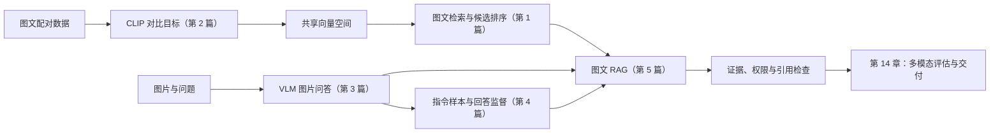

# 第 11 章（1）：用 CLIP 找到图文对应项

假设一家公司有上万张商品图、设置页面和票据。用户搜“带红色按钮的设置页面”时，系统要先从图库里找出候选；它不能只返回一个看似合理的分数，还得说明排名怎样算、哪些图算相关，以及这个结果能否进入后续回答。

这篇从 CLIP 的图像和文本向量开始，沿着一次检索走到候选索引，也先用直观方式说明共享表征为什么能支持 zero-shot 分类。读完后，你应能手算相似度、看懂 Recall@K 和 MRR 的分母，并知道一个高相似度分数为什么不是正确概率。这里先把编码器当作现成工具；下一篇会把刚才见到的训练目标拆成张量、损失、梯度方向和跨卡标签顺序。

本章后续还会从检索走向图片问答、训练样本和图文 RAG。读图时要区分“找到相似图片”和“回答受到图片证据支持”：前者负责找候选，后者还要检查原图、OCR 或结构化字段、模型回答和业务规则。

图按知识依赖画：训练目标先形成共享表征，再用于检索；正文从读者看得见的检索结果讲起，然后回头解释目标函数。下面的检索实验使用手工构造的向量，只核对排序和指标算法，不加载真实 CLIP 权重，也不证明真实图像能力。

## 11.1 使用 CLIP 做图文检索

### 11.1.1 从“图片像什么”到“图片与文字是否对应”

图文检索的任务不是给图片生成一段漂亮描述，而是在一组候选中找出与查询语义最接近的对象。给定一句“带红色按钮的设置页面”，系统应该从图片库中找出相关截图；给定一张商品图片，系统应该从商品描述库中找出匹配文本。

CLIP 的关键设计是两个编码器：图像编码器把图片映射到向量空间，文本编码器把文字映射到同一个向量空间。训练数据中的匹配图文被拉近，不匹配组合被推远。训练完成后，检索不必为每个新类别重新训练分类头，而是可以直接把候选类别或查询写成文本。

设图像为 I_i，文本为 T_j，两个编码器分别为 f_img 和 f_txt：

~~~math
u_i=f_{\mathrm{img}}(I_i),\qquad v_j=f_{\mathrm{txt}}(T_j)
~~~

检索前通常做 L2 归一化：

~~~math
\hat{u}_i=\frac{u_i}{\|u_i\|_2},\qquad
\hat{v}_j=\frac{v_j}{\|v_j\|_2}
~~~

归一化后，图文相似度可以用点积表示：

~~~math
s_{ij}=\hat{u}_i^{\mathsf T}\hat{v}_j
~~~

如果有 N 张图片和 M 条文本，整个相似度矩阵是：

~~~math
S=\hat{U}\hat{V}^{\mathsf T},\qquad S\in\mathbb{R}^{N\times M}
~~~

这里要求图像集合和文本集合非空，即 $N>0$、$M>0$，并要求两个编码器输出相同维度且每个向量范数严格大于零。若某一侧没有候选，检索结果和 Recall@K 都是不适用，而不是一个可以继续排序的空矩阵。

S[i,j] 只表示当前编码器、当前预处理和当前候选集合下的相似度。它不是概率，也不能直接解释为“图片属于文本类别的概率”。不同查询、不同模型和不同图库之间的分数通常不能直接横向比较。

### 11.1.2 对比学习为什么能支持 zero-shot 分类

训练 batch 中有 N 个配对样本 (I_i,T_i)。对于第 i 张图片，T_i 是正文本，其他文本是负文本；对于第 i 条文本，I_i 是正图片，其他图片是负图片。带温度的图像到文本损失可以写为：

~~~math
L_{\mathrm{i2t}}
=-\frac{1}{N}\sum_{i=1}^{N}
\log\frac{\exp(z_{ii})}{\sum_{j=1}^{N}\exp(z_{ij})}
~~~

文本到图像方向则对转置矩阵计算交叉熵：

~~~math
L_{\mathrm{t2i}}
=-\frac{1}{N}\sum_{j=1}^{N}
\log\frac{\exp(z_{jj})}{\sum_{i=1}^{N}\exp(z_{ij})}
~~~

总损失通常取两个方向的平均：

~~~math
L_{\mathrm{clip}}=\frac{L_{\mathrm{i2t}}+L_{\mathrm{t2i}}}{2}
~~~

对比损失要求 batch 中有 $N>0$ 个配对样本，温度满足 $\tau>0$，并且每个图像/文本 embedding 可归一化。若 batch 为空或出现零向量，正样本概率和平均损失都没有定义。

z_ij 可以写为 s_ij / tau，也可以写为 exp(g) s_ij。后一种写法把 g 作为可学习的 logit scale 参数。温度较小时，softmax 更尖锐，模型会更强地惩罚正负样本分数接近的情况；温度过小也可能放大噪声和梯度不稳定。

CLIP 的两个方向都在 batch 内对候选做 softmax，所有候选通过同一个分母相互竞争。SigLIP 保留图文双编码器和配对数据，但把每个图文组合当作带标签的二分类项：匹配为正，其他组合为负；它不使用 CLIP 式的全局 softmax 分母。令 `s_ij` 是图文相似度，`α` 是缩放系数，`b` 是偏置，`y_ij` 为正例 `+1` 或负例 `−1`：

~~~math
x_{ij}=\alpha s_{ij}+b,\qquad
\ell_{ij}=-\log\sigma(y_{ij}x_{ij})
~~~

取一个可手算的单 pair 输入 `x=1`。若它是正例，`σ(1)≈0.7311`，损失为 `−ln(0.7311)≈0.313`；若同一分数被标作负例，则 `σ(−1)≈0.2689`，损失为 `−ln(0.2689)≈1.313`。这个计算只说明标签怎样改变单 pair 目标，不是模型输出或训练结果。取消全局 softmax 不会自动消除伪负例；若完整计算一个 batch 的所有图文组合，pair 数仍为 `B²`，归一化约定也会影响 loss 尺度。SigLIP 2 又把该目标与多语言训练、数据筛选、自蒸馏和其他任务组合，因此论文中的效果不能只算在 sigmoid 损失头上。

zero-shot 分类只是检索的一个特例。假设候选类别是“猫、狗、汽车、花”，先把类别写成文本模板：

~~~text
a photo of a cat
a photo of a dog
a photo of a car
a photo of a flower
~~~

再计算图片与这些候选文本的相似度，取分数最高的类别。类别名称、模板措辞、语言和领域分布都会影响结果，因此 zero-shot 并不意味着不需要验证。

### 11.1.3 最小检索实验

下面的实验不依赖模型下载。它用手写向量模拟编码器输出，验证四个局部事实：归一化后向量长度为 1，匹配对的排名靠前，打乱文本会破坏排名，Recall@K 和 MRR 能把排序结果转成指标。

> 代码状态：静态审阅，未运行（2026-10-30）

~~~python
import math

def normalize(vector):
    if not isinstance(vector, (list, tuple)) or not vector:
        raise ValueError("vector must be non-empty")
    if any(isinstance(value, bool) or not isinstance(value, (int, float))
           or not math.isfinite(value) for value in vector):
        raise ValueError("vector values must be finite numbers")
    norm = math.sqrt(sum(value * value for value in vector))
    if not math.isfinite(norm) or norm == 0:
        raise ValueError("zero vector cannot be normalized")
    return [value / norm for value in vector]

def dot(left, right):
    if (not isinstance(left, (list, tuple)) or not isinstance(right, (list, tuple))
            or not left or len(left) != len(right)):
        raise ValueError("dot product dimensions must match and be non-empty")
    return sum(a * b for a, b in zip(left, right))

images = {
    "cat.jpg": [3.0, 1.0, 0.0, 0.0],
    "dog.jpg": [0.0, 3.0, 1.0, 0.0],
    "car.jpg": [0.0, 0.0, 3.0, 1.0],
    "flower.jpg": [1.0, 0.0, 0.0, 3.0],
}
texts = {
    "cat": [2.8, 1.0, 0.0, 0.1],
    "dog": [0.1, 2.7, 1.0, 0.0],
    "car": [0.0, 0.2, 2.8, 1.0],
    "flower": [0.9, 0.0, 0.1, 2.8],
}

image_names = list(images)
text_names = list(texts)
if not image_names or not text_names:
    raise ValueError("image and text collections must be non-empty")
if len({len(vector) for vector in images.values()}) != 1:
    raise ValueError("image vectors must have a common dimension")
if len({len(vector) for vector in texts.values()}) != 1:
    raise ValueError("text vectors must have a common dimension")
if len(next(iter(images.values()))) != len(next(iter(texts.values()))):
    raise ValueError("image and text dimensions must match")
image_vectors = [normalize(images[name]) for name in image_names]
text_vectors = [normalize(texts[name]) for name in text_names]
similarity = [
    [dot(image, text) for text in text_vectors]
    for image in image_vectors
]

def text_to_image_rank(text_index):
    if (isinstance(text_index, bool) or not isinstance(text_index, int)
            or not 0 <= text_index < len(text_names)):
        raise ValueError("text_index is out of range")
    order = sorted(
        range(len(image_names)),
        key=lambda image_index: similarity[image_index][text_index],
        reverse=True,
    )
    correct_name = text_names[text_index] + ".jpg"
    return order.index(image_names.index(correct_name)) + 1

ranks = [text_to_image_rank(index) for index in range(len(text_names))]
recall_at_1 = sum(rank <= 1 for rank in ranks) / len(ranks)
recall_at_2 = sum(rank <= 2 for rank in ranks) / len(ranks)
mrr = sum(1 / rank for rank in ranks) / len(ranks)

# 保持原来的正确图片标签，只轮换实际使用的文本向量。
shuffled_ranks = []
for index in range(len(text_names)):
    source_column = (index + 1) % len(text_names)
    order = sorted(range(len(image_names)),
                   key=lambda i: similarity[i][source_column], reverse=True)
    shuffled_ranks.append(order.index(image_names.index(text_names[index] + ".jpg")) + 1)
shuffled_recall_at_1 = sum(rank == 1 for rank in shuffled_ranks) / len(shuffled_ranks)

assert all(abs(sum(value * value for value in vector) - 1.0) < 1e-12
           for vector in image_vectors + text_vectors)
assert ranks == [1, 1, 1, 1]
assert recall_at_1 == 1.0
assert recall_at_2 == 1.0
assert mrr == 1.0
assert shuffled_recall_at_1 == 0.0
print("similarity_shape=", (len(similarity), len(similarity[0])))
print("ranks=", ranks)
print("recall_at_1=", recall_at_1)
print("mrr=", round(mrr, 4))
print("shuffled_recall_at_1=", shuffled_recall_at_1)
~~~
本例相似度矩阵为 4×4，正常配对四个排名均为 1，MRR 和 Recall@1 均为 1；只轮换向量、保留原标签后 Recall@1 为 0。同步轮换向量和正确标签只是改变排列。每个查询只有一个相关图片时，这里的 Recall@K 等于 Hit@K；多相关图片时须用命中相关图片数除以该查询全部相关图片数。

这个实验没有证明真实 CLIP 的泛化能力，因为向量本身是人为构造的。它只验证所列输入上的排序与指标。真实实验还需要固定 checkpoint、图像预处理、文本模板、候选集合、数据切分和版本，并按任务类别报告 Recall@K，而不是只展示一张图片的 top-1 结果。

### 11.1.4 从一次查询到可维护索引

图库规模较小时，可以在线编码图片并计算矩阵；规模变大后，图片编码应当离线完成。一个可回放的索引条目至少保留：

~~~text
image_id
image_path 或对象存储 URI
encoder_name 与 model_revision
preprocess_revision
embedding_dim 与 dtype
source、tenant、permission_version
created_at 与 index_version
~~~

在线请求只编码查询文本，再从图片向量索引中取候选。FAISS 的 inner-product 索引在向量已归一化时可以用于 cosine 检索；近似索引还需要通过 Recall@K、延迟、内存和更新成本做选型。图片权限不能在向量相似度之后才完全补救，租户和访问范围应进入检索过滤条件。

如果一张图片对应多个描述，训练和评估不能机械地使用一条对角线标签。多正样本可以使用集合标签：

~~~math
Y_{ij}\in\{0,1\}
~~~

当文本 `T_j` 是图片 `I_i` 的合法描述时，令 `Y_{ij}=1`；否则令 `Y_{ij}=0`。

评估时也要允许任意一个合法文本命中，否则会把“描述不同但事实都正确”的结果误判为错误。相反，如果同一图片的近重复描述同时出现在训练和测试，检索分数会被高估，因此图片级 hash、来源和时间切分都应纳入数据治理。

#### 跟着算一次：相似度不是概率

把查询“红色按钮的设置页面”编码成单位向量 q=[1,0]。为了只看排序过程，假设三个候选页面的向量分别是 d1=[0.8,0.6]、d2=[0.6,0.8]、d3=[0.1,√0.99]。它们的范数都为 1，因此余弦相似度就是点积：q 与 d1 的点积为 0.8，q 与 d2 为 0.6，q 与 d3 为 0.1。系统先给出 d1、d2、d3 的顺序，再由标注判断相关项是否排在前面。

如果第一名的分数是 0.8，这不表示“有 80% 概率找对”。将所有候选都替换成完全不相关的图片，模型仍会从中挑一个分数最高的结果；分数只描述候选之间的相对相似程度。若业务需要拒答，应在独立验证集上校准阈值，并报告阈值附近的误召回和漏召回。离线评估至少要同时记录 Recall@1、Recall@5、查询延迟和候选总数；只报告 top-1 示例会掩盖图库变大后出现的近似负例。

上述向量是手工构造的几何例子，不是 CLIP 的实测输出。真实 embedding 的维数可能很高，语义相近、视觉相似和业务相关也不是同一标签。上线前应按截图、商品、图表、中文文字和长尾类别分别检查，并把每个 query 的正确对象集合写清楚；这一步决定 Recall@K 的分母和“命中”含义。

#### 候选集合怎样改变 Recall@K 的读法

再看指标分母。假设 20 个查询中，每个查询平均有 3 张合法相关图片。若系统对某查询的 top-5 找回 2 张相关图片，该查询 Recall@5 是 2/3，而不是“top-5 命中”就记作 1。若其余 19 个查询各找回全部 3 张，宏平均 Recall@5 为 (2/3+19)/20≈98.33%。把 top-1 命中率和这个指标混在一起，会把“只要找到一张就算成功”误说成“找全了相关内容”。

另外，候选集合从 100 张扩大到 10 万张时，模型分数范围和最难负例都会变化。一个阈值在小型开发集上表现好，未必在大图库中仍有同样精确率。评估应固定查询集合和相关标注，同时记录索引规模、过滤前后的候选数，以及新索引中的近似重复项。Recall@K 衡量已标注相关项被找回的比例，无法说明未标注候选一定不相关；需要抽样复核“看起来新、但未标注”的结果。

### 11.1.5 资料与证据边界

CLIP 的对比学习方法见 [Learning Transferable Visual Models From Natural Language Supervision](https://arxiv.org/abs/2103.00020)；逐 pair sigmoid 目标见 [Sigmoid Loss for Language Image Pre-Training](https://arxiv.org/abs/2303.15343)，后续组合式训练方案见 [SigLIP 2](https://arxiv.org/abs/2502.14786)。向量索引的具体接口可参考 [FAISS 文档](https://faiss.ai/)，当前 Transformers 接口可参考 [CLIP 文档](https://huggingface.co/docs/transformers/model_doc/clip)。这些论文结果分别限定在作者报告的模型、数据和协议；目标图库上的召回率、中文效果、细粒度能力和成本必须单独实测。

---

下一篇：[对比学习损失](11-图文理解与检索实战-2-对比学习损失.md)：从已经能排序的向量回到训练目标。
