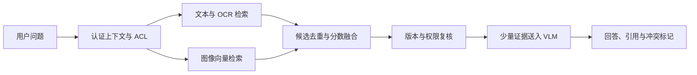

# 第 11 章（下）：VLM 问答、多模态数据与图文 RAG

CLIP 能告诉我们“这张图更像哪段文字”，却不会自然生成一段答案。若用户问截图里的错误码是什么，或图表中哪条曲线最高，系统需要把视觉输入和问题一起交给能生成文字的视觉语言模型（VLM）。

这一部分先看图片问答怎样进入 VLM，再检查多模态监督数据怎样构造，最后用图文 RAG 把检索候选、权限和回答证据接起来。视觉编码和连接器负责把图像变成模型可读取的表示，分辨率与视觉 token 数决定输入预算；模型再生成回答，最后按任务类别评估。文中的 Qwen2.5-VL 例子固定了一个具体模型家族，接口只说明怎样组织这次请求，不代表其他模型可直接替换，也不证明模型答对了。

## 11.3 使用开源 VLM 做图片问答

### 11.3.1 检索模型与生成模型的分工

CLIP 主要回答“这张图和哪段文字更接近”。图片问答还要回答“图片中有什么、某个对象在哪里、图表趋势怎样、截图报了什么错”。这要求模型把视觉输入和自然语言上下文组合起来，并自回归生成答案。

一个常见的视觉语言模型可以抽象为三部分：

~~~text
vision encoder：把图像变成视觉特征
projector / adapter：把视觉特征映射到语言模型 hidden space
language model：结合视觉 token 和问题 token 生成回答
~~~

设图像为 $I$，问题 token 为 $q$，回答 token 为 $a$：

~~~math
H_{v}=f_{v}(I),\qquad Z_{v}=P(H_{v}),\qquad E_{q}=\mathrm{Emb}(q)
~~~

最简单的拼接抽象是：

~~~math
X=[Z_{v};E_{q}],\qquad
p(a\mid I,q)=\prod_{t=1}^{T}p(a_{t}\mid X,a_{1:t-1})
~~~

实际模型可能使用 Q-Former、交叉注意力、特殊 image token、动态分辨率或原生统一 token 化。公式表达的是信息流，不是所有模型的实现细节。

### 11.3.2 图像 token 预算是系统约束

视觉编码器通常把图片分成 patch。若输入分辨率为 H x W，patch 边长为 p，未考虑特殊 token 时，视觉 token 数约为：

~~~math
N_{\mathrm{patch}}=\left\lfloor\frac{H}{p}\right\rfloor
\left\lfloor\frac{W}{p}\right\rfloor
~~~

这里要求输入高宽 `H,W` 和 patch 边长 `p` 为正整数，且至少各产生一个 patch。特殊 token、padding、动态分辨率和局部 crop 会改变实际 token 数，不能把这个近似式当作所有 processor 的精确计费结果。

分辨率提高有助于小字、细粒度物体和图表，但会增加视觉 token、prefill 时间和显存。压缩视觉 token 可以降低成本，却可能损失空间关系和 OCR 细节。因此图像预处理不能只写“resize 到固定大小”，还应记录：原始尺寸、裁剪策略、长宽比、patch 数、视觉 token 数和是否做局部 crop。

一个图像问答请求的上下文预算可以写成：

~~~math
B_{\mathrm{total}}=B_{\mathrm{image}}+B_{\mathrm{question}}+B_{\mathrm{history}}+B_{\mathrm{answer}}
~~~

各项预算应为非负数，总预算要满足模型上下文上限；若可用预算小于图片和问题本身，回答字段没有可分配空间，应在入口拒绝或截断并记录原因。

如果图片 token 已经占据大部分上下文，再叠加长历史或大量检索文档，模型可能不是“看不懂”，而是输入预算和注意力资源已经被耗尽。

### 11.3.3 以 Qwen2.5-VL 演示调用与接口边界

不同模型的 processor、占位符和模型类并不一致。下面固定一个 Qwen2.5-VL checkpoint，用模型专属类和当前多模态 chat template 接口走完图片问答：

> 代码状态：静态审阅，未运行（2026-10-30；依赖与模型权重未验证）

~~~python
import torch
from transformers import AutoProcessor, Qwen2_5_VLForConditionalGeneration

model_name = "Qwen/Qwen2.5-VL-3B-Instruct"
processor = AutoProcessor.from_pretrained(model_name)
model = Qwen2_5_VLForConditionalGeneration.from_pretrained(
    model_name, device_map="auto", torch_dtype="auto",
).eval()
question = "请只根据图片中可以确认的内容回答：图中有什么？"
messages = [{
    "role": "user",
    "content": [
        {"type": "image", "image": "https://huggingface.co/datasets/huggingface/documentation-images/resolve/main/cats.png"},
        {"type": "text", "text": question},
    ],
}]

inputs = processor.apply_chat_template(
    messages,
    add_generation_prompt=True,
    tokenize=True,
    return_dict=True,
    return_tensors="pt",
).to(model.device)

with torch.no_grad():
    output_ids = model.generate(**inputs, max_new_tokens=128, do_sample=False)

generated_ids = output_ids[:, inputs["input_ids"].shape[1]:]
answer = processor.batch_decode(generated_ids, skip_special_tokens=True)[0]
print(answer)
~~~
截至 2026-11-16，Transformers 的 Qwen2.5-VL 文档仍使用 `Qwen2_5_VLForConditionalGeneration`；多模态模板由 `AutoProcessor.apply_chat_template()` 处理，输入中除了文本 token，还可能包含 `pixel_values` 和 `image_grid_thw` 等图像字段。示例按输入 token 长度截去 prompt，只解码新生成的 token。通用 `AutoModelForImageTextToText` 也是文档中的一种入口，但模型专属类、processor 字段和输出约定都要与当前 checkpoint 对齐，不能只替换 `model_name` 就假定接口兼容。

示例使用 Transformers 文档中的公开图片，需要网络、模型权重、PyTorch、Transformers 和 Accelerate；`device_map="auto"` 不保证目标设备能容纳模型，也不代表延迟已满足要求。复现实验时应固定 checkpoint 与 processor revision、库版本、图片内容及预处理参数。若改用本地资料，应通过对应模型支持的图像输入方式载入，并记录图片版本，避免把会变化的 URL 当作固定测试样本。

### 11.3.4 按任务类型评估，比只看平均分更有用

图像问答至少应区分：

~~~text
全局描述
目标存在性与属性
计数
空间关系
OCR 与数字
图表和表格
截图与错误信息
无法判断与拒答
隐私和安全边界
~~~

对短答案可以使用 exact match 或字段准确率；对图表可以检查数值误差和相对关系；对开放描述需要人工评估正确性、完整性、groundedness 和幻觉；对无法判断问题，需要检查模型是否明确表达证据不足。

视觉幻觉率可以粗略写成：

~~~math
R_{\mathrm{hall}}=\frac{1}{N}\sum_{i=1}^{N}H_{i}
~~~

其中 $H_{i}=1$ 表示第 $i$ 个回答包含没有视觉证据支持的关键断言， $H_{i}=0$ 表示没有命中该类错误；该式要求评估样本数 $N>0$，且 $H_{i}\in\{0,1\}$。

这里的“无视觉证据”需要标注规则或人工审核定义，不能只用一个关键词列表代替所有判断。

### 11.3.5 一个不依赖模型的 VQA 评估样例

> 代码状态：静态审阅，未运行（2026-10-30）

~~~python
from collections import defaultdict

cases = [
    {
        "id": "object",
        "task": "object",
        "expected": ["cat"],
        "forbidden": ["dog"],
        "answer": "A cat is sitting on a sofa.",
    },
    {
        "id": "ocr",
        "task": "ocr",
        "expected": ["128"],
        "forbidden": ["123"],
        "answer": "The error code is 128.",
    },
    {
        "id": "counting",
        "task": "counting",
        "expected": ["2"],
        "forbidden": ["3"],
        "answer": "There are 3 cups.",
    },
]

def contains_all(text, values):
    if not isinstance(text, str) or not isinstance(values, (list, tuple)) or not values:
        raise ValueError("text and expected values must be non-empty")
    if any(not isinstance(value, str) or not value for value in values):
        raise ValueError("expected values must be non-empty strings")
    lowered = text.lower()
    return all(value.lower() in lowered for value in values)

def contains_any(text, values):
    if not isinstance(text, str) or not isinstance(values, (list, tuple)):
        raise TypeError("text and forbidden values have invalid types")
    if any(not isinstance(value, str) or not value for value in values):
        raise ValueError("forbidden values must be non-empty strings")
    lowered = text.lower()
    return any(value.lower() in lowered for value in values)

by_task = defaultdict(list)
bad_ids = []
for case in cases:
    correct = (contains_all(case["answer"], case["expected"])
               and not contains_any(case["answer"], case["forbidden"]))
    by_task[case["task"]].append(int(correct))
    if not correct:
        bad_ids.append(case["id"])

task_accuracy = {
    task: round(sum(values) / len(values), 4)
    for task, values in sorted(by_task.items())
}
assert task_accuracy == {"counting": 0.0, "object": 1.0, "ocr": 1.0}
assert bad_ids == ["counting"]
print("task_accuracy=", task_accuracy)
print("bad_ids=", bad_ids)
~~~
代码只验证一个规则化样本组的统计流程，不能替代人工视觉判断。特别是“回答中出现了正确关键词”不等于回答的关系、数量和因果都正确。

#### 跟着算一次：图片 token 会挤占回答预算

用一个便于心算的 patch 模型估算输入量：假设图片处理为正方形，patch 边长为 $14$，且暂不计特殊 token、裁剪和动态分辨率。 $448\times448$ 图片产生 $32\times32=1024$ 个视觉 patch； $336\times336$ 图片产生 $24\times24=576$ 个，减少 $1024-576=448$ 个，约下降 $448/1024\approx43.75\%$。这只是在简化假设下的 token 数变化，实际 processor 可能切成多个 crop 或使用不同图像 token 规则，必须读取模型对应版本的 processor 输出。

再假设一次请求的可用上下文为 $8192$ token，历史对话占 $1800$，检索文本占 $2500$，问题和模板占 $300$，最多输出 $512$。若输入一张 448 图片，按这些 token 估算，总量是 $1024+1800+2500+300+512=6136$，还剩 $8192-6136=2056$；若输入四张同尺寸图片，视觉项增至 $4\times1024=4096$，总量变成 $4096+1800+2500+300+512=9208$，超过上限 $9208-8192=1016$。若简单从最早历史截断 $1016$ token，可能恰好删掉用户前面给出的约束；若缩小图片，也可能让小字不可读。正确的处理是按任务确定保留优先级，再把截断位置和每张图的预处理记录进 trace。

这个预算案例没有计入模型运行时额外开销，因此应留出安全余量。若任务是读图表，优先保留图表区域的清晰度；若是多轮对话，优先保留仍有效的约束和最近状态；若图像本身模糊，增加 token 也不会补回缺失的像素信息。评估时要同时做分辨率消融，并按任务类别分别报告 OCR 字段、空间关系、图表数值、拒答质量、延迟与峰值显存。这样才能判断省下来的视觉 token 是有效压缩，还是把关键证据一并删掉。

#### 分辨率实验需要把任务错误分开看

若一批样本中 30 张是商品外观匹配、30 张是票据小字读取、40 张是图表趋势理解，那么把全部 100 张合成一个 exact-match 分数会混淆三种能力。假设 448 输入下三类正确数是 27、25、34，总体为 $86/100$；336 输入下分别为 28、18、33，总体为 $79/100$。总体差 $86\%-79\%=7$ 个百分点，但信号并不是“低分辨率对所有任务都差”：商品类反而多 1 个样本，主要退化发生在票据 OCR。应同时报告各类样本的分母、图片 token 数和错误类型，再判断是否对票据使用局部 crop。

还要控制预处理之外的变量：同一模型 revision、模板、解码设置和测试图片顺序；若比较不同 processor，就把 processor revision 明确作为实验变量。只选择提升最大的分辨率作为最终配置，会有在同一测试集上过拟合的风险；选型集用于调参，最终测试集只用于一次独立确认。任何节省 token 的方案都应通过预先规定的质量容忍度，而不能事后因为平均分仍高就忽略高风险字段错误。

若一张输入图像因为长宽比而被拆为 4 个 crop，而另一张正方形图只形成 1 个 crop，统计表里即使都写“一张图”，实际视觉 token 成本也不同。样本统计应同时保留原始图数和 processor 展开的 patch/crop 数。评测延迟时要分别记录图像预处理和模型 prefill；否则 CPU 上的 resize 或高分辨率图像裁切时间会被误记成模型生成慢。

如果系统把大图先缩小再选择一个局部 crop，应固定 crop 坐标或选择策略，确保对照实验可以重放。验证集可以用来调分辨率和 crop 规则，测试集只能用来报告最终选择的质量；反复根据测试错误裁剪，会把评估集变成隐式训练数据。

### 11.3.6 资料与证据边界

视觉语言模型的连接方式可参考 [LLaVA](https://arxiv.org/abs/2304.08485)、[BLIP-2](https://arxiv.org/abs/2301.12597) 和各模型的官方模型卡；[Transformers 多模态消息模板](https://huggingface.co/docs/transformers/chat_templating_multimodal)、[图片到文本任务指南](https://huggingface.co/docs/transformers/tasks/image_text_to_text) 与[Qwen2.5-VL 文档](https://huggingface.co/docs/transformers/model_doc/qwen2_5_vl)给出具体接口示例，以上页面已于 2026-11-16 复查。模型卡和文档只说明特定 checkpoint 的输入和输出方式，不代表这些依赖组合已经一起运行验证；接口会随库版本演进，图片分辨率、中文 OCR、图表能力和视觉幻觉仍须用目标数据验证。

---

前一部分：[对比学习损失](11-图文理解与检索实战-1-CLIP检索与对比学习.md)；接下来讨论多模态指令数据，回答行为要由数据和监督目标具体教出来。

同一个 VLM，换一组训练样本，可能更会读票据，也可能更爱猜图片里没有的信息。要解释这种变化，不能把训练数据只看成“图片加 caption”；还要看用户问了什么、目标回答是什么、哪些 token 参与损失，以及同一张图片有没有同时跑进训练集和测试集。

本节把一条多模态监督样本的各部分放在一起检查：图片、问题、回答、任务、证据、数据划分和版本必须彼此对应。随后用拒答样本、assistant-only loss mask、图片级切分和一个数据构造器，说明训练信号如何形成，以及哪些数据错误会让评估看起来比实际更好。

## 11.4 构造多模态 Instruction Tuning 数据

### 11.4.1 一条训练样本的真正对象

多模态监督数据不是“图片加 caption”的同义词。caption 主要教模型描述图像；instruction tuning 还要教模型根据问题选择证据、遵守格式、在看不清或无法判断时停下来，并处理 OCR、图表、截图、定位和安全任务。

可以把一条样本写成：

~~~math
d_{i}=(I_{i},q_{i},a_{i},t_{i},e_{i},s_{i},v_{i})
~~~

其中：

~~~text
$I_{i}$：图片或图片集合
$q_{i}$：用户问题或指令
$a_{i}$：目标回答
$t_{i}$：任务类型
$e_{i}$：可选的证据、字段或标注
$s_{i}$：数据 split
$v_{i}$：数据和模板版本
~~~

训练数据集为 $D=\{d_{i}\}$。任务覆盖率可以写成：

~~~math
C_{\mathrm{task}}=\frac{|\{t_{i}:t_{i}\in T_{\mathrm{target}}\}|}{|T_{\mathrm{target}}|}
~~~

该覆盖率要求目标任务集合满足 $|T_{\mathrm{target}}|>0$，并且每个任务标签已经规范化。覆盖率只表示任务标签是否出现，不衡量数量、难度或正确性。目标任务没有专门样本时，模型仍可能依靠预训练迁移，但不能据此确认已经学会业务格式和拒答边界，应保留独立验证组。

### 11.4.2 任务设计与拒答样本

一个企业图片助手通常需要混合以下样本：

~~~text
caption：主体、背景和可见动作
vqa：属性、数量、位置和关系
ocr_qa：金额、日期、编号、错误码和表格字段
chart_qa：最高值、趋势、对比和异常点
screenshot_qa：页面状态、报错和操作线索
unanswerable：图片没有提供足够证据
safety：隐私、身份、敏感属性和危险操作
~~~

拒答样本不是为了让模型变得保守，而是让“无法从输入得到结论”成为一个合法输出状态。例如图片中有一辆车，不代表可以从图片可靠推出车主姓名；截图中有一个账号页面，也不代表可以猜出用户的私人手机号。

回答应区分三种情况：

~~~text
可直接观察：图片明确显示了某个文字、物体或关系
弱证据推断：可以给出可能性，但必须说明不确定
不可判断：图片缺少关键证据，应明确说明无法确定
~~~

把三种情况都标成“有问必答”，会把语言先验训练成视觉事实。

### 11.4.3 assistant-only loss 与图像占位符

多模态 SFT 的上下文通常包含系统消息、图片占位符、用户问题和 assistant 回答。一般只对 assistant 回答 token 计算损失：

~~~math
m_{k}=\begin{cases}
1,& k\in A\\
0,& k\in P
\end{cases}
~~~

这里 `A` 和 `P` 是互不重叠、合起来覆盖本例序列的位置集合，分别对应 assistant answer 与 system/user/image placeholder；判断的是位置归属，而不是 token ID。同一个词可以出现在用户和回答中，不能据此使用同一监督标签。真实 padding 位置也要排除监督；结束标记是否属于回答，由模板约定决定。

对应的 masked loss 为：

~~~math
L_{\mathrm{sft}}=-\frac{\sum_{k}m_{k}\log p_\theta(y_{k}\mid c_{k})}{\sum_{k}m_{k}}
~~~

严格地说，这个 masked loss 要求有效 assistant token 数 $\sum_{k}m_{k}>0$。如果截断或模板错误导致没有目标 token，loss 应报告为“不适用”并回溯样本，而不是用 `max(1, ...)` 伪造一个零监督损失。

如果把图片占位符或用户问题也放进监督区域，loss 下降可能只是模型学会复读输入，而不是学会根据图片回答。还要确认图片 token 与 label shift 的对应关系：不同模型的 processor 可能会扩展一个占位符为多个视觉 token，不能按字符串长度手写 mask。

### 11.4.4 图片级切分和数据泄漏

同一张图片常常会产生多个问题。如果按行随机切分，可能出现同一图片的一个问题在训练集、另一个问题在测试集。图片本身已经被模型见过，评估就不再表示对新图片的泛化。

令 S(I) 表示图片 I 出现过的 split 集合，图片级切分约束是：

~~~math
\forall I,\quad |S(I)|=1
~~~

实际数据治理还应处理：近重复图片、裁剪后的同源图片、同一 PDF 的不同页面、模板化截图和公开评估集污染。图片 hash 只能发现完全相同文件，近重复检测和来源记录仍然需要额外方法。

### 11.4.5 一个可回放的数据构造器

> 代码状态：静态审阅，未运行（2026-10-30）

~~~python
import hashlib
import json
import random
from pathlib import Path
from tempfile import TemporaryDirectory

def stable_id(image, instruction):
    if (not isinstance(image, str) or not image.strip()
            or not isinstance(instruction, str) or not instruction.strip()):
        raise ValueError("image and instruction must be non-empty strings")
    value = json.dumps([image, instruction], ensure_ascii=False).encode("utf-8")
    return hashlib.sha256(value).hexdigest()[:12]

def write_jsonl(path, rows):
    if not isinstance(rows, (list, tuple)) or not rows:
        raise ValueError("rows must be non-empty")
    with path.open("w", encoding="utf-8") as stream:
        for row in rows:
            stream.write(json.dumps(row, ensure_ascii=False) + "\n")

def normalize_rows(rows):
    if not isinstance(rows, (list, tuple)) or not rows:
        raise ValueError("rows must be a non-empty list or tuple")
    normalized = []
    seen = {}
    used_ids = set()
    for row in rows:
        if not isinstance(row, dict):
            raise TypeError("each row must be a dictionary")
        required = ["image", "task_type", "instruction", "answer"]
        if any(not isinstance(row.get(key), str) for key in required):
            raise TypeError("image, task_type, instruction and answer must be strings")
        missing = [key for key in required if not row[key].strip()]
        if missing:
            raise ValueError(f"missing fields: {missing}")
        key = (row["image"].strip(), " ".join(row["instruction"].split()))
        answer = row["answer"].strip()
        task = row["task_type"].strip()
        evidence = row.get("evidence", "")
        if not isinstance(evidence, str):
            raise TypeError("evidence must be a string")
        evidence = evidence.strip()
        if key in seen:
            if seen[key] != (answer, task, evidence):
                raise ValueError("conflicting annotations for the same image and instruction")
            continue
        seen[key] = (answer, task, evidence)
        item_id = row.get("id") or stable_id(*key)
        if not isinstance(item_id, str) or not item_id.strip() or item_id in used_ids:
            raise ValueError("ids must be non-empty unique strings")
        used_ids.add(item_id)
        normalized.append({
            "id": item_id,
            "image": key[0],
            "task_type": task,
            "instruction": key[1],
            "answer": answer,
            "evidence": evidence,
        })
    return normalized

def split_by_image(rows, seed=7):
    if not isinstance(rows, (list, tuple)) or not rows:
        raise ValueError("rows must be non-empty")
    images = sorted({row["image"] for row in rows})
    if len(images) < 3:
        raise ValueError("at least three images are required for train/valid/test")
    random.Random(seed).shuffle(images)
    boundaries = (max(1, int(len(images) * 0.6)),
                  max(2, int(len(images) * 0.8)))
    boundaries = (boundaries[0], min(boundaries[1], len(images) - 1))
    image_split = {}
    for index, image in enumerate(images):
        image_split[image] = (
            "train" if index < boundaries[0]
            else "valid" if index < boundaries[1]
            else "test"
        )
    result = []
    for row in rows:
        item = dict(row)
        item["split"] = image_split[item["image"]]
        result.append(item)
    return result

def to_messages(row):
    if (not isinstance(row, dict)
            or not isinstance(row.get("id"), str)
            or not isinstance(row.get("split"), str)):
        raise ValueError("row must contain string id and split")
    return {
        "id": row["id"],
        "image": row["image"],
        "task_type": row["task_type"],
        "split": row["split"],
        "messages": [
            {"role": "user", "content": [
                {"type": "image"},
                {"type": "text", "text": row["instruction"]},
            ]},
            {"role": "assistant", "content": row["answer"]},
        ],
    }

raw = [
    {"image": "cat.jpg", "task_type": "caption",
     "instruction": "请描述图片。", "answer": "图片中有一只猫。"},
    {"image": "cat.jpg", "task_type": "unanswerable",
     "instruction": "这只猫叫什么名字？", "answer": "图片无法判断猫的名字。"},
    {"image": "invoice.jpg", "task_type": "ocr_qa",
     "instruction": "总金额是多少？", "answer": "总金额是 128.50 元。"},
    {"image": "chart.jpg", "task_type": "chart_qa",
     "instruction": "哪个月份最高？", "answer": "5 月最高。"},
]

with TemporaryDirectory() as directory:
    root = Path(directory)
    rows = split_by_image(normalize_rows(raw))
    conversations = [to_messages(row) for row in rows]
    write_jsonl(root / "rows.jsonl", rows)
    write_jsonl(root / "messages.jsonl", conversations)
    image_splits = {}
    for row in rows:
        image_splits.setdefault(row["image"], set()).add(row["split"])
    assert all(len(splits) == 1 for splits in image_splits.values())
    assert len(rows) == 4
    assert all(item["messages"][0]["content"][0]["type"] == "image"
               for item in conversations)
    print("rows=", len(rows))
    print("image_splits=", {key: sorted(value) for key, value in image_splits.items()})
~~~
输出保留四条记录，三张图片分别落入 train/valid/test，同图的两条问题始终在同一 split。同图同问题的完全重复标注去重，答案、任务或证据冲突则报错交由人工处理；不同记录不能复用同一 ID。

这个脚本只负责 schema、去重和按图片路径分组切分，不验证文件存在或回答是否符合图片。路径只是教学分组键，同图不同路径仍会泄漏；真实数据还需按内容 hash、同源页面或近重复组统一切分，并做图片解码、OCR 抽检、标注一致性、隐私脱敏、版权记录和独立测试集。只有三张图片的切分不具备统计代表性，也不保证每个任务在各 split 中都有样本。

#### 跟着算一次：按问题行随机切分会泄漏多少图片

设每张图片各产生 4 条问题，数据构造器把问题行独立随机分到训练集和测试集，训练概率为 0.8、测试概率为 0.2。某张图片的 4 条问题全部进入训练集的概率是 0.8 的 4 次方，即 0.4096；全部进入测试集的概率是 0.2 的 4 次方，即 0.0016。因此，至少有一条训练问题、也至少有一条测试问题的概率为 1 减 0.4096 再减 0.0016，等于 0.5888，约 58.88%。在 100 张图片的玩具集合中，期望约 59 张图片会同时出现在两侧。这个计算假设每行独立分配；如果问题由同一模板批量生成，真实泄漏还可能更严重。

把切分单位改成图片组后，图片的全部问题先进入同一个集合，再从图片组层面分配 $80/20$，来自同一图片的问题就不会跨集合。若同一图片被复制、压缩、裁剪或嵌入不同 PDF 页面，仅按文件路径分组仍不够，需要先通过内容 hash、来源 ID 或近重复簇合并成一个 group。评测前应检查每组在各 split 的交集是否为空，并单独保证验证集和测试集覆盖关键任务。

组切分会改变样本比例，也可能让小数据集的类别分布不均。解决方法是按组做分层分配，或报告每个 split 的图片数、问题数与任务分布；不能为了让每个任务都出现在测试集，就悄悄把同一张图的不同问句拆开。这里真正需要保持独立的是可复用的视觉证据，而不只是文本问题。

#### 手算一次 assistant-only loss mask

把一条简化序列写成 8 个位置：system、user、image、问题、assistant、回答第一个 token、回答第二个 token、结束 token。若协议规定只训练回答及结束标记，则 mask 是 $[0,0,0,0,0,1,1,1]$。假设三个受监督位置的负对数概率依次为 $0.1,0.4,0.7$，masked loss 是 $(0.1+0.4+0.7)/3=0.4$。前五个位置即使模型预测得很差，也不应进入这个 assistant-only loss。

若错误地把问题和图片占位位置也设为 $1$，而这些位置的损失分别为 $0.8,0.6,0.9,0.5,0.3$，那么总平均变成 $(0.8+0.6+0.9+0.5+0.3+0.1+0.4+0.7)/8=0.5375$。这个数字比 0.4 更高，但它表示优化目标已经混入输入 token，并非回答质量变差的直接证据。反过来，若训练记录把所有位置都算进分母，却仅在回答位置累加分子，也会人为压低 loss。

实际模型的一个图片占位符可能在 processor 后扩展为多个视觉位置，所以 mask 必须与最终 tokenized sequence 对齐，而不能按原始字符串字符数切片。应随机抽样把 token、角色、mask 和标签并排打印，检查截断后至少还剩一个有效目标 token；为零时要跳过或报错并追查模板，而不是把分母改成 1。

任务覆盖率也不能只看每个任务“至少出现一次”。假设 1000 条 SFT 中有 700 条通用 caption、250 条物体问答、40 条 OCR、10 条无法判断样本。四个任务都出现了，但拒答样本只占 1%，金额 OCR 也只有几十例；模型更可能学到通用描述风格，而非稳定的拒答和字段读取能力。应报告每类样本量、难度、来源、训练 loss 权重和独立验证表现，必要时做数据配比消融。

配比不是一条通用配方：过度重复少数高风险例子可能造成过度拒答，单纯加权也可能让低质量标签影响更大。先审标注质量，再分别比较各类任务在训练前后的结果；如果 OCR 准确率上升但模型在无法判断时开始编造，应把收益和退化都写入结果，而不是只挑改善的指标。

### 11.4.6 资料与证据边界

多模态指令微调的数据组织可以参考 [Visual Instruction Tuning](https://arxiv.org/abs/2304.08485) 和 [Transformers 多模态 chat template 文档](https://huggingface.co/docs/transformers/chat_templating_multimodal)。数据比例、拒答比例、图片分辨率、assistant-only mask 和训练参数不是论文或文档可以替用户决定的常数，必须由目标任务的验证集和风险类别评估来决定。

---

前一节讲 VLM 图片问答和多模态监督数据；下面把图片、文本和权限证据接成图文 RAG 流程，检查模型回答是否有对应来源和访问权限。

单独检索图片只能告诉我们“哪几张可能相关”；单独调用 VLM 也未必知道制度规则、资料版本或当前用户是否有权限看关联文档。图文 RAG 要把这些部分接起来：文本、OCR 和图片检索先找候选，证据与权限检查再决定哪些材料可以交给模型。

本节从图片为什么不能只压成 caption 开始，比较文本化、双索引和原生多模态路径，再把分数融合、权限过滤、版本冲突与回答引用放进一个链路。最后的纯 Python 示例只演示词袋分数和 ACL 条件，不处理真实图像、认证或生产并发；真实系统要分别验证检索质量和授权边界。

## 11.5 构建图像 + 文本 RAG

### 11.5.1 图片证据为什么不能只保存成一句 caption

企业知识常常同时存在于制度文本、PDF 页面、截图、票据、图表、商品图片和历史案例中。只做文本 RAG 会丢掉布局、颜色、空间关系和原图细节；只把原图交给 VLM，又可能缺少规则、版本、权限和可引用的文本依据。

多模态 RAG 的基本对象包括两个集合：

~~~math
D_{T}=\{d_{i}^T\}_{i=1}^{N_{T}},\qquad D_{I}=\{d_{j}^I\}_{j=1}^{N_{I}}
~~~

图片条目至少应保留：

~~~text
image_id、image_path、caption、ocr_text、source、version
linked_doc_ids、tenant_id、acl、ocr_confidence、created_at
~~~

这样一张图片既可以走图像 embedding 检索，也可以走 OCR/caption 文本检索，还能通过关联文档得到处理规则。

### 11.5.2 三种架构与选择条件

第一种是文本化架构：图片先经过 OCR、caption 或 VLM 描述，再进入普通文本索引。它适合票据字段、扫描文档和截图错误码，优点是复用现有文本 RAG；代价是文本化过程中可能丢失布局和视觉细节。

第二种是双索引架构：文本知识库和图片向量库分开维护，在线并行召回，再做融合。它适合同时需要规则文本和相似图片的场景，但必须解决不同检索器的分数校准、证据去重和权限一致性。

第三种是原生多模态架构：召回图片和文本后，把关键图片直接送入 VLM。它保留更多视觉信息，但图片数量、分辨率、上下文预算和推理成本都更高。

工程上常见的混合路径是：离线保存 OCR/caption 和图像 embedding；在线先用文本、OCR 和图像检索获得候选，再重排并只把少量关键原图交给 VLM。逻辑上的授权范围必须在证据交给生成模型前确定；具体向量库可能在近邻搜索前或搜索过程中应用过滤，也可能在候选形成后过滤，执行时机不同会改变召回和延迟，不能把某一家服务的模式当作所有索引的共同实现。

### 11.5.3 融合分数、上下文预算与证据图

如果文本、OCR 和图像检索分别得到分数，不能直接把 BM25、cosine 和模型 logits 相加。可以先按验证集做归一化，再使用：

~~~math
s_{I}(q,I_{j})=\lambda_{1}s_{\mathrm{img}}(q,I_{j})
+\lambda_{2}s_{\mathrm{ocr}}(q,I_{j})
+\lambda_{3}s_{\mathrm{cap}}(q,I_{j}),
\qquad\sum_{k}\lambda_{k}=1
~~~

这里要求各权重非负，且分数归一化方法由同一验证集校准；权重和为 1 本身不能消除不同检索器的分布差异。图片召回后，通过 linked_doc_ids 扩展到相关文本：

~~~math
E=TopK_{T}(q)\cup TopK_{I}(q)\cup Link(TopK_{I}(q))
~~~

三个集合都必须限定在当前租户和用户授权范围内。图片可见不代表其关联文本自动可见，关联扩展必须重新查权限；进入上下文前还要复核版本与授权。集合并集用于说明来源，实际实现仍要保留排序和类型化 ID，避免文字 ID 与图片 ID 冲突。

上下文预算要显式分配：

~~~math
B_{\mathrm{ctx}}=B_{T}+B_{I}+B_{\mathrm{ocr}}+B_{\mathrm{instruction}}+B_{\mathrm{answer}}
~~~

如果把所有 OCR 文本和 top-20 图片都塞入上下文，模型可能在噪声中丢掉真正相关的证据。证据条目还需要带 ID、来源和版本，使回答中的引用可以回指原始对象。

当图片 OCR 与制度文本冲突时，不应默默选择分数更高的一方。例如发票图片显示 128.50，报销单显示 182.50，系统应把冲突作为结果的一部分，要求人工核对，而不是生成一个看似确定的数字。

### 11.5.4 纯 Python 证据融合实验

> 代码状态：静态审阅，未运行（2026-10-30）

~~~python
import math
import re
from collections import Counter
from dataclasses import dataclass

@dataclass
class TextDoc:
    doc_id: str
    title: str
    content: str
    version: str
    tenant: str = "demo"
    acl: frozenset[str] = frozenset()

@dataclass
class ImageDoc:
    image_id: str
    caption: str
    ocr_text: str
    linked_doc_ids: list[str]
    source: str
    version: str = "v1"
    tenant: str = "demo"
    acl: frozenset[str] = frozenset()

def tokens(text):
    if not isinstance(text, str) or not text.strip():
        raise ValueError("text must be non-empty")
    values = re.findall(r"[a-z0-9]+|[\u4e00-\u9fff]", text.lower())
    if not values:
        raise ValueError("text has no searchable tokens")
    return values

def cosine(left, right):
    if not isinstance(left, list) or not isinstance(right, list) or not left or not right:
        raise ValueError("token lists must be non-empty")
    left = Counter(left)
    right = Counter(right)
    common = set(left) & set(right)
    numerator = sum(left[key] * right[key] for key in common)
    denom = math.sqrt(sum(value * value for value in left.values()))
    denom *= math.sqrt(sum(value * value for value in right.values()))
    if denom == 0:
        raise ValueError("cosine is undefined for a zero vector")
    return numerator / denom

texts = [
    TextDoc("doc_504", "504 排查手册", "检查上游服务和网关超时配置。", "v2",
            acl=frozenset({"employee"})),
    TextDoc("doc_invoice", "金额核对规则", "核对金额、税额和价税合计。", "v1",
            acl=frozenset({"finance"})),
]
images = [
    ImageDoc("img_504", "报错页面显示 504 Gateway Timeout",
             "504 Gateway Timeout nginx", ["doc_504"], "case",
             acl=frozenset({"employee"})),
    ImageDoc("img_invoice", "发票图片", "价税合计 128.50 元",
             ["doc_invoice"], "invoice", acl=frozenset({"finance"})),
]

def fuse_evidence(query, texts, images, tenant, groups):
    query_tokens = tokens(query)
    if not isinstance(tenant, str) or not tenant.strip():
        raise ValueError("tenant must be non-empty")
    if not isinstance(groups, (set, frozenset)):
        raise TypeError("groups must be a set")
    def visible(item):
        return item.tenant == tenant and bool(item.acl & groups)

    docs_by_id = {doc.doc_id: doc for doc in texts}
    if len(docs_by_id) != len(texts) or len({i.image_id for i in images}) != len(images):
        raise ValueError("duplicate document or image ids")
    text_hits = sorted(
        [(cosine(query_tokens, tokens(doc.title + doc.content)), doc)
         for doc in texts if visible(doc)], key=lambda item: item[0], reverse=True)
    image_hits = sorted(
        [(cosine(query_tokens, tokens(image.caption + image.ocr_text)), image)
         for image in images if visible(image)], key=lambda item: item[0], reverse=True)
    evidence, seen_docs = [], set()
    for score, doc in text_hits[:1]:
        if score > 0 and visible(doc):
            evidence.append({"type": "text", "id": doc.doc_id,
                             "score": round(score, 4), "version": doc.version,
                             "content": doc.content})
            seen_docs.add(doc.doc_id)
    for score, image in image_hits[:1]:
        if score <= 0 or not visible(image):
            continue
        evidence.append({"type": "image", "id": image.image_id,
                         "score": round(score, 4), "source": image.source,
                         "version": image.version, "ocr": image.ocr_text})
        for doc_id in image.linked_doc_ids:
            doc = docs_by_id.get(doc_id)
            if doc is not None and doc_id not in seen_docs and visible(doc):
                evidence.append({"type": "linked_text", "id": doc.doc_id,
                                 "version": doc.version, "content": doc.content})
                seen_docs.add(doc_id)
    return evidence

query = "截图显示 504 Gateway Timeout，怎么排查？"
evidence = fuse_evidence(query, texts, images, "demo", {"employee"})

assert [item["id"] for item in evidence] == ["doc_504", "img_504"]
assert any(item["type"] == "text" for item in evidence)
assert any(item["type"] == "image" for item in evidence)
assert "504 Gateway Timeout" in next(
    item["ocr"] for item in evidence if item["type"] == "image"
)
print("evidence=", evidence)
~~~
输出依次包含 `doc_504` 与 `img_504`，分数约为 $0.2697$ 和 $0.4835$，分别保留 v2/v1。示例使用汉字单字与英文词词袋，没有读取真实图片或运行 OCR。空 ACL、空用户组、错误租户、无候选或零重合返回空证据；图片关联的未授权文档不会扩展进来。分数大于零只是 toy 候选规则，不是已校准相关性门槛，两个检索通道的分数也未直接相加。

生产检索通常需要 BM25、dense embedding、OCR 字段索引、CLIP/SigLIP、reranker 和 ACL 过滤的组合，并且每个候选都要保留来源版本。示例 `tenant/groups` 必须在真实系统中取自可信认证上下文，不能由请求方自报后直接授权；过滤表达式本身不提供身份认证。这里的内存集合检查只演示访问条件，不能证明并发权限变更、缓存隔离或索引过滤正确。

### 11.5.5 评估不能只看最终答案

文本召回可以报告 Recall@K、MRR 和 NDCG；图片召回可以报告 Image Recall@K、OCR 字段命中率和 text-to-image Recall@K；端到端回答还要评估 groundedness、citation correctness、证据冲突处理和资料不足时的选择性回答。

多模态 RAG 出错时，至少要分清以下情况：

~~~text
图片解析或 OCR 错误
文本切分或版本错误
图片/文本召回遗漏
分数融合或重排错误
权限过滤错误
上下文截断
生成幻觉或引用错配
~~~

下面的流程图把在线链路中的关键边界画出来。特别要注意权限过滤位于融合之前，证据检查位于生成之后；只要任何一个候选越过了错误租户的边界，后续回答再准确也无法弥补数据泄露。

#### 跟着算一次：分数融合之前先统一量纲

假设两个候选都通过 ACL。对候选 A，验证集归一化后的文本分数为 $0.80$、图像分数为 $0.40$；候选 B 的两项分数为 $0.55$ 和 $0.95$。若业务验证集给文本通道权重 $0.6$、图像通道权重 $0.4$，则融合分数分别为 $0.6\times0.80+0.4\times0.40=0.64$ 与 $0.6\times0.55+0.4\times0.95=0.71$。B 排在 A 前面，原因是视觉匹配补足了较弱的文本匹配。

如果不做校准就把一个范围为 0 到 1 的 cosine 分数和 BM25 原始分数直接相加，后者可能因查询词数量和文档长度达到数十，结果会由量纲较大的通道支配，而不是由更可靠的证据支配。min-max、分位数或学习式校准都依赖具体候选集合和验证数据；采用哪一种应记录拟合数据版本，并避免用测试集调权重。

排序分数也不能代替证据冲突检测。若 A 是制度原文、B 是一张新票据，而两者金额互相矛盾，系统应把两条事实和各自版本同时展示，或暂缓给出确定答案。融合负责安排“先看什么”，并不自动回答“什么是真的”。实际评估应分别报告各通道召回、融合后 Recall@K、ACL 误放率、冲突识别率、引用支持率和每次问答成本，并用单通道消融证明融合确实增加了可用证据。

#### ACL 过滤的顺序会改变 top-k

假设图像库有 50 个全局候选，其中 14 个属于当前用户不可访问的租户；目标证据在全局相似度排名第 8，但前 7 个里有 6 个是无权候选。若先取全局 top-5 再过滤，可能只剩下 1 个可见候选，甚至完全没有目标证据。若在候选排序时把可信身份对应的 ACL 条件纳入搜索，授权范围内的相关项就有机会进入 top-5。不同检索服务对向量过滤时机的定义不同：有的在近邻图遍历中应用，有的先取局部或全局候选再过滤；后者可能漏掉授权范围内的相关结果。无论采用哪种模式，不可见证据都不能进入交给 VLM 的上下文。

这个例子也说明安全过滤会影响召回分母。离线评估要为每个请求记录“有权相关证据数”和“无权相似候选数”，分别计算授权范围内的 Recall@K 和权限误放率。不能为了提高 Recall@K 把权限范围放宽，也不能把无权证据先送给 VLM、最后才隐藏引用；模型已经看到的数据无法靠删掉回答中的 URL 撤回。

权限可能在索引构建后发生变化，因此 ACL 版本、租户和用户组要进入缓存键或请求过滤条件。对高风险资料还要在召回后做一次版本和授权复核；若权限变更与查询并发，应定义以哪个时间点的权限为准。该约定属于目标系统的数据协议，向量数据库本身不会自动决定业务授权。

### 11.5.6 资料与证据边界

RAG 的基本框架见 [Retrieval-Augmented Generation](https://arxiv.org/abs/2005.11401)，图文检索可参考 CLIP 论文和 [FAISS 文档](https://faiss.ai/)。权限方面，Azure AI Search 的 [security filter 模式](https://learn.microsoft.com/en-us/azure/search/search-security-trimming-for-azure-search)展示了把可信请求方标识用于结果过滤的做法；其[向量查询过滤文档](https://learn.microsoft.com/en-us/azure/search/vector-search-filters)还区分 pre-filter、post-filter 和 strict post-filter，并说明它们对召回、假阴性与延迟的不同影响。该服务的过滤模式不等于身份认证，也不能推广到其他向量库。这些来源都不证明本地权限、OCR、召回和引用实现；“把图片放进 prompt”本身也不等于完成了可追溯的多模态 RAG。

图文 RAG 把这条选读支线收束到“候选怎样变成有来源、有权限的回答”。接下来，[第十四章：多模态评估与系统交付](14-多模态评估与交付.md)会检查媒体输入、证据、权限和端到端质量；更完整的多模态机制见[第十五册](../../book-15-multimodal-generative-models/目录.md)。

---
