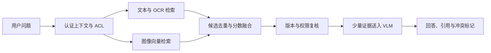

# 第 11 章（5）：把图片接入可核验的 RAG

单独检索图片只能告诉我们“哪几张可能相关”；单独调用 VLM 也未必知道制度规则、资料版本或当前用户是否有权限看关联文档。图文 RAG 要把这些部分接起来：文本、OCR 和图片检索先找候选，证据与权限检查再决定哪些材料可以交给模型。

这篇从图片为什么不能只压成 caption 开始，比较文本化、双索引和原生多模态路径，再把分数融合、权限过滤、版本冲突与回答引用放进一个链路。最后的纯 Python 示例只演示词袋分数和 ACL 条件，不处理真实图像、认证或生产并发；真实系统要分别验证检索质量和授权边界。

## 11.5 构建图像 + 文本 RAG

### 11.5.1 图片证据为什么不能只保存成一句 caption

企业知识常常同时存在于制度文本、PDF 页面、截图、票据、图表、商品图片和历史案例中。只做文本 RAG 会丢掉布局、颜色、空间关系和原图细节；只把原图交给 VLM，又可能缺少规则、版本、权限和可引用的文本依据。

多模态 RAG 的基本对象包括两个集合：

~~~math
D_T=\{d_i^T\}_{i=1}^{N_T},\qquad D_I=\{d_j^I\}_{j=1}^{N_I}
~~~

图片条目至少应保留：

~~~text
image_id、image_path、caption、ocr_text、source、version
linked_doc_ids、tenant_id、acl、ocr_confidence、created_at
~~~

这样一张图片既可以走图像 embedding 检索，也可以走 OCR/caption 文本检索，还能通过关联文档得到处理规则。

### 11.5.2 三种架构与选择条件

第一种是文本化架构：图片先经过 OCR、caption 或 VLM 描述，再进入普通文本索引。它适合票据字段、扫描文档和截图错误码，优点是复用现有文本 RAG；代价是文本化过程中可能丢失布局和视觉细节。

第二种是双索引架构：文本知识库和图片向量库分开维护，在线并行召回，再做融合。它适合同时需要规则文本和相似图片的场景，但必须解决不同检索器的分数校准、证据去重和权限一致性。

第三种是原生多模态架构：召回图片和文本后，把关键图片直接送入 VLM。它保留更多视觉信息，但图片数量、分辨率、上下文预算和推理成本都更高。

工程上常见的混合路径是：离线保存 OCR/caption 和图像 embedding；在线先用文本、OCR 和图像检索获得候选，再重排并只把少量关键原图交给 VLM。逻辑上的授权范围必须在证据交给生成模型前确定；具体向量库可能在近邻搜索前或搜索过程中应用过滤，也可能在候选形成后过滤，执行时机不同会改变召回和延迟，不能把某一家服务的模式当作所有索引的共同实现。

### 11.5.3 融合分数、上下文预算与证据图

如果文本、OCR 和图像检索分别得到分数，不能直接把 BM25、cosine 和模型 logits 相加。可以先按验证集做归一化，再使用：

~~~math
s_I(q,I_j)=\lambda_1s_{\mathrm{img}}(q,I_j)
+\lambda_2s_{\mathrm{ocr}}(q,I_j)
+\lambda_3s_{\mathrm{cap}}(q,I_j),
\qquad\sum_k\lambda_k=1
~~~

这里要求各权重非负，且分数归一化方法由同一验证集校准；权重和为 1 本身不能消除不同检索器的分布差异。图片召回后，通过 linked_doc_ids 扩展到相关文本：

~~~math
E=TopK_T(q)\cup TopK_I(q)\cup Link(TopK_I(q))
~~~

三个集合都必须限定在当前租户和用户授权范围内。图片可见不代表其关联文本自动可见，关联扩展必须重新查权限；进入上下文前还要复核版本与授权。集合并集用于说明来源，实际实现仍要保留排序和类型化 ID，避免文字 ID 与图片 ID 冲突。

上下文预算要显式分配：

~~~math
B_{\mathrm{ctx}}=B_T+B_I+B_{\mathrm{ocr}}+B_{\mathrm{instruction}}+B_{\mathrm{answer}}
~~~

如果把所有 OCR 文本和 top-20 图片都塞入上下文，模型可能在噪声中丢掉真正相关的证据。证据条目还需要带 ID、来源和版本，使回答中的引用可以回指原始对象。

当图片 OCR 与制度文本冲突时，不应默默选择分数更高的一方。例如发票图片显示 128.50，报销单显示 182.50，系统应把冲突作为结果的一部分，要求人工核对，而不是生成一个看似确定的数字。

### 11.5.4 纯 Python 证据融合实验

> 代码状态：静态审阅，未运行（2026-10-30）

~~~python
import math
import re
from collections import Counter
from dataclasses import dataclass

@dataclass
class TextDoc:
    doc_id: str
    title: str
    content: str
    version: str
    tenant: str = "demo"
    acl: frozenset[str] = frozenset()

@dataclass
class ImageDoc:
    image_id: str
    caption: str
    ocr_text: str
    linked_doc_ids: list[str]
    source: str
    version: str = "v1"
    tenant: str = "demo"
    acl: frozenset[str] = frozenset()

def tokens(text):
    if not isinstance(text, str) or not text.strip():
        raise ValueError("text must be non-empty")
    values = re.findall(r"[a-z0-9]+|[\u4e00-\u9fff]", text.lower())
    if not values:
        raise ValueError("text has no searchable tokens")
    return values

def cosine(left, right):
    if not isinstance(left, list) or not isinstance(right, list) or not left or not right:
        raise ValueError("token lists must be non-empty")
    left = Counter(left)
    right = Counter(right)
    common = set(left) & set(right)
    numerator = sum(left[key] * right[key] for key in common)
    denom = math.sqrt(sum(value * value for value in left.values()))
    denom *= math.sqrt(sum(value * value for value in right.values()))
    if denom == 0:
        raise ValueError("cosine is undefined for a zero vector")
    return numerator / denom

texts = [
    TextDoc("doc_504", "504 排查手册", "检查上游服务和网关超时配置。", "v2",
            acl=frozenset({"employee"})),
    TextDoc("doc_invoice", "金额核对规则", "核对金额、税额和价税合计。", "v1",
            acl=frozenset({"finance"})),
]
images = [
    ImageDoc("img_504", "报错页面显示 504 Gateway Timeout",
             "504 Gateway Timeout nginx", ["doc_504"], "case",
             acl=frozenset({"employee"})),
    ImageDoc("img_invoice", "发票图片", "价税合计 128.50 元",
             ["doc_invoice"], "invoice", acl=frozenset({"finance"})),
]

def fuse_evidence(query, texts, images, tenant, groups):
    query_tokens = tokens(query)
    if not isinstance(tenant, str) or not tenant.strip():
        raise ValueError("tenant must be non-empty")
    if not isinstance(groups, (set, frozenset)):
        raise TypeError("groups must be a set")
    def visible(item):
        return item.tenant == tenant and bool(item.acl & groups)

    docs_by_id = {doc.doc_id: doc for doc in texts}
    if len(docs_by_id) != len(texts) or len({i.image_id for i in images}) != len(images):
        raise ValueError("duplicate document or image ids")
    text_hits = sorted(
        [(cosine(query_tokens, tokens(doc.title + doc.content)), doc)
         for doc in texts if visible(doc)], key=lambda item: item[0], reverse=True)
    image_hits = sorted(
        [(cosine(query_tokens, tokens(image.caption + image.ocr_text)), image)
         for image in images if visible(image)], key=lambda item: item[0], reverse=True)
    evidence, seen_docs = [], set()
    for score, doc in text_hits[:1]:
        if score > 0 and visible(doc):
            evidence.append({"type": "text", "id": doc.doc_id,
                             "score": round(score, 4), "version": doc.version,
                             "content": doc.content})
            seen_docs.add(doc.doc_id)
    for score, image in image_hits[:1]:
        if score <= 0 or not visible(image):
            continue
        evidence.append({"type": "image", "id": image.image_id,
                         "score": round(score, 4), "source": image.source,
                         "version": image.version, "ocr": image.ocr_text})
        for doc_id in image.linked_doc_ids:
            doc = docs_by_id.get(doc_id)
            if doc is not None and doc_id not in seen_docs and visible(doc):
                evidence.append({"type": "linked_text", "id": doc.doc_id,
                                 "version": doc.version, "content": doc.content})
                seen_docs.add(doc_id)
    return evidence

query = "截图显示 504 Gateway Timeout，怎么排查？"
evidence = fuse_evidence(query, texts, images, "demo", {"employee"})

assert [item["id"] for item in evidence] == ["doc_504", "img_504"]
assert any(item["type"] == "text" for item in evidence)
assert any(item["type"] == "image" for item in evidence)
assert "504 Gateway Timeout" in next(
    item["ocr"] for item in evidence if item["type"] == "image"
)
print("evidence=", evidence)
~~~
输出依次包含 `doc_504` 与 `img_504`，分数约 0.2697/0.4835，分别保留 v2/v1。示例使用汉字单字与英文词词袋，没有读取真实图片或运行 OCR。空 ACL、空用户组、错误租户、无候选或零重合返回空证据；图片关联的未授权文档不会扩展进来。分数大于零只是 toy 候选规则，不是已校准相关性门槛，两个检索通道的分数也未直接相加。

生产检索通常需要 BM25、dense embedding、OCR 字段索引、CLIP/SigLIP、reranker 和 ACL 过滤的组合，并且每个候选都要保留来源版本。示例 `tenant/groups` 必须在真实系统中取自可信认证上下文，不能由请求方自报后直接授权；过滤表达式本身不提供身份认证。这里的内存集合检查只演示访问条件，不能证明并发权限变更、缓存隔离或索引过滤正确。

### 11.5.5 评估不能只看最终答案

文本召回可以报告 Recall@K、MRR 和 NDCG；图片召回可以报告 Image Recall@K、OCR 字段命中率和 text-to-image Recall@K；端到端回答还要评估 groundedness、citation correctness、证据冲突处理和资料不足时的选择性回答。

多模态 RAG 的错误归因至少分为：

~~~text
图片解析或 OCR 错误
文本切分或版本错误
图片/文本召回遗漏
分数融合或重排错误
权限过滤错误
上下文截断
生成幻觉或引用错配
~~~

下面的流程图把在线链路中的关键边界画出来。特别要注意权限过滤位于融合之前，证据检查位于生成之后；只要任何一个候选越过了错误租户的边界，后续回答再准确也无法弥补数据泄露。

#### 跟着算一次：分数融合之前先统一量纲

假设两个候选都通过 ACL。对候选 A，验证集归一化后的文本分数为 0.80、图像分数为 0.40；候选 B 的两项分数为 0.55 和 0.95。若业务验证集给文本通道权重 0.6、图像通道权重 0.4，则融合分数分别为 0.6×0.80+0.4×0.40=0.64 与 0.6×0.55+0.4×0.95=0.71。B 排在 A 前面，原因是视觉匹配补足了较弱的文本匹配。

如果不做校准就把一个范围为 0 到 1 的 cosine 分数和 BM25 原始分数直接相加，后者可能因查询词数量和文档长度达到数十，结果会由量纲较大的通道支配，而不是由更可靠的证据支配。min-max、分位数或学习式校准都依赖具体候选集合和验证数据；采用哪一种应记录拟合数据版本，并避免用测试集调权重。

排序分数也不能代替证据冲突检测。若 A 是制度原文、B 是一张新票据，而两者金额互相矛盾，系统应把两条事实和各自版本同时展示，或暂缓给出确定答案。融合负责安排“先看什么”，并不自动回答“什么是真的”。实际评估应分别报告各通道召回、融合后 Recall@K、ACL 误放率、冲突识别率、引用支持率和每次问答成本，并用单通道消融证明融合确实增加了可用证据。

#### ACL 过滤的顺序会改变 top-k

假设图像库有 50 个全局候选，其中 14 个属于当前用户不可访问的租户；目标证据在全局相似度排名第 8，但前 7 个里有 6 个是无权候选。若先取全局 top-5 再过滤，可能只剩下 1 个可见候选，甚至完全没有目标证据。若在候选排序时把可信身份对应的 ACL 条件纳入搜索，授权范围内的相关项就有机会进入 top-5。不同检索服务对向量过滤时机的定义不同：有的在近邻图遍历中应用，有的先取局部或全局候选再过滤；后者可能漏掉授权范围内的相关结果。无论采用哪种模式，不可见证据都不能进入交给 VLM 的上下文。

这个例子也说明安全过滤会影响召回分母。离线评估要为每个请求记录“有权相关证据数”和“无权相似候选数”，分别计算授权范围内的 Recall@K 和权限误放率。不能为了提高 Recall@K 把权限范围放宽，也不能把无权证据先送给 VLM、最后才隐藏引用；模型已经看到的数据无法靠删掉回答中的 URL 撤回。

权限可能在索引构建后发生变化，因此 ACL 版本、租户和用户组要进入缓存键或请求过滤条件。对高风险资料还要在召回后做一次版本和授权复核；若权限变更与查询并发，应定义以哪个时间点的权限为准。该约定属于目标系统的数据协议，向量数据库本身不会自动决定业务授权。

### 11.5.6 资料与证据边界

RAG 的基本框架见 [Retrieval-Augmented Generation](https://arxiv.org/abs/2005.11401)，图文检索可参考 CLIP 论文和 [FAISS 文档](https://faiss.ai/)。权限方面，Azure AI Search 的 [security filter 模式](https://learn.microsoft.com/en-us/azure/search/search-security-trimming-for-azure-search)展示了把可信请求方标识用于结果过滤的做法；其[向量查询过滤文档](https://learn.microsoft.com/en-us/azure/search/vector-search-filters)还区分 pre-filter、post-filter 和 strict post-filter，并说明它们对召回、假阴性与延迟的不同影响。该服务的过滤模式不等于身份认证，也不能推广到其他向量库。这些来源都不证明本地权限、OCR、召回和引用实现；“把图片放进 prompt”本身也不等于完成了可追溯的多模态 RAG。

图文 RAG 把这条选读支线收束到“候选怎样变成有来源、有权限的回答”。接下来，[第十四章：多模态评估与系统交付](14-多模态评估与交付.md)会检查媒体输入、证据、权限和端到端质量；更完整的多模态机制见[第十五册](../../book-15-multimodal-generative-models/目录.md)。

---

前一篇：[多模态指令数据](11-图文理解与检索实战-4-多模态指令数据.md)。
