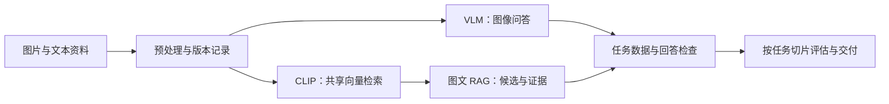
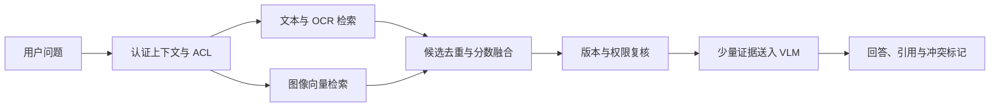

# 第 11 章 图文理解与检索实战

本章围绕一个视觉知识入口展开：先用 CLIP 把图像和文字映射到可检索空间，再用 VLM 回答图像问题，检查多模态监督数据，最后把图片证据接入受权限约束的图文 RAG。这里关注输入如何成为证据、检索结果怎样被核验；生成模型与语音系统分别在后续章节处理。

CLIP 与 VLM 示例可能需要模型权重和额外依赖；不依赖外部模型的代码只验证局部 shape、数值或数据契约。运行 toy 不等于验证真实视觉能力。

本章的主线是把图片变成能检索、能回答、能审计的证据。CLIP 建立图像和文本的共享向量空间；VLM 直接回答图像问题；多模态 instruction 数据决定训练时哪些模态和回答位置参与监督；图文 RAG 则把候选检索和生成证据接起来。四种工作不能用同一个“多模态准确率”代替。

读图时要区分“找到相似图片”和“回答受到图片证据支持”。CLIP 的相似度用于候选排序；最终事实判断仍要检查原图、OCR/结构化字段、VLM 输出和业务规则。

## 11.1 使用 CLIP 做图文检索

### 11.1.1 从“图片像什么”到“图片与文字是否对应”

图文检索的任务不是给图片生成一段漂亮描述，而是在一组候选中找出与查询语义最接近的对象。给定一句“带红色按钮的设置页面”，系统应该从图片库中找出相关截图；给定一张商品图片，系统应该从商品描述库中找出匹配文本。

CLIP 的关键设计是两个编码器：图像编码器把图片映射到向量空间，文本编码器把文字映射到同一个向量空间。训练数据中的匹配图文被拉近，不匹配组合被推远。训练完成后，检索不必为每个新类别重新训练分类头，而是可以直接把候选类别或查询写成文本。

设图像为 I_i，文本为 T_j，两个编码器分别为 f_img 和 f_txt：

~~~math
u_i=f_{\mathrm{img}}(I_i),\qquad v_j=f_{\mathrm{txt}}(T_j)
~~~

检索前通常做 L2 归一化：

~~~math
\hat{u}_i=\frac{u_i}{\|u_i\|_2},\qquad
\hat{v}_j=\frac{v_j}{\|v_j\|_2}
~~~

归一化后，图文相似度可以用点积表示：

~~~math
s_{ij}=\hat{u}_i^{\mathsf T}\hat{v}_j
~~~

如果有 N 张图片和 M 条文本，整个相似度矩阵是：

~~~math
S=\hat{U}\hat{V}^{\mathsf T},\qquad S\in\mathbb{R}^{N\times M}
~~~

这里要求图像集合和文本集合非空，即 \(N>0\)、\(M>0\)，并要求两个编码器输出相同维度且每个向量范数严格大于零。若某一侧没有候选，检索结果和 Recall@K 都是不适用，而不是一个可以继续排序的空矩阵。

S[i,j] 只表示当前编码器、当前预处理和当前候选集合下的相似度。它不是概率，也不能直接解释为“图片属于文本类别的概率”。不同查询、不同模型和不同图库之间的分数通常不能直接横向比较。

### 11.1.2 对比学习为什么能支持 zero-shot 分类

训练 batch 中有 N 个配对样本 (I_i,T_i)。对于第 i 张图片，T_i 是正文本，其他文本是负文本；对于第 i 条文本，I_i 是正图片，其他图片是负图片。带温度的图像到文本损失可以写为：

~~~math
L_{\mathrm{i2t}}
=-\frac{1}{N}\sum_{i=1}^{N}
\log\frac{\exp(z_{ii})}{\sum_{j=1}^{N}\exp(z_{ij})}
~~~

文本到图像方向则对转置矩阵计算交叉熵：

~~~math
L_{\mathrm{t2i}}
=-\frac{1}{N}\sum_{j=1}^{N}
\log\frac{\exp(z_{jj})}{\sum_{i=1}^{N}\exp(z_{ij})}
~~~

总损失通常取两个方向的平均：

~~~math
L_{\mathrm{clip}}=\frac{L_{\mathrm{i2t}}+L_{\mathrm{t2i}}}{2}
~~~

对比损失要求 batch 中有 \(N>0\) 个配对样本，温度满足 \(\tau>0\)，并且每个图像/文本 embedding 可归一化。若 batch 为空或出现零向量，正样本概率和平均损失都没有定义。

z_ij 可以写为 s_ij / tau，也可以写为 exp(g) s_ij。后一种写法把 g 作为可学习的 logit scale 参数。温度较小时，softmax 更尖锐，模型会更强地惩罚正负样本分数接近的情况；温度过小也可能放大噪声和梯度不稳定。

zero-shot 分类只是检索的一个特例。假设候选类别是“猫、狗、汽车、花”，先把类别写成文本模板：

~~~text
a photo of a cat
a photo of a dog
a photo of a car
a photo of a flower
~~~

再计算图片与这些候选文本的相似度，取分数最高的类别。类别名称、模板措辞、语言和领域分布都会影响结果，因此 zero-shot 并不意味着不需要验证。

### 11.1.3 最小检索实验

下面的实验不依赖模型下载。它用手写向量模拟编码器输出，验证四个局部事实：归一化后向量长度为 1，匹配对的排名靠前，打乱文本会破坏排名，Recall@K 和 MRR 能把排序结果转成指标。

> 代码状态：已验证（2026-10-22；Python 3.12.9，标准库教学输入；历史记录中的输入、输出与边界检查适用于此代码）

~~~python
import math

def normalize(vector):
    if not isinstance(vector, (list, tuple)) or not vector:
        raise ValueError("vector must be non-empty")
    if any(isinstance(value, bool) or not isinstance(value, (int, float))
           or not math.isfinite(value) for value in vector):
        raise ValueError("vector values must be finite numbers")
    norm = math.sqrt(sum(value * value for value in vector))
    if not math.isfinite(norm) or norm == 0:
        raise ValueError("zero vector cannot be normalized")
    return [value / norm for value in vector]

def dot(left, right):
    if (not isinstance(left, (list, tuple)) or not isinstance(right, (list, tuple))
            or not left or len(left) != len(right)):
        raise ValueError("dot product dimensions must match and be non-empty")
    return sum(a * b for a, b in zip(left, right))

images = {
    "cat.jpg": [3.0, 1.0, 0.0, 0.0],
    "dog.jpg": [0.0, 3.0, 1.0, 0.0],
    "car.jpg": [0.0, 0.0, 3.0, 1.0],
    "flower.jpg": [1.0, 0.0, 0.0, 3.0],
}
texts = {
    "cat": [2.8, 1.0, 0.0, 0.1],
    "dog": [0.1, 2.7, 1.0, 0.0],
    "car": [0.0, 0.2, 2.8, 1.0],
    "flower": [0.9, 0.0, 0.1, 2.8],
}

image_names = list(images)
text_names = list(texts)
if not image_names or not text_names:
    raise ValueError("image and text collections must be non-empty")
if len({len(vector) for vector in images.values()}) != 1:
    raise ValueError("image vectors must have a common dimension")
if len({len(vector) for vector in texts.values()}) != 1:
    raise ValueError("text vectors must have a common dimension")
if len(next(iter(images.values()))) != len(next(iter(texts.values()))):
    raise ValueError("image and text dimensions must match")
image_vectors = [normalize(images[name]) for name in image_names]
text_vectors = [normalize(texts[name]) for name in text_names]
similarity = [
    [dot(image, text) for text in text_vectors]
    for image in image_vectors
]

def text_to_image_rank(text_index):
    if (isinstance(text_index, bool) or not isinstance(text_index, int)
            or not 0 <= text_index < len(text_names)):
        raise ValueError("text_index is out of range")
    order = sorted(
        range(len(image_names)),
        key=lambda image_index: similarity[image_index][text_index],
        reverse=True,
    )
    correct_name = text_names[text_index] + ".jpg"
    return order.index(image_names.index(correct_name)) + 1

ranks = [text_to_image_rank(index) for index in range(len(text_names))]
recall_at_1 = sum(rank <= 1 for rank in ranks) / len(ranks)
recall_at_2 = sum(rank <= 2 for rank in ranks) / len(ranks)
mrr = sum(1 / rank for rank in ranks) / len(ranks)

# 保持原来的正确图片标签，只轮换实际使用的文本向量。
shuffled_ranks = []
for index in range(len(text_names)):
    source_column = (index + 1) % len(text_names)
    order = sorted(range(len(image_names)),
                   key=lambda i: similarity[i][source_column], reverse=True)
    shuffled_ranks.append(order.index(image_names.index(text_names[index] + ".jpg")) + 1)
shuffled_recall_at_1 = sum(rank == 1 for rank in shuffled_ranks) / len(shuffled_ranks)

assert all(abs(sum(value * value for value in vector) - 1.0) < 1e-12
           for vector in image_vectors + text_vectors)
assert ranks == [1, 1, 1, 1]
assert recall_at_1 == 1.0
assert recall_at_2 == 1.0
assert mrr == 1.0
assert shuffled_recall_at_1 == 0.0
print("similarity_shape=", (len(similarity), len(similarity[0])))
print("ranks=", ranks)
print("recall_at_1=", recall_at_1)
print("mrr=", round(mrr, 4))
print("shuffled_recall_at_1=", shuffled_recall_at_1)
~~~
本例相似度矩阵为 4×4，正常配对四个排名均为 1，MRR 和 Recall@1 均为 1；只轮换向量、保留原标签后 Recall@1 为 0。同步轮换向量和正确标签只是改变排列。每个查询只有一个相关图片时，这里的 Recall@K 等于 Hit@K；多相关图片时须用命中相关图片数除以该查询全部相关图片数。

这个实验没有证明真实 CLIP 的泛化能力，因为向量本身是人为构造的。它只验证所列输入上的排序与指标。真实实验还需要固定 checkpoint、图像预处理、文本模板、候选集合、数据切分和版本，并报告不同任务切片的 Recall@K，而不是只展示一张图片的 top-1 结果。

### 11.1.4 从一次查询到可维护索引

图库规模较小时，可以在线编码图片并计算矩阵；规模变大后，图片编码应当离线完成。一个可回放的索引条目至少保留：

~~~text
image_id
image_path 或对象存储 URI
encoder_name 与 model_revision
preprocess_revision
embedding_dim 与 dtype
source、tenant、permission_version
created_at 与 index_version
~~~

在线请求只编码查询文本，再从图片向量索引中取候选。FAISS 的 inner-product 索引在向量已归一化时可以用于 cosine 检索；近似索引还需要通过 Recall@K、延迟、内存和更新成本做选型。图片权限不能在向量相似度之后才完全补救，租户和访问范围应进入检索过滤条件。

如果一张图片对应多个描述，训练和评估不能机械地使用一条对角线标签。多正样本可以使用集合标签：

~~~math
Y_{ij}\in\{0,1\}
~~~

当文本 `T_j` 是图片 `I_i` 的合法描述时，令 `Y_{ij}=1`；否则令 `Y_{ij}=0`。

评估时也要允许任意一个合法文本命中，否则会把“描述不同但事实都正确”的结果误判为错误。相反，如果同一图片的近重复描述同时出现在训练和测试，检索分数会被高估，因此图片级 hash、来源和时间切分都应纳入数据治理。

#### 跟着算一次：相似度不是概率

把查询“红色按钮的设置页面”编码成单位向量 q=[1,0]。为了只看排序过程，假设三个候选页面的向量分别是 d1=[0.8,0.6]、d2=[0.6,0.8]、d3=[0.1,√0.99]。它们的范数都为 1，因此余弦相似度就是点积：q 与 d1 的点积为 0.8，q 与 d2 为 0.6，q 与 d3 为 0.1。系统先给出 d1、d2、d3 的顺序，再由标注判断相关项是否排在前面。

如果第一名的分数是 0.8，这不表示“有 80% 概率找对”。将所有候选都替换成完全不相关的图片，模型仍会从中挑一个分数最高的结果；分数只描述候选之间的相对相似程度。若业务需要拒答，应在独立验证集上校准阈值，并报告阈值附近的误召回和漏召回。一个可用的离线账本同时记录 Recall@1、Recall@5、查询延迟和候选总数；只报告 top-1 示例会掩盖图库变大后出现的近似负例。

上述向量是手工构造的几何例子，不是 CLIP 的实测输出。真实 embedding 的维数可能很高，语义相近、视觉相似和业务相关也不是同一标签。上线前应按截图、商品、图表、中文文字和长尾类别分切片检查，并把每个 query 的正确对象集合写清楚；这一步决定 Recall@K 的分母和“命中”含义。

#### 候选集合怎样改变 Recall@K 的读法

再看指标分母。假设 20 个查询中，每个查询平均有 3 张合法相关图片。若系统对某查询的 top-5 找回 2 张相关图片，该查询 Recall@5 是 2/3，而不是“top-5 命中”就记作 1。若其余 19 个查询各找回全部 3 张，宏平均 Recall@5 为 (2/3+19)/20≈98.33%。把 top-1 命中率和这个指标混在一起，会把“只要找到一张就算成功”误说成“找全了相关内容”。

另外，候选集合从 100 张扩大到 10 万张时，模型分数范围和最难负例都会变化。一个阈值在小型开发集上表现好，未必在大图库中仍有同样精确率。评估应固定查询集合和相关标注，同时记录索引规模、过滤前后的候选数，以及新索引中的近似重复项。Recall@K 衡量已标注相关项被找回的比例，无法说明未标注候选一定不相关；需要抽样复核“看起来新、但未标注”的结果。

### 11.1.5 资料与证据边界

CLIP 的对比学习方法见 [Learning Transferable Visual Models From Natural Language Supervision](https://arxiv.org/abs/2103.00020)。向量索引的具体接口可参考 [FAISS 文档](https://faiss.ai/)，当前 Transformers 接口可参考 [CLIP 文档](https://huggingface.co/docs/transformers/model_doc/clip)。论文结果支持论文设置下的训练和评估结论，官方文档支持接口事实；目标图库上的召回率、中文效果、细粒度能力和成本必须单独实测。

## 11.2 从零实现 mini CLIP 损失

### 11.2.1 相似度矩阵的标签结构

上一节把编码器当作黑盒。本节只研究损失函数，目的是把“图文对齐”从一句概念还原成可计算的张量关系。

一个 batch 的图像 embedding 和文本 embedding 形状都是 [N,D]。归一化后相乘得到 [N,N] 矩阵：行表示一个图像，列表示一个候选文本。若第 i 张图与第 i 条文本匹配，标签就是 [0,1,...,N-1]。

~~~math
U\in\mathbb{R}^{N\times D},\qquad V\in\mathbb{R}^{N\times D},\qquad Z=\frac{\mathrm{normalize}(U)\mathrm{normalize}(V)^{\mathsf T}}{\tau}
~~~

图像到文本方向的交叉熵为：

~~~math
L_{\mathrm{i2t}}=-\frac{1}{N}\sum_i\left(Z_{ii}-\log\sum_j\exp Z_{ij}\right)
~~~

文本到图像方向只需把 Z 转置。实现时必须使用数值稳定的 log-sum-exp：

~~~math
\log\sum_j\exp z_j=m+\log\sum_j\exp(z_j-m),\qquad m=\max_j z_j
~~~

当温度很小或 logit scale 很大时，直接计算 exp(z) 容易溢出；稳定实现不是可选的装饰。

### 11.2.2 纯 Python 版本与反事实检查

> 代码状态：已验证（2026-10-22；Python 3.12.9，标准库教学输入；历史记录中的输入、输出与边界检查适用于此代码）

~~~python
import math

def normalize(vector):
    if not isinstance(vector, (list, tuple)) or not vector:
        raise ValueError("vector must be non-empty")
    if any(isinstance(value, bool) or not isinstance(value, (int, float))
           or not math.isfinite(value) for value in vector):
        raise ValueError("vector values must be finite numbers")
    norm = math.sqrt(sum(value * value for value in vector))
    if not math.isfinite(norm) or norm == 0:
        raise ValueError("zero vector")
    return [value / norm for value in vector]

def transpose(matrix):
    if not isinstance(matrix, list) or not matrix or any(
            not isinstance(row, list) or not row for row in matrix):
        raise ValueError("matrix must be non-empty")
    width = len(matrix[0])
    if any(len(row) != width for row in matrix):
        raise ValueError("matrix rows must have equal length")
    return [list(column) for column in zip(*matrix)]

def logsumexp(row):
    if not isinstance(row, list) or not row:
        raise ValueError("row must be non-empty")
    if any(isinstance(value, bool) or not isinstance(value, (int, float))
           or not math.isfinite(value) for value in row):
        raise ValueError("logits must be finite numbers")
    maximum = max(row)
    return maximum + math.log(sum(math.exp(value - maximum) for value in row))

def cross_entropy_diagonal(logits):
    if not isinstance(logits, list) or not logits:
        raise ValueError("logits must be non-empty")
    if any(not isinstance(row, list) or len(row) != len(logits) for row in logits):
        raise ValueError("diagonal paired logits must be square")
    return sum(-row[index] + logsumexp(row)
               for index, row in enumerate(logits)) / len(logits)

def clip_loss(images, texts, temperature=0.07):
    if (isinstance(temperature, bool) or not isinstance(temperature, (int, float))
            or not math.isfinite(temperature) or temperature <= 0):
        raise ValueError("temperature must be positive")
    if (not isinstance(images, list) or not images
            or not isinstance(texts, list) or not texts
            or len(images) != len(texts)):
        raise ValueError("images and texts must be non-empty and aligned")
    image_vectors = [normalize(vector) for vector in images]
    text_vectors = [normalize(vector) for vector in texts]
    if len({len(vector) for vector in image_vectors + text_vectors}) != 1:
        raise ValueError("all embeddings must share a dimension")
    logits = [
        [sum(a * b for a, b in zip(image, text)) / temperature
         for text in text_vectors]
        for image in image_vectors
    ]
    loss_i2t = cross_entropy_diagonal(logits)
    loss_t2i = cross_entropy_diagonal(transpose(logits))
    return (loss_i2t + loss_t2i) / 2, logits

images = [[3.0, 1.0, 0.0], [0.0, 3.0, 1.0], [1.0, 0.0, 3.0]]
texts = [[2.9, 1.0, 0.0], [0.0, 2.8, 1.0], [0.9, 0.0, 2.8]]
loss, logits = clip_loss(images, texts)
shuffled_loss, _ = clip_loss(images, texts[1:] + texts[:1])
smooth_loss, _ = clip_loss(images, texts, temperature=0.5)

assert loss < shuffled_loss
assert smooth_loss > loss
assert all(max(range(3), key=lambda j: logits[i][j]) == i for i in range(3))
print("loss=", round(loss, 6))
print("shuffled_loss=", round(shuffled_loss, 6))
print("smooth_temperature_loss=", round(smooth_loss, 6))
~~~
本例正常 loss 约为 0.000095，打乱配对后约为 10.008890，温度改为 0.5 时约为 0.402856。这些数字对应当前手写向量：温度变大使分布更平滑，但在任意错误排序输入上，loss 不一定随温度增大而增大。若检查失败，优先查看归一化维度、转置方向、标签顺序和 batch 内样本配对，而不是先调学习率。

`N=1` 时两个方向的损失恒为 0，因为没有 batch 内负样本，不能把这个零损失解释成对齐成功。本例是公式计算器，没有梯度、参数更新或编码器训练。

### 11.2.3 大 batch、跨卡负样本与标签一致性

batch 内负样本数量为 N-1。大 batch 往往能提供更多负样本，但也会增加显存和通信。多卡训练中，如果每张卡只使用本地 batch，负样本规模受单卡限制；如果做 all_gather，全局样本数近似为：

~~~math
N_{\mathrm{global}}=W\cdot N_{\mathrm{local}}
~~~

其中 W 是 worker 数，此式假设各卡本地 batch 等长。变长 batch 应求各卡样本数之和。若 logits 的行是本卡 query、列是全局候选，标签需加上该卡样本在 gather 顺序中的 offset；若在每卡计算完整全局方阵，标签仍是全局 `arange(N_global)`。offset 是张量布局决定的，不能无条件添加。常见错误包括：

~~~text
只 gather image 不 gather text
gather 后仍使用本地 arange(N_local)
不同卡上的样本顺序不一致
梯度是否跨卡传播没有明确记录
多正样本被错误压成单一对角线
~~~

一个可靠实验应同时记录 local batch、global batch、负样本数量、通信时间、显存和 Recall@K。只报告 loss 下降，无法说明大 batch 的收益来自更好的负样本，还是来自训练步数、学习率或数据混合变化。

### 11.2.4 训练目标与检索目标不完全相同

对比损失优化的是 batch 内相对排序，而业务检索可能要求：精确字段、权限过滤、同义词鲁棒性、重复结果去除和多语言匹配。于是训练 loss 下降并不自动意味着业务 Recall@K 提高。

需要分别建立：

~~~text
训练监控：i2t loss、t2i loss、logit scale、梯度范数
检索指标：Recall@1/5/10、MRR、Median Rank
业务切片：语言、分辨率、细粒度类别、OCR、长尾来源
工程指标：编码吞吐、索引延迟、更新耗时、存储大小
~~~

#### 跟着算一次：一个 2×2 batch 的双向损失

先看最小的非退化 batch：两张图片和两条文本，配对关系为对角线。假设归一化后的相似度已经除以温度，得到 logits 矩阵 [[2,0],[0,2]]。第一行的两个指数权重是 e 的 2 次方，约 7.389，与 e 的 0 次方，即 1。因此图片 1 选择文本 1 的概率为 7.389 除以 8.389，约 0.8808；图片 2 选择文本 2 的概率也为 0.8808。图像到文本损失是负的自然对数 0.8808，约 0.1269。矩阵对称，所以文本到图像得到同一个值，双向平均仍为约 0.1269。

再把正确标签改成反对角线，相当于保留分数矩阵却把配对关系交换。此时每个正确位置的 logit 是 0，概率变为 1 除以 1 加 e 的 2 次方，约 0.1192，损失约为 2.1269。这组数说明损失同时依赖分数和标签：同一批向量仅因样本错配就会得到完全不同的目标值。实现中标签顺序必须跟 embedding gather 后的行列顺序一致。

温度把原始相似度整体缩放。若原始对角分数为 0.2、非对角分数为 0，那么温度 0.1 会得到 2 和 0，正样本概率约 0.8808；温度 0.2 会得到 1 和 0，概率约 0.7311，交叉熵约 0.3133。温度较低使区分变尖锐，也让错误排序承受更大的梯度压力。实践中不能只看训练 loss，还要检查配对标签、温度或可学习 scale、batch 内重复样本和验证集 Recall@K；重复图或同一语义的多条文本被当作负例，会把本来合理的匹配错误地推远。

这个 2×2 计算没有模拟梯度更新，也没有证明大 batch 一定更好。它把双向 softmax、负样本和标签错位的作用隔离出来；真实多卡训练还要把 all-gather 的梯度传播、去重策略和全局样本编号纳入验证。

#### 跨卡 gather 后标签为什么需要偏移

假设两张 GPU 各持有 2 组图文对，rank 0 的图文顺序为 A、B，rank 1 的顺序为 C、D。只用本地候选时，rank 1 两个 query 的正确列标签是 [0,1]；做全局 gather 后候选顺序变成 A、B、C、D，rank 1 的正确列标签必须是 [2,3]。若忘了偏移，模型会被要求把 C 对齐到 A、把 D 对齐到 B，目标函数方向直接错了。

这一步只描述“本地 query 对全局候选”的布局。如果每个 worker 都构造完整的全局 4×4 矩阵，四个 query 的标签自然是 [0,1,2,3]；不能再额外加 rank offset。标签写法由 logits 的行、列实际对应哪些样本决定，应先列出顺序再写代码。样本数不等时，rank offset 是此前所有 worker 样本数之和，而不是 rank 乘一个假定的 batch size。

用一张小检查表可以发现错位：给每个图片和文本一个相同的显式 ID，打印 gather 前后的顺序，再检查每一行正确列是否指向同 ID。随后做一个反事实，把文本顺序循环移动一次；若标签不动，loss 应显著增大。重复或多正样本场景不能只靠对角线标签，需改成正例集合或适合多标签的目标，并在评估时保持一致。

#### 从 softmax 概率读出一轮更新方向

仍用 logits [2,0] 和正确标签 0。交叉熵对正确 logit 的导数是 p0-1，约 0.8808-1=-0.1192；对负例 logit 的导数是 p1-0=0.1192。梯度下降会提高正确配对分数、压低这个负例分数。若配对顺序错了，两个导数的角色也会随错误标签交换，模型就会被稳定地推向错误对应。

这是对 logits 的局部梯度，不是对图像和文本 embedding 参数的最终梯度。真实训练还要经过归一化、温度缩放、图像/文本编码器和共享参数；同一图片在 batch 中出现多次，也会使它同时参与多条正负关系。因此排查训练异常应先查看 logits、标签和样本 ID，再查看编码器学习率，而不是只凭 loss 的绝对大小猜模型有没有学会。

再把 2 张卡上的 gather 结果写成账本：rank 0 本地行对应 A、B，rank 1 本地行对应 C、D；全局列始终按 A、B、C、D 排列。rank 1 的 logits 形状是 2×4，行是 C、D，正确列分别是 2、3。若误用 [0,1]，平均交叉熵会奖励 rank 1 query 选择 rank 0 的样本；这个错误可能仍能运行并产生有限 loss，所以仅检查 shape 和 loss 是否非 NaN 不够。

可以在训练前用固定小 batch 做一次协议测试：把每个 embedding 换成能够从 ID 直接识别的单位向量，确认相同 ID 的 logit 位于目标列；再将某一张卡的顺序反转，确认标签也随 gather 顺序变更。该测试不证明梯度通信正确，却能把分布式实现中最容易忽略的“顺序契约”显式化。目标是真实训练时仍应记录 global batch、worker 数、采样顺序和重复样本规则。

### 11.2.5 资料与证据边界

原始 CLIP 论文支持双向对比目标和 zero-shot 设定；分布式 all-gather、混合精度和具体 batch 规模属于实现选择，需要依据目标训练框架和硬件验证。toy 损失的数值只验证局部公式，不能推出真实模型的图文理解能力。

## 11.3 使用开源 VLM 做图片问答

### 11.3.1 检索模型与生成模型的分工

CLIP 主要回答“这张图和哪段文字更接近”。图片问答还要回答“图片中有什么、某个对象在哪里、图表趋势怎样、截图报了什么错”。这要求模型把视觉输入和自然语言上下文组合起来，并自回归生成答案。

一个常见的视觉语言模型可以抽象为三部分：

~~~text
vision encoder：把图像变成视觉特征
projector / adapter：把视觉特征映射到语言模型 hidden space
language model：结合视觉 token 和问题 token 生成回答
~~~

设图像为 I，问题 token 为 q，回答 token 为 a：

~~~math
H_v=f_v(I),\qquad Z_v=P(H_v),\qquad E_q=\mathrm{Emb}(q)
~~~

最简单的拼接抽象是：

~~~math
X=[Z_v;E_q],\qquad
p(a\mid I,q)=\prod_{t=1}^{T}p(a_t\mid X,a_{1:t-1})
~~~

实际模型可能使用 Q-Former、交叉注意力、特殊 image token、动态分辨率或原生统一 token 化。公式表达的是信息流，不是所有模型的实现细节。

### 11.3.2 图像 token 预算是系统约束

视觉编码器通常把图片分成 patch。若输入分辨率为 H x W，patch 边长为 p，未考虑特殊 token 时，视觉 token 数约为：

~~~math
N_{\mathrm{patch}}=\left\lfloor\frac{H}{p}\right\rfloor
\left\lfloor\frac{W}{p}\right\rfloor
~~~

这里要求输入高宽 `H,W` 和 patch 边长 `p` 为正整数，且至少各产生一个 patch。特殊 token、padding、动态分辨率和局部 crop 会改变实际 token 数，不能把这个近似式当作所有 processor 的精确计费结果。

分辨率提高有助于小字、细粒度物体和图表，但会增加视觉 token、prefill 时间和显存。压缩视觉 token 可以降低成本，却可能损失空间关系和 OCR 细节。因此图像预处理不能只写“resize 到固定大小”，还应记录：原始尺寸、裁剪策略、长宽比、patch 数、视觉 token 数和是否做局部 crop。

一个图像问答请求的上下文预算可以写成：

~~~math
B_{\mathrm{total}}=B_{\mathrm{image}}+B_{\mathrm{question}}+B_{\mathrm{history}}+B_{\mathrm{answer}}
~~~

各项预算应为非负数，总预算要满足模型上下文上限；若可用预算小于图片和问题本身，回答字段没有可分配空间，应在入口拒绝或截断并记录原因。

如果图片 token 已经占据大部分上下文，再叠加长历史或大量检索文档，模型可能不是“看不懂”，而是输入预算和注意力资源已经被耗尽。

### 11.3.3 通用调用骨架与接口边界

不同模型的 processor、占位符和模型类并不一致。一个通用骨架可以写成：

> 代码状态：静态审阅，未运行（2026-10-22；Python 3.12.9，标准库教学输入；缺少模型接口依赖或权重）

~~~python
from PIL import Image
import torch
from transformers import AutoProcessor, AutoModelForImageTextToText

device = "cuda" if torch.cuda.is_available() else "cpu"
model_name = "Qwen/Qwen2.5-VL-3B-Instruct"
processor = AutoProcessor.from_pretrained(model_name)
model = AutoModelForImageTextToText.from_pretrained(model_name)
model.to(device).eval()

image = Image.open("demo.png").convert("RGB")
question = "请只根据图片中可以确认的内容回答：图中有什么？"
messages = [{
    "role": "user",
    "content": [
        {"type": "image"},
        {"type": "text", "text": question},
    ],
}]

prompt = processor.apply_chat_template(
    messages,
    add_generation_prompt=True, tokenize=False,
)
inputs = processor(text=prompt, images=image, return_tensors="pt")
inputs = {key: value.to(device) for key, value in inputs.items()}

with torch.no_grad():
    output_ids = model.generate(**inputs, max_new_tokens=128, do_sample=False)

generated_ids = output_ids[:, inputs["input_ids"].shape[1]:]
answer = processor.batch_decode(generated_ids, skip_special_tokens=True)[0]
print(answer)
~~~
这段代码按 Transformers 多模态模板文档使用 `AutoModelForImageTextToText`，以 Qwen2.5-VL 的 decoder-only 接口为例，先生成字符串模板，再把本地 RGB 图片交给 processor。`tokenize=False` 明确避免把已分词结果再次当成文本处理；输出按输入 token 宽度截去 prompt，仅解码新增 token。encoder-decoder 模型不能照搬这一截取方法。

这是需要下载权重和提供 `demo.png` 的外部接口示例；CPU 还可能受内存和延迟约束。运行前固定模型/processor revision 和 Transformers 版本，并核对消息格式、图片占位符、最大图片数及停止 token。不同模型的 image 写法和额外 processor 参数必须按模型卡适配。

### 11.3.4 任务切片比单一平均分更重要

图像问答至少应区分：

~~~text
全局描述
目标存在性与属性
计数
空间关系
OCR 与数字
图表和表格
截图与错误信息
无法判断与拒答
隐私和安全边界
~~~

对短答案可以使用 exact match 或字段准确率；对图表可以检查数值误差和相对关系；对开放描述需要人工评估正确性、完整性、groundedness 和幻觉；对无法判断问题，需要检查模型是否明确表达证据不足。

视觉幻觉率可以粗略写成：

~~~math
R_{\mathrm{hall}}=\frac{1}{N}\sum_{i=1}^{N}H_i
~~~

其中 `H_i=1` 表示第 `i` 个回答包含没有视觉证据支持的关键断言，`H_i=0` 表示没有命中该类错误；该式要求评估样本数 \(N>0\)，且 `H_i` 是 0/1 标记。

这里的“无视觉证据”需要标注规则或人工审核定义，不能只用一个关键词列表代替所有判断。

### 11.3.5 一个不依赖模型的 VQA 评估样例

> 代码状态：已验证（2026-10-22；Python 3.12.9，标准库教学输入；历史记录中的输入、输出与边界检查适用于此代码）

~~~python
from collections import defaultdict

cases = [
    {
        "id": "object",
        "task": "object",
        "expected": ["cat"],
        "forbidden": ["dog"],
        "answer": "A cat is sitting on a sofa.",
    },
    {
        "id": "ocr",
        "task": "ocr",
        "expected": ["128"],
        "forbidden": ["123"],
        "answer": "The error code is 128.",
    },
    {
        "id": "counting",
        "task": "counting",
        "expected": ["2"],
        "forbidden": ["3"],
        "answer": "There are 3 cups.",
    },
]

def contains_all(text, values):
    if not isinstance(text, str) or not isinstance(values, (list, tuple)) or not values:
        raise ValueError("text and expected values must be non-empty")
    if any(not isinstance(value, str) or not value for value in values):
        raise ValueError("expected values must be non-empty strings")
    lowered = text.lower()
    return all(value.lower() in lowered for value in values)

def contains_any(text, values):
    if not isinstance(text, str) or not isinstance(values, (list, tuple)):
        raise TypeError("text and forbidden values have invalid types")
    if any(not isinstance(value, str) or not value for value in values):
        raise ValueError("forbidden values must be non-empty strings")
    lowered = text.lower()
    return any(value.lower() in lowered for value in values)

by_task = defaultdict(list)
bad_ids = []
for case in cases:
    correct = (contains_all(case["answer"], case["expected"])
               and not contains_any(case["answer"], case["forbidden"]))
    by_task[case["task"]].append(int(correct))
    if not correct:
        bad_ids.append(case["id"])

task_accuracy = {
    task: round(sum(values) / len(values), 4)
    for task, values in sorted(by_task.items())
}
assert task_accuracy == {"counting": 0.0, "object": 1.0, "ocr": 1.0}
assert bad_ids == ["counting"]
print("task_accuracy=", task_accuracy)
print("bad_ids=", bad_ids)
~~~
代码只验证一个规则化切片的统计流程，不能替代人工视觉判断。特别是“回答中出现了正确关键词”不等于回答的关系、数量和因果都正确。

#### 跟着算一次：图片 token 会挤占回答预算

用一个便于心算的 patch 模型估算输入量：假设图片处理为正方形，patch 边长为 14，且暂不计特殊 token、裁剪和动态分辨率。448×448 图片产生 32×32，即 1024 个视觉 patch；336×336 图片产生 24×24，即 576 个，减少 448 个，约下降 43.75%。这只是在简化假设下的 token 数变化，实际 processor 可能切成多个 crop 或使用不同图像 token 规则，必须读取模型对应版本的 processor 输出。

再假设一次请求的可用上下文为 8192 token，历史对话占 1800，检索文本占 2500，问题和模板占 300，最多输出 512。若输入一张 448 图片，账面总量是 1024+1800+2500+300+512=6136，尚有 2056 的余量；若输入四张同尺寸图片，视觉项增至 4096，总量变成 9208，超过上限 1016。若简单从最早历史截断 1016 token，可能恰好删掉用户前面给出的约束；若缩小图片，也可能让小字不可读。正确的处理是按任务确定保留优先级，再把截断位置和每张图的预处理记录进 trace。

这个预算案例没有计入模型运行时额外开销，因此应留出安全余量。若任务是读图表，优先保留图表区域的清晰度；若是多轮对话，优先保留仍有效的约束和最近状态；若图像本身模糊，增加 token 也不会补回缺失的像素信息。评估时要同时做分辨率消融和任务切片，分别报告 OCR 字段、空间关系、图表数值、拒答质量、延迟与峰值显存。这样才能判断省下来的视觉 token 是有效压缩，还是把关键证据一并删掉。

#### 分辨率实验需要把任务错误分开看

若一批样本中 30 张是商品外观匹配、30 张是票据小字读取、40 张是图表趋势理解，那么把全部 100 张合成一个 exact-match 分数会混淆三种能力。假设 448 输入下三类正确数是 27、25、34，总体为 86/100；336 输入下分别为 28、18、33，总体为 79/100。总体差 7 个百分点，但信号并不是“低分辨率对所有任务都差”：商品类反而多 1 个样本，主要退化发生在票据 OCR。应同时报告各切片的分母、图片 token 数和错误类型，再判断是否对票据使用局部 crop。

还要控制预处理之外的变量：同一模型 revision、模板、解码设置和测试图片顺序；若比较不同 processor，就把 processor revision 明确作为实验变量。只选择提升最大的分辨率作为最终配置，会有在同一测试集上过拟合的风险；选型集用于调参，最终测试集只用于一次独立确认。任何节省 token 的方案都应通过预先规定的质量容忍度，而不能事后因为平均分仍高就忽略高风险字段错误。

若一张输入图像因为长宽比而被拆为 4 个 crop，而另一张正方形图只形成 1 个 crop，二者在账本中即便都叫“一张图”，实际视觉 token 成本也不同。样本统计应同时保留原始图数和 processor 展开的 patch/crop 数。评测延迟时要分别记录图像预处理和模型 prefill；否则 CPU 上的 resize 或高分辨率切片时间会被误记成模型生成慢。

如果系统把大图先缩小再选择一个局部 crop，应固定 crop 坐标或选择策略，确保对照实验可以重放。验证集可以用来调分辨率和 crop 规则，测试集只能用来报告最终选择的质量；反复根据测试错误裁剪，会把评估集变成隐式训练数据。

### 11.3.6 资料与证据边界

视觉语言模型的连接方式可参考 [LLaVA](https://arxiv.org/abs/2304.08485)、[BLIP-2](https://arxiv.org/abs/2301.12597) 和各模型的官方模型卡；多模态消息格式可参考 [Transformers multimodal chat templates](https://huggingface.co/docs/transformers/chat_templating_multimodal)。论文支持公开架构和实验设置，模型卡支持具体 checkpoint 的输入输出契约；图片分辨率、中文 OCR、图表能力和视觉幻觉必须用目标数据集验证。

## 11.4 构造多模态 Instruction Tuning 数据

### 11.4.1 一条训练样本的真正对象

多模态监督数据不是“图片加 caption”的同义词。caption 主要教模型描述图像；instruction tuning 还要教模型根据问题选择证据、遵守格式、在看不清或无法判断时停下来，并处理 OCR、图表、截图、定位和安全任务。

可以把一条样本写成：

~~~math
d_i=(I_i,q_i,a_i,t_i,e_i,s_i,v_i)
~~~

其中：

~~~text
I_i：图片或图片集合
q_i：用户问题或指令
a_i：目标回答
t_i：任务类型
e_i：可选的证据、字段或标注
s_i：数据 split
v_i：数据和模板版本
~~~

训练数据集为 D={d_i}。任务覆盖率可以写成：

~~~math
C_{\mathrm{task}}=\frac{|\{t_i:t_i\in T_{\mathrm{target}}\}|}{|T_{\mathrm{target}}|}
~~~

该覆盖率要求目标任务集合满足 \(|T_{\mathrm{target}}|>0\)，并且每个任务标签已经规范化。覆盖率只表示任务标签是否出现，不衡量数量、难度或正确性。目标任务没有专门样本时，模型仍可能依靠预训练迁移，但不能据此确认已经学会业务格式和拒答边界，应保留独立验证切片。

### 11.4.2 任务设计与拒答样本

一个企业图片助手通常需要混合以下样本：

~~~text
caption：主体、背景和可见动作
vqa：属性、数量、位置和关系
ocr_qa：金额、日期、编号、错误码和表格字段
chart_qa：最高值、趋势、对比和异常点
screenshot_qa：页面状态、报错和操作线索
unanswerable：图片没有提供足够证据
safety：隐私、身份、敏感属性和危险操作
~~~

拒答样本不是为了让模型变得保守，而是让“无法从输入得到结论”成为一个合法输出状态。例如图片中有一辆车，不代表可以从图片可靠推出车主姓名；截图中有一个账号页面，也不代表可以猜出用户的私人手机号。

回答应区分三种情况：

~~~text
可直接观察：图片明确显示了某个文字、物体或关系
弱证据推断：可以给出可能性，但必须说明不确定
不可判断：图片缺少关键证据，应明确说明无法确定
~~~

把三种情况都标成“有问必答”，会把语言先验训练成视觉事实。

### 11.4.3 assistant-only loss 与图像占位符

多模态 SFT 的上下文通常包含系统消息、图片占位符、用户问题和 assistant 回答。一般只对 assistant 回答 token 计算损失：

~~~math
m_k=\begin{cases}
1,& k\in A\\
0,& k\in P
\end{cases}
~~~

这里 `A` 和 `P` 是不相交且覆盖本例序列的位置集合，分别对应 assistant answer 与 system/user/image placeholder；判断的是位置归属，而不是 token ID。同一个词可以出现在用户和回答中，不能据此使用同一监督标签。真实 padding 位置也要排除监督，结束标记是否属于回答由模板契约决定。

对应的 masked loss 为：

~~~math
L_{\mathrm{sft}}=-\frac{\sum_km_k\log p_\theta(y_k\mid c_k)}{\sum_km_k}
~~~

严格地说，这个 masked loss 要求有效 assistant token 数 \(\sum_km_k>0\)。如果截断或模板错误导致没有目标 token，loss 应报告为“不适用”并回溯样本，而不是用 `max(1, ...)` 伪造一个零监督损失。

如果把图片占位符或用户问题也放进监督区域，loss 下降可能只是模型学会复读输入，而不是学会根据图片回答。还要确认图片 token 与 label shift 的对应关系：不同模型的 processor 可能会扩展一个占位符为多个视觉 token，不能按字符串长度手写 mask。

### 11.4.4 图片级切分和数据泄漏

同一张图片常常会产生多个问题。如果按行随机切分，可能出现同一图片的一个问题在训练集、另一个问题在测试集。图片本身已经被模型见过，评估就不再表示对新图片的泛化。

令 S(I) 表示图片 I 出现过的 split 集合，图片级切分约束是：

~~~math
\forall I,\quad |S(I)|=1
~~~

实际数据治理还应处理：近重复图片、裁剪后的同源图片、同一 PDF 的不同页面、模板化截图和公开评估集污染。图片 hash 只能发现完全相同文件，近重复检测和来源记录仍然需要额外方法。

### 11.4.5 一个可回放的数据构造器

> 代码状态：已验证（2026-10-22；Python 3.12.9，标准库教学输入；历史记录中的输入、输出与边界检查适用于此代码）

~~~python
import hashlib
import json
import random
from pathlib import Path
from tempfile import TemporaryDirectory

def stable_id(image, instruction):
    if (not isinstance(image, str) or not image.strip()
            or not isinstance(instruction, str) or not instruction.strip()):
        raise ValueError("image and instruction must be non-empty strings")
    value = json.dumps([image, instruction], ensure_ascii=False).encode("utf-8")
    return hashlib.sha256(value).hexdigest()[:12]

def write_jsonl(path, rows):
    if not isinstance(rows, (list, tuple)) or not rows:
        raise ValueError("rows must be non-empty")
    with path.open("w", encoding="utf-8") as stream:
        for row in rows:
            stream.write(json.dumps(row, ensure_ascii=False) + "\n")

def normalize_rows(rows):
    if not isinstance(rows, (list, tuple)) or not rows:
        raise ValueError("rows must be a non-empty list or tuple")
    normalized = []
    seen = {}
    used_ids = set()
    for row in rows:
        if not isinstance(row, dict):
            raise TypeError("each row must be a dictionary")
        required = ["image", "task_type", "instruction", "answer"]
        if any(not isinstance(row.get(key), str) for key in required):
            raise TypeError("image, task_type, instruction and answer must be strings")
        missing = [key for key in required if not row[key].strip()]
        if missing:
            raise ValueError(f"missing fields: {missing}")
        key = (row["image"].strip(), " ".join(row["instruction"].split()))
        answer = row["answer"].strip()
        task = row["task_type"].strip()
        evidence = row.get("evidence", "")
        if not isinstance(evidence, str):
            raise TypeError("evidence must be a string")
        evidence = evidence.strip()
        if key in seen:
            if seen[key] != (answer, task, evidence):
                raise ValueError("conflicting annotations for the same image and instruction")
            continue
        seen[key] = (answer, task, evidence)
        item_id = row.get("id") or stable_id(*key)
        if not isinstance(item_id, str) or not item_id.strip() or item_id in used_ids:
            raise ValueError("ids must be non-empty unique strings")
        used_ids.add(item_id)
        normalized.append({
            "id": item_id,
            "image": key[0],
            "task_type": task,
            "instruction": key[1],
            "answer": answer,
            "evidence": evidence,
        })
    return normalized

def split_by_image(rows, seed=7):
    if not isinstance(rows, (list, tuple)) or not rows:
        raise ValueError("rows must be non-empty")
    images = sorted({row["image"] for row in rows})
    if len(images) < 3:
        raise ValueError("at least three images are required for train/valid/test")
    random.Random(seed).shuffle(images)
    boundaries = (max(1, int(len(images) * 0.6)),
                  max(2, int(len(images) * 0.8)))
    boundaries = (boundaries[0], min(boundaries[1], len(images) - 1))
    image_split = {}
    for index, image in enumerate(images):
        image_split[image] = (
            "train" if index < boundaries[0]
            else "valid" if index < boundaries[1]
            else "test"
        )
    result = []
    for row in rows:
        item = dict(row)
        item["split"] = image_split[item["image"]]
        result.append(item)
    return result

def to_messages(row):
    if (not isinstance(row, dict)
            or not isinstance(row.get("id"), str)
            or not isinstance(row.get("split"), str)):
        raise ValueError("row must contain string id and split")
    return {
        "id": row["id"],
        "image": row["image"],
        "task_type": row["task_type"],
        "split": row["split"],
        "messages": [
            {"role": "user", "content": [
                {"type": "image"},
                {"type": "text", "text": row["instruction"]},
            ]},
            {"role": "assistant", "content": row["answer"]},
        ],
    }

raw = [
    {"image": "cat.jpg", "task_type": "caption",
     "instruction": "请描述图片。", "answer": "图片中有一只猫。"},
    {"image": "cat.jpg", "task_type": "unanswerable",
     "instruction": "这只猫叫什么名字？", "answer": "图片无法判断猫的名字。"},
    {"image": "invoice.jpg", "task_type": "ocr_qa",
     "instruction": "总金额是多少？", "answer": "总金额是 128.50 元。"},
    {"image": "chart.jpg", "task_type": "chart_qa",
     "instruction": "哪个月份最高？", "answer": "5 月最高。"},
]

with TemporaryDirectory() as directory:
    root = Path(directory)
    rows = split_by_image(normalize_rows(raw))
    conversations = [to_messages(row) for row in rows]
    write_jsonl(root / "rows.jsonl", rows)
    write_jsonl(root / "messages.jsonl", conversations)
    image_splits = {}
    for row in rows:
        image_splits.setdefault(row["image"], set()).add(row["split"])
    assert all(len(splits) == 1 for splits in image_splits.values())
    assert len(rows) == 4
    assert all(item["messages"][0]["content"][0]["type"] == "image"
               for item in conversations)
    print("rows=", len(rows))
    print("image_splits=", {key: sorted(value) for key, value in image_splits.items()})
~~~
输出保留四条记录，三张图片分别落入 train/valid/test，同图的两条问题始终在同一 split。同图同问题的完全重复标注去重，答案、任务或证据冲突则报错交由人工处理；不同记录不能复用同一 ID。

这个脚本只负责 schema、去重和按图片路径分组切分，不验证文件存在或回答是否符合图片。路径只是教学分组键，同图不同路径仍会泄漏；真实数据还需按内容 hash、同源页面或近重复组统一切分，并做图片解码、OCR 抽检、标注一致性、隐私脱敏、版权记录和独立测试集。只有三张图片的切分不具备统计代表性，也不保证每个任务在各 split 中都有样本。

#### 跟着算一次：按问题行随机切分会泄漏多少图片

设每张图片各产生 4 条问题，数据构造器把问题行独立随机分到训练集和测试集，训练概率为 0.8、测试概率为 0.2。某张图片的 4 条问题全部进入训练集的概率是 0.8 的 4 次方，即 0.4096；全部进入测试集的概率是 0.2 的 4 次方，即 0.0016。因此，至少有一条训练问题、也至少有一条测试问题的概率为 1 减 0.4096 再减 0.0016，等于 0.5888，约 58.88%。在 100 张图片的玩具集合中，期望约 59 张图片会同时出现在两侧。这个计算假设每行独立分配；如果问题由同一模板批量生成，真实泄漏还可能更严重。

把切分单位改成图片组后，图片的全部问题先进入同一个集合，再从图片组层面分配 80/20，来自同一图片的问题就不会跨集合。若同一图片被复制、压缩、裁剪或嵌入不同 PDF 页面，仅按文件路径分组仍不够，需要先通过内容 hash、来源 ID 或近重复簇合并成一个 group。评测前应检查每组在各 split 的交集是否为空，并单独保证验证集和测试集覆盖关键任务。

组切分会改变样本比例，也可能让小数据集的类别分布不均。解决方法是按组做分层分配，或报告每个 split 的图片数、问题数与任务分布；不能为了让每个任务都出现在测试集，就悄悄把同一张图的不同问句拆开。这里真正需要保持独立的是可复用的视觉证据，而不只是文本问题。

#### 手算一次 assistant-only loss mask

把一条简化序列写成 8 个位置：system、user、image、问题、assistant、回答第一个 token、回答第二个 token、结束 token。若协议规定只训练回答及结束标记，则 mask 是 [0,0,0,0,0,1,1,1]。假设三个受监督位置的负对数概率依次为 0.1、0.4、0.7，masked loss 是 (0.1+0.4+0.7)/3=0.4。前五个位置即使模型预测得很差，也不应进入这个 assistant-only loss。

若错误地把问题和图片占位位置也设为 1，而这些位置的损失分别为 0.8、0.6、0.9、0.5、0.3，那么总平均变成 (0.8+0.6+0.9+0.5+0.3+0.1+0.4+0.7)/8=0.5375。这个数字比 0.4 更高，但它表示优化目标已经混入输入 token，并非回答质量变差的直接证据。反过来，若训练记录把所有位置都算进分母，却仅在回答位置累加分子，也会人为压低 loss。

实际模型的一个图片占位符可能在 processor 后扩展为多个视觉位置，所以 mask 必须与最终 tokenized sequence 对齐，而不能按原始字符串字符数切片。应随机抽样把 token、角色、mask 和标签并排打印，检查截断后至少还剩一个有效目标 token；为零时要跳过或报错并追查模板，而不是把分母改成 1。

任务覆盖率也不能只看每个任务“至少出现一次”。假设 1000 条 SFT 中有 700 条通用 caption、250 条物体问答、40 条 OCR、10 条无法判断样本。四个任务都出现了，但拒答样本只占 1%，金额 OCR 也只有几十例；模型更可能学到通用描述风格，而非稳定的拒答和字段读取能力。应报告每类样本量、难度、来源、训练 loss 权重和独立验证表现，必要时做数据配比消融。

配比不是一条通用配方：过度重复少数高风险例子可能造成过度拒答，单纯加权也可能让低质量标签影响更大。先审标注质量，再观察各任务在训练前后的独立切片变化；如果 OCR 准确率上升但无法判断时开始编造，应把收益和退化都写入结果，而不是只挑改善的指标。

### 11.4.6 资料与证据边界

多模态指令微调的数据组织可以参考 [Visual Instruction Tuning](https://arxiv.org/abs/2304.08485) 和 [Transformers 多模态 chat template 文档](https://huggingface.co/docs/transformers/chat_templating_multimodal)。数据比例、拒答比例、图片分辨率、assistant-only mask 和训练参数不是论文或文档可以替用户决定的常数，必须由目标任务的验证集和风险切片支撑。

## 11.5 构建图像 + 文本 RAG

### 11.5.1 图片证据为什么不能只保存成一句 caption

企业知识常常同时存在于制度文本、PDF 页面、截图、票据、图表、商品图片和历史案例中。只做文本 RAG 会丢掉布局、颜色、空间关系和原图细节；只把原图交给 VLM，又可能缺少规则、版本、权限和可引用的文本依据。

多模态 RAG 的基本对象包括两个集合：

~~~math
D_T=\{d_i^T\}_{i=1}^{N_T},\qquad D_I=\{d_j^I\}_{j=1}^{N_I}
~~~

图片条目至少应保留：

~~~text
image_id、image_path、caption、ocr_text、source、version
linked_doc_ids、tenant_id、acl、ocr_confidence、created_at
~~~

这样一张图片既可以走图像 embedding 检索，也可以走 OCR/caption 文本检索，还能通过关联文档得到处理规则。

### 11.5.2 三种架构与选择条件

第一种是文本化架构：图片先经过 OCR、caption 或 VLM 描述，再进入普通文本索引。它适合票据字段、扫描文档和截图错误码，优点是复用现有文本 RAG；代价是文本化过程中可能丢失布局和视觉细节。

第二种是双索引架构：文本知识库和图片向量库分开维护，在线并行召回，再做融合。它适合同时需要规则文本和相似图片的场景，但必须解决不同检索器的分数校准、证据去重和权限一致性。

第三种是原生多模态架构：召回图片和文本后，把关键图片直接送入 VLM。它保留更多视觉信息，但图片数量、分辨率、上下文预算和推理成本都更高。

工程上常见的混合路径是：离线保存 OCR/caption 和图像 embedding；在线先用文本、OCR 和图像检索获得候选，再重排并只把少量关键原图交给 VLM。

### 11.5.3 融合分数、上下文预算与证据图

如果文本、OCR 和图像检索分别得到分数，不能直接把 BM25、cosine 和模型 logits 相加。可以先按验证集做归一化，再使用：

~~~math
s_I(q,I_j)=\lambda_1s_{\mathrm{img}}(q,I_j)
+\lambda_2s_{\mathrm{ocr}}(q,I_j)
+\lambda_3s_{\mathrm{cap}}(q,I_j),
\qquad\sum_k\lambda_k=1
~~~

这里要求各权重非负，且分数归一化方法由同一验证集校准；权重和为 1 本身不能消除不同检索器的分布差异。图片召回后，通过 linked_doc_ids 扩展到相关文本：

~~~math
E=TopK_T(q)\cup TopK_I(q)\cup Link(TopK_I(q))
~~~

三个集合都必须限定在当前租户和用户授权范围内。图片可见不代表其关联文本自动可见，关联扩展必须重新查权限；进入上下文前还要复核版本与授权。集合并集用于说明来源，实际实现仍要保留排序和类型化 ID，避免文字 ID 与图片 ID 冲突。

上下文预算要显式分配：

~~~math
B_{\mathrm{ctx}}=B_T+B_I+B_{\mathrm{ocr}}+B_{\mathrm{instruction}}+B_{\mathrm{answer}}
~~~

如果把所有 OCR 文本和 top-20 图片都塞入上下文，模型可能在噪声中丢掉真正相关的证据。证据条目还需要带 ID、来源和版本，使回答中的引用可以回指原始对象。

当图片 OCR 与制度文本冲突时，不应默默选择分数更高的一方。例如发票图片显示 128.50，报销单显示 182.50，系统应把冲突作为结果的一部分，要求人工核对，而不是生成一个看似确定的数字。

### 11.5.4 纯 Python 证据融合实验

> 代码状态：已验证（2026-10-22；Python 3.12.9，标准库教学输入；历史记录中的输入、输出与边界检查适用于此代码）

~~~python
import math
import re
from collections import Counter
from dataclasses import dataclass

@dataclass
class TextDoc:
    doc_id: str
    title: str
    content: str
    version: str
    tenant: str = "demo"
    acl: frozenset[str] = frozenset()

@dataclass
class ImageDoc:
    image_id: str
    caption: str
    ocr_text: str
    linked_doc_ids: list[str]
    source: str
    version: str = "v1"
    tenant: str = "demo"
    acl: frozenset[str] = frozenset()

def tokens(text):
    if not isinstance(text, str) or not text.strip():
        raise ValueError("text must be non-empty")
    values = re.findall(r"[a-z0-9]+|[\u4e00-\u9fff]", text.lower())
    if not values:
        raise ValueError("text has no searchable tokens")
    return values

def cosine(left, right):
    if not isinstance(left, list) or not isinstance(right, list) or not left or not right:
        raise ValueError("token lists must be non-empty")
    left = Counter(left)
    right = Counter(right)
    common = set(left) & set(right)
    numerator = sum(left[key] * right[key] for key in common)
    denom = math.sqrt(sum(value * value for value in left.values()))
    denom *= math.sqrt(sum(value * value for value in right.values()))
    if denom == 0:
        raise ValueError("cosine is undefined for a zero vector")
    return numerator / denom

texts = [
    TextDoc("doc_504", "504 排查手册", "检查上游服务和网关超时配置。", "v2",
            acl=frozenset({"employee"})),
    TextDoc("doc_invoice", "金额核对规则", "核对金额、税额和价税合计。", "v1",
            acl=frozenset({"finance"})),
]
images = [
    ImageDoc("img_504", "报错页面显示 504 Gateway Timeout",
             "504 Gateway Timeout nginx", ["doc_504"], "case",
             acl=frozenset({"employee"})),
    ImageDoc("img_invoice", "发票图片", "价税合计 128.50 元",
             ["doc_invoice"], "invoice", acl=frozenset({"finance"})),
]

def fuse_evidence(query, texts, images, tenant, groups):
    query_tokens = tokens(query)
    if not isinstance(tenant, str) or not tenant.strip():
        raise ValueError("tenant must be non-empty")
    if not isinstance(groups, (set, frozenset)):
        raise TypeError("groups must be a set")
    def visible(item):
        return item.tenant == tenant and bool(item.acl & groups)

    docs_by_id = {doc.doc_id: doc for doc in texts}
    if len(docs_by_id) != len(texts) or len({i.image_id for i in images}) != len(images):
        raise ValueError("duplicate document or image ids")
    text_hits = sorted(
        [(cosine(query_tokens, tokens(doc.title + doc.content)), doc)
         for doc in texts if visible(doc)], key=lambda item: item[0], reverse=True)
    image_hits = sorted(
        [(cosine(query_tokens, tokens(image.caption + image.ocr_text)), image)
         for image in images if visible(image)], key=lambda item: item[0], reverse=True)
    evidence, seen_docs = [], set()
    for score, doc in text_hits[:1]:
        if score > 0 and visible(doc):
            evidence.append({"type": "text", "id": doc.doc_id,
                             "score": round(score, 4), "version": doc.version,
                             "content": doc.content})
            seen_docs.add(doc.doc_id)
    for score, image in image_hits[:1]:
        if score <= 0 or not visible(image):
            continue
        evidence.append({"type": "image", "id": image.image_id,
                         "score": round(score, 4), "source": image.source,
                         "version": image.version, "ocr": image.ocr_text})
        for doc_id in image.linked_doc_ids:
            doc = docs_by_id.get(doc_id)
            if doc is not None and doc_id not in seen_docs and visible(doc):
                evidence.append({"type": "linked_text", "id": doc.doc_id,
                                 "version": doc.version, "content": doc.content})
                seen_docs.add(doc_id)
    return evidence

query = "截图显示 504 Gateway Timeout，怎么排查？"
evidence = fuse_evidence(query, texts, images, "demo", {"employee"})

assert [item["id"] for item in evidence] == ["doc_504", "img_504"]
assert any(item["type"] == "text" for item in evidence)
assert any(item["type"] == "image" for item in evidence)
assert "504 Gateway Timeout" in next(
    item["ocr"] for item in evidence if item["type"] == "image"
)
print("evidence=", evidence)
~~~
输出依次包含 `doc_504` 与 `img_504`，分数约 0.2697/0.4835，分别保留 v2/v1。示例使用汉字单字与英文词词袋，没有读取真实图片或运行 OCR。空 ACL、空用户组、错误租户、无候选或零重合返回空证据；图片关联的未授权文档不会扩展进来。分数大于零只是 toy 候选规则，不是已校准相关性门槛，两个检索通道的分数也未直接相加。

生产检索通常需要 BM25、dense embedding、OCR 字段索引、CLIP/SigLIP、reranker 和 ACL 过滤的组合，并且每个候选都要保留来源版本。示例 `tenant/groups` 必须在真实系统中取自可信认证上下文，不能由请求方自报后直接授权；过滤表达式本身不提供身份认证。这里的内存集合检查只演示访问条件，不能证明并发权限变更、缓存隔离或索引过滤正确。

### 11.5.5 评估不能只看最终答案

文本召回可以报告 Recall@K、MRR 和 NDCG；图片召回可以报告 Image Recall@K、OCR 字段命中率和 text-to-image Recall@K；端到端回答还要评估 groundedness、citation correctness、证据冲突处理和资料不足时的选择性回答。

多模态 RAG 的错误归因至少分为：

~~~text
图片解析或 OCR 错误
文本切分或版本错误
图片/文本召回遗漏
分数融合或重排错误
权限过滤错误
上下文截断
生成幻觉或引用错配
~~~

下面的流程图把在线链路中的关键边界画出来。特别要注意权限过滤位于融合之前，证据检查位于生成之后；只要任何一个候选越过了错误租户的边界，后续回答再准确也无法弥补数据泄露。

#### 跟着算一次：分数融合之前先统一量纲

假设两个候选都通过 ACL。对候选 A，验证集归一化后的文本分数为 0.80、图像分数为 0.40；候选 B 的两项分数为 0.55 和 0.95。若业务验证集给文本通道权重 0.6、图像通道权重 0.4，则融合分数分别为 0.6×0.80+0.4×0.40=0.64 与 0.6×0.55+0.4×0.95=0.71。B 排在 A 前面，原因是视觉匹配补足了较弱的文本匹配。

如果不做校准就把一个范围为 0 到 1 的 cosine 分数和 BM25 原始分数直接相加，后者可能因查询词数量和文档长度达到数十，结果会由量纲较大的通道支配，而不是由更可靠的证据支配。min-max、分位数或学习式校准都依赖具体候选集合和验证数据；采用哪一种应记录拟合数据版本，并避免用测试集调权重。

排序分数也不能代替证据冲突检测。若 A 是制度原文、B 是一张新票据，而两者金额互相矛盾，系统应把两条事实和各自版本同时展示，或暂缓给出确定答案。融合负责安排“先看什么”，并不自动回答“什么是真的”。实际评估应分别报告各通道召回、融合后 Recall@K、ACL 误放率、冲突识别率、引用支持率和每次问答成本，并用单通道消融证明融合确实增加了可用证据。

#### ACL 过滤的顺序会改变 top-k

假设图像库有 50 个全局候选，其中 14 个属于当前用户不可访问的租户；目标证据在全局相似度排名第 8，但前 7 个里有 6 个是无权候选。若先取全局 top-5 再过滤，可能只剩下 1 个可见候选，甚至完全没有目标证据。若在向量搜索阶段按可信身份做 ACL 过滤，再对可访问候选排序，目标就可能进入 top-5。两种过程不是等价的后处理顺序。

这个例子也说明安全过滤会影响召回分母。离线评估要为每个请求记录“有权相关证据数”和“无权相似候选数”，分别计算授权范围内的 Recall@K 和权限误放率。不能为了提高 Recall@K 把权限范围放宽，也不能把无权证据先送给 VLM、最后才隐藏引用；模型已经看到的数据无法靠删掉回答中的 URL 撤回。

权限可能在索引构建后发生变化，因此 ACL 版本、租户和用户组要进入缓存键或请求过滤条件。对高风险资料还要在召回后做一次版本和授权复核；若权限变更与查询并发，应定义以哪个时间点的权限为准。该约定属于目标系统的数据协议，向量数据库本身不会自动决定业务授权。

### 11.5.6 资料与证据边界

RAG 的基本框架见 [Retrieval-Augmented Generation](https://arxiv.org/abs/2005.11401)，图文检索可参考 CLIP 论文和 [FAISS 文档](https://faiss.ai/)，检索时权限过滤可参考 [Azure AI Search security filter 模式](https://learn.microsoft.com/en-us/azure/search/search-security-trimming-for-azure-search)。这些来源不证明本地权限、OCR、召回和引用实现；“把图片放进 prompt”本身也不等于完成了可追溯的多模态 RAG。

本章的输出需按[第十四章多模态评估与交付](14-多模态评估与交付.md)记录来源、边界和失败；多模态机制的系统主讲见[第十五册](../../book-15-multimodal-generative-models/目录.md)。
