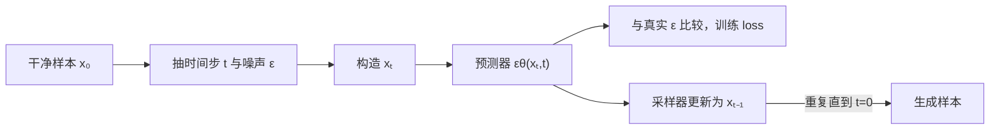

# 第 12 章 Diffusion 数值实验

本章把扩散模型的前向加噪和反向去噪写成可复算的小实验。我们跟踪少量标量和向量，确认调度系数、噪声目标与一次反向更新如何对应；它是理解机制的实验台，不是完整文生图系统，也不代表真实图像质量。更完整的生成任务和 pipeline 由第十五册深入。

整章围绕两个方向读：训练阶段从干净样本随机选一个噪声强度，让网络估计噪声；生成阶段从噪声出发，反复用预测结果更新到更干净的状态。图中的训练和采样共享同一个 schedule 与噪声预测器，但观测条件不同：训练时知道加入的噪声，采样时只能得到模型预测。

## 12.1 实现 Diffusion 加噪与去噪最小例子

### 12.1.1 把生成拆成一条随机过程

扩散模型的核心不是“画图 API”，而是把难以直接建模的数据分布拆成许多步简单的去噪任务。正向过程从真实数据 x_0 出发逐步加噪，反向过程从近似高斯噪声开始逐步恢复数据。

DDPM 的一步正向过程为：

~~~math
q(x_t\mid x_{t-1})=\mathcal{N}\left(\sqrt{1-\beta_t}x_{t-1},\beta_tI\right)
~~~

定义：

~~~math
\alpha_t=1-\beta_t,\qquad
\bar{\alpha}_t=\prod_{s=1}^{t}\alpha_s
~~~

标准 DDPM schedule 通常要求每个 \(0<\beta_t<1\)，因此 \(0<\alpha_t<1\)，并按合法的时间步顺序计算 \(\bar{\alpha}_t\)。若 \(\beta_t\) 越界，平方根、后验方差和采样过程都不再满足这里的概率解释。

闭式加噪公式可以从逐步过程推出来。前两步是：

~~~math
x_1=\sqrt{\alpha_1}x_0+\sqrt{\beta_1}\epsilon_1
~~~

~~~math
x_2=\sqrt{\alpha_2}x_1+\sqrt{\beta_2}\epsilon_2
=\sqrt{\alpha_1\alpha_2}x_0
+\sqrt{\alpha_2\beta_1}\epsilon_1
+\sqrt{\beta_2}\epsilon_2
~~~

由于 \(\epsilon_1,\epsilon_2\) 是独立标准高斯，后两项仍是均值为 0 的高斯噪声，其方差为 \(\alpha_2\beta_1+\beta_2=1-\alpha_1\alpha_2\)。因此可以把多步噪声合并成一个标准高斯 \(\epsilon\)，得到一般形式。训练时先抽 \(t\) 再一次性构造 \(x_t\)，不必真的从第 1 步循环到第 \(t\) 步；这使每个 batch 中的样本可以独立抽取不同的噪声强度。

可以直接从 x_0 构造任意时刻的 x_t：

~~~math
x_t=\sqrt{\bar{\alpha}_t}x_0+\sqrt{1-\bar{\alpha}_t}\epsilon,
\qquad\epsilon\sim\mathcal{N}(0,I)
~~~

累计信噪比可以用：

~~~math
\mathrm{SNR}_t=\frac{\bar{\alpha}_t}{1-\bar{\alpha}_t}
~~~

该有限 SNR 定义要求 \(0<\bar{\alpha}_t<1\)。干净边界约定 \(\bar{\alpha}_0=1\)，其 SNR 在扩展意义上为正无穷；这不是非法的干净样本，只是不能代入要求有限分母的噪声反解。代码中的 `step=0` 对应数学上的 `t=1`，即第一次加噪。

随着 t 增大，信号占比下降。schedule 的本质是设计信噪比如何变化，而不是随便生成一串 beta。

还要检查终点是否与采样初值相配。如果训练 schedule 的最后一个 \(\bar{\alpha}_T\) 仍明显大于零，终点就保留了信号；推理却从纯高斯噪声开始时，训练和采样的边界可能不一致。零终端信噪比及相应的预测参数化、起始时间步调整，是针对特定 schedule/checkpoint 提出的修正路线，不能脱离模型配置直接套用（[原论文](https://arxiv.org/abs/2305.08891v4)）。本章的短 schedule 只用于算式演示，不用于判断真实模型是否存在这种问题。

### 12.1.2 为什么通常预测噪声

训练时可以采样 x_0、t 和真实噪声 epsilon，再构造 x_t。模型学习：

~~~math
\hat{\epsilon}=\epsilon_\theta(x_t,t)
~~~

单个训练样本与时间步的简化损失是：

~~~math
L_{\mathrm{simple}}=\|\epsilon-\epsilon_\theta(x_t,t)\|_2^2
~~~

完整训练目标还要对数据、采样时间步与高斯噪声求期望；实现中采用 sum 还是按元素 mean 会改变尺度，需保持一致。

如果已知噪声预测，可以构造反向均值：

~~~math
\mu_\theta(x_t,t)=\frac{1}{\sqrt{\alpha_t}}
\left(x_t-\frac{\beta_t}{\sqrt{1-\bar{\alpha}_t}}\hat{\epsilon}\right)
~~~

这个均值可以从真实后验看出来。给定干净样本 \(x_0\) 和当前带噪样本 \(x_t\)，将一步前向分布与累计前向分布相乘并归一化，得到高斯后验：

~~~math
q(x_{t-1}\mid x_t,x_0)
=\mathcal{N}(\tilde{\mu}_t,\tilde{\beta}_t I)
~~~

其均值为：

~~~math
\tilde{\mu}_t
=\frac{\sqrt{\bar{\alpha}_{t-1}}\beta_t}{1-\bar{\alpha}_t}x_0
+\frac{\sqrt{\alpha_t}(1-\bar{\alpha}_{t-1})}{1-\bar{\alpha}_t}x_t
~~~

真实采样时不知道 \(x_0\)，所以模型根据 \(x_t,t\) 预测噪声，再反解一个 \(\hat{x}_0=(x_t-\sqrt{1-\bar{\alpha}_t}\hat{\epsilon})/\sqrt{\bar{\alpha}_t}\) 代入后验均值。化简后就是前面的 \(\mu_\theta\)。这一步说明噪声预测不是最终生成图像；它只是通过 schedule 映射成当前反向转移的均值。

再根据选择的方差注入随机性。后验方差的一种写法为：

~~~math
\tilde{\beta}_t=\beta_t\frac{1-\bar{\alpha}_{t-1}}{1-\bar{\alpha}_t}
~~~

这里取 \(\bar{\alpha}_0=1\)，因此最后一次反向更新 `t=1` 的后验方差为零。若另选固定方差，DDPM 采样算法仍在 `t=1` 使用零随机项。预测 x_0、预测 epsilon 和预测 velocity 是不同参数化，训练目标与采样公式必须匹配。

### 12.1.3 纯 Python 公式审计

> 代码状态：静态审阅，未运行（2026-10-30）

~~~python
import math

betas = [0.01, 0.02, 0.03, 0.04, 0.05]
if (not betas or any(isinstance(beta, bool) or not isinstance(beta, (int, float))
                     or not math.isfinite(beta) or not 0 < beta < 1
                     for beta in betas)):
    raise ValueError("betas must be finite values in (0, 1)")
alphas = [1.0 - beta for beta in betas]
alpha_bars = []
product = 1.0
for alpha in alphas:
    product *= alpha
    alpha_bars.append(product)

def q_sample(x0, noise, step):
    if (not isinstance(x0, list) or not isinstance(noise, list)
            or not x0 or len(x0) != len(noise)):
        raise ValueError("x0 and noise must be non-empty and aligned")
    if (isinstance(step, bool) or not isinstance(step, int)
            or not 0 <= step < len(alpha_bars)):
        raise ValueError("step is out of range")
    if any(isinstance(value, bool) or not isinstance(value, (int, float))
           or not math.isfinite(value) for value in x0 + noise):
        raise ValueError("sample values must be finite numbers")
    alpha_bar = alpha_bars[step]
    return [
        math.sqrt(alpha_bar) * value
        + math.sqrt(1.0 - alpha_bar) * eps
        for value, eps in zip(x0, noise)
    ]

def recover_noise(x_t, x0, step):
    if (not isinstance(x_t, list) or not isinstance(x0, list)
            or not x_t or len(x_t) != len(x0)):
        raise ValueError("x_t and x0 must be non-empty and aligned")
    if (isinstance(step, bool) or not isinstance(step, int)
            or not 0 <= step < len(alpha_bars)):
        raise ValueError("step is out of range")
    if any(isinstance(value, bool) or not isinstance(value, (int, float))
           or not math.isfinite(value) for value in x_t + x0):
        raise ValueError("sample values must be finite numbers")
    alpha_bar = alpha_bars[step]
    if alpha_bar >= 1.0:
        raise ValueError("step must contain non-zero noise")
    return [
        (current - math.sqrt(alpha_bar) * clean)
        / math.sqrt(1.0 - alpha_bar)
        for current, clean in zip(x_t, x0)
    ]

def reverse_step(x_t, predicted_noise, step, random_noise):
    if (isinstance(step, bool) or not isinstance(step, int)
            or not 0 <= step < len(betas)):
        raise ValueError("step is out of range")
    vectors = (x_t, predicted_noise, random_noise)
    if any(not isinstance(v, list) or not v for v in vectors):
        raise ValueError("vectors must be non-empty lists")
    if len({len(v) for v in vectors}) != 1:
        raise ValueError("vector dimensions must match")
    if any(isinstance(v, bool) or not isinstance(v, (int, float))
           or not math.isfinite(v) for vector in vectors for v in vector):
        raise ValueError("vector values must be finite numbers")
    alpha, alpha_bar = alphas[step], alpha_bars[step]
    previous_bar = 1.0 if step == 0 else alpha_bars[step - 1]
    variance = betas[step] * (1 - previous_bar) / (1 - alpha_bar)
    mean = [(current - betas[step] * eps / math.sqrt(1 - alpha_bar))
            / math.sqrt(alpha) for current, eps in zip(x_t, predicted_noise)]
    return [value + math.sqrt(variance) * z
            for value, z in zip(mean, random_noise)], variance

x0 = [2.0, 0.0]
noise = [0.3, -1.2]
x_t = q_sample(x0, noise, 4)
recovered = recover_noise(x_t, x0, 4)
mse = sum((a - b) ** 2 for a, b in zip(recovered, noise)) / len(noise)
first_noisy = q_sample(x0, noise, 0)
last_result, last_variance = reverse_step(first_noisy, noise, 0, [100.0, -100.0])
assert last_variance == 0
assert all(abs(a - b) < 1e-12 for a, b in zip(last_result, x0))
previous, variance = reverse_step(x_t, noise, 4, [0.0, 0.0])

assert alpha_bars[-1] < alpha_bars[0]
assert mse < 1e-12
print("alpha_bars=", [round(value, 6) for value in alpha_bars])
print("x_t=", [round(value, 4) for value in x_t])
print("recovered_noise=", [round(value, 4) for value in recovered])
print("recovery_mse=", round(mse, 12))
print("reverse_mean=", [round(value, 4) for value in previous])
print("posterior_variance=", round(variance, 6))
~~~
按公式得到的预期量为：累计 \(\bar{\alpha}\) 约 `[0.990000, 0.970200, 0.941094, 0.903450, 0.858278]`，末步带噪向量约 `[1.9658,-0.4518]`，反解噪声回到 `[0.3,-1.2]`；第 5 步反向均值约 `[1.9760,-0.3000]`，后验方差约 `0.03406`。这些是公式手算的预期结果，不是代码运行输出。反向函数用指定噪声预测计算一步均值与后验方差，随机项可由调用方用标准高斯生成。`step=0` 时不论传入什么有限随机项，方差均为零，使用真实噪声预测可回到原样本。其他步的后验仍有随机性，单步均值不等于精确恢复实际前一状态。

这里的 `recover_noise` 直接使用干净 `x0`，是代数一致性检查，不能充当生成时可用的噪声预测器。五步 schedule 的最终累计 alpha 仍约 0.8583，远未达到近似纯噪声；它不是可直接从标准高斯开始生成的训练配置。实验不训练网络，也不证明采样器能恢复目标分布；完整 toy DDPM 需要另训练噪声预测器并比较数据与采样分布。

### 12.1.4 从二维 toy 到图像系统

二维点的 MLP 在图像系统中通常会替换成 UNet 或 DiT；输入从 [batch,2] 变成像素或 latent 张量；时间步 embedding 仍然告诉模型当前噪声水平。Latent Diffusion 先使用 VAE 将图片压缩到 latent 空间，再在 latent 上做扩散：

~~~text
image -> VAE encoder -> latent z
latent z -> conditional diffusion -> generated latent
generated latent -> VAE decoder -> image
~~~

latent 空间减少空间尺寸和计算量，但 VAE 会带来重建损失。图像生成系统的质量因此同时受数据、VAE、去噪网络、条件编码、采样步数和解码器影响。

### 12.1.5 文本条件与 classifier-free guidance

有文本条件时，模型变成：

~~~math
\hat{\epsilon}=\epsilon_\theta(x_t,t,c)
~~~

训练时，同一个网络以一定概率把条件替换成空条件，因此推理时可以分别得到有条件预测 \(\epsilon_{\mathrm{cond}}\) 和无条件预测 \(\epsilon_{\mathrm{uncond}}\)；原论文用 null token 表示空条件（[Classifier-Free Guidance](https://arxiv.org/abs/2207.12598v1)）。常见差分记法是：

~~~math
\epsilon_{\mathrm{cfg}}
=\epsilon_{\mathrm{uncond}}+s(\epsilon_{\mathrm{cond}}-\epsilon_{\mathrm{uncond}})
~~~

这里的 \(s\) 是差分记法中的 guidance scale：\(s=0\) 只取无条件预测，\(s=1\) 恰好回到条件预测。Classifier-Free Guidance 原论文使用另一记号 \(w\)：

~~~math
\epsilon_{\mathrm{paper}}
=(1+w)\epsilon_{\mathrm{cond}}-w\epsilon_{\mathrm{uncond}},
\qquad s=1+w
~~~

所以原论文的 \(w=0\) 与差分记法的 \(s=1\) 都是条件预测基线。以标量 \(\epsilon_{\mathrm{uncond}}=0.2\)、\(\epsilon_{\mathrm{cond}}=0.6\) 为例，取 \(s=1.5\) 得 \(0.2+1.5(0.6-0.2)=0.8\)；用原论文记法取 \(w=0.5\)，则 \(1.5(0.6)-0.5(0.2)=0.8\)。两种记法算出同一结果，但参数的零点不同。若取 \(s=0.5\)，结果为 0.4，位于两种预测之间；\(s=1.5\) 的 0.8 则超出条件预测，属于外推。scale 不是 prompt adherence 的线性刻度，数值加倍不代表遵循程度加倍。Diffusers v0.35.1 的经典 Stable Diffusion pipeline 以 `guidance_scale=1` 表示不启用 CFG，并在大于 1 时启用；该 API 值对应差分记法的 \(s\)，不应直接当成论文的 \(w\)（[固定版本源码](https://github.com/huggingface/diffusers/blob/v0.35.1/src/diffusers/pipelines/stable_diffusion/pipeline_stable_diffusion.py)）。

同一 pipeline 的 `negative_prompt` 还会改变公式里的基线：它把 negative prompt 的文本表示放进空条件分支的位置。因此该分支不再是数学推导里的真正空条件，而是“朝正向提示、远离负向提示”的接口实现；其他 pipeline 可能采用不同约定，应检查对应版本。该版本将两组文本表示拼成一个 batch 来减少前向调用次数，但 batch 中仍包含两组预测，计算量不会因此消失。

这个预测差值为什么有用？令 \(s_{\mathrm{cond}}=\nabla_{x_t}\log p_t(x_t\mid c)\) 表示有条件分布的 score，\(s_{\mathrm{uncond}}=\nabla_{x_t}\log p_t(x_t)\) 表示无条件分布的 score。由 Bayes 公式，二者之差对应条件对数概率的梯度：

~~~math
s_{\mathrm{cond}}-s_{\mathrm{uncond}}
=\nabla_{x_t}\log p_t(c\mid x_t)
~~~

在噪声预测参数化且 score 估计准确的理想情况下，score 与噪声预测只差一个由时间步决定的比例因子。因此，把条件/无条件 score 差放大，可以把采样推向更符合条件的区域；换回噪声预测记法时就得到前面的 CFG 公式。这里是原论文的推导直觉，不是说训练出的神经网络一定对应一个精确概率密度或真实分类器；实际效果仍取决于模型、条件和采样轨迹。名称里的“无分类器”指不另训练一个噪声图像分类器，并不表示推理时没有额外计算。

做这个差值时，两次预测必须使用同一个 \(x_t\) 和同一个时间步 \(t\)，只替换条件输入；否则差值会混入不同噪声状态或不同随机样本的影响，不能再解释为条件带来的变化。

较大的 \(s\) 会沿条件与无条件预测之差向外外推，通常更强调条件匹配，但论文观察到质量与多样性的取舍；具体 checkpoint 上也可能出现过曝或整体质量下降。CFG 每一步都需要两种预测，常把有条件和空条件输入拼到同一 batch 计算，但去噪网络承担的计算量仍会增加。它不是“越大越好”的旋钮，应在固定模型、提示词和采样预算下分桶比较。

DDIM 在不重新训练基础预测器的前提下改变采样路径；DPM-Solver 将反向采样写成扩散 ODE 的数值求解。它们主要减少模型评估次数，但更少步数不自动保证相同质量或更低端到端延迟。渐进蒸馏则通过教师—学生训练逐步减少采样步数；也有工作把 CFG 合成的有条件/无条件预测蒸馏到单一模型，这会改变训练与模型权重，属于不同改动层次（[Progressive Distillation](https://arxiv.org/abs/2202.00512)、[Guided Diffusion Distillation](https://arxiv.org/abs/2210.03142)）。这些方法都不意味着基础 DDPM 的前向加噪过程消失。

#### 跟着算一次：前向信号如何变小，反向均值如何算

取一个只有两个时间步的教学 schedule：β1=0.1、β2=0.2，因此 α1=0.9、α2=0.8，累计值分别是 ᾱ1=0.9、ᾱ2=0.72。令干净标量 x0=1，抽到的噪声 ε=-0.5。第二步的带噪样本为 √0.72×1+√0.28×(-0.5)，约为 0.5839。第一项信号贡献约 0.8485，第二项噪声贡献约 -0.2646；观察到的数值是两项叠加，不是模型从图像里“减掉一点噪声”这么简单。

如果真实噪声预测器恰好给出 ε̂=-0.5，第二步反向均值为 (0.5839-0.2×(-0.5)/√0.28)/√0.8，约 0.8642：括号内的分子约 0.7729，还要再除以 √0.8。后验方差为 0.2×(1-0.9)/(1-0.72)，约 0.0714。若按该后验采样，标准差约 0.2672，再乘一个独立标准高斯随机数。一次真实反向抽样因而不必等于当初正向路径上的 x1；反向分布表达的是给定 xt 后对前一状态的不确定性。

这个两步 schedule 的最终 ᾱ 仍是 0.72，第二步样本里还有很强的原始信号。真实生成通常从约定的初始噪声分布开始，不能把这个短 schedule 的输出冒充成“已经纯噪声”。更重要的是，上面的噪声预测是已知真值，训练和推理时模型并不知道 x0，也拿不到真实 ε；它只能根据 xt、时间步及条件估计噪声。手算验证了公式之间的一致性，不能证明一个未训练的模型能恢复图像。

#### 噪声预测误差如何传到反向均值

继续使用第二步的参数，反向均值中噪声预测的系数是 β2 除以 √α2√(1-ᾱ2)，约 0.4226。若真值噪声是 -0.5，模型给出 -0.3，预测误差为 0.2；代入反向均值后，结果相对真噪声预测会偏移约 -0.4226×0.2=-0.0845。这个小算例把“噪声预测准确度”与“生成状态误差”连接起来：不同时间步的系数不同，同样大小的预测误差可能造成不同程度的状态偏移。

但这并不意味着可以直接把平均 MSE 换算成图像质量。真实模型预测的是高维 latent 或像素张量，误差具有空间结构；同样的均方误差若集中在主体边缘、文字或背景，感知影响不同。采样器还会在多步中传播误差，且文本条件和 guidance 会改变轨迹。MSE 是训练目标或局部诊断量，图像质量仍须用任务相关评估、人工切片和多随机种子观察。

做采样器对比时，固定 checkpoint、初始随机种子、prompt 和图像预处理，再分别报告采样步数、每次模型调用、延迟、显存及质量。若不同方法使用了不同的计算预算，必须公开预算；否则更少步数的质量差异无法归因于采样规则本身。手算系数用于理解传播路径，真实结论由目标模型和目标任务的实验支撑。

在第二步，信号方差占比是 ᾱ2=0.72，噪声方差占比是 1-ᾱ2=0.28，因此 SNR=0.72/0.28≈2.57。信号仍大于噪声；继续加噪后，ᾱ 会下降，SNR 也会下降。这个比例解释了为何不同时间步的去噪难度不一样，也解释了训练时要让模型看到多个 t，而不是只拟合一个固定噪声强度。

如果评估只在靠前的低噪声时间步测 MSE，模型仍可能在接近纯噪声的高 t 区间失败。训练和诊断可以按时间步分桶比较噪声误差、预测 x0 的误差和采样结果，但这些仍是不同层次的指标。最终任务若关心文字清晰度、主体结构或风格一致性，还要把结果按这些属性单独评估。

### 12.1.6 生成评估与失败归因

图像生成评估不能只看 CLIP score。先把任务拆成可观察维度，再决定指标和人工复核方式：

| 维度 | 需要观察什么 | 常见核验方式 |
| --- | --- | --- |
| Prompt adherence | 主体、属性、数量和相互关系是否符合提示 | 按属性和关系逐项标注，不能只看整体相似度 |
| 图像质量 | 清晰度、伪影、构图和局部细节 | 固定提示集做盲评，并记录失败类型 |
| 多样性 | 同一提示的不同随机种子是否只产生近似结果 | 按提示分组查看多 seed 输出和分布指标 |
| 安全 | 禁止内容是否出现、拒绝边界是否正确 | 独立安全切片和人工复核 |
| 文字与数字 | 拼写、字符、数值和版面是否正确 | OCR 或结构化字段校验 |
| 成本 | 采样步数、模型评估次数、显存和延迟 | 固定硬件与预算，报告端到端测量条件 |

评测前先定义样本单位和成功条件。Prompt 集应包含目标场景里的主体、属性、数量、空间关系、文字和安全要求；每条 prompt 可以生成多个 seed，但结果同时按 prompt 与生成图像统计。人工评审要先写清每项判定标准，随机化模型/采样器标签，并分别标注主体出现、属性正确、关系满足和整体通过，避免评审者只凭“看起来不错”给总分。

例如，用 20 条 prompt、每条 3 个 seed 得到 60 张图。若主体通过 51/60（85%）、属性通过 44/60（73.3%）、关系通过 30/60（50%），且三项都通过的图为 24/60（40%），就能看出整体失败主要集中在关系组合；只报平均分会遮住这一差别。这些是教学用的人工标注计数，不是模型结果。多个 seed 共享同一 prompt，不能当作 60 条独立 prompt；还应报告 prompt 级宏平均或按场景分组结果，并保留每项的分子、分母和不确定性。

比较采样器时固定 checkpoint、prompt、图像预处理、负向提示、分辨率、CFG scale 和尽可能匹配的初始噪声，同时记录 schedule、模型评估次数、硬件及端到端延迟。不同 sampler 对随机项的消费方式可能不同，同一个 seed 不一定对应完全相同的随机轨迹；应披露配对条件。若同时改模型、guidance 和步数，输出差异无法归因给某一个改动。

FID 比较真实图像集与生成图像集在 Inception 特征空间中的均值和协方差，适合观察分布差异，但一个总分不能指出哪个 prompt 属性或局部关系出错（[原论文](https://proceedings.neurips.cc/paper_files/paper/2017/file/8a1d694707eb0fefe65871369074926d-Paper.pdf)）。Inception Score 使用预训练分类器的 \(p(y\mid x)\) 与生成集边缘类别分布 \(p(y)\)，同时偏好单张图像的分类置信度和集合类别多样性；它没有拿目标业务的参考图像分布作直接比较，因此不能证明特定提示词、文字或关系得到满足（[原论文](https://papers.nips.cc/paper/6125-improved-techniques-for-training-gans.pdf)）。

CLIPScore 用图文表征相似度评估图像与文本的兼容性；其原论文评估的是图像描述任务，并报告了对需要丰富上下文的新闻描述相对较弱，因此迁移到文生图时应把它当作一个语义信号，而不是完整质量分数（[原论文](https://aclanthology.org/2021.emnlp-main.595/)）。由其全局相似度性质可以推知，主体出现不代表数量、空间关系、文字准确性或安全要求都成立。若业务依赖数字、表格或文字，应加 OCR/结构化校验；若关心安全，也应单独设计安全切片。比较采样器时固定 checkpoint、prompt、预处理和计算预算，并报告每个维度的结果，否则总分变化无法定位到具体机制。

按失败信号定位下一步：

| 观测信号 | 优先切片或检查 | 归因时要控制的变量 |
| --- | --- | --- |
| 主体正确、关系错误 | 左右/前后、数量、交互关系分别统计 | 固定 prompt 含义与模型，检查条件表达能力 |
| 强引导时过曝或细节变差 | 按 CFG scale 与提示类型分桶 | 固定 checkpoint、seed 和 sampler，再调 scale |
| 图文分数高但文字错 | OCR 字符错误率、关键字段准确率 | 不用全图相似度替代文字校验 |
| 多样性不足 | 同一 prompt 多 seed 的重复率和覆盖率 | 区分 prompt 多样性与 seed 多样性 |
| 速度变快但质量下降 | 质量切片、模型评估次数、端到端延迟 | 固定硬件并报告质量/成本两条曲线 |

这张表给的是排查顺序，不是从某个分数直接推出的根因。样本较少时，应同时展示计数或区间，避免把偶然波动当作 sampler 的稳定改进；高风险场景还需要针对安全、版权和数据治理单独验收。

报告 FID、Inception Score 或 CLIPScore 时，还要写明评测集、样本数、图像缩放与预处理、特征/分类模型和指标实现版本。FID 与 IS 都从整批样本的特征或类别统计量计算；如果样本构成、提取器或预处理不一致，分数差异可能来自测量口径而非生成器。CLIPScore 也依赖其图文编码器与文本构造方式。只有任务、样本和测量流程足够一致时，数值才适合横向对照；否则应把结论收窄到各自设置，并回到逐项人工或程序化检查。

不要在评测后才调整维度权重，把多目标压成一个总分；阈值和失败等级应先按业务任务定义，再用于模型选择或发布门禁。

### 12.1.7 资料与证据边界

扩散基础见 [DDPM](https://arxiv.org/abs/2006.11239)，快速采样见 [DDIM](https://arxiv.org/abs/2010.02502) 和 [DPM-Solver](https://arxiv.org/abs/2206.00927)，latent diffusion 见 [High-Resolution Image Synthesis with Latent Diffusion Models](https://arxiv.org/abs/2112.10752)，DiT 见 [Scalable Diffusion Models with Transformers](https://arxiv.org/abs/2212.09748)，classifier-free guidance 见 [原论文](https://arxiv.org/abs/2207.12598v1)。FID、Inception Score 和 CLIPScore 的定义与任务边界分别见[原始 FID 论文](https://proceedings.neurips.cc/paper_files/paper/2017/file/8a1d694707eb0fefe65871369074926d-Paper.pdf)、[Inception Score 论文](https://papers.nips.cc/paper/6125-improved-techniques-for-training-gans.pdf)和 [CLIPScore 论文](https://aclanthology.org/2021.emnlp-main.595/)。论文中的生成质量、采样步数和数据集结论不能直接转成目标业务的质量或安全保证。

本章的输出需按[第十四章多模态评估与交付](14-多模态评估与交付.md)记录来源、边界和失败；多模态机制的系统主讲见[第十五册](../../book-15-multimodal-generative-models/目录.md)。

实现真实训练或采样器时，还应查看 [Hugging Face Diffusers 的 DDPMScheduler 文档](https://huggingface.co/docs/diffusers/api/schedulers/ddpm)：`epsilon`、`sample` 与 `v_prediction` 对应不同模型输出约定，不能只换模型输出名称而沿用不匹配的反向公式。框架 API 的具体参数和默认值应绑定安装版本；本章手算与标准库 demo 用于解释基础 DDPM，不验证该框架或实际图像 pipeline。
