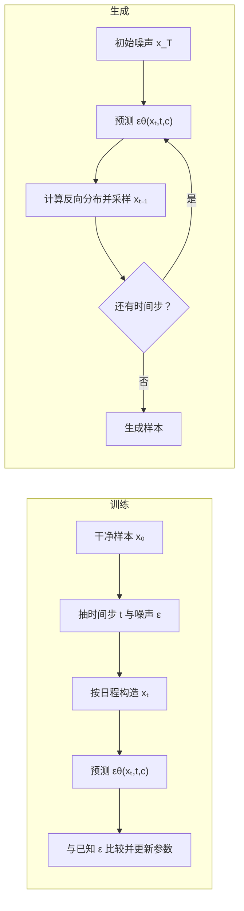

# 第 12 章 Diffusion 数值实验

一张图像从噪声里一步步出现，听起来像“模型学会把噪声擦掉”。这个说法只对了一半：扩散（diffusion）模型在训练时看到人为加噪后的样本，并知道加进去的噪声；生成时它看不到真实噪声，只能估计。采样器再把这份估计换成下一步的均值，并按设定保留或注入随机性。理解这条链，才知道代码里的每个系数在做什么。

本章先从前向加噪出发，解释噪声预测目标和反向分布；接着用一个两步算例把输入、预测和更新完整算一遍，再让纯 Python 代码审计公式的向量版本。随后把这个小实验放回图像系统，讨论文本引导、少步采样和评估。读完后，你应能判断一个数值实验到底检查了什么、不能证明什么。这里不训练图像模型，也不把玩具数字当成真实生成效果；更完整的生成流程和项目由[第十五册](../../book-15-multimodal-generative-models/目录.md)深入。

训练和生成会用到相同的噪声日程（noise schedule）与去噪网络，却不是同一个计算过程。训练时从干净样本出发，随机选择时间步并加上已知噪声，再用两者计算损失；生成时从初始噪声出发，网络预测未知噪声，采样器据此反复更新。图中分开的两条路径，正是后面公式要解释的对象。

## 12.1 从加噪公式走到一次生成更新

### 12.1.1 前向过程：每一步都保留一点信号，再加入一点噪声

先区分两个方向。前向过程是我们规定的加噪规则：从真实样本 $x_0$ 出发，按时间步逐渐破坏它；反向过程是模型要近似的去噪规则：从接近高斯噪声的状态开始，逐步生成样本。这里的 $x_t$ 可以是一张图像，也可以是压缩后的潜变量（latent）张量；本节先用标量和向量解释同一套运算。

去噪扩散概率模型（Denoising Diffusion Probabilistic Model, DDPM）的一步正向过程为（见 [DDPM 原论文](https://arxiv.org/abs/2006.11239)）：

~~~math
q(x_t\mid x_{t-1})=\mathcal{N}\left(\sqrt{1-\beta_t}x_{t-1},\beta_tI\right)
~~~

$\mathcal{N}$ 表示正态分布，括号中依次是均值和协方差矩阵；$I$ 是单位矩阵，表示各维度使用相同的方差 $\beta_t$，且这一步设定下不同维度的噪声互不相关。若把 $x$ 看成单个数，这个式子就是“以 $\sqrt{1-\beta_t}x_{t-1}$ 为中心、方差为 $\beta_t$”的钟形随机分布。

定义：

~~~math
\alpha_t=1-\beta_t,\qquad
\bar{\alpha}_t=\prod_{s=1}^{t}\alpha_s
~~~

标准离散 DDPM schedule 通常要求每个 $0<\beta_t<1$，因此 $0<\alpha_t<1$。$\beta_t$ 是一步加入的噪声方差，$\alpha_t$ 是这一步保留的信号比例；$\bar{\alpha}_t$ 则是从起点一路相乘后的累计保留率。若 $\beta_t$ 越界，平方根、后验方差和采样过程都不再满足这里的概率解释。

闭式加噪公式可以从逐步过程推出来。前两步是：

~~~math
x_1=\sqrt{\alpha_1}x_0+\sqrt{\beta_1}\epsilon_1
~~~

~~~math
x_2=\sqrt{\alpha_2}x_1+\sqrt{\beta_2}\epsilon_2
=\sqrt{\alpha_1\alpha_2}x_0
+\sqrt{\alpha_2\beta_1}\epsilon_1
+\sqrt{\beta_2}\epsilon_2
~~~

由于 $\epsilon_1$、$\epsilon_2$ 是独立标准高斯，后两项仍是均值为 0 的高斯噪声，其方差为 $\alpha_2\beta_1+\beta_2=1-\alpha_1\alpha_2$。因此可以把多步噪声合并成一个标准高斯 $\epsilon$，得到一般形式。训练时先抽 $t$ 再一次性构造 $x_t$，不必真的从第 1 步循环到第 $t$ 步；这使 batch 中的样本可以独立抽取不同的噪声强度。

于是可以直接从 $x_0$ 构造任意时刻的 $x_t$：

~~~math
x_t=\sqrt{\bar{\alpha}_t}x_0+\sqrt{1-\bar{\alpha}_t}\epsilon,
\qquad\epsilon\sim\mathcal{N}(0,I)
~~~

$\epsilon\sim\mathcal{N}(0,I)$ 表示每个维度各抽一个均值为 0、方差为 1 的标准高斯噪声；噪声张量与 $x_0$ 形状相同。两个平方根系数作用在标准差上，所以对应的信号和噪声方差比例才分别是 $\bar{\alpha}_t$ 与 $1-\bar{\alpha}_t$。

信噪比（signal-to-noise ratio, SNR）可以用下面的累计比值表示：

~~~math
\mathrm{SNR}_t=\frac{\bar{\alpha}_t}{1-\bar{\alpha}_t}
~~~

该有限 SNR 定义要求 $0<\bar{\alpha}_t<1$。干净边界约定 $\bar{\alpha}_0=1$，其 SNR 在扩展意义上为正无穷；这不是非法的干净样本，只是不能代入要求有限分母的噪声反解。代码中的 `step=0` 对应数学上的 `t=1`，即第一次加噪。

随着 $t$ 增大，信号占比通常下降。schedule 的本质是设计 SNR 如何变化，而不是随便生成一串 beta。不同训练配置可能采用不同 schedule；单凭一个时间步上的噪声强度，不能断言整条生成链更容易或更难。

还要检查终点是否与采样初值相配。如果训练噪声日程的最后一个 $\bar{\alpha}_T$ 仍明显大于零，终点就保留了信号；推理却从纯高斯噪声开始时，训练和采样的边界可能不一致。零终端信噪比及相应的预测参数化、起始时间步调整，是针对特定噪声日程和模型检查点（checkpoint）提出的修正路线，不能脱离模型配置直接套用（[原论文](https://arxiv.org/abs/2305.08891v4)）。本章的短 schedule 只用于算式演示，不用于判断真实模型是否存在这种问题。

### 12.1.2 训练目标和反向分布：预测的噪声怎样变成下一步

训练时，干净样本 $x_0$、时间步 $t$ 和噪声 $\epsilon$ 都由训练过程提供。把它们代入前面的闭式公式得到 $x_t$，网络再根据 $x_t$ 和时间步预测噪声：

~~~math
\hat{\epsilon}=\epsilon_\theta(x_t,t)
~~~

噪声是一个方便的监督目标，因为它正是这次构造 $x_t$ 时抽出的随机量，训练过程知道答案。单个样本、单个时间步的简化损失为：

~~~math
L_{\mathrm{simple}}=\|\epsilon-\epsilon_\theta(x_t,t)\|_2^2
~~~

实际训练会对训练样本、时间步和噪声取期望；常见做法是随机抽取 $t$。范数平方先对样本里的像素或 latent 元素求和，工程实现也可能先按元素取平均，再对 batch 和时间步平均。sum/mean 的区别会改变损失尺度，比较训练设置时要把它记下来。即使平均训练损失下降，也不能据此断言每个噪声区间或每类图像都学好了。

不同时间步的损失也不一定要同等加权。最小信噪比加权（Min-SNR-$\gamma$）是一种训练方案；对噪声预测目标，一种常见写法是：

~~~math
L_{\mathrm{weighted}}
=\mathbb{E}\left[w_t\left\|\epsilon-\epsilon_\theta(x_t,t)\right\|_2^2\right],
\qquad
w_t=\min\left(1,\frac{\gamma}{\mathrm{SNR}_t}\right)
~~~

$\gamma$ 是截断阈值，不是模型参数。比如取 $\gamma=5$，SNR 为 10 的时间步权重为 0.5，SNR 为 2.57 的时间步权重为 1；这会改变不同去噪任务对参数更新的相对影响，不是对所有参数化都通用的常数。$x_0$ 预测、噪声预测和 $v$ 预测的权重换算不同，采用前要对齐训练目标和实现（[Min-SNR 论文](https://arxiv.org/abs/2303.09556v3)）。诊断时也应按时间步分桶看损失，避免整体平均掩盖高噪声区间的失败。

现在从反向方向看。若同时知道干净样本 $x_0$ 和带噪样本 $x_t$，可以把前向过程中的相邻两步用贝叶斯公式合起来。给定 $x_0$ 时，前一状态的分布和下一步的加噪分布分别是：

~~~math
q(x_{t-1}\mid x_0)
=\mathcal{N}\left(\sqrt{\bar{\alpha}_{t-1}}x_0,
(1-\bar{\alpha}_{t-1})I\right),
\qquad
q(x_t\mid x_{t-1})
=\mathcal{N}(\sqrt{\alpha_t}x_{t-1},\beta_t I)
~~~

因此 $q(x_{t-1}\mid x_t,x_0)$ 正比于这两个高斯密度的乘积。把指数中的二次项配方，后验仍是高斯：

~~~math
q(x_{t-1}\mid x_t,x_0)
=\mathcal{N}(\tilde{\mu}_t,\tilde{\beta}_t I)
~~~

配方后得到后验方差和均值。对 $t>1$，两个高斯的精度相加再取倒数，整理后方差为：

~~~math
\tilde{\beta}_t
=\left(\frac{1}{1-\bar{\alpha}_{t-1}}+
\frac{\alpha_t}{\beta_t}\right)^{-1}
=\beta_t\frac{1-\bar{\alpha}_{t-1}}{1-\bar{\alpha}_t}
~~~

~~~math
\tilde{\mu}_t
=\frac{\sqrt{\bar{\alpha}_{t-1}}\beta_t}{1-\bar{\alpha}_t}x_0
+\frac{\sqrt{\alpha_t}(1-\bar{\alpha}_{t-1})}{1-\bar{\alpha}_t}x_t
~~~

在 $t=1$，前一状态就是已知的干净样本，公式给出 $\tilde{\beta}_1=0$；上面的精度相加说法只用于非退化的 $t>1$ 情形。

真实采样时不知道 $x_0$。模型先根据 $x_t$ 和 $t$ 预测噪声，再反解一个干净样本估计：

~~~math
\hat{x}_0
=\frac{x_t-\sqrt{1-\bar{\alpha}_t}\hat{\epsilon}}
{\sqrt{\bar{\alpha}_t}}
~~~

把 $\hat{x}_0$ 代回后验均值并整理，可得噪声参数化下常用的反向均值：

~~~math
\mu_\theta(x_t,t)=\frac{1}{\sqrt{\alpha_t}}
\left(x_t-\frac{\beta_t}{\sqrt{1-\bar{\alpha}_t}}\hat{\epsilon}\right)
~~~

所以网络输出的 $\hat{\epsilon}$ 不是生成图像，也不是直接的“去噪后图像”；它先经过 schedule 的缩放，变成反向分布的均值。反向转移还需要一个方差，控制围绕该均值保留多少随机性。先用常见的后验方差设置作例子：

~~~math
p_\theta(x_{t-1}\mid x_t)
=\mathcal{N}(\mu_\theta(x_t,t),\tilde{\beta}_t I)
~~~

从这个分布采样时，一步更新为：

~~~math
x_{t-1}=\mu_\theta(x_t,t)+\sqrt{\tilde{\beta}_t}\,z,
\qquad z\sim\mathcal{N}(0,I)
~~~

$z$ 是这一步额外抽取的随机噪声。取 $\bar{\alpha}_0=1$ 后，最后一步 $t=1$ 的后验方差为零，不再加入随机项；前面的步骤则保留后验不确定性。标准 DDPM 可以固定不同方差，Improved DDPM 还提出学习反向方差并加入变分下界（variational lower bound）项训练；简化的噪声 MSE 本身不会训练方差参数。该论文在其指定图像设置下报告了较少模型前向调用的结果，但不能据此推断任意模型检查点都可安全跳步（[Improved DDPM](https://arxiv.org/abs/2102.09672v1)）。

把训练过程和生成过程分开看，算法步骤就清楚了：训练时抽 $x_0,t,\epsilon$，构造 $x_t$，预测并比较目标，再更新网络；生成时在与训练终点匹配的约定下从 $x_T\sim\mathcal{N}(0,I)$ 开始，按时间步从大到小预测模型所约定的目标、换算反向分布并采样，直到得到 $x_0$。预测 $x_0$、预测 $\epsilon$ 和预测 $v$ 是不同输出参数化；切换输出目标时，训练目标、均值换算和 scheduler 配置都必须匹配。本章先把噪声预测这一种常见形式算清。

速度目标（velocity prediction，也简称 $v$ 预测）不是另一份独立数据，而是同一对干净样本与噪声按时间步重新组合的一种目标。采用常见定义时，令 $a=\sqrt{\bar{\alpha}_t}$、$b=\sqrt{1-\bar{\alpha}_t}$：

~~~math
x_t=ax_0+b\epsilon,
\qquad v_t=a\epsilon-bx_0
~~~

这两个式子可以反解为 $x_0=ax_t-bv_t$、$\epsilon=bx_t+av_t$。因此在固定时间步上，预测 $v$ 仍能换回去噪所需的量；不同实现的 target 定义和 scheduler 约定必须一致，不能把名为 `v_prediction` 的输出直接塞进噪声预测公式。

### 12.1.3 两步手算：噪声预测误差会怎样改变反向结果

用一个标量例子核对刚才几条公式。设两个时间步的 schedule 为 $\beta_1=0.1$、$\beta_2=0.2$，于是 $\alpha_1=0.9$、$\alpha_2=0.8$，累计值为 $\bar{\alpha}_1=0.9$、$\bar{\alpha}_2=0.72$。令干净输入 $x_0=1$，在闭式公式中抽到的合并噪声为 $\epsilon=-0.5$。

第二步的带噪输入为：

~~~math
x_2=\sqrt{0.72}\times 1+\sqrt{0.28}\times(-0.5)
\approx 0.848528-0.264575=0.583953
~~~

这里第一项是保留下来的信号，第二项是加进去的噪声贡献。假设模型恰好预测对了，$\hat{\epsilon}=-0.5$。先反解干净样本：

~~~math
\hat{x}_0
=\frac{0.583953-\sqrt{0.28}\times(-0.5)}{\sqrt{0.72}}
\approx 1
~~~

再把这个估计放进真实后验的均值。$x_0$ 和 $x_2$ 前面的权重分别约为 0.6776 和 0.3194，因此：

~~~math
\tilde{\mu}_2
\approx 0.67763\times 1+0.31944\times 0.583953
\approx 0.8642
~~~

用噪声形式直接计算也应得到同一均值：

~~~math
\mu_\theta
=\frac{0.583953-0.2\times(-0.5)/\sqrt{0.28}}{\sqrt{0.8}}
\approx \frac{0.772935}{\sqrt{0.8}}
\approx 0.8642
~~~

后验方差为 $0.2\times(1-0.9)/(1-0.72)\approx0.0714$，标准差约为 0.2672。实际采样还会把标准差乘以一个独立标准高斯 $z$ 加到均值上。因而一次反向抽样不一定等于某条特定的正向路径上的中间值；这个方差表达的是给定当前 $x_t$ 后，前一状态仍有不确定性。闭式公式里的合并噪声 $\epsilon$ 也没有告诉我们这条正向路径中每一步各自抽到了什么噪声。

现在故意让模型预测错：真实噪声仍是 $-0.5$，预测值改成 $-0.3$。噪声预测误差为 0.2；在当前时间步，均值对噪声预测的系数是 $\beta_2/(\sqrt{\alpha_2}\sqrt{1-\bar{\alpha}_2})\approx0.4226$，且公式中它带负号，所以反向均值相对正确预测偏移约 $-0.4226\times0.2=-0.0845$。同样大小的预测误差在不同时间步会乘上不同系数。

该步的信号与噪声方差比例分别为 0.72 和 0.28，因此 $\mathrm{SNR}_2=0.72/0.28\approx2.57$。这个短 schedule 结束时仍保留不少原始信号，并没有到纯噪声。上面的手算验证了闭式加噪、噪声反解和后验均值彼此一致；它不能证明未训练模型能恢复图像，也不能把局部均方误差（mean squared error, MSE）直接换算成感知质量。真实网络预测高维像素或 latent，误差有空间结构，而且会在多步采样中传播。

### 12.1.4 用纯 Python 审计公式

前一节用一个标量检查每个系数从哪里来；这里把同一类运算扩展到二维向量和五步 schedule，并检查输入边界、噪声反解与最后一步的零方差。它不包含神经网络，作用是核对公式实现，不是训练或生成图像。

> 代码状态：静态审阅，未运行（2026-10-30）

~~~python
import math

betas = [0.01, 0.02, 0.03, 0.04, 0.05]
if (not betas or any(isinstance(beta, bool) or not isinstance(beta, (int, float))
                     or not math.isfinite(beta) or not 0 < beta < 1
                     for beta in betas)):
    raise ValueError("betas must be finite values in (0, 1)")
alphas = [1.0 - beta for beta in betas]
alpha_bars = []
product = 1.0
for alpha in alphas:
    product *= alpha
    alpha_bars.append(product)

def q_sample(x0, noise, step):
    if (not isinstance(x0, list) or not isinstance(noise, list)
            or not x0 or len(x0) != len(noise)):
        raise ValueError("x0 and noise must be non-empty and aligned")
    if (isinstance(step, bool) or not isinstance(step, int)
            or not 0 <= step < len(alpha_bars)):
        raise ValueError("step is out of range")
    if any(isinstance(value, bool) or not isinstance(value, (int, float))
           or not math.isfinite(value) for value in x0 + noise):
        raise ValueError("sample values must be finite numbers")
    alpha_bar = alpha_bars[step]
    return [
        math.sqrt(alpha_bar) * value
        + math.sqrt(1.0 - alpha_bar) * eps
        for value, eps in zip(x0, noise)
    ]

def recover_noise(x_t, x0, step):
    if (not isinstance(x_t, list) or not isinstance(x0, list)
            or not x_t or len(x_t) != len(x0)):
        raise ValueError("x_t and x0 must be non-empty and aligned")
    if (isinstance(step, bool) or not isinstance(step, int)
            or not 0 <= step < len(alpha_bars)):
        raise ValueError("step is out of range")
    if any(isinstance(value, bool) or not isinstance(value, (int, float))
           or not math.isfinite(value) for value in x_t + x0):
        raise ValueError("sample values must be finite numbers")
    alpha_bar = alpha_bars[step]
    if alpha_bar >= 1.0:
        raise ValueError("step must contain non-zero noise")
    return [
        (current - math.sqrt(alpha_bar) * clean)
        / math.sqrt(1.0 - alpha_bar)
        for current, clean in zip(x_t, x0)
    ]

def reverse_step(x_t, predicted_noise, step, random_noise):
    if (isinstance(step, bool) or not isinstance(step, int)
            or not 0 <= step < len(betas)):
        raise ValueError("step is out of range")
    vectors = (x_t, predicted_noise, random_noise)
    if any(not isinstance(v, list) or not v for v in vectors):
        raise ValueError("vectors must be non-empty lists")
    if len({len(v) for v in vectors}) != 1:
        raise ValueError("vector dimensions must match")
    if any(isinstance(v, bool) or not isinstance(v, (int, float))
           or not math.isfinite(v) for vector in vectors for v in vector):
        raise ValueError("vector values must be finite numbers")
    alpha, alpha_bar = alphas[step], alpha_bars[step]
    previous_bar = 1.0 if step == 0 else alpha_bars[step - 1]
    variance = betas[step] * (1 - previous_bar) / (1 - alpha_bar)
    mean = [(current - betas[step] * eps / math.sqrt(1 - alpha_bar))
            / math.sqrt(alpha) for current, eps in zip(x_t, predicted_noise)]
    return [value + math.sqrt(variance) * z
            for value, z in zip(mean, random_noise)], variance

x0 = [2.0, 0.0]
noise = [0.3, -1.2]
x_t = q_sample(x0, noise, 4)
recovered = recover_noise(x_t, x0, 4)
mse = sum((a - b) ** 2 for a, b in zip(recovered, noise)) / len(noise)
first_noisy = q_sample(x0, noise, 0)
last_result, last_variance = reverse_step(first_noisy, noise, 0, [100.0, -100.0])
assert last_variance == 0
assert all(abs(a - b) < 1e-12 for a, b in zip(last_result, x0))
previous, variance = reverse_step(x_t, noise, 4, [0.0, 0.0])

assert alpha_bars[-1] < alpha_bars[0]
assert mse < 1e-12
print("alpha_bars=", [round(value, 6) for value in alpha_bars])
print("x_t=", [round(value, 4) for value in x_t])
print("recovered_noise=", [round(value, 4) for value in recovered])
print("recovery_mse=", round(mse, 12))
print("reverse_mean=", [round(value, 4) for value in previous])
print("posterior_variance=", round(variance, 6))
~~~
按公式得到的预期量为：累计 $\bar{\alpha}$ 约 `[0.990000, 0.970200, 0.941094, 0.903450, 0.858278]`，末步带噪向量约 `[1.9658,-0.4518]`，反解噪声回到 `[0.3,-1.2]`；第 5 步反向均值约 `[1.9760,-0.3000]`，后验方差约 `0.03406`。这些是公式手算的预期结果，不是代码运行输出。反向函数用指定噪声预测计算一步均值与后验方差，随机项可由调用方用标准高斯生成。`step=0` 时不论传入什么有限随机项，方差均为零，使用真实噪声预测可回到原样本。其他步的后验仍有随机性，单步均值不等于精确恢复实际前一状态。

这里的 `recover_noise` 直接使用干净 `x0`，是代数一致性检查，不能充当生成时可用的噪声预测器。五步 schedule 的最终累计 alpha 仍约 0.8583，远未达到近似纯噪声；它不是可直接从标准高斯开始生成的训练配置。实验不训练网络，也不证明采样器能恢复目标分布；完整 toy DDPM 需要另训练噪声预测器并比较数据与采样分布。

### 12.1.5 从二维 toy 到图像系统

本章的二维向量代码只核对公式，没有实现去噪网络。真正的图像模型接收高维张量，常见去噪主干是 U-Net，也可以使用扩散 Transformer（Diffusion Transformer, DiT）；时间步编码仍告诉网络当前噪声水平，条件模型还会接收文本或其他条件。换成更大的网络不会改变前面的加噪和损失定义，但张量形状、算力和数据需求会大幅增加。

潜空间扩散（Latent Diffusion）把去噪放到压缩表示中；其中 VAE 是变分自编码器（variational autoencoder）：

~~~text
image -> VAE encoder -> latent z
latent z -> conditional diffusion -> generated latent
generated latent -> VAE decoder -> image
~~~

latent 空间通常比像素空间尺寸小，因而可减少去噪网络的计算；但 VAE 编码和解码会带来重建误差与额外开销。图像生成系统的输出因此同时受数据、VAE、去噪网络、条件编码、采样步数和解码器影响，不能只凭扩散网络的局部损失判断成品质量（参见 [Latent Diffusion 原论文](https://arxiv.org/abs/2112.10752)与 [DiT 原论文](https://arxiv.org/abs/2212.09748)）。

### 12.1.6 文本条件与无分类器引导（classifier-free guidance, CFG）

有文本条件时，模型变成：

~~~math
\hat{\epsilon}=\epsilon_\theta(x_t,t,c)
~~~

$c$ 表示提示词（prompt）经文本编码器得到的条件表示；如果本节采用的模型结构接收其他条件，例如类别或图像特征，也可以用同一个符号表示。

训练时，同一个网络以一定概率把条件替换成空条件，因此推理时可以分别得到有条件预测 $\epsilon_{\mathrm{cond}}$ 和无条件预测 $\epsilon_{\mathrm{uncond}}$；原论文用 null token（空条件标记）表示空条件（[Classifier-Free Guidance](https://arxiv.org/abs/2207.12598v1)）。常见差分记法是：

~~~math
\epsilon_{\mathrm{cfg}}
=\epsilon_{\mathrm{uncond}}+s(\epsilon_{\mathrm{cond}}-\epsilon_{\mathrm{uncond}})
~~~

这里的 $s$ 是差分记法中的 guidance scale：$s=0$ 只取无条件预测，$s=1$ 恰好回到条件预测。Classifier-Free Guidance 原论文使用另一记号 $w$：

~~~math
\epsilon_{\mathrm{paper}}
=(1+w)\epsilon_{\mathrm{cond}}-w\epsilon_{\mathrm{uncond}},
\qquad s=1+w
~~~

把它接回采样器，每个时间步做四件事：固定当前的 $x_t$ 和 $t$；分别用空条件与文本条件预测噪声；按上式合成一份预测；把这份预测代入反向均值，再继续采样。CFG 改变的是送进反向更新的预测方向，并没有替换前向加噪公式。

所以原论文的 $w=0$ 与差分记法的 $s=1$ 都是条件预测基线。以标量 $\epsilon_{\mathrm{uncond}}=0.2$、$\epsilon_{\mathrm{cond}}=0.6$ 为例，取 $s=1.5$ 得 $0.2+1.5(0.6-0.2)=0.8$；用原论文记法取 $w=0.5$，则 $1.5(0.6)-0.5(0.2)=0.8$。两种记法算出同一结果，但参数的零点不同。若取 $s=0.5$，结果为 0.4，位于两种预测之间；$s=1.5$ 的 0.8 则超出条件预测，属于外推。scale 不是提示符合度的线性刻度，数值加倍不代表遵循程度加倍。Diffusers v0.35.1 的经典 Stable Diffusion pipeline 在未采用时间条件投影（time-conditioned projection）的路径中以 `guidance_scale=1` 表示不启用 CFG，并在大于 1 时启用；该 API 值对应差分记法的 $s$，不应直接当成论文的 $w$（[固定版本源码](https://github.com/huggingface/diffusers/blob/v0.35.1/src/diffusers/pipelines/stable_diffusion/pipeline_stable_diffusion.py)）。

同一 pipeline 的 `negative_prompt`（负向提示）还会改变公式里的基线：它把负向提示的文本表示放进空条件分支的位置。因此该分支不再是数学推导里的真正空条件，而是“朝正向提示、远离负向提示”的接口实现；其他 pipeline 可能采用不同约定，应检查对应版本。该版本将两组文本表示拼成一个 batch 来减少前向调用次数，但 batch 中仍包含两组预测，计算量不会因此消失。

这个预测差值为什么有用？score 是对数概率密度关于当前样本的梯度。由 Bayes 公式，有条件与无条件 score 之差对应条件对数概率的梯度：

~~~math
\nabla_{x_t}\log p_t(x_t\mid c)
-\nabla_{x_t}\log p_t(x_t)
=\nabla_{x_t}\log p_t(c\mid x_t)
~~~

在噪声预测参数化且 score 估计准确的理想情况下，score 与噪声预测只差一个由时间步决定的比例因子。因此，把条件/无条件 score 差放大，可以把采样推向更符合条件的区域；换回噪声预测记法时就得到前面的 CFG 公式。这里是原论文的推导直觉，不是说训练出的神经网络一定对应一个精确概率密度或真实分类器；实际效果仍取决于模型、条件和采样轨迹。名称里的“无分类器”指不另训练一个噪声图像分类器，并不表示推理时没有额外计算。

做这个差值时，两次预测必须使用同一个 $x_t$ 和同一个时间步 $t$，只替换条件输入；否则差值会混入不同噪声状态或不同随机样本的影响，不能再解释为条件带来的变化。

较大的 $s$ 会沿条件与无条件预测之差向外外推，通常更强调条件匹配，但论文观察到质量与多样性的取舍；具体 checkpoint 上也可能出现过曝或整体质量下降。CFG 每一步都需要两种预测，常把有条件和空条件输入拼到同一 batch 计算，但去噪网络承担的计算量仍会增加。它不是“越大越好”的旋钮，应在固定模型、提示词和采样预算下分桶比较。

去噪扩散隐式模型（Denoising Diffusion Implicit Models, DDIM）可以在不重新训练基础预测器的前提下改变采样路径；DPM-Solver 则把反向过程写成扩散常微分方程（ordinary differential equation, ODE）的数值求解。它们主要减少模型评估次数，但更少步数不自动保证相同质量或更低端到端延迟。渐进蒸馏则通过教师—学生训练逐步减少采样步数；也有工作把 CFG 合成的有条件/无条件预测蒸馏到单一模型，这会改变训练与模型权重，属于不同改动层次（[Progressive Distillation](https://arxiv.org/abs/2202.00512)、[Guided Diffusion Distillation](https://arxiv.org/abs/2210.03142)）。这些方法都不意味着基础 DDPM 的前向加噪过程消失。

### 12.1.7 生成评估与失败归因

图像生成评估不能只看 CLIPScore（基于 CLIP 图文表征的兼容度指标）。先把任务拆成可观察维度，再决定指标和人工复核方式：

| 维度 | 需要观察什么 | 常见核验方式 |
| --- | --- | --- |
| 提示符合度（prompt adherence） | 主体、属性、数量和相互关系是否符合提示 | 按属性和关系逐项标注，不能只看整体相似度 |
| 图像质量 | 清晰度、伪影、构图和局部细节 | 固定提示集做盲评，并记录失败类型 |
| 多样性 | 同一提示的不同随机种子是否只产生近似结果 | 按提示分组查看多个随机种子的输出和分布指标 |
| 安全 | 禁止内容是否出现、拒绝边界是否正确 | 独立安全切片和人工复核 |
| 文字与数字 | 拼写、字符、数值和版面是否正确 | 光学字符识别（OCR）或结构化字段校验 |
| 成本 | 采样步数、模型评估次数、显存和延迟 | 固定硬件与预算，报告端到端测量条件 |

评测前先定义样本单位和成功条件。提示词集应包含目标场景里的主体、属性、数量、空间关系、文字和安全要求；每条提示词可以生成多个随机种子（seed）结果，并按提示词和生成图像分别统计。人工评审要先写清每项判定标准，随机化模型/采样器标签，并分别标注主体出现、属性正确、关系满足和整体通过，避免评审者只凭“看起来不错”给总分。

例如，用 20 条提示词、每条 3 个随机种子得到 60 张图。若主体通过 51/60（85%）、属性通过 44/60（73.3%）、关系通过 30/60（50%），且三项都通过的图为 24/60（40%），就能看出整体失败主要集中在关系组合；只报平均分会遮住这一差别。这些是教学用的人工标注计数，不是模型结果。多个随机种子共享同一提示词，不能当作 60 条独立提示词；还应报告提示词级宏平均或按场景分组结果，并保留每项的分子、分母和不确定性。

比较采样器时固定模型检查点（checkpoint）、提示词和图像预处理、负向提示、分辨率、CFG scale 和尽可能匹配的初始噪声，同时记录 schedule、模型评估次数、硬件及端到端延迟。不同 sampler 对随机项的消费方式可能不同，同一个随机种子不一定对应完全相同的随机轨迹；应披露配对条件。若同时改模型、guidance 和步数，输出差异无法归因给某一个改动。

Fréchet Inception Distance（FID）比较真实图像集与生成图像集在 Inception 特征空间中的均值和协方差，适合观察总体分布差异，但一个总分不能指出哪个提示词（prompt）属性或局部关系出错（[原论文](https://proceedings.neurips.cc/paper_files/paper/2017/file/8a1d694707eb0fefe65871369074926d-Paper.pdf)）。Inception Score（IS）使用预训练分类器的 $p(y\mid x)$ 与生成集边缘类别分布 $p(y)$，同时偏好单张图像的分类置信度和集合类别多样性；它没有拿目标业务的参考图像分布作直接比较，因此不能证明特定提示词、文字或关系得到满足（[原论文](https://papers.nips.cc/paper/6125-improved-techniques-for-training-gans.pdf)）。

CLIPScore 用图文表征相似度评估图像与文本的兼容性；其原论文评估的是图像描述任务，并报告了对需要丰富上下文的新闻描述相对较弱，因此迁移到文生图时应把它当作一个语义信号，而不是完整质量分数（[原论文](https://aclanthology.org/2021.emnlp-main.595/)）。由其全局相似度性质可以推知，主体出现不代表数量、空间关系、文字准确性或安全要求都成立。若业务依赖数字、表格或文字，应加 OCR/结构化校验；若关心安全，也应单独设计安全切片。比较采样器时固定 checkpoint、prompt、预处理和计算预算，并报告每个维度的结果，否则总分变化无法定位到具体机制。

按失败信号定位下一步：

| 观测信号 | 优先切片或检查 | 归因时要控制的变量 |
| --- | --- | --- |
| 主体正确、关系错误 | 左右/前后、数量、交互关系分别统计 | 固定提示词含义与模型，检查条件表达能力 |
| 强引导时过曝或细节变差 | 按 CFG scale 与提示类型分桶 | 固定 checkpoint、seed 和 sampler，再调 scale |
| 图文分数高但文字错 | OCR 字符错误率、关键字段准确率 | 不用全图相似度替代文字校验 |
| 多样性不足 | 同一提示词多随机种子的重复率和覆盖率 | 区分 prompt 多样性与 seed 多样性 |
| 速度变快但质量下降 | 质量切片、模型评估次数、端到端延迟 | 固定硬件并报告质量/成本两条曲线 |

这张表给的是排查顺序，不是从某个分数直接推出的根因。样本较少时，应同时展示计数或区间，避免把偶然波动当作 sampler 的稳定改进；高风险场景还需要针对安全、版权和数据治理单独验收。

报告 FID、Inception Score 或 CLIPScore 时，还要写明评测集、样本数、图像缩放与预处理、特征/分类模型和指标实现版本。FID 与 IS 都从整批样本的特征或类别统计量计算；如果样本构成、提取器或预处理不一致，分数差异可能来自测量口径而非生成器。CLIPScore 也依赖其图文编码器与文本构造方式。只有任务、样本和测量流程足够一致时，数值才适合横向对照；否则应把结论收窄到各自设置，并回到逐项人工或程序化检查。

不要在评测后才调整维度权重，把多目标压成一个总分；阈值和失败等级应先按业务任务定义，再用于模型选择或发布门禁。

### 12.1.8 资料与证据边界

扩散基础见 [DDPM](https://arxiv.org/abs/2006.11239)，反向方差学习见 [Improved DDPM](https://arxiv.org/abs/2102.09672v1)，时间步加权见 [Min-SNR-γ](https://arxiv.org/abs/2303.09556v3)，终端信噪比讨论见[相关论文](https://arxiv.org/abs/2305.08891v4)。快速采样见 [DDIM](https://arxiv.org/abs/2010.02502) 和 [DPM-Solver](https://arxiv.org/abs/2206.00927)，潜空间扩散见 [High-Resolution Image Synthesis with Latent Diffusion Models](https://arxiv.org/abs/2112.10752)，DiT 见 [Scalable Diffusion Models with Transformers](https://arxiv.org/abs/2212.09748)，无分类器引导见 [原论文](https://arxiv.org/abs/2207.12598v1)。FID、Inception Score 和 CLIPScore 的定义与任务边界分别见[原始 FID 论文](https://proceedings.neurips.cc/paper_files/paper/2017/file/8a1d694707eb0fefe65871369074926d-Paper.pdf)、[Inception Score 论文](https://papers.nips.cc/paper/6125-improved-techniques-for-training-gans.pdf)和 [CLIPScore 论文](https://aclanthology.org/2021.emnlp-main.595/)。论文中的生成质量、采样步数和数据集结论不能直接转成目标业务的质量或安全保证。

本章的输出需按[第十四章多模态评估与交付](14-多模态评估与交付.md)记录来源、边界和失败；多模态机制的系统主讲见[第十五册](../../book-15-multimodal-generative-models/目录.md)。

实现真实训练或采样器时，还应查看 [Hugging Face Diffusers 的 DDPMScheduler 文档](https://huggingface.co/docs/diffusers/api/schedulers/ddpm)。当前文档列出 `epsilon`、`sample`、`v_prediction` 等预测目标，以及固定或学习的方差类型；这些配置必须与模型训练时的约定匹配，不能只改输出名称就沿用不匹配的反向公式。文档会随版本更新，实际调用前要核对安装版本的参数和默认值；本章手算与标准库演示用于解释基础 DDPM，不验证该框架或实际图像生成流程。
